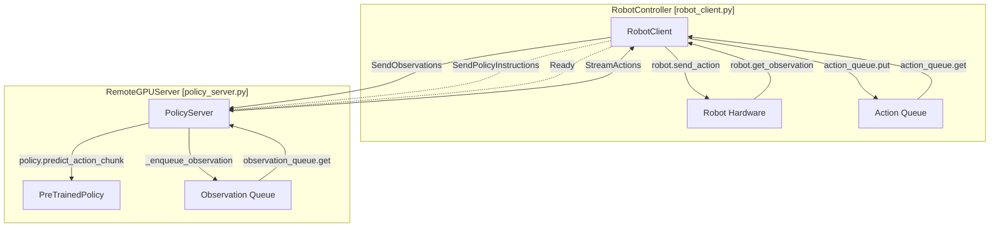
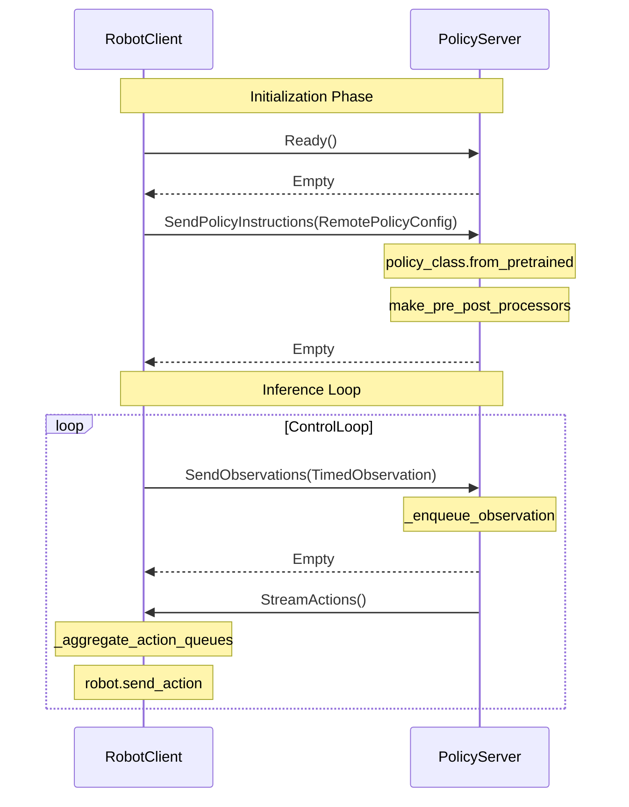
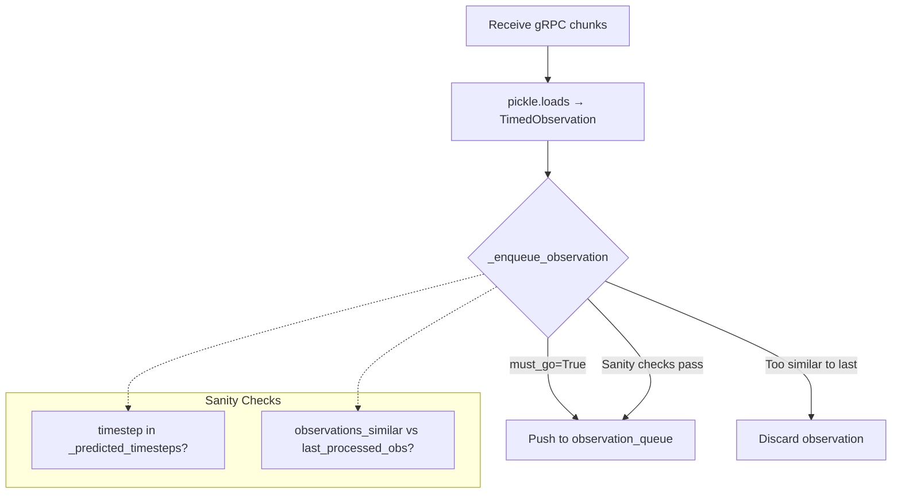
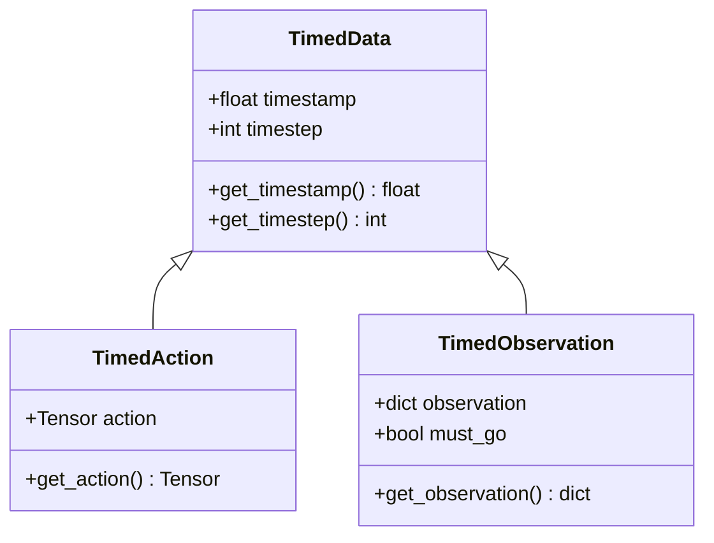

<!-- source: DeepWiki mcp.deepwiki.com · repo huggingface/lerobot · page 9.4 Asynchronous Inference · fetched 2026-10-26 -->

# Asynchronous Inference

<details>
<summary>Relevant source files</summary>

The following files were used as context for generating this wiki page:

- [docs/source/async.mdx](docs/source/async.mdx)
- [docs/source/video_encoding_parameters.mdx](docs/source/video_encoding_parameters.mdx)
- [examples/tutorial/act/act_training_example.py](examples/tutorial/act/act_training_example.py)
- [examples/tutorial/act/act_using_example.py](examples/tutorial/act/act_using_example.py)
- [examples/tutorial/async-inf/policy_server.py](examples/tutorial/async-inf/policy_server.py)
- [examples/tutorial/async-inf/robot_client.py](examples/tutorial/async-inf/robot_client.py)
- [examples/tutorial/diffusion/diffusion_training_example.py](examples/tutorial/diffusion/diffusion_training_example.py)
- [examples/tutorial/diffusion/diffusion_using_example.py](examples/tutorial/diffusion/diffusion_using_example.py)
- [examples/tutorial/pi0/using_pi0_example.py](examples/tutorial/pi0/using_pi0_example.py)
- [examples/tutorial/rl/hilserl_example.py](examples/tutorial/rl/hilserl_example.py)
- [examples/tutorial/rl/reward_classifier_example.py](examples/tutorial/rl/reward_classifier_example.py)
- [examples/tutorial/smolvla/using_smolvla_example.py](examples/tutorial/smolvla/using_smolvla_example.py)
- [src/lerobot/async_inference/configs.py](src/lerobot/async_inference/configs.py)
- [src/lerobot/async_inference/constants.py](src/lerobot/async_inference/constants.py)
- [src/lerobot/async_inference/helpers.py](src/lerobot/async_inference/helpers.py)
- [src/lerobot/async_inference/policy_server.py](src/lerobot/async_inference/policy_server.py)
- [src/lerobot/async_inference/robot_client.py](src/lerobot/async_inference/robot_client.py)
- [tests/async_inference/test_e2e.py](tests/async_inference/test_e2e.py)
- [tests/async_inference/test_helpers.py](tests/async_inference/test_helpers.py)
- [tests/async_inference/test_policy_server.py](tests/async_inference/test_policy_server.py)
- [tests/async_inference/test_robot_client.py](tests/async_inference/test_robot_client.py)

</details>


This page documents the asynchronous inference system for real-time robotics control. Asynchronous inference decouples action prediction from action execution, allowing robots to continue executing actions while the next action chunk is computed on a remote policy server. This eliminates "wait-for-inference" lags that occur in traditional synchronous approaches where the robot idles while waiting for policy predictions [docs/source/async.mdx:3-17]().

For information about distributed reinforcement learning with actor-learner separation, see page 9.5. For general policy architectures and inference methods, see page 4.

> **Installation prerequisite:** The async inference subsystem requires extra dependencies. Install them with:
> ```bash
> pip install -e ".[async]"
> ```
> This is required before running either `PolicyServer` or `RobotClient` [docs/source/async.mdx:24-28]().

Sources: [docs/source/async.mdx:3-28]()

---

## System Architecture

The asynchronous inference system consists of two primary components communicating via gRPC: the `PolicyServer` (executing on a machine with GPU resources) and the `RobotClient` (running directly on the robot controller) [docs/source/async.mdx:39-51]().



Sources: [src/lerobot/async_inference/robot_client.py:96-150](), [src/lerobot/async_inference/policy_server.py:64-90](), [docs/source/async.mdx:15-17]()

---

## Communication Protocol

The gRPC communication follows a structured protocol defined in the `AsyncInferenceServicer` interface [src/lerobot/async_inference/policy_server.py:64]().



The protocol relies on key RPC methods defined in `PolicyServer`:
- `Ready()`: Client-server handshake, resetting server state via `_reset_server()` [src/lerobot/async_inference/policy_server.py:108-114]().
- `SendPolicyInstructions()`: Client transmits a serialized `RemotePolicyConfig` containing configuration parameters (`policy_type`, `pretrained_name_or_path`, `actions_per_chunk`, device) [src/lerobot/async_inference/policy_server.py:116-171]().
- `SendObservations()`: Client streams `TimedObservation` objects in chunks using `send_bytes_in_chunks()` [src/lerobot/async_inference/robot_client.py:196-214](), [src/lerobot/transport/utils.py:46-70]().
- `StreamActions()`: Server streams back serialized lists of `TimedAction` objects computed by the policy [src/lerobot/async_inference/policy_server.py:216-268]().

Sources: [src/lerobot/async_inference/policy_server.py:108-268](), [src/lerobot/async_inference/robot_client.py:196-214](), [src/lerobot/transport/utils.py:46-70]()

---

## PolicyServer

The `PolicyServer` class manages remote inference execution, handling observation queuing, pre-processing, policy forward passes, post-processing, and action timing [src/lerobot/async_inference/policy_server.py:64-90]().

### Configuration

Server configuration parameters are structured via `PolicyServerConfig`:

| Parameter | Default | Description |
|-----------|---------|-------------|
| `host` | `"localhost"` | Server binding address [src/lerobot/async_inference/configs.py:54]() |
| `port` | `8080` | Server listening port [src/lerobot/async_inference/configs.py:55]() |
| `fps` | `30` | Target operational frequency [src/lerobot/async_inference/configs.py:58]() |
| `inference_latency` | `0.033` | Expected inference latency in seconds [src/lerobot/async_inference/configs.py:59-61]() |
| `obs_queue_timeout` | `2` | Observation queue timeout threshold [src/lerobot/async_inference/configs.py:63-65]() |

Sources: [src/lerobot/async_inference/policy_server.py:68-106](), [src/lerobot/async_inference/configs.py:46-100]()

### Observation Filtering and Enqueuing



Incoming observations are validated via `_enqueue_observation()` [src/lerobot/async_inference/policy_server.py:288-312]() to prevent redundant computation:
1. `must_go` flag: Bypasses filters when the client queue is depleted [src/lerobot/async_inference/policy_server.py:293]().
2. `_predicted_timesteps` check: Avoids processing duplicate timesteps [src/lerobot/async_inference/policy_server.py:270-287]().
3. `observations_similar` check: Compares state values against `last_processed_obs` [src/lerobot/async_inference/helpers.py:280-296]().

Sources: [src/lerobot/async_inference/policy_server.py:173-312](), [src/lerobot/async_inference/helpers.py:280-296]()

---

## RobotClient

The `RobotClient` class runs on the robot controller, coordinating physical hardware I/O and asynchronous queue synchronization [src/lerobot/async_inference/robot_client.py:96-150]().

### Threading Architecture

The client operates with two primary threads coordinated via a `threading.Barrier` [src/lerobot/async_inference/robot_client.py:141]():
1. **Control Loop Thread**: Pulls actions from `action_queue`, executes them via `robot.send_action()`, retrieves new observations via `robot.get_observation()`, and transmits them conditionally [src/lerobot/async_inference/robot_client.py:458-481]().
2. **Action Receiver Thread**: Receives action chunks from the server via `StreamActions()` and merges them into the local queue using `_aggregate_action_queues()` [src/lerobot/async_inference/robot_client.py:224-301]().

Sources: [src/lerobot/async_inference/robot_client.py:96-150](), [src/lerobot/async_inference/robot_client.py:224-301](), [src/lerobot/async_inference/robot_client.py:458-481]()

### Action Queue Aggregation

The `_aggregate_action_queues` method handles overlapping action portions:
1. **Stale filtering**: Discards incoming actions where `timestep <= latest_action` [src/lerobot/async_inference/robot_client.py:246-247]().
2. **Overlapping combination**: Combines actions at overlapping timesteps using a configured `aggregate_fn` [src/lerobot/async_inference/robot_client.py:256-264]().

Supported aggregation functions include:
- `weighted_average`: `0.3 * old + 0.7 * new` (Default) [src/lerobot/async_inference/configs.py:30]()
- `latest_only`: `new` [src/lerobot/async_inference/configs.py:31]()
- `average`: `0.5 * old + 0.5 * new` [src/lerobot/async_inference/configs.py:32]()
- `conservative`: `0.7 * old + 0.3 * new` [src/lerobot/async_inference/configs.py:33]()

Sources: [src/lerobot/async_inference/robot_client.py:224-267](), [src/lerobot/async_inference/configs.py:29-43]()

---

## Tuning Parameters & Data Structures

### Key Parameters

- `actions_per_chunk`: Determines the chunk size requested from the policy (capped at policy limits) [src/lerobot/async_inference/configs.py:119-120]().
- `chunk_size_threshold`: Ratio threshold (`queue_size / action_chunk_size <= threshold`) determining when observations are sent [src/lerobot/async_inference/robot_client.py:403-407]().

### Data Structures



- `timestamp`: Unix time used for latency tracking [src/lerobot/async_inference/helpers.py:204]().
- `timestep`: Monotonically increasing counter for sequence synchronization [src/lerobot/async_inference/helpers.py:205]().
- `must_go`: Priority execution flag [src/lerobot/async_inference/robot_client.py:149]().

Sources: [src/lerobot/async_inference/helpers.py:200-235](), [src/lerobot/async_inference/robot_client.py:149](), [src/lerobot/async_inference/configs.py:119-120]()

---

