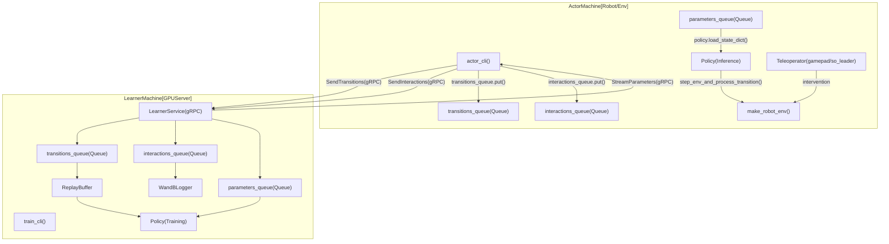
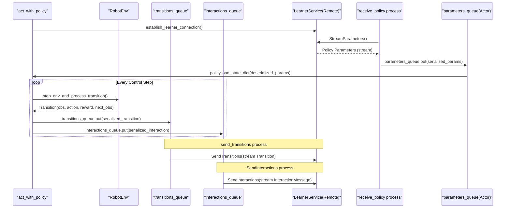

<!-- source: DeepWiki mcp.deepwiki.com · repo huggingface/lerobot · page 9.5 Distributed RL: Actor-Learner Architecture · fetched 2026-10-26 -->

# Distributed RL: Actor-Learner Architecture

Relevant source files

The following files were used as context for generating this wiki page:

- [docs/source/hilserl.mdx](docs/source/hilserl.mdx)
- [docs/source/hilserl_sim.mdx](docs/source/hilserl_sim.mdx)
- [src/lerobot/rl/actor.py](src/lerobot/rl/actor.py)
- [src/lerobot/rl/buffer.py](src/lerobot/rl/buffer.py)
- [src/lerobot/rl/crop_dataset_roi.py](src/lerobot/rl/crop_dataset_roi.py)
- [src/lerobot/rl/eval_policy.py](src/lerobot/rl/eval_policy.py)
- [src/lerobot/rl/learner.py](src/lerobot/rl/learner.py)
- [src/lerobot/rl/learner_service.py](src/lerobot/rl/learner_service.py)
- [src/lerobot/rl/queue.py](src/lerobot/rl/queue.py)
- [tests/rl/test_actor.py](tests/rl/test_actor.py)
- [tests/rl/test_actor_learner.py](tests/rl/test_actor_learner.py)
- [tests/rl/test_learner_service.py](tests/rl/test_learner_service.py)
- [tests/rl/test_queue.py](tests/rl/test_queue.py)
- [tests/transport/test_transport_utils.py](tests/transport/test_transport_utils.py)
- [tests/utils/test_replay_buffer.py](tests/utils/test_replay_buffer.py)

This page explains the distributed reinforcement learning architecture in LeRobot, which separates experience collection (actors) from policy learning (learners) to enable efficient online training [docs/source/hilserl.mdx:5-15](), [src/lerobot/rl/learner.py:17-23](). This architecture is primarily utilized by the **HIL-SERL** (Human-in-the-Loop Sample-Efficient Reinforcement Learning) workflow [docs/source/hilserl.mdx:5-15]().

## Overview

The actor-learner architecture is a distributed system design where:
- **Actors** interact with physical or simulated environments to collect experience (transitions) [src/lerobot/rl/actor.py:17-22]().
- **Learners** maintain the policy parameters, manage a replay buffer, and perform gradient updates [src/lerobot/rl/learner.py:17-23]().
- Communication is handled via **gRPC** (Google Remote Procedure Call) over a network, allowing the actor (connected to a robot) and learner (a powerful GPU server) to run on different machines [src/lerobot/rl/learner.py:31-32]().

Sources: [src/lerobot/rl/actor.py:17-22](), [src/lerobot/rl/learner.py:17-23](), [docs/source/hilserl.mdx:5-15]()

## System Topology and Code Entities

The distributed RL system utilizes specialized classes and services to coordinate high-frequency data flow and asynchronous updates between the actor script (`src/lerobot/rl/actor.py`) and the learner server (`src/lerobot/rl/learner.py`).

### Component Relationship

Sources: [src/lerobot/rl/actor.py:120-194](), [src/lerobot/rl/learner.py:123-195](), [src/lerobot/rl/buffer.py:81-120]()

## Actor Component

The Actor executes the control loop at a fixed frequency (typically 10 FPS for HIL-SERL) [docs/source/hilserl.mdx:81](). It runs policy inference, handles human interventions via a teleoperator, and manages asynchronous communication with the learner.

### Key Functions and Classes
- `actor_cli`: Entry point in `src/lerobot/rl/actor.py` that validates configuration, sets up multiprocessing or threading, and starts concurrent processes for policy sync and data streaming [src/lerobot/rl/actor.py:120-140]().
- `send_transitions`: Background function that pulls from `transitions_queue` and streams experience to the learner [src/lerobot/rl/actor.py:179-183]().
- `receive_policy`: Background function that periodically fetches model weights from the learner and updates the local policy via `parameters_queue` [src/lerobot/rl/actor.py:173-177]().

### Actor Data Flow (Control Loop)

Sources: [src/lerobot/rl/actor.py:120-194](), [src/lerobot/rl/actor.py:198-204]()

## Learner Component

The Learner hosts the gRPC server, maintains the `ReplayBuffer`, and executes the optimization loop.

### Learner Infrastructure
- `train_cli`: Entry point in `src/lerobot/rl/learner.py` that initializes logging, W&B tracking, resume logic, and starts learner threads [src/lerobot/rl/learner.py:123-195]().
- `LearnerService`: The gRPC service implementation (`src/lerobot/rl/learner_service.py`) that handles incoming transitions and interactions from actors, and streams policy parameters back [src/lerobot/rl/learner_service.py:46-67]().
- `ReplayBuffer`: Defined in `src/lerobot/rl/buffer.py`, it pre-allocates tensor storage for states, actions, rewards, next states, and done flags [src/lerobot/rl/buffer.py:81-152]().
- `RLTrainer`: Orchestrates the training process, draining queues and performing policy updates [src/lerobot/rl/learner.py:118]().

Sources: [src/lerobot/rl/learner.py:114-120](), [src/lerobot/rl/learner.py:123-195](), [src/lerobot/rl/buffer.py:81-152](), [src/lerobot/rl/learner_service.py:46-67]()

## Replay Buffer and Data Management

The `ReplayBuffer` class in `src/lerobot/rl/buffer.py` supports configurable capacity, storage devices (CPU/GPU), memory optimization, and image data augmentation (such as `random_shift` and vectorized random cropping) [src/lerobot/rl/buffer.py:81-132]().

| Method / Attribute | Code Entity | Description |
|---|---|---|
| `__init__` | `ReplayBuffer` | Allocates capacities, storage devices, and initializes thread locks [src/lerobot/rl/buffer.py:81-120](). |
| `_initialize_storage` | `ReplayBuffer` | Pre-allocates memory tensors based on the first observed transition [src/lerobot/rl/buffer.py:134-161](). |
| `image_augmentation_function` | `ReplayBuffer` | Applies spatial augmentations (e.g. DrQ-style shifts) during sampling [src/lerobot/rl/buffer.py:127-132](). |

Sources: [src/lerobot/rl/buffer.py:81-161]()

## Communication Protocol (gRPC)

LeRobot uses gRPC services to bridge actors and learners. Because image observations and large model parameters can be large, communication utilities handle chunked transmission and binary serialization [src/lerobot/rl/actor.py:59-80](), [src/lerobot/rl/learner.py:58-65](). The `LearnerService` class [src/lerobot/rl/learner_service.py:46-67]() implements the server-side logic for these gRPC calls.

| Operation | Direction | Implementation Details |
|---|---|---|
| `SendTransitions` | Actor -> Learner | Streams serialized environment transitions to be stored in the replay buffer [src/lerobot/rl/actor.py:179-183](). The `LearnerService.SendTransitions` method receives these chunks and reconstructs the full transition [src/lerobot/rl/learner_service.py:106-118](). |
| `SendInteractions` | Actor -> Learner | Transmits interaction metadata and episodic rewards for logging [src/lerobot/rl/actor.py:185-189](). The `LearnerService.SendInteractions` method processes these messages [src/lerobot/rl/learner_service.py:120-132](). |
| `StreamParameters` | Learner -> Actor | Streams updated policy parameter weights at configured frequencies [src/lerobot/rl/actor.py:173-177](). The `LearnerService.StreamParameters` method sends these parameters [src/lerobot/rl/learner_service.py:69-104](). |
| `Ready` | Actor -> Learner | A simple health check to ensure the learner is responsive [tests/rl/test_learner_service.py:85-91](). |

Sources: [src/lerobot/rl/actor.py:59-80](), [src/lerobot/rl/actor.py:173-189](), [src/lerobot/rl/learner.py:58-65](), [src/lerobot/rl/learner_service.py:46-67](), [src/lerobot/rl/learner_service.py:69-104](), [src/lerobot/rl/learner_service.py:106-118](), [src/lerobot/rl/learner_service.py:120-132](), [tests/rl/test_learner_service.py:85-91]()

## Human-in-the-Loop Workflow

In HIL-SERL, the architecture accommodates human presence and safety:

1. **Human Intervention**: Using a `Teleoperator` (such as a gamepad or leader arm), a human can override policy actions [src/lerobot/rl/actor.py:33-35]().
2. **Experience Collection**: Transitions collected during human interventions are labeled and streamed to the learner to guide exploration [docs/source/hilserl.mdx:5-15]().
3. **Training Coordination**: The learner server must be initiated prior to launching the actor process [src/lerobot/rl/learner.py:31-32]().
4. **Safety Bounds**: Workspace and joint/end-effector limits ensure hardware safety during high-frequency online updates [docs/source/hilserl.mdx:13](), [docs/source/hilserl.mdx:115-119]().

Sources: [src/lerobot/rl/learner.py:31-32](), [src/lerobot/rl/actor.py:33-35](), [docs/source/hilserl.mdx:5-15](), [docs/source/hilserl.mdx:115-119]()

## Configuration

The distributed RL configuration is managed through classes such as `TrainRLServerPipelineConfig` [src/lerobot/rl/learner.py:119](), `GymManipulatorConfig`, and `HILSerlRobotEnvConfig` [docs/source/hilserl.mdx:65-79](). These configurations specify networking parameters (`learner_host`, `learner_port`), device placement, dataset paths, and environment settings [docs/source/hilserl.mdx:69-134]().

Sources: [src/lerobot/rl/learner.py:119](), [docs/source/hilserl.mdx:65-134]()

---

