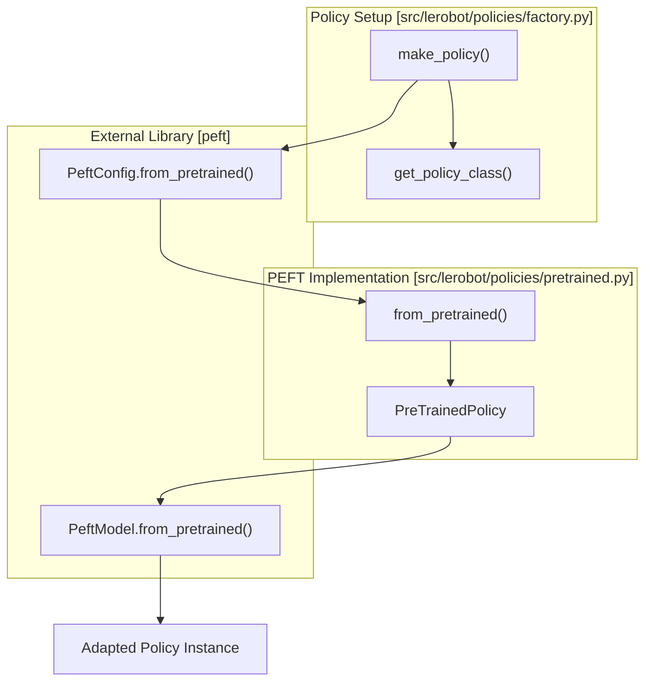
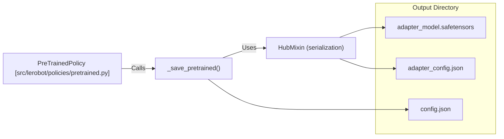

<!-- source: DeepWiki mcp.deepwiki.com · repo huggingface/lerobot · page 9.6 PEFT Training and Fine-tuning · fetched 2026-10-26 -->

# PEFT Training and Fine-tuning

<details>
<summary>Relevant source files</summary>

The following files were used as context for generating this wiki page:

- [src/lerobot/common/train_utils.py](src/lerobot/common/train_utils.py)
- [src/lerobot/configs/train.py](src/lerobot/configs/train.py)
- [src/lerobot/policies/factory.py](src/lerobot/policies/factory.py)
- [src/lerobot/policies/pi0/modeling_pi0.py](src/lerobot/policies/pi0/modeling_pi0.py)
- [src/lerobot/policies/pi05/modeling_pi05.py](src/lerobot/policies/pi05/modeling_pi05.py)
- [src/lerobot/policies/pretrained.py](src/lerobot/policies/pretrained.py)
- [src/lerobot/policies/smolvla/modeling_smolvla.py](src/lerobot/policies/smolvla/modeling_smolvla.py)
- [src/lerobot/policies/smolvla/smolvlm_with_expert.py](src/lerobot/policies/smolvla/smolvlm_with_expert.py)
- [src/lerobot/policies/vqbet/vqbet_utils.py](src/lerobot/policies/vqbet/vqbet_utils.py)
- [src/lerobot/rewards/factory.py](src/lerobot/rewards/factory.py)
- [src/lerobot/scripts/lerobot_train.py](src/lerobot/scripts/lerobot_train.py)
- [tests/common/test_publish.py](tests/common/test_publish.py)
- [tests/configs/test_resume_from_hub.py](tests/configs/test_resume_from_hub.py)
- [tests/policies/pi0_pi05/test_pi05_vision_inference.py](tests/policies/pi0_pi05/test_pi05_vision_inference.py)
- [tests/policies/pi0_pi05/test_pi0_vision_inference.py](tests/policies/pi0_pi05/test_pi0_vision_inference.py)
- [tests/policies/test_factory_peft_revision.py](tests/policies/test_factory_peft_revision.py)
- [tests/policies/test_language_processor_factory.py](tests/policies/test_language_processor_factory.py)
- [tests/rewards/test_reward_model_base.py](tests/rewards/test_reward_model_base.py)
- [tests/utils/test_train_utils.py](tests/utils/test_train_utils.py)

</details>


Parameter-Efficient Fine-Tuning (PEFT) enables efficient adaptation of large pre-trained policies to new tasks by training only a small subset of parameters. LeRobot integrates the [🤗 PEFT library](https://github.com/huggingface/peft) to support methods like LoRA (Low-Rank Adaptation) and MISS, significantly reducing hardware requirements for fine-tuning Vision-Language-Action (VLA) models like SmolVLA, π₀, and GR00T.

**Key Benefits:**
- **Reduced Memory**: Train large models with significantly lower VRAM requirements compared to full fine-tuning [src/lerobot/configs/policies.py:67-68]().
- **Faster Training**: Fewer parameters to optimize leads to faster gradient computation and iterations.
- **Modular Adapters**: Save and share task-specific adapters separately from large base models.
- **Inference Compatibility**: Load a base model and swap multiple adapters at runtime for different tasks.

**Sources:** [src/lerobot/configs/policies.py:67-68](), [src/lerobot/policies/pretrained.py:35-44]()

---

## PEFT Configuration

LeRobot configures PEFT through the `PreTrainedConfig` base class, which includes a `use_peft` boolean flag [src/lerobot/configs/policies.py:68-68](). Specific policies like `SmolVLAPolicy` or `PI0Policy` can leverage this to wrap their internal models with LoRA or MISS configurations.

### Configuration Parameters

| Parameter | Type | Description |
|-----------|------|-------------|
| `use_peft` | `bool` | Whether the policy employs PEFT for training [src/lerobot/configs/policies.py:68-68](). |
| `pretrained_path` | `Path` | Path to a directory containing weights, which can be a PEFT adapter directory [src/lerobot/configs/policies.py:81-81](). |
| `pretrained_revision` | `str` | Optional Hub revision (commit hash, branch, or tag) to pin the version [src/lerobot/configs/policies.py:83-83](). |

Policies that wrap external models (like SmolVLA wrapping SmolVLM) often expose more granular PEFT settings in their specific configuration classes, such as `train_expert_only` [src/lerobot/policies/smolvla/smolvlm_with_expert.py:79-79]() or `freeze_vision_encoder` [src/lerobot/policies/smolvla/smolvlm_with_expert.py:80-80]().

**Sources:** [src/lerobot/configs/policies.py:67-84](), [src/lerobot/policies/smolvla/smolvlm_with_expert.py:74-87]()

---

## PEFT Training Workflow

The training orchestration logic detects the presence of PEFT configurations. The `PreTrainedPolicy` class provides the infrastructure to handle PEFT-aware serialization and loading.

### Code Entity Space: Wrapping Logic

The following diagram bridges the Natural Language concept of "Wrapping" to the specific code entities involved in the `PreTrainedPolicy` and `PolicyFactory` lifecycle.


**Sources:** [src/lerobot/policies/factory.py:19-59](), [src/lerobot/policies/pretrained.py:147-176](), [tests/policies/test_factory_peft_revision.py:25-64]()

### Implementation Detail: `make_policy` and PEFT
The `make_policy` function in `lerobot.policies.factory` handles the initialization of PEFT models:
1. **Detection**: It checks if `cfg.use_peft` is enabled and if a `pretrained_path` is provided [tests/policies/test_factory_peft_revision.py:26-34]().
2. **Adapter Configuration**: It uses `PeftConfig.from_pretrained` to load the adapter's configuration [tests/policies/test_factory_peft_revision.py:68-71]().
3. **Base Policy Loading**: It identifies the `base_model_name_or_path` from the adapter config and loads the base `PreTrainedPolicy` [tests/policies/test_factory_peft_revision.py:72-78]().
4. **Adapter Wrapping**: It wraps the base policy with the adapter using `PeftModel.from_pretrained` [tests/policies/test_factory_peft_revision.py:79-85]().

**Sources:** [src/lerobot/policies/factory.py:47-59](), [tests/policies/test_factory_peft_revision.py:25-86]()

---

## Policy-Specific PEFT Implementations

Different architectures implement parameter efficiency in specialized ways.

### SmolVLA: Expert Adaptation
`SmolVLA` uses a hybrid approach where a pre-trained VLM is combined with an action expert. The `SmolVLMWithExpertModel` allows freezing specific components:
- **Vision Encoder**: Can be frozen via `freeze_vision_encoder` [src/lerobot/policies/smolvla/smolvlm_with_expert.py:153-156]().
- **VLM Backbone**: The base VLM can be frozen using `train_expert_only`, leaving only the `lm_expert` trainable [src/lerobot/policies/smolvla/smolvlm_with_expert.py:157-160]().

### π₀ and π₀.₅: VLM Fine-tuning
Policies like `PI0` and `PI05` allow freezing the vision encoder while fine-tuning the transformer backbone [src/lerobot/policies/pi0/modeling_pi0.py:196-196](), [src/lerobot/policies/pi05/modeling_pi05.py:195-195]().

**Sources:** [src/lerobot/policies/smolvla/smolvlm_with_expert.py:147-178](), [src/lerobot/policies/pi0/modeling_pi0.py:185-200]()

---

## Saving and Loading PEFT Models

PEFT models utilize a "sidecar" approach where the base model remains unchanged and only the adapter weights (and configuration) are saved.

### Data Flow: Serialization
When saving a policy, `_save_pretrained` handles the serialization of the configuration and weights. For PEFT models, the Hub integration ensures that adapter configurations are correctly stored [src/lerobot/configs/policies.py:165-170]().


**Sources:** [src/lerobot/policies/pretrained.py:118-144](), [src/lerobot/configs/policies.py:165-170]()

### Loading Logic
The loading process is managed by `PreTrainedPolicy.from_pretrained`. It handles the resolution of the model class and the loading of weights from Safetensors [src/lerobot/policies/pretrained.py:147-176](). If the checkpoint is a PEFT adapter, the factory logic in `make_policy` ensures the base model is fetched first [tests/policies/test_factory_peft_revision.py:72-85]().

**Sources:** [src/lerobot/policies/pretrained.py:147-176](), [tests/policies/test_factory_peft_revision.py:25-86]()

---

## CLI Usage and Overrides

PEFT parameters can be toggled and overridden via the CLI using the `policy` and `peft` namespaces.

### Enabling PEFT for Training
To fine-tune a model like SmolVLA using its internal expert-only training mode:
```bash
lerobot-train \
  --policy.type=smolvla \
  --policy.use_peft=true \
  --dataset.repo_id=lerobot/pusht
```
**Sources:** [src/lerobot/policies/smolvla/modeling_smolvla.py:29-36](), [src/lerobot/configs/policies.py:68-68]()

### Overriding Pretrained Paths
Users can specify a base model and then apply an adapter by pointing `pretrained_path` to the adapter directory:
```bash
lerobot-train \
  --policy.pretrained_path=path/to/adapter \
  --policy.use_peft=true
```
**Sources:** [src/lerobot/configs/policies.py:81-81](), [tests/policies/test_factory_peft_revision.py:29-31]()

---

## Performance Considerations

- **Gradient Checkpointing**: Policies like `PI0` and `PI05` support `supports_gradient_checkpointing = True` to further reduce memory usage during fine-tuning [src/lerobot/policies/pi0/modeling_pi0.py:228-228](), [src/lerobot/policies/pi05/modeling_pi05.py:227-227]().
- **Mixed Precision**: Using `use_amp=True` in the configuration is highly recommended when fine-tuning large VLAs to speed up training and reduce memory footprint [src/lerobot/configs/policies.py:65-65]().

**Sources:** [src/lerobot/policies/pi0/modeling_pi0.py:228-228](), [src/lerobot/configs/policies.py:63-65]()

---

