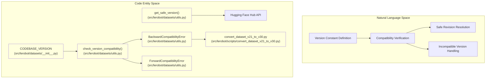
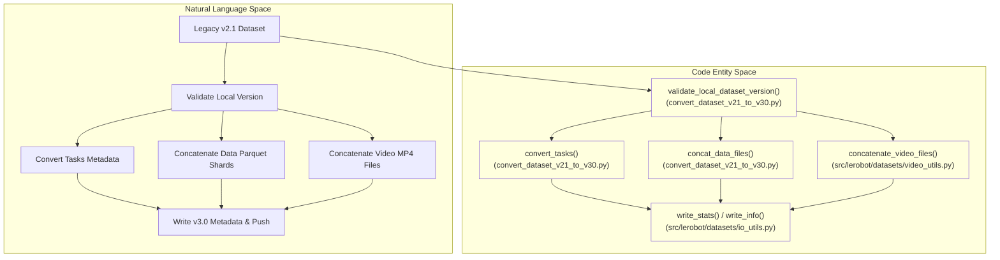
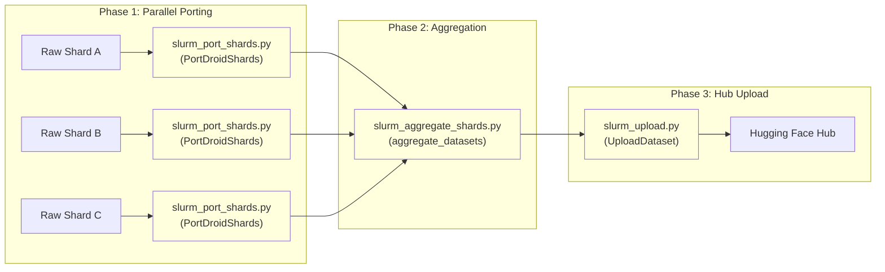

<!-- source: DeepWiki mcp.deepwiki.com · repo huggingface/lerobot · page 9.7 Version Compatibility and Migration · fetched 2026-10-26 -->

# Version Compatibility and Migration

Relevant source files

The following files were used as context for generating this wiki page:

- [.github/ISSUE_TEMPLATE/bug-report.yml](.github/ISSUE_TEMPLATE/bug-report.yml)
- [.github/PULL_REQUEST_TEMPLATE.md](.github/PULL_REQUEST_TEMPLATE.md)
- [.github/labeler.yml](.github/labeler.yml)
- [.pre-commit-config.yaml](.pre-commit-config.yaml)
- [CODE_OF_CONDUCT.md](CODE_OF_CONDUCT.md)
- [CONTRIBUTING.md](CONTRIBUTING.md)
- [Makefile](Makefile)
- [docs/source/backwardcomp.mdx](docs/source/backwardcomp.mdx)
- [docs/source/porting_datasets_v3.mdx](docs/source/porting_datasets_v3.mdx)
- [examples/port_datasets/display_error_files.py](examples/port_datasets/display_error_files.py)
- [examples/port_datasets/port_droid.py](examples/port_datasets/port_droid.py)
- [examples/port_datasets/slurm_aggregate_shards.py](examples/port_datasets/slurm_aggregate_shards.py)
- [examples/port_datasets/slurm_port_shards.py](examples/port_datasets/slurm_port_shards.py)
- [examples/port_datasets/slurm_upload.py](examples/port_datasets/slurm_upload.py)
- [src/lerobot/scripts/convert_dataset_v21_to_v30.py](src/lerobot/scripts/convert_dataset_v21_to_v30.py)
- [src/lerobot/scripts/lerobot_annotate.py](src/lerobot/scripts/lerobot_annotate.py)
- [src/lerobot/scripts/lerobot_find_cameras.py](src/lerobot/scripts/lerobot_find_cameras.py)
- [src/lerobot/scripts/lerobot_find_port.py](src/lerobot/scripts/lerobot_find_port.py)
- [src/lerobot/scripts/lerobot_info.py](src/lerobot/scripts/lerobot_info.py)
- [src/lerobot/scripts/lerobot_train_tokenizer.py](src/lerobot/scripts/lerobot_train_tokenizer.py)
- [tests/datasets/test_delta_timestamps.py](tests/datasets/test_delta_timestamps.py)
- [tests/scripts/test_lerobot_annotate.py](tests/scripts/test_lerobot_annotate.py)

This page explains the version compatibility and migration mechanisms in LeRobot, detailing how `CODEBASE_VERSION` governs data format validation, how backward and forward compatibility errors are handled, how safe version resolution works for Hugging Face Hub datasets, and how datasets are migrated from v2.1 to v3.0 using standalone scripts or distributed SLURM pipelines.

---

## 1. CODEBASE_VERSION and Compatibility Checks

LeRobot uses a semantic versioning scheme (`vMAJOR.MINOR`) to track compatibility between the core package and on-disk datasets. The single source of truth for the expected dataset layout is the `CODEBASE_VERSION` constant [src/lerobot/scripts/convert_dataset_v21_to_v30.py:67](), pinned to `v3.0` [src/lerobot/scripts/convert_dataset_v21_to_v30.py:99-100]().

### Compatibility Architecture and Validation Flow

The following diagram bridges the natural language conceptual space to the concrete code entities responsible for version checking and error handling during dataset loading:

Title: "Version Compatibility Validation and Code Entities"

Sources: [src/lerobot/scripts/convert_dataset_v21_to_v30.py:67](), [src/lerobot/scripts/convert_dataset_v21_to_v30.py:99-100]()

### Compatibility Errors and Resolution

When datasets are loaded via `LeRobotDataset`, the metadata stored in `meta/info.json` is inspected against `CODEBASE_VERSION`:
- **Backward Compatibility Mismatch**: If a dataset's major version is lower than the library's `CODEBASE_VERSION` (e.g., `v2.1` vs `v3.0`), a `BackwardCompatibilityError` is raised [src/lerobot/scripts/convert_dataset_v21_to_v30.py:18-25](). Users must migrate their dataset using conversion utilities [src/lerobot/scripts/convert_dataset_v21_to_v30.py:171-180]().
- **Forward Compatibility Mismatch**: If a dataset's major version exceeds what the current installation supports, a `ForwardCompatibilityError` is raised, requiring a package upgrade.
- **Safe Version Resolution**: `get_safe_version()` inspects available remote tags on the Hugging Face Hub to resolve a compatible repository revision when none is explicitly pinned.

Sources: [src/lerobot/scripts/convert_dataset_v21_to_v30.py:18-180]()

---

## 2. Dataset Format Migration: v2.1 to v3.0

The architectural transition from version `v2.1` to `v3.0` replaces rigid, per-episode file layouts with chunked, multi-episode sharded files. This reduces inode exhaustion on distributed filesystems and accelerates data streaming.

### Structural Comparison

| Component | v2.1 (Legacy Layout) | v3.0 (Current Layout) |
| :--- | :--- | :--- |
| **Parquet Data Shards** | `data/chunk-000/episode_000000.parquet` [src/lerobot/scripts/convert_dataset_v21_to_v30.py:105]() | `data/chunk-000/file_000.parquet` [src/lerobot/scripts/convert_dataset_v21_to_v30.py:108]() |
| **Video Storage** | `videos/chunk-000/CAMERA/episode_000000.mp4` [src/lerobot/scripts/convert_dataset_v21_to_v30.py:111]() | `videos/CAMERA/chunk-000/file_000.mp4` [src/lerobot/scripts/convert_dataset_v21_to_v30.py:114]() |
| **Metadata Tracking** | `episodes.jsonl`, `tasks.jsonl` [src/lerobot/scripts/convert_dataset_v21_to_v30.py:117](), [src/lerobot/scripts/convert_dataset_v21_to_v30.py:125]() | `meta/episodes/chunk-000/file_000.parquet`, `meta/tasks.parquet` [src/lerobot/scripts/convert_dataset_v21_to_v30.py:121](), [src/lerobot/scripts/convert_dataset_v21_to_v30.py:129]() |

Sources: [src/lerobot/scripts/convert_dataset_v21_to_v30.py:101-143]()

### Migration Pipeline Implementation

The script `src/lerobot/scripts/convert_dataset_v21_to_v30.py` automates the migration workflow [src/lerobot/scripts/convert_dataset_v21_to_v30.py:18-25]().

Title: "Dataset Conversion Pipeline and Functions"

- **`validate_local_dataset_version()`**: Reads `meta/info.json` to verify that `codebase_version` equals `v2.1` before proceeding [src/lerobot/scripts/convert_dataset_v21_to_v30.py:171-180]().
- **`convert_tasks()`**: Parses legacy task line records and builds the `meta/tasks.parquet` dataframe [src/lerobot/scripts/convert_dataset_v21_to_v30.py:182-188]().
- **`concat_data_files()`**: Aggregates individual episode dataframes into unified parquet chunks matching target size constraints [src/lerobot/scripts/convert_dataset_v21_to_v30.py:191-206]().

Sources: [src/lerobot/scripts/convert_dataset_v21_to_v30.py:67-300]()

---

## 3. Porting Large Datasets to v3.0

For large-scale robotic datasets (e.g., DROID), LeRobot provides a distributed porting and ingestion framework utilizing `datatrove` across SLURM clusters.

### Distributed Porting Architecture

Title: "Distributed Dataset Porting Pipeline for Large Datasets"

### Components
- **`slurm_port_shards.py`**: Executes parallel processing tasks to convert raw multi-gigabyte recordings into intermediate `v3.0` compatible shards.
- **`slurm_aggregate_shards.py`**: Invokes `aggregate_datasets` to perform global metadata validation, index remapping, and unified statistics computation.
- **`slurm_upload.py`**: Manages multi-threaded chunked uploads via `CommitOperationAdd` and `preupload_lfs_files` to push the resulting dataset to the Hugging Face Hub.

Sources: [examples/port_datasets/slurm_port_shards.py](), [examples/port_datasets/slurm_aggregate_shards.py](), [examples/port_datasets/slurm_upload.py]()

---

