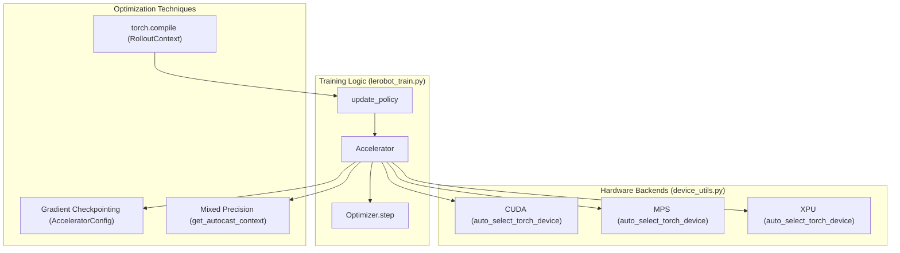
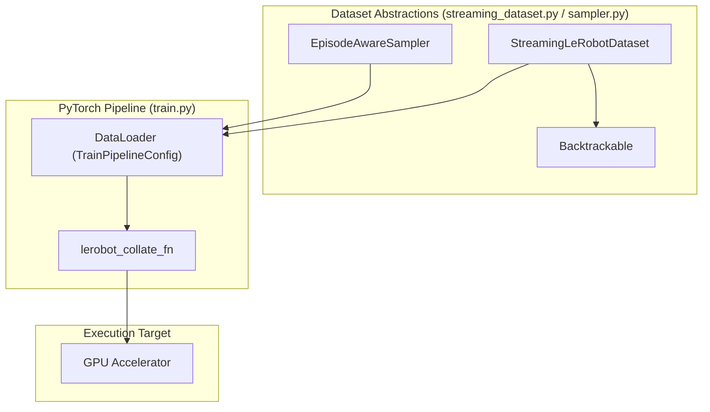
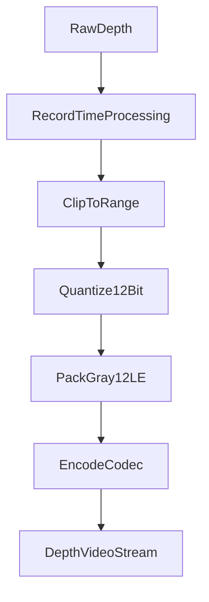

<!-- source: DeepWiki mcp.deepwiki.com · repo huggingface/lerobot · page 9.8 Performance Optimization · fetched 2026-10-26 -->

# Performance Optimization

Relevant source files

The following files were used as context for generating this wiki page:

- [docs/source/multi_gpu_training.mdx](docs/source/multi_gpu_training.mdx)
- [docs/source/torch_accelerators.mdx](docs/source/torch_accelerators.mdx)
- [docs/source/training_dataset_streaming.mdx](docs/source/training_dataset_streaming.mdx)
- [src/lerobot/configs/accelerator.py](src/lerobot/configs/accelerator.py)
- [src/lerobot/distributed/checkpoint.py](src/lerobot/distributed/checkpoint.py)
- [src/lerobot/optim/__init__.py](src/lerobot/optim/__init__.py)
- [src/lerobot/utils/device_utils.py](src/lerobot/utils/device_utils.py)
- [tests/common/test_checkpoint_legacy_contracts.py](tests/common/test_checkpoint_legacy_contracts.py)
- [tests/common/test_checkpoint_save_resume.py](tests/common/test_checkpoint_save_resume.py)
- [tests/configs/test_accelerator_config.py](tests/configs/test_accelerator_config.py)
- [tests/datasets/test_streaming_factory.py](tests/datasets/test_streaming_factory.py)
- [tests/datasets/test_streaming_production.py](tests/datasets/test_streaming_production.py)
- [tests/datasets/test_streaming_workers.py](tests/datasets/test_streaming_workers.py)
- [tests/utils/test_device_utils.py](tests/utils/test_device_utils.py)

This page documents performance optimization techniques for training and inference in LeRobot. Focus areas include gradient checkpointing, KV-caching for VLA inference, mixed precision training, memory-mapped/streaming dataset loading, video encoding benchmarks, batch tuning, and accelerator selection.

---

## Gradient Checkpointing

Gradient checkpointing is a memory-saving technique that trades compute for memory by not storing all intermediate activations during the forward pass. Instead, it recomputes them during the backward pass.

In LeRobot, Vision-Language-Action (VLA) policies like **π₀**, **π₀.₅**, and **MolmoAct2** explicitly support this via their configuration:

- **Configuration**: Enabled via the `activation_checkpointing` mode in `AcceleratorConfig` [src/lerobot/configs/accelerator.py:34]() or policy-specific flags like `gradient_checkpointing` in `PI0Config` [src/lerobot/policies/pi0/configuration_pi0.py:80](), `PI05Config` [src/lerobot/policies/pi05/configuration_pi05.py:81](), and `MolmoAct2Config` [src/lerobot/policies/molmoact2/configuration_molmoact2.py:76]().
- **Implementation**: For π₀ and π₀.₅, the `compute_layer_complete` function is defined to handle the full layer computation (attention, MLP, and residuals) in a single checkpointable unit [src/lerobot/policies/pi0/modeling_pi0.py:77-146](), [src/lerobot/policies/pi05/modeling_pi05.py:74-143](). This allows the model to process large batches of images and language tokens without exceeding VRAM limits.

**Performance Characteristics**:
- **Memory**: Reduces activation memory footprint significantly, allowing larger batch sizes or higher resolution image inputs on the same hardware.
- **Compute**: Increases training time due to the extra forward pass required during the backward pass for recomputation.

Sources: [src/lerobot/configs/accelerator.py:34](), [src/lerobot/policies/pi0/configuration_pi0.py:80](), [src/lerobot/policies/pi05/configuration_pi05.py:81](), [src/lerobot/policies/pi0/modeling_pi0.py:77-146](), [src/lerobot/policies/molmoact2/configuration_molmoact2.py:76]()

---

## KV-Caching for VLA Inference

Vision-Language-Action (VLA) models, particularly those based on autoregressive backbones like **SmolVLA**, use Key-Value (KV) caching to accelerate inference by avoiding redundant computations of static vision and language prefixes.

### Implementation in SmolVLA
The `SmolVLAConfig` includes a `use_cache` flag [src/lerobot/policies/smolvla/configuration_smolvla.py:66]().
- During the first step of action generation, the model computes and stores the KV tensors for the vision and language prefix tokens using the `DynamicCache` class from the `transformers` library [src/lerobot/policies/smolvla/smolvlm_with_expert.py:29]().
- For flow-matching based VLAs, utilities like `clone_past_key_values` are used to manage cache states across different denoising steps [src/lerobot/policies/pi0/modeling_pi0.py:59]().

### Real-Time Chunking (RTC)
RTC is an optimization for continuous action generation. Policies like `SmolVLAPolicy`, `GrootPolicy`, and `MolmoAct2` support RTC by implementing `supports_rtc() -> bool` [src/lerobot/policies/smolvla/modeling_smolvla.py:148](), [src/lerobot/policies/groot/modeling_groot.py:71]().
- **RTCProcessor**: Manages the temporal consistency of action chunks and handles the ramp-up of control signals [src/lerobot/policies/smolvla/modeling_smolvla.py:167]().
- **Inference Backends**: The `RolloutContext` supports both `SyncInferenceConfig` and `RTCInferenceConfig` [src/lerobot/rollout/context.py:57-58]().

Sources: [src/lerobot/policies/smolvla/configuration_smolvla.py:66](), [src/lerobot/policies/smolvla/smolvlm_with_expert.py:29](), [src/lerobot/policies/smolvla/modeling_smolvla.py:148-167](), [src/lerobot/rollout/context.py:55-60]()

---

## Mixed Precision and Accelerator Selection

LeRobot leverages `HuggingFace Accelerator` to manage distributed training and precision automatically within the `update_policy` loop [src/lerobot/scripts/lerobot_train.py:151]().

### Training Precision
- **Mixed Precision**: Controlled via `accelerator.autocast()`. It supports `fp16` and `bf16` [src/lerobot/scripts/lerobot_train.py:151](). The `get_autocast_context` utility provides a device-safe context manager, falling back to `fp16` on older CUDA hardware when `bf16` is requested [src/lerobot/utils/device_utils.py:136-158]().
- **Deterministic Training**: The `cudnn_deterministic` flag in `TrainPipelineConfig` can be set to `True` for reproducibility, though it may reduce training speed by 10-20% [src/lerobot/configs/train.py:130]().

### Accelerator Support
LeRobot supports a variety of backends via PyTorch, selected automatically by `auto_select_torch_device` [src/lerobot/utils/device_utils.py:23-36]():
- **CUDA**: Standard NVIDIA GPU acceleration. Peak memory stats are reset at every training step for monitoring [src/lerobot/scripts/lerobot_train.py:182]().
- **MPS**: Apple Silicon acceleration.
- **XPU**: Intel GPU acceleration.
- **torch.compile**: Inference can be accelerated using `torch.compile` on the `predict_action_chunk` method, which is configured in the `RolloutContext` [src/lerobot/rollout/context.py:73-99]().

### Performance Entity Mapping

*Figure 1: Association between runtime training/inference loops and underlying accelerator/optimization code entities.*

Sources: [src/lerobot/scripts/lerobot_train.py:151-182](), [src/lerobot/configs/train.py:130](), [src/lerobot/utils/device_utils.py:23-158](), [src/lerobot/rollout/context.py:73-99]()

---

## DataLoader and Dataset Optimization

Efficient data loading is critical to keep GPUs saturated. LeRobot uses several techniques to optimize the data pipeline:

### DataLoader Tuning
The `TrainPipelineConfig` provides knobs for the PyTorch DataLoader:
- **`num_workers`**: Number of subprocesses for data loading [src/lerobot/configs/train.py:132]().
- **`prefetch_factor`**: Number of batches loaded in advance by each worker [src/lerobot/configs/train.py:134]().
- **`persistent_workers`**: Keeps workers alive between epochs to save on startup overhead [src/lerobot/configs/train.py:135]().
- **`dataloader_multiprocessing_context`**: Defaults to `"spawn"` for safety with video libraries like PyAV/FFmpeg, but can be set to `"fork"` for faster startup [src/lerobot/configs/train.py:141]().

### Memory-Mapped/Streaming Dataset Loading
LeRobot supports both memory-mapped and streaming dataset loading, offering flexibility for different dataset sizes and memory constraints.

#### Memory-Mapped Loading
For datasets that fit into memory or when random access is crucial, LeRobot can load data using memory-mapping. The `EpisodeAwareSampler` and `compute_sampler_state` functions manage efficient sampling across large-scale robotic datasets [src/lerobot/datasets/sampler.py:28](), [src/lerobot/datasets/sampler.py:174](). This approach is typically used when `StreamingLeRobotDataset` is not enabled.

#### Streaming Dataset Loading
For very large datasets that do not fit into memory, LeRobot provides `StreamingLeRobotDataset` [src/lerobot/datasets/streaming_dataset.py:45](). This class wraps an iterable dataset, allowing for on-the-fly loading and processing of data.

- **`Backtrackable` Iterator**: The core of streaming is the `Backtrackable` class [src/lerobot/datasets/streaming_dataset.py:66-112](), which wraps any iterator/iterable to allow stepping back up to `history` items and looking ahead up to `lookahead` items. This is crucial for temporal queries in robotic datasets.
- **Buffer Management**: `StreamingLeRobotDataset` uses a buffer (`buffer_size`) to prefetch data, ensuring a continuous flow to the model [src/lerobot/datasets/streaming_dataset.py:300]().
- **Sharding and Shuffling**: The dataset can be sharded across multiple workers and supports shuffling, with reproducibility across instances and epochs guaranteed by a seed [src/lerobot/datasets/streaming_dataset.py:300](), [tests/datasets/test_streaming_production.py:86-95](), [tests/datasets/test_streaming_workers.py:146-151]().
- **Hub Integration**: `StreamingLeRobotDataset` integrates with the Hugging Face Hub, allowing direct streaming from remote repositories [src/lerobot/datasets/streaming_dataset.py:300](), [tests/datasets/test_streaming_factory.py:55-69]().
- **MP4 Sidecars**: Video streaming uses MP4 index sidecars. If not available, LeRobot builds them locally. These sidecars are memory-mapped for efficient access [docs/source/training_dataset_streaming.mdx:61-87]().
- **Worker Concurrency**: Each DataLoader worker gets a disjoint, frame-balanced part of the rank's episodes. `streaming_decode_threads` and `streaming_decoded_queue_size` control parallel sample assembly and video frame decoding [docs/source/training_dataset_streaming.mdx:30-41]().

### Dataset Pipeline Code Entities

*Figure 2: Mapping of data streaming and sampling classes to PyTorch DataLoader structures.*

Sources: [src/lerobot/configs/train.py:132-141](), [src/lerobot/datasets/sampler.py:28](), [src/lerobot/datasets/sampler.py:174](), [src/lerobot/datasets/streaming_dataset.py:45-112](), [src/lerobot/datasets/streaming_dataset.py:300](), [tests/datasets/test_streaming_production.py:86-95](), [tests/datasets/test_streaming_workers.py:146-151](), [tests/datasets/test_streaming_factory.py:55-69](), [docs/source/training_dataset_streaming.mdx:61-87](), [docs/source/training_dataset_streaming.mdx:30-41]()

---

## Video Encoding Benchmarks

LeRobot provides extensive control over video encoding parameters to balance compression ratio, visual quality, and decoding/seek speed. This is crucial for optimizing dataset size and I/O performance.

### VideoEncoderConfig
The `VideoEncoderConfig` [src/lerobot/configs/video.py:197]() allows tuning various parameters:
- **`vcodec`**: Video codec (e.g., `h264`, `libsvtav1`). Can be set to `"auto"` to pick the first available hardware encoder [docs/source/video_encoding_parameters.mdx:52]().
- **`pix_fmt`**: Output pixel format (e.g., `yuv420p`, `gray12le` for depth) [docs/source/video_encoding_parameters.mdx:53]().
- **`g`**: Group of Pictures (GOP) size, determining keyframe frequency [docs/source/video_encoding_parameters.mdx:54]().
- **`crf`**: Constant Rate Factor, an abstract quality value mapped per codec [docs/source/video_encoding_parameters.mdx:55]().
- **`preset`**: Encoder speed preset, meaning depends on the codec [docs/source/video_encoding_parameters.mdx:56]().
- **`fast_decode`**: Option to prioritize faster decoding [docs/source/video_encoding_parameters.mdx:57]().
- **`extra_options`**: Dictionary for additional FFmpeg or codec-specific options [docs/source/video_encoding_parameters.mdx:61]().

### Depth Stream Encoding
Depth maps are stored as their own video streams. Since raw depth data cannot be directly encoded by 8-bit codecs, LeRobot:
1. **Quantizes** each map to a 12-bit code (e.g., `[0, 4095]`), often logarithmically to match sensor error profiles.
2. **Packs** it into a high-bit-depth pixel format (`gray12le`).
3. **Encodes** it with a 12-bit codec [docs/source/video_encoding_parameters.mdx:65-68]().

*Figure 3: Depth encoding pipeline mapping.*

Sources: [src/lerobot/configs/video.py:197](), [docs/source/video_encoding_parameters.mdx:52-68]()

---

## Checkpointing Efficiency

LeRobot uses a structured checkpointing system designed for fast saving and resumption:
- **Periodic Saving**: Configured via `save_freq` [src/lerobot/configs/train.py:154]().
- **Atomic Symlinks**: The `update_last_checkpoint` function manages a `last` symlink to the most recent checkpoint directory, ensuring that the latest state is always easily accessible for resumption [src/lerobot/common/train_utils.py:116-129]().
- **Training State**: Saves not just weights, but also `optimizer_state`, `scheduler_state`, and `rng_state` to ensure sample-exact resumption [src/lerobot/common/train_utils.py:137-163](). The `GradScaler` state for `fp16` mixed precision is also saved and restored to avoid recalibration on resume [src/lerobot/optim/__init__.py:58](), [tests/common/test_checkpoint_save_resume.py:155-167]().
- **DCP Support**: For large models, Distributed Checkpoint (DCP) allows sharded saving and loading, which is significantly faster than gathering all weights to a single process [src/lerobot/configs/train.py:45-60](). The `save_sharded_model` and `load_sharded_model` functions handle the saving and loading of sharded model parameters using `accelerate`'s utilities [src/lerobot/distributed/checkpoint.py:132-158]().

Sources: [src/lerobot/configs/train.py:45-154](), [src/lerobot/common/train_utils.py:116-163](), [src/lerobot/optim/__init__.py:58](), [tests/common/test_checkpoint_save_resume.py:155-167](), [src/lerobot/distributed/checkpoint.py:132-158]()

---

