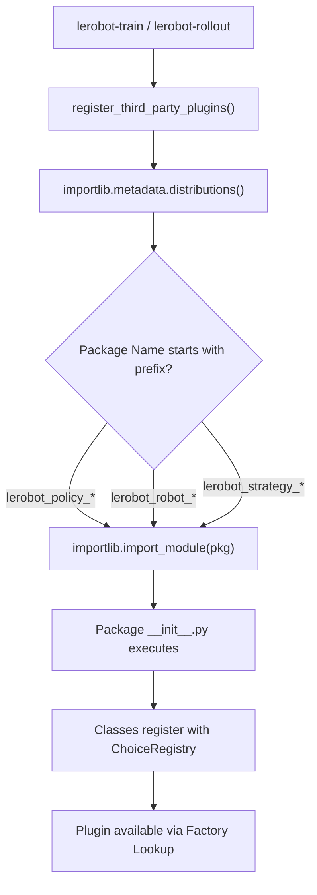
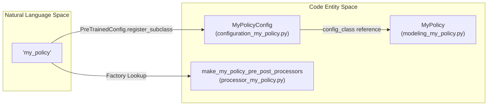
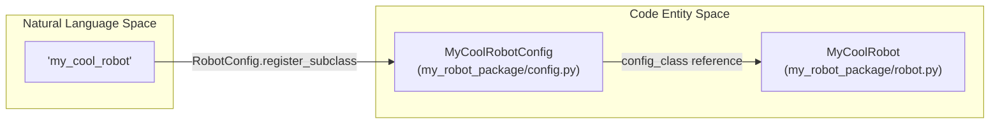
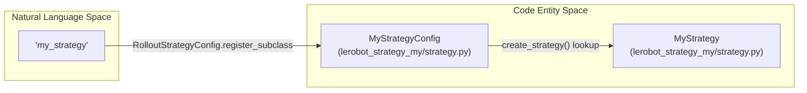

<!-- source: DeepWiki mcp.deepwiki.com · repo huggingface/lerobot · page 9.9 Plugin Development · fetched 2026-10-26 -->

# Plugin Development

Relevant source files

The following files were used as context for generating this wiki page:

- [docs/source/bring_your_own_policies.mdx](docs/source/bring_your_own_policies.mdx)
- [docs/source/inference.mdx](docs/source/inference.mdx)
- [docs/source/integrate_hardware.mdx](docs/source/integrate_hardware.mdx)
- [src/lerobot/common/control_utils.py](src/lerobot/common/control_utils.py)
- [src/lerobot/configs/policies.py](src/lerobot/configs/policies.py)
- [src/lerobot/configs/rewards.py](src/lerobot/configs/rewards.py)
- [src/lerobot/policies/evo1/modeling_evo1.py](src/lerobot/policies/evo1/modeling_evo1.py)
- [src/lerobot/policies/evo1/processor_evo1.py](src/lerobot/policies/evo1/processor_evo1.py)
- [src/lerobot/policies/rtc/latency_tracker.py](src/lerobot/policies/rtc/latency_tracker.py)
- [src/lerobot/rl/algorithms/configs.py](src/lerobot/rl/algorithms/configs.py)
- [src/lerobot/rollout/configs.py](src/lerobot/rollout/configs.py)
- [src/lerobot/rollout/strategies/base.py](src/lerobot/rollout/strategies/base.py)
- [src/lerobot/rollout/strategies/core.py](src/lerobot/rollout/strategies/core.py)
- [src/lerobot/rollout/strategies/dagger.py](src/lerobot/rollout/strategies/dagger.py)
- [src/lerobot/rollout/strategies/episodic.py](src/lerobot/rollout/strategies/episodic.py)
- [src/lerobot/rollout/strategies/factory.py](src/lerobot/rollout/strategies/factory.py)
- [src/lerobot/rollout/strategies/highlight.py](src/lerobot/rollout/strategies/highlight.py)
- [src/lerobot/rollout/strategies/sentry.py](src/lerobot/rollout/strategies/sentry.py)
- [src/lerobot/scripts/lerobot_rollout.py](src/lerobot/scripts/lerobot_rollout.py)
- [src/lerobot/transport/utils.py](src/lerobot/transport/utils.py)
- [tests/configs/test_plugin_loading.py](tests/configs/test_plugin_loading.py)
- [tests/policies/evo1/test_evo1.py](tests/policies/evo1/test_evo1.py)

## Purpose and Scope

This document explains how to develop custom plugins for the LeRobot ecosystem. Plugins allow developers to extend the framework with third-party policies, robot hardware interfaces, camera systems, environments, reward models, and rollout strategies without modifying core `lerobot` library code. The plugin system leverages Python package discovery mechanisms and `draccus.ChoiceRegistry` [src/lerobot/configs/policies.py:43]() to dynamically register and instantiate custom components at runtime.

For foundational details, see [Policy Interface and Base Classes]() (Section 4.1) and [Robot and Teleoperator Abstraction]() (Section 6.1).

Sources: `[src/lerobot/configs/policies.py:43]()`

## Overview

LeRobot's plugin architecture relies on standardized package naming prefixes for third-party extensions installed in the Python environment. When CLI entrypoints or scripts run, they trigger discovery routines that import these packages, allowing custom configuration and implementation classes to bind to global registries.

### Supported Plugin Types and Prefixes

| Plugin Type | Package Prefix | Base Class / Interface |
|:---|:---|:---|
| **Policy** | `lerobot_policy_` | `PreTrainedPolicy` [docs/source/bring_your_own_policies.mdx:100]() |
| **Robot** | `lerobot_robot_` | `Robot` [docs/source/integrate_hardware.mdx:5-6]() |
| **Camera** | `lerobot_camera_` | `Camera` |
| **Teleoperator** | `lerobot_teleoperator_` | `Teleoperator` |
| **Environment** | `lerobot_env_` | `EnvConfig` |
| **Reward Model** | `lerobot_reward_` | `RewardModelConfig` [src/lerobot/configs/rewards.py:42]() |
| **RL Algorithm** | `lerobot_algo_` | `RLAlgorithmConfig` |
| **Rollout Strategy** | `lerobot_strategy_` | `RolloutStrategyConfig` [src/lerobot/rollout/configs.py:43]() |

### Plugin Discovery Flow

Sources: `[docs/source/bring_your_own_policies.mdx:100]()`, `[docs/source/integrate_hardware.mdx:5-6]()`, `[src/lerobot/configs/rewards.py:42]()`, `[src/lerobot/rollout/configs.py:43-67]()`

## Policy Plugins

Policy plugins introduce custom neural network architectures and imitation learning algorithms. They require a configuration class inheriting from `PreTrainedConfig` [docs/source/bring_your_own_policies.mdx:21](), a modeling class inheriting from `PreTrainedPolicy` [docs/source/bring_your_own_policies.mdx:100](), and a processor module.

### Naming and Structure Conventions

- **Config Class**: `<Name>Config` registered via `@PreTrainedConfig.register_subclass("<name>")` [docs/source/bring_your_own_policies.mdx:32]().
- **Policy Class**: `<Name>Policy` inheriting from `PreTrainedPolicy` [docs/source/bring_your_own_policies.mdx:100]().
- **Files**: `configuration_<name>.py`, `modeling_<name>.py`, and `processor_<name>.py`.

### Policy Entity Mapping

Sources: `[docs/source/bring_your_own_policies.mdx:21]()`, `[docs/source/bring_your_own_policies.mdx:32]()`, `[docs/source/bring_your_own_policies.mdx:100]()`

## Hardware and Other Plugins

Hardware drivers, simulation environments, and rollout strategies follow parallel registry patterns using `ChoiceRegistry` subclasses.

### Robot Plugins

To integrate custom robot hardware, developers must subclass `RobotConfig` and `Robot`. The `RobotConfig` subclass is registered using `@RobotConfig.register_subclass("my_cool_robot")` [docs/source/integrate_hardware.mdx:51](). The `Robot` subclass then uses this config and implements the robot's specific observation and action features, as well as connection and control logic [docs/source/integrate_hardware.mdx:75-98]().

Sources: `[docs/source/integrate_hardware.mdx:51]()`, `[docs/source/integrate_hardware.mdx:75-98]()`

### Rollout Strategy Plugins

Rollout strategies customize the execution loop of `lerobot-rollout`. Developers implement a strategy configuration subclassing `RolloutStrategyConfig` [src/lerobot/rollout/configs.py:43]() and an execution class subclassing `RolloutStrategy` [src/lerobot/rollout/strategies/core.py:51]().

The `RolloutStrategyConfig` defines metadata such as `supports_interactive`, `dataset_mode`, and `requires_teleop` [src/lerobot/rollout/configs.py:56-63](). For example, the `BaseStrategyConfig` [src/lerobot/rollout/configs.py:87-91]() supports interactive mode and does not require a dataset, while `SentryStrategyConfig` [src/lerobot/rollout/configs.py:93-117]() requires a dataset and forces streaming encoding.

Sources: `[src/lerobot/rollout/configs.py:43-63]()`, `[src/lerobot/rollout/configs.py:87-91]()`, `[src/lerobot/rollout/configs.py:93-117]()`, `[src/lerobot/rollout/strategies/core.py:51]()`

## Distribution and Registration

Plugins are distributed as standard Python packages or editable local packages. The `lerobot` framework automatically discovers and registers classes from installed packages that follow the naming conventions (e.g., `lerobot_policy_*`, `lerobot_robot_*`). This allows users to install a plugin package and immediately use its components via the `--policy.type`, `--robot.type`, or `--strategy.type` CLI arguments [src/lerobot/scripts/lerobot_rollout.py:29-31]().

For example, to use a custom policy named `my_policy`, after installing `lerobot_policy_my_policy`, one would specify `--policy.type=my_policy` [docs/source/bring_your_own_policies.mdx:96](). Similarly, for a custom rollout strategy, `--strategy.type=my_strategy` would be used [src/lerobot/scripts/lerobot_rollout.py:29-31]().

Sources: `[docs/source/bring_your_own_policies.mdx:96]()`, `[src/lerobot/scripts/lerobot_rollout.py:29-31]()`

---

