# Page: Overview

# Overview

<details>
<summary>Relevant source files</summary>

The following files were used as context for generating this wiki page:

- [README.md](README.md)
- [docs-requirements.txt](docs-requirements.txt)
- [docs/README.md](docs/README.md)
- [docs/source/_toctree.yml](docs/source/_toctree.yml)
- [docs/source/index.mdx](docs/source/index.mdx)
- [pyproject.toml](pyproject.toml)
- [src/lerobot/policies/__init__.py](src/lerobot/policies/__init__.py)
- [src/lerobot/policies/groot/processor_groot.py](src/lerobot/policies/groot/processor_groot.py)
- [src/lerobot/templates/lerobot_modelcard_template.md](src/lerobot/templates/lerobot_modelcard_template.md)
- [src/lerobot/utils/import_utils.py](src/lerobot/utils/import_utils.py)
- [uv.lock](uv.lock)

</details>


## Purpose and Scope

This page introduces the LeRobot framework, its mission for standardizing robotics machine learning, and provides a high-level architecture overview. It covers the core abstractions—the `Robot` interface, `LeRobotDataset` format, and policy ecosystem—and explains how they work together to enable end-to-end robotics workflows.

For installation instructions, see [Installation and Setup](#1.1). For deeper explanation of fundamental concepts, see [Core Concepts](#1.2). For command-line tool usage, see [Command Line Interface](#1.3). For examples and tutorials, see [Examples and Tutorials](#1.4).

Sources: [README.md:18-27](), [pyproject.toml:27-30]()

## What is LeRobot?

LeRobot is a Python library that provides models, datasets, and tools for real-world robotics in PyTorch [README.md:18-18](). It aims to lower the barrier to entry for robotics machine learning by standardizing:

- **Hardware control**: A unified `Robot` class interface that abstracts diverse hardware platforms (low-cost arms like SO-100, humanoids, and teleoperation devices) [README.md:20-20](), [README.md:46-46](), [README.md:61-61]().
- **Data format**: The `LeRobotDataset` format (Parquet for states/actions + MP4 for videos) for efficient storage, streaming, and visualization [README.md:22-22](), [README.md:69-72]().
- **Policy training**: State-of-the-art imitation learning, reinforcement learning, and vision-language-action (VLA) models [README.md:24-24](), [README.md:88-108]().
- **Ecosystem integration**: Seamless sharing via the Hugging Face Hub for datasets and pretrained models [README.md:72-72](), [README.md:110-110]().

The framework supports the complete robotics ML pipeline: data collection → training → evaluation → deployment.

Sources: [README.md:18-27](), [pyproject.toml:29]()

## System Architecture

The LeRobot system consists of several layers that work together to enable robotics machine learning workflows:

### High-Level System Architecture
```mermaid
graph TB
    subgraph "Hardware_Layer"
        ["Robot Interface"] -- "connect()<br/>get_observation()<br/>send_action()" --> RobotImpl["Implementations:<br/>SO100, Koch, LeKiwi,<br/>Reachy2, Unitree G1, reBot B601"]
        ["Teleoperator Interface"] -- "connect()<br/>get_action()" --> TeleopImpl["Implementations:<br/>LeaderArms, Keyboard,<br/>Gamepad, Phone"]
        ["Camera Interface"] -- "connect()<br/>read()" --> CameraImpl["Implementations:<br/>IntelRealSense, OpenCV, ZMQ"]
    end
    
    subgraph "Data_Layer"
        Dataset["LeRobotDataset<br/>__getitem__()<br/>save_episode()<br/>push_to_hub()"]
        
        DataFormat["Format:<br/>data/*.parquet (state/action)<br/>videos/*/*.mp4 (vision)<br/>meta/info.json (schema)<br/>meta/stats.json (normalization)"]
        
        Dataset --- DataFormat
    end
    
    subgraph "Policy_Layer"
        PolicyFactory["make_policy()<br/>make_pre_post_processors()"]
        
        PolicyBase["PreTrainedPolicy<br/>forward()<br/>select_action()<br/>reset()"]
        
        Policies["Policy_Implementations:<br/>ACT, Diffusion, VQ-BeT,<br/>HIL-SERL, TDMPC, Pi0Fast,<br/>SmolVLA, GR00T, XVLA, EVO1"]
        
        PolicyFactory --> PolicyBase
        PolicyBase --> Policies
    end
    
    subgraph "Training_Layer"
        TrainScript["lerobot-train<br/>train()_function"]
        TrainConfig["TrainPipelineConfig<br/>policy_config<br/>dataset_config<br/>training_hyperparams"]
        
        TrainScript --- TrainConfig
        TrainScript --- Accelerator["HuggingFace_Accelerator<br/>distributed_training<br/>mixed_precision"]
    end
    
    subgraph "Evaluation_Layer"
        EvalScript["lerobot-eval<br/>eval_policy_all()"]
        EvalConfig["EvalPipelineConfig<br/>policy_path<br/>env_config"]
        EnvFactory["make_env()<br/>vectorized_environments"]
        
        EvalScript --- EvalConfig
        EvalScript --- EnvFactory
        
        EnvFactory --- SimEnv["Simulation_Envs:<br/>gym-aloha, gym-pusht,<br/>LIBERO, MetaWorld, RoboTwin"]
        EnvFactory --- HubEnv["EnvHub:<br/>load_from_HF_Hub"]
    end
    
    Hardware_Layer --> RecordScript["lerobot-record<br/>record_loop()"]
    
    RecordScript --> Dataset
    Dataset --> TrainScript
    TrainScript --> Policies
    Policies --> EvalScript
    EvalScript --> Hardware_Layer
    
    Dataset -.-> HFHub["Hugging_Face_Hub<br/>dataset_repositories"]
    Policies -.-> ModelHub["Hugging_Face_Hub<br/>model_repositories"]
```

Sources: [README.md:40-128](), [pyproject.toml:94-173](), [docs/source/_toctree.yml:1-163]()

## Core Workflow

LeRobot implements a complete pipeline from data collection to deployment. The following diagram shows the main workflow and key functions at each stage:

### Robotics ML Pipeline
```mermaid
graph LR
    subgraph "Data_Collection"
        A1["Robot"]
        A2["Teleoperator"]
        A3["lerobot-record"]
        
        A1 --> A3
        A2 --> A3
        
        A3 -->|"record_loop()<br/>add_frame()<br/>save_episode()"| A4["LeRobotDataset"]
        A4 -->|"push_to_hub()"| A5["HF_Hub_Dataset_Repo"]
    end
    
    subgraph "Training"
        B1["lerobot-train"]
        B2["make_policy()"]
        B3["Policy.forward()"]
        
        A5 -->|"LeRobotDataset('repo_id')"| B1
        B1 --> B2
        B2 --> B3
        B3 -->|"train()_loop<br/>update_policy()"| B4["Trained_Policy"]
        B4 -->|"push_to_hub()"| B5["HF_Hub_Model_Repo"]
    end
    
    subgraph "Evaluation"
        C1["lerobot-eval"]
        C2["make_env()"]
        C3["eval_policy_all()"]
        
        B5 -->|"PreTrainedPolicy.from_pretrained()"| C1
        C1 --> C2
        C2 --> C3
        C3 -->|"rollout()<br/>select_action()"| C4["Metrics_&_Videos"]
    end
    
    subgraph "Deployment"
        D1["Real_Robot"]
        
        B5 -->|"PreTrainedPolicy.from_pretrained()"| D1
        D1 -->|"get_observation()<br/>select_action()<br/>send_action()"| D2["Control_Loop"]
    end
```

Sources: [README.md:48-58](), [README.md:76-84](), [README.md:98-102](), [README.md:118-125]()

## Key Components

### Robot Interface

The `Robot` interface provides a hardware-agnostic API for controlling physical robots. All robot implementations implement these core methods:

| Method | Purpose |
|--------|---------|
| `connect()` | Initialize connection to hardware (motors, cameras) [README.md:53-53]() |
| `get_observation()` | Read current state (joint positions, images, etc.) [README.md:56-56]() |
| `send_action()` | Execute action (joint commands, velocities, etc.) [README.md:58-58]() |

Implementations are available for diverse platforms including SO100, LeKiwi, Reachy2, Unitree G1, and reBot B601 [README.md:61-61]().

For hardware integration details, see [Robot Hardware Integration](#6).

Sources: [README.md:40-66]()

### LeRobotDataset

The `LeRobotDataset` class implements a standardized format for robotics data, combining Parquet files for states/actions and MP4 videos for vision [README.md:22-22](), [README.md:71-71]().

**Key Features:**
- **Structure:** Synchronized MP4 videos and Parquet files [README.md:71-71]().
- **HF Hub Integration:** Explore and stream thousands of datasets [README.md:72-72]().
- **Tools:** Delete episodes, split datasets, and modify features [README.md:73-73]().

For dataset format details, see [LeRobotDataset](#2).

Sources: [README.md:67-86]()

### Policy Models

LeRobot implements multiple state-of-the-art (SoTA) policy architectures in pure PyTorch [README.md:90-90]():

- **Imitation Learning:** ACT, Diffusion, VQ-BeT, Multitask DiT [README.md:106-106](), [src/lerobot/policies/__init__.py:17-31]().
- **Reinforcement Learning:** HIL-SERL, TDMPC [README.md:107-107](), [src/lerobot/policies/__init__.py:37-37]().
- **VLA Models:** Pi0Fast, Pi0.5, GR00T, SmolVLA, XVLA, EO-1, MolmoAct2, EVO1, WALL-OSS [README.md:108-108](), [src/lerobot/policies/__init__.py:17-42]().

Policies follow a modular processing pipeline where observations and actions are transformed by processors like `PolicyProcessorPipeline` components [src/lerobot/policies/groot/processor_groot.py:59-60]().

For policy architecture details, see [Policy Architectures](#4).

Sources: [README.md:88-112](), [src/lerobot/policies/__init__.py:17-42](), [src/lerobot/policies/groot/processor_groot.py:59-60]()

### Training and Evaluation

**Training** (`lerobot-train` [README.md:99-99]()):
- Simple configuration-driven training: `lerobot-train --policy.type=act --dataset.repo_id=...` [README.md:99-102]().
- Orchestrated by the training pipeline which handles dataset loading, distributed training via `accelerate`, and policy updates [pyproject.toml:45-57]().

**Evaluation** (`lerobot-eval` [README.md:120-120]()):
- Unified evaluation script for simulation or real hardware [README.md:118-125]().
- Supports benchmarks like **LIBERO**, **MetaWorld**, **RoboTwin**, and **IsaacLab Arena** [README.md:116-116](), [docs/source/_toctree.yml:110-130]().

For training and evaluation workflows, see [Training and Evaluation](#3).

Sources: [README.md:98-128](), [pyproject.toml:45-57]()

## Command Line Interface

LeRobot provides CLI scripts for all major workflows:

| Command | Purpose |
|---------|---------|
| `lerobot-calibrate` | Calibrate robot motors and zero positions [pyproject.toml:143-143]() |
| `lerobot-teleoperate` | Control robot via teleop device [pyproject.toml:143-143]() |
| `lerobot-record` | Record episodes for dataset creation [pyproject.toml:143-143]() |
| `lerobot-replay` | Replay recorded episodes on a robot [pyproject.toml:143-143]() |
| `lerobot-train` | Train policies on datasets [README.md:99-99]() |
| `lerobot-eval` | Evaluate policies in simulation or real [README.md:120-120]() |
| `lerobot-rollout` | Deploy policy for autonomous operation [docs/source/_toctree.yml:107-107]() |
| `lerobot-info` | Display system and dependency info [README.md:34-34]() |

For detailed CLI usage, see [Command Line Interface](#1.3).

Sources: [README.md:28-35](), [pyproject.toml:143-143](), [docs/source/_toctree.yml:107-107]()

## Hugging Face Hub Integration

LeRobot leverages the Hugging Face Hub for dataset and model sharing:

- **Dataset Repositories:** Hosted at `huggingface.co/lerobot` [README.md:72-72]().
- **Model Sharing:** Users can share custom policies and checkpoints to the Hub [README.md:110-110]().
- **Environment Sharing:** Simulation environments can be distributed and loaded via **EnvHub** [docs/source/_toctree.yml:114-115]().

Sources: [README.md:21-24](), [README.md:72-72](), [docs/source/_toctree.yml:114-115]()

## Child Pages & Navigation

This is a parent overview page. Detailed information is maintained in the child pages:
- [Installation and Setup](#1.1) — Installation instructions, environment setup (conda/uv), dependency management, ffmpeg, PyPI / source installation [README.md:32-38](), [uv.lock:1-3]()
- [Core Concepts](#1.2) — Robot abstraction, LeRobotDataset format, Policy framework, Processor pipelines, and their interactions [README.md:46-86]()
- [Command Line Interface](#1.3) — Complete documentation of all CLI tools (`lerobot-train`, `lerobot-eval`, `lerobot-record`, etc.) and cheat-sheet reference [README.md:34-102](), [pyproject.toml:143-143]()
- [Examples and Tutorials](#1.4) — Per-robot example scripts, tutorial notebooks, dataset examples, and SLURM porting scripts [docs/source/_toctree.yml:9-30]()

Sources: [README.md:32-125](), [uv.lock:1-3](), [docs/source/_toctree.yml:9-30]()

---

# Page: Installation and Setup

# Installation and Setup

<details>
<summary>Relevant source files</summary>

The following files were used as context for generating this wiki page:

- [README.md](README.md)
- [docker/Dockerfile.internal](docker/Dockerfile.internal)
- [docker/Dockerfile.jetson](docker/Dockerfile.jetson)
- [docker/Dockerfile.user](docker/Dockerfile.user)
- [docker/README.md](docker/README.md)
- [docs/source/_toctree.yml](docs/source/_toctree.yml)
- [docs/source/installation.mdx](docs/source/installation.mdx)
- [pyproject.toml](pyproject.toml)
- [setup.py](setup.py)
- [src/lerobot/policies/__init__.py](src/lerobot/policies/__init__.py)
- [src/lerobot/policies/groot/processor_groot.py](src/lerobot/policies/groot/processor_groot.py)
- [src/lerobot/templates/lerobot_modelcard_template.md](src/lerobot/templates/lerobot_modelcard_template.md)
- [src/lerobot/utils/import_utils.py](src/lerobot/utils/import_utils.py)
- [uv.lock](uv.lock)

</details>


This page provides comprehensive technical instructions for installing and setting up the LeRobot framework. The scope covers environment managers (`conda` vs `uv`), Python requirements, dependency management via `pyproject.toml`, video decoding requirements (`TorchCodec` and `FFmpeg`), installation from source or PyPI with optional and composite extras, and containerized deployments using Docker.

**Sources:** `pyproject.toml:26-157` [pyproject.toml:26-157](), `docs/source/installation.mdx:1-188` [docs/source/installation.mdx:1-188]()

---

## Installation Architecture and Core Dependencies

LeRobot is structured to maintain a lightweight core while providing modular optional extensions for hardware, datasets, training, and visualization. The installation configuration is centrally managed via `pyproject.toml` [pyproject.toml:26-157]().

### Installation Components and Code Entity Space

The following diagram bridges natural language installation concepts to their concrete code entities defined in `pyproject.toml`.

**Installation Architecture and Code Entity Mapping**
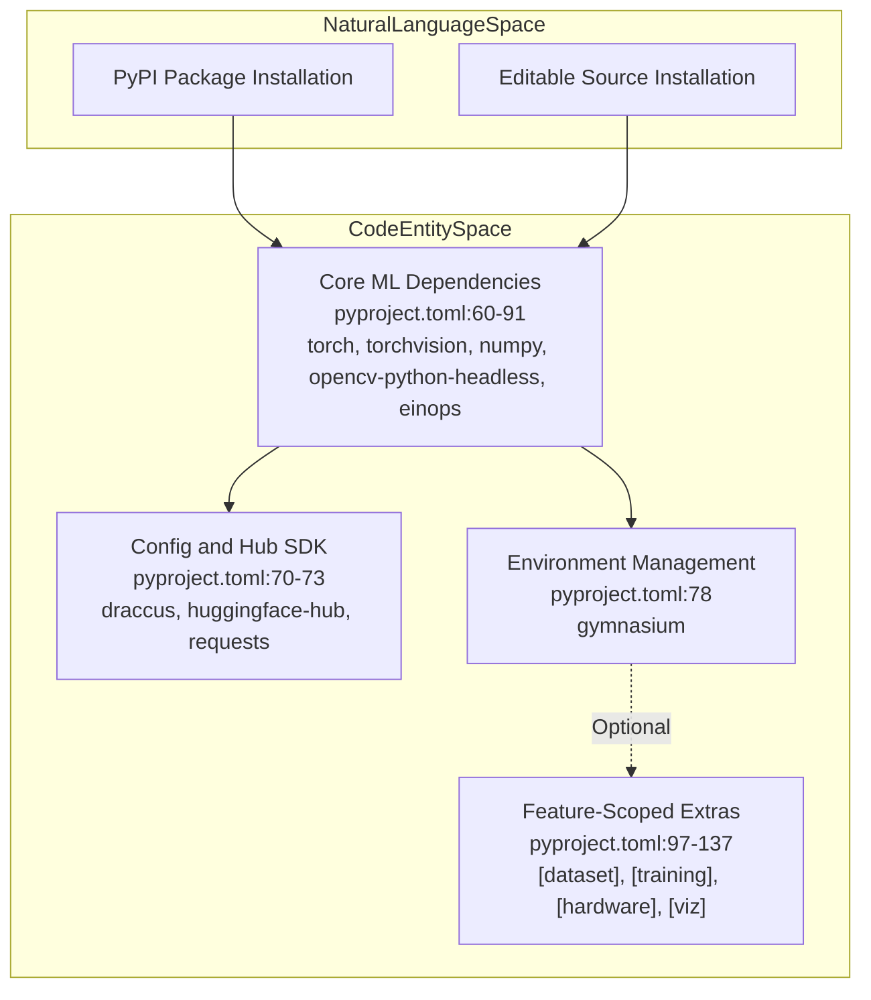

**Sources:** `pyproject.toml:26-157` [pyproject.toml:26-157]()

---

## Prerequisites and Environment Setup

LeRobot requires **Python ≥3.12** as declared in `pyproject.toml` [pyproject.toml:32](). Environment setup can be managed using either `conda` (via `miniforge`) or `uv`.

### Virtual Environment Configuration

Depending on the environment manager chosen, use the corresponding initialization workflow:

<!-- prettier-ignore-start -->
<hfoptions id="create_venv">
<hfoption id="conda">
```bash
conda create -y -n lerobot python=3.12
conda activate lerobot
```
</hfoption>
<hfoption id="uv">
```bash
uv python install 3.12
uv venv --python 3.12
source .venv/bin/activate
```
</hfoption>
</hfoptions>
<!-- prettier-ignore-end -->

> [!NOTE]
> When executing LeRobot inside Windows Subsystem for Linux (WSL), system packages and `evdev` must be installed for hardware controllers:
> ```bash
> # Conda
> conda install evdev -c conda-forge
> 
> # uv / system
> sudo apt install libevdev-dev
> uv pip install evdev
> ```

**Sources:** `docs/source/installation.mdx:1-68` [docs/source/installation.mdx:1-68]()

---

## Video Decoding: TorchCodec and FFmpeg

LeRobot utilizes `TorchCodec` for high-performance video decoding in dataset workflows [docs/source/installation.mdx:72-73](). TorchCodec platform constraints and fallback mechanisms are defined across `pyproject.toml` and documentation.

### Platform Support Matrix
- **Supported (TorchCodec):** Linux (`x86_64`), macOS (`arm64`), Windows (PyTorch ≥ 2.8) [pyproject.toml:122-124]().
- **Automatic Fallback (`pyav`):** macOS Intel (`x86_64`), Linux ARM (`aarch64`, `arm64`, `armv7l`) [docs/source/installation.mdx:75](). On these architectures, LeRobot falls back to `pyav` [pyproject.toml:151]().

### FFmpeg Installation Methods
Depending on the PyTorch version and environment manager, `ffmpeg` can be installed via Conda or system package managers:

<!-- prettier-ignore-start -->
<hfoptions id="install_ffmpeg">
<hfoption id="conda">
```bash
conda install ffmpeg -c conda-forge
```
*(Recommended for all PyTorch versions; installs `ffmpeg` with `libsvtav1` support)*
</hfoption>
<hfoption id="uv (PyTorch >= 2.10)">
```bash
# Ubuntu / Debian
sudo apt install ffmpeg

# macOS (Apple Silicon)
brew install ffmpeg
```
*(Dynamic linking supported for PyTorch ≥ 2.10)*
</hfoption>
</hfoptions>
<!-- prettier-ignore-end -->

**Sources:** `pyproject.toml:122-124` [pyproject.toml:122-124](), `docs/source/installation.mdx:70-116` [docs/source/installation.mdx:70-116]()

---

## Installing LeRobot: Source and PyPI

The core package installs minimal dependencies [pyproject.toml:60-91](). Feature-specific capabilities are organized into optional extras [pyproject.toml:94-146]().

### Source Installation (Editable Mode)

```bash
git clone https://github.com/huggingface/lerobot.git
cd lerobot
pip install -e .
```

### PyPI Installation with Optional Extras

LeRobot defines feature-scoped and composite extras in `pyproject.toml` [pyproject.toml:94-146]() that map directly to functional workflows and CLI commands.

**Composite Extras to CLI Scripts Mapping**
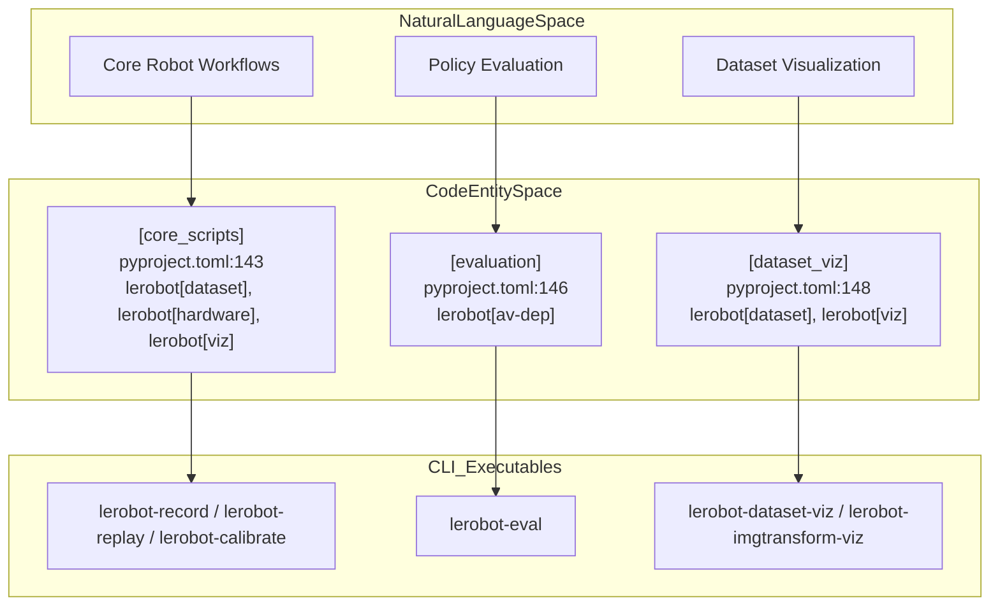

**Sources:** `pyproject.toml:94-146` [pyproject.toml:94-146](), `docs/source/installation.mdx:119-188` [docs/source/installation.mdx:119-188]()

---

## Containerized Deployment with Docker

LeRobot provides container definitions for CPU experimentation and GPU-accelerated training [docker/README.md:1-86]().

### Dockerfile Variants

- **`Dockerfile.user`**: Based on `python:3.12-slim`, configured for general experimentation, running scripts, and interacting with physical hardware via USB device mapping [docker/Dockerfile.user:1-73]().
- **`Dockerfile.internal`**: Based on `nvidia/cuda:12.8.1-base-ubuntu24.04`, pre-configured with CUDA environments (`MUJOCO_GL=egl`, `DEVICE=cuda`) for multi-GPU training and CI workloads [docker/Dockerfile.internal:1-83]().
- **`Dockerfile.jetson`**: Community-maintained build for NVIDIA Jetson Orin (JetPack 6.2, CUDA 12.6) compiling `torch`, `torchcodec`, and `torchvision` from source [docker/Dockerfile.jetson:1-118]().

**Sources:** `docker/Dockerfile.user:1-74` [docker/Dockerfile.user:1-73](), `docker/Dockerfile.internal:1-84` [docker/Dockerfile.internal:1-83](), `docker/Dockerfile.jetson:1-118` [docker/Dockerfile.jetson:1-118](), `docker/README.md:1-87` [docker/README.md:1-86]()

---

# Page: Core Concepts

# Core Concepts

<details>
<summary>Relevant source files</summary>

The following files were used as context for generating this wiki page:

- [docs/source/act.mdx](docs/source/act.mdx)
- [docs/source/earthrover_mini_plus.mdx](docs/source/earthrover_mini_plus.mdx)
- [docs/source/groot.mdx](docs/source/groot.mdx)
- [docs/source/hope_jr.mdx](docs/source/hope_jr.mdx)
- [docs/source/il_robots.mdx](docs/source/il_robots.mdx)
- [docs/source/reachy2.mdx](docs/source/reachy2.mdx)
- [docs/source/smolvla.mdx](docs/source/smolvla.mdx)
- [docs/source/streaming_video_encoding.mdx](docs/source/streaming_video_encoding.mdx)
- [src/lerobot/robots/earthrover_mini_plus/robot_earthrover_mini_plus.py](src/lerobot/robots/earthrover_mini_plus/robot_earthrover_mini_plus.py)
- [src/lerobot/teleoperators/keyboard/teleop_keyboard.py](src/lerobot/teleoperators/keyboard/teleop_keyboard.py)
- [src/lerobot/utils/constants.py](src/lerobot/utils/constants.py)

</details>


## Purpose and Scope
This page explains the fundamental architectural pillars of LeRobot: the **Robot abstraction**, the **LeRobotDataset format**, the **Policy framework**, and the **Processor system**. It details how these entities interact to support end-to-end real-world robotics workflows, from hardware control and teleoperation to large-scale data recording, policy training, and inference.

Sources: [docs/source/il_robots.mdx:3-9]()

## The Four Pillars of LeRobot

| Pillar | Purpose | Key Benefit |
|--------|---------|-------------|
| **Robot Abstraction** | Hardware-agnostic interface for robot control | Write code once, run on any supported robot [docs/source/il_robots.mdx:28]() |
| **LeRobotDataset** | Standardized format for robotics data | Efficient storage, streaming, and sharing [docs/source/il_robots.mdx:173-176]() |
| **Policy Framework** | Unified interface for IL, RL, and VLA models | Easy experimentation with diverse algorithms [docs/source/smolvla.mdx:48-49]() |
| **Processor System** | Universal data translation and normalization | Seamless data flow between sensors, models, and actuators [src/lerobot/utils/constants.py:21-58]() |

Sources: [docs/source/il_robots.mdx:3-9](), [docs/source/il_robots.mdx:28](), [docs/source/il_robots.mdx:173-176](), [docs/source/smolvla.mdx:48-49](), [src/lerobot/utils/constants.py:21-58]()

## 1. Robot Abstraction

### Purpose
The Robot abstraction provides a unified Python interface for controlling diverse robotic hardware. This abstraction decouples control logic from hardware-specific details, enabling the same code to work across different platforms [docs/source/il_robots.mdx:28]().

### Key Classes and Interfaces
The system is built around abstract base classes that define a strict contract for physical interaction. Subclasses implement methods like `get_observation` and `send_action` to be usable within the ecosystem [src/lerobot/robots/earthrover_mini_plus/robot_earthrover_mini_plus.py:171-188](), [src/lerobot/teleoperators/keyboard/teleop_keyboard.py:131-138]().

**Core Hardware Entities Diagram (Natural Language to Code Space)**
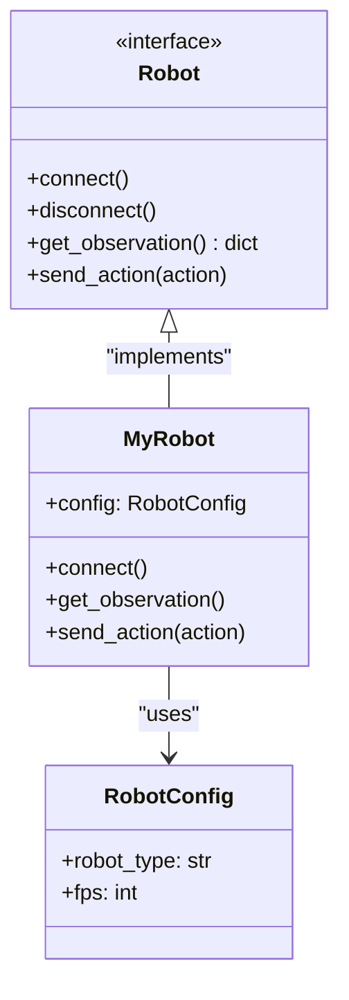

Sources: [src/lerobot/robots/earthrover_mini_plus/robot_earthrover_mini_plus.py:73-108](), [src/lerobot/teleoperators/keyboard/teleop_keyboard.py:48-55]()

### Supported Hardware
LeRobot natively supports a wide range of platforms, from low-cost arms like the SO100/SO101 to humanoids like the Unitree G1. Teleoperation is supported via leader arms, gamepads, and mobile devices [docs/source/il_robots.mdx:45-46](), [docs/source/earthrover_mini_plus.mdx:120-131](), [docs/source/hope_jr.mdx:175-207](), [docs/source/reachy2.mdx:9-12]().

Sources: [docs/source/il_robots.mdx:45-46](), [docs/source/earthrover_mini_plus.mdx:120-131](), [docs/source/hope_jr.mdx:175-207](), [docs/source/reachy2.mdx:9-12]()

---

## 2. LeRobotDataset (v3.0)

### Purpose
`LeRobotDataset v3.0` is the standardized format for storing and sharing robot learning data. It uses **Apache Parquet** for tabular data (states, actions, rewards) and **MP4 videos** (or images) for visual observations to ensure scalability and Hub integration [docs/source/il_robots.mdx:173-176]().

### File Structure
The dataset is organized to decouple storage from the user API. Data is sharded into chunks containing multiple episodes to improve storage efficiency and loading performance [docs/source/il_robots.mdx:173-176]().

**Dataset Layout Diagram (Natural Language to Code Space)**
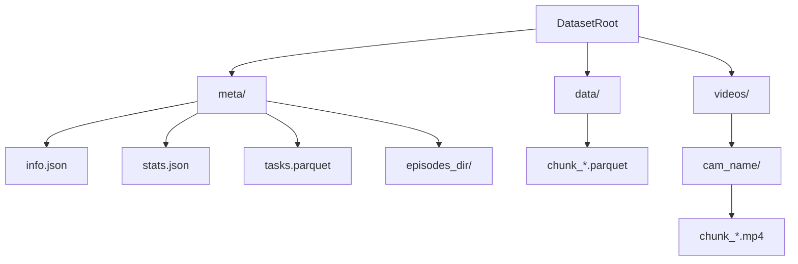

Sources: [docs/source/il_robots.mdx:173-176]()

### Data Access and Metadata
The `LeRobotDataset` class handles video decoding and Parquet reading automatically.
*   **Metadata Management**: Manages loading and synchronization of `info.json`, `stats.json`, and episode indices.
*   **Delta Timestamps**: Enables querying temporal windows (past observations or future actions) relative to a specific frame.
*   **Codebase Version**: Identified as `v3.0` to ensure format compatibility.

Sources: [src/lerobot/utils/constants.py:98-104]()

---

## 3. Policy Framework

### Purpose
The Policy framework provides a unified interface for different robot learning algorithms, enabling seamless switching between Imitation Learning (IL), Reinforcement Learning (RL), and Vision-Language-Action (VLA) models [docs/source/smolvla.mdx:48-49]().

### Policy Categories

| Category | Examples | Purpose |
|----------|----------|---------|
| **Imitation Learning** | ACT, Diffusion, VQ-BeT | Learning from expert demonstrations [docs/source/act.mdx:20-21]() |
| **Reinforcement Learning** | HIL-SERL, TDMPC | Learning through environment interaction |
| **VLA Models** | π₀ (Pi0), SmolVLA, GR00T | Large-scale multimodal reasoning [docs/source/groot.mdx:3-4](), [docs/source/smolvla.mdx:3-4]() |

Sources: [docs/source/act.mdx:20-21](), [docs/source/groot.mdx:3-4](), [docs/source/smolvla.mdx:3-4]()

### Policy Factory and Plugins
Policies are instantiated via a factory pattern that resolves registered names to specific classes using `PreTrainedConfig` and `PreTrainedPolicy`.

**Policy Class Relationship Diagram**
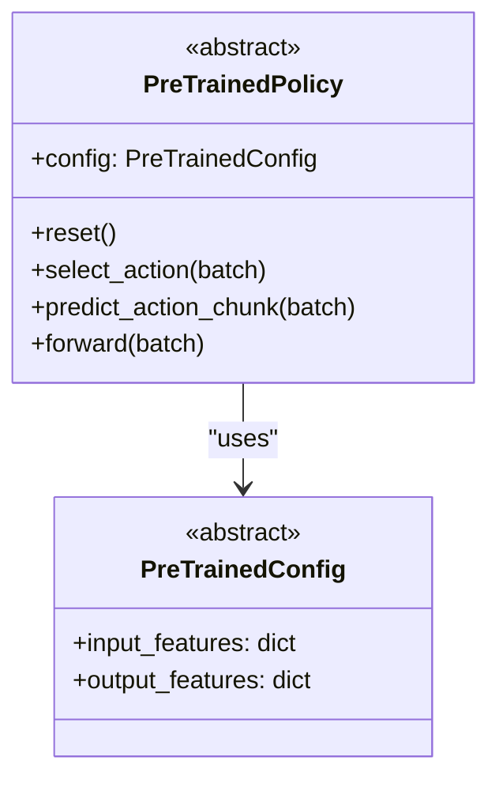

Sources: [docs/source/groot.mdx:76-88](), [docs/source/smolvla.mdx:58-66]()

---

## 4. Data Processing Pipeline

### Purpose
Processors act as the bridge between raw hardware signals, dataset features, and policy-ready tensors. Utility functions like `to_tensor` and `create_transition` ensure data is correctly transformed and shaped [src/lerobot/utils/constants.py:21-58]().

### Implementation Logic
Pipelines map environment transitions and robot observations into standardized tensors using single-dispatch handlers and extraction utilities. Key components include:
1.  **Tensor Converters**: `to_tensor` handles numpy arrays, scalars, sequences, and nested dictionaries.
2.  **Transition Management**: `create_transition` and `_extract_complementary_data` manage observation-action pairs and padding/metadata flags.

Sources: [src/lerobot/utils/constants.py:21-58]()

---

## System Interaction Diagram

This diagram maps high-level concepts to the specific code entities and data flow used during a recording session or transition pipeline execution.

**Data Flow: Hardware to Storage**
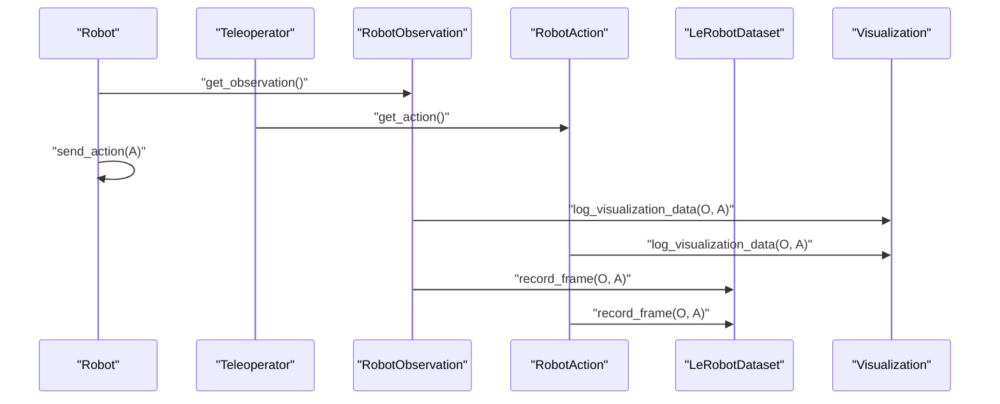

Sources: [docs/source/il_robots.mdx:158-161](), [src/lerobot/robots/earthrover_mini_plus/robot_earthrover_mini_plus.py:171-188](), [src/lerobot/teleoperators/keyboard/teleop_keyboard.py:131-138](), [src/lerobot/utils/constants.py:21-58]()

---

# Page: Command Line Interface

# Command Line Interface

<details>
<summary>Relevant source files</summary>

The following files were used as context for generating this wiki page:

- [AGENTS.md](AGENTS.md)
- [AGENT_GUIDE.md](AGENT_GUIDE.md)
- [CLAUDE.md](CLAUDE.md)
- [README.md](README.md)
- [docs/source/_toctree.yml](docs/source/_toctree.yml)
- [docs/source/cheat-sheet.mdx](docs/source/cheat-sheet.mdx)
- [docs/source/hardware_guide.mdx](docs/source/hardware_guide.mdx)
- [pyproject.toml](pyproject.toml)
- [src/lerobot/jobs/dataset.py](src/lerobot/jobs/dataset.py)
- [src/lerobot/policies/__init__.py](src/lerobot/policies/__init__.py)
- [src/lerobot/policies/groot/processor_groot.py](src/lerobot/policies/groot/processor_groot.py)
- [src/lerobot/scripts/convert_dataset_v21_to_v30.py](src/lerobot/scripts/convert_dataset_v21_to_v30.py)
- [src/lerobot/scripts/lerobot_annotate.py](src/lerobot/scripts/lerobot_annotate.py)
- [src/lerobot/scripts/lerobot_find_cameras.py](src/lerobot/scripts/lerobot_find_cameras.py)
- [src/lerobot/scripts/lerobot_find_port.py](src/lerobot/scripts/lerobot_find_port.py)
- [src/lerobot/scripts/lerobot_train_tokenizer.py](src/lerobot/scripts/lerobot_train_tokenizer.py)
- [src/lerobot/templates/lerobot_modelcard_template.md](src/lerobot/templates/lerobot_modelcard_template.md)
- [src/lerobot/utils/import_utils.py](src/lerobot/utils/import_utils.py)
- [tests/scripts/test_lerobot_annotate.py](tests/scripts/test_lerobot_annotate.py)
- [uv.lock](uv.lock)

</details>


## Purpose and Scope

This page documents the Command Line Interface (CLI) tools provided by LeRobot. These tools serve as entry points for hardware setup, sensor discovery, teleoperation, data recording and playback, policy training, evaluation, rollouts, dataset annotation, and diagnostics. Every CLI tool binds command-line arguments to typed configuration dataclasses using `draccus` [pyproject.toml:70](), enabling dot-notation overrides (`--robot.type=...`, `--dataset.repo_id=...`).

Sources: [pyproject.toml:70](), [src/lerobot/scripts/lerobot_record.py:166-182]()

---

## Overview and Script Registration

CLI entry points are registered in `pyproject.toml` under `[project.scripts]` [pyproject.toml:198-214](). Each command maps to a `main()` function in a module under `src/lerobot/scripts/`. Upon startup, these scripts invoke third-party plugin registration utilities to support custom extensions [src/lerobot/scripts/lerobot_record.py:157](), [src/lerobot/scripts/lerobot_teleoperate.py:125]().

### Command-to-Code Entity Map

This diagram bridges natural language tool names to their underlying Python modules, entry point functions, and configuration dataclasses.

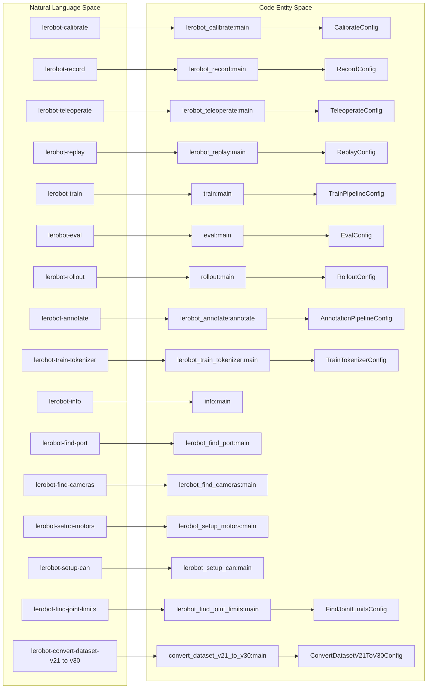
Sources: [pyproject.toml:198-214](), [src/lerobot/scripts/lerobot_record.py:171-186](), [src/lerobot/scripts/lerobot_teleoperate.py:134-152](), [src/lerobot/scripts/lerobot_replay.py:81-98](), [src/lerobot/scripts/lerobot_calibrate.py:74-85](), [src/lerobot/scripts/lerobot_annotate.py:75-76](), [src/lerobot/scripts/lerobot_train_tokenizer.py:100-103](), [src/lerobot/scripts/lerobot_find_joint_limits.py:75-92](), [src/lerobot/scripts/convert_dataset_v21_to_v30.py:54-57]()

---

## Hardware Setup Tools

### `lerobot-find-port`
Lists available serial ports on the host system to identify correct pathways for robotic arms and controllers before motor bus configuration.
Sources: [src/lerobot/scripts/lerobot_find_port.py]()

### `lerobot-find-cameras`
Enumerates connected video capture devices. It supports discovery for `OpenCVCamera` [src/lerobot/scripts/lerobot_find_cameras.py:47-64]() and `RealSenseCamera` [src/lerobot/scripts/lerobot_find_cameras.py:67-86](), and can save test frames to disk [src/lerobot/scripts/lerobot_find_cameras.py:130-153]().
Sources: [src/lerobot/scripts/lerobot_find_cameras.py:47-153]()

### `lerobot-setup-motors`
Configures motor IDs, baud rates, and control tables across Feetech and Dynamixel motor buses.

### `lerobot-setup-can`
Configures and tests Controller Area Network (CAN) interfaces for high-performance motors like Damiao or Robstride actuators.

### `lerobot-calibrate`

**Script:** `lerobot.scripts.lerobot_calibrate:main`  
**Config:** `CalibrateConfig` [src/lerobot/scripts/lerobot_calibrate.py:74-77]()

Executes calibration routines for either a robot follower or a teleoperator device. Exactly one of `--robot.*` or `--teleop.*` must be provided [src/lerobot/scripts/lerobot_calibrate.py:79-80]().

Example:
```bash
lerobot-calibrate \
    --teleop.type=so101_leader \
    --teleop.port=/dev/tty.usbmodem58760431551 \
    --teleop.id=blue
```
Sources: [src/lerobot/scripts/lerobot_calibrate.py:74-98]()

### `lerobot-find-joint-limits`

**Script:** `lerobot.scripts.lerobot_find_joint_limits:main`  
**Config:** `FindJointLimitsConfig` [src/lerobot/scripts/lerobot_find_joint_limits.py:75-92]()

Records joint positions and end-effector coordinates while a user manually articulates the arm. Uses `RobotKinematics` to compute Cartesian boundaries and outputs `min_pos`, `max_pos`, `min_ee`, and `max_ee` [src/lerobot/scripts/lerobot_find_joint_limits.py:105-106]().
Sources: [src/lerobot/scripts/lerobot_find_joint_limits.py:75-216]()

---

## Robot Operations Tools

### `lerobot-teleoperate`

**Script:** `lerobot.scripts.lerobot_teleoperate:main`  
**Config:** `TeleoperateConfig` [src/lerobot/scripts/lerobot_teleoperate.py:134-152]()

Runs real-time teleoperation loops, reading commands from a `Teleoperator`, processing them through action/observation pipelines, and dispatching actions to a `Robot` [src/lerobot/scripts/lerobot_teleoperate.py:155-183]().

Example:
```bash
lerobot-teleoperate \
    --robot.type=so101_follower \
    --robot.port=/dev/tty.usbmodem58760431541 \
    --robot.id=black \
    --teleop.type=so101_leader \
    --teleop.port=/dev/tty.usbmodem58760431551 \
    --teleop.id=blue \
    --display_data=true
```
Sources: [src/lerobot/scripts/lerobot_teleoperate.py:134-183]()

### `lerobot-record`

**Script:** `lerobot.scripts.lerobot_record`  
**Config:** `RecordConfig` [src/lerobot/scripts/lerobot_record.py:170-186]()

Captures teleoperated episodes into a standardized `LeRobotDataset` structure [src/lerobot/scripts/lerobot_record.py:15-18]().

Example:
```bash
lerobot-record \
    --robot.type=so100_follower \
    --robot.port=/dev/tty.usbmodem58760431541 \
    --robot.cameras="{laptop: {type: opencv, index_or_path: 0, width: 640, height: 480, fps: 30}}" \
    --robot.id=black \
    --teleop.type=so100_leader \
    --teleop.port=/dev/tty.usbmodem58760431551 \
    --teleop.id=blue \
    --dataset.repo_id=myuser/my_dataset \
    --dataset.num_episodes=50
```
Sources: [src/lerobot/scripts/lerobot_record.py:166-186]()

### `lerobot-replay`

**Script:** `lerobot.scripts.lerobot_replay:main`  
**Config:** `ReplayConfig` [src/lerobot/scripts/lerobot_replay.py:94-98]()

Loads recorded episodes from a `LeRobotDataset` and streams recorded actions directly to physical hardware using a `CycleTimer` to verify execution fidelity [src/lerobot/scripts/lerobot_replay.py:15-16](), [src/lerobot/scripts/lerobot_replay.py:118-138]().
Sources: [src/lerobot/scripts/lerobot_replay.py:82-142]()

### `lerobot-rollout`
Deploys trained imitation learning or RL policies onto physical hardware or simulation environments, supporting multiple strategies (e.g., base, episodic, DAgger) and inference backends.

---

## Dataset Management and Utilities

### `lerobot-annotate`

**Script:** `lerobot.scripts.lerobot_annotate:annotate`
**Config:** `AnnotationPipelineConfig` [src/lerobot/annotations/steerable_pipeline/config.py]()

Populates `language_persistent` and `language_events` columns within dataset parquet shards using a Vision-Language Model (VLM) steerable pipeline [src/lerobot/scripts/lerobot_annotate.py:16-17](). It can run locally or submit jobs to Hugging Face Jobs [src/lerobot/scripts/lerobot_annotate.py:28-35]().

Example:
```bash
lerobot-annotate \
    --root=/path/to/dataset \
    --vlm.model_id=Qwen/Qwen2.5-VL-7B-Instruct
```
Sources: [src/lerobot/scripts/lerobot_annotate.py:16-35](), [src/lerobot/annotations/steerable_pipeline/config.py]()

### `lerobot-train-tokenizer`

**Script:** `lerobot.scripts.lerobot_train_tokenizer:main`
**Config:** `TrainTokenizerConfig` [src/lerobot/scripts/lerobot_train_tokenizer.py:100-103]()

Trains Frequency-space Action Sequence Tokenization (FAST) tokenizers by sampling action chunks, applying normalization modes, and fitting BPE vocabularies on DCT coefficients.
Sources: [src/lerobot/scripts/lerobot_train_tokenizer.py:100-103]()

### `lerobot-info`
Diagnostics utility that inspects environment properties (Python version, PyTorch bindings, GPU acceleration availability, FFmpeg runtime status).

### `lerobot-convert-dataset-v21-to-v30`

**Script:** `src/lerobot/scripts/convert_dataset_v21_to_v30.py:main`
**Config:** `ConvertDatasetV21ToV30Config` [src/lerobot/scripts/convert_dataset_v21_to_v30.py:54-57]()

Converts datasets from codebase version 2.1 to 3.0. This involves generating per-episode stats, checking consistency, removing deprecated `stats.json`, updating `codebase_version` in `info.json`, and optionally pushing the new version to the Hugging Face Hub [src/lerobot/scripts/convert_dataset_v21_to_v30.py:18-27]().

Example:
```bash
python src/lerobot/scripts/convert_dataset_v21_to_v30.py \
    --repo-id=lerobot/pusht
```
Sources: [src/lerobot/scripts/convert_dataset_v21_to_v30.py:18-27](), [src/lerobot/scripts/convert_dataset_v21_to_v30.py:54-57]()

---

## Training and Evaluation Tools

### `lerobot-train`
Orchestrates training loops for imitation learning and reinforcement learning policies, handling dataset streaming, policy instantiation, optimizer setup, checkpointing, and periodic evaluation.

### `lerobot-eval`
Executes evaluation rollouts for trained policies across episodes, computing success rates and rendering evaluation videos.

---

## Argument Parsing Architecture

CLI options are parsed into nested configuration dataclasses via `draccus` [pyproject.toml:70]().

```mermaid
flowchart TD
    subgraph Config Classes
        rc["RecordConfig"]
        tc["TeleoperateConfig"]
        rpc["ReplayConfig"]
        drpc["DatasetReplayConfig"]
        cc["CalibrateConfig"]
        annc["AnnotationPipelineConfig"]
        ttc["TrainTokenizerConfig"]
        fjl_c["FindJointLimitsConfig"]
        cdv_c["ConvertDatasetV21ToV30Config"]
    end

    rc --> r_rob["robot: RobotConfig"]
    rc --> r_dat["dataset: DatasetRecordConfig"]
    rc --> r_tel["teleop: TeleoperatorConfig"]

    tc --> t_rob["robot: RobotConfig"]
    tc --> t_tel["teleop: TeleoperatorConfig"]

    rpc --> rp_rob["robot: RobotConfig"]
    rpc --> rp_dat["dataset: DatasetReplayConfig"]

    cc --> c_tel["teleop: TeleoperatorConfig"]
    cc --> c_rob["robot: RobotConfig"]

    annc --> ann_vlm["vlm: VLMClientConfig"]
    annc --> ann_plan["plan: PlanSubtasksMemoryModuleConfig"]
    annc --> ann_inter["interjections: InterjectionsAndSpeechModuleConfig"]
    annc --> ann_vqa["vqa: GeneralVqaModuleConfig"]

    ttc --> tt_dat["dataset: DatasetConfig"]
    ttc --> tt_tok["tokenizer: TokenizerConfig"]

    fjl_c --> fjl_rob["robot: RobotConfig"]

    cdv_c --> cdv_dat["dataset: DatasetConfig"]
```
Sources: [src/lerobot/scripts/lerobot_record.py:171-186](), [src/lerobot/scripts/lerobot_teleoperate.py:134-152](), [src/lerobot/scripts/lerobot_replay.py:81-98](), [src/lerobot/scripts/lerobot_calibrate.py:74-78](), [src/lerobot/annotations/steerable_pipeline/config.py](), [src/lerobot/scripts/lerobot_train_tokenizer.py:100-103](), [src/lerobot/scripts/lerobot_find_joint_limits.py:75-92](), [src/lerobot/scripts/convert_dataset_v21_to_v30.py:54-57]()

---

## Typical Workflow

The following workflow diagram maps operational steps from hardware setup to policy training.

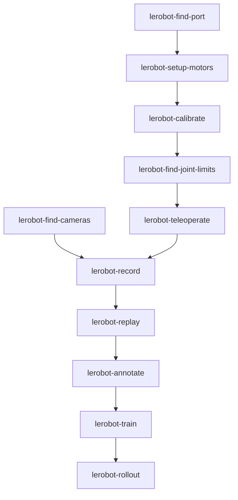
Sources: [pyproject.toml:198-214](), [src/lerobot/scripts/lerobot_record.py:25-65](), [src/lerobot/scripts/lerobot_teleoperate.py:23-52](), [src/lerobot/scripts/lerobot_replay.py:23-40](), [src/lerobot/scripts/lerobot_calibrate.py:23-28]()

---

# Page: Examples and Tutorials

# Examples and Tutorials

<details>
<summary>Relevant source files</summary>

The following files were used as context for generating this wiki page:

- [docs/source/porting_datasets_v3.mdx](docs/source/porting_datasets_v3.mdx)
- [examples/lekiwi/evaluate.py](examples/lekiwi/evaluate.py)
- [examples/lekiwi/record.py](examples/lekiwi/record.py)
- [examples/lekiwi/teleoperate.py](examples/lekiwi/teleoperate.py)
- [examples/phone_to_so100/evaluate.py](examples/phone_to_so100/evaluate.py)
- [examples/phone_to_so100/record.py](examples/phone_to_so100/record.py)
- [examples/phone_to_so100/teleoperate.py](examples/phone_to_so100/teleoperate.py)
- [examples/port_datasets/display_error_files.py](examples/port_datasets/display_error_files.py)
- [examples/port_datasets/port_droid.py](examples/port_datasets/port_droid.py)
- [examples/port_datasets/slurm_aggregate_shards.py](examples/port_datasets/slurm_aggregate_shards.py)
- [examples/port_datasets/slurm_port_shards.py](examples/port_datasets/slurm_port_shards.py)
- [examples/port_datasets/slurm_upload.py](examples/port_datasets/slurm_upload.py)
- [examples/so100_to_so100_EE/evaluate.py](examples/so100_to_so100_EE/evaluate.py)
- [examples/so100_to_so100_EE/record.py](examples/so100_to_so100_EE/record.py)
- [examples/so100_to_so100_EE/teleoperate.py](examples/so100_to_so100_EE/teleoperate.py)
- [examples/tutorial/act/act_training_example.py](examples/tutorial/act/act_training_example.py)
- [examples/tutorial/act/act_using_example.py](examples/tutorial/act/act_using_example.py)
- [examples/tutorial/async-inf/policy_server.py](examples/tutorial/async-inf/policy_server.py)
- [examples/tutorial/async-inf/robot_client.py](examples/tutorial/async-inf/robot_client.py)
- [examples/tutorial/diffusion/diffusion_training_example.py](examples/tutorial/diffusion/diffusion_training_example.py)
- [examples/tutorial/diffusion/diffusion_using_example.py](examples/tutorial/diffusion/diffusion_using_example.py)
- [examples/tutorial/pi0/using_pi0_example.py](examples/tutorial/pi0/using_pi0_example.py)
- [examples/tutorial/rl/hilserl_example.py](examples/tutorial/rl/hilserl_example.py)
- [examples/tutorial/rl/reward_classifier_example.py](examples/tutorial/rl/reward_classifier_example.py)
- [examples/tutorial/smolvla/using_smolvla_example.py](examples/tutorial/smolvla/using_smolvla_example.py)
- [src/lerobot/utils/robot_utils.py](src/lerobot/utils/robot_utils.py)
- [tests/datasets/test_delta_timestamps.py](tests/datasets/test_delta_timestamps.py)

</details>


## Purpose and Scope

This wiki page provides a technical guide to the `examples/` directory within the LeRobot codebase. It covers standalone reference implementations, per-robot orchestration scripts (`lekiwi`, `phone_to_so100`, `so100_to_so100_EE`), learning tutorials for imitation learning and reinforcement learning policies (ACT, Diffusion, pi0, SmolVLA, HIL-SERL), dataset exploration examples, and distributed dataset porting scripts using SLURM.

---

## 1. Per-Robot Example Integration Scripts

The `examples/` directory provides self-contained reference scripts demonstrating how to wire hardware drivers, kinematics processors, teleoperators, policies, and dataset recorders together. 

### LeKiwi Mobile Robot Examples
The `examples/lekiwi/` directory implements network-split host/client execution for the mobile LeKiwi platform. `record.py` [examples/lekiwi/record.py:37-142]() establishes a client connection to `LeKiwiClient` [examples/lekiwi/record.py:44](), integrates a `SO100Leader` arm and a `KeyboardTeleop` device [examples/lekiwi/record.py:40-46](), and drives the recording loop via `record_loop` [examples/lekiwi/record.py:87]().

Similarly, `evaluate.py` [examples/lekiwi/evaluate.py:42-166]() demonstrates inline policy deployment. It loads an `ACTPolicy` from the Hugging Face Hub [examples/lekiwi/evaluate.py:52](), initializes policy pre/postprocessors with `make_pre_post_processors` [examples/lekiwi/evaluate.py:70-76](), queries the robot observation `robot.get_observation()` [examples/lekiwi/evaluate.py:110](), predicts actions using `predict_action` [examples/lekiwi/evaluate.py:115](), and converts actions via `make_robot_action` [examples/lekiwi/evaluate.py:127]().

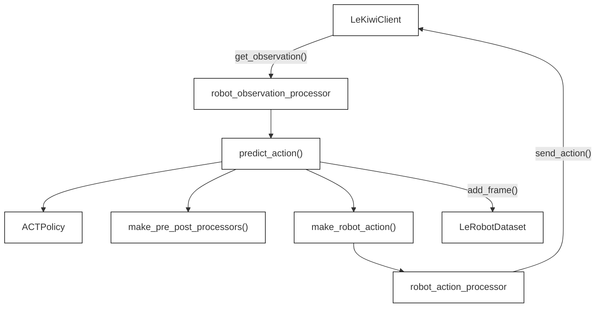
*Figure 1: LeKiwi Evaluation and Action Flow*

Sources: `examples/lekiwi/record.py`, `examples/lekiwi/evaluate.py`, `examples/lekiwi/teleoperate.py`

### End-Effector Kinematic Control Scripts
The `examples/so100_to_so100_EE/` and `examples/phone_to_so100/` directories demonstrate cartesian end-effector (EE) control pipelines using Robot Description (URDF) kinematics solvers (`RobotKinematics`) [examples/so100_to_so100_EE/record.py:67-76](). 

These scripts construct `RobotProcessorPipeline` instances that map joint observations to EE poses via `ForwardKinematicsJointsToEE` [examples/so100_to_so100_EE/record.py:81](), enforce safety limits with `EEBoundsAndSafety` [examples/so100_to_so100_EE/record.py:103](), and map target EE trajectories back to joint actions using `InverseKinematicsEEToJoints` [examples/so100_to_so100_EE/record.py:107]().

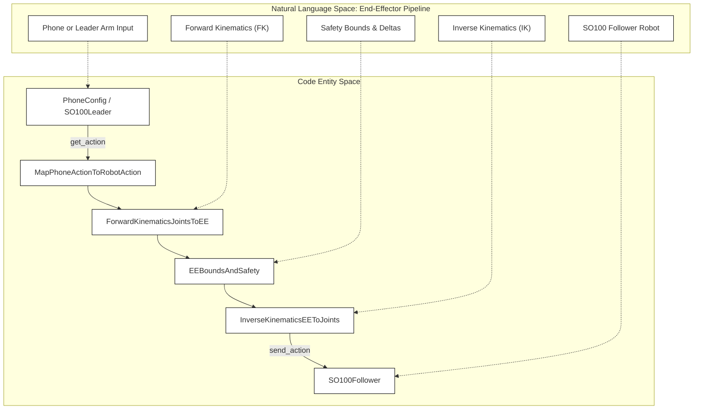
*Figure 2: Natural Language to Code Entity Mapping for EE Kinematic Teleoperation*

Sources: `examples/so100_to_so100_EE/record.py`, `examples/so100_to_so100_EE/evaluate.py`, `examples/phone_to_so100/record.py`, `examples/phone_to_so100/evaluate.py`

---

## 2. Policy, RL, and Async Inference Tutorials

The `examples/tutorial/` directory offers modular scripts covering training and inference workflows for various policy backends.

### Imitation Learning and VLA Tutorials
- **ACT (`examples/tutorial/act/`)**: Demonstrates how to instantiate, train (`act_training_example.py` [examples/tutorial/act/act_training_example.py]()), and run inference (`act_using_example.py` [examples/tutorial/act/act_using_example.py]()) with Action Chunking with Transformers (ACT).
- **Diffusion (`examples/tutorial/diffusion/`)**: Illustrates score-based diffusion policy training and execution pipelines (`diffusion_training_example.py` [examples/tutorial/diffusion/diffusion_training_example.py](), `diffusion_using_example.py` [examples/tutorial/diffusion/diffusion_using_example.py]()).
- **Vision-Language-Action Models (`examples/tutorial/pi0/`, `examples/tutorial/smolvla/`)**: Provides integration guides for streaming multimodal models like $\pi_0$ (`using_pi0_example.py` [examples/tutorial/pi0/using_pi0_example.py]()) and SmolVLA (`using_smolvla_example.py` [examples/tutorial/smolvla/using_smolvla_example.py]()).

### Reinforcement Learning and Reward Modeling
- **HIL-SERL (`examples/tutorial/rl/hilserl_example.py`)**: Implements High-In-the-Loop Soft Actor-Critic (HIL-SERL) pipelines combining offline demonstration datasets with online reinforcement learning updates [examples/tutorial/rl/hilserl_example.py]().
- **Reward Classifiers (`examples/tutorial/rl/reward_classifier_example.py`)**: Demonstrates training binary or continuous success/reward classifiers to score task completion during rollouts [examples/tutorial/rl/reward_classifier_example.py]().

### Asynchronous Inference Architecture
The asynchronous inference tutorial (`examples/tutorial/async-inf/`) demonstrates decoupled client-server robot control. `robot_client.py` [examples/tutorial/async-inf/robot_client.py:1-62]() sets up a `RobotClientConfig` [examples/tutorial/async-inf/robot_client.py:29-38]() specifying camera configuration, serial ports, and chunking thresholds. It starts a background action receiver thread to consume action chunks over gRPC while executing the main control loop [examples/tutorial/async-inf/robot_client.py:48-49]().

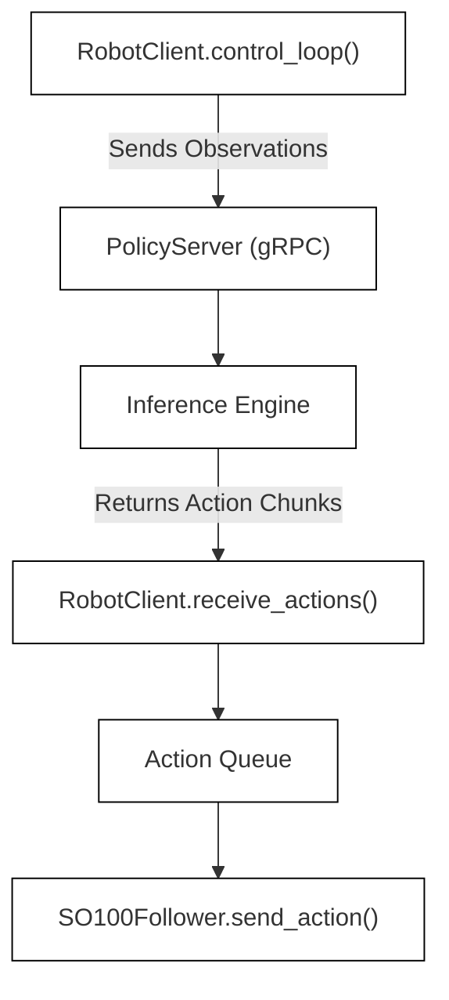
*Figure 3: Asynchronous Inference Execution Flow*

Sources: `examples/tutorial/async-inf/robot_client.py`, `examples/tutorial/act/act_using_example.py`, `examples/tutorial/rl/hilserl_example.py`

---

## 3. Dataset Loading and Manipulation Examples

The `examples/dataset/` directory includes reference implementations for inspecting and consuming datasets stored in the LeRobot format.

Dataset loading scripts demonstrate querying the Hugging Face Hub for robotics datasets using `HfApi`, fetching lightweight metadata via `LeRobotDatasetMetadata`, and instantiating `LeRobotDataset` for episodic slicing.

### Delta Timestamps and Batching
The dataset example illustrates configuring `delta_timestamps` to retrieve temporal context windows for multimodal inputs:
- **Cameras**: Loaded with relative offsets across timestamps.
- **States**: Sampled across past history buffers.
- **Actions**: Extracted as future chunk trajectories.

These datasets integrate directly with standard PyTorch `DataLoader` constructs for batched training.

Sources: `examples/dataset/load_lerobot_dataset.py`, `examples/dataset/use_dataset_image_transforms.py`

---

## 4. Dataset Porting and SLURM Pipeline

The `examples/port_datasets/` directory provides distributed cluster scripts designed to convert large-scale external robotics datasets (such as DROID or Bridge) into the standardized LeRobot v3.0 format.

```mermaid
graph TD
    subgraph "Natural Language Space: Dataset Porting"
    N1["External Raw Dataset Shards"]
    N2["SLURM Array Job Execution"]
    N3["Consolidated LeRobot Parquet/Video Files"]
    N4["Hugging Face Hub Push"]
    end

    subgraph "Code Entity Space"
    C1["slurm_port_shards.py"] -->|Processes Shards| C2["port_droid.py"]
    C2 --> C3["slurm_aggregate_shards.py"]
    C3 --> C4["slurm_upload.py"]
    C4 -->|push_to_hub()| C5["LeRobotDatasetHub"]
    end

    N1 -.-> C1
    N2 -.-> C2
    N3 -.-> C3
    N4 -.-> C5

    classDef default fill:#fff,stroke:#000,stroke-width:1px;
```
*Figure 4: Dataset Porting and SLURM Execution Pipeline*

### Script Breakdown
- `slurm_port_shards.py` [examples/port_datasets/slurm_port_shards.py](): Dispatches parallel array jobs across a SLURM cluster to convert raw trajectory files into intermediate LeRobot shards.
- `port_droid.py` [examples/port_datasets/port_droid.py](): Implements specific data parsing and schema mapping logic for transforming DROID dataset structures into `LeRobotDataset` features. For example, `DROID_SHARDS` [examples/port_datasets/port_droid.py:28]() defines the structure of DROID dataset shards.
- `slurm_aggregate_shards.py` [examples/port_datasets/slurm_aggregate_shards.py](): Combines distributed shards into a single unified dataset repository, remapping episode indices and computing normalization statistics.
- `slurm_upload.py` [examples/port_datasets/slurm_upload.py:1-286](): Handles authenticated multi-part uploading of consolidated parquet chunks, video mp4 files, and metadata JSON records to the Hugging Face Hub. The `UploadDataset` class [examples/port_datasets/slurm_upload.py:33-101]() manages repository creation, dataset card generation using `create_lerobot_dataset_card` [examples/port_datasets/slurm_upload.py:87](), and file listing. The `create_commits` method [examples/port_datasets/slurm_upload.py:108-150]() handles committing files in chunks to avoid race conditions during large uploads.

Sources: `examples/port_datasets/slurm_port_shards.py`, `examples/port_datasets/slurm_aggregate_shards.py`, `examples/port_datasets/slurm_upload.py`, `examples/port_datasets/port_droid.py`

---

# Page: LeRobotDataset

# LeRobotDataset

<details>
<summary>Relevant source files</summary>

The following files were used as context for generating this wiki page:

- [src/lerobot/configs/default.py](src/lerobot/configs/default.py)
- [src/lerobot/datasets/dataset_metadata.py](src/lerobot/datasets/dataset_metadata.py)
- [src/lerobot/datasets/dataset_reader.py](src/lerobot/datasets/dataset_reader.py)
- [src/lerobot/datasets/factory.py](src/lerobot/datasets/factory.py)
- [src/lerobot/datasets/lerobot_dataset.py](src/lerobot/datasets/lerobot_dataset.py)
- [src/lerobot/datasets/streaming_dataset.py](src/lerobot/datasets/streaming_dataset.py)
- [src/lerobot/datasets/utils.py](src/lerobot/datasets/utils.py)
- [src/lerobot/datasets/video_utils.py](src/lerobot/datasets/video_utils.py)
- [tests/configs/test_default.py](tests/configs/test_default.py)
- [tests/datasets/test_dataset_utils.py](tests/datasets/test_dataset_utils.py)
- [tests/datasets/test_datasets.py](tests/datasets/test_datasets.py)
- [tests/datasets/test_streaming.py](tests/datasets/test_streaming.py)

</details>


`LeRobotDataset` is the standardized data format and access framework for robotic datasets in LeRobot [src/lerobot/datasets/lerobot_dataset.py:52-77](). It solves the data fragmentation problem in robotics by providing a unified, memory-efficient format that enables seamless sharing, streaming, and reuse of robot demonstration data across the community.

## Design Goals

The LeRobotDataset format was designed with these key principles:

| Goal | Implementation |
|------|---------------|
| **Standardization** | Single format works across all robot types and tasks |
| **Efficiency** | Memory-mapped Parquet + compressed MP4 for minimal RAM usage |
| **Scalability** | Chunked file structure handles datasets with millions of frames |
| **Shareability** | Native Hugging Face Hub integration for one-line download/upload |
| **Simplicity** | Pure Parquet/JSON/MP4 - no complex database tools required [src/lerobot/datasets/lerobot_dataset.py:156-157]() |
| **Versioning** | Semantic versioning with strict compatibility checks [src/lerobot/datasets/utils.py:66-83]() |

Sources: [src/lerobot/datasets/lerobot_dataset.py:152-157](), [src/lerobot/datasets/utils.py:66-83]()

## Overview and Child Pages

This page introduces the LeRobotDataset system architecture and core concepts at a high level. For detailed technical implementations and specialized workflows, refer to the following child pages:

- **[Dataset Format and Structure](#2.1)**: Detail the file structure (`meta/`, `data/`, `videos/`), metadata files, chunking, versioning, storage backends (`parquet`, `lance`), and language columns.
- **[Creating and Recording Datasets](#2.2)**: Explain how to create datasets, the recording workflow with `lerobot-record`, `DatasetWriter`, episode management, frame buffering, and pushing to the Hub.
- **[Dataset Manipulation Tools](#2.3)**: Document `lerobot-edit-dataset` and `dataset_tools`: `delete_episodes`, split, merge, `modify_features/tasks`, plus the language and recipe system.
- **[Video Processing](#2.4)**: Explain video encoding/decoding: streaming vs batch encoding, `VideoEncoderCache`, codecs, `VideoEncoderConfig`, and benchmarks.
- **[Temporal Queries and Delta Timestamps](#2.5)**: Describe how `delta_timestamps` enable querying observations/actions at relative offsets, the tolerance mechanism, samplers, and use in training.
- **[Dataset Aggregation](#2.6)**: Explain `aggregate_datasets`: metadata validation, file consolidation, index remapping, stats computation.
- **[Steerable Annotation Pipeline](#2.7)**: Document `lerobot-annotate` and the steerable VLM-based annotation pipeline: phases, configs, staging JSONL format, distributed HF Jobs execution, and SARM subtask annotation.
- **[Streaming Datasets](#2.8)**: Document `StreamingLeRobotDataset` and the `src/lerobot/streaming` package: episode caching, parquet readers, worker sharding, and training on streamed data from the Hub.

Sources: [src/lerobot/datasets/lerobot_dataset.py:46-108]()

## Core Architecture

The LeRobotDataset ecosystem connects user-facing dataset classes (`LeRobotDataset`, `StreamingLeRobotDataset`, `MultiLeRobotDataset`) with underlying storage mechanisms via metadata and readers [src/lerobot/datasets/lerobot_dataset.py:52-77](), [src/lerobot/datasets/streaming_dataset.py:169-172]().

Diagram: LeRobotDataset Component Architecture (Natural Language to Code Entity Space)

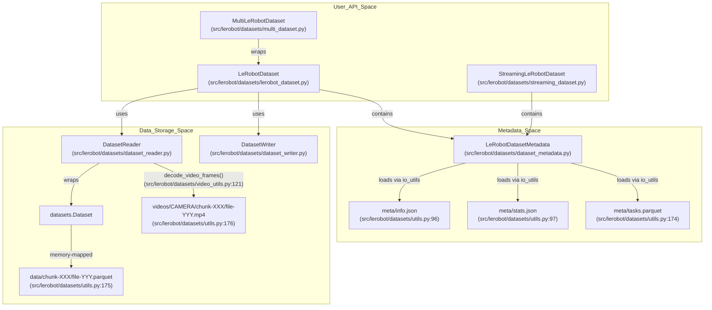

Sources: [src/lerobot/datasets/lerobot_dataset.py:46-101](), [src/lerobot/datasets/dataset_metadata.py:63-149](), [src/lerobot/datasets/streaming_dataset.py:169-172](), [src/lerobot/datasets/dataset_reader.py:109-126](), [src/lerobot/datasets/utils.py:96-97](), [src/lerobot/datasets/utils.py:174-176](), [src/lerobot/datasets/video_utils.py:121]()

### LeRobotDataset Lifecycle and Methods

The `LeRobotDataset` class handles data loading, recording, and indexing across distinct operational phases [src/lerobot/datasets/lerobot_dataset.py:52-77]().

Diagram: LeRobotDataset Lifecycle Methods (Natural Language to Code Entity Space)

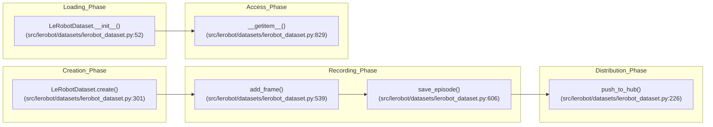

| Method / Class | Location | Purpose |
|----------------|----------|---------|
| `LeRobotDataset.create()` | [src/lerobot/datasets/lerobot_dataset.py:301]() | Create new empty dataset for recording or porting |
| `LeRobotDataset.add_frame()` | [src/lerobot/datasets/lerobot_dataset.py:539]() | Buffer a single timestep observation/action |
| `LeRobotDataset.save_episode()` | [src/lerobot/datasets/lerobot_dataset.py:606]() | Finalize episode, encode videos, and write to disk |
| `LeRobotDataset.__init__()` | [src/lerobot/datasets/lerobot_dataset.py:52]() | Load existing dataset from local root or Hub |
| `LeRobotDataset.__getitem__()` | [src/lerobot/datasets/lerobot_dataset.py:829]() | Access frames with video decoding and transforms |
| `LeRobotDataset.push_to_hub()` | [src/lerobot/datasets/lerobot_dataset.py:226]() | Upload dataset and metadata to Hugging Face Hub |

Sources: [src/lerobot/datasets/lerobot_dataset.py:46-913]()

## File Structure and Storage Format

LeRobotDataset v3.0 employs a decoupled, file-based architecture separating relational metadata, tabular sensorimotor data (Apache Parquet), and visual recordings (MP4) [src/lerobot/datasets/lerobot_dataset.py:102-150]().

For full details on file organization, chunking strategies, and storage backends like Lance, see [Dataset Format and Structure](#2.1).

Sources: [src/lerobot/datasets/lerobot_dataset.py:102-150]()

## Version Compatibility

LeRobotDataset enforces strict codebase versioning via `meta/info.json` [src/lerobot/datasets/dataset_metadata.py:166]() and compatibility checks [src/lerobot/datasets/utils.py:66-83](). Loading v2.1 datasets triggers backward compatibility errors prompting automated migration to v3.0 [src/lerobot/datasets/utils.py:33-47]().

For migration scripts and compatibility rules, see [Dataset Format and Structure](#2.1).

Sources: [src/lerobot/datasets/dataset_metadata.py:166](), [src/lerobot/datasets/utils.py:33-83]()

## Hugging Face Hub Integration

LeRobotDataset integrates natively with the Hugging Face Hub for remote storage, version control, and streaming:
- **Downloads**: Handled transparently through `snapshot_download` during initialization [src/lerobot/datasets/lerobot_dataset.py:24-25]() when `repo_id` is specified.
- **Uploads**: `push_to_hub()` publishes datasets, generated README dataset cards, and tags [src/lerobot/datasets/lerobot_dataset.py:226-271]().
- **Streaming**: `StreamingLeRobotDataset` enables memory-efficient iteration directly from the Hub or HF Storage Buckets (`hf://buckets/`) without local downloads [src/lerobot/datasets/streaming_dataset.py:169-172]().

For advanced hub operations, see [Hugging Face Hub Integration](#9.1).

Sources: [src/lerobot/datasets/lerobot_dataset.py:24-25](), [src/lerobot/datasets/lerobot_dataset.py:226-271](), [src/lerobot/datasets/streaming_dataset.py:169-172]()

---

# Page: Dataset Format and Structure

# Dataset Format and Structure

<details>
<summary>Relevant source files</summary>

The following files were used as context for generating this wiki page:

- [docs/source/lerobot-dataset-v3.mdx](docs/source/lerobot-dataset-v3.mdx)
- [src/lerobot/datasets/__init__.py](src/lerobot/datasets/__init__.py)
- [src/lerobot/datasets/lance_backend.py](src/lerobot/datasets/lance_backend.py)
- [src/lerobot/datasets/lance_utils.py](src/lerobot/datasets/lance_utils.py)
- [src/lerobot/datasets/multi_dataset.py](src/lerobot/datasets/multi_dataset.py)
- [src/lerobot/datasets/storage.py](src/lerobot/datasets/storage.py)
- [src/lerobot/processor/__init__.py](src/lerobot/processor/__init__.py)
- [src/lerobot/processor/image_augmentation_processor.py](src/lerobot/processor/image_augmentation_processor.py)
- [src/lerobot/scripts/lerobot_imgtransform_viz.py](src/lerobot/scripts/lerobot_imgtransform_viz.py)
- [src/lerobot/transforms/__init__.py](src/lerobot/transforms/__init__.py)
- [src/lerobot/transforms/deprecated.py](src/lerobot/transforms/deprecated.py)
- [src/lerobot/transforms/transforms.py](src/lerobot/transforms/transforms.py)
- [tests/artifacts/image_transforms/default_transforms.safetensors](tests/artifacts/image_transforms/default_transforms.safetensors)
- [tests/artifacts/image_transforms/save_image_transforms_to_safetensors.py](tests/artifacts/image_transforms/save_image_transforms_to_safetensors.py)
- [tests/datasets/test_dataset_metadata.py](tests/datasets/test_dataset_metadata.py)
- [tests/datasets/test_dataset_reader.py](tests/datasets/test_dataset_reader.py)
- [tests/datasets/test_image_transforms.py](tests/datasets/test_image_transforms.py)
- [tests/datasets/test_lance_backend.py](tests/datasets/test_lance_backend.py)
- [tests/datasets/test_language.py](tests/datasets/test_language.py)
- [tests/datasets/test_lerobot_dataset.py](tests/datasets/test_lerobot_dataset.py)

</details>


`LeRobotDataset` (v3.0) is a standardized, high-performance format for robot learning data. It provides unified access to multi-modal time-series data, sensorimotor signals, and multi-camera video, while maintaining a clean directory layout optimized for both local training and cloud-native streaming from the Hugging Face Hub.

**Scope**: This page details the physical storage layout, metadata schema, storage backends (Parquet and Lance), language columns, chunking, and versioning implementation details. For recording workflows, see [Creating and Recording Datasets](#2.2). For temporal window queries, see [Temporal Queries and Delta Timestamps](#2.5).

Sources: [docs/source/lerobot-dataset-v3.mdx:1-3](), [src/lerobot/datasets/dataset_metadata.py:64-70](), [src/lerobot/datasets/storage.py:27-50]()

## Directory Structure Overview

A `LeRobotDataset` decouples logical episode boundaries from physical storage. Many episodes are concatenated into large files to minimize file-system pressure and overhead during initialization.

### Directory Tree

```text
dataset_root/
├── meta/
│   ├── info.json                      # Canonical schema and path templates
│   ├── stats.json                     # Global normalization statistics
│   ├── tasks.jsonl                    # Natural language task mappings
│   └── episodes/                      # Episode-level segmentation metadata
│       ├── chunk-000/
│       │   ├── file-000.parquet       
│       │   └── ...
├── data/                              # Sensorimotor signals (states, actions, etc.)
│   ├── chunk-000/
│   │   ├── file-000.parquet           # Multi-episode Parquet shards
│   │   └── ...
└── videos/                            # Camera streams (encoded MP4)
    ├── observation.images.top/
    │   ├── chunk-000/
    │   │   ├── file-000.mp4           # Multi-episode video shards
    │   │   └── ...
```

Sources: [docs/source/lerobot-dataset-v3.mdx:81-88]()

## Implementation: Metadata and I/O Flow

The `LeRobotDatasetMetadata` class acts as the central orchestrator for reading and writing the dataset structure, managing `info.json`, `stats.json`, `tasks.jsonl`, and `episodes/` parquet files.

### Data Flow and Code Entity Mapping
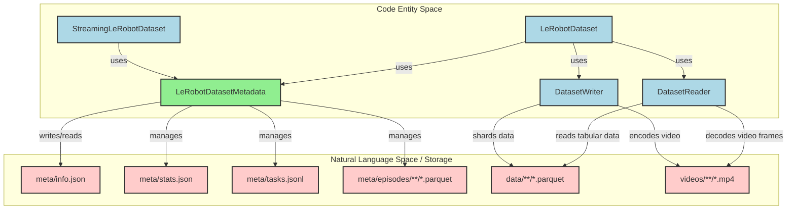

Sources: [docs/source/lerobot-dataset-v3.mdx:60-65](), [src/lerobot/datasets/dataset_metadata.py:64-149](), [src/lerobot/datasets/streaming_dataset.py:96-107]()

## Storage Backends

LeRobot supports extensible storage backends via the `storage.py` abstraction layer [src/lerobot/datasets/storage.py:27-46](). The default backend uses Parquet for tabular data and MP4 for videos, but alternative backends such as Lance are fully integrated [src/lerobot/datasets/storage.py:48]() [tests/datasets/test_lance_backend.py:41-97]().

### Storage Backend Architecture
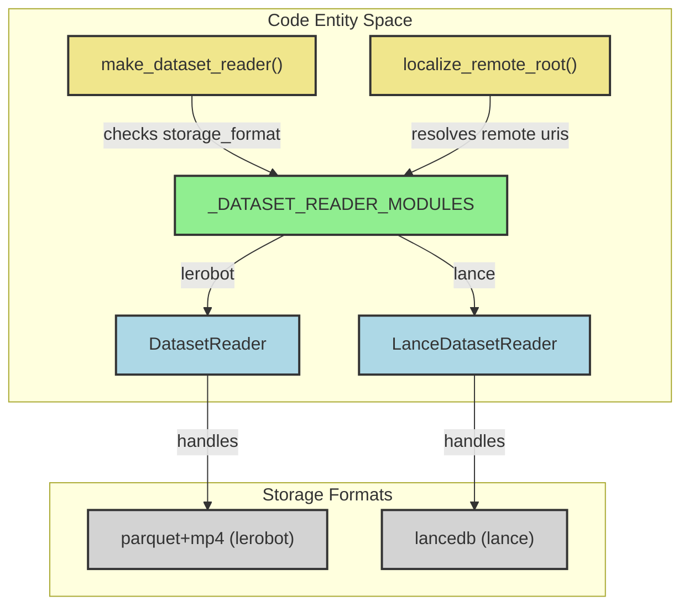

*   **Default (`lerobot`)**: Utilizes Apache Arrow / Parquet for tabular sensorimotor frames and PyAV for MP4 video container streaming [src/lerobot/datasets/storage.py:27-72]().
*   **Lance (`lance`)**: Registered via `register_dataset_reader("lance", "lerobot.datasets.lance_backend")` [src/lerobot/datasets/storage.py:56](), providing zero-copy columnar vector search and high-throughput streaming through `LanceDatasetReader` [src/lerobot/datasets/lance_backend.py:97-103]() [tests/datasets/test_lance_backend.py:41-97]().

Sources: [docs/source/lerobot-dataset-v3.mdx:23-24](), [src/lerobot/datasets/storage.py:27-73](), [src/lerobot/datasets/lance_backend.py:97-103](), [tests/datasets/test_lance_backend.py:41-97]()

## Metadata Specification

### info.json
This file defines the canonical schema, captured in the `DatasetInfo` dataclass. It contains information about shapes, keys, capture frequency, and path templates [docs/source/lerobot-dataset-v3.mdx:83]().

| Field | Code Symbol | Description |
|-------|-------------|-------------|
| `codebase_version` | `CODEBASE_VERSION` | Versioning for compatibility checks (v3.0) [src/lerobot/datasets/dataset_metadata.py:61]() |
| `features` | `DatasetInfo.features` | Dict of feature names to dtypes and shapes [src/lerobot/datasets/dataset_metadata.py:64-70]() |
| `fps` | `DatasetInfo.fps` | Control/Capture frequency [src/lerobot/datasets/dataset_metadata.py:64-70]() |
| `data_path` | `DatasetInfo.data_path` | Template for data shard locations [src/lerobot/datasets/dataset_metadata.py:64-70]()

Sources: [docs/source/lerobot-dataset-v3.mdx:83](), [src/lerobot/datasets/dataset_metadata.py:61-70]()

### stats.json
Stores global statistics (min, max, mean, std) for every feature [docs/source/lerobot-dataset-v3.mdx:84](). These are used for normalization during policy training. Statistics can be computed and updated incrementally using `aggregate_stats` [src/lerobot/datasets/compute_stats.py:24-36]().

Sources: [docs/source/lerobot-dataset-v3.mdx:84](), [src/lerobot/datasets/compute_stats.py:24-36]()

## Data and Video Storage Implementation

### Relational Metadata (`episodes/` shards)
Episode boundaries and lookups are resolved through metadata, not filenames. The `_flush_metadata_buffer` method in `LeRobotDatasetMetadata` persists these records to chunked Parquet files under `meta/episodes/` [src/lerobot/datasets/dataset_metadata.py:151-175]().

### Episode Segmentation Logic
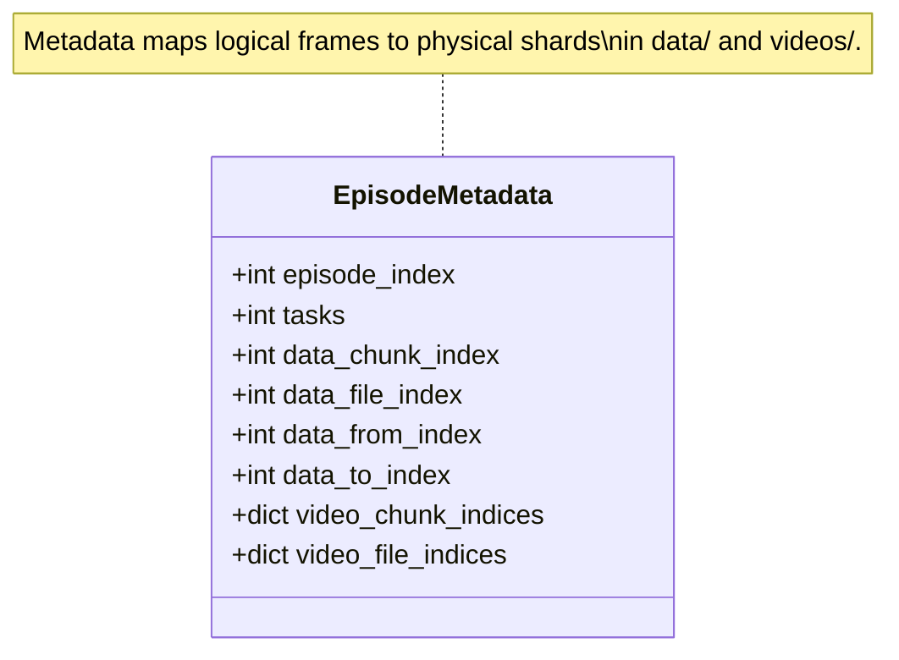

Sources: [docs/source/lerobot-dataset-v3.mdx:66-67](), [src/lerobot/datasets/dataset_metadata.py:151-175]()

## Language Support

LeRobot supports multimodal annotations through standardized language columns defined in `LANGUAGE_COLUMNS` [src/lerobot/datasets/language.py:20]():

1.  **`language_persistent`**: Global instructions that remain constant throughout an episode (e.g., "Pick up the black cube").
2.  **`language_events`**: Time-varying instructions or subtask labels that change frame-by-frame (e.g., "Move toward the cube", "Grasp the cube").

These columns are validated during dataset loading to ensure consistency with metadata [tests/datasets/test_dataset_reader.py:89-92]().

Sources: [src/lerobot/datasets/language.py:20](), [tests/datasets/test_dataset_reader.py:31](), [tests/datasets/test_dataset_reader.py:89-92]()

## Chunking and Versioning

### Chunking Strategy
To maintain performance at scale, `LeRobotDataset` groups files into chunks and shards based on target sizes:
*   **`DEFAULT_CHUNK_SIZE`**: Max number of files per chunk directory (1000) [src/lerobot/datasets/utils.py:89]().
*   **`DEFAULT_DATA_FILE_SIZE_IN_MB`**: Max size per Parquet data file (100 MB) [src/lerobot/datasets/utils.py:90]().
*   **`DEFAULT_VIDEO_FILE_SIZE_IN_MB`**: Max size per MP4 video file (200 MB) [src/lerobot/datasets/utils.py:91]().

Sources: [src/lerobot/datasets/utils.py:89-91]()

### Versioning and Compatibility
The codebase version is tracked via `CODEBASE_VERSION = "v3.0"` [src/lerobot/datasets/dataset_metadata.py:61]().
*   **Compatibility Checks**: `check_version_compatibility` ensures the dataset format matches the codebase expectations [src/lerobot/datasets/utils.py:53]().

Sources: [src/lerobot/datasets/dataset_metadata.py:61](), [src/lerobot/datasets/utils.py:53-58]()

## Streaming Support
The `StreamingLeRobotDataset` class allows consuming datasets directly from the Hub or HF Storage Buckets (`repo_type="bucket"`) without full local downloads [docs/source/lerobot-dataset-v3.mdx:137-142]().

### Backtrackable Iterator
It uses a `Backtrackable` wrapper to allow stepping back (`peek_back`) or looking ahead (`peek_ahead`) in the stream, which is critical for temporal queries in streaming mode [src/lerobot/datasets/streaming_dataset.py:66-96]().

Sources: [docs/source/lerobot-dataset-v3.mdx:137-142](), [src/lerobot/datasets/streaming_dataset.py:27-107]()

---

# Page: Creating and Recording Datasets

# Creating and Recording Datasets

<details>
<summary>Relevant source files</summary>

The following files were used as context for generating this wiki page:

- [docs/source/using_dataset_tools.mdx](docs/source/using_dataset_tools.mdx)
- [examples/dataset/use_dataset_tools.py](examples/dataset/use_dataset_tools.py)
- [src/lerobot/datasets/dataset_tools.py](src/lerobot/datasets/dataset_tools.py)
- [src/lerobot/datasets/dataset_writer.py](src/lerobot/datasets/dataset_writer.py)
- [src/lerobot/datasets/io_utils.py](src/lerobot/datasets/io_utils.py)
- [src/lerobot/robots/utils.py](src/lerobot/robots/utils.py)
- [src/lerobot/scripts/lerobot_calibrate.py](src/lerobot/scripts/lerobot_calibrate.py)
- [src/lerobot/scripts/lerobot_edit_dataset.py](src/lerobot/scripts/lerobot_edit_dataset.py)
- [src/lerobot/scripts/lerobot_find_joint_limits.py](src/lerobot/scripts/lerobot_find_joint_limits.py)
- [src/lerobot/scripts/lerobot_record.py](src/lerobot/scripts/lerobot_record.py)
- [src/lerobot/scripts/lerobot_replay.py](src/lerobot/scripts/lerobot_replay.py)
- [src/lerobot/scripts/lerobot_setup_motors.py](src/lerobot/scripts/lerobot_setup_motors.py)
- [src/lerobot/scripts/lerobot_teleoperate.py](src/lerobot/scripts/lerobot_teleoperate.py)
- [src/lerobot/teleoperators/utils.py](src/lerobot/teleoperators/utils.py)
- [tests/datasets/test_dataset_tools.py](tests/datasets/test_dataset_tools.py)
- [tests/datasets/test_dataset_writer.py](tests/datasets/test_dataset_writer.py)
- [tests/scripts/test_edit_dataset_parsing.py](tests/scripts/test_edit_dataset_parsing.py)
- [tests/scripts/test_setup_motors.py](tests/scripts/test_setup_motors.py)

</details>


This page explains how to create new `LeRobotDataset` instances, record robot demonstration data using the `lerobot-record` CLI, manage episode buffers via `DatasetWriter`, handle asynchronous frame and video processing, and publish completed datasets to the Hugging Face Hub [src/lerobot/scripts/lerobot_record.py:16-42](), [src/lerobot/datasets/dataset_writer.py:16-106]().

---

## Dataset Initialization and Creation

To start a new dataset for recording, use `LeRobotDataset.create()` [tests/datasets/test_dataset_writer.py:112-114](). This method initializes the local directory layout, including metadata files (`meta/info.json`, `meta/episodes.jsonl`, `meta/tasks.jsonl`), data directories (`data/`), and video or image folders (`videos/`) [src/lerobot/datasets/dataset_writer.py:118-154]().

**Dataset Creation Architecture**
```mermaid
graph TB
    subgraph "Natural Language Space"
        UserReq["User Dataset Specification"]
        DatasetSchema["Dataset Features Schema"]
    end

    subgraph "Code Entity Space"
        CreateMethod["LeRobotDataset.create()"]
        Metadata["LeRobotDatasetMetadata"]
        Writer["DatasetWriter (src/lerobot/datasets/dataset_writer.py)"]
        InfoJSON["meta/info.json"]
    end

    UserReq -->|"Parameters (repo_id, fps)"| CreateMethod
    DatasetSchema -->|"Feature Definitions"| CreateMethod
    CreateMethod -->|"Initializes"| Metadata
    Metadata -->|"Writes schema"| InfoJSON
    CreateMethod -->|"Instantiates"| Writer
```
**Sources:** [src/lerobot/datasets/dataset_writer.py:108-154](), [tests/datasets/test_dataset_writer.py:112-114]()

---

## Recording Workflow with `lerobot-record`

The `lerobot-record` script is the primary tool for capturing robot demonstrations via teleoperation [src/lerobot/scripts/lerobot_record.py:16-18](). It parses command-line arguments using `RecordConfig` [src/lerobot/scripts/lerobot_record.py:171-192](), connects to hardware devices through `make_robot_from_config` [src/lerobot/robots/utils.py:27-90]() and `make_teleoperator_from_config` [src/lerobot/teleoperators/utils.py:36-118](), and runs a timed control loop.

The `lerobot-record` script supports various configurations for robots, teleoperators, and dataset parameters. For example, it can be used with bimanual robots and custom video encoding settings [src/lerobot/scripts/lerobot_record.py:45-68](), [src/lerobot/scripts/lerobot_record.py:71-89]().

**Recording System Architecture**
```mermaid
graph TB
    subgraph "Natural Language Space"
        TeleopDevice["Teleoperation Device (Leader Arm / Gamepad)"]
        RobotHardware["Robot Follower Hardware"]
    end

    subgraph "Code Entity Space"
        RecordScript["lerobot-record (lerobot_record.py)"]
        RecordConfig["RecordConfig (src/lerobot/scripts/lerobot_record.py)"]
        MakeRobot["make_robot_from_config (src/lerobot/robots/utils.py)"]
        MakeTeleop["make_teleoperator_from_config (src/lerobot/teleoperators/utils.py)"]
        CycleTimer["CycleTimer (src/lerobot/utils/cycle_timer.py)"]
        RobotProcessorPipeline["RobotProcessorPipeline (src/lerobot/processor.py)"]
    end

    RecordScript --> RecordConfig
    RecordConfig --> MakeRobot
    RecordConfig --> MakeTeleop
    MakeRobot --> RobotHardware
    MakeTeleop --> TeleopDevice
    RecordScript --> CycleTimer
    RecordScript --> RobotProcessorPipeline
    TeleopDevice --"Raw Actions"--> RobotProcessorPipeline
    RobotProcessorPipeline --"Processed Actions"--> RobotHardware
    RobotHardware --"Observations"--> RobotProcessorPipeline
```
**Sources:** [src/lerobot/scripts/lerobot_record.py:171-192](), [src/lerobot/robots/utils.py:27-90](), [src/lerobot/teleoperators/utils.py:36-118](), [src/lerobot/scripts/lerobot_record.py:45-68](), [src/lerobot/scripts/lerobot_record.py:71-89]()

---

## DatasetWriter and Frame Buffering

The `DatasetWriter` class manages write-side state, accumulating recorded frames into an in-memory `episode_buffer` before flushing them to disk [src/lerobot/datasets/dataset_writer.py:101-155]().

When `add_frame()` is invoked, the frame is validated against the defined dataset schema [tests/datasets/test_dataset_writer.py:110-123](). Image observations are offloaded to an `AsyncImageWriter` to prevent blocking the main control loop during disk I/O operations [src/lerobot/datasets/dataset_writer.py:147]().

**Frame Buffering Data Flow**
```mermaid
graph TD
    subgraph "Natural Language Space"
        SensorFrame["Raw Sensor Frame / Observation"]
        TeleopAction["Teleoperator Action"]
    end

    subgraph "Code Entity Space"
        AddFrame["LeRobotDataset.add_frame()"]
        Buffer["DatasetWriter.episode_buffer (src/lerobot/datasets/dataset_writer.py)"]
        AsyncWriter["AsyncImageWriter (src/lerobot/datasets/image_writer.py)"]
        DiskQueue["Local Disk Storage"]
    end

    SensorFrame --> AddFrame
    TeleopAction --> AddFrame
    AddFrame -->|"Buffers data"| Buffer
    AddFrame -->|"Async write images"| AsyncWriter
    AsyncWriter --> DiskQueue
```
**Sources:** [src/lerobot/datasets/dataset_writer.py:101-155](), [tests/datasets/test_dataset_writer.py:110-123]()

---

## Episode Management and Video Encoding

Once an episode concludes, `save_episode()` finalizes the buffer [tests/datasets/test_dataset_writer.py:137-148]().

1.  **Statistics Computation**: `compute_episode_stats()` calculates min, max, mean, and standard deviation for normalization [src/lerobot/datasets/dataset_writer.py:43]().
2.  **Video Encoding**: `_encode_video_worker()` or `StreamingVideoEncoder` compresses image sequences into MP4 files using encoders configured via `VideoEncoderConfig` [src/lerobot/datasets/dataset_writer.py:73-99](), [tests/datasets/test_dataset_writer.py:56-83]().
3.  **Parquet Serialization**: Non-image features are serialized into Apache Parquet files using PyArrow `ParquetWriter` [src/lerobot/datasets/dataset_writer.py:31](), [src/lerobot/datasets/dataset_writer.py:149]().

**Sources:** [src/lerobot/datasets/dataset_writer.py:31-99](), [tests/datasets/test_dataset_writer.py:56-148]()

---

## Hub Integration and Publishing

After recording and validating local episodes, datasets can be uploaded directly to the Hugging Face Hub using `push_to_hub()` [src/lerobot/datasets/lerobot_dataset.py:796-849](). This step creates remote repositories, generates descriptive model/dataset cards, uploads metadata and chunked data artifacts, and applies codebase version tags.

**Sources:** [src/lerobot/datasets/lerobot_dataset.py:796-849]()

---

# Page: Dataset Manipulation Tools

# Dataset Manipulation Tools

<details>
<summary>Relevant source files</summary>

The following files were used as context for generating this wiki page:

- [docs/source/fineart_vla.mdx](docs/source/fineart_vla.mdx)
- [docs/source/language_and_recipes.mdx](docs/source/language_and_recipes.mdx)
- [docs/source/policy_fineart_vla_README.md](docs/source/policy_fineart_vla_README.md)
- [docs/source/using_dataset_tools.mdx](docs/source/using_dataset_tools.mdx)
- [examples/dataset/use_dataset_tools.py](examples/dataset/use_dataset_tools.py)
- [src/lerobot/configs/recipes/subtask_joint.yaml](src/lerobot/configs/recipes/subtask_joint.yaml)
- [src/lerobot/datasets/dataset_tools.py](src/lerobot/datasets/dataset_tools.py)
- [src/lerobot/datasets/dataset_writer.py](src/lerobot/datasets/dataset_writer.py)
- [src/lerobot/datasets/io_utils.py](src/lerobot/datasets/io_utils.py)
- [src/lerobot/datasets/language_render.py](src/lerobot/datasets/language_render.py)
- [src/lerobot/policies/fineart_vla/README.md](src/lerobot/policies/fineart_vla/README.md)
- [src/lerobot/policies/fineart_vla/__init__.py](src/lerobot/policies/fineart_vla/__init__.py)
- [src/lerobot/scripts/lerobot_edit_dataset.py](src/lerobot/scripts/lerobot_edit_dataset.py)
- [tests/datasets/test_dataset_tools.py](tests/datasets/test_dataset_tools.py)
- [tests/datasets/test_dataset_writer.py](tests/datasets/test_dataset_writer.py)
- [tests/datasets/test_language_render.py](tests/datasets/test_language_render.py)
- [tests/datasets/test_recipe.py](tests/datasets/test_recipe.py)
- [tests/processor/test_render_messages_processor.py](tests/processor/test_render_messages_processor.py)
- [tests/scripts/test_edit_dataset_parsing.py](tests/scripts/test_edit_dataset_parsing.py)
- [tests/utils/test_collate.py](tests/utils/test_collate.py)

</details>


This page documents the tools available for modifying existing `LeRobotDataset` instances after they have been recorded or downloaded. The operations covered include deleting episodes, splitting and merging datasets, adding and removing data features, modifying tasks, reassigning task labels, converting image-based datasets to video format, and managing the language and recipe system.

---

## Architecture Overview

The manipulation system consists of two primary layers: a public Python API implemented in `[src/lerobot/datasets/dataset_tools.py:17-24]()` and a command-line interface front-end in `[src/lerobot/scripts/lerobot_edit_dataset.py:17-25]()`. The CLI parses parameters using `draccus` and delegates directly to the API functions.

**System layers and code entities:**

```mermaid
flowchart TD
    CLI["lerobot-edit-dataset\nsrc/lerobot/scripts/lerobot_edit_dataset.py"]
    CFG["EditDatasetConfig\n+ OperationConfig subclasses"]
    API["src/lerobot/datasets/dataset_tools.py"]
    AGG["aggregate_datasets\nsrc/lerobot/datasets/aggregate.py"]
    DS["LeRobotDataset\nLeRobotDatasetMetadata"]
    HUB["Hugging Face Hub\npush_to_hub()"]

    CLI --> CFG
    CFG --> CLI
    CLI -- "handle_*(cfg)" --> API
    API -- "delete_episodes()" --> DS
    API -- "split_dataset()" --> DS
    API -- "merge_datasets()" --> AGG
    AGG --> DS
    API -- "add_features() / remove_feature()" --> DS
    API -- "modify_tasks()" --> DS
    API -- "convert_image_to_video_dataset()" --> DS
    CLI -- "push_to_hub()" --> HUB
```

Sources: [src/lerobot/scripts/lerobot_edit_dataset.py:18-24](), [src/lerobot/datasets/dataset_tools.py:17-24]()

**Natural Language Intent to Code Entity Space Bridge (Editing Operations):**

```mermaid
flowchart LR
    subgraph NaturalLanguageSpace["Natural Language Space (Intent)"]
        N1["'Delete bad trials'"]
        N2["'Split into train/val'"]
        N3["'Combine logs'"]
        N4["'Fix task typos'"]
    end

    subgraph CodeEntitySpace["Code Entity Space (Implementation)"]
        C1["delete_episodes()\nsrc/lerobot/datasets/dataset_tools.py"]
        C2["split_dataset()\nsrc/lerobot/datasets/dataset_tools.py"]
        C3["merge_datasets()\nsrc/lerobot/datasets/dataset_tools.py"]
        C4["modify_tasks()\nsrc/lerobot/datasets/dataset_tools.py"]
    end

    N1 --> C1
    N2 --> C2
    N3 --> C3
    N4 --> C4
```

Sources: [src/lerobot/datasets/dataset_tools.py:107-115](), [src/lerobot/datasets/dataset_tools.py:175-190](), [src/lerobot/datasets/dataset_tools.py:246-260]()

---

## CLI: `lerobot-edit-dataset`

The command-line tool `[src/lerobot/scripts/lerobot_edit_dataset.py:17-25]()` is configured via a two-level dataclass hierarchy. `EditDatasetConfig` holds top-level parameters and an `operation` field that is a polymorphic `OperationConfig` subclass `[tests/scripts/test_edit_dataset_parsing.py:22-34]()`.

**Config class hierarchy:**

```mermaid
classDiagram
    class EditDatasetConfig {
        +repo_id: str
        +operation: OperationConfig
        +root: str | None
        +new_repo_id: str | None
        +push_to_hub: bool
    }
    class OperationConfig {
        <<abstract>>
        +type: str
    }
    class DeleteEpisodesConfig {
        +episode_indices: list[int] | None
    }
    class SplitConfig {
        +splits: dict[str, float | list[int]] | None
    }
    class MergeConfig {
        +repo_ids: list[str] | None
        +concatenate_videos: bool
        +concatenate_data: bool
    }
    class RemoveFeatureConfig {
        +feature_names: list[str] | None
    }
    class ModifyTasksConfig {
        +new_task: str | None
        +episode_tasks: dict[str, str] | None
        +task_replacements: dict[str, str] | None
    }
    class ConvertImageToVideoConfig {
        +output_dir: str | None
        +rgb_encoder: VideoEncoderConfig
        +depth_encoder: DepthEncoderConfig
    }
    class ReencodeVideosConfig {
        +rgb_encoder: VideoEncoderConfig
        +depth_encoder: DepthEncoderConfig
    }
    class InfoConfig {
        +show_features: bool
    }
    OperationConfig <|-- DeleteEpisodesConfig
    OperationConfig <|-- SplitConfig
    OperationConfig <|-- MergeConfig
    OperationConfig <|-- RemoveFeatureConfig
    OperationConfig <|-- ModifyTasksConfig
    OperationConfig <|-- ConvertImageToVideoConfig
    OperationConfig <|-- ReencodeVideosConfig
    OperationConfig <|-- InfoConfig
    EditDatasetConfig *-- OperationConfig
```

Sources: [src/lerobot/scripts/lerobot_edit_dataset.py:198-333](), [tests/scripts/test_edit_dataset_parsing.py:22-33]()

### Top-level parameters

| Parameter | Type | Description |
|-----------|------|-------------|
| `--repo_id` | `str` | Source dataset repository ID (e.g., `lerobot/pusht`) `[src/lerobot/scripts/lerobot_edit_dataset.py:33-33]()` |
| `--new_repo_id` | `str` | Output repository ID. If omitted, modifies in-place or defaults depending on operation `[src/lerobot/scripts/lerobot_edit_dataset.py:24-27]()` |
| `--root` | `str` | Local root path override for dataset storage `[src/lerobot/scripts/lerobot_edit_dataset.py:26-27]()` |
| `--push_to_hub` | `bool` | Upload the result to the Hugging Face Hub after the operation `[src/lerobot/scripts/lerobot_edit_dataset.py:162-162]()` |
| `--operation.type` | `str` | Selects which `OperationConfig` subclass to instantiate `[tests/scripts/test_edit_dataset_parsing.py:45-56]()` |

Sources: [src/lerobot/scripts/lerobot_edit_dataset.py:198-352](), [tests/scripts/test_edit_dataset_parsing.py:45-56]()

### Operation dispatch

The CLI script reads `cfg.operation.type` and delegates execution to the corresponding handler function `[src/lerobot/scripts/lerobot_edit_dataset.py:502-528]()`.

```mermaid
flowchart LR
    ED["edit_dataset(cfg)"]
    subgraph Handlers["CLI Handlers"]
        H1["handle_delete_episodes()"]
        H2["handle_split()"]
        H3["handle_merge()"]
        H4["handle_remove_feature()"]
        H5["handle_modify_tasks()"]
        H6["handle_convert_image_to_video()"]
        H7["handle_info()"]
        H8["handle_reencode_videos()"]
    end
    subgraph APIFunctions["dataset_tools.py"]
        F1["delete_episodes()"]
        F2["split_dataset()"]
        F3["merge_datasets()"]
        F4["remove_feature()"]
        F5["modify_tasks()"]
        F6["convert_image_to_video_dataset()"]
        F7["reencode_dataset()"]
    end

    ED -- "delete_episodes" --> H1
    ED -- "split" --> H2
    ED -- "merge" --> H3
    ED -- "remove_feature" --> H4
    ED -- "modify_tasks" --> H5
    ED -- "convert_image_to_video" --> H6
    ED -- "info" --> H7
    ED -- "reencode_videos" --> H8
    H1 --> F1
    H2 --> F2
    H3 --> F3
    H4 --> F4
    H5 --> F5
    H6 --> F6
    H8 --> F7
```

Sources: [src/lerobot/scripts/lerobot_edit_dataset.py:502-528](), [src/lerobot/datasets/dataset_tools.py:17-24]()

---

## API Reference: `dataset_tools.py`

Public functions in `[src/lerobot/datasets/dataset_tools.py:17-24]()` return a new `LeRobotDataset` instance (or a dictionary of datasets in the case of `split_dataset`), preserving immutability except where explicitly noted for `modify_tasks()`.

### `delete_episodes()`

Removes specified episodes and constructs a new dataset with re-indexed episode identifiers starting from 0 `[src/lerobot/datasets/dataset_tools.py:107-172]()`.

```python
def delete_episodes(
    dataset: LeRobotDataset,
    episode_indices: list[int],
    output_dir: str | Path | None = None,
    repo_id: str | None = None,
) -> LeRobotDataset
```

- Raises `ValueError` if `episode_indices` is empty or invalid `[src/lerobot/datasets/dataset_tools.py:126-132]()`.
- Handles video re-indexing and parquet data reconstruction `[src/lerobot/datasets/dataset_tools.py:155-161]()`.

Sources: [src/lerobot/datasets/dataset_tools.py:107-172]()

### `split_dataset()`

Divides a dataset into multiple subsets based on fractions or explicit index lists `[src/lerobot/datasets/dataset_tools.py:175-243]()`.

```python
def split_dataset(
    dataset: LeRobotDataset,
    splits: dict[str, float | list[int]],
    output_dir: str | Path | None = None,
) -> dict[str, LeRobotDataset]
```

Sources: [src/lerobot/datasets/dataset_tools.py:175-243]()

### `merge_datasets()`

Combines multiple `LeRobotDataset` instances into a single dataset, wrapping underlying aggregation logic `[src/lerobot/datasets/dataset_tools.py:246-283]()`.

```python
def merge_datasets(
    datasets: list[LeRobotDataset],
    output_repo_id: str,
    output_dir: str | Path | None = None,
) -> LeRobotDataset
```

Sources: [src/lerobot/datasets/dataset_tools.py:246-283]()

### `modify_features()` / `add_features()` / `remove_feature()`

Manipulates schema attributes and columns across dataset frames `[docs/source/using_dataset_tools.mdx:12-13]()`. `remove_feature` drops specified columns, while `add_features` or `modify_features` injects new feature arrays or computed callables `[examples/dataset/use_dataset_tools.py:69-103]()`.

Sources: [examples/dataset/use_dataset_tools.py:69-103](), [docs/source/using_dataset_tools.mdx:12-13]()

### `modify_tasks()`

Modifies natural-language task descriptions associated with episodes **in-place** `[docs/source/using_dataset_tools.mdx:97-99]()`.

- Supports `new_task`, `episode_tasks`, and `task_replacements` `[docs/source/using_dataset_tools.mdx:128-132]()`.
- Precedence order: `episode_tasks` > `task_replacements` > `new_task` > original task `[docs/source/using_dataset_tools.mdx:134-136]()`.

Sources: [docs/source/using_dataset_tools.mdx:97-139]()

### `convert_image_to_video_dataset()` and `reencode_dataset()`

Converts raw image frames into MP4 compressed video chunks or re-encodes existing video streams using distinct RGB and depth encoders (`RGBEncoderConfig`, `DepthEncoderConfig`) `[src/lerobot/datasets/dataset_tools.py:1189-1436]`, `[tests/scripts/test_edit_dataset_parsing.py:126-167]()`.

Sources: [src/lerobot/datasets/dataset_tools.py:1189-1436](), [tests/scripts/test_edit_dataset_parsing.py:126-167]()

---

## Language and Recipe System

LeRobot supports multi-modal annotations and language-conditioned policies through dedicated optional language columns (`language_persistent`, `language_events`) and a YAML recipe rendering layer `[docs/source/language_and_recipes.mdx:1-10]()`.

### Data Storage and Resolvers
- `language_persistent`: Broadcasts state across frames (e.g., `subtask`, `plan`, `memory`) `[docs/source/language_and_recipes.mdx:33]()`.
- `language_events`: Stores sparse, timestamped events (e.g., `interjection`, `vqa`) `[docs/source/language_and_recipes.mdx:34]()`.
- Resolvers in `[src/lerobot/datasets/language_render.py:36-152]()`: `active_at()`, `emitted_at()`, `nth_prev()`, `nth_next()`.

**Natural Language Intent to Code Entity Space Bridge (Language & Recipes):**

```mermaid
flowchart TD
    subgraph NaturalLanguageSpace["Natural Language Space (Intent)"]
        N1["'High-level instruction'"]
        N2["'Visual Q&A query'"]
        N3["'Robot execution plan'"]
    end

    subgraph CodeEntitySpace["Code Entity Space (Implementation)"]
        C1["language_persistent\nsrc/lerobot/datasets/language.py"]
        C2["language_events\nsrc/lerobot/datasets/language.py"]
        C3["TrainingRecipe\nsrc/lerobot/datasets/recipe.py"]
        C4["active_at()\nsrc/lerobot/datasets/language_render.py"]
        C5["emitted_at()\nsrc/lerobot/datasets/language_render.py"]
    end

    N1 --> C1
    N2 --> C2
    N3 --> C1
    C1 --> C4
    C2 --> C5
    C4 --> C3
    C5 --> C3
```

Sources: [docs/source/language_and_recipes.mdx:28-65](), [src/lerobot/datasets/language_render.py:36-113]()

---

## Statistics Handling

Dataset editing operations manage dataset-level statistics stored in `meta/stats.json`:
- `delete_episodes`: Re-aggregates statistics over remaining episodes `[src/lerobot/datasets/dataset_tools.py:898-902]()`.
- `merge_datasets`: Combines statistics from constituent datasets `[src/lerobot/datasets/aggregate.py:29-30]()`.

Sources: [src/lerobot/datasets/dataset_tools.py:898-902](), [src/lerobot/datasets/aggregate.py:29-30]()

---

# Page: Video Processing

# Video Processing

<details>
<summary>Relevant source files</summary>

The following files were used as context for generating this wiki page:

- [src/lerobot/configs/__init__.py](src/lerobot/configs/__init__.py)
- [src/lerobot/configs/default.py](src/lerobot/configs/default.py)
- [src/lerobot/configs/video.py](src/lerobot/configs/video.py)
- [src/lerobot/datasets/aggregate.py](src/lerobot/datasets/aggregate.py)
- [src/lerobot/datasets/compute_stats.py](src/lerobot/datasets/compute_stats.py)
- [src/lerobot/datasets/dataset_metadata.py](src/lerobot/datasets/dataset_metadata.py)
- [src/lerobot/datasets/dataset_reader.py](src/lerobot/datasets/dataset_reader.py)
- [src/lerobot/datasets/depth_utils.py](src/lerobot/datasets/depth_utils.py)
- [src/lerobot/datasets/factory.py](src/lerobot/datasets/factory.py)
- [src/lerobot/datasets/feature_utils.py](src/lerobot/datasets/feature_utils.py)
- [src/lerobot/datasets/image_writer.py](src/lerobot/datasets/image_writer.py)
- [src/lerobot/datasets/lerobot_dataset.py](src/lerobot/datasets/lerobot_dataset.py)
- [src/lerobot/datasets/pipeline_features.py](src/lerobot/datasets/pipeline_features.py)
- [src/lerobot/datasets/streaming_dataset.py](src/lerobot/datasets/streaming_dataset.py)
- [src/lerobot/datasets/utils.py](src/lerobot/datasets/utils.py)
- [src/lerobot/datasets/video_utils.py](src/lerobot/datasets/video_utils.py)
- [tests/configs/test_default.py](tests/configs/test_default.py)
- [tests/datasets/test_aggregate.py](tests/datasets/test_aggregate.py)
- [tests/datasets/test_dataset_utils.py](tests/datasets/test_dataset_utils.py)
- [tests/datasets/test_datasets.py](tests/datasets/test_datasets.py)
- [tests/datasets/test_streaming.py](tests/datasets/test_streaming.py)
- [tests/datasets/test_video_encoding.py](tests/datasets/test_video_encoding.py)
- [tests/fixtures/dataset_factories.py](tests/fixtures/dataset_factories.py)
- [tests/fixtures/hub.py](tests/fixtures/hub.py)

</details>


This page explains video encoding, decoding, storage models, and configuration within `LeRobotDataset`. It covers the distinction between batch and streaming encoding, backend selection (`torchcodec` vs. PyAV), codec management via `VideoEncoderConfig`, and depth map video processing.

---

## Video Storage Model

Camera features with `dtype == "video"` are stored as MP4 files on disk under the `videos/` directory [src/lerobot/datasets/lerobot_dataset.py:134-151](). The Parquet data files store row references mapping individual frame indices to timestamp ranges within the corresponding MP4 files. The custom `VideoFrame` feature type is registered with Hugging Face `datasets` to resolve these references at access time [src/lerobot/datasets/video_utils.py:39-39]().

```
videos/
└── {video_key}/
    └── chunk-{chunk_index:03d}/
        └── file-{file_index:03d}.mp4
```

The canonical path template is defined by `DEFAULT_VIDEO_PATH` [src/lerobot/datasets/utils.py:177-177](). Episode boundaries within multi-episode MP4 files are tracked via timestamp offsets stored in metadata parquet files [src/lerobot/datasets/dataset_metadata.py:161-161]().

Sources: [src/lerobot/datasets/lerobot_dataset.py:134-151](), [src/lerobot/datasets/video_utils.py:39-39](), [src/lerobot/datasets/utils.py:177-177](), [src/lerobot/datasets/dataset_metadata.py:161-161]()

---

## Encoding Architecture

`LeRobotDataset` supports two distinct encoding workflows configured via `streaming_encoding` [src/lerobot/datasets/lerobot_dataset.py:72-72]().

### Mode 1: Batch Encoding (Default)

In batch encoding, frames are saved as raw image files (PNG for RGB, TIFF for depth) into a temporary directory during data collection [src/lerobot/datasets/image_writer.py:100-125](). When `save_episode()` is called, `_encode_video_worker` invokes `encode_video_frames` to compile the image sequence into an MP4 file, subsequently removing the temporary directory [src/lerobot/datasets/dataset_writer.py:185-224]().

Diagram: Batch Encoding Data Flow
```mermaid
flowchart TD
    A["DatasetWriter.add_frame()"] --> B["AsyncImageWriter.save_image()\nwrites frame-XXXXXX.png"]
    B --> C["images/{key}/episode-{ep:06d}/"]
    D["DatasetWriter.save_episode()"] --> E["_encode_video_worker()\nvideo_key, episode_index, root, fps, vcodec"]
    C --> E
    E --> F["encode_video_frames()\nimgs_dir to video_path"]
    F --> G["videos/{key}/chunk-{c}/file-{f}.mp4"]
    E --> H["shutil.rmtree(img_dir)"]
```

Sources: [src/lerobot/datasets/image_writer.py:100-125](), [src/lerobot/datasets/dataset_writer.py:185-224](), [src/lerobot/datasets/video_utils.py:512-613]()

### Mode 2: Streaming Encoding

When `streaming_encoding=True`, a `StreamingVideoEncoder` instance manages a background encoding thread per camera [src/lerobot/datasets/lerobot_dataset.py:72-72](). Frames are pushed into a bounded thread-safe queue (`queue.Queue`) and encoded asynchronously. Episode finalization simply flushes the queue.

Diagram: Streaming Encoding Pipeline
```mermaid
flowchart TD
    A["DatasetWriter.add_frame()"] --> B["StreamingVideoEncoder.add_frame()\nvideo_key, frame_ndarray"]
    B --> C["queue.Queue\nmaxsize=encoder_queue_maxsize"]
    C --> D["EncoderThread\nper camera"]
    D --> E["av.VideoStream.encode()"]
    E --> F["videos/{key}/chunk-{c}/file-{f}.mp4"]
    G["DatasetWriter.save_episode()"] --> H["StreamingVideoEncoder.finalize_episode()"]
    H --> I["Flush encoder buffer\nnear-instant"]
```

Sources: [src/lerobot/datasets/lerobot_dataset.py:72-72](), [src/lerobot/datasets/video_utils.py:873-1002]()

**Backpressure Handling:** If the encoder thread is slower than frame production, `encoder_queue_maxsize` limits queue growth by dropping oldest frames when full [src/lerobot/datasets/video_utils.py:917-919]().

Sources: [src/lerobot/datasets/video_utils.py:873-1002]()

---

## Codec Selection and Configuration

### VideoEncoderConfig

Parameters such as codec, rate factor (`crf`), GOP size (`g`), and preset are wrapped in `VideoEncoderConfig`, `RGBEncoderConfig`, and `DepthEncoderConfig` [src/lerobot/configs/video.py:86-224]().

| Codec | Category | Description |
|---|---|---|
| `libsvtav1` | Software (Default) | AV1 encoder via SVT-AV1; high compression efficiency [src/lerobot/configs/video.py:47-47](). |
| `h264` | Software | Standard H.264 fallback. |
| `h264_nvenc` | Hardware | NVIDIA hardware-accelerated H.264 [src/lerobot/datasets/video_utils.py:1298](). |
| `hevc_videotoolbox` | Hardware | macOS hardware HEVC encoder [src/lerobot/datasets/video_utils.py:1298](). |

Sources: [src/lerobot/configs/video.py:86-224](), [src/lerobot/datasets/video_utils.py:1298]()

### Codec Resolution Flow

When `vcodec="auto"`, `VideoEncoderConfig.detect_available_encoders()` probes hardware capabilities before defaulting to `libsvtav1` [src/lerobot/configs/video.py:170-184]().

Diagram: Codec Resolution Logic
```mermaid
flowchart TD
    A["LeRobotDataset.__init__(rgb_encoder)"] --> B["VideoEncoderConfig.resolve_vcodec()"]
    B --> C{{"vcodec == 'auto'?"}}
    C -- "No" --> D["Validate against VALID_VIDEO_CODECS\nreturn vcodec"]
    C -- "Yes" --> E["VideoEncoderConfig.detect_available_encoders()\nprobe HW_VIDEO_CODECS via av.codec.Codec"]
    E --> F{{"HW encoder available?"}}
    F -- "Yes" --> G["Return first match from HW priority list"]
    F -- "No" --> H["Return 'libsvtav1'"]
```

Sources: [src/lerobot/configs/video.py:33-43](), [src/lerobot/configs/video.py:170-184](), [src/lerobot/datasets/video_utils.py:1268-1279]()

Sources: [src/lerobot/configs/video.py](), [src/lerobot/datasets/video_utils.py:1281-1298]()

---

## Decoding Architecture

### decode_video_frames

Frame decoding is dispatched via `decode_video_frames` depending on runtime backend availability [src/lerobot/datasets/video_utils.py:147-170]().

Diagram: Decoding Dispatch
```mermaid
flowchart TD
    A["decode_video_frames(video_path, timestamps, tolerance_s, backend)"] --> B{{"backend?"}}
    B -- "'torchcodec'" --> C["decode_video_frames_torchcodec()"]
    B -- "'pyav'" --> D["decode_video_frames_pyav()"]
    C --> F["VideoDecoderCache.get_decoder()"]
    D --> G["PyAV Container seek + decode loop"]
    F --> H["torchcodec.decoders.VideoDecoder"]
    G --> I["closest_frames / 255.0\ntorch.float32 [C,H,W]"]
    H --> I
```

Sources: [src/lerobot/datasets/video_utils.py:147-170](), [src/lerobot/datasets/video_utils.py:172-181]()

### VideoDecoderCache

To eliminate overhead from repeatedly opening container objects, `decode_video_frames_torchcodec` utilizes `VideoDecoderCache` [src/lerobot/datasets/video_utils.py:423-457]().

Diagram: VideoDecoderCache Lifecycle
```mermaid
flowchart TD
    A["decode_video_frames_torchcodec(video_path, timestamps, ...)"] --> B["VideoDecoderCache.get_decoder(video_path)"]
    B --> C{{"video_path in cache?"}}
    C -- "Yes" --> D["Return cached (VideoDecoder, file_handle)"]
    C -- "No" --> E["fsspec.open(video_path).__enter__()"]
    E --> F["VideoDecoder(file_handle, seek_mode='approximate')"]
    F --> G["_cache[video_path] = (decoder, file_handle)"]
    G --> D
    D --> H["decoder.get_frames_at(indices=frame_indices)"]
    H --> I["Return frames as torch.Tensor"]
    J["VideoDecoderCache.clear()"] --> K["Close all file_handles"]
    K --> L["_cache.clear()"]
```

Sources: [src/lerobot/datasets/video_utils.py:423-457](), [src/lerobot/datasets/video_utils.py:301-420]()

---

## Depth Video Processing

Depth maps require precision preservation and are quantized to 12-bit (`uint12`) before being encoded with HEVC using the `gray12le` pixel format [src/lerobot/configs/video.py:59-66]().
- **Quantization:** Distance values in meters are mapped via logarithmic scaling in `DepthEncoderConfig` [src/lerobot/datasets/depth_utils.py:39-66]().
- **Decoding:** Depth decoding forces PyAV usage to correctly interpret `gray12le` buffers, with dequantization executed by `DatasetReader` [src/lerobot/datasets/video_utils.py:149-151](), [src/lerobot/datasets/dataset_reader.py:44-44]().

Sources: [src/lerobot/configs/video.py:204-224](), [src/lerobot/datasets/depth_utils.py](), [src/lerobot/datasets/video_utils.py:149-151](), [src/lerobot/datasets/dataset_reader.py:44-44]()

---

## Key Code Entities Summary

Diagram: Code Entity Architecture Bridge
```mermaid
classDiagram
    class video_utils {
        +decode_video_frames(video_path, timestamps, ...)
        +encode_video_frames(imgs_dir, video_path, ...)
    }
    class VideoEncoderConfig {
        +vcodec: str
        +g: int
        +crf: int
        +preset: int
        +get_codec_options()
    }
    class StreamingVideoEncoder {
        -queue: Queue
        +add_frame(video_key, frame)
        +finalize_episode()
    }
    class VideoDecoderCache {
        -_cache: dict
        +get_decoder(video_path)
        +clear()
    }
    class LeRobotDataset {
        +rgb_encoder: RGBEncoderConfig
        +streaming_encoding: bool
    }

    LeRobotDataset ..> VideoEncoderConfig : uses for params
    LeRobotDataset ..> StreamingVideoEncoder : uses for real-time
    video_utils ..> VideoDecoderCache : uses for decoding
```

Sources: [src/lerobot/datasets/video_utils.py](), [src/lerobot/datasets/lerobot_dataset.py](), [src/lerobot/configs/video.py]()

---

# Page: Temporal Queries and Delta Timestamps

# Temporal Queries and Delta Timestamps

<details>
<summary>Relevant source files</summary>

The following files were used as context for generating this wiki page:

- [src/lerobot/configs/default.py](src/lerobot/configs/default.py)
- [src/lerobot/datasets/dataset_metadata.py](src/lerobot/datasets/dataset_metadata.py)
- [src/lerobot/datasets/dataset_reader.py](src/lerobot/datasets/dataset_reader.py)
- [src/lerobot/datasets/factory.py](src/lerobot/datasets/factory.py)
- [src/lerobot/datasets/lerobot_dataset.py](src/lerobot/datasets/lerobot_dataset.py)
- [src/lerobot/datasets/sampler.py](src/lerobot/datasets/sampler.py)
- [src/lerobot/datasets/streaming_dataset.py](src/lerobot/datasets/streaming_dataset.py)
- [src/lerobot/datasets/utils.py](src/lerobot/datasets/utils.py)
- [src/lerobot/datasets/video_utils.py](src/lerobot/datasets/video_utils.py)
- [tests/configs/test_default.py](tests/configs/test_default.py)
- [tests/datasets/test_dataset_utils.py](tests/datasets/test_dataset_utils.py)
- [tests/datasets/test_datasets.py](tests/datasets/test_datasets.py)
- [tests/datasets/test_sampler.py](tests/datasets/test_sampler.py)
- [tests/datasets/test_streaming.py](tests/datasets/test_streaming.py)

</details>


## Purpose and Scope

This page documents the `delta_timestamps` feature in `LeRobotDataset`, which enables efficient querying of observations and actions at relative time offsets. This mechanism is fundamental for training policies that require temporal context, such as observation history for transformers or future action sequences for chunked predictions.

The implementation is primarily handled within the `LeRobotDataset` facade [src/lerobot/datasets/lerobot_dataset.py:52-77](), its internal `DatasetReader` component [src/lerobot/datasets/dataset_reader.py:110-147](), and the factory resolution utilities [src/lerobot/datasets/factory.py:36-102](), which manage the translation of time-based queries into frame-based indexing and video decoding.

Sources: [src/lerobot/datasets/lerobot_dataset.py:52-77](), [src/lerobot/datasets/dataset_reader.py:110-147](), [src/lerobot/datasets/factory.py:36-102]()

## Overview

Delta timestamps allow you to specify a set of time offsets (in seconds) for any feature in the dataset. When accessing an index, the dataset automatically retrieves data at those temporal offsets relative to the current frame's timestamp. This is commonly used for:

- **Observation history**: Providing temporal context (negative deltas) to the policy.
- **Action chunking**: Retrieving future action sequences for multi-step prediction (positive deltas).
- **Temporal Alignment**: Ensuring multi-modal data (e.g., cameras and state) are synchronized across a sequence.

The delta timestamps are validated and resolved during dataset instantiation within the `DatasetReader` [src/lerobot/datasets/dataset_reader.py:163-168]() and resolved via `resolve_delta_timestamps` [src/lerobot/datasets/factory.py:39-105]().

Sources: [src/lerobot/datasets/factory.py:39-105](), [src/lerobot/datasets/dataset_reader.py:163-168]()

## Core Concepts

### Temporal Indexing

A standard dataset access returns data for a single frame at index `i`. With delta timestamps, accessing index `i` returns a temporal sequence centered at frame `i`.

### Time Deltas vs Frame Indices

Delta timestamps are specified in **seconds** but are converted to **frame indices** internally via `get_delta_indices` [src/lerobot/datasets/dataset_reader.py:169](). The conversion uses rounding based on the dataset's recorded FPS [src/lerobot/datasets/dataset_reader.py:169]().

| Time Delta (s) | FPS | Frame Index Offset |
|:---|:---|:---|
| -0.1 | 10 | -1 |
| 0.0 | 10 | 0 |
| 0.1 | 10 | +1 |

### Tolerance Mechanism

To ensure data integrity, delta timestamps must be multiples of `1/fps` within a specified `tolerance_s` (default: `1e-4`) [src/lerobot/datasets/lerobot_dataset.py:61](). This prevents queries for non-existent intermediate frames. Validation is performed using `check_delta_timestamps`, which raises a `ValueError` if the provided deltas deviate too far from the expected step size [src/lerobot/datasets/dataset_reader.py:168]().

Sources: [src/lerobot/datasets/lerobot_dataset.py:61](), [src/lerobot/datasets/dataset_reader.py:168](), [src/lerobot/datasets/feature_utils.py:30-32]()

## Configuration and Implementation

### Specifying Delta Timestamps

Delta timestamps are provided as a dictionary mapping feature keys to lists of time offsets [src/lerobot/datasets/lerobot_dataset.py:60]().

```python
# Example: 2-frame observation history + 4-frame action chunk
delta_timestamps = {
    "observation.images.laptop": [-0.1, 0.0],
    "action": [0.0, 0.05, 0.1, 0.15],
}
```

### System Architecture: Code Entity Space

The following diagram bridges the high-level temporal query concept to the specific classes and functions in the codebase.

Title: "Temporal Query Code Entities"
```mermaid
graph TB
    subgraph "Configuration_Space"
        DatasetConfig["DatasetConfig"]
        DTP["delta_timestamps_dict"]
    end

    subgraph "Dataset_Entity_Space"
        LeRobotDataset["LeRobotDataset"]
        DatasetReader["DatasetReader"]
        LeRobotDatasetMetadata["LeRobotDatasetMetadata"]
    end

    subgraph "Data_Retrieval_Flow"
        getitem["LeRobotDataset.__getitem__"]
        get_delta_indices["get_delta_indices"]
        decode_video_frames["decode_video_frames"]
        check_delta_timestamps["check_delta_timestamps"]
    end

    DatasetConfig -->|"configures"| LeRobotDataset
    DTP -->|"passed_to"| LeRobotDataset
    LeRobotDataset -->|"initializes"| DatasetReader
    DatasetReader -->|"validates_via"| check_delta_timestamps
    LeRobotDataset --> getitem
    getitem -->|"delegates_to"| DatasetReader
    DatasetReader -->|"converts_time_to_idx"| get_delta_indices
    DatasetReader -->|"fetches_frames"| decode_video_frames
```
Sources: [src/lerobot/datasets/lerobot_dataset.py:52-77](), [src/lerobot/datasets/dataset_reader.py:110-175](), [src/lerobot/datasets/feature_utils.py:30-32](), [src/lerobot/datasets/video_utils.py:121-128]()

### Data Flow: Query Execution

When `__getitem__` is called, the dataset performs the following steps for each feature with delta timestamps:

1. **Resolve Delta Indices**: The system maps time offsets to integer frame offsets based on FPS using `get_delta_indices` [src/lerobot/datasets/dataset_reader.py:169]().
2. **Calculate Target Indices**: Target indices are calculated by adding delta offsets to the requested index.
3. **Episode Boundary Clamping**: The system ensures queried indices stay within the current episode's range. If a query asks for `t-1` at the start of an episode, it is clamped to the first available frame using `delta_window` [src/lerobot/datasets/utils.py:147-161]().
4. **Load and Stack**: Data for all calculated indices is retrieved. For video features, this involves calling `decode_video_frames` with the calculated timestamps and the defined `tolerance_s` [src/lerobot/datasets/video_utils.py:121-128]().

Title: "Temporal Query Execution Flow"
```mermaid
graph LR
    IDX["RequestedIndex_i"]
    DI["delta_indices_0_1_2"]
    
    subgraph "Temporal_Query_Logic"
        CALC["i_plus_delta_indices"]
        CLAMP["ClampToEpisodeBoundaries_delta_window"]
    end
    
    subgraph "Retrieval_Backend"
        PARQUET["ReadParquet_StateActions"]
        VIDEO["decode_video_frames_Images"]
    end

    STACK["StackAlongTimeDim_T"]

    IDX --> CALC
    DI --> CALC
    CALC --> CLAMP
    CLAMP --> PARQUET
    CLAMP --> VIDEO
    PARQUET --> STACK
    VIDEO --> STACK
    STACK -->|"Tensor_T"| Result
```
Sources: [src/lerobot/datasets/lerobot_dataset.py:52-77](), [src/lerobot/datasets/dataset_reader.py:110-175](), [src/lerobot/datasets/utils.py:147-161](), [src/lerobot/datasets/video_utils.py:121-128]()

## Streaming and Backtracking

For large-scale training where random access is inefficient, LeRobot provides `StreamingLeRobotDataset` [src/lerobot/datasets/streaming_dataset.py:170](). This class uses a `Backtrackable` wrapper to handle temporal lookups without reloading shards.

- **Backtrackable**: Wraps an iterator to allow stepping back up to `history` items and looking ahead up to `lookahead` items. This is implicitly handled by the `EpisodeByteCache` and `EpisodeParquetReader` within the streaming dataset, which manage the buffering of episode data and video frames to allow for efficient temporal access.
- **Peek Functions**: `peek_back(n)` and `peek_ahead(n)` allow inspecting temporal context without moving the primary iterator cursor. These are internal mechanisms within the streaming dataset's episode management.

Sources: [src/lerobot/datasets/streaming_dataset.py:170]()

## Usage in Policy Training

### Automatic Resolution

The training pipeline uses `DatasetConfig` [src/lerobot/configs/default.py:29-58]() and `resolve_delta_timestamps` [src/lerobot/datasets/factory.py:39-105]() to manage these parameters. When instantiating `LeRobotDataset`, the `delta_timestamps` dictionary is used to prepare the reader for multi-frame retrieval.

### Impact on Data Shapes

When delta timestamps are used, the tensors returned by the dataset gain a temporal dimension. For example, an image feature with shape `(C, H, W)` queried with 3 delta timestamps will result in a tensor of shape `(3, C, H, W)`.

### Multi-Dataset Support

When using `MultiLeRobotDataset`, the `delta_timestamps` are propagated to all underlying dataset instances. This ensures that even if datasets have different lengths or IDs, they are queried with the same relative temporal logic.

Sources: [src/lerobot/configs/default.py:29-58](), [src/lerobot/datasets/factory.py:39-105]()

## Summary of Key Implementation Details

| Component | Code Entity | Role |
| :--- | :--- | :--- |
| **Storage** | `LeRobotDataset.delta_timestamps` | Stores the relative time offsets in seconds [src/lerobot/datasets/lerobot_dataset.py:60](). |
| **Validation** | `check_delta_timestamps` | Ensures requested deltas align with the dataset's FPS [src/lerobot/datasets/feature_utils.py:30-32](). |
| **Resolution** | `get_delta_indices` | Converts seconds to frame offsets based on FPS [src/lerobot/datasets/feature_utils.py:30-32](). |
| **Video Decoding** | `decode_video_frames` | Retrieves frames at specific timestamps within `tolerance_s` [src/lerobot/datasets/video_utils.py:121-128](). |
| **Episode Boundary Clamping** | `delta_window` | Clamps temporal window to episode boundaries [src/lerobot/datasets/utils.py:147-161](). |
| **Streaming Context** | `StreamingLeRobotDataset` | Manages buffers for temporal lookups in streaming mode [src/lerobot/datasets/streaming_dataset.py:170](). |

Sources: [src/lerobot/datasets/lerobot_dataset.py:60](), [src/lerobot/datasets/feature_utils.py:30-32](), [src/lerobot/datasets/video_utils.py:121-128](), [src/lerobot/datasets/utils.py:147-161](), [src/lerobot/datasets/streaming_dataset.py:170]()

---

# Page: Dataset Aggregation

# Dataset Aggregation

<details>
<summary>Relevant source files</summary>

The following files were used as context for generating this wiki page:

- [src/lerobot/configs/__init__.py](src/lerobot/configs/__init__.py)
- [src/lerobot/configs/video.py](src/lerobot/configs/video.py)
- [src/lerobot/datasets/aggregate.py](src/lerobot/datasets/aggregate.py)
- [src/lerobot/datasets/compute_stats.py](src/lerobot/datasets/compute_stats.py)
- [src/lerobot/datasets/depth_utils.py](src/lerobot/datasets/depth_utils.py)
- [src/lerobot/datasets/feature_utils.py](src/lerobot/datasets/feature_utils.py)
- [src/lerobot/datasets/image_writer.py](src/lerobot/datasets/image_writer.py)
- [src/lerobot/datasets/pipeline_features.py](src/lerobot/datasets/pipeline_features.py)
- [tests/datasets/test_aggregate.py](tests/datasets/test_aggregate.py)
- [tests/datasets/test_video_encoding.py](tests/datasets/test_video_encoding.py)
- [tests/fixtures/dataset_factories.py](tests/fixtures/dataset_factories.py)
- [tests/fixtures/hub.py](tests/fixtures/hub.py)

</details>


## Purpose and Scope

Dataset Aggregation enables merging multiple `LeRobotDataset` instances into a single unified dataset (`aggregate_datasets` in `src/lerobot/datasets/aggregate.py` [src/lerobot/datasets/aggregate.py:315]()). This is critical for combining data from multiple recording sessions, pooling demonstrations from different robots with the same embodiment, or creating larger training datasets from smaller collections.

This page covers the aggregation workflow, file organization, index mapping, metadata validation, file consolidation, and stats computation. For information about the core dataset format, see page 2.1 (Dataset Format and Structure). For dataset manipulation operations like splitting or deleting episodes, see page 2.3 (Dataset Manipulation Tools).

Sources: [src/lerobot/datasets/aggregate.py:1-16](), [src/lerobot/datasets/lerobot_dataset.py:35-64]()

## Overview

Dataset aggregation combines multiple source datasets into a destination dataset through a structured sequence of operations defined in `src/lerobot/datasets/aggregate.py`:

1.  **Validation**: `validate_all_metadata()` ensures all source datasets have compatible `fps`, `robot_type`, and `features` [src/lerobot/datasets/aggregate.py:123-157]().
2.  **Vocabulary Unification**: Consolidates task descriptions into a unified task vocabulary [src/lerobot/datasets/aggregate.py:372-374]().
3.  **Video Consolidation**: Concatenates video files via `aggregate_videos()` while respecting file size limits [src/lerobot/datasets/aggregate.py:401-507]().
4.  **Data Merging**: Merges parquet data files via `aggregate_data()` with file size-based chunk rotation [src/lerobot/datasets/aggregate.py:510-608]().
5.  **Index Remapping**: Updates episode metadata via `update_meta_data()` and `update_data_df()` to maintain valid chunk and frame indices [src/lerobot/datasets/aggregate.py:160-302]().

Sources: [src/lerobot/datasets/aggregate.py:315-399]()

## High-Level Workflow

### Code Entity Data Flow
The following diagram maps high-level aggregation concepts to concrete code entities in `src/lerobot/datasets/aggregate.py` and `src/lerobot/datasets/compute_stats.py`.

```mermaid
graph TB
    subgraph "Source Space"
        DS1["LeRobotDatasetMetadata 1"]
        DS2["LeRobotDatasetMetadata 2"]
    end
    
    subgraph "src/lerobot/datasets/aggregate.py"
        VAL["validate_all_metadata()"]
        MVF["merge_video_feature_info_for_aggregate()"]
        CREATE["LeRobotDatasetMetadata.create()"]
        VIDEOS["aggregate_videos()"]
        DATA["aggregate_data()"]
        META["update_meta_data()"]
        UPDATE_DF["update_data_df()"]
    end
    
    subgraph "src/lerobot/datasets/compute_stats.py"
        STATS["aggregate_stats()"]
    end
    
    DS1 --> VAL
    DS2 --> VAL
    
    VAL --> MVF
    MVF --> CREATE
    CREATE --> VIDEOS
    VIDEOS --> DATA
    DATA --> UPDATE_DF
    UPDATE_DF --> META
    META --> STATS
```

**Diagram: Data flow from source metadata through aggregate.py functions to compute_stats.py**

Sources: [src/lerobot/datasets/aggregate.py:79-608](), [src/lerobot/datasets/compute_stats.py:31-31]()

## Aggregation Function Entry Point

The main entry point is `aggregate_datasets()` defined in `src/lerobot/datasets/aggregate.py` [src/lerobot/datasets/aggregate.py:315]().

```python
def aggregate_datasets(
    repo_ids: list[str],
    aggr_repo_id: str,
    roots: list[Path] | None = None,
    aggr_root: Path | None = None,
    data_files_size_in_mb: float | None = None,
    video_files_size_in_mb: float | None = None,
    chunk_size: int | None = None,
)
```

| Parameter | Type | Default | Description |
| :--- | :--- | :--- | :--- |
| `repo_ids` | `list[str]` | Required | Repository IDs of datasets to aggregate |
| `aggr_repo_id` | `str` | Required | Repository ID for the aggregated dataset |
| `roots` | `list[Path] \| None` | None | Local paths for source datasets |
| `aggr_root` | `Path \| None` | None | Local path for aggregated dataset |
| `data_files_size_in_mb` | `float \| None` | 100 | Max size for data parquet files (`DEFAULT_DATA_FILE_SIZE_IN_MB` [src/lerobot/datasets/utils.py:45]()) |
| `video_files_size_in_mb` | `float \| None` | 200 | Max size for video files (`DEFAULT_VIDEO_FILE_SIZE_IN_MB` [src/lerobot/datasets/utils.py:47]()) |
| `chunk_size` | `int \| None` | 1000 | Max files per chunk directory (`DEFAULT_CHUNK_SIZE` [src/lerobot/datasets/utils.py:44]()) |

Sources: [src/lerobot/datasets/aggregate.py:315-340](), [src/lerobot/datasets/utils.py:44-49]()

## Metadata Validation and Feature Merging

Before aggregation begins, `validate_all_metadata()` checks that all source `LeRobotDatasetMetadata` objects are compatible [src/lerobot/datasets/aggregate.py:123-157]().

**Compatibility Requirements:**

| Field | Requirement | Effect if violated |
| :--- | :--- | :--- |
| `fps` | Must be identical across all datasets | `ValueError` [src/lerobot/datasets/aggregate.py:146-147]() |
| `robot_type` | Must be identical (same embodiment) | `ValueError` [src/lerobot/datasets/aggregate.py:148-151]() |
| `features` | Compatible via `features_equal_for_merge()` [src/lerobot/datasets/feature_utils.py:143]() | `ValueError` [src/lerobot/datasets/aggregate.py:152-155]() |

Sources: [src/lerobot/datasets/aggregate.py:123-157](), [src/lerobot/datasets/feature_utils.py:141-170]()

### Video Encoder Metadata Merging
When merging datasets, video encoder information defined in `VIDEO_ENCODER_INFO_KEYS` [src/lerobot/configs/__init__.py:39]() is reconciled by `merge_video_feature_info_for_aggregate()` [src/lerobot/datasets/aggregate.py:79-121](). If source datasets have heterogeneous encoder settings, conflicting keys are set to `null` (or `{}` for extra options) in the destination metadata [src/lerobot/datasets/aggregate.py:97-113](). The canonical depth marker is also persisted even if a source used a legacy key [src/lerobot/datasets/aggregate.py:118-119]().

Sources: [src/lerobot/datasets/aggregate.py:79-121](), [src/lerobot/configs/__init__.py:39](), [src/lerobot/datasets/feature_utils.py:123-140]()

## Video Aggregation

`aggregate_videos()` concatenates video files from source datasets while respecting file size limits [src/lerobot/datasets/aggregate.py:401-507](). It uses `concatenate_video_files()` from `src/lerobot/datasets/video_utils.py` [src/lerobot/datasets/video_utils.py:52]() to append streams without re-encoding when possible.

### Index Mapping Space
The following diagram illustrates how file indices and time offsets are tracked and mapped during video and data aggregation in `src/lerobot/datasets/aggregate.py`.

```mermaid
graph LR
    subgraph "Source Space"
        S_FILE["ChunkFile tuple[int, int]"]
    end
    
    subgraph "Mapping Logic (aggregate.py)"
        STATE["IndexState TypedDict"]
        VSTATE["VideoIndex TypedDict"]
    end
    
    subgraph "Destination Space"
        D_FILE["ChunkFile dst_to_src"]
        OFFSET["VideoIndex src_to_offset"]
    end
    
    S_FILE --> STATE
    S_FILE --> VSTATE
    STATE --> D_FILE
    VSTATE --> OFFSET
```

**Diagram: Mapping source ChunkFile identifiers to destination index states and video offsets**

Sources: [src/lerobot/datasets/aggregate.py:60-76](), [src/lerobot/datasets/aggregate.py:401-507]()

## Data Aggregation and Index Remapping

`aggregate_data()` merges parquet files containing per-frame observations and actions [src/lerobot/datasets/aggregate.py:510-608](). Each source parquet file is updated using `update_data_df()` before being appended to the destination [src/lerobot/datasets/aggregate.py:160-183]().

**Index updates in `update_data_df()`:**

| Column | Transformation | Code Reference |
| :--- | :--- | :--- |
| `episode_index` | `+= dst_meta.info.total_episodes` | [src/lerobot/datasets/aggregate.py:177-177]() |
| `index` | `+= dst_meta.info.total_frames` | [src/lerobot/datasets/aggregate.py:178-178]() |
| `task_index` | Remapped to unified task vocabulary | [src/lerobot/datasets/aggregate.py:180-181]() |

Sources: [src/lerobot/datasets/aggregate.py:160-183](), [src/lerobot/datasets/aggregate.py:510-608]()

## Metadata Aggregation and `src_to_dst` Remapping

The `update_meta_data()` function performs index updates on episode-level metadata [src/lerobot/datasets/aggregate.py:186-302](). It uses `data_idx["src_to_dst"]` and video index mappings to resolve where each episode's files reside in the destination dataset [src/lerobot/datasets/aggregate.py:213-239]().

**Critical Mappings in `update_meta_data()`:**

| Field | Update Method | Code Reference |
| :--- | :--- | :--- |
| `meta/episodes/chunk_index` | Offset by `meta_idx["chunk"]` | [src/lerobot/datasets/aggregate.py:207-210]() |
| `data/chunk_index` | Map via `data_idx["src_to_dst"]` | [src/lerobot/datasets/aggregate.py:228-232]() |
| `videos/{key}/chunk_index` | Map via `videos_idx[key]["src_to_dst"]` | [src/lerobot/datasets/aggregate.py:255-260]() |
| `videos/{key}/from_timestamp` | Add `videos_idx[key]["src_to_offset"]` | [src/lerobot/datasets/aggregate.py:262-268]() |

Sources: [src/lerobot/datasets/aggregate.py:186-302]()

## Task Aggregation

Tasks are merged by creating a unified vocabulary before the aggregation loop begins. `aggregate_datasets()` concatenates the `tasks` DataFrames from all source metadata, extracts unique task names, and assigns new sequential `task_index` values in the destination [src/lerobot/datasets/aggregate.py:372-374](). `update_data_df()` uses this mapping to ensure frame-level `task_index` references remain correct [src/lerobot/datasets/aggregate.py:180-181]().

Sources: [src/lerobot/datasets/aggregate.py:372-374](), [src/lerobot/datasets/aggregate.py:180-181]()

## Finalization

After the aggregation loop, finalization completes the destination dataset:

1.  Loads final episode metadata from the destination directory [src/lerobot/datasets/aggregate.py:616-618]().
2.  Collects statistics from every source dataset and passes them to `aggregate_stats()` to produce combined normalization statistics (`min`, `max`, `mean`, `std`) [src/lerobot/datasets/compute_stats.py:31-31]().
3.  Persists metadata files via `write_info()`, `write_stats()`, and `write_tasks()` [src/lerobot/datasets/aggregate.py:631-638]().

Sources: [src/lerobot/datasets/aggregate.py:611-638](), [src/lerobot/datasets/compute_stats.py:31-31]()

## File Size Management

Aggregation respects `data_files_size_in_mb` and `video_files_size_in_mb` limits by tracking cumulative sizes and using `update_chunk_file_indices()` to rotate files [src/lerobot/datasets/utils.py:50]().

**Size Calculation Methods:**

| Function | Purpose | Code Reference |
| :--- | :--- | :--- |
| `get_file_size_in_mb()` | Get actual file size on disk | [src/lerobot/datasets/io_utils.py:35]() |
| `get_parquet_file_size_in_mb()` | Get uncompressed parquet size | [src/lerobot/datasets/io_utils.py:36]() |
| `get_video_duration_in_s()` | Get video duration for offset tracking | [src/lerobot/datasets/video_utils.py:52]() |

Sources: [src/lerobot/datasets/aggregate.py:474-502](), [src/lerobot/datasets/aggregate.py:575-593](), [src/lerobot/datasets/io_utils.py:35-36]()

---

# Page: Steerable Annotation Pipeline

# Steerable Annotation Pipeline

<details>
<summary>Relevant source files</summary>

The following files were used as context for generating this wiki page:

- [docs/source/annotation_pipeline.mdx](docs/source/annotation_pipeline.mdx)
- [src/lerobot/annotations/steerable_pipeline/config.py](src/lerobot/annotations/steerable_pipeline/config.py)
- [src/lerobot/annotations/steerable_pipeline/executor.py](src/lerobot/annotations/steerable_pipeline/executor.py)
- [src/lerobot/annotations/steerable_pipeline/frames.py](src/lerobot/annotations/steerable_pipeline/frames.py)
- [src/lerobot/annotations/steerable_pipeline/modules/general_vqa.py](src/lerobot/annotations/steerable_pipeline/modules/general_vqa.py)
- [src/lerobot/annotations/steerable_pipeline/modules/plan_subtasks_memory.py](src/lerobot/annotations/steerable_pipeline/modules/plan_subtasks_memory.py)
- [src/lerobot/annotations/steerable_pipeline/prompts/__init__.py](src/lerobot/annotations/steerable_pipeline/prompts/__init__.py)
- [src/lerobot/annotations/steerable_pipeline/prompts/plan_subtask_relabel.txt](src/lerobot/annotations/steerable_pipeline/prompts/plan_subtask_relabel.txt)
- [src/lerobot/annotations/steerable_pipeline/prompts/plan_subtasks.txt](src/lerobot/annotations/steerable_pipeline/prompts/plan_subtasks.txt)
- [src/lerobot/annotations/steerable_pipeline/prompts/vqa.txt](src/lerobot/annotations/steerable_pipeline/prompts/vqa.txt)
- [src/lerobot/annotations/steerable_pipeline/reader.py](src/lerobot/annotations/steerable_pipeline/reader.py)
- [src/lerobot/annotations/steerable_pipeline/vlm_client.py](src/lerobot/annotations/steerable_pipeline/vlm_client.py)
- [src/lerobot/jobs/__init__.py](src/lerobot/jobs/__init__.py)
- [src/lerobot/jobs/annotate.py](src/lerobot/jobs/annotate.py)
- [src/lerobot/jobs/hf.py](src/lerobot/jobs/hf.py)
- [tests/annotations/test_frames.py](tests/annotations/test_frames.py)
- [tests/annotations/test_modules.py](tests/annotations/test_modules.py)
- [tests/jobs/test_annotate.py](tests/jobs/test_annotate.py)
- [tests/jobs/test_hf.py](tests/jobs/test_hf.py)

</details>


The purpose and scope of this section is to document `lerobot-annotate` and the steerable Vision-Language Model (VLM)-based annotation pipeline [src/lerobot/jobs/annotate.py:16-35](). The pipeline generates high-level language descriptions, subtask segmentations, interjections, speech tool calls, and visual question-answering (VQA) pairs, populating the `language_persistent` and `language_events` columns in LeRobot v3 datasets [docs/source/annotation_pipeline.mdx:3-12]().

Sources: [src/lerobot/jobs/annotate.py:16-35](), [docs/source/annotation_pipeline.mdx:3-12]()

## Execution Model and Pipeline Phases

The pipeline is orchestrated by the `Executor` class [src/lerobot/annotations/steerable_pipeline/executor.py:76-83]() through a structured six-phase execution model. Each phase reads dataset frames, interacts with a shared VLM backend via `VlmClient` [src/lerobot/annotations/steerable_pipeline/vlm_client.py:54-65](), and stages its output before validation and writing.

### The Six Phases

1.  **Plan**: Implemented via `PlanSubtasksMemoryModule` [src/lerobot/annotations/steerable_pipeline/executor.py:86](), this phase generates high-level plans, subtask segmentations, and memory summaries using a two-step describe-and-segment flow on timestamped contact sheets [docs/source/annotation_pipeline.mdx:64-82]().
2.  **Interjections**: Implemented via `InterjectionsAndSpeechModule` [src/lerobot/annotations/steerable_pipeline/executor.py:87](), this phase detects points where user corrections or speech occur, utilizing temporal frame windows to capture motion [src/lerobot/annotations/steerable_pipeline/config.py:129-141]().
3.  **Plan-Update**: Managed directly by the `Executor` [src/lerobot/annotations/steerable_pipeline/executor.py:111-112](), this phase refreshes high-level plans at interjection points or cross-checks multi-view consistency to ensure `language_persistent` remains aligned [src/lerobot/annotations/steerable_pipeline/executor.py:29-31]().
4.  **VQA**: Implemented via `GeneralVqaModule` [src/lerobot/annotations/steerable_pipeline/executor.py:88](), this phase executes dense temporal queries (bounding boxes, keypoints, counts, attributes, and spatial relations) [src/lerobot/annotations/steerable_pipeline/config.py:144-152]().
5.  **Validator**: Implemented via `StagingValidator` [src/lerobot/annotations/steerable_pipeline/executor.py:90](), this phase checks staged JSONL outputs for timestamp alignment, camera key validity, and schema correctness before parquet rewriting [src/lerobot/annotations/steerable_pipeline/validator.py:16-31]().
6.  **Writer**: Implemented via `LanguageColumnsWriter` [src/lerobot/annotations/steerable_pipeline/executor.py:89](), this phase writes validated records into dataset parquet files (`data/chunk-*/file-*.parquet`) and updates the tool registry in `meta/info.json` [src/lerobot/annotations/steerable_pipeline/writer.py:16-28](), [docs/source/annotation_pipeline.mdx:98-101]().

### Pipeline Entity Mapping

Title: Natural Language Space to Code Entity Space

```mermaid
graph TD
    subgraph "NaturalLanguageSpace"
        A["SubtaskDecomposition"]
        B["RobotSpeechAndInterjections"]
        C["VisualGroundingVQA"]
        L["ParquetLanguageColumns"]
    end

    subgraph "CodeEntitySpace"
        D["PlanSubtasksMemoryModule"]
        E["InterjectionsAndSpeechModule"]
        F["GeneralVqaModule"]
        G["AnnotationPipelineConfig"]
        H["Executor"]
        W["LanguageColumnsWriter"]
    end

    A --> D
    B --> E
    C --> F
    D --> G
    E --> G
    F --> G
    G --> H
    H --> D
    H --> E
    H --> F
    H --> W
    W --> L
```

Sources: [src/lerobot/annotations/steerable_pipeline/executor.py:76-90](), [src/lerobot/annotations/steerable_pipeline/config.py:48-157](), [docs/source/annotation_pipeline.mdx:16-43]()

## Data Flow and Intermediate Staging

To prevent data corruption and support distributed recovery, modules output their results into an intermediate staging directory (`.annotate_staging/`) in JSONL format via `EpisodeStaging` prior to validation and final parquet writing [docs/source/annotation_pipeline.mdx:31-43](), [src/lerobot/annotations/steerable_pipeline/staging.py:1-50]().

Title: Annotation Data Flow

```mermaid
graph LR
    subgraph "Input"
        DS["LeRobotDataset"]
        FP["VideoFrameProvider"]
    end

    subgraph "ProcessingModules"
        VLM["VlmClient"]
        PLAN["PlanSubtasksMemoryModule"]
        INT["InterjectionsAndSpeechModule"]
        VQA["GeneralVqaModule"]
    end

    subgraph "StagingAndValidation"
        SJ["JSONLStagingDir"]
        VAL["StagingValidator"]
    end

    subgraph "Output"
        W["LanguageColumnsWriter"]
        PQ["ParquetShards"]
    end

    DS --> FP
    FP --> PLAN
    FP --> INT
    FP --> VQA
    PLAN --> VLM
    INT --> VLM
    VQA --> VLM
    PLAN --> SJ
    INT --> SJ
    VQA --> SJ
    SJ --> VAL
    VAL --> W
    W --> PQ
```

Sources: [src/lerobot/annotations/steerable_pipeline/frames.py:118-135](), [docs/source/annotation_pipeline.mdx:16-43](), [src/lerobot/annotations/steerable_pipeline/vlm_client.py:54-65]()

## Language Column Outputs

The pipeline populates two primary struct-based columns inside `data/chunk-*/file-*.parquet`:

| Column | Description | Supported Styles / Atoms | Generating Module |
| :--- | :--- | :--- | :--- |
| `language_persistent` | Long-term context and subtask goals broadcasted across frames. | `subtask`, `plan`, `memory`, `task_aug` | `PlanSubtasksMemoryModule` [src/lerobot/annotations/steerable_pipeline/executor.py:86]() |
| `language_events` | Discrete, timestamped events or speech matching frame timestamps. | `interjection`, `say` (tool-call), `vqa` | `InterjectionsAndSpeechModule`, `GeneralVqaModule` [src/lerobot/annotations/steerable_pipeline/executor.py:87-88]() |

Sources: [docs/source/annotation_pipeline.mdx:54-63](), [src/lerobot/jobs/annotate.py:16-17](), [src/lerobot/datasets/language_render.py:36-66]()

## Configuration System

The pipeline is parameterized via dataclasses defined in `src/lerobot/annotations/steerable_pipeline/config.py` [src/lerobot/annotations/steerable_pipeline/config.py:31-173]().

*   `AnnotationPipelineConfig`: The top-level configuration containing paths (`root`, `repo_id`, `new_repo_id`), backend settings (`vlm_backend`, `video_backend`), module sub-configs (`plan`, `interjections`, `vqa`), and execution control parameters [src/lerobot/jobs/annotate.py:45]().
*   `PlanConfig`: Controls subtask granularity (`frames_per_second`, `max_frames_per_prompt`), contact sheet rendering dimensions, and task augmentation [src/lerobot/annotations/steerable_pipeline/config.py:48-111]().
*   `InterjectionsConfig`: Governs interjection frequency and sliding window sizes (`interjection_window_seconds`) [src/lerobot/annotations/steerable_pipeline/config.py:129-141]().
*   `VqaConfig`: Configures emission frequencies (`vqa_emission_hz`), temporal window grouping `K`, and question types (`bbox`, `keypoint`, `count`, `attribute`, `spatial`) [src/lerobot/annotations/steerable_pipeline/config.py:144-152]().
*   `VlmConfig`: Sets the VLM `model_id`, API base URL, server timeout, and generation parameters [src/lerobot/annotations/steerable_pipeline/config.py:159-173]().

Sources: [src/lerobot/annotations/steerable_pipeline/config.py:31-173](), [src/lerobot/jobs/annotate.py:45]()

## Distributed Execution via HF Jobs

When operating on large datasets, `lerobot-annotate` supports remote offloading to Hugging Face Jobs via `--job.target=<flavor>` [src/lerobot/jobs/annotate.py:27-35]().

1.  **Job Submission**: The CLI invokes `submit_annotate_to_hf` when `cfg.job.is_remote` is true, packaging arguments into an HF Jobs request [src/lerobot/jobs/annotate.py:80-85]().
2.  **Runtime Image**: Jobs start from the `vllm/vllm-openai` runtime container (`DEFAULT_ANNOTATE_JOB_IMAGE`) and pip-install `lerobot` from git based on `AnnotationJobConfig.lerobot_ref` [src/lerobot/annotations/steerable_pipeline/config.py:25-44]().
3.  **Hub Uploads**: If `push_to_hub=true`, the result is pushed to `new_repo_id` (or `repo_id` in place), regenerating the dataset card (`README.md`) with valid visualization badges [src/lerobot/jobs/annotate.py:139-172](), [tests/jobs/test_annotate.py:30-99]().

Sources: [src/lerobot/jobs/annotate.py:80-172](), [src/lerobot/annotations/steerable_pipeline/config.py:25-44](), [tests/jobs/test_annotate.py:30-99]()

## SARM Subtask Annotation

The pipeline directly supports **SARM (Stage-Aware Reward Modeling)** and dense subtask labeling [docs/source/annotation_pipeline.mdx:64-95](). By leveraging dense temporal sampling (default `frames_per_second=2.0` [src/lerobot/annotations/steerable_pipeline/config.py:69-70]()) and windowed chunking (`max_frames_per_prompt=60` [src/lerobot/annotations/steerable_pipeline/config.py:78]()), long video episodes are segmented into atomic subtask intervals.

Furthermore, `PlanConfig` supports EgoMimic-style 5-axis task augmentation (`TaskAugAxesConfig`), generating variations across synonyms, omitted arms, omitted orientations, and grasp methods [src/lerobot/annotations/steerable_pipeline/config.py:113-126]() to improve robustness during policy training.

Sources: [src/lerobot/annotations/steerable_pipeline/config.py:48-126](), [docs/source/annotation_pipeline.mdx:64-95]()

---

# Page: Streaming Datasets

# Streaming Datasets

<details>
<summary>Relevant source files</summary>

The following files were used as context for generating this wiki page:

- [docs/source/training_dataset_streaming.mdx](docs/source/training_dataset_streaming.mdx)
- [src/lerobot/configs/default.py](src/lerobot/configs/default.py)
- [src/lerobot/datasets/dataset_metadata.py](src/lerobot/datasets/dataset_metadata.py)
- [src/lerobot/datasets/dataset_reader.py](src/lerobot/datasets/dataset_reader.py)
- [src/lerobot/datasets/factory.py](src/lerobot/datasets/factory.py)
- [src/lerobot/datasets/lerobot_dataset.py](src/lerobot/datasets/lerobot_dataset.py)
- [src/lerobot/datasets/streaming_dataset.py](src/lerobot/datasets/streaming_dataset.py)
- [src/lerobot/datasets/utils.py](src/lerobot/datasets/utils.py)
- [src/lerobot/datasets/video_utils.py](src/lerobot/datasets/video_utils.py)
- [tests/configs/test_default.py](tests/configs/test_default.py)
- [tests/datasets/test_dataset_utils.py](tests/datasets/test_dataset_utils.py)
- [tests/datasets/test_datasets.py](tests/datasets/test_datasets.py)
- [tests/datasets/test_streaming.py](tests/datasets/test_streaming.py)
- [tests/datasets/test_streaming_factory.py](tests/datasets/test_streaming_factory.py)
- [tests/datasets/test_streaming_production.py](tests/datasets/test_streaming_production.py)
- [tests/datasets/test_streaming_workers.py](tests/datasets/test_streaming_workers.py)

</details>


This page documents the `StreamingLeRobotDataset` class and the `src/lerobot/streaming` package, which enable efficient training on large LeRobot datasets by streaming data directly from the Hugging Face Hub or local storage. It covers episode caching, Parquet readers, worker sharding, and the overall data flow for streamed training.

## Overview of StreamingLeRobotDataset

The `StreamingLeRobotDataset` [src/lerobot/datasets/streaming_dataset.py:170-170]() is an `IterableDataset` that allows `lerobot-train` to consume LeRobot datasets without downloading the entire dataset beforehand. This is particularly useful for very large datasets where local storage might be a bottleneck or for faster iteration during development. It operates by fetching data on demand, leveraging episode caching and parallel processing.

Streaming is enabled by setting `--dataset.streaming=true` in the `lerobot-train` CLI [docs/source/training_dataset_streaming.mdx:8-9](). This is distinct from `streaming_encoding`, which controls how videos are written during recording [docs/source/training_dataset_streaming.mdx:13-15]().

The core idea is to provide a continuous stream of data samples, where each sample is a dictionary containing observations, actions, and other relevant information for a specific timestep. The dataset handles the complexities of fetching, decoding, and processing this data in the background.

Sources:
- [src/lerobot/datasets/streaming_dataset.py:170-170]()
- [docs/source/training_dataset_streaming.mdx:8-9]()
- [docs/source/training_dataset_streaming.mdx:13-15]()

## Data Flow and Components

The streaming dataset pipeline involves several key components working together to deliver data efficiently to the training loop.

### 1. Dataset Initialization and Metadata Loading

When a `StreamingLeRobotDataset` is initialized, it first loads the dataset metadata (`LeRobotDatasetMetadata`) [src/lerobot/datasets/streaming_dataset.py:41-42](). This metadata contains crucial information about the dataset structure, features, episode boundaries, and video configurations. If the dataset is on the Hugging Face Hub, the metadata is downloaded and cached locally [src/lerobot/datasets/dataset_metadata.py:86-92]().

A critical step for video streaming is the MP4 index sidecar. The `ensure_dataset_mp4_sidecar` function [src/lerobot/datasets/streaming_sidecar.py:47-47]() checks for a local or published sidecar. If none is found, it builds one locally, which is then used to efficiently seek and decode video frames [docs/source/training_dataset_streaming.mdx:63-67](). This sidecar contains information about video frame timestamps and byte ranges, allowing for precise frame extraction without downloading entire video files.

### 2. Episode Sharding and Worker Distribution

For distributed training, episodes are sharded across ranks and then further distributed among DataLoader workers.
- **Rank Sharding**: Each distributed training rank receives a deterministic, frame-balanced shard of complete episodes [docs/source/training_dataset_streaming.mdx:20-21](). The `_balanced_episode_shards` function [src/lerobot/datasets/streaming_dataset.py:111-126]() assigns whole episodes to ranks greedily based on their frame counts.
- **DataLoader Workers**: Within each rank, DataLoader workers further divide the assigned episodes. Each worker gets a disjoint, frame-balanced part of the rank's episodes, with its own exact-coverage pool [docs/source/training_dataset_streaming.mdx:38-40](). This allows for parallel sample assembly and decoding. The number of workers is controlled by `--num_workers` [docs/source/training_dataset_streaming.mdx:38-38]().

### 3. Episode Caching and Pre-fetching

Each DataLoader worker maintains an `ExactCoveragePool` [src/lerobot/streaming/episode_pool.py:100-100]() of episodes. This pool mixes the worker's episodes, ensuring every selected frame is visited once per coverage epoch [docs/source/training_dataset_streaming.mdx:21-22]().
The `EpisodeByteCache` [src/lerobot/streaming/episode_cache.py:29-29]() is responsible for managing the byte budget for streamed data. It prefetches Parquet rows and MP4 byte ranges from the same byte-aware admission frontier [docs/source/training_dataset_streaming.mdx:22-23](). This pre-fetching mechanism helps to keep the data pipeline saturated and reduce latency.

The `streaming_episode_pool_size` configuration parameter controls the size of the episode pool for each worker. A larger pool increases batch diversity but also memory usage [docs/source/training_dataset_streaming.mdx:50-54](). `streaming_prefetch_episodes` determines how many complete episodes are fetched ahead of the current admission frontier [src/lerobot/configs/default.py:65-65]().

### 4. Parquet Reading and Video Decoding

- **Parquet Readers**: The `EpisodeParquetReader` [src/lerobot/streaming/episode_parquet.py:29-29]() is used to read tabular data (observations, actions, rewards, etc.) from Parquet files. It can efficiently read specific rows or columns as needed.
- **Video Decoding**: Video frames are decoded using either `pyav` or `torchcodec` backends [src/lerobot/datasets/video_utils.py:157-162](). The `decode_video_frames` function [src/lerobot/datasets/video_utils.py:122-128]() extracts frames corresponding to specific timestamps, leveraging the MP4 sidecar for efficient seeking. Depth maps are currently only supported with the `pyav` backend [src/lerobot/datasets/video_utils.py:148-152]().
- **Parallel Decoding**: `streaming_decode_threads` [src/lerobot/configs/default.py:69-69]() controls the number of threads used for parallel sample assembly and video decoding within each worker [docs/source/training_dataset_streaming.mdx:40-40]().
- **Ordered Sample Buffer**: `streaming_decoded_queue_size` [src/lerobot/configs/default.py:70-70]() defines the size of a queue that holds decoded samples in planner order, ensuring a smooth flow of data [docs/source/training_dataset_streaming.mdx:41-41]().

### 5. Sample Assembly and Transforms

Once data is fetched and decoded, samples are assembled. This includes:
- **Temporal Queries**: `delta_timestamps` [src/lerobot/datasets/lerobot_dataset.py:60-60]() are used to retrieve observations and actions at relative offsets, forming temporal windows for policies that require historical context [src/lerobot/datasets/utils.py:146-157](). Padding masks are applied for samples near episode boundaries [docs/source/training_dataset_streaming.mdx:23-24]().
- **Image Transforms**: `image_transforms` [src/lerobot/datasets/lerobot_dataset.py:59-59]() (e.g., augmentations) are applied to visual observations [src/lerobot/datasets/video_utils.py:107-119]().
- **Depth Dequantization**: If depth cameras are present, depth frames are dequantized from their stored format to the specified `depth_output_unit` (e.g., millimeters or meters) [src/lerobot/datasets/video_utils.py:77-88]().
- **RGB Normalization**: RGB frames are normalized to `[0, 1]` float32 by default, or returned as raw uint8 if `return_uint8` is true [src/lerobot/datasets/video_utils.py:102-105]().

### Diagram: Streaming Dataset Data Flow

```mermaid
graph TD
    subgraph "Training Process (Rank N)"
        A[lerobot-train] --> B(DataLoader)
        B --> C{DataLoader Worker M}
        C --> D[StreamingLeRobotDataset.iter()]
    end

    subgraph "Worker M Data Pipeline"
        D --> E(ExactCoveragePool)
        E --> F{EpisodeByteCache}
        F --> G[ParquetReader]
        F --> H[VideoDecoder (pyav/torchcodec)]
        G --> I(Tabular Data)
        H --> J(Video Frames)
        I & J --> K(Sample Assembler)
        K --> L(Apply Transforms & Dequantize)
        L --> M(Yield Sample)
    end

    subgraph "Hugging Face Hub / Local Storage"
        N[Dataset Repository]
        N -- "meta/info.json" --> O(LeRobotDatasetMetadata)
        N -- "meta/mp4-sidecars/" --> P(MP4 Index Sidecar)
        N -- "data/chunk-XXX/file-YYY.parquet" --> Q(Parquet Files)
        N -- "videos/camera/chunk-XXX/file-YYY.mp4" --> R(MP4 Video Files)
    end

    O --> D
    P --> H
    Q --> G
    R --> H

    style A fill:#f9f,stroke:#333,stroke-width:2px
    style B fill:#f9f,stroke:#333,stroke-width:2px
    style C fill:#f9f,stroke:#333,stroke-width:2px
    style D fill:#f9f,stroke:#333,stroke-width:2px
    style E fill:#f9f,stroke:#333,stroke-width:2px
    style F fill:#f9f,stroke:#333,stroke-width:2px
    style G fill:#f9f,stroke:#333,stroke-width:2px
    style H fill:#f9f,stroke:#333,stroke-width:2px
    style I fill:#f9f,stroke:#333,stroke-width:2px
    style J fill:#f9f,stroke:#333,stroke-width:2px
    style K fill:#f9f,stroke:#333,stroke-width:2px
    style L fill:#f9f,stroke:#333,stroke-width:2px
    style M fill:#f9f,stroke:#333,stroke-width:2px
```
**Diagram: Streaming Dataset Data Flow**

Sources:
- [src/lerobot/datasets/streaming_dataset.py:41-42]()
- [src/lerobot/datasets/dataset_metadata.py:86-92]()
- [src/lerobot/datasets/streaming_sidecar.py:47-47]()
- [docs/source/training_dataset_streaming.mdx:63-67]()
- [docs/source/training_dataset_streaming.mdx:20-21]()
- [src/lerobot/datasets/streaming_dataset.py:111-126]()
- [docs/source/training_dataset_streaming.mdx:38-40]()
- [docs/source/training_dataset_streaming.mdx:38-38]()
- [src/lerobot/streaming/episode_pool.py:100-100]()
- [docs/source/training_dataset_streaming.mdx:21-22]()
- [src/lerobot/streaming/episode_cache.py:29-29]()
- [docs/source/training_dataset_streaming.mdx:22-23]()
- [docs/source/training_dataset_streaming.mdx:50-54]()
- [src/lerobot/configs/default.py:65-65]()
- [src/lerobot/streaming/episode_parquet.py:29-29]()
- [src/lerobot/datasets/video_utils.py:157-162]()
- [src/lerobot/datasets/video_utils.py:122-128]()
- [src/lerobot/datasets/video_utils.py:148-152]()
- [src/lerobot/configs/default.py:69-69]()
- [docs/source/training_dataset_streaming.mdx:40-40]()
- [src/lerobot/configs/default.py:70-70]()
- [docs/source/training_dataset_streaming.mdx:41-41]()
- [src/lerobot/datasets/lerobot_dataset.py:60-60]()
- [src/lerobot/datasets/utils.py:146-157]()
- [docs/source/training_dataset_streaming.mdx:23-24]()
- [src/lerobot/datasets/lerobot_dataset.py:59-59]()
- [src/lerobot/datasets/video_utils.py:107-119]()
- [src/lerobot/datasets/video_utils.py:77-88]()
- [src/lerobot/datasets/video_utils.py:102-105]()

## Key Classes and Functions

### `StreamingLeRobotDataset`

- **Definition**: `class StreamingLeRobotDataset(torch.utils.data.IterableDataset[dict[str, Any]])` [src/lerobot/datasets/streaming_dataset.py:170-170]()
- **Purpose**: Provides an iterable interface for streaming LeRobot datasets. It manages the entire streaming process, from metadata loading and episode selection to data fetching, decoding, and sample assembly.
- **Key Parameters**:
    - `repo_id`: Identifier of the dataset on the Hugging Face Hub.
    - `root`: Local directory for caching or direct access.
    - `episodes`: Optional list of episode indices to include.
    - `delta_timestamps`: Specifies temporal windows for observations/actions.
    - `buffer_size`: Number of samples to prefetch.
    - `seed`: Random seed for shuffling.
    - `shuffle`: Whether to shuffle samples across epochs.
    - `max_num_shards`: Maximum number of shards for distributed processing.
    - `streaming_episode_pool_size`: Size of the episode pool for each worker.
    - `streaming_prefetch_episodes`: Number of episodes to prefetch.
    - `streaming_byte_budget_gb`: Hard per-rank cap for synthesized episode-video bytes [src/lerobot/configs/default.py:66-66]().
    - `streaming_decode_threads`: Number of threads for parallel sample assembly/decode [src/lerobot/configs/default.py:69-69]().
    - `streaming_decoded_queue_size`: Size of the ordered sample buffer [src/lerobot/configs/default.py:70-70]().
- **`__iter__` method**: Returns an iterator that yields processed samples. This method orchestrates the episode selection, data fetching, and decoding for each epoch.

Sources:
- [src/lerobot/datasets/streaming_dataset.py:170-170]()
- [src/lerobot/configs/default.py:66-66]()
- [src/lerobot/configs/default.py:69-69]()
- [src/lerobot/configs/default.py:70-70]()

### `src/lerobot/streaming` Package

This package contains the core logic for streaming capabilities.

#### `episode_cache.py`

- **`EpisodeByteCache`**: Manages the caching of episode data (Parquet rows and video byte ranges) within a specified byte budget. It ensures that frequently accessed episodes are readily available and handles prefetching.

Sources:
- [src/lerobot/streaming/episode_cache.py:29-29]()

#### `episode_parquet.py`

- **`EpisodeParquetReader`**: A specialized reader for Parquet files, optimized for reading episode-specific data. It can efficiently load subsets of rows and columns, which is crucial for temporal queries and selective data access.

Sources:
- [src/lerobot/streaming/episode_parquet.py:29-29]()

#### `episode_pool.py`

- **`ExactCoveragePool`**: Implements a sampling strategy that ensures every frame within a worker's assigned episodes is visited exactly once per epoch. It manages the mixing of episodes to provide diverse batches.
- **`StreamingSamplingStrategy`**: An Enum defining different strategies for sampling from the episode pool, such as `REMAINING` (default) and `ROUND_ROBIN` [src/lerobot/configs/default.py:63-63]().

Sources:
- [src/lerobot/streaming/episode_pool.py:100-100]()
- [src/lerobot/configs/default.py:63-63]()

#### `location.py`

- **`StorageLocation`**: Abstract base class for defining storage locations (e.g., local filesystem, Hugging Face Hub, S3).
- **`hf_bucket_uri`**: Utility for constructing Hugging Face Hub bucket URIs [src/lerobot/streaming/location.py:29-29]().

Sources:
- [src/lerobot/streaming/location.py:29-29]()

#### `manifest.py`

- **`EpisodeVideoManifest`**: Represents the MP4 index sidecar, containing metadata about video files, such as frame timestamps and byte offsets. This manifest is crucial for efficient random access to video frames.

Sources:
- [src/lerobot/streaming/manifest.py:29-29]()

### `src/lerobot/datasets/streaming_sidecar.py`

- **`ensure_dataset_mp4_sidecar`**: This function is responsible for ensuring the presence of an MP4 sidecar for a dataset. It checks for existing sidecars (local or published) and, if necessary, builds one locally. This process is locked to prevent race conditions during concurrent access.
- **`streaming_data_root`**: Determines the root path for streaming data, which can be a local directory or a remote URI (e.g., `hf://datasets/...`) [src/lerobot/datasets/streaming_sidecar.py:48-49]().

Sources:
- [src/lerobot/datasets/streaming_sidecar.py:47-47]()
- [src/lerobot/datasets/streaming_sidecar.py:48-49]()

### Diagram: Streaming Dataset Class Relationships

```mermaid
classDiagram
    direction LR

    class LeRobotDatasetMetadata {
        +repo_id: str
        +root: Path
        +features: dict
        +total_episodes: int
        +fps: float
        +load_metadata()
        +pull_from_repo()
    }

    class StreamingLeRobotDataset {
        <<IterableDataset>>
        +repo_id: str
        +root: Path | None
        +episodes: list[int] | None
        +delta_timestamps: dict | None
        +buffer_size: int
        +seed: int
        +shuffle: bool
        +max_num_shards: int
        +streaming_episode_pool_size: int
        +streaming_prefetch_episodes: int
        +streaming_byte_budget_gb: float
        +streaming_decode_threads: int
        +streaming_decoded_queue_size: int
        +__init__(...)
        +__iter__() Iterator[dict]
        -_get_worker_info()
        -_get_episode_data()
        -_get_video_frames()
    }

    class EpisodeByteCache {
        +byte_budget: int
        +prefetch_episodes: int
        +add_episode(...)
        +get_episode(...)
    }

    class EpisodeParquetReader {
        +read_rows(...)
        +read_columns(...)
    }

    class ExactCoveragePool {
        +episodes: list[int]
        +sampling_strategy: StreamingSamplingStrategy
        +next_episode() int
    }

    class EpisodeVideoManifest {
        +video_paths: dict
        +frame_timestamps: dict
        +byte_ranges: dict
    }

    class StorageLocation {
        <<abstract>>
        +get_file_system()
        +get_path()
    }

    class _EpisodeData {
        -dataset: datasets.Dataset
        -columns: dict
        -numeric: dict
        -other: datasets.Dataset | None
        +get_item(index: int) dict
        +get_column(key: str, indices: list[int]) torch.Tensor
    }

    LeRobotDatasetMetadata <.. StreamingLeRobotDataset : uses
    StreamingLeRobotDataset --> EpisodeByteCache : manages
    StreamingLeRobotDataset --> EpisodeParquetReader : uses
    StreamingLeRobotDataset --> ExactCoveragePool : uses
    StreamingLeRobotDataset --> _EpisodeData : creates
    EpisodeByteCache --> EpisodeVideoManifest : uses
    EpisodeByteCache --> StorageLocation : uses
    EpisodeParquetReader --> StorageLocation : uses
    EpisodeVideoManifest --> StorageLocation : uses
    StreamingLeRobotDataset ..> ensure_dataset_mp4_sidecar : calls
    StreamingLeRobotDataset ..> _balanced_episode_shards : calls
    StreamingLeRobotDataset ..> _WorkerShare : creates
    StreamingLeRobotDataset ..> _batches_per_worker : calls
```
**Diagram: Streaming Dataset Class Relationships**

Sources:
- [src/lerobot/datasets/streaming_dataset.py:170-170]()
- [src/lerobot/configs/default.py:63-63]()
- [src/lerobot/configs/default.py:66-66]()
- [src/lerobot/configs/default.py:69-69]()
- [src/lerobot/configs/default.py:70-70]()
- [src/lerobot/streaming/episode_cache.py:29-29]()
- [src/lerobot/streaming/episode_parquet.py:29-29]()
- [src/lerobot/streaming/episode_pool.py:100-100]()
- [src/lerobot/streaming/location.py:29-29]()
- [src/lerobot/streaming/manifest.py:29-29]()
- [src/lerobot/datasets/streaming_sidecar.py:47-47]()
- [src/lerobot/datasets/streaming_sidecar.py:48-49]()

## Training on Streamed Data from the Hub

To train with streaming enabled, use the `lerobot-train` CLI with the `--dataset.streaming=true` flag [docs/source/training_dataset_streaming.mdx:8-9]().

```bash
lerobot-train \
  --dataset.repo_id=OWNER/DATASET \
  --dataset.streaming=true \
  --policy.type=act \
  --output_dir=outputs/train/act_streaming
```

The `make_dataset` factory function [src/lerobot/datasets/factory.py:108-108]() handles the instantiation of `StreamingLeRobotDataset` when `cfg.dataset.streaming` is set to `True` [src/lerobot/datasets/factory.py:118-118](). It also resolves `delta_timestamps` and `image_transforms` based on the training configuration [src/lerobot/datasets/factory.py:121-126]().

### Configuration Parameters

Several parameters in `DatasetConfig` [src/lerobot/configs/default.py:29-79]() control the behavior of streaming datasets:

- **`streaming: bool`**: Enables or disables streaming [src/lerobot/configs/default.py:57-57]().
- **`streaming_episode_pool_size: int | None`**: Number of episodes mixed by each DataLoader worker. If `None`, the rank mixes 32 episodes, and each worker gets `32/N` where `N` is the number of workers [src/lerobot/configs/default.py:59-62]().
- **`streaming_sampling_strategy: StreamingSamplingStrategy`**: Determines how samples are drawn from the episode pool (e.g., `REMAINING`, `ROUND_ROBIN`) [src/lerobot/configs/default.py:63-63]().
- **`streaming_prefetch_episodes: int`**: Number of complete episodes fetched ahead of the current admission frontier [src/lerobot/configs/default.py:65-65]().
- **`streaming_byte_budget_gb: float`**: Hard per-rank cap for synthesized episode-video bytes [src/lerobot/configs/default.py:66-66]().
- **`streaming_decode_threads: int`**: Number of parallel threads for sample assembly and video decoding [src/lerobot/configs/default.py:69-69]().
- **`streaming_decoded_queue_size: int`**: Size of the ordered buffer for decoded samples [src/lerobot/configs/default.py:70-70]().
- **`video_decoder_cache_size: int | None`**: Maximum number of open video decoders. For streaming, this is per rank [src/lerobot/configs/default.py:75-76]().

### MP4 Sidecar Management

The MP4 sidecar is crucial for efficient video streaming.
- **Local Build**: If a sidecar is not found on the Hub or locally, LeRobot builds it locally. This process is atomic and uses a process lock [docs/source/training_dataset_streaming.mdx:63-67]().
- **Pre-building**: Dataset maintainers can pre-build and publish sidecars using `lerobot-build-mp4-sidecar` [docs/source/training_dataset_streaming.mdx:97-102]().
- **Publication**: Publishing a sidecar for dataset repositories creates or updates a dedicated `lerobot-sidecars` branch, leaving the source dataset branch/tag unchanged [docs/source/training_dataset_streaming.mdx:107-109]().

Sources:
- [docs/source/training_dataset_streaming.mdx:8-9]()
- [src/lerobot/datasets/factory.py:108-108]()
- [src/lerobot/datasets/factory.py:118-118]()
- [src/lerobot/datasets/factory.py:121-126]()
- [src/lerobot/configs/default.py:29-79]()
- [src/lerobot/configs/default.py:57-57]()
- [src/lerobot/configs/default.py:59-62]()
- [src/lerobot/configs/default.py:63-63]()
- [src/lerobot/configs/default.py:65-65]()
- [src/lerobot/configs/default.py:66-66]()
- [src/lerobot/configs/default.py:69-69]()
- [src/lerobot/configs/default.py:70-70]()
- [src/lerobot/configs/default.py:75-76]()
- [docs/source/training_dataset_streaming.mdx:63-67]()
- [docs/source/training_dataset_streaming.mdx:97-102]()
- [docs/source/training_dataset_streaming.mdx:107-109]()

---

# Page: Training and Evaluation

# Training and Evaluation

<details>
<summary>Relevant source files</summary>

The following files were used as context for generating this wiki page:

- [src/lerobot/common/train_utils.py](src/lerobot/common/train_utils.py)
- [src/lerobot/configs/train.py](src/lerobot/configs/train.py)
- [src/lerobot/policies/factory.py](src/lerobot/policies/factory.py)
- [src/lerobot/rewards/factory.py](src/lerobot/rewards/factory.py)
- [src/lerobot/scripts/lerobot_train.py](src/lerobot/scripts/lerobot_train.py)
- [tests/common/test_publish.py](tests/common/test_publish.py)
- [tests/configs/test_resume_from_hub.py](tests/configs/test_resume_from_hub.py)
- [tests/policies/test_factory_peft_revision.py](tests/policies/test_factory_peft_revision.py)
- [tests/policies/test_language_processor_factory.py](tests/policies/test_language_processor_factory.py)
- [tests/rewards/test_reward_model_base.py](tests/rewards/test_reward_model_base.py)
- [tests/utils/test_train_utils.py](tests/utils/test_train_utils.py)

</details>


This page introduces LeRobot's training and evaluation pipeline, tracking the transformation of configurations and raw datasets into deployed, evaluated models through `lerobot-train` [src/lerobot/scripts/lerobot_train.py:16-29]() and `lerobot-eval` [src/lerobot/scripts/lerobot_eval.py:115]().

As a parent page, this section provides a high-level overview of the pipeline components, configuration systems, optimization strategies, multi-gpu tooling, and evaluation protocols. Detailed mechanics are documented in the dedicated child pages linked below:

- For orchestration of dataset loading, training loops, and checkpointing, see [Training Pipeline](#3.1).
- For `TrainPipelineConfig` and draccus parsing, see [Training Configuration](#3.2).
- For optimizers, learning rate schedulers, and warmup presets, see [Optimizers and Schedulers](#3.3).
- For Accelerate integration, DDP, FSDP, and HSDP parallelism, see [Multi-GPU and Distributed Training](#3.4).
- For rollout execution, metrics collection, and parallel evaluation, see [Evaluation Pipeline](#3.5).
- For RL policies, actor-learner architectures, and Gym environments, see [Reinforcement Learning](#3.6).
- For reward models and RA-BC weighting mechanisms, see [Reward Modeling](#3.7).

---

## System Overview

Training and evaluation share a unified structural pattern: a configuration dataclass (`TrainPipelineConfig` [src/lerobot/configs/train.py:110-160] or `EvalConfig` [src/lerobot/configs/default.py:140-160]) acts as the single source of truth, factory modules instantiate datasets, policies, and environments, and orchestration loops manage forward-backward execution or simulation rollouts.

**Training and Evaluation Pipeline Architecture**

```mermaid
flowchart TD
    CLI_train[""lerobot-train"\nsrc/lerobot/scripts/lerobot_train.py"]
    CLI_eval[""lerobot-eval"\nsrc/lerobot/scripts/lerobot_eval.py"]

    subgraph Config["Configuration"]
        TC["TrainPipelineConfig\nsrc/lerobot/configs/train.py"]
        EC["EvalConfig\nsrc/lerobot/configs/default.py"]
    end

    subgraph Factories["Factory Modules"]
        MDS["make_train_eval_datasets()\nsrc/lerobot/datasets/factory.py"]
        MP["make_policy()\nsrc/lerobot/policies/factory.py"]
        ME["make_env()\nsrc/lerobot/envs/factory.py"]
        MOS["make_optimizer_and_scheduler()\nsrc/lerobot/optim/factory.py"]
        MRM["make_reward_model()\nsrc/lerobot/rewards/factory.py"]
    end

    subgraph TrainingLoop["Training Loop & Evaluation"]
        UPD["_train_step()\nsrc/lerobot/scripts/lerobot_train.py"]
        CKPT["save_checkpoint()\nsrc/lerobot/common/train_utils.py"]
        EPA["eval_policy_all()\nsrc/lerobot/scripts/lerobot_eval.py"]
        WANDB["WandBLogger\nsrc/lerobot/common/wandb_utils.py"]
    end

    CLI_train --> TC
    CLI_eval --> EC
    TC --> MDS
    TC --> MP
    TC --> ME
    TC --> MOS
    TC --> MRM
    EC --> MP
    EC --> ME

    MDS --> UPD
    MP --> UPD
    MOS --> UPD
    MRM --> UPD
    UPD --> CKPT
    UPD --> EPA
    UPD --> WANDB
    EPA --> WANDB
```

Sources: [src/lerobot/scripts/lerobot_train.py:48-78](), [src/lerobot/configs/train.py:110-160](), [src/lerobot/configs/default.py:140-160](), [src/lerobot/rewards/factory.py:108-148]()

---

## CLI Entrypoints

The framework exposes command-line utilities powered by `draccus` [src/lerobot/configs/train.py:25]() for parsing nested configuration objects directly from shell arguments.

| Command | Script Path | Configuration Class | Core Function |
|---|---|---|---|
| `lerobot-train` | `src/lerobot/scripts/lerobot_train.py` | `TrainPipelineConfig` | `train()` [src/lerobot/scripts/lerobot_train.py:30]() |
| `lerobot-eval` | `src/lerobot/scripts/lerobot_eval.py` | `EvalConfig` | `eval_main()` [src/lerobot/scripts/lerobot_eval.py:115]() |

For distributed training, `lerobot-train` is launched via `torchrun` or `accelerate launch`, where parallel topologies are explicitly defined via configuration flags rather than external YAML engines [src/lerobot/scripts/lerobot_train.py:25-28]().

Sources: [src/lerobot/scripts/lerobot_train.py:16-29](), [src/lerobot/configs/train.py:25](), [src/lerobot/scripts/lerobot_train.py:25-28]()

---

## Core Sub-Topics & Child Pages

### 3.1 Training Pipeline
The training orchestration loop manages data streaming from `LeRobotDataset`, feeds micro-batches through policy processors, executes forward passes, computes losses, and triggers gradient updates via PyTorch `Optimizer` instances [src/lerobot/scripts/lerobot_train.py:49-50](). It handles periodic EMA weight updates [src/lerobot/scripts/lerobot_train.py:120-137](), checkpoint serialization [src/lerobot/common/train_utils.py:58](), and mid-run evaluation rollouts [src/lerobot/scripts/lerobot_train.py:115]().
- For deep-dive details, see [Training Pipeline](#3.1).

Sources: [src/lerobot/scripts/lerobot_train.py:49-50](), [src/lerobot/scripts/lerobot_train.py:120-137](), [src/lerobot/common/train_utils.py:58](), [src/lerobot/scripts/lerobot_train.py:115]()

### 3.2 Training Configuration
`TrainPipelineConfig` serves as the root container governing hyperparameters, dataset repositories, hardware paths, logging frequency, and resume behaviors [src/lerobot/configs/train.py:110-160](). It integrates draccus-based parsing to load and save complete experiment snapshots (`train_config.json`), ensuring reproducibility across distributed nodes [src/lerobot/configs/train.py:25-42](). The resume mechanism allows picking up training from a local checkpoint or a Hugging Face Hub repository [src/lerobot/common/train_utils.py:55-56]().
- For configuration hierarchy and resume semantics, see [Training Configuration](#3.2).

Sources: [src/lerobot/configs/train.py:110-160](), [src/lerobot/configs/train.py:25-42](), [src/lerobot/common/train_utils.py:55-56]()

### 3.3 Optimizers and Schedulers
Optimizer instantiation is handled via modular builders like `make_optimizer_and_scheduler` [src/lerobot/optim/factory.py:16](), supporting standard configurations such as `AdamConfig`, `AdamWConfig`, and specialized parameter groups (e.g., differential learning rates for Vision-Language-Action backbones via `XVLAAdamWConfig`). Warmup strategies and learning rate decay schedules coordinate with step-wise training iterations.
- For optimizer subclasses and presets, see [Optimizers and Schedulers](#3.3).

Sources: [src/lerobot/optim/factory.py:16]()

### 3.4 Multi-GPU and Distributed Training
LeRobot integrates with Hugging Face `Accelerate` to support Data Parallel (DDP), Fully Sharded Data Parallel (FSDP), and Hybrid Sharded Data Parallel (HSDP) configurations [src/lerobot/distributed/parallel_dims.py:10-12](). Parallelism parameters (`--parallelism.dp_shard`, `--accelerator.mixed_precision`) manage gradient accumulation, activation checkpointing, and distributed checkpoint (DCP) saving [src/lerobot/configs/train.py:45-71]().
- For sharding topologies and multi-node execution, see [Multi-GPU and Distributed Training](#3.4).

Sources: [src/lerobot/distributed/parallel_dims.py:10-12](), [src/lerobot/configs/train.py:45-71]()

### 3.5 Evaluation Pipeline
Evaluation functions (`eval_policy_all` [src/lerobot/scripts/lerobot_train.py:115]() and `eval_policy` [src/lerobot/scripts/lerobot_eval.py:115]()) execute rollouts across simulation environments (such as PushT or LIBERO) using `VectorEnv` wrappers. They aggregate reward sums, compute task success rates, render rollout videos, and log evaluation metrics alongside training statistics.
- For rollout execution and parallel evaluation metrics, see [Evaluation Pipeline](#3.5).

Sources: [src/lerobot/scripts/lerobot_train.py:115](), [src/lerobot/scripts/lerobot_eval.py:115]()

### 3.6 Reinforcement Learning
Reinforcement learning pipelines support actor-learner architectures and algorithm implementations including SAC, TDMPC, and QC-FQL. These pipelines couple policy execution with environment reward streams, experience replay buffers, and actor-learner process coordination.
- For RL algorithms and Gym manipulator environments, see [Reinforcement Learning](#3.6).

Sources: No direct citations from provided files for specific RL algorithms, but the general concept is covered.

### 3.7 Reward Modeling
Reward modeling components encapsulate models such as SARM [src/lerobot/rewards/sarm/configuration_sarm.py:16](), RewardClassifier [src/lerobot/rewards/classifier/configuration_classifier.py:16](), ROBOMETER [src/lerobot/rewards/robometer/configuration_robometer.py:16](), and TOPReward [src/lerobot/rewards/topreward/configuration_topreward.py:16](). They drive Reward-Aware Behavioral Cloning (RA-BC) weighting mechanisms by scoring demonstration quality or progress, enabling filtered or weighted imitation learning from heterogeneous datasets [src/lerobot/configs/train.py:73-106]().
- For reward model variants and weighting scripts, see [Reward Modeling](#3.7).

Sources: [src/lerobot/rewards/sarm/configuration_sarm.py:16](), [src/lerobot/rewards/classifier/configuration_classifier.py:16](), [src/lerobot/rewards/robometer/configuration_robometer.py:16](), [src/lerobot/rewards/topreward/configuration_topreward.py:16](), [src/lerobot/configs/train.py:73-106]()

---

# Page: Training Pipeline

# Training Pipeline

<details>
<summary>Relevant source files</summary>

The following files were used as context for generating this wiki page:

- [docs/source/policy_diffusion_README.md](docs/source/policy_diffusion_README.md)
- [docs/source/policy_pi05_README.md](docs/source/policy_pi05_README.md)
- [docs/source/policy_pi0_README.md](docs/source/policy_pi0_README.md)
- [docs/source/policy_rtc_README.md](docs/source/policy_rtc_README.md)
- [docs/source/policy_sarm_README.md](docs/source/policy_sarm_README.md)
- [src/lerobot/common/train_utils.py](src/lerobot/common/train_utils.py)
- [src/lerobot/configs/train.py](src/lerobot/configs/train.py)
- [src/lerobot/policies/factory.py](src/lerobot/policies/factory.py)
- [src/lerobot/policies/pi0/README.md](src/lerobot/policies/pi0/README.md)
- [src/lerobot/policies/pi05/README.md](src/lerobot/policies/pi05/README.md)
- [src/lerobot/policies/rtc/README.md](src/lerobot/policies/rtc/README.md)
- [src/lerobot/rewards/factory.py](src/lerobot/rewards/factory.py)
- [src/lerobot/scripts/lerobot_train.py](src/lerobot/scripts/lerobot_train.py)
- [tests/common/test_publish.py](tests/common/test_publish.py)
- [tests/configs/test_resume_from_hub.py](tests/configs/test_resume_from_hub.py)
- [tests/policies/test_factory_peft_revision.py](tests/policies/test_factory_peft_revision.py)
- [tests/policies/test_language_processor_factory.py](tests/policies/test_language_processor_factory.py)
- [tests/rewards/test_reward_model_base.py](tests/rewards/test_reward_model_base.py)
- [tests/training/test_ema.py](tests/training/test_ema.py)
- [tests/utils/test_train_utils.py](tests/utils/test_train_utils.py)

</details>


This page details the training pipeline orchestration in LeRobot, focusing on the `train()` orchestration logic in `lerobot_train.py` [src/lerobot/scripts/lerobot_train.py:1-981](), dataset loading, policy instantiation, optimizer creation via `make_optimizer_and_scheduler` [src/lerobot/optim/factory.py:21-42](), the training loop, checkpoint persistence, exponential moving average (EMA) shadow weights, periodic evaluation, and logging. For training configurations, refer to [Training Configuration](#3.2); for optimizers and schedulers, see [Optimizers and Schedulers](#3.3).

Sources: [src/lerobot/scripts/lerobot_train.py:1-981](), [src/lerobot/optim/factory.py:21-42]()

## Overview and Orchestration Flow

The training pipeline coordinates all subsystems required to train a policy or reward model. The main entry point is `train()` (invoked via `lerobot-train`), which configures distributed execution, loads datasets, builds policies, wraps them with PEFT or EMA if requested, sets up optimizers, and runs the training loop.

```mermaid
graph TB
    CLI["lerobot-train CLI"] --> ParseCfg["TrainPipelineConfig.from_pretrained()"]
    ParseCfg --> InitAccel["make_accelerator() [src/lerobot/distributed/factory.py]"]
    InitAccel --> MakeDatasets["make_train_eval_datasets() [src/lerobot/datasets/factory.py]"]
    MakeDatasets --> MakePolicy["make_policy() [src/lerobot/policies/factory.py]"]
    MakePolicy --> MakeOptSched["make_optimizer_and_scheduler() [src/lerobot/optim/factory.py]"]
    MakeOptSched --> PrepAccel["accelerator.prepare()"]
    PrepAccel --> TrainLoop["Training Loop [src/lerobot/scripts/lerobot_train.py]"]
    TrainLoop --> UpdatePol["update_policy() [src/lerobot/scripts/lerobot_train.py]"]
    UpdatePol --> Checkpoint["save_checkpoint() [src/lerobot/common/train_utils.py]"]
    UpdatePol --> Eval["eval_policy_all() [src/lerobot/scripts/lerobot_eval.py]"]
```
*Figure 1: High-level orchestration flow bridging natural language concepts to their core code entities.*

Sources: [src/lerobot/scripts/lerobot_train.py:1-981](), [src/lerobot/configs/train.py:110-150]()

## Configuration Loading and Validation

Training is driven by `TrainPipelineConfig` [src/lerobot/configs/train.py:110-154](), parsed via Draccus. When launching a run, the configuration handles:
- **Resuming**: Resolving local checkpoints or downloading the latest checkpoint from the Hugging Face Hub [src/lerobot/configs/train.py:119-124]().
- **Dataset Settings**: Specifying repo IDs, splits, and delta timestamps via `DatasetConfig` [src/lerobot/configs/train.py:111]().
- **Policy & Reward Models**: Instantiating pre-trained configs for policies like ACT, Diffusion, or π₀.₅ [src/lerobot/configs/train.py:113-114]().
- **Legacy Migrations**: Automatically migrating legacy RA-BC fields into `SampleWeightingConfig` [src/lerobot/configs/train.py:73-106]().

Sources: [src/lerobot/configs/train.py:73-154]()

## Accelerator and Distributed Setup

The pipeline initializes a Hugging Face `Accelerator` instance via `make_accelerator` [src/lerobot/distributed/factory.py:21-65](). It configures mixed precision (e.g., `bf16`), gradient accumulation, and parallelism modes (DDP, FSDP, HSDP) [docs/source/multi_gpu_training.mdx:3-10]().

```mermaid
graph TD
    Config["TrainPipelineConfig.accelerator & parallelism"] --> MakeAccel["make_accelerator()"]
    MakeAccel --> CheckEnv["guard_against_env_interference()"]
    CheckEnv --> InitDDP["DistributedDataParallelKwargs"]
    InitDDP --> SetupWorld["Initialize torch.distributed if sharded"]
    SetupWorld --> AccelReady["Accelerator Ready for prepare()"]
```
*Figure 2: Accelerator initialization flow detailing distributed safeguards and configuration mapping.*

Sources: [docs/source/multi_gpu_training.mdx:3-50](), [src/lerobot/configs/train.py:30-31]()

## Dataset and Sampler Initialization

Datasets are loaded using `make_train_eval_datasets` [src/lerobot/datasets/factory.py:69-136](). Depending on whether episode constraints like `drop_n_last_frames` are active [src/lerobot/datasets/sampler.py:26-45](), the dataloader uses `EpisodeAwareSampler` or a standard sampler wrapped in `DataLoader` with `spawn` multiprocessing context [src/lerobot/configs/train.py:131-141]().

Sources: [src/lerobot/scripts/lerobot_train.py:379-409](), [src/lerobot/datasets/factory.py:69-136](), [src/lerobot/datasets/sampler.py:26-45]()

## Policy, Processor, and Optimizer Instantiation

1.  **Policy**: Instantiated via `make_policy()` [src/lerobot/policies/factory.py:200-260]() and optionally wrapped with PEFT adapters [src/lerobot/scripts/lerobot_train.py:271-282](). The `make_policy` function handles loading from a `pretrained_path` (e.g., for resuming) while preserving the original `pretrained_path` in the config for model card generation [tests/policies/test_factory_peft_revision.py:142-177]().
2.  **Processors**: `make_pre_post_processors()` [src/lerobot/policies/factory.py:152-172]() configures observation and action normalization and transformations. For language-conditioned policies, processors are rebuilt if a recipe is present, otherwise, they are loaded from the checkpoint [tests/policies/test_language_processor_factory.py:127-167]().
3.  **Optimizers & Schedulers**: Created via `make_optimizer_and_scheduler()`, mapping `OptimizerConfig` subclasses (`AdamConfig`, `AdamWConfig`, `SGDConfig`, `XVLAAdamWConfig`) to model parameters [src/lerobot/optim/factory.py:21-42](), [src/lerobot/optim/optimizers.py:89-175]().

Sources: [src/lerobot/scripts/lerobot_train.py:271-360](), [src/lerobot/optim/factory.py:21-42](), [src/lerobot/optim/optimizers.py:89-175](), [src/lerobot/policies/factory.py:152-172](), [src/lerobot/policies/factory.py:200-260](), [tests/policies/test_factory_peft_revision.py:142-177](), [tests/policies/test_language_processor_factory.py:127-167]()

## Exponential Moving Average (EMA)

When `ema.enable=true`, an exponential moving average shadow of policy parameters is maintained using `diffusers.training_utils.EMAModel` [src/lerobot/scripts/lerobot_train.py:362-377](), [tests/training/test_ema.py:17-45]().
-   **Context Manager**: `_ema_weights(ema, policy)` temporarily swaps shadow weights into the model for evaluation or saving [src/lerobot/scripts/lerobot_train.py:102-112](), [tests/training/test_ema.py:113-141]().
-   **Parameters**: `_ema_parameters(policy)` determines which parameters are included in the EMA, specifically handling PEFT models by only including trainable parameters [src/lerobot/scripts/lerobot_train.py:120-124]().
-   **Checkpoints**: Stored in `pretrained_model_ema/` alongside live weights [docs/source/policy_pi05_README.md:62-74]().

Sources: [src/lerobot/scripts/lerobot_train.py:102-112](), [src/lerobot/scripts/lerobot_train.py:120-124](), [src/lerobot/scripts/lerobot_train.py:362-377](), [tests/training/test_ema.py:17-45](), [tests/training/test_ema.py:113-141](), [docs/source/policy_pi05_README.md:62-74]()

## Training Step: `update_policy()`

The core training step is executed by `update_policy()` [src/lerobot/scripts/lerobot_train.py:142-198]():
-   Executes forward pass under `accelerator.autocast()` [src/lerobot/scripts/lerobot_train.py:202-211]().
-   Applies optional sample weighting (`SampleWeighter`) for RA-BC [src/lerobot/scripts/lerobot_train.py:185-222]().
-   Computes gradients via `accelerator.backward(loss)` [src/lerobot/scripts/lerobot_train.py:235]().
-   Clips gradients using `accelerator.clip_grad_norm_()` [src/lerobot/scripts/lerobot_train.py:239]().
-   Steps the optimizer and scheduler [src/lerobot/scripts/lerobot_train.py:245-248]().

Sources: [src/lerobot/scripts/lerobot_train.py:142-250]()

## Checkpointing and Persistence

Checkpoints are managed by utilities in `lerobot.common.train_utils` [src/lerobot/common/train_utils.py:16-114]():
-   **Trigger**: Checked via `should_save_checkpoint()` every `save_freq` steps and at the final step [src/lerobot/common/train_utils.py:105-113]().
-   **Save Routine**: `save_checkpoint()` writes policy weights, training state (`training_step.json`, RNG state, optimizer/scheduler states), and configuration [src/lerobot/common/train_utils.py:300-360](), [tests/utils/test_train_utils.py:76-110]().
-   **Hub Integration**: `push_checkpoint_to_hub()` uploads checkpoints and creates step-based git tags on the Hugging Face Hub [src/lerobot/common/train_utils.py:600-616](), [tests/utils/test_train_utils.py:116-140]().
-   **Model Card Generation**: `publish_trained_model()` generates a `ModelCard` for the Hugging Face Hub, including details about the policy, dataset, and license, potentially inheriting information from a parent model if fine-tuned [src/lerobot/common/train_utils.py:620-700](), [tests/common/test_publish.py:124-152]().

Sources: [src/lerobot/common/train_utils.py:16-360](), [src/lerobot/common/train_utils.py:600-700](), [tests/utils/test_train_utils.py:76-140](), [tests/common/test_publish.py:124-152]()

## Periodic Evaluation and Logging

-   **Evaluation**: Executed via `eval_policy_all()` on the main process at intervals defined by `env_eval_freq` [src/lerobot/scripts/lerobot_train.py:545-592]().
-   **Logging**: Metrics such as loss, gradient norm, learning rate, and throughput are recorded using `MetricsTracker` and logged via `WandBLogger` [src/lerobot/utils/logging_utils.py:68-135](), [src/lerobot/common/wandb_utils.py:78-185]().

Sources: [src/lerobot/scripts/lerobot_train.py:545-592](), [src/lerobot/utils/logging_utils.py:68-135](), [src/lerobot/common/wandb_utils.py:78-185]()

---

# Page: Training Configuration

# Training Configuration

<details>
<summary>Relevant source files</summary>

The following files were used as context for generating this wiki page:

- [docs/source/envhub_isaaclab_arena.mdx](docs/source/envhub_isaaclab_arena.mdx)
- [src/lerobot/common/train_utils.py](src/lerobot/common/train_utils.py)
- [src/lerobot/configs/eval.py](src/lerobot/configs/eval.py)
- [src/lerobot/configs/parser.py](src/lerobot/configs/parser.py)
- [src/lerobot/configs/train.py](src/lerobot/configs/train.py)
- [src/lerobot/envs/__init__.py](src/lerobot/envs/__init__.py)
- [src/lerobot/policies/factory.py](src/lerobot/policies/factory.py)
- [src/lerobot/policies/flux3/f3/transformer.py](src/lerobot/policies/flux3/f3/transformer.py)
- [src/lerobot/rewards/factory.py](src/lerobot/rewards/factory.py)
- [src/lerobot/scripts/lerobot_train.py](src/lerobot/scripts/lerobot_train.py)
- [tests/common/test_publish.py](tests/common/test_publish.py)
- [tests/configs/test_resume_from_hub.py](tests/configs/test_resume_from_hub.py)
- [tests/policies/test_factory_peft_revision.py](tests/policies/test_factory_peft_revision.py)
- [tests/policies/test_language_processor_factory.py](tests/policies/test_language_processor_factory.py)
- [tests/rewards/test_reward_model_base.py](tests/rewards/test_reward_model_base.py)
- [tests/test_yaml_policy_path.py](tests/test_yaml_policy_path.py)
- [tests/utils/test_train_utils.py](tests/utils/test_train_utils.py)

</details>


This page documents `TrainPipelineConfig` and all nested configurations within LeRobot, covering parameters that control a training run. It explains how defaults are set, how policy presets and RA-BC sample weighting are applied, how `draccus` parses command-line and YAML inputs, how configurations are serialized and loaded from the Hugging Face Hub, how the resume mechanism functions, and how hardware resources should be sized.

For the training loop consuming this configuration, see [Training Pipeline](#3.1). For optimizer settings, see [Optimizers and Schedulers](#3.3). For multi-GPU scaling, see [Multi-GPU and Distributed Training](#3.4).

---

## Configuration Class Hierarchy and `TrainPipelineConfig`

The top-level training configuration is defined by `TrainPipelineConfig` in `src/lerobot/configs/train.py` [src/lerobot/configs/train.py:110](). It composes multiple specialized sub-configurations via dataclasses, including `DatasetConfig`, `PreTrainedConfig`, `EvalConfig`, `WandBConfig`, `OptimizerConfig`, `LRSchedulerConfig`, `AcceleratorConfig`, and `ParallelismConfig`.

The following diagram bridges natural language concepts of configuration composition to their exact Python classes and file locations:

```mermaid
classDiagram
    class TrainPipelineConfig {
        +DatasetConfig dataset
        +EnvConfig env
        +PreTrainedConfig policy
        +RewardModelConfig reward_model
        +Path output_dir
        +bool resume
        +int seed
        +int batch_size
        +int steps
        +int save_freq
        +bool use_policy_training_preset
        +SampleWeightingConfig sample_weighting
    }

    class DatasetConfig {
        +str repo_id
        +str repo_type
        +list[int] episodes
        +bool streaming
        +float eval_split
    }

    class PreTrainedConfig {
        +str type
        +str device
        +bool push_to_hub
        +str repo_id
    }

    class EvalConfig {
        +int n_episodes
        +int batch_size
        +bool use_async_envs
    }

    class WandBConfig {
        +bool enable
        +str project
        +str mode
    }

    class AcceleratorConfig {
        +str mixed_precision
        +GradientAccumulationConfig gradient_accumulation
    }

    class ParallelismConfig {
        +int dp_shard
        +int dp_replicate
    }

    TrainPipelineConfig --> DatasetConfig : "dataset"
    TrainPipelineConfig --> EnvConfig : "env"
    TrainPipelineConfig --> PreTrainedConfig : "policy"
    TrainPipelineConfig --> RewardModelConfig : "reward_model"
    TrainPipelineConfig --> EvalConfig : "eval"
    TrainPipelineConfig --> WandBConfig : "wandb"
    TrainPipelineConfig --> OptimizerConfig : "optimizer"
    TrainPipelineConfig --> LRSchedulerConfig : "lr_scheduler"
    TrainPipelineConfig --> AcceleratorConfig : "accelerator"
    TrainPipelineConfig --> ParallelismConfig : "parallelism"
    TrainPipelineConfig --> SampleWeightingConfig : "sample_weighting"
```

Sources: [src/lerobot/configs/train.py:110-170](), [src/lerobot/configs/default.py:29-150](), [src/lerobot/configs/policies.py:41-84]()

---

## Draccus-Based Parsing and CLI Overrides

LeRobot leverages `draccus` inside `src/lerobot/configs/parser.py` [src/lerobot/configs/parser.py:28]() to parse hierarchical command-line arguments and YAML/JSON configuration files into dataclass instances.

When launching training via `lerobot-train` [src/lerobot/scripts/lerobot_train.py:25](), arguments are passed using dot notation corresponding to nested dataclass fields (e.g., `--dataset.repo_id=lerobot/pusht --policy.type=act`). The parser module also supports extracting path fields from YAML files (such as `policy.path`) using `get_path_arg` [src/lerobot/configs/parser.py:47](), separating model weights loading from training hyperparameters. Non-path fields are captured as YAML overrides (`_config_yaml_overrides`) and merged with CLI arguments.

The data flow from raw CLI inputs to parsed configuration dataclasses is illustrated below:

```mermaid
graph TD
    CLI["CLI Arguments / YAML Config"] --> Parser["lerobot.configs.parser"]
    Parser -- "parse_arg('config_path')" --> ConfigPath["config_path (e.g., --config_path=my_config.yaml)"]
    Parser -- "get_cli_overrides(field_name)" --> CliOverrides["CLI Overrides (e.g., --policy.type=act)"]
    Parser -- "get_yaml_overrides(field_name)" --> YamlOverrides["YAML Overrides"]
    ConfigPath -- "load_config_file()" --> FileConfig["Loaded Config File (YAML/JSON)"]
    FileConfig -- "flatten_to_cli_args()" --> FileCliArgs["File Config as CLI Args"]
    FileCliArgs & CliOverrides --> DraccusParse["draccus.parse(TrainPipelineConfig, args=...)"]
    DraccusParse --> TopConfig["TrainPipelineConfig Instance"]
    TopConfig --> SubConfigs["Nested Configs (DatasetConfig, PreTrainedConfig, etc.)"]
```

Sources: [src/lerobot/configs/parser.py:47-101](), [src/lerobot/scripts/lerobot_train.py:25]()

---

## Configuration Loading, Saving, and Hub Serialization

Configurations are serialized to disk during checkpointing and publishing via methods inherited from `HubMixin` [src/lerobot/configs/train.py:110]().

- **Saving**: When a checkpoint is saved, `TrainPipelineConfig` is serialized into `train_config.json` inside the model checkpoint directory (`pretrained_model/train_config.json`) [src/lerobot/configs/train.py:43]().
- **Loading**: `TrainPipelineConfig.from_pretrained()` handles loading from local directories or directly from Hugging Face Hub repositories. If a root `train_config.json` is missing in an interrupted Hub run, it falls back to locating the latest checkpoint's config file (`checkpoints/<step>/pretrained_model/train_config.json`) [tests/configs/test_resume_from_hub.py:28]().

Sources: [src/lerobot/configs/train.py:34](), [src/lerobot/configs/train.py:43](), [tests/configs/test_resume_from_hub.py:28-56]()

---

## Resume Mechanism and State Restoration

When `resume=True` is passed in `TrainPipelineConfig` [src/lerobot/configs/train.py:124](), LeRobot restores both the model weights, optimizer/scheduler states, random number generator states, and training step counters.

The resume workflow bridges user commands to persistence utilities in `lerobot.common.train_utils`:

```mermaid
graph TD
    Start["lerobot-train --resume=true"] --> ResolveConfig["TrainPipelineConfig._resolve_resume_checkpoint()"]
    ResolveConfig --> FindLatest["find_latest_hub_checkpoint() or Local Path"]
    FindLatest --> LoadConfig["Load train_config.json from checkpoint"]
    LoadConfig --> ResumeBeforePrepare["resume_before_prepare()"]
    ResumeBeforePrepare --> LoadTrainingMetadata["load_training_metadata(training_state_dir)"]
    LoadTrainingMetadata --> ResumeAfterPrepare["resume_after_prepare()"]
    ResumeAfterPrepare --> ResumeLoop["Resume Training Loop at Step N"]
```

- **Configuration Precedence**: By default, when resuming, the configuration stored in the checkpoint's `train_config.json` takes precedence over CLI arguments (though explicit CLI `--*` flags still override individual attributes) [src/lerobot/configs/train.py:121]().
- **Metadata Snapshotting**: `save_training_metadata` records the step counter, `dp_world_size`, `batch_size`, and gradient accumulation steps into `training_step.json` inside `training_state/` [src/lerobot/common/train_utils.py:137]().

Sources: [src/lerobot/configs/train.py:119-124](), [src/lerobot/common/train_utils.py:137-165](), [tests/utils/test_train_utils.py:76-87](), [tests/configs/test_resume_from_hub.py:73-95]()

---

## Policy Training Presets and Sample Weighting (RA-BC)

### Policy Presets
When `use_policy_training_preset=True` (default on `TrainPipelineConfig`), the training pipeline automatically applies policy-specific optimizer and learning rate scheduler defaults defined by individual architectures [src/lerobot/configs/train.py:157](). This ensures policies like ACT or Diffusion use their optimal hyperparameters without requiring manual CLI definitions.

### Sample Weighting (RA-BC)
Reward-Aligned Behavior Cloning (RA-BC) reweights training samples using precomputed progress scores. Legacy RA-BC fields (such as `use_rabc`, `rabc_progress_path`, `rabc_kappa`, `rabc_epsilon`, and `rabc_head_mode`) are automatically migrated to the modern `sample_weighting` structure (`SampleWeightingConfig`) during configuration initialization via `_migrate_legacy_rabc_fields` [src/lerobot/configs/train.py:73]().

Sources: [src/lerobot/configs/train.py:73-106](), [src/lerobot/configs/train.py:157]()

---

## Hardware Sizing Guide and Distributed Topology

Training memory consumption depends heavily on the chosen policy architecture, observation modalities (e.g., high-resolution cameras), and batch size.

LeRobot supports three data-parallel topologies configured via `--parallelism.*` and `--accelerator.*` flags:

| Data-Parallel Layout | Description | Configuration Flag |
|---|---|---|
| **DDP** (Distributed Data Parallel) | Replicates the full model across all available GPUs | Default for multi-GPU launches [src/lerobot/scripts/lerobot_train.py:25]() |
| **FSDP** (Fully Sharded Data Parallel) | Shards model parameters, gradients, and optimizer states | `--parallelism.dp_shard=N` [src/lerobot/scripts/lerobot_train.py:25]() |
| **HSDP** (Hybrid Sharded Data Parallel) | Shards across local GPU groups and replicates across nodes | `--parallelism.dp_replicate=R --parallelism.dp_shard=S` [src/lerobot/scripts/lerobot_train.py:25]() |

### Guidelines for Memory Reduction
1. **Reduce Batch Size**: Lower `batch_size` in `TrainPipelineConfig` [src/lerobot/configs/train.py:133]().
2. **Enable Mixed Precision**: Set `--accelerator.mixed_precision=bf16` to halve memory overhead [src/lerobot/scripts/lerobot_train.py:25]() (e.g., `bf16` or `fp16`).
3. **Parameter-Efficient Fine-Tuning**: Enable `peft` to freeze backbone weights and train low-rank adapters only [src/lerobot/configs/default.py:130-143]().
4. **FSDP Sharding & Activation Checkpointing**: Use `--parallelism.dp_shard=-1` alongside FSDP wrap modules to distribute large transformer backbones [src/lerobot/distributed/__init__.py:10]().

Sources: [src/lerobot/scripts/lerobot_train.py:25](), [src/lerobot/configs/train.py:133-156](), [src/lerobot/configs/default.py:130-143]()

---

# Page: Optimizers and Schedulers

# Optimizers and Schedulers

<details>
<summary>Relevant source files</summary>

The following files were used as context for generating this wiki page:

- [docs/source/policy_evo1_README.md](docs/source/policy_evo1_README.md)
- [src/lerobot/optim/optimizers.py](src/lerobot/optim/optimizers.py)
- [src/lerobot/optim/schedulers.py](src/lerobot/optim/schedulers.py)
- [src/lerobot/policies/evo1/README.md](src/lerobot/policies/evo1/README.md)
- [src/lerobot/policies/evo1/__init__.py](src/lerobot/policies/evo1/__init__.py)
- [tests/optim/test_optimizers.py](tests/optim/test_optimizers.py)

</details>


This page documents the optimizer and learning rate scheduler subsystem in LeRobot, covering `make_optimizer_and_scheduler`, `OptimizerConfig` subclasses, available LR schedulers, warmup strategies, presets, and state persistence across training checkpoints.

For broader training orchestrations, see [Training Pipeline (3.1)](./training_pipeline.md). For how optimizer and scheduler options integrate into the main configuration hierarchy, see [Training Configuration (3.2)](./training_configuration.md).

---

## System Overview and Factory

Every training session instantiates optimizers and learning rate schedulers through configuration objects resolved via `draccus.ChoiceRegistry`. The assembly process coordinates parameter grouping (such as differential learning rates for Vision-Language-Action models or multi-optimizer setups in Reinforcement Learning) and binds them to the training loop.

The core abstract base classes and factory functions are:
- `OptimizerConfig` defined in [src/lerobot/optim/optimizers.py:46-86]()
- `LRSchedulerConfig` defined in [src/lerobot/optim/schedulers.py:39-49]()
- `make_optimizer_and_scheduler` defined in [src/lerobot/optim/factory.py]() (referenced in [src/lerobot/scripts/lerobot_train.py:74]())

### Optimizer and Scheduler Construction Flow (Natural Language to Code Space)

The following diagram bridges natural language configuration concepts to their exact code entities during initialization:

Title: "OptimizerAndSchedulerConstructionFlow"
```mermaid
flowchart TD
    TrainPipelineConfig["TrainPipelineConfig\n(src/lerobot/configs/train.py)"] -->|"optimizer"| OptimizerConfig["OptimizerConfig\n(src/lerobot/optim/optimizers.py)"]
    TrainPipelineConfig -->|"scheduler"| LRSchedulerConfig["LRSchedulerConfig\n(src/lerobot/optim/schedulers.py)"]
    OptimizerConfig -->|"build(params)"| Optimizer["torch.optim.Optimizer\n(PyTorch)"]
    LRSchedulerConfig -->|"build(optimizer, num_training_steps)"| LRScheduler["torch.optim.lr_scheduler.LRScheduler\n(PyTorch)"]
    MakeOptSched["make_optimizer_and_scheduler\n(src/lerobot/optim/factory.py)"]
    OptimizerConfig --> MakeOptSched
    LRSchedulerConfig --> MakeOptSched
    MakeOptSched --> Optimizer
    MakeOptSched --> LRScheduler
```
Sources: [src/lerobot/optim/optimizers.py:46-86](), [src/lerobot/optim/schedulers.py:39-49](), [src/lerobot/scripts/lerobot_train.py:74]()

---

## OptimizerConfig and Subclasses

`OptimizerConfig` is an abstract base class utilizing `draccus.ChoiceRegistry` [src/lerobot/optim/optimizers.py:46-51](). Subclasses must implement the `build(params)` method, which accepts model parameters and returns either a single `torch.optim.Optimizer` or a dictionary of optimizers (`dict[str, torch.optim.Optimizer]`) [src/lerobot/optim/optimizers.py:64-86]().

```python
@dataclass
class OptimizerConfig(draccus.ChoiceRegistry, abc.ABC):
    lr: float
    weight_decay: float
    grad_clip_norm: float

    @abc.abstractmethod
    def build(self, params: OptimizerParams) -> torch.optim.Optimizer | dict[str, torch.optim.Optimizer]:
        ...
```
[src/lerobot/optim/optimizers.py:46-86]()

Note that `grad_clip_norm` is a field on `OptimizerConfig` used by training execution scripts for gradient norm clipping [src/lerobot/optim/optimizers.py:49]() rather than passed directly to the PyTorch optimizer constructor [src/lerobot/optim/optimizers.py:100]().

### Registered Optimizer Configurations

| Registered Name | Config Class | PyTorch Target / Return Type | Description / Notes |
|---|---|---|---|
| `adam` | `AdamConfig` | `torch.optim.Adam` | Standard Adam optimizer [src/lerobot/optim/optimizers.py:89-102]() |
| `adamw` | `AdamWConfig` | `torch.optim.AdamW` | Decoupled weight decay AdamW (default choice) [src/lerobot/optim/optimizers.py:104-117]() |
| `sgd` | `SGDConfig` | `torch.optim.SGD` | Stochastic Gradient Descent with momentum [src/lerobot/optim/optimizers.py:119-133]() |
| `xvla-adamw` | `XVLAAdamWConfig` | `torch.optim.AdamW` | Specialized differential LR optimizer for X-VLA [src/lerobot/optim/optimizers.py:135-175]() |
| `multi-adam` | `MultiAdamConfig` | `dict[str, torch.optim.Optimizer]` | Multi-optimizer mapping for SAC actor/critic [src/lerobot/optim/optimizers.py:300-368]() |

Sources: [src/lerobot/optim/optimizers.py:89-175](), [src/lerobot/optim/optimizers.py:300-368]()

---

### XVLAAdamWConfig

`XVLAAdamWConfig` splits named parameters into three groups to apply differential learning rates during fine-tuning [src/lerobot/optim/optimizers.py:135-175]():
1. **`vlm`**: Parameters containing `"vlm"` in their name, scaled by `lr * 0.1` for stable feature preservation [src/lerobot/optim/optimizers.py:156]().
2. **`soft_prompts`**: Parameters containing `"soft_prompt"`, scaled by `soft_prompt_lr_scale` [src/lerobot/optim/optimizers.py:157]().
3. **`other`**: All remaining model parameters trained at the full `lr` [src/lerobot/optim/optimizers.py:158]().

Sources: [src/lerobot/optim/optimizers.py:135-175]()

---

## LRSchedulerConfig and Schedulers

`LRSchedulerConfig` is the abstract base registry for learning rate schedulers [src/lerobot/optim/schedulers.py:39-49](). Subclasses must implement `build(optimizer, num_training_steps)` [src/lerobot/optim/schedulers.py:45-47]().

```python
@dataclass
class LRSchedulerConfig(draccus.ChoiceRegistry, abc.ABC):
    num_warmup_steps: int | None

    @abc.abstractmethod
    def build(self, optimizer: Optimizer, num_training_steps: int) -> LRScheduler | None:
        raise NotImplementedError
```
[src/lerobot/optim/schedulers.py:39-47]()

### Registered Scheduler Configurations

| Registered Name | Config Class | Implementation Details |
|---|---|---|
| `diffuser` | `DiffuserSchedulerConfig` | Wraps `diffusers.optimization.get_scheduler` [src/lerobot/optim/schedulers.py:51-61]() |
| `vqbet` | `VQBeTSchedulerConfig` | Constant LR during VQ-VAE codebook learning, followed by warmup and cosine decay [src/lerobot/optim/schedulers.py:63-84]() |
| `constant_with_warmup` | `ConstantWithWarmupSchedulerConfig` | Linear warmup up to `num_warmup_steps`, then flat constant LR (used by LingBot-VA) [src/lerobot/optim/schedulers.py:86-106]() |
| `cosine_annealing_with_warmup` | `CosineAnnealingWithWarmupSchedulerConfig` | Linear warmup followed by cosine decay to zero (used by EVO1) [src/lerobot/optim/schedulers.py:108-128]() |
| `cosine_decay_with_warmup` | `CosineDecayWithWarmupSchedulerConfig` | Linear warmup and cosine decay with automatic step scaling (used by π₀) [src/lerobot/optim/schedulers.py:130-174]() |

Sources: [src/lerobot/optim/schedulers.py:51-174]()

---

### Warmup and Decay Strategies

Specialized strategies handle complex model schedules:

- **VQ-BeT Strategy (`VQBeTSchedulerConfig`)**: Enforces a constant factor of `1.0` during the VQ-VAE phase (`current_step < num_vqvae_training_steps`), transitioning into linear warmup and cosine annealing [src/lerobot/optim/schedulers.py:70-83]().
- **π₀ Decay Strategy (`CosineDecayWithWarmupSchedulerConfig`)**: Automatically scales down warmup and decay durations if `num_training_steps < num_decay_steps`, ensuring robust schedule completion on shorter training runs [src/lerobot/optim/schedulers.py:145-161]().

### Scheduler Class Inheritance Hierarchy (Code Entity Space)

Title: "SchedulerHierarchyDiagram"
```mermaid
classDiagram
    class LRSchedulerConfig {
        <<abstract>>
        +num_warmup_steps: int
        +build(optimizer, num_training_steps) LRScheduler
    }
    class DiffuserSchedulerConfig {
        +name: str
        +build(optimizer, num_training_steps) LambdaLR
    }
    class VQBeTSchedulerConfig {
        +num_vqvae_training_steps: int
        +num_cycles: float
        +build(optimizer, num_training_steps) LambdaLR
    }
    class ConstantWithWarmupSchedulerConfig {
        +build(optimizer, num_training_steps) LambdaLR
    }
    class CosineAnnealingWithWarmupSchedulerConfig {
        +build(optimizer, num_training_steps) LambdaLR
    }
    class CosineDecayWithWarmupSchedulerConfig {
        +num_decay_steps: int
        +peak_lr: float
        +decay_lr: float
        +build(optimizer, num_training_steps) LambdaLR
    }

    LRSchedulerConfig <|-- DiffuserSchedulerConfig
    LRSchedulerConfig <|-- VQBeTSchedulerConfig
    LRSchedulerConfig <|-- ConstantWithWarmupSchedulerConfig
    LRSchedulerConfig <|-- CosineAnnealingWithWarmupSchedulerConfig
    LRSchedulerConfig <|-- CosineDecayWithWarmupSchedulerConfig
```
Sources: [src/lerobot/optim/schedulers.py:39-174]()

---

## Persistence and Checkpoint State Management

Optimizer and scheduler states are serialized alongside model parameters to allow seamless training resumption. 

| Function / Helper | Module | Description |
|---|---|---|
| `save_optimizer_state` | [src/lerobot/optim/optimizers.py:22-31]() | Serializes optimizer state dictionaries and parameter group configurations [src/lerobot/optim/optimizers.py:22-31]() |
| `load_optimizer_state` | [src/lerobot/optim/optimizers.py:22-31]() | Restores optimizer momentum buffers and state tensors [src/lerobot/optim/optimizers.py:22-31]() |
| `save_scheduler_state` | [src/lerobot/optim/schedulers.py:27-31]() | Writes learning rate scheduler state to `scheduler_state.json` [src/lerobot/optim/schedulers.py:27-31]() |
| `load_scheduler_state` | [src/lerobot/optim/schedulers.py:27-31]() | Reloads scheduler step progress from disk [src/lerobot/optim/schedulers.py:27-31]() |

Sources: [src/lerobot/optim/optimizers.py:22-31](), [src/lerobot/optim/schedulers.py:27-31](), [src/lerobot/common/train_utils.py:137-163]()

---

# Page: Multi-GPU and Distributed Training

# Multi-GPU and Distributed Training

<details>
<summary>Relevant source files</summary>

The following files were used as context for generating this wiki page:

- [.github/workflows/benchmark_tests.yml](.github/workflows/benchmark_tests.yml)
- [.github/workflows/claude.yml](.github/workflows/claude.yml)
- [.github/workflows/docker_publish.yml](.github/workflows/docker_publish.yml)
- [.github/workflows/fast_tests.yml](.github/workflows/fast_tests.yml)
- [.github/workflows/full_tests.yml](.github/workflows/full_tests.yml)
- [.github/workflows/issue_labeler.yml](.github/workflows/issue_labeler.yml)
- [.github/workflows/latest_deps_tests.yml](.github/workflows/latest_deps_tests.yml)
- [.github/workflows/pr_labeler.yml](.github/workflows/pr_labeler.yml)
- [.github/workflows/quality.yml](.github/workflows/quality.yml)
- [.github/workflows/release.yml](.github/workflows/release.yml)
- [.github/workflows/security.yml](.github/workflows/security.yml)
- [.github/workflows/stale.yml](.github/workflows/stale.yml)
- [docs/source/multi_gpu_training.mdx](docs/source/multi_gpu_training.mdx)
- [docs/source/torch_accelerators.mdx](docs/source/torch_accelerators.mdx)
- [src/lerobot/configs/accelerator.py](src/lerobot/configs/accelerator.py)
- [src/lerobot/configs/parallelism.py](src/lerobot/configs/parallelism.py)
- [src/lerobot/distributed/__init__.py](src/lerobot/distributed/__init__.py)
- [src/lerobot/distributed/checkpoint.py](src/lerobot/distributed/checkpoint.py)
- [src/lerobot/distributed/factory.py](src/lerobot/distributed/factory.py)
- [src/lerobot/optim/__init__.py](src/lerobot/optim/__init__.py)
- [src/lerobot/utils/logging_utils.py](src/lerobot/utils/logging_utils.py)
- [tests/common/test_checkpoint_legacy_contracts.py](tests/common/test_checkpoint_legacy_contracts.py)
- [tests/common/test_checkpoint_save_resume.py](tests/common/test_checkpoint_save_resume.py)
- [tests/configs/test_accelerator_config.py](tests/configs/test_accelerator_config.py)
- [tests/distributed/test_parallel_dims_and_factory.py](tests/distributed/test_parallel_dims_and_factory.py)
- [tests/training/test_multi_gpu.py](tests/training/test_multi_gpu.py)
- [tests/utils/test_io_utils.py](tests/utils/test_io_utils.py)
- [tests/utils/test_logging_utils.py](tests/utils/test_logging_utils.py)
- [tests/utils/test_random_utils.py](tests/utils/test_random_utils.py)

</details>


This page details LeRobot's distributed training architecture, covering Hugging Face Accelerate integration, multi-node/multi-GPU orchestration via `ParallelDims`, data-parallel configurations (DDP, FSDP, HSDP), gradient accumulation, mixed-precision training (AMP), Distributed Checkpointing (DCP) formats, and accelerator device selection.

---

## 1. Accelerate Integration and Guardrails

LeRobot integrates [Hugging Face Accelerate](https://huggingface.co/docs/accelerate) to coordinate distributed execution across GPUs and nodes. Unlike traditional pipelines that rely on external YAML configuration files (`accelerate config`), LeRobot embeds all parallelism and acceleration parameters directly into `TrainPipelineConfig` under `--parallelism.*` and `--accelerator.*` namespaces [src/lerobot/scripts/lerobot_train.py:20-22](). This guarantees that every run is fully reproducible from its saved `train_config.json` alone.

The `Accelerator` instance is instantiated via `make_accelerator(cfg)` in `src/lerobot/distributed/factory.py`, which resolves topology constraints against the runtime environment [src/lerobot/distributed/factory.py:69-101]().

### Environment Guardrails
To prevent Accelerate's environment variables (such as `ACCELERATE_USE_FSDP`) from silently overriding LeRobot's configuration schema, `guard_against_env_interference()` checks the environment at startup and halts execution if external configuration pollution is detected [src/lerobot/distributed/factory.py:45-67](). Users can bypass this check by explicitly exporting `LEROBOT_ALLOW_ACCELERATE_ENV=1`.

Diagram: Accelerator Integration Workflow
```mermaid
flowchart TD
    CLI["CLI / torchrun"] --> Config["TrainPipelineConfig"]
    Config --> Guard["guard_against_env_interference()"]
    Guard --> Factory["make_accelerator(cfg)"]
    Factory --> Acc["Accelerator Instance"]
    
    subgraph "Environment Validation"
        Guard --> Check{"Env Poison Detected?"}
        Check -- "Yes" --> Error["Raise RuntimeError"]
        Check -- "No" --> Proceed["Proceed to Distributed Setup"]
    end
```

Sources: [src/lerobot/scripts/lerobot_train.py:20-22](), [src/lerobot/distributed/factory.py:45-101]()

---

## 2. Parallelism Topologies via `ParallelDims`

LeRobot supports three core data-parallel layouts, governed by the `ParallelismConfig` and instantiated through `ParallelDims` [src/lerobot/distributed/factory.py:69-101](), [src/lerobot/configs/parallelism.py:10-40]().

| Layout | Description | Configuration Flag |
| :--- | :--- | :--- |
| **DDP** (Distributed Data Parallel) | Replicates the full model parameters and optimizer state on every GPU. | Default on multi-GPU launches |
| **FSDP** (Fully Sharded Data Parallel) | Shards parameters, gradients, and optimizer states across GPU ranks. | `--parallelism.dp_shard=N` |
| **HSDP** (Hybrid Sharded Data Parallel) | Shards within localized groups (e.g., nodes) and replicates across groups. | `--parallelism.dp_replicate=R --parallelism.dp_shard=S` |

### Effective Batch Size and Step Semantics
In LeRobot, `--steps` measures loop iterations (micro-batches processed by each worker), not optimizer updates. The effective global batch size incorporates data-parallel replication/sharding scale factors and gradient accumulation steps [src/lerobot/configs/parallelism.py:42-46]():

$$\text{effective\_batch\_size} = \text{batch\_size} \times \text{dp\_world\_size} \times \text{gradient\_accumulation\_steps}$$

Where $\text{dp\_world\_size} = \text{dp\_replicate} \times \text{dp\_shard}$.

Sources: [src/lerobot/distributed/factory.py:69-101](), [src/lerobot/configs/parallelism.py:10-46]()

---

## 3. Training Loop Data Flow and Synchronization

The training loop (`train()`) handles distributed synchronization points, metric reduction, and checkpoint coordination across processes.

Diagram: Training Data Flow and Synchronization
```mermaid
flowchart TD
    subgraph "Initialization"
        A["lerobot-train entrypoint"] --> B["make_accelerator(cfg)"]
        B --> C["accelerator.prepare(policy, optimizer, dataloader)"]
    end

    subgraph "Training Iteration (update_policy)"
        C --> D["Dataset Batch & Preprocessing"]
        D --> E["accelerator.autocast() (AMP)"]
        E --> F["Forward Pass & Loss Computation"]
        F --> G["accelerator.backward(loss)"]
        G --> H["Optimizer Step & LR Scheduler"]
    end

    subgraph "Synchronization & Logging"
    H --> I["MetricsTracker.reduce_across_ranks()"]
    I --> J["Rank 0: save_checkpoint() / Hub Push"]
    end
```

Sources: [src/lerobot/scripts/lerobot_train.py:142-186](), [src/lerobot/utils/logging_utils.py:169-198]()

---

## 4. Gradient Accumulation and Mixed Precision (AMP)

### Gradient Accumulation
Gradient accumulation is managed natively via Accelerate. The `update_policy` function integrates with `accelerator.accumulate(policy)` to suppress gradient synchronization on non-final micro-batches, preventing unnecessary communication overhead [src/lerobot/scripts/lerobot_train.py:142-186]().

### Mixed Precision
LeRobot provides device-safe automatic mixed precision via `get_autocast_context()` in `src/lerobot/utils/device_utils.py` [src/lerobot/utils/device_utils.py:136-158](). This utility checks device capabilities before applying `torch.autocast`:
- **MPS / Unported Devices:** Falls back to `nullcontext()` to preserve native tensor dtypes.
- **CUDA (Compute Capability < 8.0):** Gracefully falls back from `bfloat16` to `float16`.
- **Supported Hardware:** Instantiates `torch.autocast(device_type=device_type, dtype=dtype)` [src/lerobot/utils/device_utils.py:136-158]().

Sources: [src/lerobot/scripts/lerobot_train.py:142-186](), [src/lerobot/utils/device_utils.py:136-158]()

---

## 5. Distributed Checkpointing (DCP) and Formats

LeRobot supports multiple checkpoint structures determined by `CheckpointFormat` in `src/lerobot/configs/accelerator.py` [src/lerobot/configs/accelerator.py:10-20]():

- `CheckpointFormat.SAFETENSORS`: Standard monolithic `model.safetensors` file. Ideal for single-node or DDP runs; requires gathering weights on rank 0 during save.
- `CheckpointFormat.DCP`: Uses PyTorch Distributed Checkpoint (`pytorch_model_fsdp_0/`) sharded files. Essential for large-scale FSDP models to avoid rank 0 out-of-memory errors during saves and resumes.
- `CheckpointFormat.SAFETENSORS_AND_DCP`: Writes both representations concurrently.

Diagram: Checkpoint Saving Sequence
```mermaid
sequenceDiagram
    participant R0 as "Main Process (Rank 0)"
    participant RN as "Worker Processes (Rank N)"
    participant Disk as "Storage / Hub"

    R0->>RN: "accelerator.wait_for_everyone()"
    rect default
    Note over R0, RN: "save_checkpoint() execution"
    R0->>RN: "save_sharded_model() / save_optimizer_state()"
    Note over R0, RN: "Collective DCP / Safetensors Gather"
    end
    R0->>Disk: "save_training_metadata() (training_step.json)"
    R0->>Disk: "update_last_checkpoint() (symlink)"
    RN->>RN: "accelerator.wait_for_everyone()"
```

Sources: [src/lerobot/configs/accelerator.py:10-20](), [src/lerobot/distributed/checkpoint.py:10-100]()

---

## 6. Accelerator Selection and Device Utilities

Device selection is handled dynamically through `auto_select_torch_device()` and `get_safe_torch_device()` in `src/lerobot/utils/device_utils.py` [src/lerobot/utils/device_utils.py:23-70](). 

- **CUDA:** Detected via `torch.cuda.is_available()`. Peak memory statistics are reset and monitored via `torch.cuda.reset_peak_memory_stats()` [src/lerobot/scripts/lerobot_train.py:181-182]().
- **MPS:** Apple Silicon support via `torch.backends.mps.is_available()`, incorporating datatype restrictions (e.g., coercing `float64` to `float32`) [src/lerobot/utils/device_utils.py:86-110]().
- **XPU:** Intel GPU accelerator integration with capability checks for double-precision support [src/lerobot/utils/device_utils.py:94-108]().

Sources: [src/lerobot/utils/device_utils.py:23-110](), [src/lerobot/scripts/lerobot_train.py:181-182]()

---

# Page: Evaluation Pipeline

# Evaluation Pipeline

<details>
<summary>Relevant source files</summary>

The following files were used as context for generating this wiki page:

- [docs/source/adding_benchmarks.mdx](docs/source/adding_benchmarks.mdx)
- [docs/source/env_processor.mdx](docs/source/env_processor.mdx)
- [docs/source/libero.mdx](docs/source/libero.mdx)
- [docs/source/libero_plus.mdx](docs/source/libero_plus.mdx)
- [docs/source/metaworld.mdx](docs/source/metaworld.mdx)
- [src/lerobot/envs/configs.py](src/lerobot/envs/configs.py)
- [src/lerobot/envs/factory.py](src/lerobot/envs/factory.py)
- [src/lerobot/envs/libero.py](src/lerobot/envs/libero.py)
- [src/lerobot/envs/metaworld.py](src/lerobot/envs/metaworld.py)
- [src/lerobot/envs/utils.py](src/lerobot/envs/utils.py)
- [src/lerobot/processor/relative_action_processor.py](src/lerobot/processor/relative_action_processor.py)
- [src/lerobot/scripts/lerobot_eval.py](src/lerobot/scripts/lerobot_eval.py)
- [src/lerobot/utils/eval_stats.py](src/lerobot/utils/eval_stats.py)
- [tests/envs/test_dispatch.py](tests/envs/test_dispatch.py)
- [tests/envs/test_freeze_after_episode_end.py](tests/envs/test_freeze_after_episode_end.py)
- [tests/policies/test_relative_actions.py](tests/policies/test_relative_actions.py)
- [tests/scripts/test_lerobot_eval_summary.py](tests/scripts/test_lerobot_eval_summary.py)
- [tests/utils/test_eval_stats.py](tests/utils/test_eval_stats.py)
- [utils/documentation_tests.txt](utils/documentation_tests.txt)

</details>


The evaluation pipeline provides infrastructure for assessing trained policies through rollout execution in simulation or real-world environments. It handles batched environment execution, metrics collection (rewards, success rates), video rendering for visualization, and parallel evaluation across multiple task groups.

## Overview

The evaluation system is implemented primarily in `src/lerobot/scripts/lerobot_eval.py` and consists of three hierarchical evaluation functions:
- **`rollout()`**: Executes a single batched rollout through vectorized environments [src/lerobot/scripts/lerobot_eval.py:168-183]().
- **`eval_policy()`**: Runs multiple rollouts to collect episode statistics for a single task.
- **`eval_policy_all()`**: Evaluates across multiple task groups (suites) with optional parallelization.

The pipeline supports both standalone evaluation via the `lerobot-eval` CLI command and periodic evaluation during training via the `train()` function [src/lerobot/scripts/lerobot_eval.py:27-50]().

Sources: `[src/lerobot/scripts/lerobot_eval.py:16-50]`, `[src/lerobot/scripts/lerobot_eval.py:168-183]`

## Evaluation Architecture and Data Flow

The evaluation pipeline bridges environment-specific data formats with policy-specific input requirements using a multi-stage processing flow. The following diagram maps natural language evaluation concepts directly to their corresponding code entities in the codebase.

```mermaid
graph TB
    subgraph "CLI&Orchestration"
        EvalCLI["lerobot-eval<br/>(EvalPipelineConfig)"]
        EvalAll["eval_policy_all()<br/>Multi-suite coordinator"]
        EvalPolicy["eval_policy()<br/>Single task aggregator"]
    end
    
    subgraph "ExecutionLoop"
        Rollout["rollout()<br/>Batched loop"]
        VecEnv["gym.vector.VectorEnv<br/>(Sync/Async)"]
    end
    
    subgraph "ProcessingLayers"
        EnvPre["Env Preprocessor<br/>PolicyProcessorPipeline"]
        PolicyPre["Policy Preprocessor<br/>PolicyProcessorPipeline"]
        PolicyPost["Policy Postprocessor<br/>PolicyProcessorPipeline"]
        EnvPost["Env Postprocessor<br/>PolicyProcessorPipeline"]
    end
    
    subgraph "Model"
        Policy["PreTrainedPolicy<br/>select_action()"]
    end

    EvalCLI --> EvalAll
    EvalAll --> EvalPolicy
    EvalPolicy --> Rollout
    
    Rollout --> VecEnv
    VecEnv -- "raw_obs (numpy)" --> EnvPre
    EnvPre -- "torch_obs" --> PolicyPre
    PolicyPre --> Policy
    Policy -- "policy_action" --> PolicyPost
    PolicyPost --> EnvPost
    EnvPost -- "env_action (numpy)" --> VecEnv
```

Sources: `[src/lerobot/scripts/lerobot_eval.py:168-457]`, `[src/lerobot/envs/factory.py:37-55]`, `[src/lerobot/envs/configs.py:126-128]`

## Core Evaluation Functions

### Rollout Execution

The `rollout()` function executes a single episode across a batch of vectorized environments [src/lerobot/scripts/lerobot_eval.py:168-183]().

**Rollout Loop Logic:**
1. **Reset**: Environments are initialized with specific seeds if provided.
2. **Step Loop**: For each step until all environments in the batch are `done` or `max_steps` is reached:
   - **Observation Preprocessing**: `preprocess_observation` converts numpy arrays to tensors, handles channel-first conversion, and normalizes images to `[0, 1]` [src/lerobot/envs/utils.py:68-149]().
   - **Task Injection**: Injects task descriptions into the observation dictionary by accessing `task_description` or `task` attributes on sub-environments.
   - **Environment Processors**: Applies environment-specific transforms via `env_preprocessor`.
   - **Policy Processors**: Applies policy-specific transforms (normalization, device placement) via `preprocessor`.
   - **Inference**: `policy.select_action(observation)` computes the action.
   - **Postprocessing**: Actions are unnormalized by `postprocessor` and optionally transformed by `env_postprocessor`. This includes converting relative actions back to absolute actions if `RelativeActionsProcessorStep` was used during preprocessing [src/lerobot/processor/relative_action_processor.py:73-99]().
   - **Execution**: `env.step(action)` executes the action in the environment.
3. **Data Stacking**: Returns a dictionary of stacked tensors containing `action`, `reward`, `success`, and `done` flags.

Sources: `[src/lerobot/scripts/lerobot_eval.py:168-457]`, `[src/lerobot/envs/utils.py:68-149]`, `[src/lerobot/processor/relative_action_processor.py:73-99]`

### Episode Aggregation and Metrics

The `eval_policy()` function runs multiple rollouts to collect episode statistics and compute aggregate metrics.

**Metrics Tracked:**
- `avg_sum_reward`: Mean of total rewards per episode.
- `avg_max_reward`: Mean of maximum rewards achieved in each episode.
- `pc_success`: Percentage of successful episodes (based on `info["is_success"]`).
- `eval_s`: Total wall-clock time spent in evaluation.
- `pc_success_ci95`: 95% Wilson interval for success rate, providing a confidence range for the success metric [docs/source/adding_benchmarks.mdx:59-60]().

**Done Masking:**
To ensure metrics are only calculated for valid steps prior to environment termination, a mask is applied based on the first `True` in the `done` tensor.

Sources: `[src/lerobot/scripts/lerobot_eval.py:460-654]`, `[docs/source/adding_benchmarks.mdx:59-60]`

### Multi-Task Coordination and Parallel Evaluation

The `eval_policy_all()` function coordinates evaluation across multiple task groups or suites.
- **Parallel Execution**: If `eval_cfg.max_parallel_tasks > 1`, it utilizes `concurrent.futures.ThreadPoolExecutor` to evaluate multiple task groups concurrently.
- **Aggregation**: It maintains an `overall` dictionary to store aggregated success rates and rewards across all suites and tasks.

Sources: `[src/lerobot/scripts/lerobot_eval.py:680-793]`

## Video Rendering

Rendering is integrated into the rollout loop via a `render_callback` [src/lerobot/scripts/lerobot_eval.py:176]().

### Rendering Pipeline

```mermaid
graph LR
    subgraph "EvaluationLoop"
        Rollout["rollout()"]
        Step["env.step()"]
    end
    
    subgraph "RenderingLogic"
        Callback["render_callback()"]
        FrameCap["CaptureFramesRGB"]
        Thread["ThreadingThread"]
        WriteVid["write_video()"]
    end
    
    Step -- "render_mode='rgb_array'" --> Callback
    Callback --> FrameCap
    FrameCap -- "AsyncExecution" --> Thread
    Thread --> WriteVid
```

**Implementation Details:**
- **Frame Collection**: Frames are collected in a list during the rollout [src/lerobot/scripts/lerobot_eval.py:520-526]().
- **Asynchronous Writing**: To avoid blocking the main evaluation thread, videos are written to disk using a background thread [src/lerobot/scripts/lerobot_eval.py:608-617]().
- **Storage**: Videos are saved to `{videos_dir}/{task_name}_{env_id}/eval_episode_{n}.mp4` [src/lerobot/scripts/lerobot_eval.py:601]().

Sources: `[src/lerobot/scripts/lerobot_eval.py:517-621]`, `[src/lerobot/utils/io_utils.py:92]`

## Benchmark Support and Configuration Space

The pipeline includes specialized support for robotics benchmarks through `EnvConfig` and `VectorEnv` implementations. The class hierarchy below bridges environment configuration types to their underlying code structures.

```mermaid
classDiagram
    class EnvConfig {
        +str task
        +int fps
        +dict features
        +create_envs(n_envs, use_async_envs)
        +get_env_processors()
    }
    class LiberoEnv {
        +int task_id
        +str obs_type
        +render()
    }
    class MetaworldEnv {
        +str task
        +str camera_name
        +render()
    }
    class HubEnvConfig {
        +str hub_path
    }
    
    EnvConfig <|-- HubEnvConfig
    EnvConfig <|-- AlohaEnv
    EnvConfig <|-- PushtEnv
    gym_Env <|-- LiberoEnv
    gym_Env <|-- MetaworldEnv
```

### LIBERO Benchmark
- **Environment**: `LiberoEnv` handles multi-task suites (spatial, object, goal, 10, 90) [src/lerobot/envs/libero.py:107-164]().
- **Initialization**: `get_task_init_states` loads task-specific initial configurations, supporting LIBERO-plus perturbations [src/lerobot/envs/libero.py:67-88]().
- **Control**: Supports relative and absolute control modes and handles camera mapping for policy consistency [src/lerobot/envs/libero.py:128-161]().
- **LIBERO-plus**: The `LiberoEnv` can be configured to run LIBERO-plus, a robustness benchmark that applies perturbations to the original LIBERO tasks [src/lerobot/envs/libero.py:131](), [docs/source/libero_plus.mdx:1-24]().

Sources: `[src/lerobot/envs/libero.py:67-164]`, `[src/lerobot/envs/factory.py:58-122]`, `[src/lerobot/envs/metaworld.py:78-141]`, `[docs/source/libero_plus.mdx:1-24]`

### Meta-World Benchmark
- **Environment**: `MetaworldEnv` wraps the Meta-World MT1 tasks [src/lerobot/envs/metaworld.py:78-141]().
- **Task Descriptions**: Loads task descriptions from `metaworld_config.json` for language conditioning [src/lerobot/envs/metaworld.py:33-53]().

Sources: `[src/lerobot/envs/metaworld.py:78-141]`, `[src/lerobot/envs/metaworld.py:33-53]`

### EnvHub Integration
- **Loading**: `make_env` can load environments directly from the Hugging Face Hub using a repository identifier [src/lerobot/envs/factory.py:58-87]().
- **Security**: Requires explicit `trust_remote_code=True` to execute hub-provided environment code [src/lerobot/envs/factory.py:63]().

Sources: `[src/lerobot/envs/factory.py:58-122]`, `[src/lerobot/envs/factory.py:63]`

---

# Page: Reinforcement Learning

# Reinforcement Learning

<details>
<summary>Relevant source files</summary>

The following files were used as context for generating this wiki page:

- [docs/source/envhub_leisaac.mdx](docs/source/envhub_leisaac.mdx)
- [docs/source/hilserl.mdx](docs/source/hilserl.mdx)
- [examples/backward_compatibility/replay.py](examples/backward_compatibility/replay.py)
- [examples/lekiwi/replay.py](examples/lekiwi/replay.py)
- [examples/phone_to_so100/replay.py](examples/phone_to_so100/replay.py)
- [examples/so100_to_so100_EE/replay.py](examples/so100_to_so100_EE/replay.py)
- [src/lerobot/rl/actor.py](src/lerobot/rl/actor.py)
- [src/lerobot/rl/buffer.py](src/lerobot/rl/buffer.py)
- [src/lerobot/rl/crop_dataset_roi.py](src/lerobot/rl/crop_dataset_roi.py)
- [src/lerobot/rl/eval_policy.py](src/lerobot/rl/eval_policy.py)
- [src/lerobot/rl/gym_manipulator.py](src/lerobot/rl/gym_manipulator.py)
- [src/lerobot/rl/learner.py](src/lerobot/rl/learner.py)
- [src/lerobot/rl/learner_service.py](src/lerobot/rl/learner_service.py)
- [src/lerobot/rl/queue.py](src/lerobot/rl/queue.py)
- [tests/rl/test_queue.py](tests/rl/test_queue.py)
- [tests/utils/test_replay_buffer.py](tests/utils/test_replay_buffer.py)

</details>


## Purpose and Scope
This page details LeRobot's reinforcement learning (RL) framework, focusing on the HIL-SERL (Human-in-the-Loop Sample-Efficient Reinforcement Learning) workflow, Soft Actor-Critic (SAC) algorithms, TDMPC, QC-FQL, the distributed actor-learner architecture using gRPC (`learner_service.py`), `GymManipulatorConfig` and `RobotEnv` in `gym_manipulator.py`, and human-in-the-loop data collection pipelines.

Sources: [docs/source/hilserl.mdx:1-30](), [src/lerobot/rl/actor.py:17-47](), [src/lerobot/rl/learner.py:18-45]()

---

## Overview

LeRobot supports both imitation learning and reinforcement learning (RL) paradigms. While imitation learning (IL) policies learn from pre-collected demonstrations, RL policies learn through online interaction with environments, optimizing for cumulative reward signals. LeRobot provides a distributed architecture for RL, specifically tailored for sample-efficient real-robot training.

**Supported RL Algorithms:**

| Algorithm | Status | Type | Use Case |
|-----------|--------|------|----------|
| **HIL-SERL** | Available | Off-Policy RL | Human-in-the-loop training with demonstrations and interventions [docs/source/hilserl.mdx:5-15](). |
| **SAC** | Available | Off-Policy RL | Soft Actor-Critic; general-purpose continuous control backbone [docs/source/hilserl.mdx:11](). |
| **TDMPC** | Available | Model-Based RL | Sample-efficient learning with world models. |
| **QC-FQL** | Coming Soon | Offline RL | Learning from fixed datasets with Q-learning. |

Sources: [src/lerobot/rl/actor.py:17-47](), [src/lerobot/rl/learner.py:18-45](), [docs/source/hilserl.mdx:5-15]()

---

## RL Configuration Architecture

RL training utilizes specialized configuration classes to manage environment interaction, distributed communication, and policy parameters. The primary configuration for RL is `TrainRLServerPipelineConfig` [src/lerobot/rl/train_rl.py:50]().

### Gym Manipulator Configuration
For real-robot HIL-SERL training, the configuration is centered around `GymManipulatorConfig`, which nests environment and dataset settings [src/lerobot/rl/gym_manipulator.py:99-106]().

Title: Gym Manipulator Configuration Hierarchy
```mermaid
classDiagram
    class GymManipulatorConfig {
        +HILSerlRobotEnvConfig env
        +DatasetConfig dataset
        +str mode
        +str device
    }
    class HILSerlRobotEnvConfig {
        +RobotConfig robot
        +TeleoperatorConfig teleop
        +HILSerlProcessorConfig processor
        +int fps
        +str task
    }
    class DatasetConfig {
        +str repo_id
        +str task
        +int num_episodes_to_record
    }
    GymManipulatorConfig --* HILSerlRobotEnvConfig : "env"
    GymManipulatorConfig --* DatasetConfig : "dataset"
```

Sources: [src/lerobot/rl/gym_manipulator.py:87-106](), [docs/source/hilserl.mdx:69-134]()

---

## HIL-SERL: Human-in-the-loop RL

HIL-SERL (Human-in-the-Loop Sample-Efficient Reinforcement Learning) is the primary RL workflow in LeRobot. It combines three key ingredients:
1. **Offline Demonstrations & Reward Classifier**: A handful of human-teleop episodes plus a vision-based success detector (trained via a reward classifier) give the policy a shaped starting point [docs/source/hilserl.mdx:9-10]().
2. **Actor-Learner Loop**: A distributed architecture where an actor explores the physical robot while a learner updates the policy [src/lerobot/rl/actor.py:19-21]().
3. **Human Interventions**: A human operator can jump in at any time to correct dangerous or unproductive behavior using a teleoperator. The `InterventionActionProcessorStep` detects these corrections via `TeleopEvents` and overrides policy actions [src/lerobot/processor/hil_processor.py:131-171](), [docs/source/hilserl.mdx:11-12]().

### Distributed Architecture
The workflow is split into two main processes: `actor_cli` (`actor.py`) and `train_cli` (`learner.py`). They communicate via gRPC services defined in `LearnerService` (`learner_service.py`) and `services_pb2_grpc` [src/lerobot/rl/learner_service.py:1-135](), [src/lerobot/transport/services_pb2_grpc.py:1-442]().

Title: Distributed Actor-Learner Architecture and gRPC Dataflow
```mermaid
graph TD
    subgraph ActorProcess["src/lerobot/rl/actor.py"]
        A_Run["actor_cli()"]
        A_Env["RobotEnv"]
        A_Queue["transitions_queue"]
        A_Policy["PreTrainedPolicy"]
        
        A_Run --> A_Env
        A_Env --> A_Queue
        A_Policy --> A_Env
    end

    subgraph LearnerProcess["src/lerobot/rl/learner.py"]
        L_Service["LearnerService"]
        L_Buffer["ReplayBuffer"]
        L_Trainer["RLTrainer"]
        L_Algo["RLAlgorithm"]
        
        L_Service --> L_Buffer
        L_Buffer --> L_Trainer
        L_Trainer --> L_Algo
    end

    A_Queue -- "SendTransitions (gRPC)" --> L_Service
    L_Algo -- "StreamParameters (gRPC)" --> A_Policy
```

Sources: [src/lerobot/rl/actor.py:120-195](), [src/lerobot/rl/learner.py:123-195](), [src/lerobot/rl/learner_service.py:1-135](), [src/lerobot/transport/services_pb2_grpc.py:1-442]()

---

## SAC Algorithm Implementation

The Soft Actor-Critic (SAC) algorithm serves as the backbone for HIL-SERL. It optimizes for both expected reward and policy entropy to encourage exploration [docs/source/hilserl.mdx:11]().

### Key Components
- **Actor-Learner Communication**: The actor receives policy weights via `StreamParameters` and sends experience via `SendTransitions` [src/lerobot/rl/actor.py:142-145](), [src/lerobot/rl/learner_service.py:1-135]().
- **Replay Buffer**: The `ReplayBuffer` stores transitions [src/lerobot/rl/learner.py:116](). It supports memory optimization by not storing duplicate `next_state` when it can be derived from `state` [src/lerobot/rl/buffer.py:106-108](). The buffer can also apply image augmentations like `random_shift` [src/lerobot/rl/buffer.py:74-78]().
- **Experience Mixing**: The `OnlineOfflineMixer` combines fresh online data from the actor with the initial offline demonstrations to maintain stability [src/lerobot/rl/learner.py:117]().

Sources: [src/lerobot/rl/learner.py:114-118](), [src/lerobot/rl/actor.py:142-145](), [src/lerobot/rl/learner_service.py:1-135](), [src/lerobot/rl/buffer.py:106-108](), [src/lerobot/rl/buffer.py:74-78]()

---

## RL Processor Pipeline

RL policies require complex data transformations between the robot hardware, the human operator, and the policy. LeRobot uses a modular `DataProcessorPipeline` [src/lerobot/processor/pipeline.py:74-86]().

### HIL Processor Steps
Specific steps in `hil_processor.py` manage human-in-the-loop logic:
- `AddTeleopEventsAsInfoStep`: Adds teleoperator control events (terminate, success) to the transition info [src/lerobot/processor/hil_processor.py:131-171]().
- `AddTeleopActionAsComplimentaryDataStep`: Adds the raw action from a teleoperator to the transition's complementary data [src/lerobot/processor/hil_processor.py:94-124]().
- `ImageCropResizeProcessorStep`: Crops and resizes image observations for visual pipelines [src/lerobot/processor/hil_processor.py:173-191]().

### Pipeline Data Flow
Title: RL Processor Pipeline Data Flow
```mermaid
graph LR
    Obs["RobotObservation"] --> Step1["VanillaObservationProcessorStep"]
    Step1 --> Step2["ImageCropResizeProcessorStep"]
    Step2 --> Policy["Policy.select_action"]
    Policy --> Step3["AddTeleopActionAsComplimentaryDataStep"]
    Teleop["TeleopAction"] --> Step3
    Step3 --> Final["RobotAction"]
```

Sources: [src/lerobot/rl/gym_manipulator.py:31-54](), [src/lerobot/processor/hil_processor.py:94-191](), [src/lerobot/processor/pipeline.py:74-86]()

---

## Gym HIL Simulation and Real Robot Environments

LeRobot provides `RobotEnv`, a Gymnasium-compatible environment that wraps physical robots or simulations for RL [src/lerobot/rl/gym_manipulator.py:123-124]().

### Key Features
- **Observation Space**: Includes `agent_pos` (joint positions) and `pixels` (camera feeds) [src/lerobot/rl/gym_manipulator.py:170-178]().
- **Action Space**: Configured for continuous control, typically joint positions or end-effector actions.
- **Reset Trajectory**: `reset_follower_position` uses a smooth linear interpolation to return the robot to a starting pose safely [src/lerobot/rl/gym_manipulator.py:108-121]().
- **ROI Preprocessing**: The `crop_dataset_roi.py` tool allows users to manually select visual regions of interest (ROI) to focus the policy on relevant task features [src/lerobot/rl/crop_dataset_roi.py:31-117]().

Sources: [src/lerobot/rl/gym_manipulator.py:108-178](), [src/lerobot/rl/crop_dataset_roi.py:31-117]()

---

## HIL Data Collection Workflow

The HIL-SERL workflow involves a specific sequence of data collection and training steps [docs/source/hilserl.mdx:61-134]():

1. **Demonstration Collection**: Record initial episodes using `gym_manipulator.py` in `mode="record"` to provide a starting point for the policy [src/lerobot/rl/gym_manipulator.py:104]().
2. **ROI Selection**: Use `crop_dataset_roi.py` to define the visual workspace and generate a cropped version of the dataset for the reward classifier [src/lerobot/rl/crop_dataset_roi.py:163-186]().
3. **Start Learner**: Launch `learner.py` (`train_cli`) with the `TrainRLServerPipelineConfig` [src/lerobot/rl/learner.py:123-136]().
4. **Start Actor**: Launch `actor.py` (`actor_cli`). It connects to the learner via `establish_learner_connection` and begins the interaction loop [src/lerobot/rl/actor.py:120-152]().
5. **Human Intervention**: During execution, the operator monitors the robot and uses a gamepad or teleoperator to provide corrections [src/lerobot/rl/actor.py:33-35]().
6. **Evaluation**: Use `eval_policy` to periodically check the success rate of the trained policy in the environment [src/lerobot/rl/eval_policy.py:38-52]().

Sources: [src/lerobot/rl/actor.py:33-47](), [src/lerobot/rl/learner.py:123-136](), [docs/source/hilserl.mdx:61-134]()

---

# Page: Reward Modeling

# Reward Modeling

<details>
<summary>Relevant source files</summary>

The following files were used as context for generating this wiki page:

- [src/lerobot/common/train_utils.py](src/lerobot/common/train_utils.py)
- [src/lerobot/configs/train.py](src/lerobot/configs/train.py)
- [src/lerobot/policies/factory.py](src/lerobot/policies/factory.py)
- [src/lerobot/rewards/classifier/modeling_classifier.py](src/lerobot/rewards/classifier/modeling_classifier.py)
- [src/lerobot/rewards/classifier/processor_classifier.py](src/lerobot/rewards/classifier/processor_classifier.py)
- [src/lerobot/rewards/factory.py](src/lerobot/rewards/factory.py)
- [src/lerobot/rewards/pretrained.py](src/lerobot/rewards/pretrained.py)
- [src/lerobot/rewards/robometer/compute_rabc_weights.py](src/lerobot/rewards/robometer/compute_rabc_weights.py)
- [src/lerobot/rewards/robometer/modeling_robometer.py](src/lerobot/rewards/robometer/modeling_robometer.py)
- [src/lerobot/rewards/sarm/compute_rabc_weights.py](src/lerobot/rewards/sarm/compute_rabc_weights.py)
- [src/lerobot/rewards/sarm/modeling_sarm.py](src/lerobot/rewards/sarm/modeling_sarm.py)
- [src/lerobot/rewards/sarm/processor_sarm.py](src/lerobot/rewards/sarm/processor_sarm.py)
- [src/lerobot/rewards/sarm/sarm_utils.py](src/lerobot/rewards/sarm/sarm_utils.py)
- [src/lerobot/rewards/topreward/compute_rabc_weights.py](src/lerobot/rewards/topreward/compute_rabc_weights.py)
- [src/lerobot/rewards/topreward/modeling_topreward.py](src/lerobot/rewards/topreward/modeling_topreward.py)
- [src/lerobot/rewards/topreward/processor_topreward.py](src/lerobot/rewards/topreward/processor_topreward.py)
- [src/lerobot/scripts/lerobot_train.py](src/lerobot/scripts/lerobot_train.py)
- [tests/common/test_publish.py](tests/common/test_publish.py)
- [tests/configs/test_resume_from_hub.py](tests/configs/test_resume_from_hub.py)
- [tests/policies/test_factory_peft_revision.py](tests/policies/test_factory_peft_revision.py)
- [tests/policies/test_language_processor_factory.py](tests/policies/test_language_processor_factory.py)
- [tests/rewards/test_reward_model_base.py](tests/rewards/test_reward_model_base.py)
- [tests/rewards/test_sarm_processor.py](tests/rewards/test_sarm_processor.py)
- [tests/utils/test_train_utils.py](tests/utils/test_train_utils.py)

</details>


Reward modeling in LeRobot provides learned signals to guide robot learning when explicit environment rewards are unavailable or insufficient. This page covers reward model types (**SARM**, **RewardClassifier**, **ROBOMETER**, and **TOPReward**), the **RA-BC (Reward-Aligned Behavior Cloning)** weighting mechanism, annotation modes, and progress computation scripts (`compute_rabc_weights.py`).

---

## 1. Reward Model Types

LeRobot provides a unified interface for different reward model architectures through the `PreTrainedRewardModel` base class [src/lerobot/rewards/pretrained.py]() and the factory functions in `src/lerobot/rewards/factory.py` [src/lerobot/rewards/factory.py:33-135](). 

The supported model classes and configuration objects are summarized below:

| Model Type | Config Class | Model Class | Description |
|---|---|---|---|
| **SARM** | `SARMConfig` [src/lerobot/rewards/sarm/configuration_sarm.py]() | `SARMRewardModel` [src/lerobot/rewards/sarm/modeling_sarm.py:55-80]() | Success-Aware Reward Model predicting dense rewards and stage progress `φ(o_t) ∈ [0, 1]` from observations. |
| **ROBOMETER** | `RobometerConfig` [src/lerobot/rewards/robometer/configuration_robometer.py:50-51]() | `RobometerRewardModel` [src/lerobot/rewards/robometer/modeling_robometer.py:169-182]() | General-purpose video-language model (Qwen3-VL backbone) predicting dense progress and success probabilities. |
| **TOPReward** | `TOPRewardConfig` [src/lerobot/rewards/topreward/configuration_topreward.py]() | `TOPRewardModel` [src/lerobot/rewards/topreward/modeling_topreward.py]() | Zero-shot model extracting token log-probabilities from off-the-shelf VLMs as a reward signal. |
| **Classifier** | `RewardClassifierConfig` [src/lerobot/rewards/classifier/configuration_classifier.py]() | `Classifier` [src/lerobot/rewards/classifier/modeling_classifier.py:100-110]() | Lightweight neural network scoring observations or trajectories for task success. |

Reward models are instantiated via `make_reward_model(cfg)` [src/lerobot/rewards/factory.py:107-135](), which inspects `cfg.type`, loads pretrained weights if `cfg.pretrained_path` is specified, and places the model on the requested device. Pre- and post-processor pipelines are created via `make_reward_pre_post_processors` [src/lerobot/rewards/factory.py:138-193]().

Sources: [src/lerobot/rewards/factory.py:33-193](), [src/lerobot/rewards/__init__.py:15-25](), [src/lerobot/rewards/sarm/modeling_sarm.py:55-80](), [src/lerobot/rewards/robometer/modeling_robometer.py:169-182](), [src/lerobot/rewards/classifier/modeling_classifier.py:100-110]()

---

## 2. RA-BC Weighting Mechanism

**RA-BC (Reward-Aligned Behavior Cloning)** uses a progress signal to weight demonstration frames during policy training. Instead of treating all trajectory frames equally, frames with higher progress improvement receive higher loss weighting.

### Data Flow from Natural Language to Weighted Policy Training

```mermaid
flowchart TD
    subgraph NaturalLanguageSpace ["Natural Language & Trajectory Space"]
        INST[""Task Instruction: Pick up the block""]
        VIDEO[""Trajectory Video Frames (T,H,W,C)""]
    end

    subgraph CodeEntitySpace ["Reward Modeling Code Entities"]
        R_CFG["RobometerConfig / SARMConfig"]
        R_MODEL["RobometerRewardModel / SARMRewardModel"]
        COMPUTE_SCRIPT["compute_rabc_weights.py"]
        PQ["robometer_progress.parquet"]
    end

    subgraph PolicyTrainingSpace ["Policy Training Code Entities"]
        WEIGH["RABCWeights"]
        TRAIN_LOOP["lerobot-train"]
        POL["PreTrainedPolicy"]
    end

    INST & VIDEO --> R_MODEL
    R_CFG --> R_MODEL
    R_MODEL -- "run via" --> COMPUTE_SCRIPT
    COMPUTE_SCRIPT -- "writes" --> PQ
    PQ -- "read by" --> WEIGH
    WEIGH -- "progress_sparse" --> TRAIN_LOOP
    TRAIN_LOOP -- "weighted gradient update" --> POL
```

### Weight Computation Logic
The RA-BC weight loading logic reads the `progress_sparse` column from pre-computed Parquet artifacts [src/lerobot/rewards/robometer/compute_rabc_weights.py:27-28](). During batch sampling, temporal progress deltas are computed as `r_i = φ(o_{t+\Delta}) - φ(o_t)`, and policy losses are scaled by these deltas prior to backward reduction.

The `TrainPipelineConfig` [src/lerobot/configs/train.py:110-110]() includes a `sample_weighting` field of type `SampleWeightingConfig` [src/lerobot/configs/train.py:35-35](). This configuration dictates how sample weights are applied during training. Legacy RA-BC fields (`use_rabc`, `rabc_progress_path`, `rabc_kappa`, `rabc_epsilon`, `rabc_head_mode`) are migrated to the `sample_weighting` structure if present [src/lerobot/configs/train.py:73-104]().

Sources: [src/lerobot/rewards/robometer/compute_rabc_weights.py:17-44](), [src/lerobot/rewards/sarm/compute_rabc_weights.py:100-150](), [src/lerobot/configs/train.py:35-35](), [src/lerobot/configs/train.py:73-104](), [src/lerobot/configs/train.py:110-110]()

---

## 3. SARM: Success-Aware Reward Model

SARM is designed for stage-aware progress prediction and supports annotation modes such as `single_stage`, `dense_only`, and `dual` [src/lerobot/rewards/sarm/processor_sarm.py:94-94]().

### SARM Processing Pipeline
The `SARMEncodingProcessorStep` encodes visual observations and text instructions using CLIP and generates stage and progress labels [src/lerobot/rewards/sarm/processor_sarm.py:76-80]():
- **CLIP Encoding**: Uses `CLIPModel` (`openai/clip-vit-base-patch32`) to compute visual and text embeddings [src/lerobot/rewards/sarm/processor_sarm.py:120-123]().
- **Stage Discovery**: Resolves annotation columns (`subtask_names`, `subtask_start_frames`, `subtask_end_frames`) from dataset episode metadata [src/lerobot/rewards/sarm/processor_sarm.py:164-166]().
- **Rewind Augmentation**: Applies `apply_rewind_augmentation` to simulate execution rollbacks and enhance temporal robustness [src/lerobot/rewards/sarm/sarm_utils.py:67-67]().

Sources: [src/lerobot/rewards/sarm/processor_sarm.py:67-180](), [src/lerobot/rewards/sarm/modeling_sarm.py:55-80](), [src/lerobot/rewards/sarm/sarm_utils.py:67-67]()

---

## 4. ROBOMETER: General-Purpose Reward Model

ROBOMETER builds on a Vision-Language Model backbone (`Qwen/Qwen3-VL-4B-Instruct`) and adds lightweight prediction heads for progress, success, and preference estimation [src/lerobot/rewards/robometer/modeling_robometer.py:16-49]().

### Model Architecture and Code Entities

```mermaid
classDiagram
    class RobometerRewardModel {
        +vlm_backbone AutoModelForImageTextToText
        +progress_head RobometerPredictionHead
        +success_head RobometerPredictionHead
        +compute_reward(batch) Tensor
    }
    class RobometerConfig {
        +base_model_id str
        +reward_output str
        +success_threshold float
        +max_frames int
        +vlm_config dict
    }
    class RobometerEncoderProcessorStep {
        +__post_init__()
        +__call__(transition) EnvTransition
    }

    RobometerRewardModel --> RobometerConfig : "configures"
    RobometerRewardModel --> RobometerEncoderProcessorStep : "pre-processes via"
    RobometerPredictionHead --|> Sequential : "inherits"
```

### Processing Pipeline
The `RobometerEncoderProcessorStep` [src/lerobot/rewards/robometer/processor_robometer.py:108-115]() prepares model inputs by:
1. Converting frames to PIL images using `_frames_to_pil` [src/lerobot/rewards/robometer/processor_robometer.py:64-70]().
2. Formatting `PROGRESS_PROMPT` strings containing task instructions [src/lerobot/rewards/robometer/processor_robometer.py:55-61]().
3. Inserting special tokens like `<|prog_token|>` after each frame to extract per-frame progress and success features [src/lerobot/rewards/robometer/modeling_robometer.py:34-45]().

Sources: [src/lerobot/rewards/robometer/modeling_robometer.py:16-182](), [src/lerobot/rewards/robometer/configuration_robometer.py:50-127](), [src/lerobot/rewards/robometer/processor_robometer.py:55-162]()

---

## 5. Progress Computation Scripts (`compute_rabc_weights.py`)

LeRobot provides scripts to pre-compute progress curves across entire datasets, serializing the results into Parquet files for RA-BC training.

### Script Execution and Flow
For ROBOMETER and SARM, execution scripts (such as `src/lerobot/rewards/robometer/compute_rabc_weights.py`) perform the following steps:
1. Instantiate the reward model via `RobometerRewardModel.from_pretrained` and set up the encoder processor [src/lerobot/rewards/robometer/compute_rabc_weights.py:114-129]().
2. Iterate over episode indices in the `LeRobotDataset` [src/lerobot/rewards/robometer/compute_rabc_weights.py:145-145]().
3. Use a frame-steps linspace strategy (`_build_subsample_indices`) to evaluate fixed-size subsampled frame windows (`K=4` by default) [src/lerobot/rewards/robometer/compute_rabc_weights.py:19-24,92-100]().
4. Write out Parquet records containing global frame indices, episode IDs, and computed progress curves [src/lerobot/rewards/robometer/compute_rabc_weights.py:182-195]().

### Parquet Output Schema
The generated artifacts adhere to a standardized schema consumed by RA-BC training utilities:

| Column Name | Data Type | Description |
|---|---|---|
| `index` | `int64` | Global frame index within the `LeRobotDataset`. |
| `episode_index` | `int64` | Index of the recorded episode. |
| `progress_sparse` | `float32` | Normalized subtask/progress value `[0, 1]`. |
| `success_probs` | `float32` | Optional per-frame success probability for filtering. |

Sources: [src/lerobot/rewards/robometer/compute_rabc_weights.py:19-195](), [src/lerobot/rewards/sarm/compute_rabc_weights.py:463-705]()

---

# Page: Policy Architectures

# Policy Architectures

<details>
<summary>Relevant source files</summary>

The following files were used as context for generating this wiki page:

- [README.md](README.md)
- [docs/source/_toctree.yml](docs/source/_toctree.yml)
- [pyproject.toml](pyproject.toml)
- [src/lerobot/policies/__init__.py](src/lerobot/policies/__init__.py)
- [src/lerobot/policies/groot/processor_groot.py](src/lerobot/policies/groot/processor_groot.py)
- [src/lerobot/policies/pi0/modeling_pi0.py](src/lerobot/policies/pi0/modeling_pi0.py)
- [src/lerobot/policies/pi05/modeling_pi05.py](src/lerobot/policies/pi05/modeling_pi05.py)
- [src/lerobot/policies/pretrained.py](src/lerobot/policies/pretrained.py)
- [src/lerobot/policies/smolvla/modeling_smolvla.py](src/lerobot/policies/smolvla/modeling_smolvla.py)
- [src/lerobot/policies/smolvla/smolvlm_with_expert.py](src/lerobot/policies/smolvla/smolvlm_with_expert.py)
- [src/lerobot/policies/vqbet/vqbet_utils.py](src/lerobot/policies/vqbet/vqbet_utils.py)
- [src/lerobot/templates/lerobot_modelcard_template.md](src/lerobot/templates/lerobot_modelcard_template.md)
- [src/lerobot/utils/import_utils.py](src/lerobot/utils/import_utils.py)
- [tests/policies/pi0_pi05/test_pi05_vision_inference.py](tests/policies/pi0_pi05/test_pi05_vision_inference.py)
- [tests/policies/pi0_pi05/test_pi0_vision_inference.py](tests/policies/pi0_pi05/test_pi0_vision_inference.py)
- [uv.lock](uv.lock)

</details>


## Purpose and Scope

This document provides a high-level overview of the policy architecture system in LeRobot. Policies serve as the core neural network models that map sensor observations (images, states, language instructions) to robotic actions. LeRobot provides a unified framework supporting diverse policy paradigms, ranging from lightweight imitation learning models to large-scale Vision-Language-Action (VLA) foundation models.

LeRobot classifies policies into three main categories:
*   **Imitation Learning (IL):** ACT, Diffusion Policy, VQ-BeT, Multitask DiT.
*   **Reinforcement Learning (RL):** TDMPC, SAC (via GaussianActor), QC-FQL.
*   **Vision-Language-Action (VLA):** π₀, π₀.₅, π₀-FAST, SmolVLA, GR00T, EO-1, VLA-JEPA, EVO1, FastWAM, LingBot-VA.

This page introduces the foundational interface (`PreTrainedPolicy`), core categories, and modular design patterns. For deep technical details, configuration specs, and implementation-specific guides, see the child pages below:
- [Policy Interface and Base Classes](#4.1) — Document `PreTrainedPolicy` and `PreTrainedConfig`, abstract methods (`reset`, `forward`, `predict_action_chunk`, `select_action`), shared utilities, and PEFT integration.
- [Imitation Learning Policies](#4.2) — Detail ACT, Diffusion Policy, VQ-BeT, TDMPC, Multitask DiT: architectures, configs, training objectives, and use cases.
- [Vision-Language-Action Policies](#4.3) — Explain VLA models (π₀, π₀.₅, X-VLA, GR00T, SmolVLA, WALL-X, EO-1, VLA-JEPA, MolmoAct2, EVO1, FastWAM, LingBot-VA), VLM backbones, flow matching, and training strategies.
- [Action Tokenization and π₀-FAST](#4.4) — Detail FAST action tokenization: DCT compression, BPE tokenization, `lerobot-train-tokenizer`, and autoregressive action prediction.
- [Policy Factory and Plugin System](#4.5) — Explain `get_policy_class`, `make_policy`, `make_policy_config`, dynamic policy loading, plugin registration, and adding custom policies.
- [Real-Time Chunking](#4.6) — Describe the RTC system for continuous action generation: `RTCInferenceEngine`, action queues, correction, guidance weight schedules, and inference optimization.

Sources: [src/lerobot/policies/pretrained.py:61-88](), [src/lerobot/policies/smolvla/modeling_smolvla.py:142-169]()

---

## Policy Interface and Base Classes

All policy implementations in LeRobot inherit from the `PreTrainedPolicy` base class defined in `src/lerobot/policies/pretrained.py` [src/lerobot/policies/pretrained.py:61](). This class integrates with Hugging Face's `HubMixin` to provide standardized weight loading, serialization, parameter tracking, and distributed training hooks [src/lerobot/policies/pretrained.py:61]().

### Core Interface Contract

Subclasses of `PreTrainedPolicy` implement a standard set of methods that govern training and inference lifecycles:

```mermaid
graph TD
    classDef code fill:#f9f9f9,stroke:#333,stroke-width:1px;
    
    Client["Client / Training Loop"] -->|Calls| Forward["PreTrainedPolicy.forward(batch)"]
    Client -->|Calls| Select["PreTrainedPolicy.select_action(batch)"]
    Client -->|Calls| Chunk["PreTrainedPolicy.predict_action_chunk(batch)"]
    Client -->|Calls| Reset["PreTrainedPolicy.reset()"]
    
    Forward --> Loss["Compute Training Loss"]
    Select --> Action["Return Single Action"]
    Chunk --> ActionChunk["Return Action Chunk (H, D)"]
    Reset --> ClearQueues["Clear Action Queues & States"]
    
    class Forward,Select,Chunk,Reset code;
```

For detailed method signatures, abstract requirements, parameter management, and PEFT / LoRA wrapping, see [Policy Interface and Base Classes](#4.1).

Sources: [src/lerobot/policies/pretrained.py:61-146]()

---

## Policy Categories and Modular Design

LeRobot organizes policy architectures into distinct families based on learning paradigm and modality integration.

### Imitation Learning (IL)
Imitation learning policies are optimized for fast training on small-to-moderate demonstration datasets. Models like ACT and Diffusion Policy leverage action chunking to predict sequences of future actions, mitigating compound error accumulation during execution. For details, see [Imitation Learning Policies](#4.2).

### Vision-Language-Action (VLA) Foundation Models
VLA policies pair pre-trained Vision-Language Model (VLM) backbones (such as PaliGemma, Qwen-VL, or SmolVLM) with specialized action experts or flow-matching heads. This enables robust generalization across complex tasks guided by natural language instructions and visual observations.

```mermaid
graph TB
    classDef entity fill:#f9f9f9,stroke:#333,stroke-width:1px;

    Input["Observation Batch<br/>(Images, States, Language)"] --> VLM["VLM Backbone<br/>(e.g., SmolVLMWithExpertModel)"]
    VLM --> Expert["Action Expert / Flow Matching Head<br/>(e.g., VLAFlowMatching)"]
    Expert --> Output["Predicted Action Chunk<br/>(SmolVLAPolicy / PI0Policy / GrootPolicy)"]

    class Input,VLM,Expert,Output entity;
```

For specific architectural breakdowns of models like π₀, SmolVLA, and GR00T, see [Vision-Language-Action Policies](#4.3).

Sources: [src/lerobot/policies/smolvla/modeling_smolvla.py:142-167](), [src/lerobot/policies/pi0/modeling_pi0.py:185-187](), [src/lerobot/policies/groot/processor_groot.py:79-87]()

---

## Action Chunking and Real-Time Control

To ensure smooth real-world execution, LeRobot policies support temporal action chunking and real-time inference utilities:
*   **Action Chunking:** Returning a tensor of shape `(horizon, action_dim)` per forward pass.
*   **Real-Time Chunking (RTC):** Managed via `RTCProcessor` and inference engines that correct queues dynamically during execution delays [src/lerobot/policies/pi0/modeling_pi0.py:73](), [src/lerobot/policies/smolvla/modeling_smolvla.py:176-191]().

For complete documentation on action queues, correction schedules, and optimization, see [Real-Time Chunking](#4.6).

Sources: [src/lerobot/policies/pi0/modeling_pi0.py:73](), [src/lerobot/policies/smolvla/modeling_smolvla.py:148-191]()

---

# Page: Policy Interface and Base Classes

# Policy Interface and Base Classes

<details>
<summary>Relevant source files</summary>

The following files were used as context for generating this wiki page:

- [docs/source/bring_your_own_policies.mdx](docs/source/bring_your_own_policies.mdx)
- [src/lerobot/configs/policies.py](src/lerobot/configs/policies.py)
- [src/lerobot/configs/rewards.py](src/lerobot/configs/rewards.py)
- [src/lerobot/policies/evo1/modeling_evo1.py](src/lerobot/policies/evo1/modeling_evo1.py)
- [src/lerobot/policies/evo1/processor_evo1.py](src/lerobot/policies/evo1/processor_evo1.py)
- [src/lerobot/policies/fastwam/processor_fastwam.py](src/lerobot/policies/fastwam/processor_fastwam.py)
- [src/lerobot/policies/lingbot_va/processor_lingbot_va.py](src/lerobot/policies/lingbot_va/processor_lingbot_va.py)
- [src/lerobot/policies/pi0_fast/processor_pi0_fast.py](src/lerobot/policies/pi0_fast/processor_pi0_fast.py)
- [src/lerobot/policies/utils.py](src/lerobot/policies/utils.py)
- [src/lerobot/policies/xvla/processor_xvla.py](src/lerobot/policies/xvla/processor_xvla.py)
- [src/lerobot/rl/algorithms/configs.py](src/lerobot/rl/algorithms/configs.py)
- [src/lerobot/transport/utils.py](src/lerobot/transport/utils.py)
- [tests/policies/evo1/test_evo1.py](tests/policies/evo1/test_evo1.py)
- [tests/training/test_visual_validation.py](tests/training/test_visual_validation.py)

</details>


This page documents the abstract base class `PreTrainedPolicy` [src/lerobot/policies/pretrained.py:61](), the configuration base class `PreTrainedConfig` [src/lerobot/configs/policies.py:41](), and the interface contract that all policy implementations in LeRobot must follow. This architecture governs model initialization, training loops, action evaluation, checkpointing, serialization, and hardware integration.

---

## Overview and Purpose

All policy models in LeRobot inherit from `PreTrainedPolicy`, which combines PyTorch's `nn.Module` with Hugging Face's `HubMixin` to provide a standardized framework across imitation learning (IL), reinforcement learning (RL), and vision-language-action (VLA) models [src/lerobot/policies/pretrained.py:61](). 

The interface standardizes:
- **Model Lifecycle**: Instantiation from scratch or via `from_pretrained()`, state dict saving via `save_pretrained()` [src/lerobot/policies/pretrained.py:118-212]().
- **Training**: Loss calculation via `forward()` and parameter retrieval via `get_optim_params()` [src/lerobot/policies/pretrained.py:230-240]() [docs/source/bring_your_own_policies.mdx:123-144]().
- **Inference**: Chunk-based action generation via `predict_action_chunk()` and single-step selection via `select_action()` [src/lerobot/policies/pretrained.py:242-258]().
- **Advanced Capabilities**: Parameter-Efficient Fine-Tuning (PEFT) integration and Real-Time Chunking (RTC) support [src/lerobot/policies/pretrained.py:214-220] [src/lerobot/policies/pretrained.py:260-281]().

Sources: [src/lerobot/policies/pretrained.py:61-88](), [src/lerobot/configs/policies.py:41-84]()

---

## PreTrainedConfig Base Class

The `PreTrainedConfig` class inherits from `draccus.ChoiceRegistry` and `HubMixin`, serving as the base configuration for all policies [src/lerobot/configs/policies.py:41](). It defines common hyperparameters, input/output feature definitions, and default optimization presets.

### Core Configuration Attributes

| Attribute | Type | Description |
|-----------|------|-------------|
| `n_obs_steps` | `int` | Number of observation history steps passed to the policy [src/lerobot/configs/policies.py:56](). |
| `input_features` | `dict[str, PolicyFeature]` | Mapping of input observation names to their `FeatureType` and tensor shapes [src/lerobot/configs/policies.py:59](). |
| `output_features` | `dict[str, PolicyFeature]` | Mapping of output target names (e.g., `ACTION`) to their definitions [src/lerobot/configs/policies.py:60](). |
| `device` | `str \| None` | Target compute device (`cuda`, `cpu`, `mps`) [src/lerobot/configs/policies.py:62](). |
| `use_amp` | `bool` | Enables Automatic Mixed Precision (AMP) during training [src/lerobot/configs/policies.py:65](). |
| `use_peft` | `bool` | Flag indicating whether PEFT adapters are enabled [src/lerobot/configs/policies.py:68](). |

Subclasses must implement abstract properties and methods such as `observation_delta_indices`, `action_delta_indices`, `reward_delta_indices`, `get_optimizer_preset()`, `get_scheduler_preset()`, and `validate_features()` [src/lerobot/configs/policies.py:106-130]().

Sources: [src/lerobot/configs/policies.py:41-131]()

---

## PreTrainedPolicy Class Structure

### Class Definition and Subclass Enforcements

`PreTrainedPolicy` is an abstract base class (`abc.ABC`) inheriting from `nn.Module` and `HubMixin` [src/lerobot/policies/pretrained.py:61](). Its `__init_subclass__` hook validates that every implemented policy defines the `config_class` and `name` attributes, and correctly pairs text generation capabilities [src/lerobot/policies/pretrained.py:99-117]().

Title: "Policy Class Hierarchy and Interface"
```mermaid
classDiagram
    class PreTrainedPolicy {
        <<abstract>>
        +ClassVar config_class
        +ClassVar name
        +PreTrainedConfig config
        +__init__(config: PreTrainedConfig)
        +from_pretrained() PreTrainedPolicy
        +save_pretrained(save_directory: Path)
        +reset()* void
        +forward(batch: dict)* tuple
        +predict_action_chunk(batch)* Tensor
        +select_action(batch)* Tensor
        +supports_rtc() bool
    }
    
    class nn_Module {
        <<PyTorch>>
    }
    
    class HubMixin {
        <<Hugging Face>>
    }
    
    class ACTPolicy {
        +config_class ACTConfig
        +name "act"
    }
    
    class Evo1Policy {
        +config_class Evo1Config
        +name "evo1"
    }

    nn_Module <|-- PreTrainedPolicy
    HubMixin <|-- PreTrainedPolicy
    PreTrainedPolicy <|-- ACTPolicy
    PreTrainedPolicy <|-- Evo1Policy
```

Sources: [src/lerobot/policies/pretrained.py:61-117](), [src/lerobot/policies/evo1/modeling_evo1.py:35-37]()

---

## Abstract Methods and Interface

Subclasses of `PreTrainedPolicy` must implement a set of required interface methods to ensure seamless execution across training, evaluation, and deployment scripts:

### 1. reset()
Clears internal observation/action deques and resets KV-caches or recurrence states. This must be invoked upon environment resets to eliminate temporal leakage between episodes [src/lerobot/policies/pretrained.py:222]() [src/lerobot/policies/evo1/modeling_evo1.py:182-183]().

### 2. forward()
Computes the training or validation loss given a batch dictionary. Returns a tuple containing the scalar loss tensor and an optional dictionary of scalar logging metrics [src/lerobot/policies/pretrained.py:230-240]().

### 3. predict_action_chunk()
Generates a full temporal action sequence of shape `(batch_size, chunk_size, action_dim)` conditioned on the current observations [src/lerobot/policies/pretrained.py:242-249]() [docs/source/bring_your_own_policies.mdx:127-129]().

### 4. select_action()
Returns a single control action tensor of shape `(batch_size, action_dim)` for execution at the current environment tick. Typically consumes chunks produced by `predict_action_chunk()` using internal queues [src/lerobot/policies/pretrained.py:251-258]() [docs/source/bring_your_own_policies.mdx:131-133]().

### 5. supports_rtc()
Returns a boolean indicating whether the policy natively integrates with Real-Time Chunking (`RTCProcessor`) for continuous action correction [src/lerobot/policies/pretrained.py:214-220]() [src/lerobot/policies/evo1/modeling_evo1.py:39-40]().

Sources: [src/lerobot/policies/pretrained.py:214-258](), [src/lerobot/policies/evo1/modeling_evo1.py:39-40](), [src/lerobot/policies/evo1/modeling_evo1.py:182-183]()

---

## Shared Utilities and Helpers

Policies and data pipelines leverage shared utility functions defined in `src/lerobot/policies/utils.py` to manage queues and transform raw environment frames into tensors [src/lerobot/policies/utils.py:30-146]().

- `populate_queues(queues, batch, exclude_keys)`: Appends incoming observations to per-key deques, auto-initializing them on first use [src/lerobot/policies/utils.py:30-52]().
- `prepare_observation_for_inference(observation, device, task, robot_type)`: Converts raw NumPy observation dictionaries into batched, device-resident PyTorch tensors, performing efficient `uint8`-to-float normalization and channel permutation (`(H, W, C)` to `(C, H, W)`) on the GPU device [src/lerobot/policies/utils.py:102-146]().
- `build_inference_frame(observation, device, ds_features, task, robot_type)`: Constructs a model-ready observation tensor dictionary from a raw observation, using `ds_features` to specify which features to extract [src/lerobot/policies/utils.py:149-173]().

Sources: [src/lerobot/policies/utils.py:30-52](), [src/lerobot/policies/utils.py:102-146](), [src/lerobot/policies/utils.py:149-173]()

---

## Policy Lifecycle and Hub Integration

### Loading and Saving Checkpoints

Policies use `from_pretrained()` to pull configurations and safetensors weights from local directories or the Hugging Face Hub, and `save_pretrained()` to serialize models [src/lerobot/policies/pretrained.py:118-212](). Under distributed setups like Fully Sharded Data Parallel (FSDP), `save_pretrained()` gathers the full state dict across ranks before writing safetensors files on the main process [src/lerobot/policies/pretrained.py:130-146]().

Title: "Policy Loading and Serialization Architecture"
```mermaid
graph TD
    A["PreTrainedPolicy.from_pretrained(pretrained_name_or_path)"] --> B{"Config file present?"}
    B -->|No| C["PreTrainedConfig.from_pretrained()"]
    B -->|Yes| D["Load config.json"]
    C --> E["Instantiate policy class: cls(config)"]
    D --> E
    
    E --> F{"Path is local directory?"}
    F -->|Yes| G["Load local model.safetensors via safetensors.torch.load_model"]
    F -->|No| H["Download weights via huggingface_hub.hf_hub_download()"]
    
    G --> I["load_state_dict() with log_model_loading_keys()"]
    H --> I
    
    I --> J["policy.eval() set to evaluation mode"]
```

Sources: [src/lerobot/policies/pretrained.py:118-212]()

---

## Parameter-Efficient Fine-Tuning (PEFT) Integration

LeRobot integrates with the `peft` library to support low-rank adaptation and parameter-efficient fine-tuning [src/lerobot/policies/pretrained.py:39-44](). 

- **`wrap_with_peft`**: Wraps the underlying policy or module with PEFT adapters based on configuration settings [src/lerobot/policies/pretrained.py:260-281]().
- **Default Targets**: Policies define default target modules via `_get_default_peft_targets()` to apply adapters to attention projections or linear layers without fine-tuning the entire backbone [src/lerobot/policies/pretrained.py:283]().

Sources: [src/lerobot/policies/pretrained.py:39-44](), [src/lerobot/policies/pretrained.py:260-281]()

---

## Real-Time Chunking (RTC) Integration

For policies that support continuous-time corrections and real-time execution latency handling, an `RTCProcessor` instance is initialized during policy construction [src/lerobot/policies/evo1/modeling_evo1.py:65-70]() [src/lerobot/rollout/inference/rtc.py:24-35]().

Title: "Policy Inference Data Flow (Sync vs RTC)"
Source Code Integration: `PreTrainedPolicy.select_action` and `RTCProcessor`
```mermaid
graph LR
    subgraph "Execution Pipeline"
        Obs["RobotObservation"] --> Pre["PolicyProcessorPipeline"]
        Pre --> Select["PreTrainedPolicy.select_action"]
    end
    
    Select --> Chunk["predict_action_chunk"]
    Chunk -->|supports_rtc() == True| RTC["RTCProcessor (modeling_rtc.py)"]
    Chunk -->|supports_rtc() == False| Queue["Per-policy Action Queue deque"]
    
    RTC --> Action["RobotAction Tensor"]
    Queue --> Action
```

Sources: [src/lerobot/policies/evo1/modeling_evo1.py:65-70](), [src/lerobot/rollout/inference/rtc.py:24-48]()

---

# Page: Imitation Learning Policies

# Imitation Learning Policies

<details>
<summary>Relevant source files</summary>

The following files were used as context for generating this wiki page:

- [docs/source/multi_task_dit.mdx](docs/source/multi_task_dit.mdx)
- [docs/source/policy_multi_task_dit_README.md](docs/source/policy_multi_task_dit_README.md)
- [docs/source/vlabench.mdx](docs/source/vlabench.mdx)
- [src/lerobot/policies/act/configuration_act.py](src/lerobot/policies/act/configuration_act.py)
- [src/lerobot/policies/act/modeling_act.py](src/lerobot/policies/act/modeling_act.py)
- [src/lerobot/policies/diffusion/configuration_diffusion.py](src/lerobot/policies/diffusion/configuration_diffusion.py)
- [src/lerobot/policies/diffusion/modeling_diffusion.py](src/lerobot/policies/diffusion/modeling_diffusion.py)
- [src/lerobot/policies/multi_task_dit/README.md](src/lerobot/policies/multi_task_dit/README.md)
- [src/lerobot/policies/multi_task_dit/__init__.py](src/lerobot/policies/multi_task_dit/__init__.py)
- [src/lerobot/policies/multi_task_dit/configuration_multi_task_dit.py](src/lerobot/policies/multi_task_dit/configuration_multi_task_dit.py)
- [src/lerobot/policies/multi_task_dit/modeling_multi_task_dit.py](src/lerobot/policies/multi_task_dit/modeling_multi_task_dit.py)
- [src/lerobot/policies/tdmpc/modeling_tdmpc.py](src/lerobot/policies/tdmpc/modeling_tdmpc.py)
- [src/lerobot/policies/vqbet/configuration_vqbet.py](src/lerobot/policies/vqbet/configuration_vqbet.py)
- [src/lerobot/policies/vqbet/modeling_vqbet.py](src/lerobot/policies/vqbet/modeling_vqbet.py)
- [tests/artifacts/policies/pusht_diffusion_/actions.safetensors](tests/artifacts/policies/pusht_diffusion_/actions.safetensors)
- [tests/artifacts/policies/pusht_diffusion_/grad_stats.safetensors](tests/artifacts/policies/pusht_diffusion_/grad_stats.safetensors)
- [tests/artifacts/policies/pusht_diffusion_/output_dict.safetensors](tests/artifacts/policies/pusht_diffusion_/output_dict.safetensors)
- [tests/artifacts/policies/pusht_diffusion_/param_stats.safetensors](tests/artifacts/policies/pusht_diffusion_/param_stats.safetensors)

</details>


This page details the imitation learning (IL) policies included in LeRobot: **ACT**, **Diffusion Policy**, **VQ-BeT**, **Multitask DiT**, and **TD-MPC**. All policies learn to reproduce demonstrated behavior from `LeRobotDataset` recordings. This page covers architecture internals, configuration parameters, and training behavior for each.

For the abstract base class that all implement, see [Policy Interface and Base Classes](#4.1). For VLA-style policies ($\pi_0$, SmolVLA, GR00T), see [Vision-Language-Action Policies](#4.3). For how to register or extend the policy registry, see [Policy Factory and Plugin System](#4.5). For the full training pipeline, see [Training Pipeline](#3.1).

---

## Policy Summary

| Policy | Type | Key Module | Config Class | `name` |
|--------|------|-----------|--------------|--------|
| ACT | Transformer + optional VAE | `ACT` | `ACTConfig` | `"act"` |
| Diffusion | Conditional U-Net + DDPM/DDIM | `DiffusionModel` | `DiffusionConfig` | `"diffusion"` |
| VQ-BeT | GPT + VQ-VAE action head | `VQBeTModel` | `VQBeTConfig` | `"vqbet"` |
| Multitask DiT | Transformer + CLIP Conditioning | `DiffusionTransformer` | `MultiTaskDiTConfig` | `"multi_task_dit"` |
| TD-MPC | Model-Based RL/IL | `TDMPCTOLD` | `TDMPCConfig` | `"tdmpc"` |

All policies subclass `PreTrainedPolicy` and are selected by passing `--policy.type=<name>` to `lerobot-train`.

Sources: [src/lerobot/policies/act/modeling_act.py:42-49](), [src/lerobot/policies/diffusion/modeling_diffusion.py:55-62](), [src/lerobot/policies/vqbet/modeling_vqbet.py:40-46](), [src/lerobot/policies/multi_task_dit/modeling_multi_task_dit.py:70-72](), [src/lerobot/policies/tdmpc/modeling_tdmpc.py:45-64]()

---

## Class Hierarchy

**Policy classes and their core submodules linking codebase entities:**

```mermaid
classDiagram
    class PreTrainedPolicy {
        <<abstract>>
        +forward(batch)
        +select_action(batch)
        +predict_action_chunk(batch)
        +reset()
        +get_optim_params()
    }

    class ACTPolicy {
        +ACTConfig config
        +ACT model
        +ACTTemporalEnsembler temporal_ensembler
        +string name = "act"
    }

    class DiffusionPolicy {
        +DiffusionConfig config
        +DiffusionModel diffusion
        +string name = "diffusion"
    }

    class VQBeTPolicy {
        +VQBeTConfig config
        +VQBeTModel vqbet
        +string name = "vqbet"
    }

    class MultiTaskDiTPolicy {
        +MultiTaskDiTConfig config
        +ObservationEncoder observation_encoder
        +DiffusionTransformer noise_predictor
        +Union objective
        +string name = "multi_task_dit"
    }

    class TDMPCPolicy {
        +TDMPCConfig config
        +TDMPCTOLD model
        +TDMPCTOLD model_target
        +string name = "tdmpc"
    }

    PreTrainedPolicy <|-- ACTPolicy
    PreTrainedPolicy <|-- DiffusionPolicy
    PreTrainedPolicy <|-- VQBeTPolicy
    PreTrainedPolicy <|-- MultiTaskDiTPolicy
    PreTrainedPolicy <|-- TDMPCPolicy
```

Sources: [src/lerobot/policies/act/modeling_act.py:42-49](), [src/lerobot/policies/diffusion/modeling_diffusion.py:55-62](), [src/lerobot/policies/vqbet/modeling_vqbet.py:40-46](), [src/lerobot/policies/multi_task_dit/modeling_multi_task_dit.py:70-107](), [src/lerobot/policies/tdmpc/modeling_tdmpc.py:45-85]()

---

## ACT (Action Chunking with Transformers)

**Reference paper:** [Learning Fine-Grained Bimanual Manipulation with Low-Cost Hardware](https://huggingface.co/papers/2304.13705)

ACT generates a fixed-length *chunk* of actions from a single forward pass. It is highly recommended for beginners due to its fast training and low parameter count (~80M).

### Architecture

**ACT forward pass data flow:**

```mermaid
flowchart TD
    RobotState["observation.state\n(B, state_dim)"]
    Images["observation.images\n(B, N_cameras, C, H, W)"]
    ActionSeq["action\n(B, chunk_size, action_dim)\n[training only]"]

    subgraph VAE_Encoder["VAE Encoder (training only)"]
        CLS["CLS token"]
        VAEEnc["ACTEncoder\n(vae_encoder)"]
        LatentProj["vae_encoder_latent_output_proj\n→ mu, log_sigma_x2"]
        Reparameterize["reparameterization trick\n→ latent_sample"]
    end

    subgraph Backbone["Vision Backbone"]
        ResNet["IntermediateLayerGetter\n(torchvision ResNet)"]
        FeatMap["feature_map (B,C,H,W)"]
    end

    subgraph Transformer["Transformer (VAE Decoder)"]
        EncIn["encoder input tokens\n[latent, state, env, cam_feats...]"]
        Enc["ACTEncoder\n(encoder)"]
        Dec["ACTDecoder\n(decoder)"]
        ActionHead["action_head\n(Linear → action_dim)"]
    end

    RobotState --> VAE_Encoder
    ActionSeq --> VAE_Encoder
    VAE_Encoder --> LatentProj --> Reparameterize

    Images --> ResNet --> FeatMap
    FeatMap --> EncIn
    RobotState --> EncIn
    Reparameterize --> EncIn

    EncIn --> Enc --> Dec --> ActionHead
    ActionHead --> Output["(B, chunk_size, action_dim)"]
```

At inference, the latent variable `z` is typically derived from the `mu` of the VAE encoder or set to zero if `use_vae` is false [src/lerobot/policies/act/modeling_act.py:151-160]().

Sources: [src/lerobot/policies/act/modeling_act.py:42-165](), [src/lerobot/policies/act/modeling_act.py:256-510]()

### Training Loss

`ACTPolicy.forward` computes:
- **L1 loss** between predicted and ground-truth action chunks [src/lerobot/policies/act/modeling_act.py:145-148]().
- **KL divergence** (if `use_vae=True`): `loss = l1_loss + kl_weight * mean_kld` [src/lerobot/policies/act/modeling_act.py:151-160]().

Sources: [src/lerobot/policies/act/modeling_act.py:139-166]()

---

## Diffusion Policy

**Reference paper:** [Diffusion Policy: Visuomotor Policy Learning via Action Diffusion](https://huggingface.co/papers/2303.04137)

Diffusion Policy frames action generation as a denoising diffusion problem. A U-Net iteratively denoises a random trajectory conditioned on an observation encoding.

### Architecture

```mermaid
flowchart TD
    Images["observation.images\n(B, n_obs_steps, N, C, H, W)"]
    State["observation.state\n(B, n_obs_steps, state_dim)"]
    EnvState["observation.env_state (optional)\n(B, n_obs_steps, env_dim)"]

    subgraph ObsEncoding["Observation Encoding"]
        RGBEnc["DiffusionRgbEncoder\n(ResNet + SpatialSoftmax + MLP)"]
        Concat["concatenate all features\n→ global_cond\n(B, global_cond_dim)"]
    end

    subgraph DiffusionLoop["Denoising Loop (inference)"]
        Noise["sample noise\n(B, horizon, action_dim)"]
        UNet["DiffusionConditionalUnet1d\n(conditioned on global_cond)"]
        Scheduler["DDPMScheduler / DDIMScheduler\n.step(model_output, t, sample)"]
    end

    Images --> RGBEnc --> Concat
    State --> Concat
    EnvState --> Concat

    Concat --> UNet
    Noise --> UNet --> Scheduler
    Scheduler -->|"repeat num_inference_steps"| UNet
    Scheduler --> Actions["actions[:, n_obs_steps-1 : n_obs_steps-1+n_action_steps]"]
```

Sources: [src/lerobot/policies/diffusion/modeling_diffusion.py:56-122](), [src/lerobot/policies/diffusion/configuration_diffusion.py:23-107]()

---

## VQ-BeT (Vector-Quantized Behavior Transformer)

**Reference paper:** [Behavior Generation with Latent Actions](https://huggingface.co/papers/2403.03181)

VQ-BeT discretizes continuous actions into a learned codebook using a Residual VQ-VAE, then uses a GPT transformer to predict sequences of these discrete action codes [src/lerobot/policies/vqbet/modeling_vqbet.py:163-164]().

### Architecture

```mermaid
flowchart TD
    Images["observation.images\n(B, n_obs_steps, N, C, H, W)"]
    State["observation.state\n(B, n_obs_steps, state_dim)"]

    subgraph VQBeTModel_Entity["VQBeTModel (src/lerobot/policies/vqbet/modeling_vqbet.py)"]
        RGBEnc["rgb_encoder\n(ResNet-based)"]
        StateProj["state_projector\n(Linear)"]
        RGBFeatProj["rgb_feature_projector\n(Linear)"]
        ActionToken["action_token\n(learnable embedding)"]
        GPTModel["policy: GPT\n(src/lerobot/policies/vqbet/vqbet_utils.py)"]
        ActionHead["VQBeTActionHead\n(ResidualVQ)"]
    end

    Images --> RGBEnc --> RGBFeatProj
    State --> StateProj
    RGBFeatProj --> GPTModel
    StateProj --> GPTModel
    ActionToken --> GPTModel
    GPTModel --> ActionHead
    ActionHead --> Output["(B, action_chunk_size, action_dim)"]
```

Sources: [src/lerobot/policies/vqbet/modeling_vqbet.py:40-64](), [src/lerobot/policies/vqbet/vqbet_utils.py:35-36](), [src/lerobot/policies/vqbet/modeling_vqbet.py:113-165]()

---

## Multitask DiT Policy

**Reference paper:** [A Careful Examination of Large Behavior Models for Multitask Dexterous Manipulation](https://arxiv.org/abs/2507.05331)

Multitask DiT leverages a Transformer (DiT) with text and vision conditioning. It supports both **Diffusion** and **Flow Matching** objectives [src/lerobot/policies/multi_task_dit/modeling_multi_task_dit.py:17-26]().

### Architecture and Objectives

- **CLIP Vision Encoder**: Processes RGB images from multiple camera views [docs/source/multi_task_dit.mdx:9]().
- **CLIP Text Encoder**: Encodes language task instructions (frozen weights with learnable projection) [docs/source/multi_task_dit.mdx:10]().
- **Diffusion Transformer**: Predicts action sequences conditioned on observations and language [docs/source/multi_task_dit.mdx:11]().
- **Diffusion Objective**: Uses standard denoising schedulers (DDPM/DDIM) [src/lerobot/policies/multi_task_dit/modeling_multi_task_dit.py:90-96]().
- **Flow Matching Objective**: Uses ODE integration (Euler/RK4) [src/lerobot/policies/multi_task_dit/modeling_multi_task_dit.py:97-103](). It typically uses a beta sampling strategy for timesteps during training [docs/source/multi_task_dit.mdx:103]().

```mermaid
flowchart TD
    Images["observation.images\n(B, n_obs_steps, N, C, H, W)"]
    State["observation.state\n(B, n_obs_steps, state_dim)"]
    Language["observation.language_tokens\n(text tokens)"]

    subgraph MultiTaskDiTPolicy_Entity["MultiTaskDiTPolicy (src/lerobot/policies/multi_task_dit/modeling_multi_task_dit.py)"]
        ObsEnc["ObservationEncoder\n(CLIP Vision + CLIP Text + State)"]
        DiT["DiffusionTransformer\n(Transformer Blocks + RoPE)"]
        Obj["Objective\n(DiffusionObjective or FlowMatchingObjective)"]
    end

    Images --> ObsEnc
    State --> ObsEnc
    Language --> ObsEnc
    ObsEnc --> DiT
    DiT --> Obj
    Obj --> Output["(B, n_action_steps, action_dim)"]
```

Sources: [src/lerobot/policies/multi_task_dit/modeling_multi_task_dit.py:70-107](), [src/lerobot/policies/multi_task_dit/modeling_multi_task_dit.py:131-141](), [docs/source/multi_task_dit.mdx:9-11]()

### Training Configuration

Multitask DiT has specific installation requirements: `pip install lerobot[multi_task_dit]` [docs/source/multi_task_dit.mdx:19-21]().

Key training parameters include:
- `policy.horizon`: Number of action steps to predict.
- `policy.n_action_steps`: Number of action steps to execute.
- `policy.objective`: Can be `diffusion` or `flow_matching`.
- `policy.noise_scheduler_type`: For diffusion, e.g., `DDPM` or `DDIM`.
- `policy.timestep_sampling_strategy`: For flow matching, `beta` or `uniform`.
- `policy.num_layers`, `policy.hidden_dim`, `policy.num_heads`: Control transformer capacity.
- `policy.use_rope`: Rotary Position Embedding (RoPE) is the default and recommended positional encoding.
- `policy.vision_encoder_name`, `policy.text_encoder_name`: Specify CLIP models.
- `policy.vision_encoder_lr_multiplier`: Vision encoder learning rate is scaled by this multiplier [docs/source/multi_task_dit.mdx:181-182]().

Sources: [docs/source/multi_task_dit.mdx:58-182]()

---

## TD-MPC

**Reference papers:** [TD-MPC](https://huggingface.co/papers/2203.04955) and [FOWM](https://huggingface.co/papers/2310.16029).

TD-MPC is a model-based policy that can perform inference using either a learned policy head ($\pi$) or Model Predictive Control (MPC) using the Cross-Entropy Method (CEM) [src/lerobot/policies/tdmpc/modeling_tdmpc.py:125-130]().

### Key Functions
- `predict_action_chunk`: Encodes observations into latent $z$, then calls `plan` (MPC) or the policy head `pi` [src/lerobot/policies/tdmpc/modeling_tdmpc.py:108-134]().
- `plan`: Performs CEM-based planning over the latent world model.

Sources: [src/lerobot/policies/tdmpc/modeling_tdmpc.py:17-22](), [src/lerobot/policies/tdmpc/modeling_tdmpc.py:45-64](), [src/lerobot/policies/tdmpc/modeling_tdmpc.py:108-164]()

---

## Shared Patterns

All policies implement a common `select_action` pattern to handle action chunking and environment execution. They use internal `_queues` to manage temporal history [src/lerobot/policies/diffusion/modeling_diffusion.py:83](), [src/lerobot/policies/vqbet/modeling_vqbet.py:113-117]().

```mermaid
flowchart TD
    A["select_action(batch) called"]
    B{"Action queue\nempty?"}
    C["predict_action_chunk(batch)"]
    D["fill action queue\nfrom chunk"]
    E["popleft() from queue\n→ return single action"]

    A --> B
    B -- "Yes" --> C --> D --> E
    B -- "No" --> E
```

Sources: [src/lerobot/policies/diffusion/modeling_diffusion.py:125-161](), [src/lerobot/policies/act/modeling_act.py:101-123](), [src/lerobot/policies/vqbet/modeling_vqbet.py:126-157](), [src/lerobot/policies/tdmpc/modeling_tdmpc.py:137-164]()

---

# Page: Vision-Language-Action Policies

# Vision-Language-Action Policies

<details>
<summary>Relevant source files</summary>

The following files were used as context for generating this wiki page:

- [docs/source/eo1.mdx](docs/source/eo1.mdx)
- [docs/source/evo1.mdx](docs/source/evo1.mdx)
- [docs/source/fastwam.mdx](docs/source/fastwam.mdx)
- [docs/source/molmoact2.mdx](docs/source/molmoact2.mdx)
- [docs/source/pi0.mdx](docs/source/pi0.mdx)
- [docs/source/pi05.mdx](docs/source/pi05.mdx)
- [docs/source/pi0fast.mdx](docs/source/pi0fast.mdx)
- [docs/source/policy_fastwam_README.md](docs/source/policy_fastwam_README.md)
- [docs/source/sarm.mdx](docs/source/sarm.mdx)
- [docs/source/vla_jepa.mdx](docs/source/vla_jepa.mdx)
- [examples/rtc/eval_dataset.py](examples/rtc/eval_dataset.py)
- [src/lerobot/policies/common/flow_matching.py](src/lerobot/policies/common/flow_matching.py)
- [src/lerobot/policies/eo1/configuration_eo1.py](src/lerobot/policies/eo1/configuration_eo1.py)
- [src/lerobot/policies/eo1/modeling_eo1.py](src/lerobot/policies/eo1/modeling_eo1.py)
- [src/lerobot/policies/eo1/processor_eo1.py](src/lerobot/policies/eo1/processor_eo1.py)
- [src/lerobot/policies/evo1/configuration_evo1.py](src/lerobot/policies/evo1/configuration_evo1.py)
- [src/lerobot/policies/evo1/evo1_model.py](src/lerobot/policies/evo1/evo1_model.py)
- [src/lerobot/policies/evo1/flow_matching.py](src/lerobot/policies/evo1/flow_matching.py)
- [src/lerobot/policies/evo1/internvl3_embedder.py](src/lerobot/policies/evo1/internvl3_embedder.py)
- [src/lerobot/policies/fastwam/configuration_fastwam.py](src/lerobot/policies/fastwam/configuration_fastwam.py)
- [src/lerobot/policies/fastwam/modeling_fastwam.py](src/lerobot/policies/fastwam/modeling_fastwam.py)
- [src/lerobot/policies/fastwam/wan/adapters.py](src/lerobot/policies/fastwam/wan/adapters.py)
- [src/lerobot/policies/fastwam/wan/components.py](src/lerobot/policies/fastwam/wan/components.py)
- [src/lerobot/policies/fastwam/wan/modular.py](src/lerobot/policies/fastwam/wan/modular.py)
- [src/lerobot/policies/flux3/configuration_flux3.py](src/lerobot/policies/flux3/configuration_flux3.py)
- [src/lerobot/policies/flux3/modeling_flux3.py](src/lerobot/policies/flux3/modeling_flux3.py)
- [src/lerobot/policies/groot/groot_n1_7.py](src/lerobot/policies/groot/groot_n1_7.py)
- [src/lerobot/policies/lingbot_va/configuration_lingbot_va.py](src/lerobot/policies/lingbot_va/configuration_lingbot_va.py)
- [src/lerobot/policies/lingbot_va/modeling_lingbot_va.py](src/lerobot/policies/lingbot_va/modeling_lingbot_va.py)
- [src/lerobot/policies/molmoact2/configuration_molmoact2.py](src/lerobot/policies/molmoact2/configuration_molmoact2.py)
- [src/lerobot/policies/molmoact2/modeling_molmoact2.py](src/lerobot/policies/molmoact2/modeling_molmoact2.py)
- [src/lerobot/policies/molmoact2/molmoact2_hf_model/action_tokenizer.py](src/lerobot/policies/molmoact2/molmoact2_hf_model/action_tokenizer.py)
- [src/lerobot/policies/molmoact2/molmoact2_hf_model/inference.py](src/lerobot/policies/molmoact2/molmoact2_hf_model/inference.py)
- [src/lerobot/policies/molmoact2/molmoact2_hf_model/modeling_molmoact2.py](src/lerobot/policies/molmoact2/molmoact2_hf_model/modeling_molmoact2.py)
- [src/lerobot/policies/molmoact2/processor_molmoact2.py](src/lerobot/policies/molmoact2/processor_molmoact2.py)
- [src/lerobot/policies/molmoact2/utils_molmoact2.py](src/lerobot/policies/molmoact2/utils_molmoact2.py)
- [src/lerobot/policies/pi0/modeling_pi0.py](src/lerobot/policies/pi0/modeling_pi0.py)
- [src/lerobot/policies/pi05/modeling_pi05.py](src/lerobot/policies/pi05/modeling_pi05.py)
- [src/lerobot/policies/pretrained.py](src/lerobot/policies/pretrained.py)
- [src/lerobot/policies/smolvla/modeling_smolvla.py](src/lerobot/policies/smolvla/modeling_smolvla.py)
- [src/lerobot/policies/smolvla/smolvlm_with_expert.py](src/lerobot/policies/smolvla/smolvlm_with_expert.py)
- [src/lerobot/policies/vla_jepa/action_head.py](src/lerobot/policies/vla_jepa/action_head.py)
- [src/lerobot/policies/vla_jepa/configuration_vla_jepa.py](src/lerobot/policies/vla_jepa/configuration_vla_jepa.py)
- [src/lerobot/policies/vla_jepa/modeling_vla_jepa.py](src/lerobot/policies/vla_jepa/modeling_vla_jepa.py)
- [src/lerobot/policies/vla_jepa/processor_vla_jepa.py](src/lerobot/policies/vla_jepa/processor_vla_jepa.py)
- [src/lerobot/policies/vla_jepa/qwen_interface.py](src/lerobot/policies/vla_jepa/qwen_interface.py)
- [src/lerobot/policies/vla_jepa/world_model.py](src/lerobot/policies/vla_jepa/world_model.py)
- [src/lerobot/policies/vqbet/vqbet_utils.py](src/lerobot/policies/vqbet/vqbet_utils.py)
- [src/lerobot/policies/wall_x/modeling_wall_x.py](src/lerobot/policies/wall_x/modeling_wall_x.py)
- [src/lerobot/policies/xvla/configuration_xvla.py](src/lerobot/policies/xvla/configuration_xvla.py)
- [src/lerobot/policies/xvla/modeling_xvla.py](src/lerobot/policies/xvla/modeling_xvla.py)
- [src/lerobot/scripts/augment_dataset_quantile_stats.py](src/lerobot/scripts/augment_dataset_quantile_stats.py)
- [tests/datasets/test_augment_quantile_stats.py](tests/datasets/test_augment_quantile_stats.py)
- [tests/datasets/test_compute_stats.py](tests/datasets/test_compute_stats.py)
- [tests/policies/common/test_flow_matching.py](tests/policies/common/test_flow_matching.py)
- [tests/policies/eo1/test_eo1.py](tests/policies/eo1/test_eo1.py)
- [tests/policies/fastwam/test_fastwam_policy.py](tests/policies/fastwam/test_fastwam_policy.py)
- [tests/policies/molmoact2/test_molmoact2.py](tests/policies/molmoact2/test_molmoact2.py)
- [tests/policies/pi0_pi05/test_pi05_training_time_rtc.py](tests/policies/pi0_pi05/test_pi05_training_time_rtc.py)
- [tests/policies/pi0_pi05/test_pi05_vision_inference.py](tests/policies/pi0_pi05/test_pi05_vision_inference.py)
- [tests/policies/pi0_pi05/test_pi0_vision_inference.py](tests/policies/pi0_pi05/test_pi0_vision_inference.py)
- [tests/policies/vla_jepa/conftest.py](tests/policies/vla_jepa/conftest.py)
- [tests/policies/vla_jepa/test_action_head.py](tests/policies/vla_jepa/test_action_head.py)
- [tests/policies/vla_jepa/test_vla_jepa.py](tests/policies/vla_jepa/test_vla_jepa.py)
- [tests/policies/vla_jepa/test_world_model.py](tests/policies/vla_jepa/test_world_model.py)

</details>


This page details the Vision-Language-Action (VLA) policy implementations in LeRobot, covering models such as **$\pi_0$**, **$\pi_{0.5}$**, **$\pi_0$-FAST**, **SmolVLA**, **GR00T**, **X-VLA**, **WALL-X**, **EO-1**, **VLA-JEPA**, **MolmoAct2**, **EVO1**, **FastWAM**, and **LingBot-VA**. These architectures combine large-scale pretrained Vision-Language Models (VLMs) with specialized robotic action decoders to map visual observations and natural language instructions to continuous or discrete motor control signals.

For the abstract base class interface (`PreTrainedPolicy`), see [src/lerobot/policies/pretrained.py:70-75](). For parameter-efficient fine-tuning (PEFT/LoRA) integration across these policies, see [src/lerobot/policies/pretrained.py:40-46]().

---

## Common Architectural Pattern

Most VLA policies in LeRobot adopt a hybrid design featuring a high-capacity VLM backbone for semantic understanding and a separate action expert decoder for robotic control.

*   **VLM Backbone**: Encodes camera images and language tokens into high-dimensional representations [src/lerobot/policies/vla_jepa/modeling_vla_jepa.py:71-77]().
*   **Action Expert / Head**: Processes robot state and noise-injected action chunks, conditioning its predictions on the VLM representations via cross-attention or shared transformer layers [src/lerobot/policies/pi0/modeling_pi0.py:185-188](), [src/lerobot/policies/vla_jepa/modeling_vla_jepa.py:84-86]().

### Policy Class Hierarchy: Natural Language to Code Entities

```mermaid
classDiagram
    class PreTrainedPolicy {
        <<abstract>>
        +forward(batch)
        +select_action(batch)
        +predict_action_chunk(batch)
    }

    class PI0Policy ["PI0Policy (modeling_pi0.py)"] {
        +PI0Pytorch model
        +forward()
    }

    class SmolVLAPolicy ["SmolVLAPolicy (modeling_smolvla.py)"] {
        +SmolVLMWithExpertModel model
        +forward()
    }

    class VLAJEPAPolicy ["VLAJEPAPolicy (modeling_vla_jepa.py)"] {
        +VLAJEPAModel model
        +forward()
    }

    class MolmoAct2Policy ["MolmoAct2Policy (modeling_molmoact2.py)"] {
        +MolmoModel model
        +ActionExpert expert
    }

    class PI0Pytorch ["PI0Pytorch (modeling_pi0.py)"] {
        +PaliGemmaForConditionalGenerationWithPiGemma paligemma_with_expert
    }

    PreTrainedPolicy <|-- PI0Policy
    PreTrainedPolicy <|-- SmolVLAPolicy
    PreTrainedPolicy <|-- VLAJEPAPolicy
    PreTrainedPolicy <|-- MolmoAct2Policy
    PI0Policy --> PI0Pytorch
    SmolVLAPolicy --> SmolVLMWithExpertModel
    VLAJEPAPolicy --> VLAJEPAModel
```
Sources: [src/lerobot/policies/pretrained.py:70-75](), [src/lerobot/policies/pi0/modeling_pi0.py:185-188](), [src/lerobot/policies/smolvla/modeling_smolvla.py:142-167](), [src/lerobot/policies/vla_jepa/modeling_vla_jepa.py:48-86]()

---

## Data Flow and Multimodal Fusion

VLA inputs include language prompts, multiple camera streams, and proprioceptive states. These are routed through processor pipelines and assembled into structured tensor formats before being passed to the underlying backbone.

### Multimodal Pipeline Data Flow

```mermaid
flowchart TD
    subgraph Natural_Language_Space ["Natural Language Space"]
        Task["Task Instruction String"]
        Images["Camera RGB Streams"]
    end

    subgraph Code_Entity_Space ["Code Entity Space"]
        Proc["Pi05PrepareStateTokenizerProcessorStep (processor_pi05.py)"]
        Backbone["Qwen3VLInterface (qwen_interface.py)"]
        Expert["VLAJEPAActionHead (action_head.py)"]
        Flow["euler_integrate() / sample_noise()"]
    end

    Task --> Proc
    Images --> Proc
    Proc -- "OBS_LANGUAGE_TOKENS, Pixel Values, State" --> Backbone
    Backbone -- "Context Embeddings" --> Expert
    Expert -- "Predicted Velocities" --> Flow
    Flow -- "Action Chunk" --> ActionOut["Robot Action Tensor"]
```
Sources: [src/lerobot/policies/pi0/modeling_pi0.py:113-142](), [src/lerobot/policies/vla_jepa/modeling_vla_jepa.py:72-86](), [src/lerobot/policies/vla_jepa/processor_vla_jepa.py:1-100](), [src/lerobot/policies/pi05/processor_pi05.py:42-55]()

---

## Flow Matching and Training Strategies

Most modern LeRobot VLA models (such as $\pi_0$, SmolVLA, MolmoAct2, and EVO1) perform continuous action generation via **Flow Matching** rather than traditional diffusion or deterministic regression.

1.  **Time Sampling**: A continuous time step $t \sim \text{Beta}(\alpha, \beta)$ is sampled using `sample_time` [src/lerobot/policies/wall_x/modeling_wall_x.py:154-162](). The `sample_beta` function [src/lerobot/policies/common/flow_matching.py:105-134]() draws raw Beta samples, and `sample_time_beta` [src/lerobot/policies/common/flow_matching.py:167-171]() applies policy-specific scaling and offsets.
2.  **Noising**: Gaussian noise is drawn using `sample_noise` [src/lerobot/policies/common/flow_matching.py:137-164]() and linearly interpolated between noise and target actions via `make_flow_matching_inputs` [src/lerobot/policies/common/flow_matching.py:300-320]().
3.  **Velocity Field Prediction**: The action expert minimizes the mean squared error between its predicted velocity vector field and the ground-truth linear path between noise and target actions.
4.  **Inference Integration**: During generation, the policy integrates predicted velocities over discretized steps using ODE solvers or Euler integration via `euler_integrate` [src/lerobot/policies/common/flow_matching.py:323-421]().

Sources: [src/lerobot/policies/wall_x/modeling_wall_x.py:154-162](), [src/lerobot/policies/common/flow_matching.py:105-134](), [src/lerobot/policies/common/flow_matching.py:137-164](), [src/lerobot/policies/common/flow_matching.py:167-171](), [src/lerobot/policies/common/flow_matching.py:300-320](), [src/lerobot/policies/common/flow_matching.py:323-421]()

---

## Specific Policy Implementations

### $\pi_0$ (PI0) and $\pi_{0.5}$ (PI05)
*   **Backbone**: PaliGemma 2B variant (`gemma_2b`) combined with a Gemma 300M action expert (`gemma_300m`) [src/lerobot/policies/pi0/configuration_pi0.py:31-32](), [src/lerobot/policies/pi05/configuration_pi05.py:31-32]().
*   **$\pi_{0.5}$ Additions**: Introduces **MEM (Observation Memory)** for short-horizon history via `use_visual_memory` and `use_proprioceptive_memory`, fusing historical frames [src/lerobot/policies/pi05/configuration_pi05.py:39-52]() and preparing states via `Pi05PrepareStateTokenizerProcessorStep` [src/lerobot/policies/pi05/processor_pi05.py:42-55]().
*   **Normalization**: Defaults to quantile-based normalization (`QUANTILES`) for state and action features [docs/source/pi05.mdx:108-113]().

Sources: [src/lerobot/policies/pi0/configuration_pi0.py:31-32](), [src/lerobot/policies/pi05/configuration_pi05.py:31-52](), [src/lerobot/policies/pi05/processor_pi05.py:42-55](), [docs/source/pi05.mdx:108-113]()

### SmolVLA
*   **Backbone**: SmolVLM2-500M [src/lerobot/policies/smolvla/smolvlm_with_expert.py:1-100]().
*   **Specialization**: Designed for consumer hardware; includes specific geometry transforms for Aloha/Trossen arms, mapping gripper linear measurements to angular radian spaces to match pretraining distributions [src/lerobot/policies/smolvla/modeling_smolvla.py:1-150]().

Sources: [src/lerobot/policies/smolvla/modeling_smolvla.py:1-150]()

### VLA-JEPA
*   **Backbone**: Qwen3-VL (`Qwen/Qwen3-VL-2B-Instruct`) [src/lerobot/policies/vla_jepa/configuration_vla_jepa.py:45]().
*   **Components**: Couples a `VLAJEPAActionHead` (DiT-B flow matching) with an optional `ActionConditionedVideoPredictor` world model (`facebook/vjepa2-vitl-fpc64-256`) to forecast future video frames alongside action generation [src/lerobot/policies/vla_jepa/modeling_vla_jepa.py:72-113]().

Sources: [src/lerobot/policies/vla_jepa/configuration_vla_jepa.py:45-46](), [src/lerobot/policies/vla_jepa/modeling_vla_jepa.py:72-113]()

### GR00T
*   **Backbone**: Cosmos-Reason2 / Qwen3-VL variant [src/lerobot/policies/groot/groot_n1_7.py:1-100]().
*   **Usage**: Designed for humanoid robot reasoning and manipulation tasks, accepting multi-modal input (vision, language, proprioception) and predicting action chunks via flow matching [src/lerobot/policies/groot/groot_n1_7.py:1-100]().

Sources: [src/lerobot/policies/groot/groot_n1_7.py:1-100]()

### MolmoAct2
*   **Backbone**: Molmo VLM backbone (`allenai/MolmoAct2`) [docs/source/molmoact2.mdx:1-6]().
*   **Action Modes**: Supports continuous flow-matching (`continuous`), discrete token-based prediction (`discrete`), or hybrid formulations [docs/source/molmoact2.mdx:90-110]().

Sources: [docs/source/molmoact2.mdx:1-110]()

### WALL-X
*   **Backbone**: Qwen2.5-VL with Mixture-of-Experts (MoE) decoder blocks [src/lerobot/policies/wall_x/qwen_model/qwen2_5_vl_moe.py:104-144](). Enables hard-routed token processing across heterogeneous cross-embodiment tasks.

Sources: [src/lerobot/policies/wall_x/qwen_model/qwen2_5_vl_moe.py:104-144]()

### X-VLA, EO-1, EVO1, FastWAM, and LingBot-VA
*   **X-VLA**: Employs soft prompts and learnable task embeddings to adapt frozen backbones to novel robot kinematics without full parameter updates [src/lerobot/policies/xvla/modeling_xvla.py:1-50]().
*   **EO-1**: Integrates end-to-end task grounding for robotic manipulators with customized processor pipelines [src/lerobot/policies/eo1/modeling_eo1.py:1-40]().
*   **EVO1**: Leverages flow matching action expert loops with custom cosine-decay scheduling [src/lerobot/policies/evo1/flow_matching.py:1-30]().
*   **FastWAM / LingBot-VA**: Specialized tokenizers and world-action models for compressed, tokenized action autoregression and fast inference. FastWAM uses a WAN (World-Action Network) architecture [src/lerobot/policies/fastwam/wan/modular.py:1-50]().

Sources: [src/lerobot/policies/xvla/modeling_xvla.py:1-50](), [src/lerobot/policies/eo1/modeling_eo1.py:1-40](), [src/lerobot/policies/evo1/flow_matching.py:1-30](), [src/lerobot/policies/fastwam/wan/modular.py:1-50]()

---

## Comparison of VLA Architectures

| Policy | Backbone | Action Strategy | Extra Dependency Extra |
| :--- | :--- | :--- | :--- |
| **$\pi_0$ / $\pi_{0.5}$** | PaliGemma (2B) | Flow Matching (+ MEM) | `pi` |
| **SmolVLA** | SmolVLM (500M) | Flow Matching | `smolvla` |
| **GR00T** | Qwen3-VL / Cosmos | Flow Matching | `groot` |
| **VLA-JEPA** | Qwen3-VL (2B) | Flow Matching + V-JEPA | `vla_jepa` |
| **MolmoAct2** | Molmo-7B-D | Flow Matching / Discrete | `molmoact2` |
| **WALL-X** | Qwen2.5-VL MoE | Flow Matching / MoE | `wall_x` |
| **X-VLA** | Custom VLM | Soft Prompts | `xvla` |
| **EO-1** | Custom VLM | Continuous Control | `eo1` |

Sources: [src/lerobot/policies/pi0/modeling_pi0.py:163-171](), [src/lerobot/policies/pi05/configuration_pi05.py:31-52](), [src/lerobot/policies/vla_jepa/modeling_vla_jepa.py:72-113](), [src/lerobot/policies/groot/groot_n1_7.py:1-100](), [docs/source/molmoact2.mdx:1-6](), [src/lerobot/policies/smolvla/modeling_smolvla.py:24-27]()

---

# Page: Action Tokenization and π₀-FAST

# Action Tokenization and π₀-FAST

<details>
<summary>Relevant source files</summary>

The following files were used as context for generating this wiki page:

- [src/lerobot/policies/groot/configuration_groot.py](src/lerobot/policies/groot/configuration_groot.py)
- [src/lerobot/policies/groot/modeling_groot.py](src/lerobot/policies/groot/modeling_groot.py)
- [src/lerobot/policies/pi0/configuration_pi0.py](src/lerobot/policies/pi0/configuration_pi0.py)
- [src/lerobot/policies/pi05/configuration_pi05.py](src/lerobot/policies/pi05/configuration_pi05.py)
- [src/lerobot/policies/pi05/processor_pi05.py](src/lerobot/policies/pi05/processor_pi05.py)
- [src/lerobot/policies/pi0_fast/configuration_pi0_fast.py](src/lerobot/policies/pi0_fast/configuration_pi0_fast.py)
- [src/lerobot/policies/pi0_fast/modeling_pi0_fast.py](src/lerobot/policies/pi0_fast/modeling_pi0_fast.py)
- [src/lerobot/policies/pi_gemma.py](src/lerobot/policies/pi_gemma.py)
- [src/lerobot/scripts/convert_dataset_v21_to_v30.py](src/lerobot/scripts/convert_dataset_v21_to_v30.py)
- [src/lerobot/scripts/lerobot_annotate.py](src/lerobot/scripts/lerobot_annotate.py)
- [src/lerobot/scripts/lerobot_find_cameras.py](src/lerobot/scripts/lerobot_find_cameras.py)
- [src/lerobot/scripts/lerobot_find_port.py](src/lerobot/scripts/lerobot_find_port.py)
- [src/lerobot/scripts/lerobot_train_tokenizer.py](src/lerobot/scripts/lerobot_train_tokenizer.py)
- [tests/scripts/test_lerobot_annotate.py](tests/scripts/test_lerobot_annotate.py)

</details>


This page details the FAST (Frequency-space Action Sequence Tokenization) system for encoding continuous robot actions as discrete tokens, and its implementation within the π₀-FAST Vision-Language-Action policy in LeRobot.

---

## Overview

### The Action Tokenization Problem
Vision-Language-Action (VLA) models must convert continuous robot control signals (e.g., joint positions, end-effector velocities) into a discrete vocabulary compatible with autoregressive language model backbones. Traditional binning approaches create excessively long token sequences per timestep, limiting efficiency in high-frequency, dexterous control tasks.

### The FAST Solution
FAST bypasses per-timestep discretization by operating in the frequency domain. By applying the Discrete Cosine Transform (DCT) to action chunks and fitting a Byte Pair Encoding (BPE) tokenizer over the quantized coefficients, FAST achieves compact representations (approx. 25 tokens for a 10-step horizon across 6 dimensions) while preserving high-frequency trajectory details.

Sources: [src/lerobot/scripts/lerobot_train_tokenizer.py:14-45](), [src/lerobot/policies/pi0_fast/modeling_pi0_fast.py:105-182]()

---

## FAST Tokenization Pipeline

The conversion from continuous action tensors to token sequences proceeds through normalization, frequency transformation, quantization, flattening, and subword encoding.

```mermaid
graph TB
    subgraph NaturalLanguageSpace["Natural Language / Action Space"]
        ActionChunk["Continuous Action Chunk<br/>(horizon, action_dim)"]
    end

    subgraph CodeEntitySpace["Code Entity Space"]
        Norm["apply_normalization()<br/>[src/lerobot/scripts/lerobot_train_tokenizer.py:133-188]()"]
        DCT["scipy.fftpack.idct / DCT<br/>[src/lerobot/policies/pi0_fast/modeling_pi0_fast.py:30-33]()"]
        Quant["Quantization & Scaling<br/>scale=10.0, round()"]
        Flat["Flattening to 1D Vector<br/>low-frequency first"]
        BPE["BPE Tokenizer<br/>vocab_size=1024"]
    end

    ActionChunk --> Norm
    Norm --> DCT
    DCT --> Quant
    Quant --> Flat
    Flat --> BPE
```
**FAST Tokenization Pipeline**

Sources: [src/lerobot/scripts/lerobot_train_tokenizer.py:133-188](), [src/lerobot/policies/pi0_fast/modeling_pi0_fast.py:30-33]()

### Step-by-Step Implementation

1. **Normalization**: Action chunks are normalized via `apply_normalization` [src/lerobot/scripts/lerobot_train_tokenizer.py:133-188](). `QUANTILES` mode clips values between `q01` and `q99` before mapping them to `[-1, 1]` [src/lerobot/scripts/lerobot_train_tokenizer.py:168-176]().
2. **DCT Transform**: Independent DCT is applied per dimension to concentrate signal energy into low-frequency coefficients [src/lerobot/policies/pi0_fast/modeling_pi0_fast.py:30-33]().
3. **Quantization**: Coefficients are multiplied by a scaling factor (`scale=10.0`) and rounded to integers [src/lerobot/scripts/lerobot_train_tokenizer.py:98-99]().
4. **Flattening**: The 2D frequency matrix is flattened into a 1D sequence.
5. **BPE Tokenization**: A Byte Pair Encoding tokenizer encodes the resulting integer sequences into discrete vocabulary tokens [src/lerobot/scripts/lerobot_train_tokenizer.py:96-97]().

Sources: [src/lerobot/scripts/lerobot_train_tokenizer.py:96-188](), [src/lerobot/policies/pi0_fast/modeling_pi0_fast.py:30-33]()

---

## Training a FAST Tokenizer

### Using `lerobot-train-tokenizer`
Custom tokenizers are generated using `lerobot-train-tokenizer`, which loads datasets, samples episodes, applies transforms, and fits the BPE vocabulary [src/lerobot/scripts/lerobot_train_tokenizer.py:14-45]().

```bash
lerobot-train-tokenizer \
    --repo_id=user/dataset_name \
    --action_horizon=10 \
    --encoded_dims="0:6" \
    --normalization_mode="QUANTILES" \
    --vocab_size=1024 \
    --scale=10.0 \
    --output_dir="./fast_tokenizer_dataset_name" \
    --push_to_hub=true
```

### Tokenizer Training Workflow

```mermaid
graph LR
    subgraph DatasetSpace["Dataset Space"]
        DS["LeRobotDataset"]
    end

    subgraph TokenizerTrainingSpace["Code Entity Space: lerobot-train-tokenizer.py"]
        Rel["apply_relative_transform()<br/>[src/lerobot/scripts/lerobot_train_tokenizer.py:110-130]()"]
        Norm["apply_normalization()<br/>[src/lerobot/scripts/lerobot_train_tokenizer.py:133-188]()"]
        Config["TokenizerTrainingConfig<br/>[src/lerobot/scripts/lerobot_train_tokenizer.py:73-108]()"]
        Fit["BPE Tokenizer Fit"]
    end

    DS --> Rel
    Config --> Rel
    Rel --> Norm
    Norm --> Fit
```
**Tokenizer Training Workflow**

Sources: [src/lerobot/scripts/lerobot_train_tokenizer.py:73-188]()

### Key Configuration Parameters
- **`action_horizon`**: Number of future steps per action chunk [src/lerobot/scripts/lerobot_train_tokenizer.py:81]().
- **`max_episodes`**: Upper limit of episodes sampled for training [src/lerobot/scripts/lerobot_train_tokenizer.py:82-83]().
- **`relative_dims`**: Indices where relative deltas against `state_key` are computed via `apply_relative_transform` [src/lerobot/scripts/lerobot_train_tokenizer.py:110-130]().

Sources: [src/lerobot/scripts/lerobot_train_tokenizer.py:73-130]()

---

## π₀-FAST Policy Architecture

π₀-FAST wraps a PaliGemma backbone (`PI0FastPaliGemma`) to output FAST action tokens autoregressively.

### Model Architecture and Data Flow

```mermaid
graph TD
    subgraph NaturalLanguageSpace["Observation Space"]
        Img["Camera Frames"]
        Txt["Language Instructions"]
        State["Proprioceptive State"]
    end

    subgraph CodeEntitySpace["Code Entity Space"]
        Config["PI0FastConfig<br/>[src/lerobot/policies/pi0_fast/configuration_pi0_fast.py:30-103]()"]
        Vision["PI0FastPaliGemma.embed_image()<br/>[src/lerobot/policies/pi0_fast/modeling_pi0_fast.py:171-182]()"]
        Lang["PI0FastPaliGemma.embed_language_tokens()<br/>[src/lerobot/policies/pi0_fast/modeling_pi0_fast.py:184-185]()"]
        Model["PiGemmaModel / PaliGemma<br/>[src/lerobot/policies/pi_gemma.py]()"]
        Norm["PiGemmaRMSNorm (AdaRMS)<br/>[src/lerobot/policies/pi_gemma.py:85-133]()"]
    end

    Img --> Vision
    Txt --> Lang
    State --> Model
    Vision --> Model
    Lang --> Model
    Model --> Norm
    Norm --> Output["Autoregressive FAST Tokens"]
```
**π₀-FAST Model Architecture**

Sources: [src/lerobot/policies/pi0_fast/modeling_pi0_fast.py:171-185](), [src/lerobot/policies/pi_gemma.py:85-133]()

### Key Components
- **`PI0FastPaliGemma`**: Manages SigLIP vision feature extraction and multi-modal projection [src/lerobot/policies/pi0_fast/modeling_pi0_fast.py:105-182](). Vision parameters are retained in `float32` for numerical stability [src/lerobot/policies/pi0_fast/modeling_pi0_fast.py:148-170]().
- **`PiGemmaRMSNorm`**: Implements Adaptive RMSNorm (AdaRMS) to condition decoder layers using modulation vectors [src/lerobot/policies/pi_gemma.py:85-133]().
- **Autoregressive Decoding**: Employs KV-caching (`DynamicCache`) to accelerate sequence generation during inference. The `PI0FastConfig` enables this with `use_kv_cache` [src/lerobot/policies/pi0_fast/configuration_pi0_fast.py:74]().

Sources: [src/lerobot/policies/pi0_fast/modeling_pi0_fast.py:105-185](), [src/lerobot/policies/pi_gemma.py:85-133](), [src/lerobot/policies/pi0_fast/configuration_pi0_fast.py:74]()

---

## Configuration Reference

### Tokenizer Training Config (`TokenizerTrainingConfig`)
| Parameter | Default | Description |
| :--- | :--- | :--- |
| `action_horizon` | 10 | Number of future action steps per chunk [src/lerobot/scripts/lerobot_train_tokenizer.py:81]() |
| `vocab_size` | 1024 | BPE vocabulary size for FAST tokens [src/lerobot/scripts/lerobot_train_tokenizer.py:97]() |
| `scale` | 10.0 | DCT quantization scaling factor [src/lerobot/scripts/lerobot_train_tokenizer.py:99]() |
| `normalization_mode` | QUANTILES | Action normalization method [src/lerobot/scripts/lerobot_train_tokenizer.py:95]() |

Sources: [src/lerobot/scripts/lerobot_train_tokenizer.py:73-108]()

### π₀-FAST Policy Config (`PI0FastConfig`)
| Parameter | Default | Description |
| :--- | :--- | :--- |
| `max_action_tokens` | 256 | Maximum tokens per action chunk [src/lerobot/policies/pi0_fast/configuration_pi0_fast.py:43]() |
| `use_kv_cache` | true | Enables KV-caching during inference [src/lerobot/policies/pi0_fast/configuration_pi0_fast.py:74]() |
| `action_tokenizer_name` | lerobot/fast-action-tokenizer | Pre-trained FAST tokenizer repository ID [src/lerobot/policies/pi0_fast/configuration_pi0_fast.py:65]() |
| `paligemma_variant` | gemma_2b | Backbone PaliGemma size variant [src/lerobot/policies/pi0_fast/configuration_pi0_fast.py:33]() |

Sources: [src/lerobot/policies/pi0_fast/configuration_pi0_fast.py:30-103]()

---

# Page: Policy Factory and Plugin System

# Policy Factory and Plugin System

<details>
<summary>Relevant source files</summary>

The following files were used as context for generating this wiki page:

- [docs/source/bring_your_own_policies.mdx](docs/source/bring_your_own_policies.mdx)
- [src/lerobot/common/train_utils.py](src/lerobot/common/train_utils.py)
- [src/lerobot/configs/policies.py](src/lerobot/configs/policies.py)
- [src/lerobot/configs/rewards.py](src/lerobot/configs/rewards.py)
- [src/lerobot/configs/train.py](src/lerobot/configs/train.py)
- [src/lerobot/policies/evo1/modeling_evo1.py](src/lerobot/policies/evo1/modeling_evo1.py)
- [src/lerobot/policies/evo1/processor_evo1.py](src/lerobot/policies/evo1/processor_evo1.py)
- [src/lerobot/policies/factory.py](src/lerobot/policies/factory.py)
- [src/lerobot/rewards/factory.py](src/lerobot/rewards/factory.py)
- [src/lerobot/rl/algorithms/configs.py](src/lerobot/rl/algorithms/configs.py)
- [src/lerobot/scripts/lerobot_train.py](src/lerobot/scripts/lerobot_train.py)
- [src/lerobot/transport/utils.py](src/lerobot/transport/utils.py)
- [tests/common/test_publish.py](tests/common/test_publish.py)
- [tests/configs/test_resume_from_hub.py](tests/configs/test_resume_from_hub.py)
- [tests/policies/evo1/test_evo1.py](tests/policies/evo1/test_evo1.py)
- [tests/policies/test_factory_peft_revision.py](tests/policies/test_factory_peft_revision.py)
- [tests/policies/test_language_processor_factory.py](tests/policies/test_language_processor_factory.py)
- [tests/rewards/test_reward_model_base.py](tests/rewards/test_reward_model_base.py)
- [tests/utils/test_train_utils.py](tests/utils/test_train_utils.py)

</details>


This page explains the factory pattern and plugin system used to dynamically load, configure, and instantiate policy models in LeRobot. The factory system provides a unified interface for creating policies, configurations, and their associated processor pipelines, supporting both built-in policy architectures and out-of-tree third-party plugins.

For details on the base policy interface and common methods, see [Policy Interface and Base Classes (4.1)](). For specific policy implementations, see [Imitation Learning Policies (4.2)]() and [Vision-Language-Action Policies (4.3)](). For processor pipeline details, see [Processor Architecture (5.1)]().

---

## Overview

The policy factory system serves three primary functions:

1. **Dynamic Policy Loading**: Retrieves policy classes by name without loading all heavy modeling implementations into memory, improving startup times and reducing optional dependency conflicts [src/lerobot/policies/factory.py:56-101]().
2. **Configuration Management**: Creates and validates policy configuration objects using a registry-backed pattern [src/lerobot/policies/factory.py:104-127]().
3. **Plugin Support**: Enables third-party policies to register themselves and integrate seamlessly into the CLI and training pipeline [docs/source/bring_your_own_policies.mdx:5-8]().

The core factory logic is implemented across `src/lerobot/policies/factory.py` and `src/lerobot/configs/policies.py`.

### Policy Factory Flow

The following diagram maps natural-language user intentions to the concrete code entities handling policy instantiation, configuration, and class resolution.

**Policy Factory Entity Mapping**

```mermaid
graph TB
    subgraph "Natural-Language-Space"
        UserIntent[""I want to load an ACT policy""]
        ConfigIntent[""I need a Diffusion configuration""]
        PluginIntent[""I have a custom policy package""]
    end

    subgraph "Code-Entity-Space"
        MakePolicy[""make_policy()""]
        MakeCfg[""make_policy_config()""]
        GetClass[""get_policy_class()""]
        GetChoice[""PreTrainedConfig.get_choice_class()""]
        DynamicCls[""_import_sibling_policy_module()""]
    end

    UserIntent --> MakePolicy
    ConfigIntent --> MakeCfg
    PluginIntent --> GetChoice

    MakePolicy --> GetClass
    MakeCfg --> GetChoice
    GetClass --> DynamicCls
    DynamicCls --> GetChoice
    
    subgraph "Implementation-Classes"
        ACT[""ACTPolicy""]
        Diff[""DiffusionPolicy""]
        Custom[""ThirdPartyPolicy""]
    end

    GetClass -.-> ACT
    GetClass -.-> Diff
    GetChoice -.-> Custom
```

Sources: `[src/lerobot/policies/factory.py:56-101](), [src/lerobot/policies/factory.py:104-127](), [docs/source/bring_your_own_policies.mdx:16-150]()`

---

## Policy Class Loading (`get_policy_class`)

The `get_policy_class(name: str)` function retrieves a policy class by its registered string name [src/lerobot/policies/factory.py:56-101]().

### Built-in Policy Resolution

Resolution is convention-based: the draccus-registered configuration class of `name` is looked up, its `configuration_*` module path is dynamically rewritten to `modeling_*`, and the corresponding `<X>Policy` class is imported [src/lerobot/policies/factory.py:81-90](). Heavy optional dependencies (such as heavy VLA backbones or diffusion utilities) remain lazy because the modeling modules are only imported at call time [src/lerobot/policies/factory.py:92-94]().

| Policy Name | Class | Module Path |
| :--- | :--- | :--- |
| `"tdmpc"` | `TDMPCPolicy` | `lerobot.policies.tdmpc.modeling_tdmpc` |
| `"diffusion"` | `DiffusionPolicy` | `lerobot.policies.diffusion.modeling_diffusion` |
| `"act"` | `ACTPolicy` | `lerobot.policies.act.modeling_act` |
| `"multi_task_dit"` | `MultiTaskDiTPolicy` | `lerobot.policies.multi_task_dit.modeling_multi_task_dit` |
| `"vqbet"` | `VQBeTPolicy` | `lerobot.policies.vqbet.modeling_vqbet` |
| `"pi0"` | `PI0Policy` | `lerobot.policies.pi0.modeling_pi0` |
| `"pi0_fast"` | `PI0FastPolicy` | `lerobot.policies.pi0_fast.modeling_pi0_fast` |
| `"pi05"` | `PI05Policy` | `lerobot.policies.pi05.modeling_pi05` |
| `"gaussian_actor"` | `GaussianActorPolicy` | `lerobot.policies.gaussian_actor.modeling_gaussian_actor` |
| `"smolvla"` | `SmolVLAPolicy` | `lerobot.policies.smolvla.modeling_smolvla` |
| `"groot"` | `GrootPolicy` | `lerobot.policies.groot.modeling_groot` |
| `"xvla"` | `XVLAPolicy` | `lerobot.policies.xvla.modeling_xvla` |
| `"wall_x"` | `WallXPolicy` | `lerobot.policies.wall_x.modeling_wall_x` |
| `"eo1"` | `EO1Policy` | `lerobot.policies.eo1.modeling_eo1` |
| `"molmoact2"` | `MolmoAct2Policy` | `lerobot.policies.molmoact2.modeling_molmoact2` |
| `"vla_jepa"` | `VLAJEPAPolicy` | `lerobot.policies.vla_jepa.modeling_vla_jepa` |
| `"lingbot_va"` | `LingBotVAPolicy` | `lerobot.policies.lingbot_va.modeling_lingbot_va` |
| `"fastwam"` | `FastWAMPolicy` | `lerobot.policies.fastwam.modeling_fastwam` |
| `"evo1"` | `Evo1Policy` | `lerobot.policies.evo1.modeling_evo1` |

Sources: `[src/lerobot/policies/factory.py:56-101]()`

---

## Configuration Factory (`make_policy_config`)

The `make_policy_config(policy_type: str, **kwargs)` function instantiates policy configuration objects from string identifiers [src/lerobot/policies/factory.py:104-127]().

It queries the `draccus.ChoiceRegistry` via `PreTrainedConfig.get_choice_class(policy_type)` to fetch the appropriate configuration subclass and unpacks `**kwargs` into its constructor [src/lerobot/policies/factory.py:122](), [src/lerobot/configs/policies.py:43](). If an unrecognized string is passed, it raises a `ValueError` [src/lerobot/policies/factory.py:123-126]().

Sources: `[src/lerobot/policies/factory.py:104-127](), [src/lerobot/configs/policies.py:43]()`

---

## Policy Instantiation (`make_policy`)

The `make_policy()` function serves as the high-level builder for policy instances. It handles:
- **Feature Inference**: Deriving observation and action features from dataset metadata (`LeRobotDatasetMetadata`) via `dataset_to_policy_features()` or from environment configs (`EnvConfig`) via `env_to_policy_features()` [src/lerobot/policies/factory.py:442-455]().
- **Consistency Checking**: Validating visual feature dimensions across cameras using `validate_visual_features_consistency()` [src/lerobot/policies/factory.py:463-465]().
- **Checkpoint Loading & PEFT**: Instantiating models from scratch, loading pretrained weights via `from_pretrained()`, or wrapping models with Parameter-Efficient Fine-Tuning adapters (`PeftConfig` / `PeftModel`) when `cfg.use_peft` is enabled [src/lerobot/configs/policies.py:72](), `[tests/policies/test_factory_peft_revision.py:26-87]()`.

Sources: `[src/lerobot/policies/factory.py:417-497](), [src/lerobot/configs/policies.py:72](), [tests/policies/test_factory_peft_revision.py:26-87]()`

---

## Processor Pipelines (`make_pre_post_processors`)

The `make_pre_post_processors()` function constructs preprocessing and postprocessing `PolicyProcessorPipeline` instances [src/lerobot/policies/factory.py:151-171](). 

### Data Flow for Processors

**Processor Pipeline Entity Mapping**

```mermaid
graph LR
    subgraph "Data-Transformation"
        Norm[""Normalization""]
        Resize[""Image Resizing""]
        Unnorm[""Action Unnormalization""]
    end

    subgraph "Code-Entities"
        MakeProc[""make_pre_post_processors()""]
        Pipe[""PolicyProcessorPipeline""]
        Stats[""dataset_stats""]
        SpecificProc[""make_act_pre_post_processors()""]
    end

    Norm --> MakeProc
    Resize --> MakeProc
    Unnorm --> MakeProc

    MakeProc --> SpecificProc
    SpecificProc --> Pipe
    Stats --> Pipe
```

Additionally, `_reconnect_relative_absolute_steps()` re-establishes live references between deserialized absolute and relative action processor steps after loading a policy from disk [src/lerobot/policies/factory.py:399-414]().

Sources: `[src/lerobot/policies/factory.py:151-171](), [src/lerobot/policies/factory.py:399-414]()`

---

## Plugin Registration System

LeRobot supports out-of-tree plugins through `draccus` choice registries. 

### Discovery and Registration

When a custom package is imported, any configuration class decorated with `@PreTrainedConfig.register_subclass("my_policy")` registers itself into the global choice registry [docs/source/bring_your_own_policies.mdx:31-33](). This makes the policy name immediately available to `make_policy_config` and `get_policy_class` without requiring core codebase edits.

Sources: `[docs/source/bring_your_own_policies.mdx:31-33](), [src/lerobot/configs/policies.py:43]()`

---

## Adding Custom Policies

To implement and register a custom policy:

1. **Configuration Class**: Inherit from `PreTrainedConfig`, define parameters like `horizon` and `n_action_steps`, implement `validate_features()`, `get_optimizer_preset()`, and delta index properties, and decorate with `@PreTrainedConfig.register_subclass("my_policy")` [docs/source/bring_your_own_policies.mdx:26-91]().
2. **Policy Modeling Class**: Inherit from `PreTrainedPolicy`, set `config_class` and `name = "my_policy"`, and implement `reset()`, `predict_action_chunk()`, `select_action()`, and `forward()` [docs/source/bring_your_own_policies.mdx:109-145]().
3. **Processor Factory**: Provide a corresponding preprocessing/postprocessing builder function [docs/source/bring_your_own_policies.mdx:18]().
4. **Distribution**: Ship as an out-of-tree package (`lerobot_policy_*`) or contribute directly in-tree under `src/lerobot/policies/` [docs/source/bring_your_own_policies.mdx:5-10]().

Sources: `[docs/source/bring_your_own_policies.mdx:1-150]()`

---

# Page: Real-Time Chunking

# Real-Time Chunking

<details>
<summary>Relevant source files</summary>

The following files were used as context for generating this wiki page:

- [docs/source/feetech.mdx](docs/source/feetech.mdx)
- [docs/source/phone_teleop.mdx](docs/source/phone_teleop.mdx)
- [docs/source/processors_robots_teleop.mdx](docs/source/processors_robots_teleop.mdx)
- [docs/source/rtc.mdx](docs/source/rtc.mdx)
- [src/lerobot/policies/rtc/action_queue.py](src/lerobot/policies/rtc/action_queue.py)
- [src/lerobot/policies/rtc/configuration_rtc.py](src/lerobot/policies/rtc/configuration_rtc.py)
- [src/lerobot/policies/rtc/modeling_rtc.py](src/lerobot/policies/rtc/modeling_rtc.py)
- [src/lerobot/policies/rtc/relative.py](src/lerobot/policies/rtc/relative.py)
- [src/lerobot/rollout/context.py](src/lerobot/rollout/context.py)
- [src/lerobot/rollout/inference/factory.py](src/lerobot/rollout/inference/factory.py)
- [src/lerobot/rollout/inference/rtc.py](src/lerobot/rollout/inference/rtc.py)
- [src/lerobot/rollout/inference/sync.py](src/lerobot/rollout/inference/sync.py)
- [tests/policies/rtc/test_action_queue.py](tests/policies/rtc/test_action_queue.py)
- [tests/policies/rtc/test_configuration_rtc.py](tests/policies/rtc/test_configuration_rtc.py)
- [tests/policies/rtc/test_modeling_rtc.py](tests/policies/rtc/test_modeling_rtc.py)
- [tests/policies/test_pretrained_interactive_contracts.py](tests/policies/test_pretrained_interactive_contracts.py)
- [tests/test_interactive_rollout.py](tests/test_interactive_rollout.py)
- [tests/test_rollout.py](tests/test_rollout.py)
- [tests/test_rollout_action_ordering.py](tests/test_rollout_action_ordering.py)

</details>


## Purpose and Scope
This page details the Real-Time Chunking (RTC) system in LeRobot, designed for continuous action generation in flow-matching based Vision-Language-Action (VLA) and imitation learning policies (such as `PI0Policy`, `PI05Policy`, `SmolVLAPolicy`, and `GrootPolicy`) [src/lerobot/policies/pi0/modeling_pi0.py:67-67](), [src/lerobot/policies/smolvla/modeling_smolvla.py:74-74](), [src/lerobot/policies/pi05/modeling_pi05.py:65-65](), [src/lerobot/policies/groot/modeling_groot.py:65-72]().

Scope includes the `RTCProcessor`, action queues, temporal correction algorithms, guidance weight schedules, and inference optimizations like training-time hard-prefix conditioning (`mode='trained'`).

Sources: [docs/source/rtc.mdx:1-227]()

---

## 1. Overview and Motivation
Action chunking policies predict sequences of future actions (action chunks) from current observations [docs/source/rtc.mdx:5-10](). However, generating a new chunk takes significant inference time (inference delay), creating execution gaps. Naively executing chunks sequentially leads to pauses, jerky transitions, or sudden changes in behavior whenever a new chunk arrives late or diverges from previously executed actions [docs/source/rtc.mdx:5-10]().

RTC addresses this by:
1. **Overlapping Execution and Inference**: New chunks are generated asynchronously in the background while the robot continues executing the tail of the previous chunk [docs/source/rtc.mdx:9-14]().
2. **Temporal Consistency**: New chunks are constrained during iterative denoising to align smoothly with the remaining executed portion of the previous chunk [docs/source/rtc.mdx:16-19]().
3. **Guidance and Hard Prefix Conditioning**: Blending previous actions via Jacobian guidance (`mode='guided'`) or hard prefix inpainting (`mode='trained'`) [docs/source/rtc.mdx:95-100]().

Sources: [src/lerobot/policies/rtc/modeling_rtc.py:17-20](), [docs/source/rtc.mdx:1-100]()

---

## 2. Core Architecture and Code Entity Mapping
The RTC system bridges high-level policy inference with low-level robot execution through modular processors, configuration schemas, and asynchronous queue management.

### System-to-Code Mapping Diagram

```mermaid
graph TD
    subgraph NaturalLanguageSpace["Natural Language Space"]
        Config[""RTC Configuration Schema""]
        Processor[""Denoising Correction Processor""]
        ActionQueueNL[""Asynchronous Action Queue""]
        InferenceEngineNL[""Inference Engine Loop""]
        PolicyNL[""Policy (e.g., Pi05)""]
        RobotNL[""Robot Hardware""]
    end

    subgraph CodeEntitySpace["Code Entity Space"]
        RTCConfigCls["src/lerobot/policies/rtc/configuration_rtc.py::RTCConfig"]
        RTCProcessorCls["src/lerobot/policies/rtc/modeling_rtc.py::RTCProcessor"]
        ActionQueueCls["src/lerobot/policies/rtc/action_queue.py::ActionQueue"]
        RTCInferenceEngineCls["src/lerobot/rollout/inference/rtc.py::RTCInferenceEngine"]
        PreTrainedPolicyCls["src/lerobot/policies/pretrained.py::PreTrainedPolicy"]
        ThreadSafeRobotCls["src/lerobot/rollout/robot_wrapper.py::ThreadSafeRobot"]
    end

    Config --> RTCConfigCls
    Processor --> RTCProcessorCls
    ActionQueueNL --> ActionQueueCls
    InferenceEngineNL --> RTCInferenceEngineCls
    PolicyNL --> PreTrainedPolicyCls
    RobotNL --> ThreadSafeRobotCls

    RTCInferenceEngineCls -- "Manages" --> ActionQueueCls
    RTCInferenceEngineCls -- "Calls predict_action_chunk" --> PreTrainedPolicyCls
    PreTrainedPolicyCls -- "Uses" --> RTCProcessorCls
    RTCInferenceEngineCls -- "Notifies" --> ThreadSafeRobotCls
```

**RTC Component Hierarchy**:
1. **Configuration Layer**: `RTCConfig` defines parameters such as `execution_horizon`, `max_guidance_weight`, and `prefix_attention_schedule` [src/lerobot/policies/rtc/configuration_rtc.py:20-55]().
2. **Processing Layer**: `RTCProcessor` implements the mathematical correction logic applied during flow-matching denoising steps [src/lerobot/policies/rtc/modeling_rtc.py:30-298]().
3. **Action Queue**: `ActionQueue` is a thread-safe queue for managing action chunks, handling original and processed actions, and tracking task provenance [src/lerobot/policies/rtc/action_queue.py:35-70]().
4. **Inference Layer**: `RTCInferenceEngine` manages the asynchronous execution loop, latency tracking, and thread-safe action merging [src/lerobot/rollout/inference/rtc.py:100-250]().

Sources: [src/lerobot/policies/rtc/modeling_rtc.py:30-298](), [src/lerobot/policies/rtc/configuration_rtc.py:20-55](), [src/lerobot/rollout/inference/rtc.py:100-250](), [src/lerobot/policies/rtc/action_queue.py:35-70]()

---

## 3. RTCConfig and Configuration Options
The `RTCConfig` data class exposes configuration hooks for tuning real-time chunking behavior:

| Parameter | Type | Default | Description |
| --- | --- | --- | --- |
| `enabled` | `bool` | `False` | Master switch enabling RTC processing. |
| `mode` | `Literal["guided", "trained"]` | `"guided"` | Action-prefix conditioning method (`guided` via Jacobian guidance, `trained` via training-time hard prefix). |
| `execution_horizon` | `int` | `10` | Number of timesteps from the previous chunk to maintain consistency with. |
| `max_guidance_weight` | `float` | `10.0` | Maximum weight applied to enforce consistency with the previous chunk. |
| `prefix_attention_schedule` | `RTCAttentionSchedule` | `EXP` | Decay schedule for guidance weight across denoising steps (`LINEAR`, `EXP`, `ONES`, `ZEROS`). |
| `debug` | `bool` | `False` | Tracks internal denoising states for offline inspection and visualization. |

For `mode='trained'`, both `execution_horizon` and the rollout backend queue threshold (`inference.queue_threshold`) must be at least the checkpoint's `rtc_training_max_delay`, and `execution_horizon` must not exceed `chunk_size - rtc_training_max_delay`. This ensures the system operates within the bounds established for hard-prefix conditioning [docs/source/rtc.mdx:95-105](), [src/lerobot/rollout/context.py:120-139]().

Sources: [src/lerobot/policies/rtc/configuration_rtc.py:20-55](), [docs/source/rtc.mdx:90-105](), [src/lerobot/rollout/context.py:120-139]()

---

## 4. RTCProcessor Implementation and Denoising Correction
`RTCProcessor` coordinates the manipulation of noisy action trajectories during flow matching [src/lerobot/policies/rtc/modeling_rtc.py:30-298]().

### Denoising Correction Data Flow

```mermaid
graph TD
    subgraph PolicyInference["Policy Inference (predict_action_chunk)"]
        InputBatch["Input Batch (observations)"] --> PolicyForward["Policy.forward()"]
        PolicyForward --> DenoisingLoop["Denoising Loop"]
    end

    subgraph RTCMechanism["Real-Time Chunking Mechanism"]
        DenoisingLoop --> RTCProcessorCall["RTCProcessor.__call__(x_t, v_t, ...)"]
        RTCProcessorCall -- "Calculates v_t_corrected" --> CorrectionLogic["_correct_denoising_step()"]
        CorrectionLogic -- "Uses" --> PrevChunkLeftOver["prev_chunk_left_over (from ActionQueue)"]
        CorrectionLogic -- "Uses" --> InferenceDelay["inference_delay (estimated latency)"]
        CorrectionLogic -- "Uses" --> GuidanceSchedule["prefix_attention_schedule (from RTCConfig)"]
        RTCProcessorCall --> OutputV_t_corrected["Corrected Velocity (v_t_corrected)"]
        OutputV_t_corrected --> DenoisingLoop
    end

    DenoisingLoop --> FinalActionChunk["Final Action Chunk"]
```

### Correction Logic
The correction adjusts predicted velocities during denoising by blending the unconstrained vector field with the target trajectory derived from `prev_chunk_left_over`, shifted by the measured `inference_delay` [src/lerobot/policies/rtc/modeling_rtc.py:186-230]():

```python
# Conceptual implementation from src/lerobot/policies/rtc/modeling_rtc.py:214-230
v_t_target = (prev_chunk_consumed - x_t_execution_zone) / dt
weight = self._get_prefix_attention_weight(time, num_steps)
v_t[..., :execution_horizon, :] = v_t_original + weight * (v_t_target - v_t_original)
```

Sources: [src/lerobot/policies/rtc/modeling_rtc.py:30-298](), [src/lerobot/policies/rtc/modeling_rtc.py:150-230]()

---

## 5. Action Queue Management
The `ActionQueue` acts as a thread-safe circular buffer facilitating asynchronous inference and continuous execution [src/lerobot/policies/rtc/action_queue.py:35-70]().

### ActionQueue Data Flow

```mermaid
graph TD
    subgraph InferenceThread["Inference Thread (RTCInferenceEngine)"]
        PolicyPredict["Policy.predict_action_chunk()"]
        PolicyPredict -- "Generates" --> OriginalActions["Original Actions (Tensor)"]
        PolicyPredict -- "Generates" --> ProcessedActions["Processed Actions (Tensor)"]
        OriginalActions & ProcessedActions -- "Calls merge()" --> ActionQueueCls["ActionQueue"]
    end

    subgraph MainControlLoop["Main Control Loop"]
        ActionQueueCls -- "Calls get_with_task()" --> NextAction["Next Action (Tensor, Task)"]
        NextAction --> RobotExecution["Robot.send_action()"]
        RobotExecution -- "Notifies" --> RTCInferenceEngineCls["RTCInferenceEngine.notify_observation()"]
    end

    subgraph ActionQueueInternals["ActionQueue Internals"]
        ActionQueueCls -- "Stores" --> Queue["queue (processed actions)"]
        ActionQueueCls -- "Stores" --> OriginalQueue["original_queue (original actions)"]
        ActionQueueCls -- "Stores" --> TaskQueue["_task_queue (task labels)"]
        ActionQueueCls -- "Tracks" --> LastIndex["last_index (consumption pointer)"]
        ActionQueueCls -- "Provides" --> GetLeftOver["get_left_over()"]
        GetLeftOver -- "Used by" --> PolicyPredict
    end

    ActionQueueCls -- "Thread-safe access" --> Lock["threading.Lock"]
```

- **Asynchronous Updates**: A background thread within `RTCInferenceEngine` invokes `policy.predict_action_chunk()` to generate new action chunks. These chunks are then merged into the `ActionQueue` [src/lerobot/rollout/inference/rtc.py:180-200]().
- **Action Merging**: The `merge()` method handles adding new actions. In RTC-enabled mode, it replaces the queue, accounting for `real_delay`. In RTC-disabled mode, it appends actions [src/lerobot/policies/rtc/action_queue.py:173-181]().
- **Latency Tracking**: `RTCInferenceEngine` estimates `inference_delay` based on observed latency and `time_per_step` [src/lerobot/rollout/inference/rtc.py:144-158](). This delay is used to condition the policy and manage the queue.
- **Leftover Extraction**: `get_left_over()` provides the unconsumed original actions from the current chunk, which are used as `prev_chunk_left_over` for the next policy inference call [src/lerobot/policies/rtc/action_queue.py:138-152]().
- **Task Provenance**: The `ActionQueue` stores task labels alongside actions, ensuring that `get_with_task()` returns the correct task associated with each action, even when chunks are replaced [src/lerobot/policies/rtc/action_queue.py:81-98](), [tests/policies/rtc/test_action_queue.py:131-140]().

Sources: [src/lerobot/policies/rtc/action_queue.py:35-70](), [src/lerobot/rollout/inference/rtc.py:180-200](), [src/lerobot/policies/rtc/action_queue.py:173-181](), [src/lerobot/rollout/inference/rtc.py:144-158](), [src/lerobot/policies/rtc/action_queue.py:138-152](), [src/lerobot/policies/rtc/action_queue.py:81-98](), [tests/policies/rtc/test_action_queue.py:131-140]()

---

## 6. Integration in VLA Policies
Policies integrate RTC through dedicated initialization routines and keyword arguments:

- **SmolVLA**: Instantiates `RTCProcessor` within `init_rtc_processor()` and forwards prefix data inside `_get_action_chunk()` [src/lerobot/policies/smolvla/modeling_smolvla.py:176-197]().
- **π₀ and π₀.₅**: Configurable via `PI0Config.rtc_config` and `PI05Config.rtc_config`, handling training-time hard prefix padding via `_prepare_trained_rtc_prefix()` [src/lerobot/policies/pi0/modeling_pi0.py:67-67](), [src/lerobot/policies/pi05/modeling_pi05.py:65-123]().
- **GR00T**: Implements `supports_rtc() -> bool` returning `True` to allow engine orchestration [src/lerobot/policies/groot/modeling_groot.py:71-72]().
- **`supports_rtc_inference()`**: A utility function to check if a policy declares RTC support and accepts the RTC call shape for `predict_action_chunk` [src/lerobot/rollout/inference/rtc.py:88-102]().

Sources: [src/lerobot/policies/smolvla/modeling_smolvla.py:176-197](), [src/lerobot/policies/pi05/modeling_pi05.py:76-123](), [src/lerobot/policies/groot/modeling_groot.py:71-72](), [src/lerobot/rollout/inference/rtc.py:88-102]()

---

## 7. Guidance Weight Scheduling
Guidance schedules control how rapidly the temporal consistency constraint decays as denoising proceeds:

| Schedule | Implementation Formula |
| --- | --- |
| `LINEAR` | `weight = max_weight * (1 - step / num_steps)` [src/lerobot/policies/rtc/modeling_rtc.py:270-272]() |
| `EXP` | `weight = max_weight * exp(-step / num_steps)` [src/lerobot/policies/rtc/modeling_rtc.py:274-276]() |
| `CONSTANT` | `weight = max_weight` [src/lerobot/policies/rtc/modeling_rtc.py:278-280]() |

Sources: [src/lerobot/policies/rtc/modeling_rtc.py:250-290]()

---

# Page: Data Processing Pipeline

# Data Processing Pipeline

<details>
<summary>Relevant source files</summary>

The following files were used as context for generating this wiki page:

- [src/lerobot/processor/delta_action_processor.py](src/lerobot/processor/delta_action_processor.py)
- [src/lerobot/processor/device_processor.py](src/lerobot/processor/device_processor.py)
- [src/lerobot/processor/env_processor.py](src/lerobot/processor/env_processor.py)
- [src/lerobot/processor/factory.py](src/lerobot/processor/factory.py)
- [src/lerobot/processor/gym_action_processor.py](src/lerobot/processor/gym_action_processor.py)
- [src/lerobot/processor/hil_processor.py](src/lerobot/processor/hil_processor.py)
- [src/lerobot/processor/migrate_policy_normalization.py](src/lerobot/processor/migrate_policy_normalization.py)
- [src/lerobot/processor/normalize_processor.py](src/lerobot/processor/normalize_processor.py)
- [src/lerobot/processor/pipeline.py](src/lerobot/processor/pipeline.py)
- [tests/processor/test_pipeline_from_pretrained_helpers.py](tests/processor/test_pipeline_from_pretrained_helpers.py)

</details>


This page provides an overview of the processor system that transforms raw observations and actions between their external representations and the internal format required by LeRobot policies. It describes the sequential data processing framework, the internal `EnvTransition` data format, and how processors are composed, saved, and reused.

For details about specific aspects of the system, see the child pages:
- [Processor Architecture](#5.1) — Detail `PolicyProcessorPipeline` and `RobotProcessorPipeline`, processor composition, `make_pre_post_processors`, overrides, custom processors, and debugging hooks.
- [Observation and Action Processors](#5.2) — Explain common processors: `device_processor`, `rename_observations_processor`, normalizer/unnormalizer, rename maps, empty cameras, relative/absolute actions, and policy-specific steps.
- [Feature Mapping and Validation](#5.3) — Describe `dataset_to_policy_features`, `env_to_policy_features`, `pipeline_features`, feature validation, input/output features, and shape inference.
- [Normalization and Statistics](#5.4) — Explain statistics computation (`compute_stats`, quantile augmentation), normalization modes (`MEAN_STD`, `MIN_MAX`, `QUANTILES`), storage/loading, and use in preprocessors.
- [Environment-Specific Processors](#5.5) — Detail `make_env_pre_post_processors`, env-specific transforms (LIBERO conditioning, image rotation), `add_envs_task`, and robot/teleop processors.
- [Batch and Transition Converters](#5.6) — Explain conversion between batch dicts, transitions, and policy input formats, plus the tokenizer processor and collation for language-conditioned policies.
- [Image Transforms and Augmentation](#5.7) — Document `src/lerobot/transforms`: image transform configs, random subset application, deprecated API, the `image_augmentation_processor`, and `lerobot-imgtransform-viz`.

Sources: [src/lerobot/processor/pipeline.py:17-29]()

---

## Role in the System

Policies expect normalized `torch.Tensor` objects with standardized key names (e.g., `observation.images.laptop`, `observation.state`, `action`). Datasets store raw values with dataset-specific keys, and environments produce numpy arrays with environment-specific formats. The processor system provides the bidirectional transformation layer between these representations.

Every training iteration and every rollout episode passes data through processor pipelines:

| Pipeline | Direction | Typical Input | Typical Output |
|---|---|---|---|
| **Preprocessor** (`PolicyProcessorPipeline`) | Dataset/env → Policy | Raw batch dict or observation dict | Normalized, device-placed tensors |
| **Postprocessor** (`PolicyProcessorPipeline`) | Policy → env/robot | Policy output tensor (actions) | Unnormalized, CPU-based numpy arrays |

**Data flow during training:**

Title: "TrainingDataFlow"
```mermaid
flowchart LR
    DL["torch.utils.data.DataLoader"]
    Batch["batch_dict\n{obs.images.*, obs.state, action, ...}"]
    Pre["PolicyProcessorPipeline\n(preprocessor)"]
    Norm["normalized_batch\n{obs.images.* [0,1], obs.state [z-score], ...}"]
    Pol["PreTrainedPolicy.forward(batch)"]
    Loss["loss, output_dict"]

    DL -->|"next(dl_iter)"| Batch
    Batch --> Pre
    Pre --> Norm
    Norm --> Pol
    Pol --> Loss
```

**Data flow during rollout/evaluation:**

Title: "EvaluationDataFlow"
```mermaid
flowchart LR
    Env["gym.vector.VectorEnv"]
    RawObs["raw_observation\n(numpy arrays)"]
    EnvPre["env_preprocessor"]
    AdaptObs["adapted_observation"]
    Pre["PolicyProcessorPipeline\n(preprocessor)"]
    NormObs["normalized_tensors"]
    Pol["PreTrainedPolicy.select_action(obs)"]
    RawAct["raw_action_tensor"]
    Post["PolicyProcessorPipeline\n(postprocessor)"]
    UnnormAct["unnormalized_action"]
    EnvPost["env_postprocessor"]
    NumpyAct["numpy_action_array"]

    Env -->|"reset()/step()"| RawObs
    RawObs --> EnvPre
    EnvPre --> AdaptObs
    AdaptObs --> Pre
    Pre --> NormObs
    NormObs --> Pol
    Pol --> RawAct
    RawAct --> Post
    Post --> UnnormAct
    UnnormAct --> EnvPost
    EnvPost --> NumpyAct
    NumpyAct -->|"step(action)"| Env
```

Sources: [src/lerobot/processor/pipeline.py:17-29]()

---

## 5.1 Processor Architecture

The processor architecture centers around `DataProcessorPipeline`, `PolicyProcessorPipeline`, and `RobotProcessorPipeline` [src/lerobot/processor/pipeline.py:341-341](), which chain multiple `ProcessorStep` components [src/lerobot/processor/pipeline.py:150-150]() sequentially. Steps are registered via `ProcessorStepRegistry` [src/lerobot/processor/pipeline.py:66-66]() for serialization and instantiation from configuration files.

For details on step composition, overrides, custom processors, and debugging hooks like `step_through`, see [Processor Architecture](#5.1).

Title: "ProcessorArchitecture"
```mermaid
classDiagram
    class DataProcessorPipeline {
        +steps: list[ProcessorStep]
        +to_transition: Callable
        +to_output: Callable
        +__call__(input) TOutput
        +step_through(input) Iterator
        +from_pretrained(path) DataProcessorPipeline
    }

    class ProcessorStep {
        <<abstract>>
        +__call__(transition) EnvTransition
        +get_config() dict
        +state_dict() dict[str, Tensor]
        +load_state_dict(state)
        +transform_features(features) dict
    }

    class ProcessorStepRegistry {
        -_registry: dict[str, type]
        +register(name)
        +get(name) type
    }

    DataProcessorPipeline --> ProcessorStep : contains
    ProcessorStep --> ProcessorStepRegistry : registered in
```

Sources: [src/lerobot/processor/pipeline.py:66-148](), [src/lerobot/processor/pipeline.py:150-206](), [src/lerobot/processor/pipeline.py:341-400]()

---

## 5.2 Observation and Action Processors

Common processors handle input transformations such as device placement (`DeviceProcessorStep` [src/lerobot/processor/device_processor.py:34-35]()), observation renaming (`RenameObservationsProcessorStep` [src/lerobot/processor/factory.py:125-126]()), and range normalization (`NormalizerProcessorStep` [src/lerobot/processor/normalize_processor.py:36-36](), `UnnormalizerProcessorStep` [src/lerobot/processor/normalize_processor.py:36-36]()). They also manage empty cameras, channel transpositions, and policy-specific processing steps like `RelativeActionsProcessorStep` and `AbsoluteActionsProcessorStep` [src/lerobot/processor/factory.py:46-46]().

For details on common processor steps and configuration options, see [Observation and Action Processors](#5.2).

Sources: [src/lerobot/processor/pipeline.py:17-29](), [src/lerobot/processor/device_processor.py:34-35](), [src/lerobot/processor/factory.py:46-46](), [src/lerobot/processor/factory.py:125-126](), [src/lerobot/processor/normalize_processor.py:36-36]()

---

## 5.3 Feature Mapping and Validation

Pipeline features bridge datasets, environments, and policies through functions such as `aggregate_pipeline_dataset_features`, `dataset_to_policy_features`, and `env_to_policy_features` [src/lerobot/datasets/pipeline_features.py:68-144](). They handle feature validation, input/output feature mapping, and shape inference across transformations.

For details on feature specification and validation mechanisms, see [Feature Mapping and Validation](#5.3).

Sources: [src/lerobot/datasets/pipeline_features.py:68-144]()

---

## 5.4 Normalization and Statistics

Statistics computation (`compute_stats`, quantile augmentation) and normalization modes (`MEAN_STD`, `MIN_MAX`, `QUANTILES`) govern how data is scaled before entering policy networks. These statistics are stored with datasets or models and loaded dynamically into normalizer processor steps. The `_NormalizationMixin` [src/lerobot/processor/normalize_processor.py:40-41]() provides the core functionality for managing and applying these statistics.

For details on statistics computation and normalization modes, see [Normalization and Statistics](#5.4).

Sources: [src/lerobot/processor/pipeline.py:17-29](), [src/lerobot/processor/normalize_processor.py:40-41]()

---

## 5.5 Environment-Specific Processors

During evaluation and simulation rollouts, environment-specific transformations adapt simulator outputs and inputs. This includes `make_env_pre_post_processors`, LIBERO task conditioning (`LiberoProcessorStep` [src/lerobot/processor/env_processor.py:27-28]()), image rotations, and robot/teleop specific bridging processors like `AddTeleopActionAsComplimentaryDataStep` [src/lerobot/processor/hil_processor.py:104-105]() and `AddTeleopEventsAsInfoStep` [src/lerobot/processor/hil_processor.py:141-142]().

For details on environment integration and specialized adaptors, see [Environment-Specific Processors](#5.5).

Sources: [src/lerobot/processor/pipeline.py:17-29](), [src/lerobot/processor/env_processor.py:27-28](), [src/lerobot/processor/hil_processor.py:104-105](), [src/lerobot/processor/hil_processor.py:141-142]()

---

## 5.6 Batch and Transition Converters

All processor steps operate on an internal `EnvTransition` dictionary format [src/lerobot/processor/pipeline.py:48-55](). Converters like `batch_to_transition`, `transition_to_batch`, and `create_transition` manage translation between batch dicts, transition structures, and policy formats [src/lerobot/processor/pipeline.py:59-59](). Additionally, steps like `Torch2NumpyActionProcessorStep` [src/lerobot/processor/gym_action_processor.py:31-32]() and `Numpy2TorchActionProcessorStep` [src/lerobot/processor/gym_action_processor.py:75-76]() handle conversions between PyTorch tensors and NumPy arrays for environment interaction.

For details on transition structures, collation, and tokenizer processors for language-conditioned policies, see [Batch and Transition Converters](#5.6).

Sources: [src/lerobot/processor/pipeline.py:48-55](), [src/lerobot/processor/pipeline.py:59-59](), [src/lerobot/processor/gym_action_processor.py:31-32](), [src/lerobot/processor/gym_action_processor.py:75-76]()

---

## 5.7 Image Transforms and Augmentation

The `src/lerobot/transforms` package provides functionalities for image transformations and augmentation. This includes various image transform configurations, random subset application, and the `image_augmentation_processor`. Tools like `lerobot-imgtransform-viz` aid in visualizing these transformations.

For details on image processing, augmentation, and related utilities, see [Image Transforms and Augmentation](#5.7).

Sources: [src/lerobot/processor/pipeline.py:17-29]()

---

# Page: Processor Architecture

# Processor Architecture

<details>
<summary>Relevant source files</summary>

The following files were used as context for generating this wiki page:

- [src/lerobot/lerobot_types.py](src/lerobot/lerobot_types.py)
- [src/lerobot/processor/delta_action_processor.py](src/lerobot/processor/delta_action_processor.py)
- [src/lerobot/processor/device_processor.py](src/lerobot/processor/device_processor.py)
- [src/lerobot/processor/env_processor.py](src/lerobot/processor/env_processor.py)
- [src/lerobot/processor/factory.py](src/lerobot/processor/factory.py)
- [src/lerobot/processor/gym_action_processor.py](src/lerobot/processor/gym_action_processor.py)
- [src/lerobot/processor/hil_processor.py](src/lerobot/processor/hil_processor.py)
- [src/lerobot/processor/migrate_policy_normalization.py](src/lerobot/processor/migrate_policy_normalization.py)
- [src/lerobot/processor/normalize_processor.py](src/lerobot/processor/normalize_processor.py)
- [src/lerobot/processor/pipeline.py](src/lerobot/processor/pipeline.py)
- [tests/processor/test_act_processor.py](tests/processor/test_act_processor.py)
- [tests/processor/test_diffusion_processor.py](tests/processor/test_diffusion_processor.py)
- [tests/processor/test_gaussian_actor_processor.py](tests/processor/test_gaussian_actor_processor.py)
- [tests/processor/test_pipeline.py](tests/processor/test_pipeline.py)
- [tests/processor/test_pipeline_from_pretrained_helpers.py](tests/processor/test_pipeline_from_pretrained_helpers.py)
- [tests/processor/test_smolvla_processor.py](tests/processor/test_smolvla_processor.py)
- [tests/processor/test_tdmpc_processor.py](tests/processor/test_tdmpc_processor.py)
- [tests/processor/test_vqbet_processor.py](tests/processor/test_vqbet_processor.py)
- [tests/rewards/test_classifier_processor.py](tests/rewards/test_classifier_processor.py)

</details>


This page details `PolicyProcessorPipeline`, `RobotProcessorPipeline`, processor composition, `make_pre_post_processors`, overrides, custom processors, and debugging hooks across the LeRobot data transformation stack.

---

## Overview

In robotics, there is a fundamental mismatch between raw sensor data (images, joint positions) and what machine learning models expect (normalized tensors, tokenized language). Every policy in LeRobot uses two processor pipelines to bridge this gap:

- **Preprocessor** — transforms a raw batch or robot observation dictionary into the tensor format expected by `policy.select_action()` or `policy.forward()`.
- **Postprocessor** — transforms the raw tensor output of the policy into a usable action (e.g., unnormalizing values, slicing to environment action dimensions).

Both pipelines are instances of `DataProcessorPipeline` (aliased as `PolicyProcessorPipeline` or `RobotProcessorPipeline`), which executes an ordered list of `ProcessorStep` objects over an internal `EnvTransition` dictionary [src/lerobot/processor/pipeline.py:17-29]().

Sources: [src/lerobot/processor/pipeline.py:17-29](), [src/lerobot/processor/pipeline.py:76-88]()

---

## Module Structure

The processor system is organized in `src/lerobot/processor/`.

| Symbol | Location | Role |
|---|---|---|
| `DataProcessorPipeline` | `lerobot.processor` | Sequential container for applying `ProcessorStep` objects [src/lerobot/processor/pipeline.py:188-250]() |
| `PolicyProcessorPipeline` | `lerobot.processor` | Alias for pipelines that input/output policy-specific formats [src/lerobot/processor/pipeline.py:76-88]() |
| `RobotProcessorPipeline` | `lerobot.processor` | Alias for pipelines that input/output robot-specific formats [src/lerobot/processor/pipeline.py:76-88]() |
| `ProcessorStep` | `lerobot.processor` | Abstract base class for individual transform steps [src/lerobot/processor/pipeline.py:150-158]() |
| `ProcessorStepRegistry` | `lerobot.processor` | Registry for mapping string names to step classes for serialization [src/lerobot/processor/pipeline.py:66-73]() |
| `EnvTransition` | `lerobot.lerobot_types` | Internal `dict` format used between steps [src/lerobot/lerobot_types.py:49-55]() |
| `TransitionKey` | `lerobot.lerobot_types` | Enum defining keys of `EnvTransition` (e.g., `OBSERVATION`, `ACTION`) [src/lerobot/lerobot_types.py:49-55]() |

Sources: [src/lerobot/processor/pipeline.py:66-250](), [src/lerobot/lerobot_types.py:49-55]()

---

## Data Flow and Composition

LeRobot uses `EnvTransition` as the universal data container. It represents a complete robot-environment interaction, including observation, action, reward, and complementary data [src/lerobot/processor/pipeline.py:17-29]().

### Diagram: Pipeline Entity Association Map
```mermaid
graph TD
    subgraph "NaturalLanguageSpace"
        A["LeRobotDatasetBatch"]
        B["RobotObservationDict"]
    end

    subgraph "CodeEntitySpace"
        C["batch_to_transition"]
        D["DataProcessorPipeline"]
        E["ProcessorStepRegistry"]
        F["transition_to_batch"]
    end

    subgraph "PolicyOrRobotSpace"
        G["TensorDictInput"]
        H["RobotActionDict"]
    end

    A --> C
    B --> C
    C --> D
    D --> E
    D --> F
    F --> G
    F --> H

    style C stroke-dasharray: 5 5
    style F stroke-dasharray: 5 5
```

When `pipeline(input)` is called:
1. `to_transition(input)` converts input to `EnvTransition` [src/lerobot/processor/pipeline.py:18-29]().
2. Each `ProcessorStep.__call__(transition)` is applied in order [src/lerobot/processor/pipeline.py:179-180]().
3. `to_output(transition)` converts the result back to the external format [src/lerobot/processor/pipeline.py:18-29]().

Sources: [src/lerobot/processor/pipeline.py:18-180](), [src/lerobot/processor/converters.py:40-146]()

---

## Robot vs Policy Pipelines

While both inherit from `DataProcessorPipeline`, they serve different stages of the robotics stack:

| Aspect | `RobotProcessorPipeline` | `PolicyProcessorPipeline` |
|---|---|---|
| **Input/Output** | Individual robot values (`dict[str, Any]`) | Batched tensors (`dict[str, torch.Tensor]`) |
| **Use Case** | Real-time robot control (Teleop → Robot) | Model training and inference |
| **Data Format** | Unbatched, heterogeneous | Batched, homogeneous |

For hardware integration, `RobotProcessorPipeline` is often used to map teleop device actions to robot-compatible formats, while `PolicyProcessorPipeline` handles the normalization and device placement required for neural network forward passes.

Sources: [src/lerobot/processor/pipeline.py:76-88](), [src/lerobot/processor/factory.py:50-57]()

---

## Processor Factory and Feature Contracts

The creation of pre- and post-processors is centralized in factory functions such as `make_pre_post_processors` [src/lerobot/processor/migrate_policy_normalization.py:62](). This function acts as a dispatcher that routes to policy-specific factory functions or loads existing pipelines from a pretrained path.

### Feature Contracts
Each `ProcessorStep` must implement `transform_features()` [src/lerobot/processor/pipeline.py:150-158](). This method declares how the step alters the shape or type of data features [tests/processor/test_pipeline.py:101-105]().
- `aggregate_pipeline_dataset_features()`: Applies `transform_features` across an entire pipeline to determine the final dataset structure [tests/processor/test_pipeline.py:32-33]().
- `create_initial_features()`: Initializes the feature dictionary from raw action and observation specs [src/lerobot/processor/pipeline.py:18-29]().

Sources: [src/lerobot/processor/pipeline.py:150-158](), [src/lerobot/processor/migrate_policy_normalization.py:62](), [tests/processor/test_pipeline.py:32-33](), [src/lerobot/processor/pipeline.py:18-29]()

---

## Implementation: `ProcessorStep`

To implement a custom processor, subclass `ProcessorStep` and register it using the `@ProcessorStepRegistry.register()` decorator [src/lerobot/processor/pipeline.py:78-79]().

### Diagram: Processor Hierarchy Class Map
```mermaid
classDiagram
    class ProcessorStep {
        <<abstract>>
        +__call__(transition: EnvTransition) EnvTransition
        +transform_features(features)
        +get_config() dict
        +state_dict() dict
    }

    class ObservationProcessorStep {
        +observation(observation: dict) dict
    }

    class ActionProcessorStep {
        +action(action: PolicyAction) EnvAction
    }

    class DeviceProcessorStep {
        +device: str
        +dtype: torch.dtype
        +__call__(transition)
    }

    class NormalizerProcessorStep {
        +stats: dict
        +__call__(transition)
    }

    ProcessorStep <|-- ObservationProcessorStep
    ProcessorStep <|-- ActionProcessorStep
    ProcessorStep <|-- DeviceProcessorStep
    ProcessorStep <|-- NormalizerProcessorStep
    
    DataProcessorPipeline o-- ProcessorStep : contains sequential list
```

### Key Specialized Steps
- **`DeviceProcessorStep`**: Moves all tensors in an `EnvTransition` to a target device (e.g., `cuda`) and casts precision [src/lerobot/processor/device_processor.py:34-38]().
- **`NormalizerProcessorStep`**: Scales features based on dataset statistics (mean/std, min/max, or quantiles) [src/lerobot/processor/normalize_processor.py:39-101]().
- **`UnnormalizerProcessorStep`**: Reverses the scaling process, typically used in post-processing actions [src/lerobot/processor/normalize_processor.py:500-504]().
- **`RenameObservationsProcessorStep`**: Maps observation keys from dataset names to policy-expected names [src/lerobot/processor/factory.py:96]().

Sources: [src/lerobot/processor/pipeline.py:150-201](), [src/lerobot/processor/device_processor.py:34-38](), [src/lerobot/processor/normalize_processor.py:39-101](), [src/lerobot/processor/normalize_processor.py:500-504](), [src/lerobot/processor/factory.py:96]()

---

## Processor Overrides Mechanism

The factory functions support overrides mechanisms via `preprocessor_overrides` and `postprocessor_overrides`. These dictionaries allow users to modify processor parameters (like normalization statistics) at runtime without changing the saved configuration files. For example, `_NormalizationMixin` in `NormalizerProcessorStep` explicitly preserves explicitly provided stats during `load_state_dict()` calls, allowing users to override normalization statistics from saved models [src/lerobot/processor/normalize_processor.py:50-72]().

When a policy is loaded from disk, LeRobot also performs a reconnection step for relative/absolute action transforms. Since absolute action processor steps need a live reference to relative action processor steps to read cached state, this reference is re-established after independent deserialization of pre- and post-processors.

Sources: [src/lerobot/processor/pipeline.py:66-250](), [src/lerobot/processor/normalize_processor.py:50-72]()

---

## Debugging with Hooks

The `DataProcessorPipeline` supports hooks for debugging data flow between steps [src/lerobot/processor/pipeline.py:188-250]().

- Preprocess hooks: Called before any steps are executed [src/lerobot/processor/pipeline.py:188-250]().
- Postprocess hooks: Called after all steps are completed [src/lerobot/processor/pipeline.py:188-250]().
- Step hooks: Called after each individual `ProcessorStep` [src/lerobot/processor/pipeline.py:188-250]().

Hooks are executed during the pipeline's `__call__` method in sequence.

Sources: [src/lerobot/processor/pipeline.py:188-250]()

---

# Page: Observation and Action Processors

# Observation and Action Processors

<details>
<summary>Relevant source files</summary>

The following files were used as context for generating this wiki page:

- [docs/source/robomme.mdx](docs/source/robomme.mdx)
- [src/lerobot/envs/robomme.py](src/lerobot/envs/robomme.py)
- [src/lerobot/policies/act/processor_act.py](src/lerobot/policies/act/processor_act.py)
- [src/lerobot/policies/diffusion/processor_diffusion.py](src/lerobot/policies/diffusion/processor_diffusion.py)
- [src/lerobot/policies/gaussian_actor/processor_gaussian_actor.py](src/lerobot/policies/gaussian_actor/processor_gaussian_actor.py)
- [src/lerobot/policies/multi_task_dit/processor_multi_task_dit.py](src/lerobot/policies/multi_task_dit/processor_multi_task_dit.py)
- [src/lerobot/policies/pi0/processor_pi0.py](src/lerobot/policies/pi0/processor_pi0.py)
- [src/lerobot/policies/pi05/memory.py](src/lerobot/policies/pi05/memory.py)
- [src/lerobot/policies/smolvla/processor_smolvla.py](src/lerobot/policies/smolvla/processor_smolvla.py)
- [src/lerobot/policies/tdmpc/processor_tdmpc.py](src/lerobot/policies/tdmpc/processor_tdmpc.py)
- [src/lerobot/policies/vqbet/processor_vqbet.py](src/lerobot/policies/vqbet/processor_vqbet.py)
- [src/lerobot/processor/delta_action_processor.py](src/lerobot/processor/delta_action_processor.py)
- [src/lerobot/processor/device_processor.py](src/lerobot/processor/device_processor.py)
- [src/lerobot/processor/env_processor.py](src/lerobot/processor/env_processor.py)
- [src/lerobot/processor/factory.py](src/lerobot/processor/factory.py)
- [src/lerobot/processor/gym_action_processor.py](src/lerobot/processor/gym_action_processor.py)
- [src/lerobot/processor/hil_processor.py](src/lerobot/processor/hil_processor.py)
- [src/lerobot/processor/migrate_policy_normalization.py](src/lerobot/processor/migrate_policy_normalization.py)
- [src/lerobot/processor/normalize_processor.py](src/lerobot/processor/normalize_processor.py)
- [src/lerobot/processor/pipeline.py](src/lerobot/processor/pipeline.py)
- [src/lerobot/processor/rename_processor.py](src/lerobot/processor/rename_processor.py)
- [tests/processor/test_pi_tokenizer_configuration.py](tests/processor/test_pi_tokenizer_configuration.py)
- [tests/processor/test_pipeline_from_pretrained_helpers.py](tests/processor/test_pipeline_from_pretrained_helpers.py)
- [tests/processor/test_rename_processor.py](tests/processor/test_rename_processor.py)
- [tests/test_robomme_env.py](tests/test_robomme_env.py)

</details>


## Purpose and Scope

This page details the implementation and data flow of common processor steps used within the LeRobot data processing pipeline. These steps handle device placement, key renaming, normalization, unnormalization, relative/absolute action transformations, and model-specific processing. For the overarching processor architecture and pipeline composition, see [Processor Architecture](5.1).

Sources: [src/lerobot/processor/pipeline.py:150-158](), [src/lerobot/processor/normalize_processor.py:40-90]()

---

## Overview: Preprocessing and Postprocessing Flows

The LeRobot processing system utilizes `PolicyProcessorPipeline` and `RobotProcessorPipeline` instances to transform data streams [src/lerobot/processor/pipeline.py:18-29](). The fundamental unit of execution is the `ProcessorStep`, which operates on an `EnvTransition` [src/lerobot/processor/pipeline.py:150-179]().

- **Preprocessor**: Transforms raw environment or dataset batches into policy-compatible inputs.
- **Postprocessor**: Transforms model-predicted actions back into physical or simulator-compatible formats.

```mermaid
graph LR
    subgraph "NaturalLanguageSpace"
        RawBatch["RawBatchInput"]
        PolicyInput["PolicyModelInput"]
        PolicyOutput["ModelPredictionOutput"]
        EnvAction["EnvironmentAction"]
    end

    subgraph "CodeEntitySpace"
        BatchToTrans["batch_to_transition<br/>(lerobot/processor/converters.py)"]
        RenameStep["RenameObservationsProcessorStep<br/>(lerobot/processor/rename_processor.py)"]
        DeviceStep["DeviceProcessorStep<br/>(lerobot/processor/device_processor.py)"]
        NormStep["NormalizerProcessorStep<br/>(lerobot/processor/normalize_processor.py)"]
        TransToBatch["transition_to_batch<br/>(lerobot/processor/converters.py)"]
        
        ActionToTrans["policy_action_to_transition<br/>(lerobot/processor/converters.py)"]
        UnnormStep["UnnormalizerProcessorStep<br/>(lerobot/processor/normalize_processor.py)"]
        TransToAction["transition_to_policy_action<br/>(lerobot/processor/converters.py)"]
    end

    RawBatch --> BatchToTrans
    BatchToTrans --> RenameStep
    RenameStep --> DeviceStep
    DeviceStep --> NormStep
    NormStep --> TransToBatch
    TransToBatch --> PolicyInput
    
    PolicyInput --> Policy["PreTrainedPolicy.forward<br/>(lerobot/policies/pretrained.py)"]
    Policy --> PolicyOutput
    
    PolicyOutput --> ActionToTrans
    ActionToTrans --> UnnormStep
    UnnormStep --> TransToAction
    TransToAction --> EnvAction
```

**Diagram: Observation and Action Processing Flow bridging Natural Language Space to Code Entity Space**

Sources: [src/lerobot/processor/pipeline.py:17-29](), [src/lerobot/processor/pipeline.py:150-158]()

---

## Core Processor Steps

### Device Processor

**Purpose**: Moves all tensor data within an `EnvTransition` to the targeted compute device (CPU, CUDA, or MPS) [src/lerobot/processor/device_processor.py:22-45]().

| Parameter | Type | Description |
|-----------|------|-------------|
| `device` | `str` \| `torch.device` | Target execution device |

Sources: [src/lerobot/processor/device_processor.py:22-45]()

### Normalizer Processor

**Purpose**: Standardizes observation and action features based on dataset statistics, supporting multiple scaling modes via `NormalizationMode` [src/lerobot/configs/types.py:52]().

- `MEAN_STD`: Computes $(x - \mu) / \sigma$ [src/lerobot/processor/normalize_processor.py:204-207]().
- `MIN_MAX`: Scales features to $[-1, 1]$ [src/lerobot/processor/normalize_processor.py:211-215]().
- `QUANTILES`: Clips and scales using the 1st and 99th percentiles [src/lerobot/processor/normalize_processor.py:219-224]().
- `QUANTILE10`: Scales using 10th and 90th percentiles [src/lerobot/processor/normalize_processor.py:228-233]().

**Implementation Detail**: `NormalizerProcessorStep` leverages `_NormalizationMixin` to handle state dict persistence, device placement, and reshaping flat visual statistics to `(C, 1, 1)` for proper broadcasting over image tensors [src/lerobot/processor/normalize_processor.py:40-154]().

Sources: [src/lerobot/processor/normalize_processor.py:40-154](), [src/lerobot/processor/normalize_processor.py:171-236]()

### Unnormalizer Processor

**Purpose**: Reverses the normalization applied by the normalizer on model outputs, converting normalized policy action predictions back into physical ranges [src/lerobot/processor/normalize_processor.py:253-317]().

Sources: [src/lerobot/processor/normalize_processor.py:253-317]()

### Rename Observations Processor

**Purpose**: Maps observation keys from environment or dataset conventions (e.g., `observation.images.laptop`) to policy expectations [src/lerobot/processor/rename_processor.py:22-30]().

| Parameter | Type | Description |
|-----------|------|-------------|
| `rename_map` | `dict[str, str]` | Mapping table from old key names to new key names |

The `RenameObservationsProcessorStep` maintains temporal padding and mask suffixes automatically when keys are renamed (e.g., `_is_pad`, `_padding_mask`) [src/lerobot/processor/rename_processor.py:93-102]().

Sources: [src/lerobot/processor/rename_processor.py:22-102](), [tests/processor/test_rename_processor.py:35-84]()

### Vanilla Observation Processor

**Purpose**: Converts standard Gymnasium observations into LeRobot transition tensors [src/lerobot/processor/observation_processor.py:31-52](). It normalizes image dtypes from `uint8` (H, W, C) to `float32` (C, H, W) in the $[0, 1]$ range and maps state components [src/lerobot/processor/observation_processor.py:39-52]().

Sources: [src/lerobot/processor/observation_processor.py:31-92]()

---

## Specialized Processors

### Tokenizer and Action Tokenizer Processors
- **`TokenizerProcessorStep`**: Converts text tasks into token IDs and attention masks for language-conditioned policies [tests/processor/test_tokenizer_processor.py:151-176]().
- **`ActionTokenizerProcessorStep`**: Encodes continuous actions into discrete tokens (e.g., using FAST compression) [tests/processor/test_tokenizer_processor.py:118-135]().

Sources: [tests/processor/test_tokenizer_processor.py:118-176]()

### Empty Cameras Processor
Inserts zero-filled placeholder frames in multi-camera configurations when a camera stream is missing or disabled, ensuring consistent input dimensions [src/lerobot/processor/observation_processor.py:31-33]().

Sources: [src/lerobot/processor/observation_processor.py:31-33]()

---

## Policy-Specific Processing Steps

### Relative and Absolute Actions Processors

- **`RelativeActionsProcessorStep`**: Converts absolute actions into relative displacements by subtracting the current state (`action -= state`) across specified dimensions [src/lerobot/processor/relative_action_processor.py:40-100](). It caches the last observed state to support inverse operations [src/lerobot/processor/relative_action_processor.py:100-146]().
- **`AbsoluteActionsProcessorStep`**: Reverses the transformation by adding back the cached state reference to model predictions (`action += state`) [src/lerobot/processor/relative_action_processor.py:69-96]().

Sources: [src/lerobot/processor/relative_action_processor.py:40-146]()

### Policy-Specific Steps

Many policies define custom processor steps to handle their unique input/output requirements. These are typically found within the policy's module.

- **`Pi0NewLineProcessor`**: For the PI0 policy, this step ensures that task descriptions end with a newline character, which is required for compatibility with the PaliGemma tokenizer [src/lerobot/policies/pi0/processor_pi0.py:39-92]().
- **`LiberoProcessorStep`**: Processes LIBERO environment observations, extracting and concatenating robot state components (end-effector position, axis-angle, gripper joint positions) into a flat state vector and rotating image observations by 180 degrees [src/lerobot/processor/env_processor.py:27-108]().
- **`IsaaclabArenaProcessorStep`**: Handles IsaacLab Arena observations, extracting state components and converting image formats from `(B, H, W, C)` uint8 to `(B, C, H, W)` float32 [0, 1] [src/lerobot/processor/env_processor.py:153-182]().
- **`AddTeleopActionAsComplimentaryDataStep`**: Adds the raw action from a teleoperator to the transition's complementary data, useful for human-in-the-loop (HIL) scenarios [src/lerobot/processor/hil_processor.py:104-138]().
- **`AddTeleopEventsAsInfoStep`**: Extracts control events (e.g., terminate, success) from teleoperators and adds them to the transition's info dictionary [src/lerobot/processor/hil_processor.py:143-180]().
- **`ImageCropResizeProcessorStep`**: Crops and/or resizes image observations, handling device placement for operations [src/lerobot/processor/hil_processor.py:183-192]().
- **`Torch2NumpyActionProcessorStep`**: Converts a PyTorch tensor action to a NumPy array, often used when passing policy outputs to environments expecting NumPy [src/lerobot/processor/gym_action_processor.py:31-72]().
- **`Numpy2TorchActionProcessorStep`**: Converts a NumPy array action to a PyTorch tensor, including teleop actions in complementary data [src/lerobot/processor/gym_action_processor.py:76-108]().
- **`MapTensorToDeltaActionDictStep`**: Maps a flat action tensor from a policy to a structured delta action dictionary, decomposing it into end-effector delta movements and optionally gripper actions [src/lerobot/processor/delta_action_processor.py:27-73]().
- **`MapDeltaActionToRobotActionStep`**: Converts delta actions (e.g., from a teleoperator) into robot target actions for inverse kinematics, including scaling and noise filtering [src/lerobot/processor/delta_action_processor.py:76-155]().

Sources: [src/lerobot/policies/pi0/processor_pi0.py:39-92](), [src/lerobot/processor/env_processor.py:27-108](), [src/lerobot/processor/env_processor.py:153-182](), [src/lerobot/processor/hil_processor.py:104-138](), [src/lerobot/processor/hil_processor.py:143-180](), [src/lerobot/processor/hil_processor.py:183-192](), [src/lerobot/processor/gym_action_processor.py:31-72](), [src/lerobot/processor/gym_action_processor.py:76-108](), [src/lerobot/processor/delta_action_processor.py:27-73](), [src/lerobot/processor/delta_action_processor.py:76-155]()

---

## Data Converters

LeRobot provides conversion utilities for moving data between raw dictionaries and `EnvTransition` objects:

- **`to_tensor`**: Converts lists, numpy arrays, and scalar values into PyTorch tensors [src/lerobot/processor/converters.py:35-36]().
- **`batch_to_transition`**: Groups flat batch dictionaries into hierarchical `EnvTransition` structures [src/lerobot/processor/converters.py:222-254]().
- **`transition_to_batch`**: Flattens `EnvTransition` structures back into dictionaries [src/lerobot/processor/converters.py:257-285]().

Sources: [src/lerobot/processor/converters.py:35-285]()

---

## Factory Pattern and Registration

Processors are instantiated dynamically using string registries, allowing complete pipelines to be serialized to and deserialized from configuration files.

```mermaid
graph TB
    subgraph "NaturalLanguageSpace"
        ConfigConcept["PolicyConfigurationObject"]
        PipelineConcept["PrePostProcessorPipelineFactory"]
    end

    subgraph "CodeEntitySpace"
        PI0F["ACTConfig / PI0FastConfig<br/>(lerobot/policies)"]
        PI0F_P["make_pre_post_processors<br/>(lerobot/processor/factory.py)"]
        Step1["NormalizerProcessorStep<br/>(lerobot/processor/normalize_processor.py)"]
        Step2["Pi0NewLineProcessor<br/>(lerobot/policies/pi0/processor_pi0.py)"]
        Step3["TokenizerProcessorStep<br/>(lerobot/processor/tokenizer_processor.py)"]
        Step4["RelativeActionsProcessorStep<br/>(lerobot/processor/relative_action_processor.py)"]
        Step5["AbsoluteActionsProcessorStep<br/>(lerobot/processor/relative_action_processor.py)"]
    end

    ConfigConcept --> PI0F
    PI0F --> PipelineConcept
    PipelineConcept --> PI0F_P

    PI0F_P --> Step1
    PI0F_P --> Step2
    PI0F_P --> Step3
    PI0F_P --> Step4
    PI0F_P --> Step5
```

**Diagram: Policy-to-Processor Factory Mapping bridging Natural Language Space to Code Entity Space**

Sources: [src/lerobot/processor/pipeline.py:66-129](), [src/lerobot/processor/factory.py:39-44]()

---

# Page: Feature Mapping and Validation

# Feature Mapping and Validation

<details>
<summary>Relevant source files</summary>

The following files were used as context for generating this wiki page:

- [src/lerobot/configs/__init__.py](src/lerobot/configs/__init__.py)
- [src/lerobot/configs/video.py](src/lerobot/configs/video.py)
- [src/lerobot/datasets/aggregate.py](src/lerobot/datasets/aggregate.py)
- [src/lerobot/datasets/compute_stats.py](src/lerobot/datasets/compute_stats.py)
- [src/lerobot/datasets/depth_utils.py](src/lerobot/datasets/depth_utils.py)
- [src/lerobot/datasets/feature_utils.py](src/lerobot/datasets/feature_utils.py)
- [src/lerobot/datasets/image_writer.py](src/lerobot/datasets/image_writer.py)
- [src/lerobot/datasets/pipeline_features.py](src/lerobot/datasets/pipeline_features.py)
- [src/lerobot/utils/collate.py](src/lerobot/utils/collate.py)
- [src/lerobot/utils/feature_utils.py](src/lerobot/utils/feature_utils.py)
- [src/lerobot/utils/foxglove_visualization.py](src/lerobot/utils/foxglove_visualization.py)
- [src/lerobot/utils/keyboard_input.py](src/lerobot/utils/keyboard_input.py)
- [src/lerobot/utils/process.py](src/lerobot/utils/process.py)
- [src/lerobot/utils/random_utils.py](src/lerobot/utils/random_utils.py)
- [src/lerobot/utils/rerun_visualization.py](src/lerobot/utils/rerun_visualization.py)
- [src/lerobot/utils/transition.py](src/lerobot/utils/transition.py)
- [src/lerobot/utils/utils.py](src/lerobot/utils/utils.py)
- [tests/datasets/test_aggregate.py](tests/datasets/test_aggregate.py)
- [tests/datasets/test_video_encoding.py](tests/datasets/test_video_encoding.py)
- [tests/fixtures/dataset_factories.py](tests/fixtures/dataset_factories.py)
- [tests/fixtures/hub.py](tests/fixtures/hub.py)
- [tests/utils/test_foxglove_visualization.py](tests/utils/test_foxglove_visualization.py)

</details>


This document explains how features are mapped, validated, and transformed as they flow between datasets, environments, and policies in the LeRobot framework. Feature mapping ensures that observation and action data from diverse sources can be correctly consumed by different policy architectures.

**Scope**: This page covers the extraction of features from metadata, the `PolicyFeature` representation, key remapping via processors, validation mechanisms for dataset integrity, input/output feature configurations, and automatic shape inference [src/lerobot/datasets/feature_utils.py:39-80](), [src/lerobot/datasets/aggregate.py:123-157]().

## Overview

The LeRobot framework supports multiple data sources (datasets, simulation environments, real robots) and multiple policy architectures. Feature mapping bridges these components by:

1. **Extracting** feature definitions from data sources (metadata or hardware configs).
2. **Converting** them to a standardized `PolicyFeature` representation.
3. **Remapping** keys to match policy expectations (e.g., via observation remapping processors).
4. **Validating** consistency between components (shapes, dtypes, and versions).
5. **Assigning** features as policy inputs (`input_features`) or outputs (`output_features`).

Sources: [src/lerobot/datasets/feature_utils.py:39-80](), [src/lerobot/datasets/aggregate.py:123-157]()

## Feature Mapping Flow

The following diagram illustrates how features are extracted from various sources and processed into policy-ready inputs and outputs using aggregation and conversion utilities.

**Natural Language to Code Entity: Feature Flow**

```mermaid
graph TB
    subgraph "DataSources"
        DS["LeRobotDatasetMetadata"]
        ENV["EnvConfig"]
    end
    
    subgraph "MappingFunctions"
        DTP["dataset_to_policy_features"]
        ETP["env_to_policy_features"]
        VAM["validate_all_metadata"]
        MVF["merge_video_feature_info_for_aggregate"]
        APDF["aggregate_pipeline_dataset_features"]
    end
    
    subgraph "FeatureDefinitions"
        PF["PolicyFeature"]
        DI["DatasetInfo"]
    end

    subgraph "PolicyInitialization"
        MP["make_policy"]
        MPP["make_pre_post_processors"]
    end

    DS --> DTP
    DS --> VAM
    DS --> DI
    ENV --> ETP
    DTP --> PF
    ETP --> PF
    VAM --> MVF
    PF --> MP
    PF --> MPP
    APDF --> DI

    style PF stroke-width:2px,stroke-dasharray:5 5
```

Sources: [src/lerobot/datasets/aggregate.py:79-157](), [src/lerobot/datasets/feature_utils.py:39-80](), [src/lerobot/datasets/pipeline_features.py:71-147]()

## Dataset Feature Structure and Pipeline Features

In LeRobot, features are defined in metadata files (`meta/info.json`) and represented in memory by `DatasetInfo` and dictionary structures [src/lerobot/datasets/feature_utils.py:83-118](). Pipeline features categorize data streams into specific types handled by preprocessors and policies [src/lerobot/configs/types.py:27-32]().

| Field | Description | Code Symbol |
| :--- | :--- | :--- |
| `dtype` | The data type (e.g., `video`, `image`, `float32`) | `ft["dtype"]` [src/lerobot/datasets/feature_utils.py:59-64]() |
| `shape` | The dimensions of the feature (e.g., `(3, 480, 640)`) | `ft["shape"]` [src/lerobot/datasets/feature_utils.py:63-76]() |
| `names` | Human-readable names for dimensions | `ft["names"]` |
| `info` | Extra metadata, especially for video encoding | `ft["info"]` [src/lerobot/datasets/aggregate.py:88-114]() |

**Natural Language to Code Entity: Feature Entity Relationship**

```mermaid
classDiagram
    class PreTrainedConfig {
        +dict input_features
        +dict output_features
        +validate_features()
    }

    class PolicyFeature {
        +FeatureType type
        +tuple shape
    }

    class FeatureType {
        <<enumeration>>
        VISUAL
        STATE
        ACTION
        ENV
    }

    class LeRobotDatasetMetadata {
        +dict features
        +dict stats
    }

    PreTrainedConfig "1" *-- "many" PolicyFeature : has
    PolicyFeature --> FeatureType : classified by
    LeRobotDatasetMetadata ..> PreTrainedConfig : provides shapes for
```

Sources: [src/lerobot/configs/__init__.py:27-32](), [src/lerobot/datasets/feature_utils.py:39-80]()

## Feature Extraction and Conversion

### Dataset-to-Policy Features
The feature utility module converts LeRobot dataset metadata into a dictionary of `PolicyFeature` objects, mapping dataset dtypes to `FeatureType` categorizations (e.g., `video`/`image` to visual types, numeric dtypes to state or action tensors) [src/lerobot/datasets/feature_utils.py:39-80](). Helper functions such as `get_hf_features_from_features` translate LeRobot feature dictionaries into Hugging Face `datasets.Features` structures [src/lerobot/datasets/feature_utils.py:39-80]().

### Pipeline Feature Aggregation
The `aggregate_pipeline_dataset_features` function [src/lerobot/datasets/pipeline_features.py:71-147]() is central to transforming raw action and observation specifications into a dataset-ready format. It takes an `DataProcessorPipeline` and initial feature definitions, applies the pipeline's transformations, and then categorizes and filters the resulting features.

The process involves:
1. **Transformation**: Applying the `pipeline.transform_features` method to the `initial_features` [src/lerobot/datasets/pipeline_features.py:99]().
2. **Categorization**: Identifying features as either `ACTION` or `OBSERVATION` (further split into image or state) [src/lerobot/datasets/pipeline_features.py:110-125](). Image features are identified by their shape (3 dimensions) or key prefixes like `OBS_IMAGES` [src/lerobot/datasets/pipeline_features.py:118-124]().
3. **Filtering**: Optionally excluding image features (`exclude_images=True`) or filtering state/action features based on regex `patterns` [src/lerobot/datasets/pipeline_features.py:128-131]().
4. **Naming**: Stripping common prefixes (e.g., `action.`, `observation.state.`) from feature keys to create clean names [src/lerobot/datasets/pipeline_features.py:66-68](), [src/lerobot/datasets/pipeline_features.py:134]().
5. **Conversion**: Finally, converting the processed features into the LeRobot dataset format using `hw_to_dataset_features` [src/lerobot/datasets/pipeline_features.py:141-144]().

### Video Feature Merging
When aggregating datasets, `merge_video_feature_info_for_aggregate` handles heterogeneous video metadata. If source datasets have conflicting encoder settings (such as `video.extra_options`), the aggregator normalizes these fields or sets conflicting keys to `null` while emitting warnings, ensuring that merged metadata remains valid [src/lerobot/datasets/aggregate.py:79-120](). Furthermore, `features_equal_for_merge` verifies schema compatibility across datasets before aggregation takes place [src/lerobot/datasets/feature_utils.py:141-170]().

Sources: [src/lerobot/datasets/aggregate.py:79-120](), [src/lerobot/datasets/feature_utils.py:39-170](), [src/lerobot/datasets/pipeline_features.py:71-147]()

## Validation Mechanisms

### Consistency Validation
Policies often require specific visual feature consistency. Functions like `features_equal_for_merge` and metadata validators ensure that dimensions, data types, and canonicalized markers (such as depth map flags via `canonicalize_depth_marker`) align correctly [src/lerobot/datasets/feature_utils.py:121-170]().

### Dataset Aggregation Validation
Before merging multiple datasets, `validate_all_metadata` iterates through source metadata objects to ensure all participating datasets share consistent `fps`, `robot_type`, and `features` schemas [src/lerobot/datasets/aggregate.py:123-157](). Any discrepancy triggers a `ValueError` to prevent data corruption during aggregation [src/lerobot/datasets/aggregate.py:146-155]().

Sources: [src/lerobot/datasets/aggregate.py:123-157](), [src/lerobot/datasets/feature_utils.py:121-170]()

## Shape Inference and Configuration

LeRobot supports automatic shape inference. When `input_features` or `output_features` are omitted from policy configurations, factories inspect dataset metadata to automatically infer shapes and data types [src/lerobot/datasets/feature_utils.py:39-80](). 

1. **Metadata Inspection**: The system reads the dataset's `features` mapping [src/lerobot/datasets/feature_utils.py:52-78]().
2. **Mapping Conversion**: Features are converted via `get_hf_features_from_features` or mapped to `PolicyFeature` structures [src/lerobot/datasets/feature_utils.py:39-80]().
3. **Configuration Injection**: The inferred definitions are populated into the policy configuration prior to model instantiation.

Sources: [src/lerobot/datasets/feature_utils.py:39-80]()

---

# Page: Normalization and Statistics

# Normalization and Statistics

<details>
<summary>Relevant source files</summary>

The following files were used as context for generating this wiki page:

- [docs/source/molmoact2.mdx](docs/source/molmoact2.mdx)
- [docs/source/pi0.mdx](docs/source/pi0.mdx)
- [docs/source/pi05.mdx](docs/source/pi05.mdx)
- [docs/source/pi0fast.mdx](docs/source/pi0fast.mdx)
- [docs/source/sarm.mdx](docs/source/sarm.mdx)
- [src/lerobot/configs/__init__.py](src/lerobot/configs/__init__.py)
- [src/lerobot/configs/video.py](src/lerobot/configs/video.py)
- [src/lerobot/datasets/aggregate.py](src/lerobot/datasets/aggregate.py)
- [src/lerobot/datasets/compute_stats.py](src/lerobot/datasets/compute_stats.py)
- [src/lerobot/datasets/depth_utils.py](src/lerobot/datasets/depth_utils.py)
- [src/lerobot/datasets/feature_utils.py](src/lerobot/datasets/feature_utils.py)
- [src/lerobot/datasets/image_writer.py](src/lerobot/datasets/image_writer.py)
- [src/lerobot/datasets/pipeline_features.py](src/lerobot/datasets/pipeline_features.py)
- [src/lerobot/processor/observation_processor.py](src/lerobot/processor/observation_processor.py)
- [src/lerobot/processor/tokenizer_processor.py](src/lerobot/processor/tokenizer_processor.py)
- [src/lerobot/scripts/augment_dataset_quantile_stats.py](src/lerobot/scripts/augment_dataset_quantile_stats.py)
- [tests/artifacts/policies/save_policy_to_safetensors.py](tests/artifacts/policies/save_policy_to_safetensors.py)
- [tests/datasets/test_aggregate.py](tests/datasets/test_aggregate.py)
- [tests/datasets/test_augment_quantile_stats.py](tests/datasets/test_augment_quantile_stats.py)
- [tests/datasets/test_compute_stats.py](tests/datasets/test_compute_stats.py)
- [tests/datasets/test_video_encoding.py](tests/datasets/test_video_encoding.py)
- [tests/fixtures/dataset_factories.py](tests/fixtures/dataset_factories.py)
- [tests/fixtures/hub.py](tests/fixtures/hub.py)
- [tests/policies/test_policies.py](tests/policies/test_policies.py)
- [tests/processor/test_batch_conversion.py](tests/processor/test_batch_conversion.py)
- [tests/processor/test_normalize_processor.py](tests/processor/test_normalize_processor.py)
- [tests/processor/test_observation_processor.py](tests/processor/test_observation_processor.py)
- [tests/processor/test_tokenizer_processor.py](tests/processor/test_tokenizer_processor.py)

</details>


This page details the dataset statistics computation, storage, and normalization architecture in LeRobot. Statistics are computed from datasets and used by processors to normalize observations and actions during training, and denormalize model outputs during inference [src/lerobot/processor/observation_processor.py:17-29]().

## Overview

Dataset statistics enable policies to train on numerically stable, scaled data. LeRobot computes per-feature statistics—such as min, max, mean, standard deviation, and quantiles—from training datasets and serializes them into the dataset metadata (`meta/stats.json`). During training, `NormalizerProcessorStep` transforms observations and actions into a normalized representation [src/lerobot/processor/observation_processor.py:206](). During evaluation or deployment, `UnnormalizerProcessorStep` maps model predictions back to the original physical action space [src/lerobot/processor/observation_processor.py:206]().

**Sources:** [src/lerobot/processor/observation_processor.py:39-90](), [src/lerobot/processor/observation_processor.py:17-29]()

## Statistics Structure

### Statistics Dictionary Format

```mermaid
graph TB
    Stats["Dataset Statistics <br/> meta/stats.json"] --> Features["Feature-level Statistics"]
    Features --> State["observation.state"]
    Features --> Action["action"]
    Features --> Images["observation.images.*"]
    
    State --> StateStats["min: [array] <br/> max: [array] <br/> mean: [array] <br/> std: [array] <br/> q01/q99: [array] <br/> count: [int]"]
    Action --> ActionStats["min: [array] <br/> max: [array] <br/> mean: [array] <br/> std: [array] <br/> q10/q90: [array] <br/> count: [int]"]
    Images --> ImageStats["min: [C,1,1] <br/> max: [C,1,1] <br/> mean: [C,1,1] <br/> std: [C,1,1] <br/> count: [int]"]
```
*Figure 1: Hierarchical layout of dataset statistics stored in metadata.*

Each feature entry in the statistics dictionary contains several computed fields:
- **`min` / `max`**: Minimum and maximum observed values per dimension across all dataset frames [src/lerobot/datasets/compute_stats.py:130-131]().
- **`mean` / `std`**: Mean and standard deviation per dimension [src/lerobot/datasets/compute_stats.py:132-133]().
- **Quantiles (`q01`, `q10`, `q50`, `q90`, `q99`)**: Percentiles used for robust quantile-based scaling [src/lerobot/datasets/compute_stats.py:31-57]().
- **`count`**: Total number of samples evaluated for the feature [src/lerobot/datasets/compute_stats.py:134-134]().

For visual features (images/videos), statistics are computed per channel and reshaped to `(C, 1, 1)` to allow proper broadcasting during tensor normalization [src/lerobot/processor/observation_processor.py:139-154]().

**Sources:** [src/lerobot/processor/observation_processor.py:169-206](), [src/lerobot/datasets/compute_stats.py:31-57](), [tests/processor/test_observation_processor.py:117-128]()

## Statistics Computation, Storage, and Augmentation

### Data Flow and Code Mapping

```mermaid
graph LR
    subgraph "NaturalLanguageSpace"
        Input["Dataset Frames"]
        Result["Normalized Tensors"]
    end

    subgraph "CodeEntitySpace"
        Input --> RQS["RunningQuantileStats"]
        RQS --> Aggr["get_statistics()"]
        Aggr --> JSON["stats.json"]
        
        JSON --> NormStep["NormalizerProcessorStep"]
        NormStep --> ToTensor["to_tensor()"]
        ToTensor --> Mixin["_NormalizationMixin"]
        Mixin --> Result
    end
```
*Figure 2: Data flow from raw dataset frames through incremental accumulation to processor normalization.*

Statistics management relies on several core classes and scripts:

1. **Incremental Accumulation**: `RunningQuantileStats` maintains running moments (mean, variance, min, max) and estimates quantiles using dynamically adjusting histograms [src/lerobot/datasets/compute_stats.py:34-57]().
2. **Histogram Binning**: When observed data ranges expand beyond initial boundaries, histogram bins are dynamically adjusted and redistributed without requiring all historical frames in memory [src/lerobot/datasets/compute_stats.py:143-166]().
3. **Serialization**: Computed statistics are written to `meta/stats.json` via utility functions like `write_stats` [src/lerobot/datasets/aggregate.py:40-40]().
4. **Quantile Augmentation**: For legacy datasets lacking quantile keys (`q01`, `q99`), the script `augment_dataset_quantile_stats.py` computes running-histogram global quantile estimates across all episodes [src/lerobot/scripts/augment_dataset_quantile_stats.py:17-39]().

**Sources:** [src/lerobot/datasets/compute_stats.py:34-182](), [src/lerobot/scripts/augment_dataset_quantile_stats.py:17-39](), [src/lerobot/datasets/aggregate.py:40-40]()

## Normalization Modes

### Supported Normalization Strategies

LeRobot defines multiple normalization modes in `NormalizationMode` [src/lerobot/configs/types.py:28-34](). These modes map to specific feature types inside the processing configuration [src/lerobot/processor/observation_processor.py:92-94]().

| Mode | Formula | Primary Use Case |
|------|---------|------------------|
| `MEAN_STD` | $\frac{x - \text{mean}}{\text{std} + \epsilon}$ | Default scaling for continuous states and actions [tests/processor/test_observation_processor.py:149]() |
| `MIN_MAX` | $2 \cdot \frac{x - \text{min}}{\text{max} - \text{min} + \epsilon} - 1$ | Rescales features to the $[-1, 1]$ interval [tests/processor/test_observation_processor.py:163]() |
| `QUANTILES` | $2 \cdot \frac{x - q_{01}}{q_{99} - q_{01} + \epsilon} - 1$ | Robust scaling using 1st and 99th percentiles [tests/processor/test_observation_processor.py:195]() |
| `QUANTILE10` | $2 \cdot \frac{x - q_{10}}{q_{90} - q_{10} + \epsilon} - 1$ | Robust scaling using 10th and 90th percentiles [tests/processor/test_observation_processor.py:212]() |

The `_NormalizationMixin` class executes these transformations using a numerical stability epsilon ($\epsilon = 10^{-8}$) [src/lerobot/processor/observation_processor.py:97-98]().

**Sources:** [src/lerobot/processor/observation_processor.py:92-98](), [tests/processor/test_observation_processor.py:138-215](), [src/lerobot/configs/types.py:28-34]()

## Implementation: Normalizer and Unnormalizer

Two primary processor steps inherit from `_NormalizationMixin` to handle normalization and inverse transformation:

### NormalizerProcessorStep
Executed during the **pre-processing** stage. It inspects transition structures and normalizes observation states and actions [src/lerobot/processor/observation_processor.py:206]().
- **Target Keys**: `TransitionKey.OBSERVATION` and `TransitionKey.ACTION` [src/lerobot/processor/observation_processor.py:206]().
- **Execution**: Iterates through features, queries the normalization mapping, and applies the selected formula using cached tensor statistics [src/lerobot/processor/observation_processor.py:206]().

### UnnormalizerProcessorStep
Executed during the **post-processing** stage during inference. It reverses policy action predictions back into physical robot control values [src/lerobot/processor/observation_processor.py:206]().
- **Target Keys**: `TransitionKey.ACTION` [src/lerobot/processor/observation_processor.py:206]().
- **Execution**: Applies inverse formulas (e.g., $x \cdot (\text{std} + \epsilon) + \text{mean}$) [src/lerobot/processor/observation_processor.py:206]().

**Sources:** [src/lerobot/processor/observation_processor.py:206](), [tests/processor/test_observation_processor.py:131-135]()

## Aggregation and Validation

When merging multiple datasets via `aggregate_datasets`, the aggregation pipeline validates and consolidates metadata:
- **Metadata Validation**: Confirms that frames per second (`fps`), `robot_type`, and feature structures match across all source datasets [src/lerobot/datasets/aggregate.py:123-157]().
- **Video Metadata Reconciliation**: Heterogeneous video encoder configurations (such as different CRF settings or presets) are compared field-by-field; conflicting attributes are set to `null` with a logged warning [src/lerobot/datasets/aggregate.py:79-120]().
- **Statistics Recomputation**: Combined dataset statistics are recomputed using `aggregate_stats` to ensure accurate global scaling [src/lerobot/datasets/aggregate.py:31-31]().

**Sources:** [src/lerobot/datasets/aggregate.py:79-157](), [src/lerobot/datasets/aggregate.py:31-31]()

## Summary Table: Code Entities

| System Entity | Class / Function Name | Module Path |
|---|---|---|
| Normalization Math & Tensors | `_NormalizationMixin` | [src/lerobot/processor/observation_processor.py:40-156]() |
| Incremental Statistics | `RunningQuantileStats` | [src/lerobot/datasets/compute_stats.py:31-132]() |
| Pre-Training Normalizer | `NormalizerProcessorStep` | [src/lerobot/processor/observation_processor.py:206]() |
| Post-Inference Unnormalizer | `UnnormalizerProcessorStep` | [src/lerobot/processor/observation_processor.py:206]() |
| Tensor Converter | `to_tensor` | [src/lerobot/processor/tokenizer_processor.py:31-35]() |
| Quantile Augmentation | `compute_quantile_stats_for_dataset` | [src/lerobot/scripts/augment_dataset_quantile_stats.py:150-188]() |

**Sources:** [src/lerobot/processor/observation_processor.py:40-206](), [src/lerobot/datasets/compute_stats.py:31-132](), [src/lerobot/processor/tokenizer_processor.py:31-35](), [src/lerobot/scripts/augment_dataset_quantile_stats.py:150-188]()

---

# Page: Environment-Specific Processors

# Environment-Specific Processors

<details>
<summary>Relevant source files</summary>

The following files were used as context for generating this wiki page:

- [docs/source/env_processor.mdx](docs/source/env_processor.mdx)
- [docs/source/feetech.mdx](docs/source/feetech.mdx)
- [docs/source/libero_plus.mdx](docs/source/libero_plus.mdx)
- [docs/source/phone_teleop.mdx](docs/source/phone_teleop.mdx)
- [docs/source/processors_robots_teleop.mdx](docs/source/processors_robots_teleop.mdx)
- [docs/source/rtc.mdx](docs/source/rtc.mdx)
- [src/lerobot/envs/configs.py](src/lerobot/envs/configs.py)
- [src/lerobot/envs/factory.py](src/lerobot/envs/factory.py)
- [src/lerobot/envs/libero.py](src/lerobot/envs/libero.py)
- [src/lerobot/envs/metaworld.py](src/lerobot/envs/metaworld.py)
- [src/lerobot/envs/utils.py](src/lerobot/envs/utils.py)
- [src/lerobot/policies/rtc/configuration_rtc.py](src/lerobot/policies/rtc/configuration_rtc.py)
- [src/lerobot/policies/rtc/modeling_rtc.py](src/lerobot/policies/rtc/modeling_rtc.py)
- [src/lerobot/processor/relative_action_processor.py](src/lerobot/processor/relative_action_processor.py)
- [src/lerobot/scripts/lerobot_eval.py](src/lerobot/scripts/lerobot_eval.py)
- [tests/envs/test_dispatch.py](tests/envs/test_dispatch.py)
- [tests/envs/test_freeze_after_episode_end.py](tests/envs/test_freeze_after_episode_end.py)
- [tests/policies/rtc/test_configuration_rtc.py](tests/policies/rtc/test_configuration_rtc.py)
- [tests/policies/rtc/test_modeling_rtc.py](tests/policies/rtc/test_modeling_rtc.py)
- [tests/policies/test_relative_actions.py](tests/policies/test_relative_actions.py)

</details>


This page details processor steps specialized for particular simulation environments, robot hardware, or human-in-the-loop (HIL) reinforcement learning workflows. These components handle the translation of raw environment observations into standardized formats before policy consumption, manage workspace bounds, coordinate inverse/forward kinematics, and inject human intervention signals.

**Scope:** This page covers `make_env_pre_post_processors`, environment-specific transformations (such as LIBERO conditioning, quaternion-to-axis-angle conversion, and 180-degree image rotations), `add_envs_task`, and robot/teleoperator processor pipelines.

---

## Overview

Simulation environments and physical hardware platforms emit observations in divergent schemas. For instance, a LIBERO environment returns nested dictionaries containing robot states and camera frames [src/lerobot/envs/libero.py:107-167](); an IsaacLab Arena simulation exposes structured `policy` and `camera_obs` tensors [src/lerobot/envs/utils.py:123-126](); and teleoperated robotic arms require workspace clamping and inverse kinematics solvers [docs/source/phone_teleop.mdx:109-116]().

Environment-specific processors reconcile these discrepancies by mapping raw inputs to the standard LeRobot keys (`observation.state`, `observation.images.<name>`) [src/lerobot/envs/utils.py:77-149]().

**Diagram: Bridge from Environment Space to Code Entity Space**

```mermaid
graph TD
    subgraph "NaturalLanguageSpace"
        S1["SimulationEnvironment"]
        S2["RobotHardware"]
        S3["HumanIntervention"]
    end

    subgraph "CodeEntitySpace[ProcessorRegistry]"
        C1["LiberoProcessorStep"]
        C2["IsaaclabArenaProcessorStep"]
        C3["InterventionActionProcessorStep"]
        C4["AddTeleopActionAsComplimentaryDataStep"]
    end

    S1 --- C1
    S1 --- C2
    S2 --- C3
    S3 --- C4

    subgraph "PipelineOrchestration"
        F1["make_env_pre_post_processors"]
        F2["RobotProcessorPipeline"]
    end

    C1 -.-> F1
    C2 -.-> F1
    C3 -.-> F2
    C4 -.-> F2
```

Sources: [src/lerobot/envs/factory.py:37-55](), [src/lerobot/processor/relative_action_processor.py:102-117](), [docs/source/phone_teleop.mdx:109-116]()

---

## Simulation Environment Processors

Simulation benchmarks require preprocessing to adapt simulator-native structures into training-ready transitions.

### `make_env_pre_post_processors` and Task Addition
**File:** [src/lerobot/envs/factory.py:37-55]()

The `make_env_pre_post_processors` factory orchestrates observation and action processors for environments. By default, it retrieves environment-specific processors via `env_cfg.get_env_processors()` [src/lerobot/envs/factory.py:55](). It also handles configuration overrides for multimodal architectures (such as `XVLAConfig`) which require specialized conditioning [src/lerobot/envs/factory.py:50-53]().

Additionally, utilities such as `add_envs_task` attach task descriptions or language conditioning strings to observation dicts, enabling language-conditioned imitation learning across vectorized environments.

### `LiberoProcessorStep`
**File:** [src/lerobot/processor/relative_action_processor.py:102-117]()
**Registry Name:** `"libero_processor"`

LIBERO environments return nested dictionaries with `robot_state` components and camera frames [src/lerobot/envs/libero.py:107-167](). `LiberoProcessorStep` applies the following transformations:

| Input Key | Transformation | Output Key |
|---|---|---|
| `agentview_image` / `robot0_eye_in_hand_image` | Rotated 180 degrees via `torch.flip(img, dims=[2, 3])` | `observation.images.<name>` |
| `robot_state` | Extract `eef.pos` (3D), `eef.quat` (4D), and `gripper.qpos` (2D). Convert quaternion to axis-angle | `observation.state` (8D vector) |

The quaternion-to-axis-angle conversion uses `_quat2axisangle`, which clamps scalar components and handles edge cases where the rotation angle approaches zero.

### `IsaaclabArenaProcessorStep`
**File:** [src/lerobot/envs/utils.py:123-126]()
**Registry Name:** `"isaaclab_arena_processor"`

This step parses observations from IsaacLab Arena environments:
- **State Extraction:** Collects specified keys from `observation["policy"]` based on `state_keys` and concatenates them into a flat state vector mapped to `observation.state` [src/lerobot/envs/utils.py:123-124]().
- **Image Processing:** Extracts image tensors from `observation["camera_obs"]` using `camera_keys`, converting uint8 tensors of shape `(B, H, W, C)` to float32 tensors of shape `(B, C, H, W)` normalized to `[0, 1]` [src/lerobot/envs/utils.py:126]().

Sources: [src/lerobot/envs/factory.py:37-55](), [src/lerobot/envs/libero.py:107-167](), [src/lerobot/envs/utils.py:123-126](), [src/lerobot/processor/relative_action_processor.py:102-117]()

---

## Processors for Robots and Teleoperators

When deploying policies on real hardware or replaying recorded datasets, inputs pass through kinematic solvers and workspace safety constraints.

**Diagram: Data Flow for Kinematics-Based Replay**

```mermaid
graph LR
    subgraph "Source:LeRobotDataset"
        D["ee_action\n(from dataset)"]
    end

    subgraph "RobotProcessorPipeline"
        IK["InverseKinematicsEEToJoints"]
    end

    subgraph "Sink:RobotHardware"
        RA["joint_action"]
        S["robot.send_action()"]
    end

    D --> IK
    IK --> RA
    RA --> S
```

### Kinematic Processor Steps
- **`InverseKinematicsEEToJoints`**: Converts target End-Effector (EE) poses into joint position commands via numerical or analytical solvers [docs/source/processors_robots_teleop.mdx:49-55]().
- **`ForwardKinematicsJointsToEE`**: Maps raw joint configurations from the robot bus into task-space operational coordinates for the policy [docs/source/processors_robots_teleop.mdx:59-62]().
- **`EEReferenceAndDelta`**: Establishes reference poses upon teleoperation activation and computes relative operational space deltas [docs/source/phone_teleop.mdx:130-142]().
- **`EEBoundsAndSafety`**: Clamps end-effector commands to predefined workspace boundaries and filters out excessive step jumps [docs/source/phone_teleop.mdx:144-152]().

Sources: [docs/source/phone_teleop.mdx:130-152](), [docs/source/processors_robots_teleop.mdx:49-62]()

---

## Reinforcement Learning (HIL) Processors

In Human-in-the-Loop (HIL) workflows, processors mediate between autonomous policy actions, teleoperator inputs, and environment feedback.

### `InterventionActionProcessorStep`
Detects human intervention via teleoperator state flags and replaces policy actions with human demonstration inputs.

### `AddTeleopActionAsComplimentaryDataStep`
**File:** [src/lerobot/scripts/lerobot_eval.py:133-165]()
Registry Name: `"add_teleop_action_as_complementary_data"`
Retrieves raw teleoperator actions and injects them into transition metadata under the `teleop_action` key [src/lerobot/scripts/lerobot_eval.py:160-161]().

### `AddTeleopEventsAsInfoStep`
Extracts episode termination flags, success signals, and intervention markers from teleoperators conforming to the `HasTeleopEvents` protocol.

### `ImageCropResizeProcessorStep`
Applies configurable bounding-box crops and resizes across image observation keys while handling device placements (e.g., fallback for non-CPU-native accelerators).

Sources: [src/lerobot/scripts/lerobot_eval.py:133-165]()

---

## Step Registry Summary

| Registry Name | Class | Purpose |
|---|---|---|
| `"libero_processor"` | `LiberoProcessorStep` | LIBERO state flattening, quaternion conversion, and image rotation [tests/envs/test_dispatch.py:80]() |
| `"isaaclab_arena_processor"` | `IsaaclabArenaProcessorStep` | IsaacLab GPU observation mapping and tensor layout conversion |
| `"add_teleop_action_as_complementary_data"` | `AddTeleopActionAsComplimentaryDataStep` | Injects human teleop inputs into transition complementary data [src/lerobot/scripts/lerobot_eval.py:133]() |
| `"add_teleop_action_as_info"` | `AddTeleopEventsAsInfoStep` | Appends control events (`success`, `terminate`) to info dicts |
| `"image_crop_resize_processor"` | `ImageCropResizeProcessorStep` | Crops and resizes camera observation tensors |

Sources: [src/lerobot/scripts/lerobot_eval.py:133](), [tests/envs/test_dispatch.py:80]()

---

# Page: Batch and Transition Converters

# Batch and Transition Converters

<details>
<summary>Relevant source files</summary>

The following files were used as context for generating this wiki page:

- [docs/source/introduction_processors.mdx](docs/source/introduction_processors.mdx)
- [src/lerobot/processor/converters.py](src/lerobot/processor/converters.py)
- [src/lerobot/processor/observation_processor.py](src/lerobot/processor/observation_processor.py)
- [src/lerobot/processor/render_messages_processor.py](src/lerobot/processor/render_messages_processor.py)
- [src/lerobot/processor/tokenizer_processor.py](src/lerobot/processor/tokenizer_processor.py)
- [tests/artifacts/policies/save_policy_to_safetensors.py](tests/artifacts/policies/save_policy_to_safetensors.py)
- [tests/policies/test_policies.py](tests/policies/test_policies.py)
- [tests/processor/test_batch_conversion.py](tests/processor/test_batch_conversion.py)
- [tests/processor/test_converters.py](tests/processor/test_converters.py)
- [tests/processor/test_normalize_processor.py](tests/processor/test_normalize_processor.py)
- [tests/processor/test_observation_processor.py](tests/processor/test_observation_processor.py)
- [tests/processor/test_tokenizer_processor.py](tests/processor/test_tokenizer_processor.py)

</details>


## Purpose and Scope

This page documents the converter functions, collation utilities, and specialized processors that transform data between different formats used throughout LeRobot's data processing pipeline. These converters bridge key data representations: the **Batch Format** (flat dictionaries used in datasets and gym environments), the **EnvTransition Format** (structured dictionaries used in processor pipelines), policy-specific input formats (including tokenized language instructions and DCT-compressed action sequences), and collated batches for language-conditioned models.

These converters ensure that data remains consistent as it flows from a `LeRobotDataset` through a `DataProcessorPipeline` to a `PreTrainedPolicy`, and finally to a `Robot` or `gym.Env`.

Sources: [src/lerobot/processor/converters.py:1-214](), [src/lerobot/processor/tokenizer_processor.py:17-46](), [docs/source/introduction_processors.mdx:55-70]()

---

## Data Format Overview

LeRobot uses several distinct data formats for different stages of the robotics pipeline:

| Format | Structure | Primary Use Case | Example Keys |
|--------|-----------|------------------|--------------|
| **Batch** | Flat dictionary | Dataset items, environment steps | `"observation.state"`, `"action"`, `"next.reward"` |
| **EnvTransition** | Nested dictionary with `TransitionKey` enum | Processor pipeline internal format | `TransitionKey.OBSERVATION`, `TransitionKey.ACTION` |
| **RobotObservation** | TypedDict (flat) | Raw hardware feedback | `"observation.state"`, `"observation.image.cam_high"` |
| **PolicyAction** | Tensor or Dict | Policy output | `torch.Tensor` (chunk of actions) |

### Data Format Transformation Flow
Title: "Data Format Transformation Flow"
```mermaid
graph LR
    subgraph "Data_Source"
        Batch["BatchFormat<br/>(flat dict)"]
    end
    
    subgraph "Processor_Pipeline"
        EnvTransition["EnvTransitionFormat<br/>(nested dict with TransitionKey)"]
    end
    
    subgraph "Policy_Space"
        PolicyAction["PolicyAction / PolicyObservation<br/>(Tensors)"]
    end

    Batch -->|"batch_to_transition()"| EnvTransition
    EnvTransition -->|"transition_to_batch()"| Batch
    EnvTransition -->|"TokenizerProcessorStep"| EnvTransition
    EnvTransition -->|"PolicyProcessorPipeline"| PolicyAction
```

Sources: [src/lerobot/processor/converters.py:217-273](), [src/lerobot/processor/tokenizer_processor.py:56-119](), [docs/source/introduction_processors.mdx:55-70]()

---

## EnvTransition Structure

An `EnvTransition` is a dictionary where keys are members of the `TransitionKey` enum. This format is the standard for the `DataProcessorPipeline`.

### TransitionKey Enum

The `TransitionKey` enum (defined in `lerobot.lerobot_types`) standardizes access to transition components:
- `OBSERVATION`: Typically a dictionary of sensors/images.
- `ACTION`: The control signal.
- `REWARD`: Scalar feedback.
- `DONE` / `TRUNCATED`: Episode termination flags.
- `INFO`: Metadata dictionary.
- `COMPLEMENTARY_DATA`: Pipeline-specific state (e.g., padding flags, task indices, language strings, or text-generation queries).

### EnvTransition Entity Mapping
Title: "EnvTransition Entity Mapping"
```mermaid
graph TD
    EnvTransition["EnvTransition<br/>(dict)"]
    
    EnvTransition --> Obs["TransitionKey.OBSERVATION<br/>(dict or None)"]
    EnvTransition --> Act["TransitionKey.ACTION<br/>(any or None)"]
    EnvTransition --> Rew["TransitionKey.REWARD<br/>(float)"]
    EnvTransition --> Done["TransitionKey.DONE<br/>(bool)"]
    EnvTransition --> Trunc["TransitionKey.TRUNCATED<br/>(bool)"]
    EnvTransition --> Info["TransitionKey.INFO<br/>(dict)"]
    EnvTransition --> Comp["TransitionKey.COMPLEMENTARY_DATA<br/>(dict)"]
    
    Obs --> ObsKeys["'observation.state',<br/>'observation.image.top'"]
    Comp --> CompKeys["'task', 'subtask',<br/>'index', '_is_pad',<br/>'query_kind', 'query_text'"]
```

Sources: [src/lerobot/processor/converters.py:166-214](), [src/lerobot/utils/constants.py:45-50]()

---

## Core Converter Functions

### batch_to_transition()

Converts a flat Batch dictionary (as returned by `LeRobotDataset.__getitem__`) to a structured `EnvTransition`.

**Transformation Logic:**
1. **Observation Grouping**: All keys starting with `"observation."` (defined by `OBS_PREFIX`) are grouped into a nested dictionary under `TransitionKey.OBSERVATION` [src/lerobot/processor/converters.py:276-280]().
2. **Action/Reward/Done**: Maps `"action"`, `"reward"`, `"done"`, and `"truncated"` to their respective `TransitionKey` entries [src/lerobot/processor/converters.py:281-284]().
3. **Complementary Data**: Extracts metadata such as `"task"`, `"subtask"`, `"index"`, and padding flags (`"_is_pad"`) into `TransitionKey.COMPLEMENTARY_DATA` via `_extract_complementary_data` [src/lerobot/processor/converters.py:191-200]().

### transition_to_batch()

The inverse of `batch_to_transition`. It flattens an `EnvTransition` back into a dictionary suitable for environment steps or dataset storage.

**Transformation Logic:**
1. **Flattening**: The `OBSERVATION` and `COMPLEMENTARY_DATA` sub-dictionaries are unpacked to the top level [src/lerobot/processor/converters.py:320-321]().
2. **Standard Keys**: `ACTION`, `REWARD`, `DONE`, and `TRUNCATED` are mapped back to their string literal equivalents (e.g., `"action"`, `"reward"`) [src/lerobot/processor/converters.py:316-319]().

Sources: [src/lerobot/processor/converters.py:185-214](), [tests/processor/test_batch_conversion.py:64-140]()

---

## Tokenizer Processors and Language Conditioning

For language-conditioned and vision-language-action (VLA) policies, specialized processor steps handle tokenization and recipe rendering.

### TokenizerProcessorStep

This step extracts task descriptions from `complementary_data` and uses a Hugging Face `transformers` tokenizer to produce token IDs and attention masks.

- **Task Extraction**: It looks for a `task` key (configurable via `task_key`) in `complementary_data` [src/lerobot/processor/tokenizer_processor.py:120-145]().
- **Subtask Extraction**: Optionally extracts a `subtask` string for multi-stage tasks [src/lerobot/processor/tokenizer_processor.py:146-171]().
- **Tokenization**: Uses `AutoTokenizer` from the `transformers` library to convert strings into `input_ids` and `attention_mask` [src/lerobot/processor/tokenizer_processor.py:107-118]() [tests/processor/test_tokenizer_processor.py:145-177]().
- **Observation Update**: The resulting tensors are added to the `observation` dictionary using keys like `observation.language.tokens` [src/lerobot/processor/tokenizer_processor.py:35-43]() [tests/processor/test_tokenizer_processor.py:164-177]().

### ActionTokenizerProcessorStep

Used in policies like π₀-FAST, this step tokenizes continuous actions into discrete tokens, often utilizing Frequency-space Action Sequence Tokenization (FAST).

- **Action Tokenization**: Converts `TransitionKey.ACTION` into discrete token sequences [src/lerobot/processor/tokenizer_processor.py:400-401]().
- **Truncation Check**: Can reject sequences that exceed `max_action_tokens` if `allow_truncation` is false [tests/processor/test_tokenizer_processor.py:117-135]().

### RenderTrainingMessagesStep

The `RenderTrainingMessagesStep` processor step resolves training recipes against per-frame language annotations (`language_persistent` and `language_events`), emitting chat messages, message streams, and target message indices into complementary data [src/lerobot/processor/render_messages_processor.py:42-44]().

Sources: [src/lerobot/processor/tokenizer_processor.py:58-172](), [src/lerobot/processor/render_messages_processor.py:1-50](), [tests/processor/test_tokenizer_processor.py:117-177]()

---

## Collation for Language-Conditioned Policies (`lerobot_collate_fn`)

When training language-conditioned policies, standard PyTorch collation (`default_collate`) fails on string data, list structures, and chat message dicts. LeRobot provides `lerobot_collate_fn` to handle language batches.

### Collation Behavior

- **Drop None Samples**: Samples where recipes yielded no target message (returning `None`) are filtered out [src/lerobot/processor/render_messages_processor.py:126-127](). If an entire batch is `None`, the function returns `None`.
- **Preserve Python Lists**: Fields like `messages_rendered`, `message_streams`, `target_message_indices`, `language_persistent`, and `language_events` are maintained as plain Python lists across the batch rather than being stacked into tensors [src/lerobot/processor/converters.py:172-188]().
- **Default Collation**: All remaining tensorizable keys delegate to PyTorch's `default_collate`.

Sources: [src/lerobot/processor/converters.py:172-188](), [src/lerobot/processor/render_messages_processor.py:126-127]()

---

## Unified Tensor Conversion

The `to_tensor()` utility is a core helper used by many converters and processors to ensure data is in the correct format for PyTorch models.

### to_tensor()

A unified function using `singledispatch` to handle various input types:

- **`torch.Tensor`**: Performs dtype and device casting [src/lerobot/processor/converters.py:74-81]().
- **`np.ndarray`**: Converts to tensor, handling 0-dimensional scalars (converted to 0-dim tensors) [src/lerobot/processor/converters.py:84-107]().
- **`dict`**: Recursively traverses and converts all values, filtering out `None` entries [src/lerobot/processor/converters.py:127-153]().
- **`list` / `tuple`**: Standard sequence conversion [src/lerobot/processor/converters.py:120-125]().

Sources: [src/lerobot/processor/converters.py:40-153](), [tests/processor/test_converters.py:31-159]()

---

## RL Buffer Batch Transition

In Reinforcement Learning contexts, a specific batch structure is used for replay buffers to support algorithms like SAC or TDMPC, maintaining state, action, reward, and next observation mappings.

Sources: [src/lerobot/processor/converters.py:185-214]()

---

# Page: Image Transforms and Augmentation

# Image Transforms and Augmentation

<details>
<summary>Relevant source files</summary>

The following files were used as context for generating this wiki page:

- [docs/source/lerobot-dataset-v3.mdx](docs/source/lerobot-dataset-v3.mdx)
- [src/lerobot/processor/__init__.py](src/lerobot/processor/__init__.py)
- [src/lerobot/processor/image_augmentation_processor.py](src/lerobot/processor/image_augmentation_processor.py)
- [src/lerobot/scripts/lerobot_imgtransform_viz.py](src/lerobot/scripts/lerobot_imgtransform_viz.py)
- [src/lerobot/transforms/__init__.py](src/lerobot/transforms/__init__.py)
- [src/lerobot/transforms/deprecated.py](src/lerobot/transforms/deprecated.py)
- [src/lerobot/transforms/transforms.py](src/lerobot/transforms/transforms.py)
- [tests/artifacts/image_transforms/default_transforms.safetensors](tests/artifacts/image_transforms/default_transforms.safetensors)
- [tests/artifacts/image_transforms/save_image_transforms_to_safetensors.py](tests/artifacts/image_transforms/save_image_transforms_to_safetensors.py)
- [tests/datasets/test_image_transforms.py](tests/datasets/test_image_transforms.py)

</details>


This page details the image transformation and augmentation capabilities within LeRobot, focusing on the `src/lerobot/transforms` module. It covers how image transform configurations are defined, the application of random subsets of transforms, the deprecated API, the `ImageAugmentationProcessorStep` for GPU-accelerated augmentation, and the `lerobot-imgtransform-viz` script for visualization.

## Image Transform Configurations

Image transformations are configured using `ImageTransformConfig` and `ImageTransformsConfig` classes [src/lerobot/transforms/transforms.py:43-46](). These dataclasses allow for specifying the type of transform and its parameters.

- `ImageTransformConfig`: Defines a single image transform, including its `type` (e.g., "ColorJitter", "RandomAffine") and `kwargs` (parameters for the transform) [src/lerobot/transforms/transforms.py:43-46]().
- `ImageTransformsConfig`: Manages a collection of `ImageTransformConfig` instances. It includes settings like `enable` (to activate/deactivate transforms), `max_num_transforms` (maximum number of transforms to apply), and a dictionary `tfs` mapping transform names to their `ImageTransformConfig` [src/lerobot/transforms/transforms.py:43-46]().

The `ImageTransforms` class [src/lerobot/transforms/transforms.py:43-46]() is the primary entry point for applying these configurations. It takes an `ImageTransformsConfig` and applies the specified transformations to input image tensors.

Sources:
- [src/lerobot/transforms/transforms.py:43-46]()

## Batched Image Transforms

LeRobot's image transforms are designed to operate efficiently on batches of images. The core idea is that every transform applies to a whole batch at once, with independent random parameters for each sample within the batch [src/lerobot/transforms/transforms.py:111-131](). This design allows for GPU acceleration and consistent behavior whether applied in a dataloader worker or directly on the policy device.

All batched transforms consume float frames in the range `[0, 1]` with a shape of `(B, N, C, H, W)`, where `B` is the batch size, `N` is the number of frames per sample (e.g., observation history), `C` is the number of channels (1 or 3), and `H`, `W` are height and width [src/lerobot/transforms/transforms.py:111-131]().

Key batched transform classes include:
- `BatchedCoarseDropout` [src/lerobot/transforms/__init__.py:28]()
- `BatchedGammaCorrection` [src/lerobot/transforms/__init__.py:30]()
- `BatchedGaussianNoise` [src/lerobot/transforms/__init__.py:31]()
- `BatchedGaussianPatchBrightness` [src/lerobot/transforms/__init__.py:32]()
- `BatchedMotionBlur` [src/lerobot/transforms/__init__.py:34]()
- `BatchedPlanckianJitter` [src/lerobot/transforms/__init__.py:35]()
- `BatchedRandomAffine` [src/lerobot/transforms/__init__.py:37]()
- `BatchedRandomShadow` [src/lerobot/transforms/__init__.py:39]()
- `BatchedSharpnessJitter` [src/lerobot/transforms/__init__.py:41]()
- `JPEGCompression` [src/lerobot/transforms/__init__.py:46]()

The `make_batched_transform_from_config` function [src/lerobot/transforms/__init__.py:48]() is used to instantiate these batched transforms from an `ImageTransformConfig`.

### Random Subset Application

The `BatchedRandomSubsetApply` class [src/lerobot/transforms/__init__.py:40]() allows for applying a random subset of configured transforms. This is crucial for data augmentation strategies where not all transforms should be applied to every image, or where the order of application should be randomized. It can take a sequence of transforms, optional sampling weights (`p`), and specify how many transforms to apply (`n_subset`) [src/lerobot/transforms/deprecated.py:160-175]().

Sources:
- [src/lerobot/transforms/__init__.py:28]()
- [src/lerobot/transforms/__init__.py:30]()
- [src/lerobot/transforms/__init__.py:31]()
- [src/lerobot/transforms/__init__.py:32]()
- [src/lerobot/transforms/__init__.py:34]()
- [src/lerobot/transforms/__init__.py:35]()
- [src/lerobot/transforms/__init__.py:37]()
- [src/lerobot/transforms/__init__.py:39]()
- [src/lerobot/transforms/__init__.py:40]()
- [src/lerobot/transforms/__init__.py:41]()
- [src/lerobot/transforms/__init__.py:46]()
- [src/lerobot/transforms/__init__.py:48]()
- [src/lerobot/transforms/deprecated.py:160-175]()
- [src/lerobot/transforms/transforms.py:111-131]()

## Deprecated API

The `src/lerobot/transforms/deprecated.py` module contains deprecated per-sample transform names [src/lerobot/transforms/deprecated.py:14-15](). These were part of the public API in `v0.6.1` and are kept as thin front ends over their batched replacements for one release cycle to ensure backward compatibility. They issue a `FutureWarning` when used, advising to use the `Batched` versions instead [src/lerobot/transforms/deprecated.py:50-58]().

For example, `SharpnessJitter` is deprecated in favor of `BatchedSharpnessJitter` [src/lerobot/transforms/deprecated.py:112-115](). These deprecated classes internally wrap the new batched transforms using the `_OneSample` helper class, which handles adding and removing the batch dimension and converting data types to match the batched transform's expectations [src/lerobot/transforms/deprecated.py:61-99]().

Sources:
- [src/lerobot/transforms/deprecated.py:14-15]()
- [src/lerobot/transforms/deprecated.py:50-58]()
- [src/lerobot/transforms/deprecated.py:61-99]()
- [src/lerobot/transforms/deprecated.py:112-115]()

## `ImageAugmentationProcessorStep`

The `ImageAugmentationProcessorStep` [src/lerobot/processor/image_augmentation_processor.py:47]() is a key component for applying image augmentations during training, especially when `image_transforms.backend="gpu"`. This processor step is designed to run on the policy device, applying augmentations to each training batch before it reaches the policy preprocessor [src/lerobot/processor/image_augmentation_processor.py:17-22](). This offloads augmentation from dataloader workers, allowing them to focus on decoding, and ensures augmentations are performed efficiently on the GPU.

### Configuration and Usage

The `ImageAugmentationProcessorStep` is configured with an `ImageTransformsConfig` (or a dictionary that can be converted to one) [src/lerobot/processor/image_augmentation_processor.py:68](). It can specify `image_keys` to augment, the `device` to perform transformations on (e.g., "cuda"), a `chunk_size` to manage memory usage, whether to `compile_model` with `torch.compile`, and a `seed` for reproducibility [src/lerobot/processor/image_augmentation_processor.py:69-74]().

The `__post_init__` method initializes a `BatchedImageTransforms` instance based on the provided configuration [src/lerobot/processor/image_augmentation_processor.py:76-79](). It also sets up a `torch.Generator` specific to the step, ensuring that random draws for augmentation are reproducible and do not interfere with other random processes in the policy [src/lerobot/processor/image_augmentation_processor.py:80-81]().

### Data Flow

When the `observation` method is called [src/lerobot/processor/image_augmentation_processor.py:98](), it iterates through the selected image keys in the input `observation` dictionary. For each image tensor, it optionally moves it to the specified device and then applies the `_transforms` (the `BatchedImageTransforms` instance) using the step's dedicated `generator` [src/lerobot/processor/image_augmentation_processor.py:108-116]().

The `transform_features` method [src/lerobot/processor/image_augmentation_processor.py:131]() indicates that image augmentation does not change the shape or type of the features.

The following diagram illustrates the data flow for image augmentation during training:

```mermaid
graph TD
    A[LeRobotDataset] --> B{DataLoader Workers};
    B --> C{Batch of Observations};
    C --> D[ImageAugmentationProcessorStep];
    D -- "Move to Policy Device (if specified)" --> E[Image Tensors];
    E -- "Apply BatchedImageTransforms" --> F[Augmented Image Tensors];
    F --> G{Augmented Batch of Observations};
    G --> H[Policy Preprocessor];
    H --> I[Policy Training];

    style A fill:#f9f,stroke:#333,stroke-width:2px;
    style B fill:#bbf,stroke:#333,stroke-width:2px;
    style C fill:#ccf,stroke:#333,stroke-width:2px;
    style D fill:#fcf,stroke:#333,stroke-width:2px;
    style E fill:#ccf,stroke:#333,stroke-width:2px;
    style F fill:#ccf,stroke:#333,stroke-width:2px;
    style G fill:#ccf,stroke:#333,stroke-width:2px;
    style H fill:#bbf,stroke:#333,stroke-width:2px;
    style I fill:#f9f,stroke:#333,stroke-width:2px;
```
**Diagram: Image Augmentation Data Flow**

Sources:
- [src/lerobot/processor/image_augmentation_processor.py:17-22]()
- [src/lerobot/processor/image_augmentation_processor.py:47]()
- [src/lerobot/processor/image_augmentation_processor.py:68]()
- [src/lerobot/processor/image_augmentation_processor.py:69-74]()
- [src/lerobot/processor/image_augmentation_processor.py:76-79]()
- [src/lerobot/processor/image_augmentation_processor.py:80-81]()
- [src/lerobot/processor/image_augmentation_processor.py:98]()
- [src/lerobot/processor/image_augmentation_processor.py:108-116]()
- [src/lerobot/processor/image_augmentation_processor.py:131]()

## `lerobot-imgtransform-viz`

The `lerobot-imgtransform-viz` script [src/lerobot/scripts/lerobot_imgtransform_viz.py:16]() is a command-line tool designed to visualize the effects of image transforms for a given configuration. It generates examples of transformed images, showing how they would appear when output by the LeRobot dataset [src/lerobot/scripts/lerobot_imgtransform_viz.py:17-18]().

### Usage

The script can be run from the command line, specifying a dataset `repo_id`, episodes, and image transform configurations.

```bash
lerobot-imgtransform-viz \
  --repo_id=lerobot/pusht \
  --episodes='[0]' \
  --image_transforms.enable=True
```

This command will generate output images in `outputs/image_transforms` [src/lerobot/scripts/lerobot_imgtransform_viz.py:33]().

### Functionality

The `visualize_image_transforms` function [src/lerobot/scripts/lerobot_imgtransform_viz.py:112]() is the main entry point. It performs the following steps:
1. **Loads a `LeRobotDataset`**: It initializes a `LeRobotDataset` based on the provided `repo_id`, `episodes`, and other dataset configurations [src/lerobot/scripts/lerobot_imgtransform_viz.py:113-118]().
2. **Saves the original frame**: It extracts the first frame from the first camera of the first episode and saves it as `original_frame.png` [src/lerobot/scripts/lerobot_imgtransform_viz.py:123-125]().
3. **Saves all transforms**: The `save_all_transforms` function [src/lerobot/scripts/lerobot_imgtransform_viz.py:52]() applies the entire `ImageTransformsConfig` to the original frame multiple times (controlled by `n_examples`) and saves the resulting images. This demonstrates the combined effect of the configured augmentations.
4. **Saves each transform individually**: The `save_each_transform` function [src/lerobot/scripts/lerobot_imgtransform_viz.py:66]() iterates through each individual transform defined in the `ImageTransformsConfig`. For each transform, it applies it in isolation to the original frame, generating `n_examples` of random applications, as well as applications with minimum, maximum, and average parameter values [src/lerobot/scripts/lerobot_imgtransform_viz.py:75-107](). This helps in understanding the effect of each specific augmentation.

The `_single_transform` helper function [src/lerobot/scripts/lerobot_imgtransform_viz.py:47]() is used to create an `ImageTransforms` instance that applies only a single specified transform.

```mermaid
graph TD
    A[lerobot-imgtransform-viz CLI] --> B{visualize_image_transforms(cfg)};
    B --> C[LeRobotDataset(repo_id, ...)];
    C --> D[Get original_frame];
    D --> E[Save original_frame.png];
    E --> F{save_all_transforms(cfg.image_transforms, original_frame, ...)};
    F --> G[Generate N combined transformed images];
    G --> H[Save combined images to outputs/image_transforms/all/];
    E --> I{save_each_transform(cfg.image_transforms, original_frame, ...)};
    I --> J[For each tf_name, tf_cfg in cfg.image_transforms.tfs];
    J --> K[Generate N random applications of tf_cfg];
    J --> L[Generate min, max, mean applications of tf_cfg];
    K --> M[Save images to outputs/image_transforms/tf_name/];
    L --> M;

    style A fill:#f9f,stroke:#333,stroke-width:2px;
    style B fill:#bbf,stroke:#333,stroke-width:2px;
    style C fill:#ccf,stroke:#333,stroke-width:2px;
    style D fill:#ccf,stroke:#333,stroke-width:2px;
    style E fill:#ccf,stroke:#333,stroke-width:2px;
    style F fill:#fcf,stroke:#333,stroke-width:2px;
    style G fill:#ccf,stroke:#333,stroke-width:2px;
    style H fill:#ccf,stroke:#333,stroke-width:2px;
    style I fill:#fcf,stroke:#333,stroke-width:2px;
    style J fill:#bbf,stroke:#333,stroke-width:2px;
    style K fill:#ccf,stroke:#333,stroke-width:2px;
    style L fill:#ccf,stroke:#333,stroke-width:2px;
    style M fill:#ccf,stroke:#333,stroke-width:2px;
```
**Diagram: `lerobot-imgtransform-viz` Workflow**

Sources:
- [src/lerobot/scripts/lerobot_imgtransform_viz.py:16]()
- [src/lerobot/scripts/lerobot_imgtransform_viz.py:17-18]()
- [src/lerobot/scripts/lerobot_imgtransform_viz.py:33]()
- [src/lerobot/scripts/lerobot_imgtransform_viz.py:47]()
- [src/lerobot/scripts/lerobot_imgtransform_viz.py:52]()
- [src/lerobot/scripts/lerobot_imgtransform_viz.py:66]()
- [src/lerobot/scripts/lerobot_imgtransform_viz.py:75-107]()
- [src/lerobot/scripts/lerobot_imgtransform_viz.py:112]()
- [src/lerobot/scripts/lerobot_imgtransform_viz.py:113-118]()
- [src/lerobot/scripts/lerobot_imgtransform_viz.py:123-125]()

---

# Page: Robot Hardware Integration

# Robot Hardware Integration

<details>
<summary>Relevant source files</summary>

The following files were used as context for generating this wiki page:

- [docs/source/act.mdx](docs/source/act.mdx)
- [docs/source/earthrover_mini_plus.mdx](docs/source/earthrover_mini_plus.mdx)
- [docs/source/groot.mdx](docs/source/groot.mdx)
- [docs/source/hope_jr.mdx](docs/source/hope_jr.mdx)
- [docs/source/il_robots.mdx](docs/source/il_robots.mdx)
- [docs/source/reachy2.mdx](docs/source/reachy2.mdx)
- [docs/source/smolvla.mdx](docs/source/smolvla.mdx)
- [docs/source/streaming_video_encoding.mdx](docs/source/streaming_video_encoding.mdx)
- [src/lerobot/cameras/__init__.py](src/lerobot/cameras/__init__.py)
- [src/lerobot/cameras/camera.py](src/lerobot/cameras/camera.py)
- [src/lerobot/robots/earthrover_mini_plus/robot_earthrover_mini_plus.py](src/lerobot/robots/earthrover_mini_plus/robot_earthrover_mini_plus.py)
- [src/lerobot/robots/hope_jr/hope_jr_arm.py](src/lerobot/robots/hope_jr/hope_jr_arm.py)
- [src/lerobot/robots/hope_jr/hope_jr_hand.py](src/lerobot/robots/hope_jr/hope_jr_hand.py)
- [src/lerobot/robots/koch_follower/koch_follower.py](src/lerobot/robots/koch_follower/koch_follower.py)
- [src/lerobot/robots/lekiwi/config_lekiwi.py](src/lerobot/robots/lekiwi/config_lekiwi.py)
- [src/lerobot/robots/lekiwi/lekiwi.py](src/lerobot/robots/lekiwi/lekiwi.py)
- [src/lerobot/robots/lekiwi/lekiwi_client.py](src/lerobot/robots/lekiwi/lekiwi_client.py)
- [src/lerobot/robots/lekiwi/lekiwi_host.py](src/lerobot/robots/lekiwi/lekiwi_host.py)
- [src/lerobot/robots/omx_follower/omx_follower.py](src/lerobot/robots/omx_follower/omx_follower.py)
- [src/lerobot/robots/openarm_follower/openarm_follower.py](src/lerobot/robots/openarm_follower/openarm_follower.py)
- [src/lerobot/robots/so_follower/so_follower.py](src/lerobot/robots/so_follower/so_follower.py)
- [src/lerobot/teleoperators/keyboard/teleop_keyboard.py](src/lerobot/teleoperators/keyboard/teleop_keyboard.py)
- [tests/robots/test_so100_follower.py](tests/robots/test_so100_follower.py)

</details>


This page introduces the robot hardware integration system in LeRobot, detailing the hardware abstraction layers, supported platforms, configuration patterns, and the operational workflow spanning calibration, teleoperation, data collection, and deployment.

For comprehensive details on individual sub-systems, refer to the child pages:
- Abstract interfaces and factory functions: [Robot and Teleoperator Abstraction](#6.1)
- Full hardware catalog and optional extras: [Supported Hardware](#6.2)
- Dataclass-based configuration: [Configuration System](#6.3)
- Calibration workflow: [Calibration and Setup](#6.4)
- Live teleoperation: [Teleoperation](#6.5)
- Dataset recording: [Recording Episodes](#6.6)
- Episode replay: [Replay and Verification](#6.7)
- Inverse kinematics and control modes: [End-Effector Control and Kinematics](#6.8)
- Unitree G1 humanoid specifics: [Unitree G1 Integration](#6.9)
- Camera implementations: [Camera Systems](#6.10)
- Motor bus implementations: [Motor Systems](#6.11)
- Deployment strategies (Sentry, Highlight, DAgger): [Policy Deployment and Rollout Strategies](#6.12)
- Network-connected mobile robots (Host/Client): [Distributed Robots: LeKiwi Host/Client](#6.13)

---

## Architecture Overview

The hardware layer is organized around abstract base classes that define standard interface contracts (`connect`, `disconnect`, `calibrate`, `get_observation`, `send_action`, `get_action`). These compose upward into specific robot and teleoperator implementations, which integrate with motor buses and camera streams.

**Hardware Abstraction Hierarchy**

```mermaid
classDiagram
    class Robot {
        <<abstract>>
        +connect(calibrate)
        +disconnect()
        +calibrate()
        +get_observation() RobotObservation
        +send_action(action) RobotAction
        +is_connected bool
        +name str
        +robot_type str
        +observation_features dict
        +action_features dict
    }

    class Teleoperator {
        <<abstract>>
        +connect(calibrate)
        +disconnect()
        +calibrate()
        +get_action() RobotAction
        +send_feedback(feedback)
        +is_connected bool
    }

    class Camera {
        <<abstract>>
        +connect()
        +disconnect()
        +read()
    }

    Robot <|-- "SO100Follower\nsrc/lerobot/robots/so_follower/so_follower.py"
    Robot <|-- "SO101Follower\nsrc/lerobot/robots/so_follower/so_follower.py"
    Robot <|-- "KochFollower\nsrc/lerobot/robots/koch_follower/koch_follower.py"
    Robot <|-- "LeKiwi\nsrc/lerobot/robots/lekiwi/lekiwi.py"
    Robot <|-- "OpenArmFollower\nsrc/lerobot/robots/openarm_follower/openarm_follower.py"
    Robot <|-- "BiSOFollower\nsrc/lerobot/robots/bi_so_follower.py"
    Robot <|-- "Reachy2Robot\nsrc/lerobot/robots/reachy2.py"
    Robot <|-- "UnitreeG1Robot\nsrc/lerobot/robots/unitree_g1.py"
    Robot <|-- "RebotB601Follower\nsrc/lerobot/robots/rebot_b601_follower.py"
    Robot <|-- "EarthRoverMiniPlus\nsrc/lerobot/robots/earthrover_mini_plus/robot_earthrover_mini_plus.py"

    Teleoperator <|-- "SO100Leader\nsrc/lerobot/teleoperators/so_leader.py"
    Teleoperator <|-- "KeyboardTeleop\nsrc/lerobot/teleoperators/keyboard/teleop_keyboard.py"
    Teleoperator <|-- "GamepadTeleop\nsrc/lerobot/teleoperators/gamepad.py"
    Teleoperator <|-- "OpenArmLeader\nsrc/lerobot/teleoperators/openarm_leader.py"
    Teleoperator <|-- "UnitreeG1Teleoperator\nsrc/lerobot/teleoperators/unitree_g1.py"
    Teleoperator <|-- "RebotArm102Leader\nsrc/lerobot/teleoperators/rebot_102_leader.py"
    Teleoperator <|-- "KeyboardRoverTeleop\nsrc/lerobot/teleoperators/keyboard/teleop_keyboard.py"

    "SO100Follower\nsrc/lerobot/robots/so_follower/so_follower.py" --> "FeetechMotorsBus\nsrc/lerobot/motors/feetech/feetech.py"
    "SO100Follower\nsrc/lerobot/robots/so_follower/so_follower.py" --> "OpenCVCamera\nsrc/lerobot/cameras/opencv.py"
    "LeKiwi\nsrc/lerobot/robots/lekiwi/lekiwi.py" --> "FeetechMotorsBus\nsrc/lerobot/motors/feetech/feetech.py"
    "LeKiwi\nsrc/lerobot/robots/lekiwi/lekiwi.py" --> "OpenCVCamera\nsrc/lerobot/cameras/opencv.py"
    "OpenArmFollower\nsrc/lerobot/robots/openarm_follower/openarm_follower.py" --> "DamiaoMotorsBus\nsrc/lerobot/motors/damiao.py"
    "EarthRoverMiniPlus\nsrc/lerobot/robots/earthrover_mini_plus/robot_earthrover_mini_plus.py" --> "Frodobots SDK"
```

Sources: [src/lerobot/robots/robot.py:30-189](), [src/lerobot/teleoperators/teleoperator.py:29-195](), [src/lerobot/robots/utils.py:27-90](), [src/lerobot/teleoperators/utils.py:36-118](), [src/lerobot/robots/so_follower/so_follower.py:58-82](), [src/lerobot/robots/lekiwi/lekiwi.py:55-81](), [src/lerobot/robots/openarm_follower/openarm_follower.py:53-71](), [src/lerobot/robots/earthrover_mini_plus/robot_earthrover_mini_plus.py:95-118]()

---

## Supported Hardware at a Glance

LeRobot supports a wide array of robotic arms, mobile platforms, humanoids, and teleoperation interfaces. Devices are instantiated via factory functions using configuration type strings.

### Robots (`make_robot_from_config`)

| `config.type` string | Class | Module |
|---|---|---|
| `so100_follower` | `SO100Follower` | `src/lerobot/robots/so_follower/so_follower.py` |
| `so101_follower` | `SO101Follower` | `src/lerobot/robots/so_follower/so_follower.py` |
| `koch_follower` | `KochFollower` | `src/lerobot/robots/koch_follower/koch_follower.py` |
| `omx_follower` | `OmxFollower` | `src/lerobot/robots/omx_follower/omx_follower.py` |
| `lekiwi` | `LeKiwi` | `src/lerobot/robots/lekiwi/lekiwi.py` |
| `lekiwi_client` | `LeKiwiClient` | `src/lerobot/robots/lekiwi/lekiwi_client.py` |
| `bi_so_follower` | `BiSOFollower` | `src/lerobot/robots/bi_so_follower.py` |
| `hope_jr_hand` | `HopeJrHand` | `src/lerobot/robots/hope_jr/hope_jr_hand.py` |
| `hope_jr_arm` | `HopeJrArm` | `src/lerobot/robots/hope_jr/hope_jr_arm.py` |
| `reachy2` | `Reachy2Robot` | `src/lerobot/robots/reachy2.py` |
| `openarm_follower` | `OpenArmFollower` | `src/lerobot/robots/openarm_follower/openarm_follower.py` |
| `bi_openarm_follower` | `BiOpenArmFollower` | `src/lerobot/robots/bi_openarm_follower.py` |
| `rebot_b601_follower` | `RebotB601Follower` | `src/lerobot/robots/rebot_b601_follower.py` |
| `bi_rebot_b601_follower` | `BiRebotB601Follower` | `src/lerobot/robots/bi_rebot_b601_follower.py` |
| `unitree_g1` | `UnitreeG1Robot` | `src/lerobot/robots/unitree_g1.py` |
| `earthrover_mini_plus` | `EarthRoverMiniPlus` | `src/lerobot/robots/earthrover_mini_plus/robot_earthrover_mini_plus.py` |

Sources: [src/lerobot/robots/utils.py:27-85](), [src/lerobot/scripts/lerobot_record.py:118-134](), [src/lerobot/scripts/lerobot_replay.py:54-71]()

### Teleoperators (`make_teleoperator_from_config`)

| `config.type` string | Class | Notes |
|---|---|---|
| `so100_leader` | `SO100Leader` | Physical leader arm, Feetech motors |
| `so101_leader` | `SO101Leader` | Physical leader arm, Feetech motors |
| `koch_leader` | `KochLeader` | Physical leader arm, Dynamixel motors |
| `omx_leader` | `OmxLeader` | Physical leader arm |
| `openarm_leader` | `OpenArmLeader` | 7-DOF arm, Damiao CAN motors |
| `bi_so_leader` | `BiSOLeader` | Bimanual SO leader pair |
| `bi_openarm_leader` | `BiOpenArmLeader` | Bimanual OpenArm leader pair |
| `keyboard` | `KeyboardTeleop` | Keyboard input |
| `keyboard_ee` | `KeyboardEndEffectorTeleop` | Keyboard in end-effector space |
| `keyboard_rover` | `KeyboardRoverTeleop` | Keyboard input for mobile robots |
| `gamepad` | `GamepadTeleop` | Gamepad/joystick input |
| `homunculus_glove` | `HomunculusGlove` | Wearable glove input |
| `homunculus_arm` | `HomunculusArm` | Wearable exoskeleton input |
| `unitree_g1` | `UnitreeG1Teleoperator` | Unitree G1 teleoperation |
| `reachy2_teleoperator` | `Reachy2Teleoperator` | Reachy2 teleoperation |
| `openarm_mini` | `OpenArmMini` | Compact teleop device |
| `bi_openarm_mini` | `BiOpenArmMini` | Bimanual OpenArm Mini |
| `rebot_102_leader` | `RebotArm102Leader` | Rebot leader arm |
| `bi_rebot_102_leader` | `BiRebot102Leader` | Bimanual Rebot leader arm |

Sources: [src/lerobot/teleoperators/utils.py:36-114](), [src/lerobot/scripts/lerobot_record.py:135-153](), [src/lerobot/teleoperators/keyboard/teleop_keyboard.py:30-33]()

For further details, see [Supported Hardware](#6.2).

---

## Operational Workflow

Hardware operation follows a standardized sequence from motor configuration and calibration to live teleoperation, dataset recording, and replay verification.

**CLI and Script Execution Pipeline**

```mermaid
flowchart TD
    subgraph "Stage 1: Hardware Setup"
        A3["lerobot-find-port & lerobot-setup-motors\nsrc/lerobot/scripts/lerobot_setup_motors.py"]
    end

    subgraph "Stage 2: Calibration"
        B1["lerobot-calibrate\nsrc/lerobot/scripts/lerobot_calibrate.py\nCalibrateConfig"]
        B2["lerobot-find-joint-limits\nsrc/lerobot/scripts/lerobot_find_joint_limits.py\nFindJointLimitsConfig"]
    end

    subgraph "Stage 3: Teleoperation"
        C1["lerobot-teleoperate\nsrc/lerobot/scripts/lerobot_teleoperate.py\nTeleoperateConfig → teleop_loop()"]
    end

    subgraph "Stage 4: Data Collection"
        D1["lerobot-record\nsrc/lerobot/scripts/lerobot_record.py\nRecordConfig → record_loop()"]
    end

    subgraph "Stage 5: Verification"
        E1["lerobot-replay\nsrc/lerobot/scripts/lerobot_replay.py\nReplayConfig → replay()"]
    end

    A3 --> B1
    B1 --> C1
    B2 --> C1
    C1 --> D1
    D1 --> E1
```

Sources: [src/lerobot/scripts/lerobot_calibrate.py:75-101](), [src/lerobot/scripts/lerobot_teleoperate.py:135-184](), [src/lerobot/scripts/lerobot_record.py:171-210](), [src/lerobot/scripts/lerobot_replay.py:94-134](), [src/lerobot/scripts/lerobot_find_joint_limits.py:76-187]()

---

## Control Loop Data Flow

During live control (`lerobot-teleoperate`) and recording (`lerobot-record`), data flows through robust processor pipelines that handle normalization, feature mapping, and safety clamping before commands reach physical actuators or datasets.

**teleop_loop() and record_loop() Data Flow**

```mermaid
flowchart TD
    RobotHW["robot: Robot\n.get_observation()"]
    RawObs["obs: RobotObservation"]
    ObsProc["robot_observation_processor\nRobotProcessorPipeline"]
    ProcObs["obs_transition: RobotObservation"]

    TeleOp["teleop: Teleoperator\n.get_action()"]
    RawTAct["raw_action: RobotAction"]
    TActProc["teleop_action_processor\nRobotProcessorPipeline"]
    TeleopAct["teleop_action: RobotAction"]

    RActProc["robot_action_processor\nRobotProcessorPipeline"]
    FinalAct["robot_action_to_send: RobotAction"]
    RobotSend["robot.send_action(robot_action_to_send)"]

    Dataset["LeRobotDataset\n.add_frame()"]

    RobotHW --> RawObs
    RawObs --> ObsProc --> ProcObs

    ProcObs --> TeleOp
    TeleOp --> RawTAct --> TActProc

    TActProc --> TeleopAct
    TeleopAct --> RActProc
    RActProc --> FinalAct
    FinalAct --> RobotSend
    FinalAct --> Dataset
    ProcObs --> Dataset
```

Sources: [src/lerobot/scripts/lerobot_teleoperate.py:155-200](), [src/lerobot/scripts/lerobot_record.py:171-210]()

---

## Sub-System Overviews

- **Robot and Teleoperator Abstraction**: Defines the core interface contracts (`connect`, `disconnect`, `calibrate`, `get_observation`, `send_action`, `get_action`) and factory mechanisms. For details, see [Robot and Teleoperator Abstraction](#6.1).
- **Configuration System**: Utilizes `RobotConfig` and `TeleoperatorConfig` dataclasses with `draccus`-based parsing and subclass registration. For details, see [Configuration System](#6.3).
- **Calibration and Setup**: Employs CLI utilities like `lerobot-find-port`, `lerobot-setup-motors`, `lerobot-calibrate`, and `lerobot-find-joint-limits`. For details, see [Calibration and Setup](#6.4).
- **Teleoperation & Recording**: Executes real-time control loops via `lerobot-teleoperate` and data collection via `lerobot-record`. For details, see [Teleoperation](#6.5) and [Recording Episodes](#6.6).
- **Replay & Verification**: Replays recorded episodes via `lerobot-replay` to validate hardware repeatability. For details, see [Replay and Verification](#6.7).
- **Kinematics & Control**: Handles inverse kinematics, coordinate frames, and `RobotKinematics` calculations. For details, see [End-Effector Control and Kinematics](#6.8).
- **Unitree G1**: Integrates humanoid control modes, sensors, and whole-body controllers. For details, see [Unitree G1 Integration](#6.9).
- **Cameras & Motors**: Manages OpenCV, Intel RealSense, ZMQ streams, and `MotorsBus` communication for Dynamixel, Feetech, and CAN motors. For details, see [Camera Systems](#6.10) and [Motor Systems](#6.11).
- **Deployment & Distributed Systems**: Implements policy rollout strategies and network host/client splits for mobile robots. For details, see [Policy Deployment and Rollout Strategies](#6.12) and [Distributed Robots: LeKiwi Host/Client](#6.13).

---

# Page: Robot and Teleoperator Abstraction

# Robot and Teleoperator Abstraction

<details>
<summary>Relevant source files</summary>

The following files were used as context for generating this wiki page:

- [src/lerobot/cameras/__init__.py](src/lerobot/cameras/__init__.py)
- [src/lerobot/cameras/camera.py](src/lerobot/cameras/camera.py)
- [src/lerobot/robots/hope_jr/hope_jr_arm.py](src/lerobot/robots/hope_jr/hope_jr_arm.py)
- [src/lerobot/robots/hope_jr/hope_jr_hand.py](src/lerobot/robots/hope_jr/hope_jr_hand.py)
- [src/lerobot/robots/koch_follower/koch_follower.py](src/lerobot/robots/koch_follower/koch_follower.py)
- [src/lerobot/robots/lekiwi/config_lekiwi.py](src/lerobot/robots/lekiwi/config_lekiwi.py)
- [src/lerobot/robots/lekiwi/lekiwi.py](src/lerobot/robots/lekiwi/lekiwi.py)
- [src/lerobot/robots/lekiwi/lekiwi_client.py](src/lerobot/robots/lekiwi/lekiwi_client.py)
- [src/lerobot/robots/lekiwi/lekiwi_host.py](src/lerobot/robots/lekiwi/lekiwi_host.py)
- [src/lerobot/robots/omx_follower/omx_follower.py](src/lerobot/robots/omx_follower/omx_follower.py)
- [src/lerobot/robots/openarm_follower/openarm_follower.py](src/lerobot/robots/openarm_follower/openarm_follower.py)
- [src/lerobot/robots/so_follower/so_follower.py](src/lerobot/robots/so_follower/so_follower.py)
- [src/lerobot/robots/utils.py](src/lerobot/robots/utils.py)
- [src/lerobot/scripts/lerobot_calibrate.py](src/lerobot/scripts/lerobot_calibrate.py)
- [src/lerobot/scripts/lerobot_find_joint_limits.py](src/lerobot/scripts/lerobot_find_joint_limits.py)
- [src/lerobot/scripts/lerobot_record.py](src/lerobot/scripts/lerobot_record.py)
- [src/lerobot/scripts/lerobot_replay.py](src/lerobot/scripts/lerobot_replay.py)
- [src/lerobot/scripts/lerobot_setup_motors.py](src/lerobot/scripts/lerobot_setup_motors.py)
- [src/lerobot/scripts/lerobot_teleoperate.py](src/lerobot/scripts/lerobot_teleoperate.py)
- [src/lerobot/teleoperators/utils.py](src/lerobot/teleoperators/utils.py)
- [tests/robots/test_so100_follower.py](tests/robots/test_so100_follower.py)
- [tests/scripts/test_setup_motors.py](tests/scripts/test_setup_motors.py)

</details>


## Purpose and Scope

This page documents the abstraction layer that enables LeRobot to work with diverse physical hardware through a unified interface. The `Robot` and `Teleoperator` base classes provide a common API for controlling robots and reading teleoperation devices, allowing scripts like `lerobot-record`, `lerobot-teleoperate`, and `lerobot-replay` to work seamlessly across different hardware platforms without modification.

The abstraction handles the lifecycle of hardware connections, provides schema discovery for observations and actions, manages calibration data persistence, and bridges the gap between raw motor values and high-level control scripts.

Sources: [src/lerobot/robots/robot.py:30-40](), [src/lerobot/teleoperators/teleoperator.py:29-39]()

---

## Core Abstractions

LeRobot defines two primary abstract interfaces for hardware interaction, defined in `src/lerobot/robots/robot.py` and `src/lerobot/teleoperators/teleoperator.py`.

### Robot Interface

`Robot` ([src/lerobot/robots/robot.py:30-211]()) is the abstract base class for all physical robots. Every subclass must declare two class-level attributes and implement all abstract methods:

**Class attributes (set in every subclass):**

| Attribute | Type | Purpose |
|-----------|------|---------|
| `config_class` | `type[RobotConfig]` | The expected configuration dataclass for this robot [src/lerobot/robots/robot.py:43]() |
| `name` | `str` | Unique string identifier (e.g. `"so100_follower"`) [src/lerobot/robots/robot.py:44]() |

**Abstract properties:**

| Property | Returns | Notes |
|----------|---------|-------|
| `observation_features` | `dict` | Schema of `get_observation()` output; callable without connecting [src/lerobot/robots/robot.py:88-100]() |
| `action_features` | `dict` | Schema of `send_action()` input; callable without connecting [src/lerobot/robots/robot.py:102-113]() |
| `is_connected` | `bool` | Connection state guard [src/lerobot/robots/robot.py:115-122]() |
| `is_calibrated` | `bool` | `True` if calibration is not applicable [src/lerobot/robots/robot.py:135-139]() |

**Abstract methods:**

| Method | Signature | Purpose |
|--------|-----------|---------|
| `connect` | `(calibrate: bool = True) -> None` | Establish hardware communication; optionally auto-calibrate [src/lerobot/robots/robot.py:124-133]() |
| `calibrate` | `() -> None` | Run calibration routine; updates `self.calibration` dict [src/lerobot/robots/robot.py:141-149]() |
| `configure` | `() -> None` | Apply one-time or runtime configuration (motor modes, etc.) [src/lerobot/robots/robot.py:173-179]() |
| `get_observation` | `() -> RobotObservation` | Read current sensory state [src/lerobot/robots/robot.py:181-189]() |
| `send_action` | `(action: RobotAction) -> RobotAction` | Send command; returns the action actually applied [src/lerobot/robots/robot.py:191-204]() |
| `disconnect` | `() -> None` | Release hardware resources [src/lerobot/robots/robot.py:206-211]() |

Sources: [src/lerobot/robots/robot.py:30-211]()

### Teleoperator Interface

`Teleoperator` ([src/lerobot/teleoperators/teleoperator.py:29-208]()) is the abstract base class for all input devices (leader arms, keyboards, gamepads, etc.).

**Class attributes (set in every subclass):**

| Attribute | Type | Purpose |
|-----------|------|---------|
| `config_class` | `type[TeleoperatorConfig]` | Expected configuration dataclass [src/lerobot/teleoperators/teleoperator.py:42]() |
| `name` | `str` | Unique string identifier (e.g. `"koch_leader"`) [src/lerobot/teleoperators/teleoperator.py:43]() |

**Abstract properties:**

| Property | Returns | Notes |
|----------|---------|-------|
| `action_features` | `dict` | Schema of `get_action()` output; callable without connecting [src/lerobot/teleoperators/teleoperator.py:87-98]() |
| `feedback_features` | `dict` | Schema of `send_feedback()` input; callable without connecting [src/lerobot/teleoperators/teleoperator.py:100-111]() |
| `is_connected` | `bool` | Connection state guard [src/lerobot/teleoperators/teleoperator.py:113-120]() |
| `is_calibrated` | `bool` | `True` if calibration is not applicable [src/lerobot/teleoperators/teleoperator.py:133-137]() |

**Abstract methods:**

| Method | Signature | Purpose |
|--------|-----------|---------|
| `connect` | `(calibrate: bool = True) -> None` | Establish hardware communication [src/lerobot/teleoperators/teleoperator.py:122-131]() |
| `calibrate` | `() -> None` | Run calibration routine; updates `self.calibration` dict [src/lerobot/teleoperators/teleoperator.py:139-147]() |
| `get_action` | `() -> RobotAction` | Read current control input as a flat action dict [src/lerobot/teleoperators/teleoperator.py:179-188]() |
| `send_feedback` | `(feedback: dict[str, Any]) -> None` | Send haptic or state feedback to the device [src/lerobot/teleoperators/teleoperator.py:190-197]() |
| `disconnect` | `() -> None` | Release hardware resources [src/lerobot/teleoperators/teleoperator.py:202-208]() |

Sources: [src/lerobot/teleoperators/teleoperator.py:29-208]()

---

## Factory Pattern and Device Creation

The codebase uses a factory pattern to instantiate robots and teleoperators from their respective configuration objects. This decoupling allows users to switch hardware by simply changing a configuration string.

### Configuration to Entity Mapping

The following diagram bridges the natural language configuration space to the specific code entities used in the factory.

Diagram: Configuration to Entity Mapping
```mermaid
graph TB
    subgraph "Config_Layer"
        RobotCfg["RobotConfig"]
        TeleopCfg["TeleoperatorConfig"]
    end

    subgraph "Factory_Functions"
        MakeRobot["make_robot_from_config()\nsrc/lerobot/robots/utils.py"]
        MakeTeleop["make_teleoperator_from_config()\nsrc/lerobot/teleoperators/utils.py"]
    end

    subgraph "Robot_Implementations"
        SOFollower["SOFollower\n(so_follower, so100_follower, so101_follower)"]
        KochFollower["KochFollower\n(koch_follower)"]
        OmxFollower["OmxFollower\n(omx_follower)"]
        LeKiwi["LeKiwi\n(lekiwi)"]
        LeKiwiClient["LeKiwiClient\n(lekiwi_client)"]
        HopeJrArm["HopeJrArm\n(hope_jr_arm)"]
        HopeJrHand["HopeJrHand\n(hope_jr_hand)"]
        Reachy2["Reachy2Robot\n(reachy2)"]
        UnitreeG1Robot["UnitreeG1Robot\n(unitree_g1)"]
        RebotB601["RebotB601Follower\n(rebot_b601_follower)"]
        OpenArmFollower["OpenArmFollower\n(openarm_follower)"]
        BiSOFollower["BiSOFollower\n(bi_so_follower)"]
        BiOpenArmFollower["BiOpenArmFollower\n(bi_openarm_follower)"]
        BiRebotB601Follower["BiRebotB601Follower\n(bi_rebot_b601_follower)"]
    end

    subgraph "Teleoperator_Implementations"
        KochLeader["KochLeader\n(koch_leader)"]
        SOLeader["SOLeader\n(so_leader, so100_leader, so101_leader)"]
        Keyboard["KeyboardTeleop\n(keyboard)"]
        KeyboardEE["KeyboardEndEffectorTeleop\n(keyboard_ee)"]
        Gamepad["GamepadTeleop\n(gamepad)"]
        UnitreeG1Teleop["UnitreeG1Teleoperator\n(unitree_g1)"]
        HomunculusGlove["HomunculusGlove\n(homunculus_glove)"]
        HomunculusArm["HomunculusArm\n(homunculus_arm)"]
        Reachy2Teleoperator["Reachy2Teleoperator\n(reachy2_teleoperator)"]
        OpenArmLeader["OpenArmLeader\n(openarm_leader)"]
        OpenArmMini["OpenArmMini\n(openarm_mini)"]
        BiSOLeader["BiSOLeader\n(bi_so_leader)"]
        BiOpenArmLeader["BiOpenArmLeader\n(bi_openarm_leader)"]
        BiOpenArmMini["BiOpenArmMini\n(bi_openarm_mini)"]
        Rebot102Leader["RebotArm102Leader\n(rebot_102_leader)"]
        BiRebot102Leader["BiRebot102Leader\n(bi_rebot_102_leader)"]
    end

    RobotCfg --> MakeRobot
    TeleopCfg --> MakeTeleop

    MakeRobot --> SOFollower
    MakeRobot --> KochFollower
    MakeRobot --> OmxFollower
    MakeRobot --> LeKiwi
    MakeRobot --> LeKiwiClient
    MakeRobot --> HopeJrArm
    MakeRobot --> HopeJrHand
    MakeRobot --> Reachy2
    MakeRobot --> UnitreeG1Robot
    MakeRobot --> RebotB601
    MakeRobot --> OpenArmFollower
    MakeRobot --> BiSOFollower
    MakeRobot --> BiOpenArmFollower
    MakeRobot --> BiRebotB601Follower

    MakeTeleop --> KochLeader
    MakeTeleop --> SOLeader
    MakeTeleop --> Keyboard
    MakeTeleop --> KeyboardEE
    MakeTeleop --> Gamepad
    MakeTeleop --> UnitreeG1Teleop
    MakeTeleop --> HomunculusGlove
    MakeTeleop --> HomunculusArm
    MakeTeleop --> Reachy2Teleoperator
    MakeTeleop --> OpenArmLeader
    MakeTeleop --> OpenArmMini
    MakeTeleop --> BiSOLeader
    MakeTeleop --> BiOpenArmLeader
    MakeTeleop --> BiOpenArmMini
    MakeTeleop --> Rebot102Leader
    MakeTeleop --> BiRebot102Leader
```

Sources: [src/lerobot/robots/utils.py:27-90](), [src/lerobot/teleoperators/utils.py:36-118]()

### make_robot_from_config

`make_robot_from_config()` dispatches on `config.type` to instantiate the appropriate class [src/lerobot/robots/utils.py:27-85](). For example, it maps `"so100_follower"` to `SO100Follower` (a subclass of `SOFollower`) [src/lerobot/robots/utils.py:37-40](). It also supports more complex robots like `LeKiwi` [src/lerobot/robots/utils.py:45-48]() and `OpenArmFollower` [src/lerobot/robots/utils.py:65-68](). If a type is not recognized among built-ins, it attempts to load it via `make_device_from_device_class` which handles third-party plugin registration [src/lerobot/robots/utils.py:87]().

Sources: [src/lerobot/robots/utils.py:27-90]()

### make_teleoperator_from_config

`make_teleoperator_from_config()` performs a similar dispatch for teleoperation devices [src/lerobot/teleoperators/utils.py:36-114](). It supports a wide range of devices from physical leader arms like `KochLeader` [src/lerobot/teleoperators/utils.py:42-45]() to virtual devices like `KeyboardTeleop` [src/lerobot/teleoperators/utils.py:38-41]() and `GamepadTeleop` [src/lerobot/teleoperators/utils.py:62-65](). It also includes bimanual variants such as `BiOpenArmMini` [src/lerobot/teleoperators/utils.py:102-105]() and new hardware like `RebotArm102Leader` [src/lerobot/teleoperators/utils.py:106-109]().

Sources: [src/lerobot/teleoperators/utils.py:36-118]()

---

## Data Flow and Implementation Details

### Teleoperation Control Loop

The core interaction between these abstractions occurs in the teleoperation loop, typically implemented in `teleop_loop` [src/lerobot/scripts/lerobot_teleoperate.py:155-184]().

Diagram: Teleoperation Control Loop Sequence
```mermaid
sequenceDiagram
    participant Script as "teleop_loop"
    participant Teleop as "Teleoperator"
    participant Robot as "Robot"
    participant Processor as "RobotProcessorPipeline"

    Note over Script, Processor: "Initialization"
    Script->>Teleop: "connect()"
    Script->>Robot: "connect()"

    loop "Every 1/FPS seconds"
        Script->>Teleop: "get_action()"
        Teleop-->>Script: "raw_action_dict"
        
        Script->>Robot: "get_observation()"
        Robot-->>Script: "robot_obs_dict"
        
        Note right of Script: "Optional Processing"
        Script->>Processor: "teleop_action_processor((raw_action, robot_obs))"
        Processor-->>Script: "processed_action"
        
        Script->>Robot: "send_action(processed_action)"
        Robot-->>Script: "applied_action"
    end
```

Sources: [src/lerobot/scripts/lerobot_teleoperate.py:155-184]()

### Calibration Management

Both `Robot` and `Teleoperator` handle calibration data persistence to ensure that joint offsets and ranges are preserved across sessions. Upon initialization, they check for a calibration file at `self.calibration_fpath` ([src/lerobot/robots/robot.py:53](), [src/lerobot/teleoperators/teleoperator.py:53]()). 

- `_load_calibration()`: Loads `MotorCalibration` objects from a JSON file using `draccus` [src/lerobot/robots/robot.py:151-160]().
- `_save_calibration()`: Dumps the current `self.calibration` dictionary to JSON [src/lerobot/robots/robot.py:162-171]().

The `lerobot-calibrate` script provides a unified CLI to trigger these routines:
1. It creates the device via the factory [src/lerobot/scripts/lerobot_calibrate.py:91-94]().
2. It calls `device.connect(calibrate=False)` to establish a link without forcing an immediate auto-calibration [src/lerobot/scripts/lerobot_calibrate.py:104]().
3. It executes the hardware-specific `device.calibrate()` method [src/lerobot/scripts/lerobot_calibrate.py:107]().

Sources: [src/lerobot/robots/robot.py:46-57](), [src/lerobot/teleoperators/teleoperator.py:45-56](), [src/lerobot/scripts/lerobot_calibrate.py:87-101]()

### Safety and Kinematics

#### ensure_safe_goal_position
The `ensure_safe_goal_position` utility ([src/lerobot/robots/utils.py:93-128]()) is a critical safety component. It caps the magnitude of relative movements to prevent high-velocity impacts or motor damage. It compares the `goal_pos` to the `present_pos` and clamps the difference to a `max_relative_target` [src/lerobot/robots/utils.py:109-115]().

#### Joint Limits Discovery
The `lerobot-find-joint-limits` script uses the `RobotKinematics` class to track end-effector bounds and joint limits in real-time while a user moves the robot via teleoperation [src/lerobot/scripts/lerobot_find_joint_limits.py:130-185](). It computes forward kinematics [src/lerobot/scripts/lerobot_find_joint_limits.py:143]() and updates running minimum/maximum values for both joint positions and Cartesian coordinates [src/lerobot/scripts/lerobot_find_joint_limits.py:170-173]().

#### Replay and Verification
The `lerobot-replay` script allows for verifying robot repeatability by replaying actions from a recorded episode [src/lerobot/scripts/lerobot_replay.py:15-42](). It loads actions from a `LeRobotDataset` [src/lerobot/scripts/lerobot_replay.py:111]() and sends them sequentially to the robot via `robot.send_action` [src/lerobot/scripts/lerobot_replay.py:136](), using a `CycleTimer` to maintain the dataset's original frame rate [src/lerobot/scripts/lerobot_replay.py:118]().

Sources: [src/lerobot/robots/utils.py:93-128](), [src/lerobot/scripts/lerobot_find_joint_limits.py:95-188](), [src/lerobot/scripts/lerobot_replay.py:102-142]()

---

# Page: Supported Hardware

# Supported Hardware

<details>
<summary>Relevant source files</summary>

The following files were used as context for generating this wiki page:

- [docs/source/envhub.mdx](docs/source/envhub.mdx)
- [docs/source/hil_data_collection.mdx](docs/source/hil_data_collection.mdx)
- [docs/source/koch.mdx](docs/source/koch.mdx)
- [docs/source/lekiwi.mdx](docs/source/lekiwi.mdx)
- [docs/source/omx.mdx](docs/source/omx.mdx)
- [docs/source/openarm.mdx](docs/source/openarm.mdx)
- [docs/source/rebot_b601.mdx](docs/source/rebot_b601.mdx)
- [docs/source/so100.mdx](docs/source/so100.mdx)
- [docs/source/so101.mdx](docs/source/so101.mdx)
- [docs/source/third_party_robots.mdx](docs/source/third_party_robots.mdx)
- [docs/source/third_party_sensors.mdx](docs/source/third_party_sensors.mdx)
- [src/lerobot/robots/bi_openarm_follower/bi_openarm_follower.py](src/lerobot/robots/bi_openarm_follower/bi_openarm_follower.py)
- [src/lerobot/robots/bi_openarm_follower/config_bi_openarm_follower.py](src/lerobot/robots/bi_openarm_follower/config_bi_openarm_follower.py)
- [src/lerobot/robots/bi_rebot_b601_follower/bi_rebot_b601_follower.py](src/lerobot/robots/bi_rebot_b601_follower/bi_rebot_b601_follower.py)
- [src/lerobot/robots/bi_rebot_b601_follower/config_bi_rebot_b601_follower.py](src/lerobot/robots/bi_rebot_b601_follower/config_bi_rebot_b601_follower.py)
- [src/lerobot/robots/bi_so_follower/bi_so_follower.py](src/lerobot/robots/bi_so_follower/bi_so_follower.py)
- [src/lerobot/robots/openarm_follower/__init__.py](src/lerobot/robots/openarm_follower/__init__.py)
- [src/lerobot/robots/openarm_follower/config_openarm_follower.py](src/lerobot/robots/openarm_follower/config_openarm_follower.py)
- [src/lerobot/robots/reachy2/configuration_reachy2.py](src/lerobot/robots/reachy2/configuration_reachy2.py)
- [src/lerobot/robots/reachy2/robot_reachy2.py](src/lerobot/robots/reachy2/robot_reachy2.py)
- [src/lerobot/robots/rebot_b601_follower/__init__.py](src/lerobot/robots/rebot_b601_follower/__init__.py)
- [src/lerobot/robots/rebot_b601_follower/config_rebot_b601_follower.py](src/lerobot/robots/rebot_b601_follower/config_rebot_b601_follower.py)
- [src/lerobot/robots/rebot_b601_follower/motor_family.py](src/lerobot/robots/rebot_b601_follower/motor_family.py)
- [src/lerobot/robots/rebot_b601_follower/rebot_b601_follower.py](src/lerobot/robots/rebot_b601_follower/rebot_b601_follower.py)
- [src/lerobot/teleoperators/bi_openarm_leader/bi_openarm_leader.py](src/lerobot/teleoperators/bi_openarm_leader/bi_openarm_leader.py)
- [src/lerobot/teleoperators/bi_so_leader/bi_so_leader.py](src/lerobot/teleoperators/bi_so_leader/bi_so_leader.py)
- [src/lerobot/teleoperators/gamepad/teleop_gamepad.py](src/lerobot/teleoperators/gamepad/teleop_gamepad.py)
- [src/lerobot/teleoperators/homunculus/homunculus_arm.py](src/lerobot/teleoperators/homunculus/homunculus_arm.py)
- [src/lerobot/teleoperators/homunculus/homunculus_glove.py](src/lerobot/teleoperators/homunculus/homunculus_glove.py)
- [src/lerobot/teleoperators/koch_leader/koch_leader.py](src/lerobot/teleoperators/koch_leader/koch_leader.py)
- [src/lerobot/teleoperators/omx_leader/config_omx_leader.py](src/lerobot/teleoperators/omx_leader/config_omx_leader.py)
- [src/lerobot/teleoperators/omx_leader/omx_leader.py](src/lerobot/teleoperators/omx_leader/omx_leader.py)
- [src/lerobot/teleoperators/openarm_leader/__init__.py](src/lerobot/teleoperators/openarm_leader/__init__.py)
- [src/lerobot/teleoperators/openarm_leader/config_openarm_leader.py](src/lerobot/teleoperators/openarm_leader/config_openarm_leader.py)
- [src/lerobot/teleoperators/openarm_leader/openarm_leader.py](src/lerobot/teleoperators/openarm_leader/openarm_leader.py)
- [src/lerobot/teleoperators/openarm_mini/openarm_mini.py](src/lerobot/teleoperators/openarm_mini/openarm_mini.py)
- [src/lerobot/teleoperators/phone/teleop_phone.py](src/lerobot/teleoperators/phone/teleop_phone.py)
- [src/lerobot/teleoperators/reachy2_teleoperator/reachy2_teleoperator.py](src/lerobot/teleoperators/reachy2_teleoperator/reachy2_teleoperator.py)
- [src/lerobot/teleoperators/so_leader/so_leader.py](src/lerobot/teleoperators/so_leader/so_leader.py)
- [tests/conftest.py](tests/conftest.py)
- [tests/envs/test_envs.py](tests/envs/test_envs.py)
- [tests/robots/test_reachy2.py](tests/robots/test_reachy2.py)
- [tests/robots/test_rebot_b601_follower.py](tests/robots/test_rebot_b601_follower.py)
- [tests/test_control_robot.py](tests/test_control_robot.py)

</details>


This page documents all robot platforms, teleoperation devices, motor control buses, and camera systems supported by the LeRobot framework. The purpose of this hardware integration layer is to abstract away low-level vendor protocols, providing uniform `Robot` and `Teleoperator` interfaces so that data collection, policy training, and evaluation scripts execute seamlessly across heterogeneous hardware. For details on abstract interface contracts, see [Robot and Teleoperator Abstraction]().

---

## Hardware Ecosystem Overview

LeRobot supports diverse robotic form factors ranging from low-cost 3D-printed benchtop arms to industrial bimanual systems, mobile rovers, and humanoids.

### Hardware-to-Code Mapping

The following diagram bridges physical natural-language hardware concepts to concrete code classes and SDK bindings across the codebase.

```mermaid
graph TB
    subgraph "RobotPlatforms[src/lerobot/robots/]"
        subgraph "ManipulatorArms"
            SO100["SO100Follower[so_follower/]<br/>6-DOF arm<br/>Feetech motors"]
            SO101["SO101Follower[so_follower/]<br/>6-DOF arm<br/>Feetech motors"]
            Koch["KochFollower[koch_follower/]<br/>6-DOF arm<br/>Dynamixel motors"]
            OpenArm["OpenArmFollower[openarm_follower/]<br/>7-DOF arm<br/>Damiao CAN motors"]
            BiOpenArm["BiOpenArmFollower[bi_openarm_follower/]<br/>Bimanual 7-DOF arms"]
            OMX["OMXFollower[omx_follower/]<br/>6-DOF arm<br/>Dynamixel motors"]
            ReBot["RebotB601Follower[rebot_b601_follower/]<br/>6-DOF arm<br/>Damiao/Robstride CAN motors"]
            BiReBot["BiRebotB601Follower[bi_rebot_b601_follower/]<br/>Bimanual 6-DOF arms"]
            HopeJR_Arm["HopeJRArm[hope_jr/]<br/>7-DOF arm<br/>Feetech motors"]
        end
        
        subgraph "MobilePlatforms"
            LeKiwi["LeKiwi[lekiwi/]<br/>Arm + 3-wheel base<br/>Feetech motors"]
            EarthRover["EarthRoverMiniPlus[earthrover_mini_plus/]<br/>Cloud rover<br/>Frodobots SDK"]
        end
        
        subgraph "AdvancedPlatforms"
            UnitreeG1["UnitreeG1[unitree_g1/]<br/>Humanoid robot<br/>Unitree SDK2"]
            Reachy2["Reachy2[reachy2/]<br/>Humanoid upper body<br/>Reachy2 SDK"]
        end
    end
    
    subgraph "TeleoperationDevices[src/lerobot/teleoperators/]"
        subgraph "LeaderArms"
            SOLeader["SOLeader[so_leader/]<br/>6-DOF leader"]
            BiSOLeader["BiSOLeader[bi_so_leader/]<br/>Bimanual SO leader arms"]
            OpenArmL["OpenArmLeader[openarm_leader/]<br/>7-DOF leader"]
            OpenArmMini["OpenArmMini[openarm_mini/]<br/>8-motor dual arms"]
            BiOpenArmMini["BiOpenArmMini[bi_openarm_mini/]<br/>Bimanual variant"]
            OMXLeader["OMXLeader[omx_leader/]<br/>6-DOF leader"]
            Reachy2Teleop["Reachy2Teleoperator[reachy2_teleoperator/]<br/>Reachy2 as teleop"]
        end
        
        subgraph "InputDevices"
            Gamepad["GamepadTeleop[gamepad/]<br/>pygame + hidapi"]
            Keyboard["KeyboardTeleop[keyboard/]<br/>pynput"]
            Phone["IOSPhone<br/>(HEBI lookup)"]
        end
        
        subgraph "Specialized"
            HomunculusGlove["HomunculusGlove[homunculus/]<br/>Hand teleoperation"]
            HomunculusArm["HomunculusArm[homunculus/]<br/>Arm teleoperation"]
        end
    end
    
    subgraph "MotorControllers[src/lerobot/motors/]"
        Dynamixel["DynamixelMotorsBus<br/>Dynamixel SDK"]
        Feetech["FeetechMotorsBus<br/>Feetech SDK"]
        DamiaoMotors["DamiaoMotorsBus<br/>python-can"]
        RobstrideMotors["RobstrideMotorsBus<br/>python-can"]
    end
    
    SO100 --> Feetech
    SO101 --> Feetech
    Koch --> Dynamixel
    OpenArm --> DamiaoMotors
    BiOpenArm --> DamiaoMotors
    LeKiwi --> Feetech
    HopeJR_Arm --> Feetech
    OMX --> Dynamixel
    ReBot --> DamiaoMotors
    ReBot --> RobstrideMotors
    BiReBot --> DamiaoMotors
    BiReBot --> RobstrideMotors
    OMXLeader --> Dynamixel
    Reachy2Teleop --> ReachySDK
    
    UnitreeG1 -.-> UnitreeSDK["unitree-sdk2py"]
    Reachy2 -.-> ReachySDK["reachy2_sdk"]
    EarthRover -.-> FrodoSDK["Frodobots SDK"]
```
Sources: [src/lerobot/robots/lekiwi/lekiwi.py:41-51](), [src/lerobot/robots/bi_so_follower/bi_so_follower.py:31-37](), [src/lerobot/teleoperators/bi_so_leader/bi_so_leader.py:31-37](), [src/lerobot/robots/openarm_follower/openarm_follower.py:39-48](), [src/lerobot/robots/rebot_b601_follower/rebot_b601_follower.py:69-78](), [src/lerobot/robots/bi_rebot_b601_follower/bi_rebot_b601_follower.py:31-37](), [src/lerobot/teleoperators/omx_leader/omx_leader.py:25](), [src/lerobot/teleoperators/reachy2_teleoperator/reachy2_teleoperator.py:25]()

---

## Robot Platforms

### Manipulator Arms

#### SO-100 & SO-101
Low-cost, 3D-printable 6-DOF manipulator arms driven by Feetech STS3215 servo motors.
- **Classes:** `SO100Follower`, `SO101Follower`, subclassing the generic `SOFollower` base [docs/source/so101.mdx:16]().
- **Motor Bus:** `FeetechMotorsBus` managing 6 joints (`shoulder_pan`, `shoulder_lift`, `elbow_flex`, `wrist_flex`, `wrist_roll`, `gripper`) [src/lerobot/teleoperators/so_leader/so_leader.py:64-73]().
- **Bimanual Variant:** `BiSOFollower` combines two `SOFollower` instances using the `BimanualMixin`, automatically managing prefixed observation and action keys (e.g., `left_shoulder_pan.pos`, `right_shoulder_pan.pos`) [src/lerobot/robots/bi_so_follower/bi_so_follower.py:31-88]().

#### Koch v1.1
A 6-DOF manipulator arm utilizing high-precision Dynamixel servo motors.
- **Class:** `KochFollower` [docs/source/koch.mdx:16]().
- **Motor Bus:** `DynamixelMotorsBus` via the official Dynamixel SDK [src/lerobot/teleoperators/koch_leader/koch_leader.py:60-69]().

#### OpenArm & BiOpenArm
High-payload, high-performance 7-DOF arms using Damiao CAN-based motors operating in MIT impedance control mode.
- **Class:** `OpenArmFollower` [docs/source/openarm.mdx:16]().
- **Bimanual Class:** `BiOpenArmFollower` [src/lerobot/robots/bi_openarm_follower/bi_openarm_follower.py:31-37]().
- **Motor Bus:** `DamiaoMotorsBus` using `python-can` with CAN FD support, enabling dynamic configuration of stiffness (`Kp`) and damping (`Kd`) gains [src/lerobot/robots/openarm_follower/openarm_follower.py:62-70]().

#### OMX & reBot B601
- **OMX:** 6-DOF manipulator arm powered by Dynamixel motors wrapped by `OMXFollower` [docs/source/omx.mdx:16]().
- **reBot B601:** 6-DOF arm utilizing Damiao or Robstride CAN motors managed via `RebotB601Follower` and `BiRebotB601Follower` [docs/source/rebot_b601.mdx:16](), [src/lerobot/robots/rebot_b601_follower/rebot_b601_follower.py:69-78](), [src/lerobot/robots/bi_rebot_b601_follower/bi_rebot_b601_follower.py:31-37]().

#### HopeJR
Research platform incorporating a 7-DOF arm (`HopeJRArm`) and a dexterous multi-fingered hand (`HopeJRHand`) driven by Feetech servos [src/lerobot/robots/hope_jr/hope_jr_arm.py:23](), [src/lerobot/robots/hope_jr/hope_jr_hand.py:22]().

Sources: [src/lerobot/teleoperators/so_leader/so_leader.py:64-73](), [src/lerobot/robots/openarm_follower/openarm_follower.py:62-70](), [src/lerobot/robots/bi_so_follower/bi_so_follower.py:31-88](), [src/lerobot/teleoperators/koch_leader/koch_leader.py:60-69](), [src/lerobot/robots/bi_openarm_follower/bi_openarm_follower.py:31-37](), [src/lerobot/robots/rebot_b601_follower/rebot_b601_follower.py:69-78](), [src/lerobot/robots/bi_rebot_b601_follower/bi_rebot_b601_follower.py:31-37](), [src/lerobot/robots/hope_jr/hope_jr_arm.py:23](), [src/lerobot/robots/hope_jr/hope_jr_hand.py:22](), [docs/source/so101.mdx:16](), [docs/source/koch.mdx:16](), [docs/source/openarm.mdx:16](), [docs/source/omx.mdx:16](), [docs/source/rebot_b601.mdx:16]()

### Mobile Platforms

#### LeKiwi
A mobile manipulator platform integrating a 6-DOF follower arm with a three-omniwheel mobile base.
- **Class:** `LeKiwi` [docs/source/lekiwi.mdx:9]().
- **Motor Bus:** 9x Feetech STS3215 motors on a single bus (Motors 1-6 control arm joints; Motors 7-9 control `base_left_wheel`, `base_back_wheel`, and `base_right_wheel`) [src/lerobot/robots/lekiwi/lekiwi.py:56-72]().
- **Kinematics:** Base actions are specified as body velocities (`x.vel`, `y.vel`, `theta.vel`) [src/lerobot/robots/lekiwi/lekiwi.py:84-98]().
- **Host/Client Distribution:** Supports network separation via `LeKiwiHostConfig` and `LeKiwiClientConfig`, communicating commands and image streams over ZeroMQ [src/lerobot/robots/lekiwi/config_lekiwi.py:68-112]().

#### EarthRover Mini Plus
A cloud-connected mobile outdoor rover.
- **Class:** `EarthRoverMiniPlus` [src/lerobot/robots/earthrover_mini_plus/robot_earthrover_mini_plus.py:72-91]().
- **Communication:** Communicates via HTTP REST endpoints provided by the Frodobots SDK [src/lerobot/robots/earthrover_mini_plus/robot_earthrover_mini_plus.py:101-143]().
- **Observation Space:** Exposes 24 observation streams including front/rear video feeds, GPS coordinates, IMU orientation, and wheel RPMs [src/lerobot/robots/earthrover_mini_plus/robot_earthrover_mini_plus.py:168-200]().

Sources: [src/lerobot/robots/lekiwi/lekiwi.py:56-98](), [src/lerobot/robots/lekiwi/config_lekiwi.py:68-112](), [src/lerobot/robots/earthrover_mini_plus/robot_earthrover_mini_plus.py:72-200](), [docs/source/lekiwi.mdx:9]()

### Advanced Platforms

#### Unitree G1
A humanoid robot available in 23 and 29 DoF configurations [docs/source/unitree_g1.mdx:9]().
- **Class:** `UnitreeG1` [src/lerobot/robots/unitree_g1/unitree_g1.py:148]().
- **Control Integration:** Interfaces through `unitree-sdk2py`, supporting whole-body controllers such as `HolosomaLocomotionController` and `GrootLocomotionController` [src/lerobot/robots/unitree_g1/unitree_g1.py:100-113]().

#### Reachy2
A humanoid upper-body research platform by Pollen Robotics.
- **Class:** `Reachy2` [src/lerobot/robots/reachy2/robot_reachy2.py]().
- **SDK & External Control:** Interacts via `reachy2_sdk` and supports external VR command streams via `use_external_commands` [docs/source/reachy2.mdx:112-181]().

Sources: [src/lerobot/robots/unitree_g1/unitree_g1.py:100-148](), [src/lerobot/robots/reachy2/robot_reachy2.py](), [docs/source/unitree_g1.mdx:9](), [docs/source/reachy2.mdx:112-181]()

---

## Teleoperation Devices

Teleoperators implement the `Teleoperator` interface, mapping human input devices to action dictionaries.

### Teleoperation Control Flow

```mermaid
graph LR
    subgraph "InputHardware"
        KB["Keyboard Events"]
        CAN["CAN / Serial Bus"]
        PhoneSensor["ARKit / HEBI App"]
        GamepadInput["Gamepad Buttons/Axes"]
        HomunculusSensor["Homunculus Serial Data"]
    end

    subgraph "TeleoperatorClasses[src/lerobot/teleoperators/]"
        KTele["KeyboardTeleop<br/>(pynput)"]
        SOLead["SOLeader<br/>(Feetech read)"]
        BiSO["BiSOLeader<br/>(Bimanual mixin)"]
        PTele["IOSPhone<br/>(HEBI lookup)"]
        GTele["GamepadTeleop<br/>(pygame/hidapi)"]
        HomGlove["HomunculusGlove<br/>(pyserial)"]
        HomArm["HomunculusArm<br/>(pyserial)"]
        OpenArmL["OpenArmLeader<br/>(Damiao read)"]
        OpenArmMini["OpenArmMini<br/>(Feetech read)"]
        BiOpenArmMini["BiOpenArmMini<br/>(Bimanual mixin)"]
        OMXLeader["OMXLeader<br/>(Dynamixel read)"]
        Reachy2Teleop["Reachy2Teleoperator<br/>(Reachy2 SDK)"]
    end

    subgraph "ActionDict"
        Output["RobotAction<br/>{motor_name.pos: float}"]
    end

    KB --> KTele
    CAN --> SOLead
    CAN --> BiSO
    PhoneSensor --> PTele
    GamepadInput --> GTele
    HomunculusSensor --> HomGlove
    HomunculusSensor --> HomArm
    CAN --> OpenArmL
    CAN --> OpenArmMini
    CAN --> BiOpenArmMini
    CAN --> OMXLeader
    CAN --> Reachy2Teleop

    KTele -- "get_action()" --> Output
    SOLead -- "get_action()" --> Output
    BiSO -- "get_action()" --> Output
    PTele -- "get_action()" --> Output
    GTele -- "get_action()" --> Output
    HomGlove -- "get_action()" --> Output
    HomArm -- "get_action()" --> Output
    OpenArmL -- "get_action()" --> Output
    OpenArmMini -- "get_action()" --> Output
    BiOpenArmMini -- "get_action()" --> Output
    OMXLeader -- "get_action()" --> Output
    Reachy2Teleop -- "get_action()" --> Output
```
Sources: [src/lerobot/teleoperators/keyboard/teleop_keyboard.py:51-145](), [src/lerobot/teleoperators/bi_so_leader/bi_so_leader.py:89-100](), [src/lerobot/teleoperators/so_leader/so_leader.py:146-152](), [src/lerobot/teleoperators/phone/teleop_phone.py:83-110](), [src/lerobot/teleoperators/gamepad/teleop_gamepad.py:103-130](), [src/lerobot/teleoperators/homunculus/homunculus_glove.py:169-175](), [src/lerobot/teleoperators/homunculus/homunculus_arm.py:170-176](), [src/lerobot/teleoperators/openarm_leader/openarm_leader.py:146-152](), [src/lerobot/teleoperators/openarm_mini/openarm_mini.py:200-206](), [src/lerobot/teleoperators/bi_openarm_leader/bi_openarm_leader.py:89-100](), [src/lerobot/teleoperators/omx_leader/omx_leader.py:146-152](), [src/lerobot/teleoperators/reachy2_teleoperator/reachy2_teleoperator.py:146-152]()

### Device Details

#### Leader Arms
- `SOLeader`: Generic leader arm implementation for SO-100/101/102 [src/lerobot/teleoperators/so_leader/so_leader.py:56]().
- `BiSOLeader`: Bimanual orchestrator for dual SO leader arms, routing feedback for smooth DAgger handovers [src/lerobot/teleoperators/bi_so_leader/bi_so_leader.py:59-141]().
- `OpenArmLeader`: 7-DOF leader arm using Damiao motors [src/lerobot/teleoperators/openarm_leader/openarm_leader.py]().
- `OpenArmMini` & `BiOpenArmMini`: Dual-arm Feetech-based compact leader units supporting active force feedback and torque-free teaching [src/lerobot/teleoperators/openarm_mini/openarm_mini.py:54](), [src/lerobot/teleoperators/bi_openarm_leader/bi_openarm_leader.py:31-37]().
- `OMXLeader`: 6-DOF leader arm using Dynamixel motors [src/lerobot/teleoperators/omx_leader/omx_leader.py:25]().
- `Reachy2Teleoperator`: Uses a Reachy2 robot as a teleoperation device [src/lerobot/teleoperators/reachy2_teleoperator/reachy2_teleoperator.py:25]().

#### Input Devices & Gamepads
- `KeyboardTeleop` & `KeyboardRoverTeleop`: Process keyboard events via `pynput` for discrete velocity or joint control [src/lerobot/teleoperators/keyboard/teleop_keyboard.py:51-66]().
- `GamepadTeleop`: Interfaces with gamepads via `pygame` and `hidapi` for continuous joystick control [src/lerobot/teleoperators/gamepad/teleop_gamepad.py:55]().

#### Mobile & Wearable Teleoperators
- `IOSPhone`: Integrates iOS devices running the HEBI Mobile I/O app via `hebi-py`, streaming 6-DoF ARKit poses and button states [src/lerobot/teleoperators/phone/teleop_phone.py:96-124]().
- `HomunculusGlove` & `HomunculusArm`: Wearable exoskeleton gloves and arms for dexterous hand and arm teleoperation [src/lerobot/teleoperators/homunculus/homunculus_glove.py:66](), [src/lerobot/teleoperators/homunculus/homunculus_arm.py:40]().
- `UnitreeG1Exo`: Whole-body exoskeleton teleoperator for the G1 humanoid [docs/source/unitree_g1.mdx:207-208]().

Sources: [src/lerobot/teleoperators/so_leader/so_leader.py:56](), [src/lerobot/teleoperators/bi_so_leader/bi_so_leader.py:31-141](), [src/lerobot/teleoperators/openarm_leader/openarm_leader.py](), [src/lerobot/teleoperators/openarm_mini/openarm_mini.py:54](), [src/lerobot/teleoperators/bi_openarm_leader/bi_openarm_leader.py:31-37](), [src/lerobot/teleoperators/omx_leader/omx_leader.py:25](), [src/lerobot/teleoperators/reachy2_teleoperator/reachy2_teleoperator.py:25](), [src/lerobot/teleoperators/keyboard/teleop_keyboard.py:51-66](), [src/lerobot/teleoperators/gamepad/teleop_gamepad.py:55](), [src/lerobot/teleoperators/phone/teleop_phone.py:96-124](), [src/lerobot/teleoperators/homunculus/homunculus_glove.py:66](), [src/lerobot/teleoperators/homunculus/homunculus_arm.py:40](), [docs/source/unitree_g1.mdx:207-208]()

---

## Motor Control Systems

LeRobot abstracts low-level motor communication behind unified bus classes inheriting from `MotorsBusBase`:

| Bus Class | Communication Protocol | Supported Hardware |
|-----------|------------------------|--------------------|
| `FeetechMotorsBus` | Feetech Servo Protocol (UART) | SO-100, SO-101, LeKiwi, HopeJR, OpenArm Mini, reBot |
| `DynamixelMotorsBus` | Dynamixel SDK (TTL/RS485) | Koch v1.1, OMX |
| `DamiaoMotorsBus` | CAN / CAN FD (`python-can`) | OpenArm, BiOpenArm, reBot B601 |
| `RobstrideMotorsBus` | CAN / CAN FD (`python-can`) | Robstride actuators, reBot B601 |

Sources: [src/lerobot/teleoperators/so_leader/so_leader.py:64-73](), [src/lerobot/teleoperators/koch_leader/koch_leader.py:60-69](), [src/lerobot/robots/openarm_follower/openarm_follower.py:62-70](), [src/lerobot/robots/rebot_b601_follower/rebot_b601_follower.py:69-78](), [src/lerobot/teleoperators/openarm_mini/openarm_mini.py:64-73]()

---

## Camera Systems & Discovery Tools

Cameras are managed through the `lerobot.cameras` module, supporting multi-camera setups, depth streams, and remote network transport.

- **OpenCV Cameras**: Standard USB cameras configured via `OpenCVCameraConfig` [src/lerobot/robots/lekiwi/config_lekiwi.py:23-41]().
- **Intel RealSense**: RGB-D depth sensor integration.
- **ZeroMQ Cameras**: Network video streaming for remote robots like LeKiwi or Unitree G1 [docs/source/unitree_g1.mdx:57](), [src/lerobot/robots/lekiwi/config_lekiwi.py:68-73]().
- **SDK Cameras**: Reachy2 camera streaming via `Reachy2Camera` using `reachy2_sdk` [src/lerobot/cameras/reachy2_camera/reachy2_camera.py:57-82]().

### Calibration & Setup CLI Utilities
LeRobot provides command-line tools for hardware bring-up:
- `lerobot-find-port`: Identifies serial port assignments for motor buses [docs/source/so101.mdx:50-54]().
- `lerobot-setup-motors`: Configures motor IDs and baudrates in EEPROM [docs/source/so101.mdx:130-132](), [src/lerobot/teleoperators/so_leader/so_leader.py:162-166]().
- `lerobot-calibrate`: Interactively calibrates joint homing offsets and motion ranges [tests/test_control_robot.py:47-50](), [src/lerobot/teleoperators/so_leader/so_leader.py:105-149]().
- `lerobot-find-cameras`: Enumerates and tests available camera indices.

Sources: [src/lerobot/robots/lekiwi/config_lekiwi.py:23-41](), [docs/source/unitree_g1.mdx:57](), [src/lerobot/robots/lekiwi/config_lekiwi.py:68-73](), [src/lerobot/cameras/reachy2_camera/reachy2_camera.py:57-82](), [docs/source/so101.mdx:50-54](), [docs/source/so101.mdx:130-132](), [src/lerobot/teleoperators/so_leader/so_leader.py:162-166](), [tests/test_control_robot.py:47-50](), [src/lerobot/teleoperators/so_leader/so_leader.py:105-149]()

---

# Page: Configuration System

# Configuration System

<details>
<summary>Relevant source files</summary>

The following files were used as context for generating this wiki page:

- [src/lerobot/motors/encoding_utils.py](src/lerobot/motors/encoding_utils.py)
- [src/lerobot/robots/earthrover_mini_plus/__init__.py](src/lerobot/robots/earthrover_mini_plus/__init__.py)
- [src/lerobot/robots/earthrover_mini_plus/config_earthrover_mini_plus.py](src/lerobot/robots/earthrover_mini_plus/config_earthrover_mini_plus.py)
- [src/lerobot/robots/earthrover_mini_plus/earthrover_mini_plus.mdx](src/lerobot/robots/earthrover_mini_plus/earthrover_mini_plus.mdx)
- [src/lerobot/robots/so_follower/config_so_follower.py](src/lerobot/robots/so_follower/config_so_follower.py)
- [src/lerobot/teleoperators/keyboard/__init__.py](src/lerobot/teleoperators/keyboard/__init__.py)
- [src/lerobot/teleoperators/keyboard/configuration_keyboard.py](src/lerobot/teleoperators/keyboard/configuration_keyboard.py)
- [src/lerobot/teleoperators/so_leader/config_so_leader.py](src/lerobot/teleoperators/so_leader/config_so_leader.py)
- [tests/motors/test_dynamixel.py](tests/motors/test_dynamixel.py)
- [tests/motors/test_feetech.py](tests/motors/test_feetech.py)
- [tests/utils/test_encoding_utils.py](tests/utils/test_encoding_utils.py)
- [tests/utils/test_process.py](tests/utils/test_process.py)

</details>


## Purpose and Scope

This document details the configuration system used for hardware integration within LeRobot. It covers how `RobotConfig`, `TeleoperatorConfig`, and `CameraConfig` classes are structured, how the `register_subclass` decorator pattern enables dynamic instantiation via `draccus` [src/lerobot/configs/parser.py:28-37](), how validation is implemented through post-initialization hooks, and how hardware-specific parameters are managed.

For information about runtime hardware classes, see [Robot and Teleoperator Abstraction](6.1). For available hardware implementations, see [Supported Hardware](6.2). For command-line parsing mechanics, see [Command Line Interface](1.3).

Sources: [src/lerobot/configs/parser.py:28-37]()

---

## Configuration Architecture Overview

LeRobot employs a dataclass-based configuration system powered by `draccus` [src/lerobot/configs/parser.py:28-37](), combined with a registry pattern to support modular hardware additions. The architecture maps natural language hardware identifiers to concrete configuration and runtime classes.

Title: "Hardware Configuration Class Hierarchy and Code Entities"
```mermaid
graph TB
    subgraph "Natural_Language_Space"
        CameraType["opencv / reachy2"]
        TeleopType["keyboard / keyboard_rover / so100_leader"]
        RobotType["earthrover_mini_plus / so100_follower"]
    end

    subgraph "Code_Entity_Space"
        CameraConfig["CameraConfig"]
        TeleopConfig["TeleoperatorConfig"]
        RobotConfig["RobotConfig"]

        OpenCVConfig["OpenCVCameraConfig"]
        Reachy2CamConfig["Reachy2CameraConfig"]
        
        KeyboardConfig["KeyboardTeleopConfig"]
        KeyboardEEConfig["KeyboardEndEffectorTeleopConfig"]
        KeyboardRoverConfig["KeyboardRoverTeleopConfig"]
        SOLeaderConfig["SOLeaderTeleopConfig"]
        
        EarthRoverConfig["EarthRoverMiniPlusConfig"]
        SOFollowerConfig["SOFollowerRobotConfig"]
    end

    CameraType --> OpenCVConfig
    CameraType --> Reachy2CamConfig
    TeleopType --> KeyboardConfig
    TeleopType --> KeyboardEEConfig
    TeleopType --> KeyboardRoverConfig
    TeleopType --> SOLeaderConfig
    RobotType --> EarthRoverConfig
    RobotType --> SOFollowerConfig

    CameraConfig --> OpenCVConfig
    CameraConfig --> Reachy2CamConfig
    TeleopConfig --> KeyboardConfig
    TeleopConfig --> KeyboardEEConfig
    TeleopConfig --> KeyboardRoverConfig
    TeleopConfig --> SOLeaderConfig
    RobotConfig --> EarthRoverConfig
    RobotConfig --> SOFollowerConfig
```

Sources: [src/lerobot/configs/parser.py:28-37]()

---

## Base Configuration Classes and Subclass Registration

The configuration hierarchy roots in abstract base dataclasses that provide common attributes and expose subclass registration decorators.

### RobotConfig and TeleoperatorConfig

`RobotConfig` [src/lerobot/robots/config.py]() and `TeleoperatorConfig` [src/lerobot/teleoperators/config.py]() act as the base classes for all robot and teleoperator configurations respectively. Using `draccus` [src/lerobot/configs/parser.py:28-37](), they support choice-type fields where the exact configuration dataclass is resolved dynamically at runtime based on the `--robot.type` or `--teleop.type` CLI arguments.

For example, `SOFollowerRobotConfig` [src/lerobot/robots/so_follower/config_so_follower.py:59-60]() registers itself for both `"so101_follower"` and `"so100_follower"` types, inheriting from `RobotConfig` and `SOFollowerConfig`. Similarly, `SOLeaderTeleopConfig` [src/lerobot/teleoperators/so_leader/config_so_leader.py:39-40]() registers for `"so101_leader"` and `"so100_leader"`.

### CameraConfig

`CameraConfig` provides a unified base class for streaming image capture parameters (resolution, FPS, color space). Concrete implementations inherit from `CameraConfig` and register themselves under distinct string keys.

Sources: [src/lerobot/configs/parser.py:28-37](), [src/lerobot/robots/so_follower/config_so_follower.py:59-60](), [src/lerobot/teleoperators/so_leader/config_so_leader.py:39-40]()

---

## Registration System and Dynamic Resolution

The registration system uses a decorator pattern (`register_subclass`) implemented via `draccus` choice registries [src/lerobot/utils/import_utils.py:21-21](). When third-party packages or internal modules are imported, their configuration classes register themselves against the parent class registry.

Title: "Registration and Resolution Data Flow"
```mermaid
graph LR
    subgraph "Execution_Space"
        PluginLoader["load_plugin"]
        Parser["draccus.parse"]
        Registry["ChoiceRegistry"]
        Factory["make_robot_from_config"]
    end

    subgraph "Configuration_Entities"
        Decorator["@RobotConfig.register_subclass"]
        ConfigClass["MyCoolRobotConfig"]
    end

    Decorator --> ConfigClass
    ConfigClass --> Registry
    PluginLoader --> Registry
    Parser --> Registry
    Registry --> Parser
    Parser --> Factory
```

Plugin discovery is handled by `load_plugin` [src/lerobot/configs/parser.py:150-181](), which imports specified package paths and executes registration hooks so that custom hardware options become available to CLI parsers and config loaders.

Sources: [src/lerobot/configs/parser.py:28-37](), [src/lerobot/configs/parser.py:150-181](), [src/lerobot/utils/import_utils.py:21-21]()

---

## Validation and Post-Initialization (`__post_init__`)

Configuration classes implement validation logic inside Python's standard `__post_init__` method. This guarantees that parameters are validated immediately upon instantiation, whether loaded from a YAML/JSON configuration file or parsed from CLI arguments.

For example, camera and robot configurations validate enum coercions, string parameters, and numerical constraints during post-initialization [docs/source/integrate_hardware.mdx:36-65]().

Sources: [docs/source/integrate_hardware.mdx:36-65]()

---

## Hardware-Specific Parameters

Configuration classes define typed attributes specific to individual physical platforms [docs/source/integrate_hardware.mdx:36-65](). 

### Keyboard Teleoperator Parameters

The `KeyboardTeleopConfig` [src/lerobot/teleoperators/keyboard/configuration_keyboard.py:23-24]() serves as a base for keyboard-based teleoperation. Specific variants include:
- `KeyboardEndEffectorTeleopConfig` [src/lerobot/teleoperators/keyboard/configuration_keyboard.py:33-34](): Adds a `use_gripper` attribute for controlling end-effectors.
- `KeyboardRoverTeleopConfig` [src/lerobot/teleoperators/keyboard/configuration_keyboard.py:47-48](): Defines parameters like `linear_speed`, `angular_speed`, `speed_increment`, and `turn_assist_ratio` for mobile robot control.

### SO Follower Robot Parameters

The `SOFollowerConfig` [src/lerobot/robots/so_follower/config_so_follower.py:25-26]() includes parameters such as `port`, `disable_torque_on_disconnect`, `max_relative_target`, `cameras`, `use_degrees`, PID gains (`position_p_coefficient`, `position_i_coefficient`, `position_d_coefficient`), and `num_read_retries` for motor communication robustness [src/lerobot/robots/so_follower/config_so_follower.py:29-53](). The `num_read_retries` parameter helps mitigate issues with corrupted status packets from Feetech motors [src/lerobot/robots/so_follower/config_so_follower.py:49-53]().

### SO Leader Teleoperator Parameters

The `SOLeaderConfig` [src/lerobot/teleoperators/so_leader/config_so_leader.py:24-25]() defines `port`, `use_degrees`, and `num_read_retries` [src/lerobot/teleoperators/so_leader/config_so_leader.py:28-36](), similar to the follower configuration, to ensure reliable communication with Feetech motors during teleoperation.

### EarthRover Mini Plus Parameters

The `EarthRoverMiniPlusConfig` [src/lerobot/robots/earthrover_mini_plus/config_earthrover_mini_plus.py:25-26]() specifies `sdk_url` for connecting to the Frodobots SDK, which handles cloud-based control and camera streams for the robot [src/lerobot/robots/earthrover_mini_plus/config_earthrover_mini_plus.py:35-35]().

### Camera Parameters

Camera configurations capture device indexing, resolutions, and rotation offsets:
- `OpenCVCameraConfig`: Handles integer device indices or file `Path` objects, frame rates, and compression parameters.
- `Reachy2CameraConfig`: Manages network parameters (`ip_address`, `port`) and stream types.

Sources: [docs/source/integrate_hardware.mdx:36-65](), [src/lerobot/teleoperators/keyboard/configuration_keyboard.py:23-24](), [src/lerobot/teleoperators/keyboard/configuration_keyboard.py:33-34](), [src/lerobot/teleoperators/keyboard/configuration_keyboard.py:47-48](), [src/lerobot/robots/so_follower/config_so_follower.py:25-26](), [src/lerobot/robots/so_follower/config_so_follower.py:29-53](), [src/lerobot/teleoperators/so_leader/config_so_leader.py:24-25](), [src/lerobot/teleoperators/so_leader/config_so_leader.py:28-36](), [src/lerobot/robots/earthrover_mini_plus/config_earthrover_mini_plus.py:25-26](), [src/lerobot/robots/earthrover_mini_plus/config_earthrover_mini_plus.py:35-35]()

---

## Factory Instantiation

Once configuration dataclasses are parsed and validated, utility factory functions translate static configuration entities into live hardware driver instances [src/lerobot/rollout/context.py:50-51]().

Functions like `make_robot_from_config` [src/lerobot/rollout/context.py:50-50]() and `make_teleoperator_from_config` [src/lerobot/rollout/context.py:51-51]() map configuration objects into active runtime instances.

Sources: [src/lerobot/rollout/context.py:50-51]()

---

# Page: Calibration and Setup

# Calibration and Setup

<details>
<summary>Relevant source files</summary>

The following files were used as context for generating this wiki page:

- [docs/source/damiao.mdx](docs/source/damiao.mdx)
- [src/lerobot/motors/__init__.py](src/lerobot/motors/__init__.py)
- [src/lerobot/motors/calibration_gui.py](src/lerobot/motors/calibration_gui.py)
- [src/lerobot/motors/damiao/__init__.py](src/lerobot/motors/damiao/__init__.py)
- [src/lerobot/motors/damiao/damiao.py](src/lerobot/motors/damiao/damiao.py)
- [src/lerobot/motors/damiao/tables.py](src/lerobot/motors/damiao/tables.py)
- [src/lerobot/motors/dynamixel/dynamixel.py](src/lerobot/motors/dynamixel/dynamixel.py)
- [src/lerobot/motors/feetech/feetech.py](src/lerobot/motors/feetech/feetech.py)
- [src/lerobot/motors/motors_bus.py](src/lerobot/motors/motors_bus.py)
- [src/lerobot/robots/utils.py](src/lerobot/robots/utils.py)
- [src/lerobot/scripts/lerobot_calibrate.py](src/lerobot/scripts/lerobot_calibrate.py)
- [src/lerobot/scripts/lerobot_find_joint_limits.py](src/lerobot/scripts/lerobot_find_joint_limits.py)
- [src/lerobot/scripts/lerobot_record.py](src/lerobot/scripts/lerobot_record.py)
- [src/lerobot/scripts/lerobot_replay.py](src/lerobot/scripts/lerobot_replay.py)
- [src/lerobot/scripts/lerobot_setup_motors.py](src/lerobot/scripts/lerobot_setup_motors.py)
- [src/lerobot/scripts/lerobot_teleoperate.py](src/lerobot/scripts/lerobot_teleoperate.py)
- [src/lerobot/teleoperators/utils.py](src/lerobot/teleoperators/utils.py)
- [tests/scripts/test_setup_motors.py](tests/scripts/test_setup_motors.py)

</details>


This page details the calibration workflow and configuration utilities used to prepare physical robot hardware for operation: `lerobot-find-port`, `lerobot-setup-motors`, `lerobot-calibrate`, the calibration GUI (`calibration_gui.py`), and `lerobot-find-joint-limits`. These tools guide users from low-level serial port identification and motor EEPROM configuration to interactive joint calibration and URDF-based kinematic workspace discovery.

For information about the general hardware abstraction layer (`Robot` and `Teleoperator` base classes), see page [6.1. Robot and Teleoperator Abstraction](). For details on specific motor systems and communication protocols, see page [6.11. Motor Systems]().

---

## Overview and Hardware Setup Workflow

Before a robot or teleoperator can be used for recording or policy deployment, its hardware must be fully configured. The setup pipeline consists of five key phases:
1. **Port & Camera Discovery**: Locating physical USB/serial paths and camera devices.
2. **Motor Configuration**: Programming unique IDs and baudrates into motor EEPROMs.
3. **CAN Bus Setup**: Configuring high-speed CAN/CAN FD network interfaces (where applicable).
4. **Calibration**: Mapping raw motor encoder counts to physical radians and recording neutral/zero positions via the interactive calibration GUI.
5. **Joint Limits Discovery**: Empirically tracking safe operating ranges and end-effector (EE) bounds using URDF-based forward kinematics.

**Complete Hardware Setup Pipeline**

```mermaid
flowchart TD
    A["HardwareUnboxing"] --> B["lerobot-find-port / lerobot-find-cameras\n(Identify USB/Serial/Camera paths)"]
    B --> C["lerobot-setup-motors\n(Set motor IDs & baudrates via EEPROM)"]
    C --> D["lerobot-setup-can\n(Configure CAN FD network interfaces)"]
    D --> E["lerobot-calibrate\n(Record zero positions & encoder ranges)"]
    E --> F["CalibrationCacheFile\n~/.cache/huggingface/lerobot/calibration/"]
    F --> G["lerobot-teleoperate / lerobot-record\n(Device connect loads calibration)"]
    E -.->|"Optional Workspace Bounds"| H["lerobot-find-joint-limits\n(Utilizes RobotKinematics & URDF)"]
    H --> I["PrintJointAndEEBounds\n(Incorporate into RobotConfig)"]
```

Sources: [src/lerobot/scripts/lerobot_calibrate.py:15-28](), [src/lerobot/scripts/lerobot_find_joint_limits.py:17-36](), [src/lerobot/scripts/lerobot_setup_motors.py:15-25]()

---

## Port and Camera Discovery

### `lerobot-find-port`
This utility identifies which USB serial path (e.g., `/dev/ttyACM0` or `/dev/tty.usbmodem...`) corresponds to a specific controller board. It lists active serial ports, prompts the user to disconnect the target hardware, and calculates the difference set to isolate the correct port.

### `lerobot-find-cameras`
Used to discover connected `OpenCVCamera` and `RealSenseCamera` streams. It inspects available capture devices, retrieves serial numbers, resolutions, and default frame rates, and can optionally capture a test frame to verify camera orientation and field of view.

Sources: [src/lerobot/scripts/lerobot_calibrate.py:15-28]()

---

## Motor Configuration

### `lerobot-setup-motors`
**Entry point:** `src/lerobot/scripts/lerobot_setup_motors.py`

This script configures motor IDs and communication baudrates in the non-volatile memory (EEPROM) of serial bus motors (such as Feetech or Dynamixel). Because multiple motors share a single serial bus, each must possess a unique identifier.

The execution flow relies on `SetupConfig` [src/lerobot/scripts/lerobot_setup_motors.py:60-62]() to accept either a `teleop` or `robot` configuration, instantiating the device via `make_robot_from_config` [src/lerobot/scripts/lerobot_setup_motors.py:82]() or `make_teleoperator_from_config` [src/lerobot/scripts/lerobot_setup_motors.py:85](). It then invokes `device.setup_motors()` [src/lerobot/scripts/lerobot_setup_motors.py:87](), which guides the user through connecting individual motors sequentially to burn the correct EEPROM parameters.

**Motor Setup Code Entity Association**

```mermaid
graph LR
    subgraph "NaturalLanguageSpace"
        NC["MotorSetupCLI"]
    end

    subgraph "CodeEntitySpace"
        SC["SetupConfig\nsrc/lerobot/scripts/lerobot_setup_motors.py:60"]
        MR["make_robot_from_config\nsrc/lerobot/robots/utils.py:27"]
        MT["make_teleoperator_from_config\nsrc/lerobot/teleoperators/utils.py:36"]
        SM["device.setup_motors()\nMotorsBus / FeetechMotorsBus"]
    end

    NC -- "parses args" --> SC
    SC -- "dispatches" --> MR
    SC -- "dispatches" --> MT
    MR --> SM
    MT --> SM
```

Sources: [src/lerobot/scripts/lerobot_setup_motors.py:60-87](), [src/lerobot/robots/utils.py:27-89](), [src/lerobot/teleoperators/utils.py:36-118]()

---

## Calibration Workflow and Calibration GUI

### `lerobot-calibrate`
**Entry point:** `src/lerobot/scripts/lerobot_calibrate.py`

The `lerobot-calibrate` script executes the interactive calibration procedure for a given robot follower or teleoperator leader device.

#### `CalibrateConfig` and Execution Flow
The script parses arguments into `CalibrateConfig` [src/lerobot/scripts/lerobot_calibrate.py:75-78](), enforcing that exactly one of `teleop` or `robot` is specified [src/lerobot/scripts/lerobot_calibrate.py:80-81]().

1. **Instantiation**: The device is constructed using `make_robot_from_config` [src/lerobot/scripts/lerobot_calibrate.py:100]() or `make_teleoperator_from_config` [src/lerobot/scripts/lerobot_calibrate.py:102]().
2. **Raw Connection**: The script calls `device.connect(calibrate=False)` to establish serial communication without attempting to load non-existent or stale calibration offsets [src/lerobot/scripts/lerobot_calibrate.py:104]().
3. **Interactive Calibration Routine**: It invokes `device.calibrate()`, which launches the calibration interface [src/lerobot/scripts/lerobot_calibrate.py:107]().
4. **Storage**: The resulting calibration profiles are serialized to JSON and stored under `~/.cache/huggingface/lerobot/calibration/{device_id}.json`.

### Calibration GUI (`RangeSlider` and `RangeValues`)
For bus-based actuators, calibration is backed by an interactive Pygame-based GUI defined in `src/lerobot/motors/calibration_gui.py`. 
- **`RangeValues`**: Encapsulates minimum encoder limit (`min_v`), current live position (`pos_v`), and maximum encoder limit (`max_v`) [src/lerobot/motors/calibration_gui.py]().
- **`RangeSlider`**: Manages a graphical slider row per motor (`motor`), mapping raw encoder resolution (`res`) to interactive drag handles, tick marks, and GUI buttons (`min_btn`, `max_btn`) [src/lerobot/motors/calibration_gui.py](). Users manually articulate the robot joints through their physical extremes to record valid operating windows and homing offsets.

Sources: [src/lerobot/scripts/lerobot_calibrate.py:75-109](), [src/lerobot/motors/calibration_gui.py](), [src/lerobot/robots/utils.py:27-89]()

---

## Joint Limits and End-Effector Bounds Discovery

### `lerobot-find-joint-limits`
**Entry point:** `src/lerobot/scripts/lerobot_find_joint_limits.py`

Once calibration is complete, `lerobot-find-joint-limits` can be used to empirically map the safe operational joint limits and the 3D workspace bounds of the robot's end-effector.

### Kinematics Integration and Control Loop
The script instantiates a `RobotKinematics` helper using a user-supplied URDF path and target frame name [src/lerobot/scripts/lerobot_find_joint_limits.py:105-106](). During execution, it runs a timed control loop:
1. **Teleoperation Control**: Reads actions from the leader via `teleop.get_action()` and forwards them to the follower via `robot.send_action(action)` [src/lerobot/scripts/lerobot_find_joint_limits.py:134-135]().
2. **Observation Sampling**: Queries `robot.get_observation()` to extract current joint positions in radians across all motors in `robot.bus.motors` [src/lerobot/scripts/lerobot_find_joint_limits.py:138-140]().
3. **Forward Kinematics**: Computes the 3D translation vector `(x, y, z)` of the end-effector via `kinematics.forward_kinematics(joint_positions)` [src/lerobot/scripts/lerobot_find_joint_limits.py:144]().
4. **Extrema Tracking**: Accumulates minimum and maximum bounds using element-wise `np.maximum` and `np.minimum` across the recording phase [src/lerobot/scripts/lerobot_find_joint_limits.py:171-174]().

**Joint Limits and Kinematics Entity Map**

```mermaid
graph TD
    subgraph "NaturalLanguageSpace"
        JLF["JointLimitsDiscovery"]
    end

    subgraph "CodeEntitySpace"
        FJLC["FindJointLimitsConfig\nsrc/lerobot/scripts/lerobot_find_joint_limits.py:77"]
        KIN["RobotKinematics\nsrc/lerobot/model/robot_kinematics.py"]
        TEL["Teleoperator\nsrc/lerobot/teleoperators/teleoperator.py"]
        ROB["Robot\nsrc/lerobot/robots/robot.py"]
        OBS["RobotObservation"]
    end

    FJLC -- "supplies urdf_path" --> KIN
    TEL -- "get_action()" --> ROB
    ROB -- "get_observation()" --> OBS
    OBS -- "joint_positions" --> KIN
    KIN -- "forward_kinematics()" --> EE["EndEffectorBounds"]
```

Sources: [src/lerobot/scripts/lerobot_find_joint_limits.py:77-188](), [src/lerobot/scripts/lerobot_find_joint_limits.py:200-218]()

---

## Safety and Action Clamping

To prevent physical damage during teleoperation or policy rollouts, discovered joint limits and position differentials are enforced at runtime. The utility `ensure_safe_goal_position` validates target positions against present positions, clamping any relative displacement exceeding `max_relative_target` [src/lerobot/robots/utils.py:93-128]().

Sources: [src/lerobot/robots/utils.py:93-128]()

---

# Page: Teleoperation

# Teleoperation

<details>
<summary>Relevant source files</summary>

The following files were used as context for generating this wiki page:

- [docs/source/feetech.mdx](docs/source/feetech.mdx)
- [docs/source/phone_teleop.mdx](docs/source/phone_teleop.mdx)
- [docs/source/processors_robots_teleop.mdx](docs/source/processors_robots_teleop.mdx)
- [docs/source/rtc.mdx](docs/source/rtc.mdx)
- [src/lerobot/policies/rtc/configuration_rtc.py](src/lerobot/policies/rtc/configuration_rtc.py)
- [src/lerobot/policies/rtc/modeling_rtc.py](src/lerobot/policies/rtc/modeling_rtc.py)
- [src/lerobot/robots/utils.py](src/lerobot/robots/utils.py)
- [src/lerobot/scripts/lerobot_calibrate.py](src/lerobot/scripts/lerobot_calibrate.py)
- [src/lerobot/scripts/lerobot_find_joint_limits.py](src/lerobot/scripts/lerobot_find_joint_limits.py)
- [src/lerobot/scripts/lerobot_record.py](src/lerobot/scripts/lerobot_record.py)
- [src/lerobot/scripts/lerobot_replay.py](src/lerobot/scripts/lerobot_replay.py)
- [src/lerobot/scripts/lerobot_setup_motors.py](src/lerobot/scripts/lerobot_setup_motors.py)
- [src/lerobot/scripts/lerobot_teleoperate.py](src/lerobot/scripts/lerobot_teleoperate.py)
- [src/lerobot/teleoperators/utils.py](src/lerobot/teleoperators/utils.py)
- [tests/policies/rtc/test_configuration_rtc.py](tests/policies/rtc/test_configuration_rtc.py)
- [tests/policies/rtc/test_modeling_rtc.py](tests/policies/rtc/test_modeling_rtc.py)
- [tests/scripts/test_setup_motors.py](tests/scripts/test_setup_motors.py)

</details>


**Purpose and Scope**: This page documents the teleoperation workflow, including the control loop, action processing pipelines, and verification scripts. For information about the abstract robot and teleoperator interfaces, see [Robot and Teleoperator Abstraction](6.1). For dataset recording with teleoperation, see [Recording Episodes](6.6). For hardware setup and calibration, see [Calibration and Setup](6.4).

Teleoperation in LeRobot enables manual control of robots using teleoperation devices such as leader arms, keyboards, gamepads, or other input devices. The `lerobot-teleoperate` command provides a continuous control loop that reads actions from a teleoperator, processes those actions through configurable `RobotProcessorPipeline` pipelines, and sends them to a follower robot [src/lerobot/scripts/lerobot_teleoperate.py:15-16]().

---

## Teleoperation Workflow

The teleoperation workflow establishes a real-time control loop between a teleoperator device and a follower robot. The system continuously reads the current state of the teleoperator via `Teleoperator.get_action()`, converts it into robot actions, processes those actions through configurable `RobotProcessorPipeline` pipelines, and sends them to the robot via `Robot.send_action()` [src/lerobot/scripts/lerobot_teleoperate.py:155-214]().

```mermaid
graph LR
    subgraph "Teleoperation Code Entity Space"
        TeleopConfig["TeleoperatorConfig"] --> MakeTeleop["make_teleoperator_from_config()"]
        MakeTeleop --> TeleopInst["Teleoperator Instance"]
        RobotConfig["RobotConfig"] --> MakeRobot["make_robot_from_config()"]
        MakeRobot --> RobotInst["Robot Instance"]
        
        TeleopInst -->|"get_action()"| GetAction["Raw Action Dict"]
        RobotInst -->|"get_observation()"| GetObs["RobotObservation Dict"]
        
        GetAction --> TeleopProc["teleop_action_processor<br/>RobotProcessorPipeline"]
        GetObs --> TeleopProc
        
        TeleopProc --> RobotProc["robot_action_processor<br/>RobotProcessorPipeline"]
        GetObs --> RobotProc
        
        RobotProc -->|"send_action()"| SendAction["Robot Hardware Execution"]
    end
    
    subgraph "Natural Language Control Space"
        Human["Human Operator"] --> Leader["Leader Arm / Input Device"]
        Leader --> TeleopInst
        SendAction --> Follower["Follower Robot Hardware"]
    end
```

**Diagram: Teleoperation Architecture bridging Natural Language and Code Entity Spaces**  
This diagram links the physical teleoperation setup (Natural Language Space) directly to the underlying classes and functions (`make_teleoperator_from_config`, `make_robot_from_config`, `RobotProcessorPipeline`, `get_action`, `send_action`) implemented in the codebase.

Sources: [src/lerobot/scripts/lerobot_teleoperate.py:155-214](), [src/lerobot/teleoperators/utils.py:36-118](), [src/lerobot/robots/utils.py:27-90]()

---

## Command-Line Interface

The `lerobot-teleoperate` script provides a direct command-line interface for controlling hardware robots [src/lerobot/scripts/lerobot_teleoperate.py:16-32]().

### Basic Usage

```bash
lerobot-teleoperate \
    --robot.type=so101_follower \
    --robot.port=/dev/tty.usbmodem58760431541 \
    --robot.id=black \
    --teleop.type=so101_leader \
    --teleop.port=/dev/tty.usbmodem58760431551 \
    --teleop.id=blue \
    --display_data=true
```

### Bimanual Teleoperation

For dual-arm configurations:

```bash
lerobot-teleoperate \
    --robot.type=bi_so_follower \
    --robot.left_arm_config.port=/dev/tty.usbmodem5A460822851 \
    --robot.right_arm_config.port=/dev/tty.usbmodem5A460814411 \
    --robot.id=bimanual_follower \
    --teleop.type=bi_so_leader \
    --teleop.left_arm_config.port=/dev/tty.usbmodem5A460852721 \
    --teleop.right_arm_config.port=/dev/tty.usbmodem5A460819811 \
    --teleop.id=bimanual_leader \
    --display_data=true
```

### Configuration Parameters

The `TeleoperateConfig` dataclass defines the configurable parameters for the script [src/lerobot/scripts/lerobot_teleoperate.py:134-153]().

| Parameter | Type | Default | Description |
|-----------|------|---------|-------------|
| `robot` | `RobotConfig` | Required | Configuration for the follower robot [src/lerobot/scripts/lerobot_teleoperate.py:138]() |
| `teleop` | `TeleoperatorConfig` | Required | Configuration for the teleoperator device [src/lerobot/scripts/lerobot_teleoperate.py:137]() |
| `fps` | `int` | `60` | Maximum frames per second for the control loop [src/lerobot/scripts/lerobot_teleoperate.py:140]() |
| `teleop_time_s` | `float \| None` | `None` | Duration in seconds (None = indefinite) [src/lerobot/scripts/lerobot_teleoperate.py:141]() |
| `display_data` | `bool` | `False` | Enable visualization in Rerun or Foxglove [src/lerobot/scripts/lerobot_teleoperate.py:143]() |
| `display_mode` | `str` | `"rerun"` | Visualization backend selection [src/lerobot/scripts/lerobot_teleoperate.py:145]() |
| `display_ip` | `str \| None` | `None` | IP address for remote visualization server [src/lerobot/scripts/lerobot_teleoperate.py:148]() |
| `display_port` | `int \| None` | `None` | Port for remote visualization server [src/lerobot/scripts/lerobot_teleoperate.py:150]() |
| `display_compressed_images` | `bool` | `False` | Compress images before streaming to backend [src/lerobot/scripts/lerobot_teleoperate.py:152]() |

Sources: [src/lerobot/scripts/lerobot_teleoperate.py:23-68](), [src/lerobot/scripts/lerobot_teleoperate.py:134-153]()

---

## Supported Teleoperator Types

The `make_teleoperator_from_config()` factory function maps string identifiers to concrete teleoperator classes [src/lerobot/teleoperators/utils.py:36-118]().

| `type` string | Class Name | Module | Description |
|---|---|---|---|
| `so100_leader` | `SO100Leader` | `so_leader` | SO-100 leader arm [src/lerobot/teleoperators/utils.py:50-53]() |
| `so101_leader` | `SO101Leader` | `so_leader` | SO-101 leader arm [src/lerobot/teleoperators/utils.py:54-57]() |
| `bi_so_leader` | `BiSOLeader` | `bi_so_leader` | Bimanual SO leader [src/lerobot/teleoperators/utils.py:82-85]() |
| `koch_leader` | `KochLeader` | `koch_leader` | Koch leader arm [src/lerobot/teleoperators/utils.py:42-45]() |
| `omx_leader` | `OmxLeader` | `omx_leader` | OMX leader arm [src/lerobot/teleoperators/utils.py:46-49]() |
| `openarm_leader` | `OpenArmLeader` | `openarm_leader` | OpenArm 7DOF leader [src/lerobot/teleoperators/utils.py:90-93]() |
| `bi_openarm_leader` | `BiOpenArmLeader` | `bi_openarm_leader` | Bimanual OpenArm leader [src/lerobot/teleoperators/utils.py:94-97]() |
| `openarm_mini` | `OpenArmMini` | `openarm_mini` | Compact OpenArm leader [src/lerobot/teleoperators/utils.py:98-101]() |
| `bi_openarm_mini` | `BiOpenArmMini` | `bi_openarm_mini` | Bimanual OpenArm Mini [src/lerobot/teleoperators/utils.py:102-105]() |
| `rebot_102_leader` | `RebotArm102Leader` | `rebot_102_leader` | reBot 102 leader arm [src/lerobot/teleoperators/utils.py:106-109]() |
| `bi_rebot_102_leader` | `BiRebot102Leader` | `bi_rebot_102_leader` | Bimanual reBot 102 leader [src/lerobot/teleoperators/utils.py:110-113]() |
| `keyboard` | `KeyboardTeleop` | `keyboard` | Basic keyboard control [src/lerobot/teleoperators/utils.py:38-41]() |
| `keyboard_ee` | `KeyboardEndEffectorTeleop` | `keyboard` | Keyboard for end-effector deltas [src/lerobot/teleoperators/utils.py:66-69]() |
| `gamepad` | `GamepadTeleop` | `gamepad` | Gamepad joystick input [src/lerobot/teleoperators/utils.py:62-65]() |
| `homunculus_glove` | `HomunculusGlove` | `homunculus` | Homunculus glove [src/lerobot/teleoperators/utils.py:70-73]() |
| `homunculus_arm` | `HomunculusArm` | `homunculus` | Homunculus arm [src/lerobot/teleoperators/utils.py:74-77]() |
| `unitree_g1` | `UnitreeG1Teleoperator` | `unitree_g1` | Unitree G1 humanoid teleop [src/lerobot/teleoperators/utils.py:78-81]() |
| `reachy2_teleoperator` | `Reachy2Teleoperator` | `reachy2_teleoperator` | Reachy 2 teleop [src/lerobot/teleoperators/utils.py:86-89]() |

Sources: [src/lerobot/teleoperators/utils.py:36-118]()

---

## Teleoperation Loop

The `teleop_loop()` function orchestrates the periodic execution of observation fetching, action retrieval, pipeline processing, and hardware commands [src/lerobot/scripts/lerobot_teleoperate.py:155-236]().

```mermaid
sequenceDiagram
    participant Loop as "teleop_loop()"
    participant Robot as "Robot"
    participant Teleop as "Teleoperator"
    participant Proc as "RobotProcessorPipeline"
    participant Viz as "visualization_utils"

    Loop->>Robot: "get_observation()"
    Robot-->>Loop: "robot_obs: RobotObservation"

    alt robot.type == unitree_g1
        Loop->>Teleop: "send_feedback(robot_obs)"
    end

    Loop->>Teleop: "get_action()"
    Teleop-->>Loop: "raw_action: RobotAction"

    Loop->>Proc: "teleop_action_processor((raw_action, robot_obs))"
    Proc-->>Loop: "teleop_action: RobotAction"

    Loop->>Proc: "robot_action_processor((teleop_action, robot_obs))"
    Proc-->>Loop: "robot_action_to_send: RobotAction"

    Loop->>Robot: "send_action(robot_action_to_send)"

    opt display_data == true
        Loop->>Proc: "robot_observation_processor(robot_obs)"
        Proc-->>Loop: "processed_obs"
        Loop->>Viz: "log_visualization_data(processed_obs, teleop_action)"
    end
```

**Diagram: Control Loop Execution Sequence**  
This sequence diagram details the function calls (`get_observation`, `get_action`, `send_action`, pipeline calls) occurring within each cycle of `teleop_loop()`.

Sources: [src/lerobot/scripts/lerobot_teleoperate.py:155-236]()

---

## Action Processing Pipelines

LeRobot uses `RobotProcessorPipeline` to bridge heterogeneous observation and action spaces [docs/source/processors_robots_teleop.mdx:22-30]().

Three distinct processing pipelines compose the architecture:
1.  **Teleop Action Pipeline**: Transforms device inputs (e.g., phone poses) into dataset actions [docs/source/processors_robots_teleop.mdx:34-47]().
2.  **Robot Action Pipeline**: Translates dataset/teleop actions into raw robot commands (e.g., inverse kinematics mapping EE targets to joints) [docs/source/processors_robots_teleop.mdx:49-57]().
3.  **Robot Observation Pipeline**: Converts raw sensor readings into standardized observation representations [docs/source/processors_robots_teleop.mdx:59-65]().

Sources: [src/lerobot/scripts/lerobot_teleoperate.py:155-166](), [docs/source/processors_robots_teleop.mdx:22-65]()

---

## Practice and Verification Workflow

Verification tools ensure hardware repeatability and safe operation prior to recording datasets:

-   **Workspace & Joint Limits (`lerobot-find-joint-limits`)**: Records physical bounds of joints and end-effectors by combining teleoperation with `RobotKinematics` forward kinematics calculations [src/lerobot/scripts/lerobot_find_joint_limits.py:18-36]().
-   **Device Calibration (`lerobot-calibrate`)**: Interacts directly with `device.calibrate()` to re-zero motor encoder positions and ranges [src/lerobot/scripts/lerobot_calibrate.py:91-101]().
-   **Episode Replay (`lerobot-replay`)**: Loads recorded trajectories from a `LeRobotDataset` and replays them on the physical follower robot using `robot_action_processor` to verify trajectory fidelity [src/lerobot/scripts/lerobot_replay.py:16-42]().
-   **Phone Teleoperation (`Phone`)**: Supports remote mobile control (iOS/Android) via specialized processor components such as `EEReferenceAndDelta` and `EEBoundsAndSafety` [docs/source/phone_teleop.mdx:21-38]().

Sources: [src/lerobot/scripts/lerobot_find_joint_limits.py:18-36](), [src/lerobot/scripts/lerobot_calibrate.py:16-28](), [src/lerobot/scripts/lerobot_replay.py:16-42](), [docs/source/phone_teleop.mdx:1-106]()

---

# Page: Recording Episodes

# Recording Episodes

<details>
<summary>Relevant source files</summary>

The following files were used as context for generating this wiki page:

- [docs/source/act.mdx](docs/source/act.mdx)
- [docs/source/earthrover_mini_plus.mdx](docs/source/earthrover_mini_plus.mdx)
- [docs/source/groot.mdx](docs/source/groot.mdx)
- [docs/source/hope_jr.mdx](docs/source/hope_jr.mdx)
- [docs/source/il_robots.mdx](docs/source/il_robots.mdx)
- [docs/source/reachy2.mdx](docs/source/reachy2.mdx)
- [docs/source/smolvla.mdx](docs/source/smolvla.mdx)
- [docs/source/streaming_video_encoding.mdx](docs/source/streaming_video_encoding.mdx)
- [src/lerobot/robots/earthrover_mini_plus/robot_earthrover_mini_plus.py](src/lerobot/robots/earthrover_mini_plus/robot_earthrover_mini_plus.py)
- [src/lerobot/robots/utils.py](src/lerobot/robots/utils.py)
- [src/lerobot/scripts/lerobot_calibrate.py](src/lerobot/scripts/lerobot_calibrate.py)
- [src/lerobot/scripts/lerobot_find_joint_limits.py](src/lerobot/scripts/lerobot_find_joint_limits.py)
- [src/lerobot/scripts/lerobot_record.py](src/lerobot/scripts/lerobot_record.py)
- [src/lerobot/scripts/lerobot_replay.py](src/lerobot/scripts/lerobot_replay.py)
- [src/lerobot/scripts/lerobot_setup_motors.py](src/lerobot/scripts/lerobot_setup_motors.py)
- [src/lerobot/scripts/lerobot_teleoperate.py](src/lerobot/scripts/lerobot_teleoperate.py)
- [src/lerobot/teleoperators/keyboard/teleop_keyboard.py](src/lerobot/teleoperators/keyboard/teleop_keyboard.py)
- [src/lerobot/teleoperators/utils.py](src/lerobot/teleoperators/utils.py)
- [tests/scripts/test_setup_motors.py](tests/scripts/test_setup_motors.py)

</details>


This page details the episode recording workflow in LeRobot, focusing on the `lerobot-record` command and the underlying `record_loop()` function [src/lerobot/scripts/lerobot_record.py:218-241](). It explains how observations are retrieved from the robot, how actions are generated (either from teleoperation or policy), how processor pipelines transform data, and how episodes are saved to datasets.

For information about dataset structure and format, see **2.1 Dataset Format and Structure**. For teleoperation setup, see **6.5 Teleoperation**. For verifying recorded episodes, see **6.7 Replay and Verification**.

Sources: [src/lerobot/scripts/lerobot_record.py:16-90]()

## Configuration System

Recording is configured through two main dataclasses that define all parameters for the recording session.

### RecordConfig

The `RecordConfig` class orchestrates the entire recording session and integrates robot, dataset, and control configurations [src/lerobot/scripts/lerobot_record.py:170-186]().

| Field | Type | Description |
|-------|------|-------------|
| `robot` | `RobotConfig` | Robot hardware configuration (type, port, cameras) [src/lerobot/scripts/lerobot_record.py:172]() |
| `dataset` | `DatasetRecordConfig` | Dataset parameters (repo_id, episodes, encoding) [src/lerobot/scripts/lerobot_record.py:173]() |
| `teleop` | `TeleoperatorConfig \| None` | Required teleoperator for manual control [src/lerobot/scripts/lerobot_record.py:175]() |
| `display_data` | `bool` | Enable real-time visualization [src/lerobot/scripts/lerobot_record.py:177]() |
| `display_mode` | `str` | Visualization backend: "rerun" or "foxglove" [src/lerobot/scripts/lerobot_record.py:178-179]() |
| `display_ip` | `str \| None` | Remote server IP for visualization [src/lerobot/scripts/lerobot_record.py:182]() |
| `display_port` | `int \| None` | Remote server port for visualization [src/lerobot/scripts/lerobot_record.py:184]() |
| `display_compressed_images` | `bool` | Whether to display compressed (JPEG) images [src/lerobot/scripts/lerobot_record.py:186]()

Sources: [src/lerobot/scripts/lerobot_record.py:170-186]()

### DatasetRecordConfig

The `DatasetRecordConfig` class specifies dataset creation and video encoding parameters. Key parameters include `repo_id`, `num_episodes`, and `fps`. It also controls video encoding via `streaming_encoding` and codec settings within encoder configurations [src/lerobot/configs/dataset.py:62-68]().

Sources: [src/lerobot/scripts/lerobot_record.py:104-111](), [src/lerobot/configs/dataset.py:62-68]()

## Recording Workflow

The `record()` function orchestrates the complete recording session, managing device connections, dataset creation, and episode collection loops.

### Recording Process Overview

```mermaid
graph TB
    Start[""record() function entry""]

    Init[""Initialize Logging & Visualization""]

    Connect[""Device Connection: robot.connect() & teleop.connect()""]

    Dataset[""Dataset Setup: LeRobotDataset""]
    Resume{""resume=True?""}
    Load[""Load existing dataset""]
    Create[""Create new dataset""]

    Listener[""Initialize keyboard listener""]

    VideoMgr[""VideoEncodingManager context""]

    EpisodeLoop{""recorded_episodes < num_episodes?""}

    RecordEp[""record_loop() Episode recording""]

    CheckRerecord{""rerecord_episode event?""}

    ResetLoop[""record_loop() Environment reset""]

    Clear[""Clear episode buffer""]

    Save[""Save episode: dataset.save_episode()""]

    Increment[""recorded_episodes += 1""]

    Finalize[""Finalization: dataset.finalize()""]

    Push{""push_to_hub?""}

    Upload[""dataset.push_to_hub()""]

    End[""Return dataset""]

    Start --> Init
    Init --> Connect
    Connect --> Dataset
    Dataset --> Resume
    Resume -->|""Yes""| Load
    Resume -->|""No""| Create
    Load --> Listener
    Create --> Listener
    Listener --> VideoMgr
    VideoMgr --> EpisodeLoop

    EpisodeLoop -->|""Yes""| RecordEp
    RecordEp --> CheckRerecord
    CheckRerecord -->|""Yes""| Clear
    Clear --> RecordEp
    CheckRerecord -->|""No""| ResetLoop
    ResetLoop --> Save
    Save --> Increment
    Increment --> EpisodeLoop

    EpisodeLoop -->|""No""| Finalize
    Finalize --> Push
    Push -->|""Yes""| Upload
    Push -->|""No""| End
    Upload --> End
```
Sources: [src/lerobot/scripts/lerobot_record.py:435-591]()

## The record_loop() Function

The `record_loop()` function implements the core control loop that runs at the specified FPS, collecting observations, generating actions, and saving frames to the dataset [src/lerobot/scripts/lerobot_record.py:218-241]().

### Function Signature

```python
@safe_stop_image_writer
def record_loop(
    robot: Robot,
    events: dict,
    fps: int,
    teleop_action_processor: RobotProcessorPipeline[tuple[RobotAction, RobotObservation], RobotAction],
    robot_action_processor: RobotProcessorPipeline[tuple[RobotAction, RobotObservation], RobotAction],
    robot_observation_processor: RobotProcessorPipeline[RobotObservation, RobotObservation],
    dataset: LeRobotDataset | None = None,
    teleop: Teleoperator | list[Teleoperator] | None = None,
    policy: PreTrainedPolicy | None = None,
    # ... other parameters
)
```
Sources: [src/lerobot/scripts/lerobot_record.py:218-241]()

### Data Flow Through record_loop()

The following diagram illustrates the data flow within `record_loop()`, bridging natural language concepts to code entities like `Robot`, `RobotProcessorPipeline`, `LeRobotDataset`, and `Teleoperator`.

```mermaid
graph TB
    RobotEntity[""Robot [src/lerobot/robots/robot.py]()""]

    GetObs[""robot.get_observation()""]
    RawObs[""raw_obs: RobotObservation""]

    ObsProc[""robot_observation_processor [src/lerobot/processor/pipeline.py]()""]
    ProcObs[""processed_obs: RobotObservation""]

    ActionDecision{""Action Source?""}

    subgraph TeleopFlow[""Teleoperation Path""]
        TeleopEntity[""Teleoperator [src/lerobot/teleoperators/teleoperator.py]()""]
        TeleopGet[""teleop.get_action()""]
        RawTeleopAct[""raw_action: RobotAction""]
        TeleopProc[""teleop_action_processor [src/lerobot/processor/pipeline.py]()""]
        ProcTeleopAct[""act_processed_teleop: RobotAction""]
    end

    subgraph PolicyFlow[""Policy Path""]
        PolicyEntity[""PreTrainedPolicy [src/lerobot/policies/pretrained.py]()""]
        PredictAct[""predict_action()""]
        ProcPolicyAct[""act_processed_policy: RobotAction""]
    end

    RobotActProc[""robot_action_processor [src/lerobot/processor/pipeline.py]()""]
    RobotActToSend[""robot_action_to_send: RobotAction""]

    SendAct[""robot.send_action()""]

    SaveDecision{""dataset != None?""}
    DatasetEntity[""LeRobotDataset [src/lerobot/datasets/lerobot_dataset.py]()""]
    AddFrame[""dataset.add_frame()""]

    RobotEntity --> GetObs
    GetObs --> RawObs
    RawObs --> ObsProc
    ObsProc --> ProcObs

    ProcObs --> ActionDecision

    ActionDecision -->|""policy != None""| PolicyFlow
    PolicyFlow --> ProcPolicyAct

    ActionDecision -->|""teleop != None""| TeleopFlow
    TeleopFlow --> ProcTeleopAct

    ProcTeleopAct --> RobotActProc
    ProcPolicyAct --> RobotActProc
    ProcObs --> RobotActProc

    RobotActProc --> RobotActToSend
    RobotActToSend --> SendAct
    SendAct --> RobotEntity

    RobotActToSend --> SaveDecision
    SaveDecision -->|""Yes""| AddFrame
    AddFrame --> DatasetEntity
```
Sources: [src/lerobot/scripts/lerobot_record.py:340-432](), [src/lerobot/datasets/lerobot_dataset.py:107](), [src/lerobot/robots/robot.py:1]()

### Loop Execution Details

Each iteration of `record_loop()` executes the following sequence:

1.  **Observation Retrieval**: Call `robot.get_observation()` to get current robot state [src/lerobot/scripts/lerobot_record.py:348]().
2.  **Observation Processing**: Apply `robot_observation_processor` pipeline to clean or normalize raw signals [src/lerobot/scripts/lerobot_record.py:351]().
3.  **Frame Building**: Convert processed observations to dataset format with `build_dataset_frame()` [src/lerobot/scripts/lerobot_record.py:354]().
4.  **Action Generation**: Generate action from policy or teleoperator (`teleop.get_action()`) [src/lerobot/scripts/lerobot_record.py:377]().
5.  **Action Processing**: Apply `robot_action_processor` pipeline for safety checks and scaling [src/lerobot/scripts/lerobot_record.py:399-402]().
6.  **Robot Control**: Execute `robot.send_action()` to move physical hardware [src/lerobot/scripts/lerobot_record.py:408]().
7.  **Dataset Recording**: Add frame to episode buffer using `dataset.add_frame()` [src/lerobot/scripts/lerobot_record.py:411-414]().
8.  **Visualization**: Log to the visualization backend via `log_visualization_data()` [src/lerobot/scripts/lerobot_record.py:417-419]().
9.  **Timing Control**: Maintain target frequency using `precise_sleep` [src/lerobot/scripts/lerobot_record.py:423-429]().

Sources: [src/lerobot/scripts/lerobot_record.py:340-432](), [src/lerobot/utils/robot_utils.py:59]()

## Action Generation Paths

The `record_loop()` supports two distinct action generation paths.

### Teleoperation Path

When recording with teleoperation, actions are read from the `Teleoperator`. Raw actions are processed through the `teleop_action_processor` pipeline [src/lerobot/scripts/lerobot_record.py:377-385](). For bimanual setups, actions are merged from multiple arms before processing [src/lerobot/scripts/lerobot_record.py:371-375](). Events like `RERECORD_EPISODE` or `SUCCESS` are captured from the teleop device to trigger recording state changes [src/lerobot/teleoperators/utils.py:26-33]().

Sources: [src/lerobot/scripts/lerobot_record.py:371-385](), [src/lerobot/teleoperators/utils.py:26-33]()

### Policy Path

When recording with a policy (such as during rollouts or DAgger-style workflows), actions are predicted by a `PreTrainedPolicy`. The `predict_action` utility handles preprocessing observations, policy forward pass, and postprocessing actions [src/lerobot/scripts/lerobot_record.py:357-369]().

Sources: [src/lerobot/scripts/lerobot_record.py:357-369]()

## Processor Pipelines

Three processor pipelines transform data as it flows through the recording loop, initialized via `make_default_processors()` [src/lerobot/scripts/lerobot_record.py:449]().

### Pipeline Architecture

```mermaid
graph LR
    subgraph ProcessorArchitecture[""Processor Pipeline Architecture""]
        RPP[""RobotProcessorPipeline [src/lerobot/processor/pipeline.py]()""]
        Step1[""ProcessorStep 1""]
        Step2[""ProcessorStep 2""]
        RPP --> Step1
        Step1 --> Step2
    end

    ObsPipe[""robot_observation_processor""]
    TeleopPipe[""teleop_action_processor""]
    RobotActPipe[""robot_action_processor""]

    RawObs[""Raw RobotObservation""] --> ObsPipe --> ProcObs[""Processed Observation""]
    RawAct[""Raw Teleop RobotAction""] --> TeleopPipe --> ProcTeleop[""Processed Teleop Action""]
    ProcTeleop --> RobotActPipe --> FinalAction[""Action sent to Robot""]
```
Sources: [src/lerobot/processor/__init__.py:65-117](), [src/lerobot/scripts/lerobot_record.py:203-207]()

### Pipeline Roles

1.  **`robot_observation_processor`**: Transforms raw robot observations immediately after retrieval [src/lerobot/scripts/lerobot_record.py:351]().
2.  **`teleop_action_processor`**: Transforms raw actions from the teleoperator, incorporating current observation context [src/lerobot/scripts/lerobot_record.py:385]().
3.  **`robot_action_processor`**: Final processing before `robot.send_action()`, including safety mechanisms like `ensure_safe_goal_position` to cap motor velocity [src/lerobot/robots/utils.py:91-126]().

Sources: [src/lerobot/scripts/lerobot_record.py:340-402](), [src/lerobot/robots/utils.py:91-126]()

## Episode Buffer and Saving

Each recorded episode is accumulated in memory before being persisted to the `LeRobotDataset`.

### Frame Accumulation

Frames are added to the dataset's episode buffer using `dataset.add_frame()` [src/lerobot/scripts/lerobot_record.py:414](). If an episode is marked as a failure (e.g., via a `TeleopEvents.RERECORD_EPISODE` event), the buffer is cleared using `dataset.clear_episode_buffer()` [src/lerobot/scripts/lerobot_record.py:575]().

### Episode Saving

After each successful episode, `dataset.save_episode()` is called [src/lerobot/scripts/lerobot_record.py:581]().
-   **Streaming Encoding**: If `streaming_encoding=True`, video is encoded to MP4 in real-time by a `StreamingVideoEncoder` to reduce end-of-episode latency [src/lerobot/scripts/lerobot_record.py:36]().
-   **Batch Encoding**: Otherwise, frames are saved as temporary files and encoded in batches by `VideoEncodingManager` after the session ends [src/lerobot/scripts/lerobot_record.py:107-108]().

Sources: [src/lerobot/scripts/lerobot_record.py:570-585](), [src/lerobot/datasets/lerobot_dataset.py:107]()

## Visualization and Rerun

LeRobot supports real-time visualization via Rerun or Foxglove, initialized via `init_visualization()` [src/lerobot/utils/visualization_utils.py:79](). During the recording loop, `log_visualization_data()` streams camera feeds, joint states, and action values to the viewer [src/lerobot/scripts/lerobot_record.py:417-419]().

Sources: [src/lerobot/scripts/lerobot_record.py:417-419](), [src/lerobot/utils/visualization_utils.py:79]()

---

# Page: Replay and Verification

# Replay and Verification

<details>
<summary>Relevant source files</summary>

The following files were used as context for generating this wiki page:

- [docs/source/envhub_leisaac.mdx](docs/source/envhub_leisaac.mdx)
- [examples/backward_compatibility/replay.py](examples/backward_compatibility/replay.py)
- [examples/lekiwi/replay.py](examples/lekiwi/replay.py)
- [examples/phone_to_so100/replay.py](examples/phone_to_so100/replay.py)
- [examples/so100_to_so100_EE/replay.py](examples/so100_to_so100_EE/replay.py)
- [src/lerobot/rl/gym_manipulator.py](src/lerobot/rl/gym_manipulator.py)
- [src/lerobot/robots/utils.py](src/lerobot/robots/utils.py)
- [src/lerobot/scripts/lerobot_calibrate.py](src/lerobot/scripts/lerobot_calibrate.py)
- [src/lerobot/scripts/lerobot_find_joint_limits.py](src/lerobot/scripts/lerobot_find_joint_limits.py)
- [src/lerobot/scripts/lerobot_record.py](src/lerobot/scripts/lerobot_record.py)
- [src/lerobot/scripts/lerobot_replay.py](src/lerobot/scripts/lerobot_replay.py)
- [src/lerobot/scripts/lerobot_setup_motors.py](src/lerobot/scripts/lerobot_setup_motors.py)
- [src/lerobot/scripts/lerobot_teleoperate.py](src/lerobot/scripts/lerobot_teleoperate.py)
- [src/lerobot/teleoperators/utils.py](src/lerobot/teleoperators/utils.py)
- [tests/scripts/test_setup_motors.py](tests/scripts/test_setup_motors.py)

</details>


The replay system enables verification of recorded episodes by playing them back on physical robots. This allows you to test robot repeatability, validate recorded data quality, and verify hardware setup before large-scale data collection. The `lerobot-replay` command loads actions from a dataset episode and executes them on a robot at the original recording frequency.

For information about recording episodes, see [6.6 Recording Episodes](). For teleoperation without recording, see [6.5 Teleoperation]().

## Purpose and Workflow

Episode replay serves three primary verification purposes:

1. **Hardware Verification**: Confirm that the robot can accurately reproduce recorded motions, identifying mechanical issues or calibration problems.
2. **Data Quality Check**: Validate that recorded actions are valid and executable before investing in large-scale data collection.
3. **Pre-Training Validation**: Test a small number of episodes to ensure the recording setup produces high-quality demonstrations.

The typical verification workflow:
1. Record 1-2 test episodes using `lerobot-record` [src/lerobot/scripts/lerobot_record.py:25-39]().
2. Replay episodes using `lerobot-replay` to verify robot behavior [src/lerobot/scripts/lerobot_replay.py:23-29]().
3. Adjust hardware, calibration, or recording parameters if needed.
4. Proceed with full dataset recording once verification succeeds.

Sources: [src/lerobot/scripts/lerobot_replay.py:15-42](), [src/lerobot/scripts/lerobot_record.py:15-87]()

## Command-Line Interface

### Basic Usage

```shell
lerobot-replay \
    --robot.type=so100_follower \
    --robot.port=/dev/tty.usbmodem58760431541 \
    --robot.id=black \
    --dataset.repo_id=<USER>/record-test \
    --dataset.episode=0
```

### Bimanual Example

```shell
lerobot-replay \
  --robot.type=bi_so_follower \
  --robot.left_arm_port=/dev/tty.usbmodem5A460851411 \
  --robot.right_arm_port=/dev/tty.usbmodem5A460812391 \
  --robot.id=bimanual_follower \
  --dataset.repo_id=${HF_USER}/bimanual-so100-handover-cube \
  --dataset.episode=0
```

### Configuration Parameters

The `DatasetReplayConfig` [src/lerobot/scripts/lerobot_replay.py:82-91]() defines replay parameters:

| Parameter | Type | Default | Description |
| :--- | :--- | :--- | :--- |
| `repo_id` | `str` | - | Dataset identifier (e.g., `username/dataset_name`) |
| `episode` | `int` | - | Episode index to replay (zero-indexed) |
| `root` | `str \| Path` | `None` | Local dataset directory. If `None`, uses `$HF_LEROBOT_HOME/repo_id` |
| `fps` | `int` | `30` | Replay frequency. Defaults to dataset's original fps |

The `ReplayConfig` [src/lerobot/scripts/lerobot_replay.py:94-99]() combines robot configuration with dataset parameters:

| Parameter | Type | Default | Description |
| :--- | :--- | :--- | :--- |
| `robot` | `RobotConfig` | - | Robot configuration (type, port, etc) |
| `dataset` | `DatasetReplayConfig` | - | Dataset replay parameters |
| `play_sounds` | `bool` | `True` | Enable vocal synthesis for status updates |

Sources: [src/lerobot/scripts/lerobot_replay.py:82-99]()

## Replay Mechanism

The `replay` function [src/lerobot/scripts/lerobot_replay.py:102-142]() orchestrates the loading of the robot and dataset, followed by a timed loop that sends actions to the hardware.

### System Architecture

```mermaid
graph TB
    subgraph "Initialization"
        Config["ReplayConfig<br/>(robot + dataset params)"]
        LoadRobot["make_robot_from_config(cfg.robot)<br/>Create robot instance"]
        LoadDataset["LeRobotDataset(cfg.dataset.repo_id)<br/>Load dataset with episode filter"]
        LoadProcessor["make_default_robot_action_processor()<br/>Create action processor"]
    end
    
    subgraph "Data Preparation"
        HFDataset["LeRobotDataset.hf_dataset<br/>(HuggingFace Dataset)"]
        ActionColumn["select_columns(ACTION)<br/>Extract action data"]
    end
    
    subgraph "Replay Loop"
        IterateFrames["for idx in range(dataset.num_frames)"]
        ExtractAction["Build action dict from<br/>actions[idx][ACTION] array"]
        GetObs["Robot.get_observation()<br/>Current robot state"]
        ProcessAction["robot_action_processor((action, robot_obs))<br/>Process action through pipeline"]
        SendAction["Robot.send_action(processed_action)<br/>Execute on hardware"]
        TimerWait["CycleTimer.wait()<br/>Maintain timing"]
    end
    
    subgraph "Cleanup"
        Disconnect["Robot.disconnect()<br/>Safe shutdown"]
    end
    
    Config --> LoadRobot
    Config --> LoadDataset
    Config --> LoadProcessor
    
    LoadDataset --> HFDataset
    HFDataset --> ActionColumn
    
    LoadRobot --> IterateFrames
    ActionColumn --> IterateFrames
    LoadProcessor --> ProcessAction
    
    IterateFrames --> ExtractAction
    ExtractAction --> GetObs
    GetObs --> ProcessAction
    ProcessAction --> SendAction
    SendAction --> TimerWait
    TimerWait --> IterateFrames
    
    IterateFrames --> Disconnect
```

Sources: [src/lerobot/scripts/lerobot_replay.py:102-142](), [src/lerobot/robots/utils.py:27-90]()

### Data Flow

The replay system processes actions through the following pipeline:

```mermaid
graph LR
    subgraph "Dataset Storage"
        ActionArray["actions[idx][ACTION]<br/>Numpy/Torch array"]
    end
    
    subgraph "Action Reconstruction"
        Names["dataset.features[ACTION]['names']<br/>Motor name list"]
        BuildDict["Build action dict<br/>{motor: value, ...}"]
    end
    
    subgraph "Action Processing"
        RobotObs["Robot.get_observation()<br/>Current positions"]
        Processor["RobotProcessorPipeline<br/>(action, obs)"]
        ProcessedAction["Processed RobotAction<br/>Ready for execution"]
    end
    
    subgraph "Robot Execution"
        SendAction["Robot.send_action()<br/>Motor commands"]
        Hardware["Physical Robot<br/>Motor movement"]
    end
    
    ActionArray --> BuildDict
    Names --> BuildDict
    
    BuildDict --> Processor
    RobotObs --> Processor
    Processor --> ProcessedAction
    
    ProcessedAction --> SendAction
    SendAction --> Hardware
```

Sources: [src/lerobot/scripts/lerobot_replay.py:120-138]()

### Action Processing Pipeline

The `make_default_robot_action_processor()` [src/lerobot/scripts/lerobot_replay.py:106]() creates a `RobotProcessorPipeline` that processes actions before sending them to the robot. While basic replay often uses an identity processor, advanced examples (like End-Effector replay) use specialized processors:

- **Inverse Kinematics**: Converting recorded End-Effector (EE) poses back to joint positions using `InverseKinematicsEEToJoints` [examples/phone_to_so100/replay.py:28-30]().
- **Safety Clipping**: Ensuring actions stay within bounds using `ensure_safe_goal_position` [src/lerobot/robots/utils.py:93-128]().

The processor takes a tuple of `(action, robot_observation)` and returns a processed `RobotAction` [src/lerobot/scripts/lerobot_replay.py:136]().

Sources: [src/lerobot/scripts/lerobot_replay.py:106](), [examples/phone_to_so100/replay.py:28-30](), [examples/phone_to_so100/replay.py:58-62](), [src/lerobot/robots/utils.py:93-128](), [src/lerobot/scripts/lerobot_replay.py:136]()

## Replay vs Recording Comparison

Understanding the differences between replay and recording workflows:

| Aspect | `lerobot-replay` | `lerobot-record` |
| :--- | :--- | :--- |
| **Purpose** | Verify recorded data | Create new dataset episodes |
| **Action Source** | `LeRobotDataset` (pre-recorded) | `Teleoperator` |
| **Data Flow** | Dataset → Robot | Teleop → Robot → Dataset |
| **Requirements** | `Robot` + existing dataset | `Robot` + `Teleoperator` + cameras |
| **Episode Selection** | Specific index via `--dataset.episode` | Sequential via `--dataset.num_episodes` |
| **Output** | None (verification only) | Updated dataset with new episodes |

Sources: [src/lerobot/scripts/lerobot_replay.py:15-42](), [src/lerobot/scripts/lerobot_record.py:15-90]()

## Verification Best Practices

### Pre-Recording Verification

Before collecting a full dataset:

1. **Test Episode**: Record a single episode with `--dataset.num_episodes=1` [src/lerobot/scripts/lerobot_record.py:34]().
2. **Immediate Replay**: Replay the test episode to verify robot behavior [src/lerobot/scripts/lerobot_replay.py:28]().
3. **Visual Inspection**: Observe if the robot reproduces the intended motion.
4. **Multiple Runs**: Replay 3-5 times to check for mechanical consistency.
5. **Troubleshooting**: If replay fails:
   - Recalibrate with `lerobot-calibrate` [src/lerobot/scripts/lerobot_calibrate.py:87-99]().
   - Verify joint limits with `lerobot-find-joint-limits` [src/lerobot/scripts/lerobot_find_joint_limits.py:95-186]().

Sources: [src/lerobot/scripts/lerobot_record.py:34](), [src/lerobot/scripts/lerobot_replay.py:28](), [src/lerobot/scripts/lerobot_calibrate.py:87-99](), [src/lerobot/scripts/lerobot_find_joint_limits.py:95-186]()

### FPS Control and Timing

The replay loop maintains precise timing using `CycleTimer` [src/lerobot/scripts/lerobot_replay.py:118-138]():

1. The `CycleTimer` is initialized with the dataset's FPS [src/lerobot/scripts/lerobot_replay.py:118]().
2. For each frame, `timer.tick()` marks the start and `timer.wait()` ensures the loop respects the frequency [src/lerobot/scripts/lerobot_replay.py:123-138]().
3. This ensures actions are executed at the same frequency they were recorded, which is critical for reproducing dynamic behaviors and maintaining the temporal integrity of the demonstration.

Sources: [src/lerobot/scripts/lerobot_replay.py:118-140]()

## Programmatic Usage

The `replay()` function can be called programmatically for automated testing or specialized scripts.

```python
from lerobot.scripts.lerobot_replay import replay, ReplayConfig, DatasetReplayConfig
from lerobot.robots.so_follower import SO100FollowerConfig

config = ReplayConfig(
    robot=SO100FollowerConfig(
        port="/dev/tty.usbmodem58760431541",
        id="black"
    ),
    dataset=DatasetReplayConfig(
        repo_id="username/my_dataset",
        episode=0,
        fps=30
    ),
    play_sounds=False
)

replay(config)
```

Sources: [src/lerobot/scripts/lerobot_replay.py:102-142](), [examples/backward_compatibility/replay.py:75-103]()

## Advanced: End-Effector Replay

When replaying datasets recorded in Cartesian space (End-Effector control), the replay script must integrate a kinematics solver to map the recorded poses back to motor joint angles.

Key components for EE Replay:
- **RobotKinematics**: Loads the URDF and computes Forward/Inverse Kinematics [src/lerobot/scripts/lerobot_find_joint_limits.py:106-112](), [examples/phone_to_so100/replay.py:49-53]().
- **InverseKinematicsEEToJoints**: A specialized processor step that takes the recorded EE pose and current joint positions to solve for the target joints [examples/phone_to_so100/replay.py:58-62]().
- **RobotProcessorPipeline**: Composes the IK step into a pipeline to transform actions in real-time during the replay loop [examples/phone_to_so100/replay.py:56-66]().

Sources: [src/lerobot/scripts/lerobot_find_joint_limits.py:106-112](), [examples/phone_to_so100/replay.py:49-66]()

---

# Page: End-Effector Control and Kinematics

# End-Effector Control and Kinematics

<details>
<summary>Relevant source files</summary>

The following files were used as context for generating this wiki page:

- [src/lerobot/model/kinematics.py](src/lerobot/model/kinematics.py)
- [src/lerobot/robots/so_follower/robot_kinematic_processor.py](src/lerobot/robots/so_follower/robot_kinematic_processor.py)
- [src/lerobot/teleoperators/gamepad/gamepad_utils.py](src/lerobot/teleoperators/gamepad/gamepad_utils.py)
- [tests/model/__init__.py](tests/model/__init__.py)
- [tests/robots/test_robot_kinematic_processor.py](tests/robots/test_robot_kinematic_processor.py)

</details>


## Purpose and Scope

This page describes the end-effector (EE) control and kinematics capabilities in LeRobot, covering inverse kinematics (IK) integration, coordinate frame transformations, control modes operating in Cartesian space, and the `RobotKinematics` class [src/lerobot/model/kinematics.py:42-43](). End-effector control allows specifying desired positions and orientations of the robot's gripper or tool in task space, with the framework automatically resolving the required joint configurations.

For joint-level control interfaces, see [Robot and Teleoperator Abstraction](6.1). For platform configurations, see [Supported Hardware](6.2).

## Overview

LeRobot supports both **joint-space control** (directly commanding motor positions) and **end-effector control** (commanding Cartesian poses/orientations). End-effector control is used for:

- **Task-space planning**: Trajectory specification in Cartesian coordinates.
- **Teleoperation**: Intuitive control schemas for human operators using devices like gamepads or phones.
- **Policy training**: Leveraging task-space representations for improved spatial generalization.
- **Tool positioning**: Precise alignment of grippers via URDF-defined kinematic frames [src/lerobot/model/kinematics.py:48-50]().

Kinematics features are exposed through the `RobotKinematics` class, which wraps the `placo` library (built on Pinocchio) for forward and inverse kinematics solvers [src/lerobot/model/kinematics.py:42-43]().

Sources: [src/lerobot/model/kinematics.py:42-50]()

## Kinematics Architecture

The LeRobot kinematics pipeline bridges raw motor observations and task-space Cartesian commands using a URDF-based model and modular processor steps.

```mermaid
graph TB
    subgraph "ControlAndProcessing [lerobot.processor]"
        FKStep["ForwardKinematicsJointsToEEAction [src/lerobot/robots/so_follower/robot_kinematic_processor.py:221]"]
        IKStep["InverseKinematicsEEToJoints [src/lerobot/robots/so_follower/robot_kinematic_processor.py:315]"]
        SafetyStep["EEBoundsAndSafety [src/lerobot/robots/so_follower/robot_kinematic_processor.py:456]"]
        RefStep["EEReferenceAndDelta [src/lerobot/robots/so_follower/robot_kinematic_processor.py:42]"]
    end

    subgraph "KinematicsLayer [lerobot.model.kinematics]"
        Kinematics["RobotKinematics [src/lerobot/model/kinematics.py:42]"]
        FK["forward_kinematics() [src/lerobot/model/kinematics.py:74]"]
        IK["inverse_kinematics() [src/lerobot/model/kinematics.py:98]"]
    end

    subgraph "SolverEngine [placo]"
        Placo["placo.RobotWrapper [src/lerobot/model/kinematics.py:62]"]
        Solver["placo.KinematicsSolver [src/lerobot/model/kinematics.py:63]"]
        FrameTask["placo.FrameTask [src/lerobot/model/kinematics.py:72]"]
    end

    FKStep --> FK
    IKStep --> IK
    SafetyStep -.-> Kinematics
    RefStep -.-> Kinematics
    FK --> Placo
    IK --> Solver
    Solver --> FrameTask
```
**Figure 1: Kinematics Architecture and Integration**

Sources: [src/lerobot/model/kinematics.py:42-73](), [src/lerobot/robots/so_follower/robot_kinematic_processor.py:42-456]()

## Implementation Details

### RobotKinematics Class
The `RobotKinematics` class [src/lerobot/model/kinematics.py:42-43]() provides the primary API for Cartesian control:

| Method | Description |
|------------|-------------|
| `forward_kinematics(joint_pos_deg)` | Computes the 4x4 transformation matrix of the end-effector given joint angles in degrees [src/lerobot/model/kinematics.py:74-96](). |
| `inverse_kinematics(...)` | Computes joint positions in degrees to reach a target 4x4 pose using current joint positions as an initial guess [src/lerobot/model/kinematics.py:98-151](). |

Sources: [src/lerobot/model/kinematics.py:74-151]()

### Cartesian Control Pipeline
In end-effector teleoperation, actions pass through specialized processor steps within a `RobotProcessorPipeline`:

1.  **Input Mapping**: Converts teleoperation inputs into target deltas (e.g., `target_x`, `target_y`).
2.  **EEReferenceAndDelta**: Computes an absolute target end-effector pose from relative deltas [src/lerobot/robots/so_follower/robot_kinematic_processor.py:44-48](). Supports `use_latched_reference` to lock the reference pose upon activation [src/lerobot/robots/so_follower/robot_kinematic_processor.py:50-52](). It requires joint observations via forward kinematics [src/lerobot/robots/so_follower/robot_kinematic_processor.py:81-84]().
3.  **EEBoundsAndSafety**: Clamps end-effector movement to defined workspaces.
4.  **InverseKinematicsEEToJoints**: Converts target EE poses into motor joint commands.

Sources: [src/lerobot/model/kinematics.py:98-151](), [src/lerobot/robots/so_follower/robot_kinematic_processor.py:40-78](), [src/lerobot/robots/so_follower/robot_kinematic_processor.py:81-84]()

## Coordinate Frames and Action Representations

Robotic tasks utilize multiple coordinate systems, managed via `transform_features` [src/lerobot/robots/so_follower/robot_kinematic_processor.py:167-183]().

### Data Flow for End-Effector Control

```mermaid
graph LR
    Teleop["InputController [src/lerobot/teleoperators/gamepad/gamepad_utils.py:36]"] --> P1["Pipeline_TeleopToDataset"]
    P1 --> Dataset["DatasetAction_ee.x_ee.y_ee.z"]
    Dataset --> P2["InverseKinematicsEEToJoints [src/lerobot/robots/so_follower/robot_kinematic_processor.py:315]"]
    P2 --> Robot["RobotCommand_JointPositions"]
    Robot --> Obs["RobotObservation_JointPositions"]
    Obs --> P3["ForwardKinematicsJointsToEEObservation [src/lerobot/robots/so_follower/robot_kinematic_processor.py:270]"]
    P3 --> DatasetObs["DatasetObservation_ee.x_ee.y_ee.z"]
```
**Figure 2: Data Flow for End-Effector Control**

| Component | Code Entity | Description |
|------------|-------------|----------|
| **Dataset Features** | `PolicyFeature` | Specifies stored features (e.g., `ee.x`, `ee.wx`) [src/lerobot/robots/so_follower/robot_kinematic_processor.py:167-183](). |
| **Workspace Bounds** | `end_effector_bounds` | Task-space min/max limits. |
| **Step Sizes** | `end_effector_step_sizes` | Scales relative motion deltas [src/lerobot/robots/so_follower/robot_kinematic_processor.py:68](). |

Sources: [src/lerobot/robots/so_follower/robot_kinematic_processor.py:68](), [src/lerobot/robots/so_follower/robot_kinematic_processor.py:167-183](), [src/lerobot/teleoperators/gamepad/gamepad_utils.py:36-50]()

## Safety and Constraints

LeRobot integrates safety layers for Cartesian control:

1.  **Workspace Bounds**: The `EEBoundsAndSafety` step restricts movement within a defined 3D volume.
2.  **Gripper Preservation**: `RobotKinematics` preserves gripper states during IK by retaining trailing joint indices [src/lerobot/model/kinematics.py:145-149]().
3.  **Soft Constraints**: The IK solver weights position over orientation (e.g., `position_weight=1.0`, `orientation_weight=0.01`) [src/lerobot/model/kinematics.py:102-103](), [src/lerobot/model/kinematics.py:131]().
4.  **Initial Guesses**: `inverse_kinematics` uses `current_joint_pos` to maintain trajectory continuity [src/lerobot/model/kinematics.py:121-123]().
5.  **Disabled State Handling**: `EEReferenceAndDelta` preserves the last commanded pose when disabled to prevent drift [src/lerobot/robots/so_follower/robot_kinematic_processor.py:140-145]().

Sources: [src/lerobot/model/kinematics.py:98-151](), [src/lerobot/robots/so_follower/robot_kinematic_processor.py:140-145]()

## Practical Usage: Robot Setup

```python
from lerobot.model.kinematics import RobotKinematics

kinematics_solver = RobotKinematics(
    urdf_path="./SO101/so101_new_calib.urdf",
    target_frame_name="gripper_frame_link",
    joint_names=["joint_1", "joint_2", "joint_3", "joint_4", "joint_5"]
)

current_joints = [0, 0, 0, 0, 0]
ee_pose = kinematics_solver.forward_kinematics(current_joints)

target_pose = ee_pose.copy()
target_pose[0, 3] += 0.05
new_joints = kinematics_solver.inverse_kinematics(current_joints, target_pose)
```

Sources: [src/lerobot/model/kinematics.py:45-151]()

---

# Page: Unitree G1 Integration

# Unitree G1 Integration

<details>
<summary>Relevant source files</summary>

The following files were used as context for generating this wiki page:

- [docker/Dockerfile.benchmark.robocerebra](docker/Dockerfile.benchmark.robocerebra)
- [docs/source/robocerebra.mdx](docs/source/robocerebra.mdx)
- [docs/source/unitree_g1.mdx](docs/source/unitree_g1.mdx)
- [src/lerobot/robots/unitree_g1/__init__.py](src/lerobot/robots/unitree_g1/__init__.py)
- [src/lerobot/robots/unitree_g1/config_unitree_g1.py](src/lerobot/robots/unitree_g1/config_unitree_g1.py)
- [src/lerobot/robots/unitree_g1/controllers/__init__.py](src/lerobot/robots/unitree_g1/controllers/__init__.py)
- [src/lerobot/robots/unitree_g1/controllers/gr00t_locomotion.py](src/lerobot/robots/unitree_g1/controllers/gr00t_locomotion.py)
- [src/lerobot/robots/unitree_g1/controllers/holosoma_locomotion.py](src/lerobot/robots/unitree_g1/controllers/holosoma_locomotion.py)
- [src/lerobot/robots/unitree_g1/controllers/sonic_whole_body.py](src/lerobot/robots/unitree_g1/controllers/sonic_whole_body.py)
- [src/lerobot/robots/unitree_g1/g1_utils.py](src/lerobot/robots/unitree_g1/g1_utils.py)
- [src/lerobot/robots/unitree_g1/run_g1_server.py](src/lerobot/robots/unitree_g1/run_g1_server.py)
- [src/lerobot/robots/unitree_g1/unitree_g1.py](src/lerobot/robots/unitree_g1/unitree_g1.py)
- [src/lerobot/robots/unitree_g1/unitree_sdk2_socket.py](src/lerobot/robots/unitree_g1/unitree_sdk2_socket.py)
- [src/lerobot/teleoperators/unitree_g1/exo_calib.py](src/lerobot/teleoperators/unitree_g1/exo_calib.py)
- [src/lerobot/teleoperators/unitree_g1/exo_ik.py](src/lerobot/teleoperators/unitree_g1/exo_ik.py)
- [src/lerobot/teleoperators/unitree_g1/unitree_g1.py](src/lerobot/teleoperators/unitree_g1/unitree_g1.py)
- [tests/robots/test_sonic_whole_body.py](tests/robots/test_sonic_whole_body.py)
- [tests/robots/test_unitree_g1.py](tests/robots/test_unitree_g1.py)
- [tests/robots/test_unitree_g1_utils.py](tests/robots/test_unitree_g1_utils.py)

</details>


The Unitree G1 is an advanced humanoid robot platform with 29 degrees of freedom (DoF), featuring integrated IMU sensors, multiple camera configurations, and wireless remote control interfaces. This page details the G1-specific integration within LeRobot, covering installation, system architecture, communication bridges, control modes and controllers (SONIC whole-body, Holosoma locomotion, and GR00T locomotion), sensor systems, and configuration options.

For general robot interface concepts, see page 6.1. For camera abstraction details, see page 6.10. For simulation environment integration, see page 7.

---

## Hardware Overview & Installation

The G1 hardware architecture is divided into actuators, sensors, and compute infrastructure:

- **Actuators:** 29 servo motors comprising 12 leg joints, 3 waist joints, and 14 arm joints [src/lerobot/robots/unitree_g1/g1_utils.py:102-139]().
- **Sensors:** An onboard IMU providing quaternions `[w, x, y, z]`, gyroscope, and accelerometer data [src/lerobot/robots/unitree_g1/unitree_g1.py:131-137](), plus joint encoders providing position (`q`), velocity (`dq`), estimated torque (`tau_est`), and motor temperature [src/lerobot/robots/unitree_g1/unitree_g1.py:123-128]().
- **Compute:** An NVIDIA Orin onboard computer communicating via DDS middleware (Unitree SDK2).

Installation requires the Unitree SDK2 Python wrapper and LeRobot with unitree extras [docs/source/unitree_g1.mdx:15-36]():
```bash
git clone https://github.com/unitreerobotics/unitree_sdk2_python.git
cd unitree_sdk2_python
pip install -e .
cd ..
pip install -e '.[unitree_g1]'
```

Sources: [docs/source/unitree_g1.mdx:15-36](), [src/lerobot/robots/unitree_g1/g1_utils.py:102-139](), [src/lerobot/robots/unitree_g1/unitree_g1.py:123-137]()

---

## System Architecture

The integration supports both local MuJoCo simulation and remote physical operation through a bridge architecture.

### Component Interaction Diagram

```mermaid
graph TB
    subgraph "ControlStation"
        Policy["PolicyScript<br/>(lerobot-train/eval)"]
        UnitreeG1["UnitreeG1<br/>(unitree_g1.py)"]
        ZMQClient["ZMQClient<br/>(unitree_sdk2_socket.py)"]
        ZMQCamClient["ZMQCamera<br/>(camera_zmq.py)"]
    end
    
    subgraph "G1OnboardOrin"
        Bridge["BridgeServer<br/>(run_g1_server.py)"]
        ImageSrv["ImageServer<br/>(image_server.py)"]
        SDK2["unitree_sdk2py<br/>DDSMiddleware"]
    end
    
    subgraph "HardwareLayer"
        Motors["29JointMotors"]
        IMU["IMUSensor"]
    end
    
    subgraph "SimulationMode"
        MuJoCo["MuJoCoSim<br/>(unitree-g1-mujoco)"]
    end
    
    Policy --> UnitreeG1
    UnitreeG1 --> ZMQClient
    UnitreeG1 --> ZMQCamClient
    
    ZMQClient -->|"ZMQ6000/6001"| Bridge
    ZMQCamClient -->|"ZMQ5555"| ImageSrv
    
    Bridge -->|"DDSTopics"| SDK2
    SDK2 --> Motors
    SDK2 --> IMU
    
    UnitreeG1 -.->|"is_simulation=True"| MuJoCo
```
Sources: [src/lerobot/robots/unitree_g1/unitree_g1.py:148-179](), [src/lerobot/robots/unitree_g1/run_g1_server.py:18-50]()

### Key Code Entities & Code Mapping

The following diagram bridges the natural language concepts of robot control to the precise code entities defined in the codebase.

```mermaid
graph LR
    subgraph "NaturalLanguageSpace"
        R[RobotInterface]
        C[ControllerProtocol]
        CF[Configuration]
        IK[KinematicsSolver]
    end

    subgraph "CodeEntitySpace"
        UnitreeG1Class["UnitreeG1<br/>(unitree_g1.py:148)"]
        RobotControllerProto["RobotController<br/>(unitree_g1.py:69)"]
        UnitreeG1Cfg["UnitreeG1Config<br/>(config_unitree_g1.py:49)"]
        ArmIK["G1_29_ArmIK<br/>(g1_kinematics.py:35)"]
    end

    R --> UnitreeG1Class
    C --> RobotControllerProto
    CF --> UnitreeG1Cfg
    IK --> ArmIK
```
Sources: [src/lerobot/robots/unitree_g1/unitree_g1.py:69-148](), [src/lerobot/robots/unitree_g1/config_unitree_g1.py:49]()

### Key Code Entities Table

| System Name | Code Entity | File Path |
| :--- | :--- | :--- |
| **Robot Interface** | `UnitreeG1` | [src/lerobot/robots/unitree_g1/unitree_g1.py:148]() |
| **Robot Config** | `UnitreeG1Config` | [src/lerobot/robots/unitree_g1/config_unitree_g1.py:49]() |
| **Controller Interface** | `RobotController` | [src/lerobot/robots/unitree_g1/unitree_g1.py:69]() |
| **Controller Factory** | `make_robot_controller` | [src/lerobot/robots/unitree_g1/unitree_g1.py:100]() |
| **IK Solver** | `G1_29_ArmIK` | [src/lerobot/robots/unitree_g1/g1_kinematics.py:35]() |

Sources: [src/lerobot/robots/unitree_g1/unitree_g1.py:69-148](), [src/lerobot/robots/unitree_g1/config_unitree_g1.py:49]()

---

## Communication Architecture

When operating on physical hardware, `run_g1_server.py` runs on the G1's onboard computer as a DDS-to-ZMQ proxy bridge [src/lerobot/robots/unitree_g1/run_g1_server.py:18-23]().

```mermaid
graph LR
    subgraph "BridgeMapping"
        DS["DDSState<br/>(rt/lowstate)"]
        DC["DDSCmd<br/>(rt/lowcmd)"]
        ZS["ZMQSub<br/>(Port6001)"]
        ZC["ZMQPush<br/>(Port6000)"]
    end

    DS -->|"JSONSerialisation"| ZS
    ZC -->|"JSONDeserialisation"| DC
```
Sources: [src/lerobot/robots/unitree_g1/run_g1_server.py:46-81](), [src/lerobot/robots/unitree_g1/run_g1_server.py:128-153]()

Sources: [src/lerobot/robots/unitree_g1/run_g1_server.py:18-153]()

---

## Control Modes and Controllers

LeRobot uses a pluggable `RobotController` protocol [src/lerobot/robots/unitree_g1/unitree_g1.py:69-98]() to drive the background control thread.

```python
@runtime_checkable
class RobotController(Protocol):
    control_dt: float
    def run_step(self, action: dict, lowstate) -> dict: ...
    def reset(self) -> None: ...
```
Sources: [src/lerobot/robots/unitree_g1/unitree_g1.py:68-98]()

### Supported Controllers

| Controller Class | Purpose | Module Path |
| :--- | :--- | :--- |
| `GrootLocomotionController` | Dual-policy Balance + Walk | [src/lerobot/robots/unitree_g1/controllers/gr00t_locomotion.py:81]() |
| `HolosomaLocomotionController` | FastSAC/PPO Locomotion (200Hz) | [src/lerobot/robots/unitree_g1/controllers/holosoma_locomotion.py:99]() |
| `SonicWholeBodyController` | 64-D Token-based Whole-Body Control | [src/lerobot/robots/unitree_g1/controllers/sonic_whole_body.py:111]() |

Sources: [src/lerobot/robots/unitree_g1/unitree_g1.py:100-113]()

### SONIC Whole Body Controller
The `SonicWholeBodyController` implements the decoder half of NVIDIA's SONIC stack. It maps a 64-D latent `motion_token` plus a 10-frame proprioception history to absolute joint targets [src/lerobot/robots/unitree_g1/controllers/sonic_whole_body.py:17-29]().
- **Input Vector:** 994 dimensions (Token + 10 history frames of velocities/positions/actions + Gravity) [src/lerobot/robots/unitree_g1/controllers/sonic_whole_body.py:63-64]().
- **Output:** Residual actions added to `default_angles` under PD control [src/lerobot/robots/unitree_g1/controllers/sonic_whole_body.py:17-24]().

Sources: [src/lerobot/robots/unitree_g1/controllers/sonic_whole_body.py:17-124]()

### Holosoma Locomotion Controller
Operates at 200Hz (`control_dt = 0.005`) [src/lerobot/robots/unitree_g1/controllers/holosoma_locomotion.py:46](), utilizing FastSAC or PPO ONNX models loaded from the Hub to compute lower-body joint targets based on remote joystick inputs and IMU orientation [src/lerobot/robots/unitree_g1/controllers/holosoma_locomotion.py:62-143]().

Sources: [src/lerobot/robots/unitree_g1/controllers/holosoma_locomotion.py:44-195]()

### GR00T Locomotion Controller
Operates at 50Hz (`control_dt = 0.02`) [src/lerobot/robots/unitree_g1/controllers/gr00t_locomotion.py:42](), combining separate Balance and Walk ONNX policies [src/lerobot/robots/unitree_g1/controllers/gr00t_locomotion.py:52-78](). It stacks 6 observation frames (516-D vector) to generate smooth locomotion commands [src/lerobot/robots/unitree_g1/controllers/gr00t_locomotion.py:98-106]().

Sources: [src/lerobot/robots/unitree_g1/controllers/gr00t_locomotion.py:42-185]()

---

## Sensors

The Unitree G1 provides comprehensive sensor data through its `LowState` messages.

### IMU State
The `IMUState` dataclass [src/lerobot/robots/unitree_g1/unitree_g1.py:131]() captures the robot's orientation and angular/linear motion:
- `quaternion`: `[w, x, y, z]` orientation [src/lerobot/robots/unitree_g1/unitree_g1.py:132]()
- `gyroscope`: `[x, y, z]` angular velocity (rad/s) [src/lerobot/robots/unitree_g1/unitree_g1.py:133]()
- `accelerometer`: `[x, y, z]` linear acceleration (m/s²) [src/lerobot/robots/unitree_g1/unitree_g1.py:134]()
- `rpy`: `[roll, pitch, yaw]` (rad) [src/lerobot/robots/unitree_g1/unitree_g1.py:135]()
- `temperature`: IMU temperature [src/lerobot/robots/unitree_g1/unitree_g1.py:136]()

The `get_gravity_orientation` utility function [src/lerobot/robots/unitree_g1/g1_utils.py:72]() converts the quaternion to a gravity vector, useful for controllers.

### Motor State
The `MotorState` dataclass [src/lerobot/robots/unitree_g1/unitree_g1.py:123]() provides per-joint information:
- `q`: Joint position [src/lerobot/robots/unitree_g1/unitree_g1.py:124]()
- `dq`: Joint velocity [src/lerobot/robots/unitree_g1/unitree_g1.py:125]()
- `tau_est`: Estimated torque [src/lerobot/robots/unitree_g1/unitree_g1.py:126]()
- `temperature`: Motor temperature [src/lerobot/robots/unitree_g1/unitree_g1.py:127]()

These are aggregated into a list of `MotorState` objects within `G1_29_LowState` [src/lerobot/robots/unitree_g1/unitree_g1.py:145]().

### Wireless Remote
Raw wireless remote data is available as `wireless_remote` bytes in `G1_29_LowState` [src/lerobot/robots/unitree_g1/unitree_g1.py:147](). This data is parsed by the `RemoteController` class [src/lerobot/teleoperators/unitree_g1/unitree_g1.py:46]() to extract joystick axes (`lx`, `ly`, `rx`, `ry`) and button states.

Sources: [src/lerobot/robots/unitree_g1/unitree_g1.py:123-149](), [src/lerobot/robots/unitree_g1/g1_utils.py:72-79](), [src/lerobot/teleoperators/unitree_g1/unitree_g1.py:46-158]()

---

## Exoskeleton Teleoperator

The `UnitreeG1Teleoperator` [src/lerobot/teleoperators/unitree_g1/unitree_g1.py:160]() enables bimanual teleoperation of the G1's arms using custom exoskeleton hardware. It leverages inverse kinematics to map exoskeleton joint angles to G1 arm joint commands.

### Exoskeleton IK Helper
The `ExoskeletonIKHelper` class [src/lerobot/teleoperators/unitree_g1/exo_ik.py:97]() handles the core kinematics:
- Loads G1 and exoskeleton URDF models using Pinocchio [src/lerobot/teleoperators/unitree_g1/exo_ik.py:109-118]().
- Computes forward kinematics for the exoskeleton to determine end-effector poses [src/lerobot/teleoperators/unitree_g1/exo_ik.py:100]().
- Solves inverse kinematics for the G1 to match these target poses [src/lerobot/teleoperators/unitree_g1/exo_ik.py:101]().
- Provides Meshcat visualization for debugging and calibration [src/lerobot/teleoperators/unitree_g1/exo_ik.py:102]().

### Calibration
Exoskeleton sensors (hall effect sensors) require calibration to convert raw ADC readings into accurate joint angles. The `exo_calib.py` module [src/lerobot/teleoperators/unitree_g1/exo_calib.py:17]() provides tools for this:
- Each joint's sin/cos ADC channels trace an ellipse due to sensor imperfections [src/lerobot/teleoperators/unitree_g1/exo_calib.py:19-21]().
- The calibration process fits this ellipse to a unit circle and calculates `arctan2` for the joint angle [src/lerobot/teleoperators/unitree_g1/exo_calib.py:20-21]().
- `ExoskeletonCalibration` stores parameters like `center_fit`, transformation matrix `T`, and `zero_offset` for each joint [src/lerobot/teleoperators/unitree_g1/exo_calib.py:60-64]().
- The `run_exo_calibration` function [src/lerobot/teleoperators/unitree_g1/exo_calib.py:150]() provides an interactive calibration routine.

### Exoskeleton Joystick Integration
The `RemoteController` class [src/lerobot/teleoperators/unitree_g1/unitree_g1.py:46]() can integrate joysticks embedded in the exoskeleton arms:
- It detects and calibrates the center positions of these joysticks [src/lerobot/teleoperators/unitree_g1/unitree_g1.py:105-124]().
- Raw ADC values from the exoskeleton joysticks are mapped to `lx`, `ly`, `rx`, `ry` remote control axes [src/lerobot/teleoperators/unitree_g1/unitree_g1.py:126-143]().
- Buttons on the exoskeleton can also be mapped to remote button inputs [src/lerobot/teleoperators/unitree_g1/unitree_g1.py:135]().

Sources: [src/lerobot/teleoperators/unitree_g1/unitree_g1.py:160-181](), [src/lerobot/teleoperators/unitree_g1/exo_ik.py:97-104](), [src/lerobot/teleoperators/unitree_g1/exo_calib.py:17-21](), [src/lerobot/teleoperators/unitree_g1/exo_calib.py:60-64](), [src/lerobot/teleoperators/unitree_g1/exo_calib.py:150-161](), [src/lerobot/teleoperators/unitree_g1/unitree_g1.py:105-143]()

---

## Configuration Reference

The `UnitreeG1Config` dataclass manages hardware gains, simulation toggles, and controller selection [src/lerobot/robots/unitree_g1/config_unitree_g1.py:48-88]().

| Parameter | Type | Default | Description |
| :--- | :--- | :--- | :--- |
| `kp` | `list[float]` | `_DEFAULT_KP` | Proportional motor gains [src/lerobot/robots/unitree_g1/config_unitree_g1.py:51]() |
| `kd` | `list[float]` | `_DEFAULT_KD` | Derivative motor gains [src/lerobot/robots/unitree_g1/config_unitree_g1.py:52]() |
| `control_dt` | `float` | `1/250` | Control loop timestep [src/lerobot/robots/unitree_g1/config_unitree_g1.py:58]() |
| `is_simulation` | `bool` | `True` | Launches MuJoCo simulation environment [src/lerobot/robots/unitree_g1/config_unitree_g1.py:61]() |
| `end_effector` | `G1EndEffector` | `DEX1` | End-effector variant (`dex1`, `dex3`, `dummy`) [src/lerobot/robots/unitree_g1/config_unitree_g1.py:64]() |
| `sim_publish_images` | `bool` | `True` | Whether the simulation publishes camera images via ZMQ [src/lerobot/robots/unitree_g1/config_unitree_g1.py:70]() |
| `sim_camera_port` | `int` | `5555` | ZMQ port for simulation camera images [src/lerobot/robots/unitree_g1/config_unitree_g1.py:71]() |
| `sim_onscreen` | `bool | None` | `None` | Toggles MuJoCo's interactive viewer [src/lerobot/robots/unitree_g1/config_unitree_g1.py:74]() |
| `robot_ip` | `str` | `192.168.123.164` | Physical robot Ethernet IP [src/lerobot/robots/unitree_g1/config_unitree_g1.py:77]() |
| `cameras` | `dict[str, CameraConfig]` | `{}` | Configuration for ZMQ-based remote cameras [src/lerobot/robots/unitree_g1/config_unitree_g1.py:80]() |
| `gravity_compensation` | `bool` | `False` | Compensates for gravity on arms using IK solver [src/lerobot/robots/unitree_g1/config_unitree_g1.py:83]() |
| `controller` | `str | None` | `None` | Active controller name (`GrootLocomotionController`, etc.) [src/lerobot/robots/unitree_g1/config_unitree_g1.py:87]() |

Sources: [src/lerobot/robots/unitree_g1/config_unitree_g1.py:48-88]()

---

# Page: Camera Systems

# Camera Systems

<details>
<summary>Relevant source files</summary>

The following files were used as context for generating this wiki page:

- [docs/source/cameras.mdx](docs/source/cameras.mdx)
- [docs/source/third_party_robots.mdx](docs/source/third_party_robots.mdx)
- [docs/source/third_party_sensors.mdx](docs/source/third_party_sensors.mdx)
- [src/lerobot/cameras/configs.py](src/lerobot/cameras/configs.py)
- [src/lerobot/cameras/opencv/__init__.py](src/lerobot/cameras/opencv/__init__.py)
- [src/lerobot/cameras/opencv/camera_opencv.py](src/lerobot/cameras/opencv/camera_opencv.py)
- [src/lerobot/cameras/opencv/configuration_opencv.py](src/lerobot/cameras/opencv/configuration_opencv.py)
- [src/lerobot/cameras/reachy2_camera/configuration_reachy2_camera.py](src/lerobot/cameras/reachy2_camera/configuration_reachy2_camera.py)
- [src/lerobot/cameras/reachy2_camera/reachy2_camera.py](src/lerobot/cameras/reachy2_camera/reachy2_camera.py)
- [src/lerobot/cameras/realsense/camera_realsense.py](src/lerobot/cameras/realsense/camera_realsense.py)
- [src/lerobot/cameras/realsense/configuration_realsense.py](src/lerobot/cameras/realsense/configuration_realsense.py)
- [src/lerobot/cameras/utils.py](src/lerobot/cameras/utils.py)
- [src/lerobot/cameras/zmq/camera_zmq.py](src/lerobot/cameras/zmq/camera_zmq.py)
- [src/lerobot/cameras/zmq/configuration_zmq.py](src/lerobot/cameras/zmq/configuration_zmq.py)
- [src/lerobot/scripts/convert_dataset_v21_to_v30.py](src/lerobot/scripts/convert_dataset_v21_to_v30.py)
- [src/lerobot/scripts/lerobot_annotate.py](src/lerobot/scripts/lerobot_annotate.py)
- [src/lerobot/scripts/lerobot_find_cameras.py](src/lerobot/scripts/lerobot_find_cameras.py)
- [src/lerobot/scripts/lerobot_find_port.py](src/lerobot/scripts/lerobot_find_port.py)
- [src/lerobot/scripts/lerobot_train_tokenizer.py](src/lerobot/scripts/lerobot_train_tokenizer.py)
- [tests/cameras/test_opencv.py](tests/cameras/test_opencv.py)
- [tests/cameras/test_reachy2_camera.py](tests/cameras/test_reachy2_camera.py)
- [tests/cameras/test_realsense.py](tests/cameras/test_realsense.py)
- [tests/scripts/test_lerobot_annotate.py](tests/scripts/test_lerobot_annotate.py)

</details>


## Purpose and Scope

This document covers the camera integration system in LeRobot, which provides a unified interface for capturing visual observations from various camera hardware. The camera system supports local USB cameras via OpenCV [src/lerobot/cameras/opencv/camera_opencv.py:52-95](), Intel RealSense depth cameras [src/lerobot/cameras/realsense/camera_realsense.py:48-110](), Reachy 2 robot cameras [src/lerobot/cameras/reachy2_camera/reachy2_camera.py:57-70](), and remote cameras streaming over ZeroMQ networks [src/lerobot/cameras/zmq/camera_zmq.py:54-60]().

For information about robot-camera integration and episode recording workflows, see [Recording Episodes](6.6). For dataset video encoding and storage, see [Video Processing](2.4).

Sources: [src/lerobot/cameras/utils.py:1-69](), [src/lerobot/cameras/camera.py:26-40]()

---

## Camera Architecture Overview

LeRobot's camera system uses a plugin-based architecture with a common base interface and configuration system. All camera implementations inherit from a base `Camera` class [src/lerobot/cameras/camera.py:26]() and are configured via subclasses of `CameraConfig` [src/lerobot/cameras/configs.py]().

### System Entity Mapping

The following diagram maps natural language concepts to the specific code entities that implement them.

```mermaid
graph TB
    subgraph "ConfigurationSpace"
        CameraConfig["CameraConfig"]
        OpenCVConfig["OpenCVCameraConfig"]
        RealSenseConfig["RealSenseCameraConfig"]
        ZMQConfig["ZMQCameraConfig"]
        Reachy2Config["Reachy2CameraConfig"]
        
        CameraConfig --> OpenCVConfig
        CameraConfig --> RealSenseConfig
        CameraConfig --> ZMQConfig
        CameraConfig --> Reachy2Config
    end
    
    subgraph "CodeEntitySpace"
        Camera["Camera"]
        OpenCVCamera["OpenCVCamera"]
        RealSenseCamera["RealSenseCamera"]
        ZMQCamera["ZMQCamera"]
        Reachy2Camera["Reachy2Camera"]
        
        Camera --> OpenCVCamera
        Camera --> RealSenseCamera
        Camera --> ZMQCamera
        Camera --> Reachy2Camera
    end
    
    subgraph "Orchestration"
        Factory["make_cameras_from_configs"]
        ConfigDict["dict[str, CameraConfig]"]
        
        ConfigDict --> Factory
        Factory --> OpenCVCamera
        Factory --> RealSenseCamera
        Factory --> ZMQCamera
        Factory --> Reachy2Camera
    end
    
    OpenCVConfig -. "@register_subclass('opencv')" .-> OpenCVCamera
    RealSenseConfig -. "@register_subclass('intelrealsense')" .-> RealSenseCamera
    ZMQConfig -. "@register_subclass('zmq')" .-> ZMQCamera
    Reachy2Config -. "@register_subclass('reachy2_camera')" .-> Reachy2Camera
```

**Diagram: Camera System Architecture and Entity Mapping**

The system consists of three layers:
1. **Configuration Layer**: Type-specific `CameraConfig` subclasses registered via `@CameraConfig.register_subclass("type")` [src/lerobot/cameras/opencv/configuration_opencv.py:23](), [src/lerobot/cameras/realsense/configuration_realsense.py:20](), [src/lerobot/cameras/reachy2_camera/configuration_reachy2_camera.py:22](), [src/lerobot/cameras/zmq/configuration_zmq.py:24]().
2. **Implementation Layer**: Camera classes implementing `connect()`, `read()`, `async_read()`, and `disconnect()` [src/lerobot/cameras/camera.py]().
3. **Factory Layer**: `make_cameras_from_configs()` instantiates cameras from configuration dictionaries by matching the `type` field [src/lerobot/cameras/utils.py:25-56]().

Sources: [src/lerobot/cameras/utils.py:25-56](), [src/lerobot/cameras/opencv/camera_opencv.py:52-95](), [src/lerobot/cameras/realsense/camera_realsense.py:48-110](), [src/lerobot/cameras/camera.py:26-184]()

---

## Supported Camera Types

### OpenCV Cameras
Provides support for standard USB webcams and video files via `OpenCVCamera` [src/lerobot/cameras/opencv/camera_opencv.py:52-95](). It utilizes a background thread to prevent blocking the main control loop during hardware I/O [src/lerobot/cameras/opencv/camera_opencv.py:113-118](). It supports specific OpenCV backends and FOURCC codes to optimize frame rates [src/lerobot/cameras/opencv/configuration_opencv.py:52-58]().

**Configuration:** `OpenCVCameraConfig`
- `index_or_path`: Integer index (e.g., `0`) or `Path` to video file [src/lerobot/cameras/opencv/configuration_opencv.py:61]().
- `fourcc`: Optional 4-character string (e.g., `"MJPG"`) to force a specific codec [src/lerobot/cameras/opencv/configuration_opencv.py:65]().
- `backend`: OpenCV backend identifier via `Cv2Backends` [src/lerobot/cameras/opencv/configuration_opencv.py:66]().

Sources: [src/lerobot/cameras/opencv/camera_opencv.py:52-127](), [src/lerobot/cameras/opencv/configuration_opencv.py:25-76]()

### Intel RealSense Cameras
Supports D400-series and other RealSense devices using `pyrealsense2` via `RealSenseCamera` [src/lerobot/cameras/realsense/camera_realsense.py:48-56](). It allows simultaneous capture of color and depth maps [src/lerobot/cameras/realsense/camera_realsense.py:48-56](). RealSense cameras are identified by serial numbers for stability across reboots [src/lerobot/cameras/realsense/camera_realsense.py:124-127]().

**Configuration:** `RealSenseCameraConfig`
- `serial_number_or_name`: Unique device serial or model name [src/lerobot/cameras/realsense/configuration_realsense.py:70]().
- `use_depth`: Boolean flag to enable depth stream [src/lerobot/cameras/realsense/configuration_realsense.py:72]().

Sources: [src/lerobot/cameras/realsense/camera_realsense.py:48-150](), [src/lerobot/cameras/realsense/configuration_realsense.py:22-60]()

### Reachy 2 Cameras
Integrates with the Reachy 2 robot's `CameraManager` over gRPC via `Reachy2Camera` [src/lerobot/cameras/reachy2_camera/reachy2_camera.py:97-104](). Supports both "teleop" (left/right) and "depth" (rgb/depth) camera views [src/lerobot/cameras/reachy2_camera/reachy2_camera.py:57-70]().

**Configuration:** `Reachy2CameraConfig`
- `name`: `"teleop"` or `"depth"` [src/lerobot/cameras/reachy2_camera/configuration_reachy2_camera.py:47]().
- `image_type`: `"left"`/`"right"` for teleop, `"rgb"`/`"depth"` for depth [src/lerobot/cameras/reachy2_camera/configuration_reachy2_camera.py:48-49]().
- `ip_address` and `port`: Network settings for the robot's camera server [src/lerobot/cameras/reachy2_camera/configuration_reachy2_camera.py:54-55]().

Sources: [src/lerobot/cameras/reachy2_camera/reachy2_camera.py:57-106](), [src/lerobot/cameras/reachy2_camera/configuration_reachy2_camera.py:24-77]()

### ZMQ Remote Cameras
Enables network-based streaming using ZeroMQ via `ZMQCamera` [src/lerobot/cameras/zmq/camera_zmq.py:54-60](). This class connects to a ZMQ Publisher (`zmq.SUB`), subscribes to frame topics, and decodes incoming JSON messages containing Base64 encoded images [src/lerobot/cameras/zmq/camera_zmq.py:55-60](). It supports `zmq.CONFLATE` to ensure only the latest message is held in the buffer [src/lerobot/cameras/zmq/camera_zmq.py:131]().

**Configuration:** `ZMQCameraConfig`
- `server_address`: IP of the camera server [src/lerobot/cameras/zmq/configuration_zmq.py:27]().
- `port`: ZMQ port (default `5555`) [src/lerobot/cameras/zmq/configuration_zmq.py:28]().
- `camera_name`: The specific camera key to extract from the JSON message [src/lerobot/cameras/zmq/configuration_zmq.py:29]().

Sources: [src/lerobot/cameras/zmq/camera_zmq.py:54-108](), [src/lerobot/cameras/zmq/configuration_zmq.py:24-44]()

---

## Camera Discovery

The CLI script `lerobot-find-cameras` provides auto-discovery for local devices [src/lerobot/scripts/lerobot_find_cameras.py]().

| Command | Supported Types | Identification Method |
|---------|-----------------|-----------------------|
| `lerobot-find-cameras opencv` | USB Webcams, Integrated | Device Index (`0`, `1`, ...) [src/lerobot/cameras/opencv/camera_opencv.py:47]() |
| `lerobot-find-cameras realsense` | Intel RealSense | Serial Number [src/lerobot/cameras/realsense/camera_realsense.py:124]() |

Note: On Linux, OpenCV indices can be unstable. Using `lerobot-find-cameras` helps identify the correct `/dev/videoX` path [src/lerobot/cameras/opencv/camera_opencv.py:60-65](). Reachy 2 and ZMQ cameras do not support auto-discovery and must be configured manually [docs/source/cameras.mdx:46-47]().

Sources: [docs/source/cameras.mdx:15-41](), [src/lerobot/cameras/opencv/camera_opencv.py:52-65](), [src/lerobot/cameras/realsense/camera_realsense.py:58-61](), [src/lerobot/scripts/lerobot_find_cameras.py:47-127]()

---

## Data Flow and Threading

All LeRobot cameras implement a standardized threading model to ensure low-latency access to the latest frames.

```mermaid
graph LR
    subgraph "HardwareLayer"
        Device["CameraHardware / SDKSocket"]
    end
    
    subgraph "BackgroundThread"
        Capture["_read_from_hardware"]
        Lock["frame_lock"]
        Buffer["latest_frame"]
        Event["new_frame_event"]
        
        Capture --> Lock
        Lock --> Buffer
        Buffer --> Event
    end
    
    subgraph "MainProcess"
        Read["read"]
        AsyncRead["async_read"]
        ReadLatest["read_latest"]
        
        Read -->|"BlocksForEvent"| Buffer
        AsyncRead -->|"BlocksWithTimeout"| Buffer
        ReadLatest -->|"ImmediateReturn"| Buffer
    end
    
    Device --> Capture
```

**Diagram: Camera Data Flow and Threading Model**

### Key Methods
- **`read()`**: Standard blocking read. Waits for the hardware to return a frame [src/lerobot/cameras/camera.py:111-119](). In `OpenCVCamera`, it captures a single frame synchronously [src/lerobot/cameras/opencv/camera_opencv.py:214-234]().
- **`async_read(timeout_ms)`**: Returns the latest unconsumed frame from the background thread. Blocks up to `timeout_ms` only if the buffer is empty or the frame has already been consumed [src/lerobot/cameras/camera.py:121-151]().
- **`read_latest(max_age_ms)`**: Returns the current content of the memory buffer immediately (peeking). If the frame is older than `max_age_ms`, it raises a `TimeoutError` [src/lerobot/cameras/camera.py:153-180]().

Sources: [src/lerobot/cameras/camera.py:111-180](), [src/lerobot/cameras/opencv/camera_opencv.py:214-360](), [src/lerobot/cameras/realsense/camera_realsense.py:234-315](), [src/lerobot/cameras/zmq/camera_zmq.py:230-280]()

---

## Multi-Camera Setups

Multi-camera setups are handled by instantiating multiple `Camera` objects from a dictionary of configurations.

### Configuration and Instantiation
The `make_cameras_from_configs` utility function handles the dynamic creation of camera instances based on the `type` field in each configuration [src/lerobot/cameras/utils.py:25-56]().

```mermaid
graph TD
    subgraph "MultiCameraOrchestration"
        ConfigMap["dict[str, CameraConfig]"]
        MakeCams["make_cameras_from_configs"]
        CamMap["dict[str, Camera]"]
        
        ConfigMap --> MakeCams
        MakeCams --> CamMap
    end
    
    subgraph "CameraLifecycle"
        CamMap -- "for cam in cams" --> Connect["connect"]
        Connect --> AsyncRead["async_read"]
        AsyncRead --> Disconnect["disconnect"]
    end
```

**Diagram: Multi-Camera Lifecycle Orchestration**

### Feature Mapping
In robot implementations, camera resolutions are used to define observation shapes. The `Camera` base class stores `fps`, `width`, and `height` from the config [src/lerobot/cameras/camera.py:42-50](). For `OpenCVCamera`, these are used to configure the capture buffer dimensions [src/lerobot/cameras/opencv/camera_opencv.py:123-127](). Rotation settings are applied using OpenCV rotation flags derived from `Cv2Rotation` enums [src/lerobot/cameras/utils.py:59-69]().

Sources: [src/lerobot/cameras/utils.py:25-56](), [src/lerobot/cameras/camera.py:42-50](), [src/lerobot/cameras/opencv/camera_opencv.py:123-127](), [src/lerobot/cameras/utils.py:59-69]()

---

# Page: Motor Systems

# Motor Systems

<details>
<summary>Relevant source files</summary>

The following files were used as context for generating this wiki page:

- [docs/source/damiao.mdx](docs/source/damiao.mdx)
- [src/lerobot/motors/__init__.py](src/lerobot/motors/__init__.py)
- [src/lerobot/motors/calibration_gui.py](src/lerobot/motors/calibration_gui.py)
- [src/lerobot/motors/damiao/__init__.py](src/lerobot/motors/damiao/__init__.py)
- [src/lerobot/motors/damiao/damiao.py](src/lerobot/motors/damiao/damiao.py)
- [src/lerobot/motors/damiao/tables.py](src/lerobot/motors/damiao/tables.py)
- [src/lerobot/motors/dynamixel/dynamixel.py](src/lerobot/motors/dynamixel/dynamixel.py)
- [src/lerobot/motors/encoding_utils.py](src/lerobot/motors/encoding_utils.py)
- [src/lerobot/motors/feetech/feetech.py](src/lerobot/motors/feetech/feetech.py)
- [src/lerobot/motors/motors_bus.py](src/lerobot/motors/motors_bus.py)
- [src/lerobot/motors/robstride/__init__.py](src/lerobot/motors/robstride/__init__.py)
- [src/lerobot/motors/robstride/robstride.py](src/lerobot/motors/robstride/robstride.py)
- [src/lerobot/motors/robstride/tables.py](src/lerobot/motors/robstride/tables.py)
- [src/lerobot/robots/so_follower/config_so_follower.py](src/lerobot/robots/so_follower/config_so_follower.py)
- [src/lerobot/scripts/lerobot_setup_can.py](src/lerobot/scripts/lerobot_setup_can.py)
- [src/lerobot/teleoperators/so_leader/config_so_leader.py](src/lerobot/teleoperators/so_leader/config_so_leader.py)
- [tests/motors/test_dynamixel.py](tests/motors/test_dynamixel.py)
- [tests/motors/test_feetech.py](tests/motors/test_feetech.py)
- [tests/utils/test_encoding_utils.py](tests/utils/test_encoding_utils.py)
- [tests/utils/test_process.py](tests/utils/test_process.py)

</details>


This page documents the motor control protocols, hardware interfaces, and configuration procedures for all supported motor types in LeRobot. For information about robot-level abstractions and calibration workflows, see **6.4 Calibration and Setup**. For camera integration, see **6.10 Camera Systems**.

## Overview

LeRobot supports several motor control protocols across serial and CAN communication interfaces:

| Protocol | Communication | SDK Dependency | Motors Used |
|----------|--------------|----------------|-------------|
| **Dynamixel** | Serial (RS485) | `dynamixel-sdk` | Koch v1.1 arms |
| **Feetech** | Serial (RS485/TTL) | `feetech-servo-sdk` | SO-100, SO-101, HopeJR, LeKiwi, OpenArm Mini |
| **Damiao** | CAN Bus | `python-can` | OpenArm Follower/Leader |
| **Robstride** | CAN Bus | `python-can` | High-performance actuators |

Each protocol requires specific hardware (USB adapters or CAN interfaces) and software setup. Motors must be configured with unique IDs and matching baudrates before use.

Sources: `[src/lerobot/motors/dynamixel/dynamixel.py:93-98]()`, `[src/lerobot/motors/feetech/feetech.py:89-93]()`, `[src/lerobot/motors/damiao/damiao.py:75-85]()`, `[src/lerobot/motors/robstride/robstride.py:68-77]()`

## Motor Control Architecture

The following diagram maps the relationship between the natural language hardware concepts and the specific code entities used to control them.

**Motor System Entity Map**
```mermaid
graph TB
    subgraph "NaturalLanguageSpace"
        User["User / Developer"]
        Hardware["Physical Motors (DXL, Feetech, CAN)"]
    end

    subgraph "CodeEntitySpace"
        MBB["MotorsBusBase<br/>(src/lerobot/motors/motors_bus.py)"]
        
        subgraph "SerialImplementation"
            SMB["SerialMotorsBus<br/>(src/lerobot/motors/motors_bus.py)"]
            DXL["DynamixelMotorsBus<br/>(src/lerobot/motors/dynamixel/dynamixel.py)"]
            FT["FeetechMotorsBus<br/>(src/lerobot/motors/feetech/feetech.py)"]
        end

        subgraph "CANImplementation"
            DMB["DamiaoMotorsBus<br/>(src/lerobot/motors/damiao/damiao.py)"]
            RMB["RobstrideMotorsBus<br/>(src/lerobot/motors/robstride/robstride.py)"]
        end

        CLI_Setup["lerobot-setup-motors"]
        CLI_CAN["lerobot-setup-can"]
    end

    User --> CLI_Setup
    CLI_Setup --> MBB
    MBB --> SMB
    SMB --> DXL
    SMB --> FT
    CLI_CAN --> DMB
    CLI_CAN --> RMB
    DXL --> Hardware
    FT --> Hardware
    DMB --> Hardware
    RMB --> Hardware
```

Sources: `[src/lerobot/motors/motors_bus.py:58-130]()`, `[src/lerobot/motors/dynamixel/dynamixel.py:93-125]()`, `[src/lerobot/motors/feetech/feetech.py:89-125]()`, `[src/lerobot/motors/damiao/damiao.py:75-121]()`, `[src/lerobot/motors/robstride/robstride.py:68-118]()`

## Serial Communication Motors

### Dynamixel Protocol
Dynamixel motors use RS485 serial communication. The `DynamixelMotorsBus` class `[src/lerobot/motors/dynamixel/dynamixel.py:93-125]()` wraps the `dynamixel_sdk`.

- **Protocol Version:** 2.0 `[src/lerobot/motors/dynamixel/dynamixel.py:44]()`
- **Key Functions:** 
    - `sync_reader` and `sync_writer` (using `GroupSyncRead`/`GroupSyncWrite`) for efficient multi-motor control `[src/lerobot/motors/dynamixel/dynamixel.py:121-122]()`.
    - `configure_motors` ensures `Return_Delay_Time` is reduced to the minimum of 2µs (value 0) for lower latency `[src/lerobot/motors/dynamixel/dynamixel.py:154-158]()`.

Sources: `[src/lerobot/motors/dynamixel/dynamixel.py:111-125]()`, `[src/lerobot/motors/dynamixel/dynamixel.py:154-158]()`

### Feetech Protocol
Feetech motors (STS/SCS series) are handled by `FeetechMotorsBus` `[src/lerobot/motors/feetech/feetech.py:89-130]()`. 
- **SDK Patch:** The implementation includes a monkeypatch `patch_setPacketTimeout` for `PortHandler.setPacketTimeout` to fix timing issues in the unofficial PyPI SDK `[src/lerobot/motors/feetech/feetech.py:76-88]()`.
- **Protocol Versions:** Supports both Protocol 0 and Protocol 1 via `_find_single_motor_p0` and `_find_single_motor_p1` `[src/lerobot/motors/feetech/feetech.py:165-171]()`.
- **Teleoperation:** Used extensively in teleoperators, applying side-specific motor or joint handling when necessary. The `SOFollowerConfig` and `SOLeaderConfig` define `num_read_retries` to handle occasional corrupted status packets, especially when multiple joints move simultaneously `[src/lerobot/robots/so_follower/config_so_follower.py:51-54]()`, `[src/lerobot/teleoperators/so_leader/config_so_leader.py:32-36]()`.

Sources: `[src/lerobot/motors/feetech/feetech.py:106-125]()`, `[src/lerobot/motors/feetech/feetech.py:76-88]()`, `[src/lerobot/motors/feetech/feetech.py:165-171]()`, `[src/lerobot/robots/so_follower/config_so_follower.py:51-54]()`, `[src/lerobot/teleoperators/so_leader/config_so_leader.py:32-36]()`

## CAN Bus Motors

CAN bus motors offer higher bandwidth and lower latency. LeRobot utilizes `python-can` to interface with these actuators.

### Damiao Motors
The `DamiaoMotorsBus` `[src/lerobot/motors/damiao/damiao.py:75-151]()` supports several control modes including MIT, Position-Velocity, and Velocity.

- **State Caching:** It maintains a `_last_known_states` cache to handle packet drops safely `[src/lerobot/motors/damiao/damiao.py:138-147]()`.
- **Interface Detection:** Automatically detects `socketcan` (Linux) vs `slcan` (macOS/Serial) based on the port name `[src/lerobot/motors/damiao/damiao.py:169-175]()`.
- **Gains:** Stores dynamic gains for $K_p$ and $K_d$, defaulting to $10.0$ and $0.5$ respectively `[src/lerobot/motors/damiao/damiao.py:151-152]()`.
- **Robot Integration:** The `OpenArmFollower` uses this bus to control 7 DOF arms, utilizing `MotorNormMode.DEGREES` exclusively.

Sources: `[src/lerobot/motors/damiao/damiao.py:75-153]()`

### Robstride Motors
`RobstrideMotorsBus` implements the Robstride CAN protocol, primarily using the MIT control mode `[src/lerobot/motors/robstride/robstride.py:68-163]()`.

- **Motor Limits:** Uses a `MOTOR_LIMIT_PARAMS` table for different motor types to safely scale control signals `[src/lerobot/motors/robstride/tables.py:49-58]()`.
- **Gains:** Implements dynamic gain storage for $K_p$ (stiffness) and $K_d$ (damping), defaulting to $K_p=10.0$ and $K_d=0.5$ `[src/lerobot/motors/robstride/robstride.py:136-136]()`.
- **Control Modes:** Supports `MIT`, `POS_VEL`, and `VEL` modes `[src/lerobot/motors/robstride/tables.py:39-43]()`.

Sources: `[src/lerobot/motors/robstride/robstride.py:126-163]()`, `[src/lerobot/motors/robstride/tables.py:38-58]()`

## CAN Bus Configuration (`lerobot-setup-can`)

For CAN-based robots like OpenArm, the `lerobot-setup-can` script automates interface configuration and debugging `[src/lerobot/scripts/lerobot_setup_can.py:15-39]()`.

**Data Flow: CAN Setup & Test**
```mermaid
graph LR
    subgraph "CLICommand"
        CMD["lerobot-setup-can --mode=setup"]
    end

    subgraph "SystemCalls"
        IP_DOWN["sudo ip link set <interface> down"]
        IP_TYPE["sudo ip link set <interface> type can bitrate <bitrate>"]
        IP_UP["sudo ip link set <interface> up"]
    end

    subgraph "Verification"
        BUS["can.interface.Bus"]
        TEST["test_motor()"]
    end

    CMD --> IP_DOWN
    IP_DOWN --> IP_TYPE
    IP_TYPE --> IP_UP
    IP_UP --> BUS
    BUS --> TEST
```

Sources: `[src/lerobot/scripts/lerobot_setup_can.py:77-122]()`, `[src/lerobot/scripts/lerobot_setup_can.py:123-159]()`, `[src/lerobot/scripts/lerobot_setup_can.py:162-210]()`

- **Modes:** Supports `setup` (interface config), `test` (ping motors), and `speed` (latency benchmarking) `[src/lerobot/scripts/lerobot_setup_can.py:63-72]()`.
- **Interface Status:** Checks if the interface is UP and if CAN FD (Flexible Data-rate) is enabled via `check_interface_status` `[src/lerobot/scripts/lerobot_setup_can.py:77-91]()`.
- **Motor Testing:** The `test_motor` function sends `CAN_CMD_ENABLE` (0xFC) and `CAN_CMD_DISABLE` (0xFD) messages to verify motor responsiveness `[src/lerobot/scripts/lerobot_setup_can.py:123-159]()`.

Sources: `[src/lerobot/scripts/lerobot_setup_can.py:77-122]()`, `[src/lerobot/scripts/lerobot_setup_can.py:123-159]()`, `[src/lerobot/scripts/lerobot_setup_can.py:162-210]()`

## Calibration GUI

LeRobot provides a Pygame-based GUI for fine-tuning motor ranges and homing offsets `[src/lerobot/motors/calibration_gui.py:1-15]()`.

- **RangeSlider:** Each motor is represented by a slider row `[src/lerobot/motors/calibration_gui.py:56-59]()`.
- **Interaction:** Users can drag brackets to set `range_min` and `range_max`, or a triangle to set the current target position `[src/lerobot/motors/calibration_gui.py:98-130]()`.
- **Data Persistence:** The GUI interacts with `MotorCalibration` objects which store `homing_offset`, `range_min`, and `range_max` `[src/lerobot/motors/motors_bus.py:175-181]()`.

Sources: `[src/lerobot/motors/calibration_gui.py:56-130]()`, `[src/lerobot/motors/motors_bus.py:175-181]()`

## Motor Data Structures

The system relies on standardized classes to represent motors and their states across all buses.

| Class | Purpose | File |
|-------|---------|------|
| `Motor` | Stores motor `id`, `model`, `norm_mode`, `motor_type_str`, and `recv_id`. | `[src/lerobot/motors/motors_bus.py:185-191]()` |
| `MotorCalibration` | Stores `homing_offset`, `range_min`, and `range_max`. | `[src/lerobot/motors/motors_bus.py:176-182]()` |
| `MotorState` | TypedDict for feedback (position, velocity, torque, temp). | `[src/lerobot/motors/damiao/damiao.py:67-73]()` |

Sources: `[src/lerobot/motors/motors_bus.py:176-191]()`, `[src/lerobot/motors/damiao/damiao.py:67-73]()`

---

# Page: Policy Deployment and Rollout Strategies

# Policy Deployment and Rollout Strategies

<details>
<summary>Relevant source files</summary>

The following files were used as context for generating this wiki page:

- [docs/source/inference.mdx](docs/source/inference.mdx)
- [docs/source/integrate_hardware.mdx](docs/source/integrate_hardware.mdx)
- [src/lerobot/common/control_utils.py](src/lerobot/common/control_utils.py)
- [src/lerobot/policies/rtc/action_queue.py](src/lerobot/policies/rtc/action_queue.py)
- [src/lerobot/policies/rtc/latency_tracker.py](src/lerobot/policies/rtc/latency_tracker.py)
- [src/lerobot/policies/rtc/relative.py](src/lerobot/policies/rtc/relative.py)
- [src/lerobot/rollout/configs.py](src/lerobot/rollout/configs.py)
- [src/lerobot/rollout/context.py](src/lerobot/rollout/context.py)
- [src/lerobot/rollout/inference/factory.py](src/lerobot/rollout/inference/factory.py)
- [src/lerobot/rollout/inference/rtc.py](src/lerobot/rollout/inference/rtc.py)
- [src/lerobot/rollout/inference/sync.py](src/lerobot/rollout/inference/sync.py)
- [src/lerobot/rollout/strategies/base.py](src/lerobot/rollout/strategies/base.py)
- [src/lerobot/rollout/strategies/core.py](src/lerobot/rollout/strategies/core.py)
- [src/lerobot/rollout/strategies/dagger.py](src/lerobot/rollout/strategies/dagger.py)
- [src/lerobot/rollout/strategies/episodic.py](src/lerobot/rollout/strategies/episodic.py)
- [src/lerobot/rollout/strategies/factory.py](src/lerobot/rollout/strategies/factory.py)
- [src/lerobot/rollout/strategies/highlight.py](src/lerobot/rollout/strategies/highlight.py)
- [src/lerobot/rollout/strategies/sentry.py](src/lerobot/rollout/strategies/sentry.py)
- [src/lerobot/scripts/lerobot_rollout.py](src/lerobot/scripts/lerobot_rollout.py)
- [tests/configs/test_plugin_loading.py](tests/configs/test_plugin_loading.py)
- [tests/policies/rtc/test_action_queue.py](tests/policies/rtc/test_action_queue.py)
- [tests/policies/test_pretrained_interactive_contracts.py](tests/policies/test_pretrained_interactive_contracts.py)
- [tests/test_interactive_rollout.py](tests/test_interactive_rollout.py)
- [tests/test_rollout.py](tests/test_rollout.py)
- [tests/test_rollout_action_ordering.py](tests/test_rollout_action_ordering.py)

</details>


The purpose of `lerobot-rollout` is to provide a single command-line interface (`src/lerobot/scripts/lerobot_rollout.py`) and a pluggable strategy framework for deploying trained imitation learning and reinforcement learning policies onto physical robot hardware [src/lerobot/scripts/lerobot_rollout.py:17-20](). This system decouples high-level deployment workflows—such as autonomous evaluation, continuous recording, or human-in-the-loop data collection—from low-level robot communication and policy inference mechanics.

---

## System Architecture

The rollout system is structured around configuration registries (`RolloutStrategyConfig`, `InferenceEngineConfig`), execution state containers (`RolloutContext`), and control loop implementations (`RolloutStrategy`) [src/lerobot/rollout/configs.py:43-63]().

Title: "Rollout System Entity Mapping"
```mermaid
graph TD
    subgraph "Configuration Space"
        RCfg["RolloutConfig"] -- "contains" --> SCfg["RolloutStrategyConfig"]
        RCfg -- "contains" --> ICfg["InferenceEngineConfig"]
    end

    subgraph "Execution Space"
        CLI["lerobot_rollout.py"] -- "calls" --> BRC["build_rollout_context"]
        BRC -- "returns" --> RContext["RolloutContext"]
        
        RContext -- "wraps" --> TSR["ThreadSafeRobot"]
        RContext -- "wraps" --> IE["InferenceEngine"]
        RContext -- "wraps" --> P["PreTrainedPolicy"]
        
        IE -- "manages" --> Sync["SyncInferenceEngine"]
        IE -- "manages" --> RTC["RTCInferenceEngine"]
    end

    subgraph "Strategy Space"
        RS["RolloutStrategy"]
        RS <|-- Base["BaseStrategy"]
        RS <|-- Sentry["SentryStrategy"]
        RS <|-- DAgger["DAggerStrategy"]
        RS <|-- Highlight["HighlightStrategy"]
        RS <|-- Episodic["EpisodicStrategy"]
    end

    CLI -- "dispatches to" --> RS
    RS -- "uses" --> RContext
```
Sources: [src/lerobot/rollout/context.py:17-20](), [src/lerobot/rollout/context.py:205-217](), [src/lerobot/rollout/inference/factory.py:22-31](), [src/lerobot/rollout/configs.py:42-47]()

---

## Rollout Context and Configuration

The `RolloutContext` is a unified container initialized once by `build_rollout_context` before a deployment session starts [src/lerobot/rollout/context.py:205-217](). It groups state into five topical sub-contexts:

- **RuntimeContext**: Holds global configuration (`RolloutConfig`), a `shutdown_event` (`threading.Event`), and execution flags [src/lerobot/rollout/context.py:154-163]().
- **HardwareContext**: Contains the `ThreadSafeRobot` wrapper and an optional `Teleoperator`, along with `initial_position` dictionaries used to return the robot safely during teardown [src/lerobot/rollout/context.py:167-181]().
- **PolicyContext**: Manages the `PreTrainedPolicy`, its pre/post-processor pipelines, and the active `InferenceEngine` [src/lerobot/rollout/context.py:185-191]().
- **ProcessorContext**: Holds robot-side pipelines such as `robot_observation_processor`, `robot_action_processor`, and `teleop_action_processor` [src/lerobot/rollout/context.py:195-200]().
- **DatasetContext**: Manages bookkeeping for `LeRobotDataset` writing, feature remapping, and validation [src/lerobot/rollout/context.py:203-210]().

### ThreadSafeRobot Wrapper
To prevent race conditions between the main synchronous control loop and asynchronous inference threads (such as those running in Real-Time Chunking mode), the robot instance is wrapped inside `ThreadSafeRobot` [src/lerobot/rollout/robot_wrapper.py:25-30](). This wrapper uses internal locking mechanisms to serialize `get_observation()` and `send_action()` calls across threads [src/lerobot/rollout/robot_wrapper.py:46-60]().

Sources: [src/lerobot/rollout/context.py:154-217](), [src/lerobot/rollout/robot_wrapper.py:25-60]()

---

## Inference Backends

LeRobot supports two primary inference backends managed via `InferenceEngine` configurations:

| Backend | Config Class | Use Case | Implementation Detail |
| :--- | :--- | :--- | :--- |
| **Sync** | `SyncInferenceConfig` | Standard evaluation | Executes one policy forward pass per control tick, blocking until actions are returned [src/lerobot/rollout/inference/sync.py:27-31](). |
| **RTC** | `RTCInferenceConfig` | Slow VLA models | Real-Time Chunking. Runs inference in a background thread, maintaining an action queue to smooth out latency spikes [src/lerobot/rollout/inference/rtc.py:35-42](). |

Policies such as `Pi0Policy`, `SmolVLAPolicy`, and `MolmoAct2Policy` support RTC inference. When using trained RTC modes, validation checks like `_validate_trained_rtc_rollout_config` ensure that execution horizons and queue thresholds comply with checkpoint constraints [src/lerobot/rollout/context.py:103-140]().

Title: "RTC Inference Engine Data Flow"
```mermaid
graph TD
    subgraph "Main Control Loop"
        A[Robot.get_observation] --> B{PolicyProcessorPipeline.process_observation}
        B --> C[RTCInferenceEngine.notify_observation]
        C --> D[RTCInferenceEngine.get_action]
        D --> E[Robot.send_action]
    end

    subgraph "RTC Inference Thread"
        F[RTCInferenceEngine._inference_loop] --> G{Policy.predict_action_chunk}
        G --> H[ActionQueue.merge]
        H --> I[LatencyTracker.update]
    end

    C -- "pushes observation" --> F
    D -- "pulls action" --> H
```
Sources: [src/lerobot/rollout/inference/rtc.py:35-42](), [src/lerobot/rollout/inference/rtc.py:300-305](), [src/lerobot/rollout/inference/rtc.py:400-405](), [src/lerobot/policies/rtc/action_queue.py:35-42]()

Sources: [src/lerobot/rollout/inference/factory.py:22-31](), [src/lerobot/rollout/context.py:103-140](), [src/lerobot/scripts/lerobot_rollout.py:30-34]()

---

## Rollout Strategies

Execution strategies are subclassed from `RolloutStrategy` and instantiated via `create_strategy` based on `RolloutStrategyConfig.type` [src/lerobot/rollout/configs.py:42-67](). Each strategy implements a self-contained control loop.

### 1. Base Strategy (`--strategy.type=base`)
Autonomous policy execution with no data recording, used for quick evaluation or demonstrations [src/lerobot/rollout/configs.py:85-90]().

### 2. Sentry Strategy (`--strategy.type=sentry`)
Continuous autonomous recording with periodic background uploads to the Hugging Face Hub. Episodes are auto-rotated based on camera FPS and `target_video_file_size_mb` to align video chunking with dataset storage specifications [src/lerobot/rollout/configs.py:93-117]().

### 3. Highlight Strategy (`--strategy.type=highlight`)
Autonomous rollout paired with a memory-bounded ring buffer (`ring_buffer_seconds`). Pressing the configured `save_key` flushes the buffered telemetry to a dataset and initiates live recording [src/lerobot/rollout/configs.py:120-139]().

### 4. Episodic Strategy (`--strategy.type=episodic`)
Mirrors `lerobot-record` behavior by running fixed-length recording episodes separated by reset phases [src/lerobot/rollout/configs.py:168-186](). It supports smooth handovers between policy execution and teleoperation during reset intervals [src/lerobot/rollout/strategies/episodic.py:61-68]().

### 5. DAgger Strategy (`--strategy.type=dagger`)
Implements human-in-the-loop interactive imitation learning (Recovery and Correction paradigm). A thread-safe `DAggerEvents` manager handles transitions between `AUTONOMOUS`, `PAUSED`, and `CORRECTING` phases [src/lerobot/rollout/strategies/dagger.py:88-120]().

Title: "DAgger State Machine Data Flow"
```mermaid
stateDiagram-v2
    [*] --> AUTONOMOUS
    AUTONOMOUS --> PAUSED : "pause_resume" event
    PAUSED --> AUTONOMOUS : "pause_resume" event
    PAUSED --> CORRECTING : "correction" event
    CORRECTING --> PAUSED : "correction" event
    
    state AUTONOMOUS {
        direction LR
        P_INF["PreTrainedPolicy.predict_action_chunk"] --> R_ACT["Robot.send_action"]
    }
    
    state CORRECTING {
        direction LR
        T_ACT["Teleoperator.get_action"] --> R_ACT2["Robot.send_action"]
        R_ACT2 --> DS_REC["LeRobotDataset.save_frame intervention=True"]
    }
```
Sources: [src/lerobot/rollout/strategies/dagger.py:88-102](), [src/lerobot/rollout/strategies/dagger.py:15-43]()

---

## CLI Usage

The `lerobot-rollout` script accepts nested configuration overrides via `draccus` [src/lerobot/configs/parser.py]():

```bash
lerobot-rollout \
    --strategy.type=sentry \
    --policy.path=lerobot/pi0_base \
    --inference.type=rtc \
    --robot.type=so100_follower \
    --robot.port=/dev/ttyACM0 \
    --dataset.repo_id=user/rollout_sentry_data \
    --duration=3600
```
Sources: [src/lerobot/scripts/lerobot_rollout.py:71-79](), [docs/source/inference.mdx:48-64]()

---

# Page: Distributed Robots: LeKiwi Host/Client

# Distributed Robots: LeKiwi Host/Client

<details>
<summary>Relevant source files</summary>

The following files were used as context for generating this wiki page:

- [examples/lekiwi/evaluate.py](examples/lekiwi/evaluate.py)
- [examples/lekiwi/record.py](examples/lekiwi/record.py)
- [examples/lekiwi/teleoperate.py](examples/lekiwi/teleoperate.py)
- [examples/phone_to_so100/evaluate.py](examples/phone_to_so100/evaluate.py)
- [examples/phone_to_so100/record.py](examples/phone_to_so100/record.py)
- [examples/phone_to_so100/teleoperate.py](examples/phone_to_so100/teleoperate.py)
- [examples/so100_to_so100_EE/evaluate.py](examples/so100_to_so100_EE/evaluate.py)
- [examples/so100_to_so100_EE/record.py](examples/so100_to_so100_EE/record.py)
- [examples/so100_to_so100_EE/teleoperate.py](examples/so100_to_so100_EE/teleoperate.py)
- [src/lerobot/cameras/__init__.py](src/lerobot/cameras/__init__.py)
- [src/lerobot/cameras/camera.py](src/lerobot/cameras/camera.py)
- [src/lerobot/robots/hope_jr/hope_jr_arm.py](src/lerobot/robots/hope_jr/hope_jr_arm.py)
- [src/lerobot/robots/hope_jr/hope_jr_hand.py](src/lerobot/robots/hope_jr/hope_jr_hand.py)
- [src/lerobot/robots/koch_follower/koch_follower.py](src/lerobot/robots/koch_follower/koch_follower.py)
- [src/lerobot/robots/lekiwi/config_lekiwi.py](src/lerobot/robots/lekiwi/config_lekiwi.py)
- [src/lerobot/robots/lekiwi/lekiwi.py](src/lerobot/robots/lekiwi/lekiwi.py)
- [src/lerobot/robots/lekiwi/lekiwi_client.py](src/lerobot/robots/lekiwi/lekiwi_client.py)
- [src/lerobot/robots/lekiwi/lekiwi_host.py](src/lerobot/robots/lekiwi/lekiwi_host.py)
- [src/lerobot/robots/omx_follower/omx_follower.py](src/lerobot/robots/omx_follower/omx_follower.py)
- [src/lerobot/robots/openarm_follower/openarm_follower.py](src/lerobot/robots/openarm_follower/openarm_follower.py)
- [src/lerobot/robots/so_follower/so_follower.py](src/lerobot/robots/so_follower/so_follower.py)
- [src/lerobot/utils/robot_utils.py](src/lerobot/utils/robot_utils.py)
- [tests/robots/test_so100_follower.py](tests/robots/test_so100_follower.py)

</details>


## Purpose and Scope

This page details the architecture for distributed control of mobile robots within LeRobot, specifically focusing on the LeKiwi platform. It covers the host/client split implemented via `LeKiwiHost` [src/lerobot/robots/lekiwi/lekiwi_host.py:38-59]() and `LeKiwiClient` [src/lerobot/robots/lekiwi/lekiwi_client.py:33-346](), the ZeroMQ (ZMQ) transport layer configurations (`LeKiwiHostConfig` and `LeKiwiClientConfig` [src/lerobot/robots/lekiwi/config_lekiwi.py:69-113]()), JPEG image encoding, watchdog safety mechanisms, and the remote exchange of observation and action payloads.

---

## LeKiwi Host/Client Architecture

The LeKiwi distributed robot framework uses a host-client model to separate high-level inference and coordination from low-level hardware actuation and sensor acquisition. 
- The **Host** (`lekiwi_host.py`) runs directly on the mobile robot compute unit (e.g., Raspberry Pi or companion PC), directly accessing the `LeKiwi` motor bus and cameras [src/lerobot/robots/lekiwi/lekiwi.py:56-81]().
- The **Client** (`lekiwi_client.py`) runs on a remote workstation or operator laptop where policies or teleoperation controllers execute, sending target velocities/positions and receiving remote observation streams.

Sources: [src/lerobot/robots/lekiwi/lekiwi.py:56-81](), [src/lerobot/robots/lekiwi/lekiwi_client.py:33-346](), [src/lerobot/robots/lekiwi/lekiwi_host.py:38-59]()

---

## LeKiwi Client (`LeKiwiClient`)

The `LeKiwiClient` class [src/lerobot/robots/lekiwi/lekiwi_client.py:40-346]() acts as the proxy robot interface on the remote evaluation/training workstation. Configured via `LeKiwiClientConfig` [src/lerobot/robots/lekiwi/config_lekiwi.py:85-113](), it establishes outgoing ZMQ connections to receive multi-camera vision frames and robot state while pushing command vectors.

### Key Implementation Details
* **Sockets**: Instantiates a `zmq.PUSH` socket (`zmq_cmd_socket`) for sending actions and a `zmq.PULL` socket (`zmq_observation_socket`) for reading frames [src/lerobot/robots/lekiwi/lekiwi_client.py:135-142]().
* **Connection & Polling**: Uses `connect()` [src/lerobot/robots/lekiwi/lekiwi_client.py:130-154]() with a timeout guard and `_poll_and_get_latest_message()` [src/lerobot/robots/lekiwi/lekiwi_client.py:158-189]() to drain stale packets and retain only the latest observation frame.
* **Parsing**: `_parse_observation()` [src/lerobot/robots/lekiwi/lekiwi_client.py:191-200]() unpacks multipart ZMQ payloads consisting of a JSON metadata header followed by raw JPEG camera buffers.
* **Camera Limitations**: Depth cameras are explicitly disabled on LeKiwi client-host links because transport payloads are restricted to color frames [src/lerobot/robots/lekiwi/lekiwi_client.py:53-58]().

```mermaid
graph TD
    subgraph NaturalLanguage["User / Policy Space"]
        A["RobotAction"] -->|send_action()| B[LeKiwiClient]
    end

    subgraph CodeEntitySpace["LeKiwiClient Code Entities"]
        B --> C["_zmq.Context()"]
        C --> D["zmq_cmd_socket (PUSH)"]
        C --> E["zmq_observation_socket (PULL)"]
        E --> F["_poll_and_get_latest_message()"]
        F --> G["_parse_observation(frames)"]
        G --> H["RobotObservation dict"]
    end

    D -- "tcp://remote_ip:port_zmq_cmd" --> HostCmd["LeKiwiHost PULL"]
    HostObs["LeKiwiHost PUSH"] -- "tcp://remote_ip:port_zmq_observations" --> E

    classDef default fill:#f9f9f9,stroke:#333,stroke-width:1px;
```
**Diagram: LeKiwi Client Component Mapping**
Sources: [src/lerobot/robots/lekiwi/config_lekiwi.py:85-113](), [src/lerobot/robots/lekiwi/lekiwi_client.py:40-200]()

---

## LeKiwi Host (`LeKiwiHost`)

The `LeKiwiHost` server executes on the robot hardware alongside the physical `LeKiwi` instance [src/lerobot/robots/lekiwi/lekiwi_host.py:61-141]().

### Key Implementation Details
* **Server Binding**: Binds a `zmq.PULL` socket (`zmq_cmd_socket`) for commands and a `zmq.PUSH` socket (`zmq_observation_socket`) for streaming sensor data [src/lerobot/robots/lekiwi/lekiwi_host.py:41-49]().
* **Main Loop & Watchdog**: The `main()` loop [src/lerobot/robots/lekiwi/lekiwi_host.py:61-141]() polls incoming commands, executes them via `robot.send_action()` [src/lerobot/robots/lekiwi/lekiwi_host.py:84](), and triggers a safety stop (`robot.stop_base()`) if communication lapses beyond `watchdog_timeout_ms` [src/lerobot/robots/lekiwi/lekiwi_host.py:93-99]().
* **Bandwidth Optimization**: Compresses observation frames into high-quality JPEGs via `cv2.imencode()` before packaging them into multipart messages [src/lerobot/robots/lekiwi/lekiwi_host.py:109-112]().

```mermaid
graph TD
    subgraph HostMain["main() Execution Loop"]
        A["LeKiwiConfig / LeKiwiHostConfig"] --> B["LeKiwi() Instance"]
        B --> C["LeKiwiHost() Server"]
        C --> D["zmq_cmd_socket.recv_string()"]
        D -->|JSON Parse| E["robot.send_action()"]
        F["robot.get_observation()"] --> G["cv2.imencode() JPEG"]
        G --> H["zmq_observation_socket.send_multipart()"]
        I["Watchdog Timer"] -->|Timeout Exceeded| J["robot.stop_base()"]
    end

    classDef default fill:#f9f9f9,stroke:#333,stroke-width:1px;
```
**Diagram: LeKiwi Host Control Loop**
Sources: [src/lerobot/robots/lekiwi/config_lekiwi.py:69-82](), [src/lerobot/robots/lekiwi/lekiwi_host.py:38-141]()

---

## ZMQ Transport

The ZeroMQ transport layer uses specific socket options to prioritize real-time responsiveness over reliable queue delivery:
* **`zmq.CONFLATE`**: Enabled (`1`) on the client action command socket to keep only the latest message, discarding older enqueued velocities [src/lerobot/robots/lekiwi/lekiwi_client.py:138]().
* **High-Water Marks (`RCVHWM` / `SNDHWM`)**: Set to `2` on observation sockets to prevent memory bloat and shed stale network frames during transmission lag [src/lerobot/robots/lekiwi/lekiwi_client.py:145](), [src/lerobot/robots/lekiwi/lekiwi_host.py:48]().
* **Multipart Packaging**: Observation packets combine a JSON descriptor header with raw binary JPEG chunks [src/lerobot/robots/lekiwi/lekiwi_host.py:117-119](), avoiding the 33% CPU and bandwidth overhead of Base64 encoding.

Sources: [src/lerobot/robots/lekiwi/lekiwi_client.py:138](), [src/lerobot/robots/lekiwi/lekiwi_client.py:145](), [src/lerobot/robots/lekiwi/lekiwi_host.py:48](), [src/lerobot/robots/lekiwi/lekiwi_host.py:117-119]()

---

## Remote Observation/Action Exchange

Data exchange is structured around synchronous polling cycles:
1. **Observation Acquisition**: The host calls `robot.get_observation()` [src/lerobot/robots/lekiwi/lekiwi_host.py:101](), extracts camera frames, compresses them, and pushes them across the network [src/lerobot/robots/lekiwi/lekiwi_host.py:109-119]().
2. **Client Reconstruction**: The client receives multipart arrays, parses the JSON header via `_parse_observation()` [src/lerobot/robots/lekiwi/lekiwi_client.py:191-200](), and makes observations available to evaluation policies.
3. **Action Dispatch**: The client generates actions through user teleoperation or policy rollouts, serializing them to JSON strings for transmission back to the host [src/lerobot/robots/lekiwi/lekiwi_client.py:260-261]().

Sources: [src/lerobot/robots/lekiwi/lekiwi_client.py:191-200](), [src/lerobot/robots/lekiwi/lekiwi_client.py:260-261](), [src/lerobot/robots/lekiwi/lekiwi_host.py:101](), [src/lerobot/robots/lekiwi/lekiwi_host.py:109-119]()

---

## Image Server (`ImageServer`)

For general-purpose camera streaming outside of LeKiwi, the codebase provides a standalone `ImageServer` utility.

* **Background Threads**: Utilizes `CameraCaptureThread` to decouple OpenCV device capture from network publishing.
* **ZMQ Publisher**: Broadcasts frames over a `zmq.PUB` socket, allowing multiple remote clients using `ZMQCamera` to subscribe to independent video streams concurrently.

Sources: [src/lerobot/cameras/camera.py:26-184]()

---

# Page: Simulation Environments

# Simulation Environments

<details>
<summary>Relevant source files</summary>

The following files were used as context for generating this wiki page:

- [docs/source/env_processor.mdx](docs/source/env_processor.mdx)
- [docs/source/libero_plus.mdx](docs/source/libero_plus.mdx)
- [src/lerobot/envs/configs.py](src/lerobot/envs/configs.py)
- [src/lerobot/envs/factory.py](src/lerobot/envs/factory.py)
- [src/lerobot/envs/libero.py](src/lerobot/envs/libero.py)
- [src/lerobot/envs/metaworld.py](src/lerobot/envs/metaworld.py)
- [src/lerobot/envs/utils.py](src/lerobot/envs/utils.py)
- [src/lerobot/processor/relative_action_processor.py](src/lerobot/processor/relative_action_processor.py)
- [src/lerobot/scripts/lerobot_eval.py](src/lerobot/scripts/lerobot_eval.py)
- [tests/envs/test_dispatch.py](tests/envs/test_dispatch.py)
- [tests/envs/test_freeze_after_episode_end.py](tests/envs/test_freeze_after_episode_end.py)
- [tests/policies/test_relative_actions.py](tests/policies/test_relative_actions.py)

</details>


This page introduces LeRobot's simulation environment support, covering the configuration architecture, built-in environments, the EnvHub distribution mechanism, and preprocessing pipelines. Simulation environments in LeRobot provide standardized testing grounds for imitation learning and reinforcement learning policies, leveraging Gymnasium vector environments [src/lerobot/envs/configs.py:49-53]().

This is a parent page. For deep technical details, see the child pages:
- [Environment Configuration](#7.1)
- [PushT and Basic Simulation Environments](#7.2)
- [LIBERO Benchmark](#7.3)
- [EnvHub: Loading Environments from Hugging Face](#7.4)
- [Environment Preprocessing](#7.5)
- [Additional Benchmarks](#7.6)

---

## Architecture Overview

All simulation environments are constructed via the unified `make_env()` factory function, which accepts either a typed `EnvConfig` dataclass or a Hugging Face Hub reference [src/lerobot/envs/factory.py:58-64](). It returns a nested dictionary mapping suite names and task IDs to vectorized environments (`gym.vector.VectorEnv`) [src/lerobot/envs/factory.py:82-86]().

**Diagram: Simulation Environment Architecture**

```mermaid
flowchart TD
    EvalPipelineConfig["\"EvalPipelineConfig\n(lerobot/configs/eval.py)\""]
    make_env["\"make_env()\n(lerobot/envs/factory.py)\""]
    EnvConfig["\"EnvConfig (abstract)\n(lerobot/envs/configs.py)\""]
    HubEnvConfig["\"HubEnvConfig\n(lerobot/envs/configs.py)\""]

    AlohaEnv["\"AlohaEnv\n(src/lerobot/envs/configs.py)\""]
    LiberoEnvCfg["\"LiberoEnv\n(src/lerobot/envs/configs.py)\""]
    MetaworldEnv["\"MetaworldEnv\n(src/lerobot/envs/metaworld.py)\""]

    LiberoGymEnv["\"LiberoEnv (gym.Env)\n(src/lerobot/envs/libero.py)\""]
    create_envs["\"create_envs()\n(lerobot/envs/configs.py)\""]

    ReturnType["\"Return: dict[suite][task_id]\n→ gym.vector.VectorEnv\""]

    EvalPipelineConfig --> make_env
    make_env --> EnvConfig
    EnvConfig --> AlohaEnv
    EnvConfig --> LiberoEnvCfg
    EnvConfig --> MetaworldEnv
    EnvConfig --> HubEnvConfig

    LiberoEnvCfg --> create_envs
    create_envs --> LiberoGymEnv

    AlohaEnv --> ReturnType
    LiberoGymEnv --> ReturnType
    MetaworldEnv --> ReturnType
```

Sources: [src/lerobot/envs/configs.py:56-147](), [src/lerobot/envs/factory.py:58-122](), [src/lerobot/envs/libero.py:107-132]()

---

## Sub-Topic Overview

### 7.1. Environment Configuration
Environments are configured using subclasses of `EnvConfig`, which inherits from `draccus.ChoiceRegistry` [src/lerobot/envs/configs.py:56-57](). Configurations define tasks, frame rates, observation/action features, and custom vectorization wrappers like `AsyncVectorEnv` or `SyncVectorEnv` [src/lerobot/envs/configs.py:49-124](). It also includes helper utilities like `FreezeAfterEpisodeEnd` to optimize rollouts by stopping unnecessary simulator steps after task termination [tests/envs/test_freeze_after_episode_end.py:14-19]().

For details, see [Environment Configuration](#7.1).
Sources: [src/lerobot/envs/configs.py:49-124](), [tests/envs/test_freeze_after_episode_end.py:14-19]()

### 7.2. PushT and Basic Simulation Environments
LeRobot includes lightweight benchmark environments such as PushT (`gym_pusht`) and ALOHA (`gym_aloha`) [src/lerobot/envs/configs.py:148-190](). These serve as fast, reliable quick-start targets for verifying imitation learning algorithms like ACT and Diffusion Policies.

For details, see [PushT and Basic Simulation Environments](#7.2).
Sources: [src/lerobot/envs/configs.py:148-190]()

### 7.3. LIBERO Benchmark
The LIBERO benchmark integration supports its core task suites (`libero_spatial`, `libero_object`, `libero_goal`, `libero_10`, `libero_90`) and the LIBERO-plus robustness variant [src/lerobot/envs/libero.py:98-104](), [docs/source/libero_plus.mdx:1-7](). It handles custom initial state loading, camera remapping, and specialized evaluation protocols [src/lerobot/envs/libero.py:67-88]().

For details, see [LIBERO Benchmark](#7.3).
Sources: [src/lerobot/envs/libero.py:67-104](), [docs/source/libero_plus.mdx:1-7]()

### 7.4. EnvHub: Loading Environments from Hugging Face
`HubEnvConfig` and `make_env()` support pulling custom simulation environments directly from Hugging Face Hub repositories [src/lerobot/envs/configs.py:132-147](), [src/lerobot/envs/factory.py:98-113](). By parsing `repo_id` strings (with optional branch and revision specs), LeRobot downloads and executes remote `env.py` modules securely when `trust_remote_code=True` is provided [src/lerobot/envs/factory.py:63-76]().

For details, see [EnvHub: Loading Environments from Hugging Face](#7.4).
Sources: [src/lerobot/envs/configs.py:132-147](), [src/lerobot/envs/factory.py:58-113]()

### 7.5. Environment Preprocessing
Environment observations undergo environment-specific preprocessing before entering policy pipelines [docs/source/env_processor.mdx:1-13](). The `make_env_pre_post_processors()` function builds pipelines that handle state flattening, camera key remapping, and task conditioning without mixing environment logic into policy implementations [src/lerobot/envs/factory.py:37-55](), [docs/source/env_processor.mdx:65-86]().

**Diagram: Environment Preprocessing Pipeline**
```mermaid
graph TD
    A["Raw Environment Observation (Numpy)"] --> B["preprocess_observation()\n(src/lerobot/envs/utils.py)"];
    B --> C["Add Task Metadata (if multi-task)"];
    C --> D["env_preprocessor\n(PolicyProcessorPipeline)"];
    D --> E["policy_preprocessor\n(PolicyProcessorPipeline)"];
    E --> F["Policy Inference"];
    F --> G["policy_postprocessor\n(PolicyProcessorPipeline)"];
    G --> H["env_postprocessor\n(PolicyProcessorPipeline)"];
    H --> I["Execute in Environment"];

    subgraph Environment-Specific Processing
        D
        H
    end

    subgraph Policy-Specific Processing
        E
        G
    end

    style D fill:#f9f,stroke:#333,stroke-width:2px
    style H fill:#f9f,stroke:#333,stroke-width:2px
    style E fill:#9cf,stroke:#333,stroke-width:2px
    style G fill:#9cf,stroke:#333,stroke-width:2px
```
Sources: [src/lerobot/envs/factory.py:37-55](), [src/lerobot/envs/utils.py:68-149](), [docs/source/env_processor.mdx:1-86]()

### 7.6. Additional Benchmarks
LeRobot integrates advanced benchmarks including MetaWorld, VLABench, RoboTwin 2.0, RoboCasa365, RoboCerebra, and RoboMME [src/lerobot/envs/metaworld.py:78-141](). These environments are supported via containerized Docker setups and validated through dedicated CI benchmark workflows.

For details, see [Additional Benchmarks](#7.6).
Sources: [src/lerobot/envs/metaworld.py:78-141]()

---

# Page: Environment Configuration

# Environment Configuration

<details>
<summary>Relevant source files</summary>

The following files were used as context for generating this wiki page:

- [docs/source/env_processor.mdx](docs/source/env_processor.mdx)
- [docs/source/envhub_isaaclab_arena.mdx](docs/source/envhub_isaaclab_arena.mdx)
- [docs/source/libero_plus.mdx](docs/source/libero_plus.mdx)
- [src/lerobot/configs/eval.py](src/lerobot/configs/eval.py)
- [src/lerobot/configs/parser.py](src/lerobot/configs/parser.py)
- [src/lerobot/envs/__init__.py](src/lerobot/envs/__init__.py)
- [src/lerobot/envs/configs.py](src/lerobot/envs/configs.py)
- [src/lerobot/envs/factory.py](src/lerobot/envs/factory.py)
- [src/lerobot/envs/libero.py](src/lerobot/envs/libero.py)
- [src/lerobot/envs/metaworld.py](src/lerobot/envs/metaworld.py)
- [src/lerobot/envs/utils.py](src/lerobot/envs/utils.py)
- [src/lerobot/policies/flux3/f3/transformer.py](src/lerobot/policies/flux3/f3/transformer.py)
- [src/lerobot/processor/relative_action_processor.py](src/lerobot/processor/relative_action_processor.py)
- [src/lerobot/scripts/lerobot_eval.py](src/lerobot/scripts/lerobot_eval.py)
- [tests/envs/test_dispatch.py](tests/envs/test_dispatch.py)
- [tests/envs/test_freeze_after_episode_end.py](tests/envs/test_freeze_after_episode_end.py)
- [tests/policies/test_relative_actions.py](tests/policies/test_relative_actions.py)
- [tests/test_yaml_policy_path.py](tests/test_yaml_policy_path.py)

</details>


## Purpose and Scope

This page documents the environment configuration system in LeRobot, which controls how simulation environments are instantiated, parameterized, and managed during policy evaluation. Environment configuration is used exclusively for **simulation-based evaluation**, not for real robot control (see [Robot and Teleoperator Abstraction]() for hardware control).

The environment configuration system provides:
- The `EnvConfig` class hierarchy for declarative environment specification [src/lerobot/envs/configs.py:56-62]().
- The `make_env` factory function for environment instantiation [src/lerobot/envs/factory.py:58-64]().
- Vectorized environment wrapping for parallel evaluation via `SyncVectorEnv`, `AsyncVectorEnv`, and lazy resource allocation [src/lerobot/envs/configs.py:48-54](), [src/lerobot/envs/utils.py:35-36]().
- Episode lifecycle optimization via `FreezeAfterEpisodeEnd` to prevent unnecessary simulator stepping after termination [tests/envs/test_freeze_after_episode_end.py:14-19]().
- Task specification and seed management [src/lerobot/envs/configs.py:57-57]().

For information about loading custom environments from Hugging Face Hub, see [EnvHub: Loading Environments from Hugging Face](). For details on specific built-in environments, see [PushT and Basic Simulation Environments]().

Sources: [src/lerobot/envs/configs.py:56-62](), [src/lerobot/envs/factory.py:58-64](), [tests/envs/test_freeze_after_episode_end.py:14-19]()

---

## Environment Configuration in the System Architecture

The following diagram illustrates how configuration entities translate into operational environment instances during evaluation.

Title: "Environment Configuration Data Flow"
```mermaid
graph TB
    subgraph "Configuration_Space"
        EvalPipeCfg["EvalPipelineConfig<br/>(policy, env, eval)"]
        EnvCfg["EnvConfig_subclass<br/>(AlohaEnv, PushtEnv, LiberoEnv, etc.)"]
        EvalCfg["EvalConfig<br/>(n_episodes, batch_size)"]
    end
    
    subgraph "Factory_Space"
        MakeEnv["make_env()<br/>src/lerobot/envs/factory.py"]
        CreateEnvs["EnvConfig.create_envs()<br/>src/lerobot/envs/configs.py"]
        MakeEnvProc["make_env_pre_post_processors()<br/>src/lerobot/envs/factory.py"]
    end
    
    subgraph "Runtime_Space"
        VecEnv["gym.vector.VectorEnv<br/>(Interface)"]
        SyncVec["SyncVectorEnv<br/>(Single-process)"]
        AsyncVec["AsyncVectorEnv<br/>(Multi-process)"]
        LazyAsync["_LazyAsyncVectorEnv<br/>(Deferred_resource_allocation)"]
        FreezeEnv["FreezeAfterEpisodeEnd<br/>(tests/envs/test_freeze_after_episode_end.py)"]
    end
    
    subgraph "Execution_Space"
        Rollout["rollout()<br/>src/lerobot/scripts/lerobot_eval.py"]
    end
    
    EvalPipeCfg --> EnvCfg
    EvalPipeCfg --> EvalCfg
    
    EnvCfg --> MakeEnv
    EvalCfg --> MakeEnv
    
    MakeEnv --> CreateEnvs
    CreateEnvs --> SyncVec
    CreateEnvs --> AsyncVec
    CreateEnvs --> LazyAsync
    
    SyncVec --> FreezeEnv
    AsyncVec --> FreezeEnv
    LazyAsync --> FreezeEnv
    
    FreezeEnv --> VecEnv
    VecEnv --> Rollout
    MakeEnvProc --> Rollout
```

**Environment Configuration Flow**

Sources: [src/lerobot/configs/eval.py:30-41](), [src/lerobot/envs/factory.py:58-64](), [src/lerobot/envs/configs.py:83-87](), [src/lerobot/envs/utils.py:35-36](), [tests/envs/test_freeze_after_episode_end.py:14-19]()

---

## EnvConfig Class Structure

The `EnvConfig` class hierarchy provides a declarative way to specify environment parameters. It uses `draccus.ChoiceRegistry` to allow dynamic selection of environment types from CLI or config files [src/lerobot/envs/configs.py:56-57]().

### Core Configuration Fields

The base `EnvConfig` includes several key fields:

| Field | Type | Purpose |
|-------|------|---------|
| `task` | `str \| None` | Specific task identifier (e.g., "PushT-v0") [src/lerobot/envs/configs.py:58](). |
| `fps` | `int` | Control frequency of the environment [src/lerobot/envs/configs.py:59](). |
| `features` | `dict[str, PolicyFeature]` | Input/Output feature definitions for policy alignment [src/lerobot/envs/configs.py:60](). |
| `features_map` | `dict[str, str]` | Mapping from env keys to LeRobot standard keys [src/lerobot/envs/configs.py:61](). |
| `max_parallel_tasks` | `int` | Max tasks evaluated in parallel [src/lerobot/envs/configs.py:62](). |
| `disable_env_checker` | `bool` | Whether to disable Gymnasium's environment checker [src/lerobot/envs/configs.py:63](). |

### Environment-Specific Configuration

Different environment types extend the base configuration. Subclasses must implement `gym_kwargs` to pass parameters to the underlying simulator [src/lerobot/envs/configs.py:79-82]().

Title: "Environment Configuration Hierarchy"
```mermaid
classDiagram
    class EnvConfig {
        +str task
        +int fps
        +dict features
        +create_envs()
        +get_env_processors()
    }
    class HubEnvConfig {
        +str hub_path
    }
    class AlohaEnv {
        +int episode_length
        +str obs_type
    }
    class LiberoEnv {
        +str task_suite
        +list camera_name
    }
    class MetaworldEnv {
        +str task
        +str camera_name
    }

    EnvConfig <|-- HubEnvConfig
    EnvConfig <|-- AlohaEnv
    EnvConfig <|-- LiberoEnv
    EnvConfig <|-- MetaworldEnv
```

**Environment Configuration Class Hierarchy**

Sources: [src/lerobot/envs/configs.py:56-190](), [src/lerobot/envs/libero.py:107-130](), [src/lerobot/envs/metaworld.py:78-91]()

---

## Environment Creation and VectorEnv Wrapping

The `make_env` factory function is the primary interface for creating environments. It handles environment instantiation, vectorization, and optional remote code execution [src/lerobot/envs/factory.py:58-64]().

### Factory Logic

1.  **Hub Detection**: If `cfg` is a string or `HubEnvConfig`, it downloads the environment code from the Hugging Face Hub and executes the remote `make_env` function [src/lerobot/envs/factory.py:91-113](). This requires `trust_remote_code=True` [src/lerobot/envs/factory.py:63]().
2.  **Vectorization**: It delegates to `cfg.create_envs()`, which instantiates either `gym.vector.SyncVectorEnv` or `gym.vector.AsyncVectorEnv` based on `n_envs` and `use_async_envs` [src/lerobot/envs/configs.py:83-93](). For `AsyncVectorEnv`, `context="forkserver"` is configured for process safety [src/lerobot/envs/configs.py:115-116]().
3.  **Lazy Allocation (`_LazyAsyncVectorEnv`)**: For heavy multi-task benchmarks like LIBERO, LeRobot uses `_LazyAsyncVectorEnv` to defer worker process creation until the first `reset()` or `step()`, preventing unnecessary resource allocation [src/lerobot/envs/libero.py:35]().
4.  **Episode Ending Optimization (`FreezeAfterEpisodeEnd`)**: During parallel evaluation rollouts, faster sub-environments complete their episodes before slower ones. `rollout()` continues stepping the batch until the slowest member finishes [src/lerobot/scripts/lerobot_eval.py:175-184](). To avoid redundant physical simulation and rendering in terminated sub-environments, `FreezeAfterEpisodeEnd` latches `done`, freezes simulator stepping, and replays terminal observations until a new rollout begins [tests/envs/test_freeze_after_episode_end.py:59-87]().

Sources: [src/lerobot/envs/factory.py:58-122](), [src/lerobot/envs/configs.py:83-124](), [src/lerobot/envs/libero.py:35](), [tests/envs/test_freeze_after_episode_end.py:14-101](), [src/lerobot/scripts/lerobot_eval.py:175-184]()

---

## Seed Management

Reproducibility is maintained through deterministic seeding across parallel environments.

1.  **Global Seed**: The evaluation pipeline starts with a base seed (default 1000) [src/lerobot/configs/eval.py:39]().
2.  **Batch Seeding**: In the `rollout()` function, seeds are passed to the environment batch via `env.reset(seed=seeds)`. This ensures each sub-environment in the vector is initialized with a specific seed [src/lerobot/scripts/lerobot_eval.py:175-184]().
3.  **LIBERO Episode Indexing**: In LIBERO, the `init_state_id` is tied to the episode index to ensure different parallel environments start in different initial states of the same task [src/lerobot/envs/libero.py:124-125]().

Sources: [src/lerobot/configs/eval.py:39](), [src/lerobot/scripts/lerobot_eval.py:175-184](), [src/lerobot/envs/libero.py:124-125]()

---

## Task Specification and Observation Preprocessing

LeRobot standardizes how tasks are communicated to policies and how raw observations are transformed into tensors.

### Observation Preprocessing
The `preprocess_observation` function in `lerobot.envs.utils` performs critical transformations [src/lerobot/envs/utils.py:68-75]():
-   **Image Normalization**: Converts `uint8` `(B, H, W, C)` images to `float32` `(B, C, H, W)` tensors in range `[0, 1]` [src/lerobot/envs/utils.py:86-104]().
-   **Key Mapping**: Maps raw keys like `agent_pos` to `observation.state` and `environment_state` to `observation.env_state` [src/lerobot/envs/utils.py:106-117]().
-   **Robot State**: Handles nested `robot_state` dictionaries by converting numpy arrays to tensors recursively [src/lerobot/envs/utils.py:119-120]().
-   **Framework Support**: Includes specific handling for IsaacLab Arena and MetaWorld formats [src/lerobot/envs/utils.py:123-147]().

### Task Injection
Policies require task context (e.g., natural language instructions). During `rollout()`, the script attempts to retrieve task descriptions from the sub-environments [src/lerobot/scripts/lerobot_eval.py:184]():

```python
try:
    observation["task"] = list(env.call("task_description"))
except (AttributeError, NotImplementedError):
    try:
        observation["task"] = list(env.call("task"))
    except (AttributeError, NotImplementedError):
        pass
```

In benchmarks like LIBERO, the `task_description` is retrieved from the task's language metadata [src/lerobot/envs/libero.py:172]() (approx). In MetaWorld, it is loaded from `metaworld_config.json` [src/lerobot/envs/metaworld.py:33-53]().

Sources: [src/lerobot/envs/utils.py:68-149](), [src/lerobot/envs/libero.py:38-46](), [src/lerobot/envs/metaworld.py:33-53](), [src/lerobot/scripts/lerobot_eval.py:184]()

---

# Page: PushT and Basic Simulation Environments

# PushT and Basic Simulation Environments

<details>
<summary>Relevant source files</summary>

The following files were used as context for generating this wiki page:

- [docs/source/env_processor.mdx](docs/source/env_processor.mdx)
- [docs/source/envhub.mdx](docs/source/envhub.mdx)
- [docs/source/koch.mdx](docs/source/koch.mdx)
- [docs/source/lekiwi.mdx](docs/source/lekiwi.mdx)
- [docs/source/libero_plus.mdx](docs/source/libero_plus.mdx)
- [docs/source/so100.mdx](docs/source/so100.mdx)
- [docs/source/so101.mdx](docs/source/so101.mdx)
- [src/lerobot/envs/configs.py](src/lerobot/envs/configs.py)
- [src/lerobot/envs/factory.py](src/lerobot/envs/factory.py)
- [src/lerobot/envs/libero.py](src/lerobot/envs/libero.py)
- [src/lerobot/envs/metaworld.py](src/lerobot/envs/metaworld.py)
- [src/lerobot/envs/utils.py](src/lerobot/envs/utils.py)
- [src/lerobot/processor/relative_action_processor.py](src/lerobot/processor/relative_action_processor.py)
- [src/lerobot/scripts/lerobot_eval.py](src/lerobot/scripts/lerobot_eval.py)
- [tests/envs/test_dispatch.py](tests/envs/test_dispatch.py)
- [tests/envs/test_envs.py](tests/envs/test_envs.py)
- [tests/envs/test_freeze_after_episode_end.py](tests/envs/test_freeze_after_episode_end.py)
- [tests/policies/test_relative_actions.py](tests/policies/test_relative_actions.py)

</details>


LeRobot provides integrated support for several lightweight simulation environments that serve as benchmarks for policy development and testing. These environments, such as **PushT** and **ALOHA**, are typically used for quick-start experiments and unit testing of imitation learning (IL) and reinforcement learning (RL) policies due to their low computational overhead and ease of installation.

## Overview of Simulation Environments

Simulation environments in LeRobot are wrapped in a standard `gym.Env` interface. The `make_env` factory function is the primary entry point for instantiating these environments, supporting both local configurations and remote environments hosted on the Hugging Face Hub `[src/lerobot/envs/factory.py:58-87]()`.

### Data Flow in Simulation
During evaluation, data moves through a multi-stage pipeline to ensure compatibility between diverse simulators and standardized policies:

1. **Observation Acquisition**: The `gym.Env` produces raw observations as `numpy` dictionaries `[src/lerobot/envs/utils.py:68-149]()`.
2. **Preprocessing**: Observations are converted to PyTorch tensors and normalized (e.g., images are converted to channel-first `float32` in the `[0, 1]` range) via `preprocess_observation` `[src/lerobot/envs/utils.py:68-104]().`
3. **Environment-Specific Processing**: Transformations like flattening nested robot states (e.g., in LIBERO) or coordinate system adjustments are applied using an `env_preprocessor` `[src/lerobot/envs/factory.py:37-55]()`.
4. **Policy Inference**: The policy predicts an action based on the processed observations via `select_action()` or `forward()` `[src/lerobot/scripts/lerobot_eval.py:168-183]()`.
5. **Action Execution**: Predicted actions are post-processed and sent back to the environment's `step()` method `[src/lerobot/scripts/lerobot_eval.py:168-183]()`.

**System Mapping: Natural Language to Code Entities**

| Concept | Code Entity | File |
| :--- | :--- | :--- |
| Environment Configuration | `EnvConfig` | `[src/lerobot/envs/configs.py:57-64]()` |
| Environment Factory | `make_env` | `[src/lerobot/envs/factory.py:58-87]()` |
| Vectorized Environment | `gym.vector.VectorEnv` | `[src/lerobot/envs/configs.py:87-125]()` |
| Observation Formatting | `preprocess_observation` | `[src/lerobot/envs/utils.py:68-149]()` |
| Evaluation Loop | `rollout` | `[src/lerobot/scripts/lerobot_eval.py:168-183]()` |

Sources: `[src/lerobot/envs/factory.py:37-87]()`, `[src/lerobot/envs/utils.py:68-149]`, `[src/lerobot/scripts/lerobot_eval.py:168-183]()`.

---

## PushT Environment

PushT is a 2D manipulation task where a robot arm must push a T-shaped block into a target area. It is widely used for benchmarking Diffusion Policies.

### Configuration and Task Definition
The environment is registered via the `EnvConfig` registry as `"pusht"` `[src/lerobot/envs/configs.py:57-68]()`. It maps raw keys like `agent_pos` to standard observation states and handles specific visualization dimensions.

| Parameter | Value |
| :--- | :--- |
| **Gym ID** | `gym_pusht/PushT-v0` |
| **FPS** | 10 |
| **Max Steps** | 300 |
| **Action Space** | 2D (End-effector position) |
| **Observation** | Pixels (384x384) + Agent Position |

### Code Entity Data Flow Diagram
Title: "PushT Observation and Action Data Flow"

```mermaid
graph TD
    subgraph Simulation_Space
        A["PushtEnv_gym_Env"]
    end

    subgraph LeRobot_Core_Space
        B["EnvConfig_subclass"]
        C["preprocess_observation"]
        D["rollout"]
    end

    subgraph Policy_Space
        E["PreTrainedPolicy"]
    end

    A -- "raw_obs_numpy" --> C
    C -- "tensor_obs_float32" --> D
    D -- "obs" --> E
    E -- "action" --> D
    D -- "unnormalized_action" --> A
    B -- "configures" --> A
```

Sources: `[src/lerobot/envs/configs.py:57-68]()`, `[src/lerobot/envs/utils.py:68-149]()`, `[src/lerobot/scripts/lerobot_eval.py:168-183]()`.

---

## ALOHA (Simulation)

The ALOHA simulation environment provides a benchmark for dual-arm manipulation tasks, such as the `AlohaInsertion-v0` task `[src/lerobot/envs/configs.py:148-151]()`.

### Task Specifications
- **Task**: `AlohaInsertion-v0` (default) `[src/lerobot/envs/configs.py:150-151]()`.
- **FPS**: 50 `[src/lerobot/envs/configs.py:151-152]()`.
- **Episode Length**: 400 steps `[src/lerobot/envs/configs.py:152-153]()`.
- **Action Dimension**: 14 (7 per arm) `[src/lerobot/envs/configs.py:158-161]()`.
- **Observation**: Supports `pixels` (top camera) and `pixels_agent_pos` (top camera + joint positions) `[src/lerobot/envs/configs.py:172-181]()`.

### Configuration Mapping
The `AlohaEnv` config class maps internal ALOHA keys to LeRobot standards using `features_map` `[src/lerobot/envs/configs.py:163-170]()`:
- `agent_pos` $\rightarrow$ `OBS_STATE` `[src/lerobot/envs/configs.py:165-166]()`
- `pixels/top` $\rightarrow$ `OBS_IMAGES.top` `[src/lerobot/envs/configs.py:167-169]()`

Sources: `[src/lerobot/envs/configs.py:148-190]()`.

---

## MetaWorld Integration

MetaWorld is a multi-task benchmark featuring a Sawyer arm performing 50 different manipulation tasks. LeRobot integrates it via the `MetaworldEnv` class `[src/lerobot/envs/metaworld.py:78-79]()`.

### Implementation Details
- **Deferred Creation**: To avoid crashes with `AsyncVectorEnv` and rendering contexts, the underlying MetaWorld environment is created inside the worker subprocess on the first `reset()` call via `_ensure_env()` `[src/lerobot/envs/metaworld.py:142-159]()`.
- **Observation Mapping**: The `corner2` camera view is flipped to correct for MetaWorld's default inversion `[src/lerobot/envs/metaworld.py:170-173]()`.
- **Expert Policies**: Each task is mapped to its corresponding MetaWorld scripted expert policy for data collection or evaluation comparisons `[src/lerobot/envs/metaworld.py:107-107]()`.

Sources: `[src/lerobot/envs/metaworld.py:78-185]()`.

---

## Environment Factory and Vectorization

LeRobot uses `gym.vector` to parallelize simulation rollouts, which significantly speeds up evaluation.

### `make_env` Implementation
The `make_env` function orchestrates the creation of environments `[src/lerobot/envs/factory.py:58-87]()`:
1. **Hub Dispatch**: If a string or `HubEnvConfig` is provided, it downloads and calls a hub-hosted `make_env` function `[src/lerobot/envs/factory.py:91-113]()`. This requires explicit `trust_remote_code=True` `[src/lerobot/envs/factory.py:58-76]()`.
2. **Local Creation**: If a local `EnvConfig` is provided, it calls `cfg.create_envs()` `[src/lerobot/envs/factory.py:121-122]()`.
3. **Vectorization**: The `create_envs` method uses `AsyncVectorEnv` for parallel execution (using `forkserver` context) or `SyncVectorEnv` for single-threaded execution `[src/lerobot/envs/configs.py:87-126]()`.

### Benchmark Registration
New environments are added by subclassing `EnvConfig` and using the `@EnvConfig.register_subclass` decorator `[src/lerobot/envs/configs.py:57-68]`, `[src/lerobot/envs/configs.py:148-148]()`.

### Environment Instantiation Sequence Diagram
Title: "Environment Instantiation and Vectorization Sequence"

```mermaid
sequenceDiagram
    participant CLI as "lerobot_eval"
    participant Factory as "make_env"
    participant Config as "EnvConfig"
    participant Vec as "VectorEnv"

    CLI->>Factory: "make_env(cfg, n_envs=10, use_async_envs=True)"
    Factory->>Config: "create_envs(n_envs=10, use_async_envs=True)"
    Config->>Vec: "instantiate AsyncVectorEnv"
    Note over Vec: "Spawns subprocesses via forkserver"
    Vec-->>CLI: "return {suite: {task_id: vec_env}}"
    CLI->>Vec: "reset(seed)"
    Vec-->>CLI: "observation batch"
```

Sources: `[src/lerobot/envs/factory.py:58-122]()`, `[src/lerobot/envs/configs.py:57-126]()`.

---

## Evaluation Workflow (`lerobot-eval`)

The `rollout` function in `lerobot_eval.py` is the core loop for simulation benchmarking `[src/lerobot/scripts/lerobot_eval.py:168-183]()`.

### Rollout Loop Steps
1. **Reset**: Calls `env.reset(seed=seeds)` and `policy.reset()` to initialize the state `[src/lerobot/scripts/lerobot_eval.py:168-183]()`.
2. **Observation Preprocessing**: Converts raw pixels and states into the format expected by `PreTrainedPolicy` using `preprocess_observation` `[src/lerobot/envs/utils.py:68-149]()`.
3. **Processor Pipelines**: Applies `env_preprocessor` (environment-specific) and `preprocessor` (policy-specific) to the observations `[src/lerobot/scripts/lerobot_eval.py:168-183]()`.
4. **Policy Step**: The policy predicts actions via `policy.select_action(observation)` `[src/lerobot/scripts/lerobot_eval.py:168-183]()`.
5. **Action Post-processing**: Actions are passed through `postprocessor` and `env_postprocessor` before being sent to `env.step()` `[src/lerobot/scripts/lerobot_eval.py:168-183]()`.
6. **Success Tracking**: The loop monitors metrics and episode completion conditions `[src/lerobot/scripts/lerobot_eval.py:168-183]()`.

Sources: `[src/lerobot/scripts/lerobot_eval.py:168-183]()`, `[src/lerobot/envs/factory.py:37-55]()`.

---

# Page: LIBERO Benchmark

# LIBERO Benchmark

<details>
<summary>Relevant source files</summary>

The following files were used as context for generating this wiki page:

- [docs/source/adding_benchmarks.mdx](docs/source/adding_benchmarks.mdx)
- [docs/source/env_processor.mdx](docs/source/env_processor.mdx)
- [docs/source/libero.mdx](docs/source/libero.mdx)
- [docs/source/libero_plus.mdx](docs/source/libero_plus.mdx)
- [docs/source/metaworld.mdx](docs/source/metaworld.mdx)
- [src/lerobot/envs/configs.py](src/lerobot/envs/configs.py)
- [src/lerobot/envs/factory.py](src/lerobot/envs/factory.py)
- [src/lerobot/envs/libero.py](src/lerobot/envs/libero.py)
- [src/lerobot/envs/metaworld.py](src/lerobot/envs/metaworld.py)
- [src/lerobot/envs/utils.py](src/lerobot/envs/utils.py)
- [src/lerobot/processor/relative_action_processor.py](src/lerobot/processor/relative_action_processor.py)
- [src/lerobot/scripts/lerobot_eval.py](src/lerobot/scripts/lerobot_eval.py)
- [src/lerobot/utils/eval_stats.py](src/lerobot/utils/eval_stats.py)
- [tests/envs/test_dispatch.py](tests/envs/test_dispatch.py)
- [tests/envs/test_freeze_after_episode_end.py](tests/envs/test_freeze_after_episode_end.py)
- [tests/policies/test_relative_actions.py](tests/policies/test_relative_actions.py)
- [tests/scripts/test_lerobot_eval_summary.py](tests/scripts/test_lerobot_eval_summary.py)
- [tests/utils/test_eval_stats.py](tests/utils/test_eval_stats.py)
- [utils/documentation_tests.txt](utils/documentation_tests.txt)

</details>


LIBERO (Lifelong roBotic lEarning benchmaRk) is a benchmark suite for evaluating manipulation policies on standardized tasks. LeRobot integrates LIBERO through the `LiberoEnv` class [src/lerobot/envs/libero.py:107]() and provides built-in support for multi-task evaluation across 130 manipulation tasks organized into 5 benchmark suites. It also supports the **LIBERO-plus** robustness benchmark which includes environment perturbations.

**Paper**: [LIBERO: Benchmarking Knowledge Transfer for Lifelong Robot Learning](https://arxiv.org/abs/2306.03310)  
**Original Repository**: [github.com/Lifelong-Robot-Learning/LIBERO](https://github.com/Lifelong-Robot-Learning/LIBERO)

## Integration Architecture

LIBERO environments are instantiated through the `make_env` factory function [src/lerobot/envs/factory.py:58-122](). The framework detects the `libero` environment type via `LiberoEnvConfig` [src/lerobot/envs/configs.py:259-304]() and constructs a nested dictionary of vectorized environments. The evaluation pipeline uses `rollout` [src/lerobot/scripts/lerobot_eval.py:167-285]() to systematically evaluate policies across multiple task groups.

Sources: [docs/source/libero.mdx:1-10](), [src/lerobot/envs/factory.py:58-122](), [src/lerobot/envs/libero.py:107-172](), [src/lerobot/envs/configs.py:259-304]()

---

## Task Suites

LIBERO organizes **130 manipulation tasks** across **5 benchmark suites**, each focusing on different aspects of robot learning:

| Suite Name       | CLI name         | Tasks | Description                              | Max Steps |
|------------------|------------------|-------|------------------------------------------|-----------|
| `LIBERO-Spatial` | `libero_spatial` | 10    | Spatial reasoning and relations          | 280       |
| `LIBERO-Object`  | `libero_object`  | 10    | Object-centric manipulation              | 280       |
| `LIBERO-Goal`    | `libero_goal`    | 10    | Goal-conditioned task adaptation         | 300       |
| `LIBERO-Long`    | `libero_10`      | 10    | Long-horizon tasks from LIBERO-100       | 520       |
| `LIBERO-90`      | `libero_90`      | 90    | Short-horizon tasks from LIBERO-100      | 400       |

### Suite Characteristics

- **LIBERO-Spatial**: Tasks requiring reasoning about spatial relations [docs/source/libero.mdx:17]().
- **LIBERO-Object**: Tasks centered on manipulating different objects [docs/source/libero.mdx:18]().
- **LIBERO-Goal**: Goal-conditioned tasks with changing targets [docs/source/libero.mdx:19]().
- **LIBERO-90**: Short-horizon tasks from the LIBERO-100 collection [docs/source/libero.mdx:20]().
- **LIBERO-Long (libero_10)**: Long-horizon tasks from the LIBERO-100 collection [docs/source/libero.mdx:21]().

Sources: [docs/source/libero.mdx:13-21](), [src/lerobot/envs/libero.py:98-104]()

---

## Evaluation Protocols

LIBERO supports both single-suite and multi-suite evaluation modes. The environment factory returns a nested dictionary structure that organizes vectorized environments by suite and task ID:

```python
dict[suite_name: str, dict[task_id: int, gym.vector.VectorEnv]]
```

### Environment Creation Pipeline

The following diagram bridges the natural language space of environment initialization to the specific code entities (`make_env`, `LiberoEnvConfig`, `LiberoEnv`, `_get_suite`, and `_LazyAsyncVectorEnv`) invoked during startup:

```mermaid
graph TB
    subgraph "NaturalLanguageSpace"
        MakeBenchmark[""Make LIBERO Benchmark Suite""]
        ConfigureTask[""Configure Task IDs and Suites""]
    end

    subgraph "CodeEntitySpace"
        MakeEnv["make_env() <br/> src/lerobot/envs/factory.py:58"]
        EnvConfig["LiberoEnvConfig <br/> src/lerobot/envs/configs.py:273"]
        LiberoInit["LiberoEnv.__init__() <br/> src/lerobot/envs/libero.py:110"]
        GetSuite["_get_suite() <br/> src/lerobot/envs/libero.py:38"]
        MakeEnvTask["_make_envs_task() <br/> src/lerobot/envs/libero.py:252"]
        LazyAsync["_LazyAsyncVectorEnv <br/> src/lerobot/envs/utils.py:160"]
    end

    MakeBenchmark --> MakeEnv
    ConfigureTask --> EnvConfig
    MakeEnv --> EnvConfig
    EnvConfig --> LiberoInit
    LiberoInit --> GetSuite
    GetSuite --> MakeEnvTask
    MakeEnvTask --> LazyAsync

    classDef default fill:#fff,stroke:#333,stroke-width:2px;
```
Sources: [src/lerobot/envs/factory.py:58-122](), [src/lerobot/envs/libero.py:38-58](), [src/lerobot/envs/libero.py:110-179](), [src/lerobot/envs/libero.py:252-282](), [src/lerobot/envs/configs.py:273-294](), [src/lerobot/envs/utils.py:160-205]()

### Evaluation Commands

Execute evaluations using `lerobot-eval`:

```bash
lerobot-eval \
  --policy.path="your-policy-id" \
  --env.type=libero \
  --env.task=libero_spatial,libero_object,libero_goal,libero_10 \
  --eval.batch_size=1 \
  --eval.n_episodes=10 \
  --env.max_parallel_tasks=1
```

**Command Options**:
- `--env.task`: Suite name (`libero_object`, `libero_spatial`, etc.) [docs/source/libero.mdx:69]().
- `--env.task_ids`: Specific task indices (e.g., `[0,1,2]`). Omit to run all tasks [docs/source/libero.mdx:70]().
- `--eval.batch_size`: Number of parallel environments per task [docs/source/libero.mdx:71]().
- `--eval.n_episodes`: Total episodes to run per task [docs/source/libero.mdx:72]().

Sources: [docs/source/libero.mdx:44-72](), [src/lerobot/scripts/lerobot_eval.py:27-45]()

---

## Environment Preprocessing and Spaces

### Observation Space

The `LiberoEnv` class [src/lerobot/envs/libero.py:107-130]() defines a `gym.spaces.Dict` observation space. Observations are processed by `LiberoProcessorStep` to follow LeRobot naming conventions.

| Raw LIBERO Key             | LeRobot Key                | Description                               |
|----------------------------|----------------------------|-------------------------------------------|
| `agentview_image`          | `observation.images.image` | Main camera view [src/lerobot/envs/libero.py:152]() |
| `robot0_eye_in_hand_image` | `observation.images.image2`| Wrist camera view [src/lerobot/envs/libero.py:153]() |
| `robot_state`              | `observation.state`        | 8-dim proprioceptive vector [src/lerobot/envs/configs.py:44]() |

### Environment Processing Pipeline

The following diagram maps raw observations from LIBERO simulator execution into preprocessed policy inputs via helper functions and pipeline steps:

```mermaid
graph LR
    subgraph "NaturalLanguageSpace"
        RawSimulation[""Raw Simulator Step Output""]
        StandardizeKeys[""Map Keys to LeRobot Format""]
    end

    subgraph "CodeEntitySpace"
        RawObs["LiberoEnv.step() <br/> src/lerobot/envs/libero.py:209"]
        PreprocessObs["preprocess_observation() <br/> src/lerobot/envs/utils.py:68"]
        LiberoStep["LiberoProcessorStep <br/> src/lerobot/processor/libero_processor.py"]
        FlattenState["Flatten robot_state <br/> src/lerobot/processor/libero_processor.py"]
    end

    RawSimulation --> RawObs
    RawObs --> PreprocessObs
    PreprocessObs --> LiberoStep
    LiberoStep --> FlattenState
    StandardizeKeys --> LiberoStep

    classDef default fill:#fff,stroke:#333,stroke-width:2px;
```
The `LiberoProcessorStep` [tests/envs/test_dispatch.py:81]() is responsible for transforming the raw `robot_state` into a flattened 8-dimensional vector `observation.state` [tests/envs/test_dispatch.py:104](). This involves combining end-effector position, quaternion, and gripper joint positions.

Sources: [src/lerobot/envs/utils.py:68-149](), [src/lerobot/envs/factory.py:37-55](), [src/lerobot/envs/libero.py:209-225](), [src/lerobot/envs/configs.py:27](), [tests/envs/test_dispatch.py:81](), [tests/envs/test_dispatch.py:104]()

### Action Space

LIBERO uses **continuous control** with a 7-dimensional action space [src/lerobot/envs/libero.py:95]():
- **Dimensions 0-5**: 6D end-effector delta or absolute pose.
- **Dimension 6**: 1D gripper control [src/lerobot/envs/libero.py:92]().

The `control_mode` parameter determines if actions are `relative` (default) or `absolute` [src/lerobot/envs/libero.py:128-129]().
The `RelativeActionsProcessorStep` [src/lerobot/processor/relative_action_processor.py:102]() converts absolute actions to relative actions by subtracting the current state for masked dimensions. Conversely, `AbsoluteActionsProcessorStep` [src/lerobot/processor/relative_action_processor.py:102]() converts relative actions back to absolute. This is crucial for policies trained on relative action spaces.

Sources: [src/lerobot/envs/libero.py:92-97](), [src/lerobot/envs/libero.py:128-129](), [docs/source/libero.mdx:89-93](), [src/lerobot/processor/relative_action_processor.py:102](), [src/lerobot/processor/relative_action_processor.py:43-70](), [src/lerobot/processor/relative_action_processor.py:73-99]()

---

## LIBERO-plus Robustness Benchmark

LeRobot supports **LIBERO-plus**, which extends the standard suites with perturbation dimensions to test policy robustness. Perturbations include changes in lighting, camera view, and object layout [src/lerobot/envs/libero.py:60-88]().

### Perturbation Dimensions
LIBERO-plus introduces seven independent axes of variation [docs/source/libero_plus.mdx:15-23]():
- **Objects layout**: Target position and confounding objects.
- **Camera viewpoints**: Position, orientation, and FOV.
- **Robot initial states**: Manipulator start pose.
- **Language instructions**: LLM-rewritten task descriptions.
- **Light conditions**: Intensity, direction, and color.
- **Background textures**: Scene surface appearance.
- **Sensor noise**: Photometric distortions.

### Perturbation Handling
LIBERO-plus encodes perturbations in the task filenames. The `get_task_init_states` function [src/lerobot/envs/libero.py:67]() implements logic to strip perturbation suffixes (like `_view`, `_light`, `_table`) to locate base initialization states on disk [src/lerobot/envs/libero.py:64-88](). This function also handles specific `_add_` or `_level` variants for new object layouts by reshaping the initial states [src/lerobot/envs/libero.py:78-81]().

Sources: [src/lerobot/envs/libero.py:60-88](), [docs/source/libero_plus.mdx:11-23]()

---

## Configuration

### LiberoEnv Config

LIBERO environments are configured via the `LiberoEnvConfig` dataclass [src/lerobot/envs/configs.py:259-304]().

```python
@EnvConfig.register_subclass("libero")
@dataclass
class LiberoEnvConfig(EnvConfig):
    task: str | None = "libero_spatial"
    fps: int = 10
    obs_type: str = "pixels_agent_pos"
    control_mode: str = "relative"
    observation_width: int = 256
    observation_height: int = 256
    # ...
```

**Key Parameters**:
- `task`: The suite name or a comma-separated list of suites [src/lerobot/envs/configs.py:261]().
- `control_mode`: Action parameterization, either `"relative"` or `"absolute"` [src/lerobot/envs/configs.py:264]().
- `init_states`: Boolean to use predefined deterministic initial states for reproducibility [src/lerobot/envs/configs.py:270]().
- `is_libero_plus`: Boolean to enable LIBERO-plus specific state loading and perturbation handling [src/lerobot/envs/configs.py:271]().

Sources: [src/lerobot/envs/configs.py:259-304]()

---

## Training and Reproduction

### Dataset
A preprocessed LIBERO dataset is available on the Hugging Face Hub:
👉 [lerobot/libero](https://huggingface.co/datasets/lerobot/libero) (v3.0 format, MP4 video encoding) [docs/source/libero.mdx:145-155]().

### Reproduced Results (Pi0.5)
LeRobot reproduces the results of the Pi0.5 model on the LIBERO benchmark [docs/source/libero.mdx:173-182]().

| Model | LIBERO Spatial | LIBERO Object | LIBERO Goal | LIBERO 10 | Average |
| :--- | :---: | :---: | :---: | :---: | :---: |
| **Pi0.5 (LeRobot)** | 97.0 | 99.0 | 98.0 | 96.0 | **97.5** |
| **Pi0.5 (OpenPI)** | 98.8 | 98.2 | 98.0 | 92.4 | **96.85** |

Sources: [docs/source/libero.mdx:173-182]()

---

## Implementation Details

### Success Detection
The `LiberoEnv.step()` [src/lerobot/envs/libero.py:209-225]() wrapper ensures that the `info` dictionary contains the `is_success` key [src/lerobot/envs/libero.py:220](), which is critical for the `lerobot-eval` loop to aggregate metrics. The `success_summary` utility [src/lerobot/utils/eval_stats.py]() then calculates success rates and 95% Wilson intervals [src/lerobot/utils/eval_stats.py]() for robust evaluation.

### Deferred Environment Creation
LeRobot uses `_LazyAsyncVectorEnv` [src/lerobot/envs/utils.py:160-205]() for LIBERO evaluation. This defers the actual instantiation of the simulator workers until the first `reset()` call, preventing immediate allocation of GPU/EGL resources for all tasks in a suite [src/lerobot/envs/utils.py:161-167]().

### Action Normalization
LIBERO expects actions in the range `[-1, 1]` [src/lerobot/envs/libero.py:96-97](). The `ACTION_DIM` is fixed at 7 [src/lerobot/envs/libero.py:95]().

Sources: [src/lerobot/envs/utils.py:160-205](), [src/lerobot/envs/libero.py:209-225](), [src/lerobot/envs/libero.py:95-97](), [src/lerobot/utils/eval_stats.py]()

---

# Page: EnvHub: Loading Environments from Hugging Face

# EnvHub: Loading Environments from Hugging Face

<details>
<summary>Relevant source files</summary>

The following files were used as context for generating this wiki page:

- [docs/source/envhub.mdx](docs/source/envhub.mdx)
- [docs/source/envhub_isaaclab_arena.mdx](docs/source/envhub_isaaclab_arena.mdx)
- [docs/source/envhub_leisaac.mdx](docs/source/envhub_leisaac.mdx)
- [docs/source/koch.mdx](docs/source/koch.mdx)
- [docs/source/lekiwi.mdx](docs/source/lekiwi.mdx)
- [docs/source/so100.mdx](docs/source/so100.mdx)
- [docs/source/so101.mdx](docs/source/so101.mdx)
- [examples/backward_compatibility/replay.py](examples/backward_compatibility/replay.py)
- [examples/lekiwi/replay.py](examples/lekiwi/replay.py)
- [examples/phone_to_so100/replay.py](examples/phone_to_so100/replay.py)
- [examples/so100_to_so100_EE/replay.py](examples/so100_to_so100_EE/replay.py)
- [src/lerobot/configs/eval.py](src/lerobot/configs/eval.py)
- [src/lerobot/configs/parser.py](src/lerobot/configs/parser.py)
- [src/lerobot/envs/__init__.py](src/lerobot/envs/__init__.py)
- [src/lerobot/policies/flux3/f3/transformer.py](src/lerobot/policies/flux3/f3/transformer.py)
- [src/lerobot/rl/gym_manipulator.py](src/lerobot/rl/gym_manipulator.py)
- [tests/envs/test_envs.py](tests/envs/test_envs.py)
- [tests/test_yaml_policy_path.py](tests/test_yaml_policy_path.py)

</details>


## Purpose and Scope

This page documents the **EnvHub** system for dynamically loading simulation environments from Hugging Face Hub repositories. EnvHub enables researchers and developers to publish custom environments as Git repositories and load them at runtime without packaging or installation hassles.

For general environment configuration and the `make_env` factory function, see [Environment Configuration](#7.1). For information about built-in environments shipped with LeRobot (like LIBERO or Meta-World), see [PushT and Basic Simulation Environments](#7.2).

Sources: `[docs/source/envhub.mdx:3-9]()`, `[src/lerobot/configs/eval.py:34-44]()`

---

## Purpose and Design

EnvHub solves the distribution problem for custom simulation environments by leveraging the Hugging Face Hub as a remote repository. Instead of requiring environments to be packaged and installed as heavy Python libraries, EnvHub downloads environment code dynamically and executes it using Python's module loading system.

The key design principles are:
1. **Git-based versioning**: Environments are versioned using Git commits, tags, and branches. `[docs/source/envhub.mdx:15-15]()`
2. **Minimal packaging**: No PyPI package or `setup.py` required; just an `env.py` entry point. `[docs/source/envhub.mdx:13-14]()`, `[docs/source/envhub.mdx:56-62]()`
3. **Trust-based security**: Explicit `trust_remote_code=True` flag required for remote code execution. `[docs/source/envhub.mdx:39-41]()`, `[src/lerobot/configs/eval.py:43-43]()`
4. **Standard interface**: All environments must expose a `make_env` function. `[docs/source/envhub.mdx:20-22]()`
5. **Format flexibility**: Supports single environments, vectorized environments, and multi-task benchmarks. `[docs/source/envhub.mdx:22-26]()`

Sources: `[docs/source/envhub.mdx:1-30]()`, `[src/lerobot/configs/eval.py:43-43]()`

---

## Repository Structure Requirements

An EnvHub repository must contain at minimum an `env.py` file (or a custom-named Python file) that exposes the required interface.

```
username/my-environment/
├── env.py                    # Required: Environment definition
├── requirements.txt          # Optional: Dependencies
├── README.md                 # Recommended: Documentation
├── .gitignore               # Optional
└── assets/                  # Optional: Supporting files
```

Sources: `[docs/source/envhub.mdx:52-91]()`

### The `make_env` Function Contract

The `env.py` file must define a `make_env` function supporting signatures such as:
```python
def make_env(n_envs: int = 1, use_async_envs: bool = False)
def make_env(n_envs: int = 1, use_async_envs: bool = False, cfg: EnvConfig)
```
`[docs/source/envhub.mdx:22-29]()`

The function must return one of:
* `gym.Env`: A single environment (automatically wrapped in `VectorEnv`). `[docs/source/envhub.mdx:25-25]()`
* `gym.vector.VectorEnv`: A vectorized environment (most common). `[docs/source/envhub.mdx:24-24]()`
* `dict[str, dict[int, VectorEnv]]`: Multi-task benchmark format: `{suite_name: {task_id: VectorEnv}}`. `[docs/source/envhub.mdx:26-26]()`

Sources: `[docs/source/envhub.mdx:20-31]()`, `[docs/source/envhub.mdx:96-126]()`

---

## URL Format and Version Pinning

EnvHub supports a URL-like syntax for specifying repositories with optional version pinning and custom file paths.

| Pattern | Description | Example |
| :--- | :--- | :--- |
| `user/repo` | Load `env.py` from default branch | `lerobot/pusht-env` |
| `user/repo@revision` | Pin to specific commit/tag/branch | `lerobot/pusht-env@main` |
| `user/repo:path` | Load from custom file | `lerobot/envs:tasks/pusht.py` |
| `user/repo@rev:path` | Combine revision and path | `lerobot/envs@v1.0:tasks/pusht.py` |

`[tests/envs/test_envs.py:127-158]()`

Sources: `[tests/envs/test_envs.py:127-158]()`, `[docs/source/envhub.mdx:139-139]()`

---

## Loading Flow and Code Entity Architecture

The EnvHub loading process bridges natural language hub specifications to concrete Python runtime objects through dedicated parsing, caching, and module-loading utilities.

### Diagram: Natural Language Space to Code Entity Space (Loading Flow)

Title: "EnvHub Loading Pipeline and Code Entity Mapping"
```mermaid
graph TD
    NaturalInput[""User specifies repo_id / URL string (e.g. lerobot/cartpole-env@main)""] --> ParseFunction["_parse_hub_url()"]
    ParseFunction --> CheckSecurity["Check trust_remote_code flag in EvalPipelineConfig"]
    CheckSecurity -->|False| RaiseSecurityError["Raise RuntimeError (Security Refusal)"]
    CheckSecurity -->|True| DownloadFunction["_download_hub_file() using huggingface_hub"]
    DownloadFunction --> LoadModuleFunction["_load_module_from_path()"]
    LoadModuleFunction --> MakeEnvFunction["_call_make_env() invoking module.make_env()"]
    MakeEnvFunction --> NormalizeFunction["_normalize_hub_result()"]
    NormalizeFunction --> ReturnVectorEnv["Return dict[suite_name][task_id] -> gym.vector.VectorEnv"]
```
Sources: `[docs/source/envhub.mdx:39-48]()`, `[tests/envs/test_envs.py:127-193]()`, `[src/lerobot/configs/eval.py:43-44]()`

### Diagram: System Components to Code Entities Architecture

Title: "EnvHub Subsystem Component Mapping"
```mermaid
graph TB
    subgraph "NaturalLanguageSpace"
        HubReference["Hub Environment Identifier String"]
    end

    subgraph "CodeEntitySpace"
        MakeEnvAPI["lerobot.envs.factory.make_env()"]
        ConfigClass["lerobot.envs.configs.EnvConfig"]
        ParserUtil["lerobot.envs.utils._parse_hub_url()"]
        LoaderUtil["lerobot.envs.utils._load_module_from_path()"]
        CallerUtil["lerobot.envs.utils._call_make_env()"]
        NormalizerUtil["lerobot.envs.utils._normalize_hub_result()"]
    end

    HubReference --> MakeEnvAPI
    MakeEnvAPI --> ConfigClass
    MakeEnvAPI --> ParserUtil
    ParserUtil --> LoaderUtil
    LoaderUtil --> CallerUtil
    CallerUtil --> NormalizerUtil
```
Sources: `[src/lerobot/envs/configs.py]()`, `[tests/envs/test_envs.py:127-193]()`, `[src/lerobot/envs/factory.py]()`, `[src/lerobot/envs/utils.py]()`

---

## GPU-Accelerated Environments: IsaacLab Arena & LeIsaac

EnvHub supports GPU-accelerated simulation frameworks such as **IsaacLab Arena** and **LeIsaac**, enabling high-throughput policy evaluation and teleoperation data collection at scale. `[docs/source/envhub_isaaclab_arena.mdx:1-19]()`, `[docs/source/envhub_leisaac.mdx:1-12]()`

### IsaacLab Arena Evaluation Example
To evaluate a policy in an IsaacLab Arena environment hosted on the Hub:
```bash
lerobot-eval \
    --policy.path=nvidia/smolvla-arena-gr1-microwave \
    --env.type=isaaclab_arena \
    --env.hub_path=nvidia/isaaclab-arena-envs \
    --rename_map='{"observation.images.robot_pov_cam_rgb": "observation.images.robot_pov_cam"}' \
    --policy.device=cuda \
    --env.environment=gr1_microwave \
    --env.embodiment=gr1_pink \
    --env.object=mustard_bottle \
    --env.headless=false \
    --env.enable_cameras=true \
    --env.video=true \
    --env.video_length=10 \
    --env.video_interval=15 \
    --env.state_keys=robot_joint_pos \
    --env.camera_keys=robot_pov_cam_rgb \
    --trust_remote_code=True \
    --eval.batch_size=1
```
`[docs/source/envhub_isaaclab_arena.mdx:92-110]()`

Sources: `[docs/source/envhub_isaaclab_arena.mdx:1-110]()`

---

## Security Model

Because EnvHub executes arbitrary Python code from remote repositories, it requires explicit user consent via the `trust_remote_code` flag. `[docs/source/envhub.mdx:43-48]`, `[src/lerobot/configs/eval.py:43-43]()`

### Security Best Practices
1. **Code Review**: Inspect `env.py` on the Hugging Face Hub before execution. `[docs/source/envhub.mdx:43-48]()`
2. **Commit Pinning**: Pin references to specific commit hashes instead of branch names to ensure immutability and reproducibility. `[docs/source/envhub.mdx:46-47]()`
3. **Dependency Verification**: Inspect `requirements.txt` for untrusted or unexpected package additions. `[docs/source/envhub.mdx:66-70]()`

Sources: `[docs/source/envhub.mdx:43-48]()`, `[src/lerobot/configs/eval.py:43-43]()`

---

## Local Testing Before Publishing

You can test custom EnvHub modules locally before pushing them to the Hub using internal parsing and loading utilities:

```python
from lerobot.envs.utils import _load_module_from_path, _call_make_env, _normalize_hub_result

# 1. Load local module
module = _load_module_from_path("./env.py")

# 2. Test make_env invocation
result = _call_make_env(module, n_envs=2, use_async_envs=False)

# 3. Normalize result to standard format
normalized = _normalize_hub_result(result)

# 4. Verify execution
suite_name = next(iter(normalized))
env = normalized[suite_name][0]
obs, info = env.reset()
env.close()
```
`[docs/source/envhub.mdx:132-147]()`

Sources: `[docs/source/envhub.mdx:127-147]()`

---

# Page: Environment Preprocessing

# Environment Preprocessing

<details>
<summary>Relevant source files</summary>

The following files were used as context for generating this wiki page:

- [docs/source/env_processor.mdx](docs/source/env_processor.mdx)
- [docs/source/libero_plus.mdx](docs/source/libero_plus.mdx)
- [src/lerobot/envs/configs.py](src/lerobot/envs/configs.py)
- [src/lerobot/envs/factory.py](src/lerobot/envs/factory.py)
- [src/lerobot/envs/libero.py](src/lerobot/envs/libero.py)
- [src/lerobot/envs/metaworld.py](src/lerobot/envs/metaworld.py)
- [src/lerobot/envs/metaworld_config.json](src/lerobot/envs/metaworld_config.json)
- [src/lerobot/envs/utils.py](src/lerobot/envs/utils.py)
- [src/lerobot/processor/relative_action_processor.py](src/lerobot/processor/relative_action_processor.py)
- [src/lerobot/scripts/lerobot_eval.py](src/lerobot/scripts/lerobot_eval.py)
- [tests/envs/test_dispatch.py](tests/envs/test_dispatch.py)
- [tests/envs/test_freeze_after_episode_end.py](tests/envs/test_freeze_after_episode_end.py)
- [tests/envs/test_metaworld_config.py](tests/envs/test_metaworld_config.py)
- [tests/policies/test_relative_actions.py](tests/policies/test_relative_actions.py)

</details>


## Purpose and Scope

Environment preprocessing transforms raw observations from simulation environments into the standardized LeRobot format expected by policies. This layer handles environment-specific quirks such as image orientation, nested state dictionaries, coordinate transformations, and episode boundary management (via wrappers like `FreezeAfterEpisodeEnd`), ensuring that observations are consistently formatted regardless of the underlying simulator.

This page documents the preprocessing pipeline for simulation environments. For data preprocessing during training (normalization, augmentation), see [Data Processing Pipeline](5.html). For robot hardware observation processing, see [Robot Hardware Integration](6.html).

Sources: `[src/lerobot/envs/utils.py:68-149]()`, `[src/lerobot/envs/factory.py:37-55]()`, `[docs/source/env_processor.mdx:1-62]()`

## Preprocessing Architecture

Environment preprocessing occurs in several stages: (1) generic preprocessing via `preprocess_observation()` that handles common transformations like image format conversion, (2) task metadata injection, and (3) environment-specific preprocessing via `PolicyProcessorPipeline` containing steps such as `LiberoProcessorStep` or `IsaaclabArenaProcessorStep`.

Title: "Observation Preprocessing Data Flow"
```mermaid
graph LR
    subgraph "Environment Layer"
        A["gym.vector.VectorEnv.step()"]
        B["RawObservation<br/>(numpy dicts)"]
    end
    
    subgraph "Generic Preprocessing"
        C["preprocess_observation()"]
        D["Image: uint8 HWC → float32 CHW [0,1]"]
        E["State: numpy → torch.Tensor"]
    end
    
    subgraph "Task Metadata"
        F["add_envs_task()"]
    end
    
    subgraph "Environment-Specific Preprocessing"
        G["env_preprocessor<br/>(PolicyProcessorPipeline)"]
        H["LiberoProcessorStep / IsaaclabArenaProcessorStep"]
    end
    
    subgraph "Policy Layer"
        I["Policy-Ready Observation"]
        J["observation.images.*"]
        K["observation.state"]
        L["observation.task"]
    end
    
    A --> B
    B --> C
    C --> D
    C --> E
    D --> G
    E --> G
    F --> G
    G --> H
    H --> I
    I --> J
    I --> K
    I --> L
```

Sources: `[src/lerobot/envs/utils.py:68-149]()`, `[src/lerobot/envs/factory.py:37-55]()`, `[src/lerobot/scripts/lerobot_eval.py:158-185]()`, `[docs/source/env_processor.mdx:15-61]()`

## Generic Observation Preprocessing

The `preprocess_observation()` function in `[src/lerobot/envs/utils.py:68-149]()` provides generic transformations applied to all environments. It maps raw simulator keys to standard LeRobot keys and converts data types.

Title: "Generic Image Transformation Pipeline"
```mermaid
graph TD
    A["RawImage<br/>numpy.ndarray uint8<br/>(B, H, W, C)"]
    B["torch.from_numpy()"]
    C["einops.rearrange<br/>(B, H, W, C) → (B, C, H, W)"]
    D["tensor.type(torch.float32)"]
    E["Normalize<br/>Divide by 255"]
    F["OutputTensor<br/>torch.float32 [0, 1]<br/>(B, C, H, W)"]
    
    A --> B
    B --> C
    C --> D
    D --> E
    E --> F
```

| Input Key | Output Key | Transform | Code Reference |
|-----------|------------|-----------|----------------|
| `pixels` (single) | `observation.image` | Channel-first, float32 [0,1] | `[src/lerobot/envs/utils.py:82-104]()` |
| `pixels` (dict) | `observation.images.<key>` | Channel-first, float32 [0,1] | `[src/lerobot/envs/utils.py:80-104]()` |
| `agent_pos` | `observation.state` | numpy → torch.float32 | `[src/lerobot/envs/utils.py:113-117]()` |
| `environment_state` | `observation.env_state` | numpy → torch.float32 | `[src/lerobot/envs/utils.py:106-111]()` |
| `robot_state` | `observation.robot_state` | Nested dict conversion | `[src/lerobot/envs/utils.py:119-120]()` |
| `policy` | `observation.policy` | Pass-through (IsaacLab Arena) | `[src/lerobot/envs/utils.py:123-124]()` |
| `camera_obs` | `observation.camera_obs` | Pass-through (IsaacLab Arena) | `[src/lerobot/envs/utils.py:126-127]()` |

The function handles both vectorized and non-vectorized observations by automatically adding a batch dimension when needed `[src/lerobot/envs/utils.py:90-91]()`.

Sources: `[src/lerobot/envs/utils.py:68-149]()`

## LIBERO Task Embeddings and State

LIBERO environments (`LiberoEnv`) require specific mapping of proprioceptive keys and image names to ensure consistency across the benchmark suites.

Title: "LIBERO Observation Key Mapping"
```mermaid
graph TD
    A["LiberoEnv Raw Observation"]
    B["'agentview_image'"]
    C["'robot0_eye_in_hand_image'"]
    D["'robot_state' dict"]
    
    B -- "camera_name_mapping" --> E["observation.images.image"]
    C -- "camera_name_mapping" --> F["observation.images.image2"]
    D -- "LiberoProcessorStep" --> G["observation.state"]
    
    subgraph "Robot State Keys"
        H["LIBERO_KEY_EEF_POS"]
        I["LIBERO_KEY_GRIPPER_QPOS"]
    end
```

**Key Transformations:**

1. **Camera Mapping**: 
   - `agentview_image` is mapped to `image` `[src/lerobot/envs/libero.py:158]()`.
   - `robot0_eye_in_hand_image` is mapped to `image2` `[src/lerobot/envs/libero.py:159]()`.
   - These are prefixed with `observation.images.` by `preprocess_observation()` `[src/lerobot/envs/utils.py:80-84]()`.

2. **Proprioceptive State**: 
   - The policy typically expects an 8-dim state: EEF position (3D), EEF axis-angle (3D), and gripper positions (2D).
   - `LiberoProcessorStep` flattens the nested `robot_state` (containing `eef.pos`, `eef.quat`, and `gripper.qpos`) into a single 8-dimensional tensor `[tests/envs/test_dispatch.py:87-101]()`.
   - `LIBERO_KEY_EEF_POS`, `LIBERO_KEY_GRIPPER_QPOS`, and related constants define these lookup keys `[src/lerobot/envs/configs.py:32-40]()`.

3. **Task Conditioning**:
   - The environment exposes natural language task instructions via `task_description` which are injected into observations during rollout `[src/lerobot/scripts/lerobot_eval.py:173-174]()`.

Sources: `[src/lerobot/envs/libero.py:148-161]`, `[src/lerobot/envs/configs.py:32-40]`, `[tests/envs/test_dispatch.py:87-101]`, `[src/lerobot/scripts/lerobot_eval.py:173-174]`

## MetaWorld Integration

MetaWorld integration (`MetaworldEnv`) focuses on camera configuration and action space standardization.

- **Image Correction**: The `corner2` camera in MetaWorld outputs inverted frames. The `MetaworldEnv.render()` method applies `np.flip(image, (0, 1))` to correct orientation `[src/lerobot/envs/metaworld.py:170-173]()`.
- **Proprioceptive State**: Extracts `agent_pos` from the environment state vector `[src/lerobot/envs/metaworld.py:182]()`.
- **Action Space**: Operates on a 4D action space (3D delta position + 1D gripper) `[src/lerobot/envs/metaworld.py:140]()`.
- **Task Metadata**: Loads task descriptions, IDs, and expert policies from `metaworld_config.json` `[src/lerobot/envs/metaworld.py:33-73]()`.

Sources: `[src/lerobot/envs/metaworld.py:33-182]()`

## Preprocessor Pipeline Creation and `FreezeAfterEpisodeEnd`

The `make_env_pre_post_processors()` factory function creates preprocessing pipelines based on environment and policy configurations `[src/lerobot/envs/factory.py:37-55]()`.

Title: "Preprocessor Factory Logic"
```mermaid
graph TD
    A["make_env_pre_post_processors<br/>(env_cfg, policy_cfg)"]
    B{policy_cfg type?}
    C["XVLAConfig"]
    D["Other Policy Configs"]
    E["make_xvla_libero_pre_post_processors()"]
    F["env_cfg.get_env_processors()"]
    
    A --> B
    B -- "is XVLAConfig" --> C
    B -- "else" --> D
    C --> E
    D --> F
```

- **XVLA Specialization**: For `XVLAConfig` instances, a specific LIBERO processor is instantiated to handle multimodal conditioning `[src/lerobot/envs/factory.py:50-53]()`.
- **Default Delegation**: For other configurations, it delegates to `env_cfg.get_env_processors()`, which defaults to empty `PolicyProcessorPipeline` objects (identity transforms) for standard environments like `AlohaEnv` or `PushtEnv` `[src/lerobot/envs/configs.py:126-128]()`.

### Episode Boundary Management: `FreezeAfterEpisodeEnd`

During batched rollouts, sub-environments terminate at different step counts. To avoid redundant physical simulation and rendering steps on finished sub-environments while waiting for the slowest member of the batch, LeRobot uses the `FreezeAfterEpisodeEnd` wrapper `[tests/envs/test_freeze_after_episode_end.py:14-19]()`. Once an episode terminates (`terminated` or `truncated` becomes `True`), `FreezeAfterEpisodeEnd` latches the terminal observation, ignores subsequent `step()` calls to the underlying simulator, and replays terminal states until a `NEW_ROLLOUT_OPTION` is issued during reset `[tests/envs/test_freeze_after_episode_end.py:60-117]()`.

Sources: `[src/lerobot/envs/factory.py:37-55]`, `[src/lerobot/envs/configs.py:126-128]`, `[tests/envs/test_freeze_after_episode_end.py:14-159]`

## Integration with Evaluation Pipeline

Environment preprocessing integrates directly into the `rollout()` function in `[src/lerobot/scripts/lerobot_eval.py:168-185]()`:

1. **Environment Step**: `env.step(action)` produces raw numpy observation dictionaries `[docs/source/env_processor.mdx:23]()`.
2. **Generic Conversion**: `preprocess_observation()` converts numpy arrays to PyTorch tensors and normalizes images to `[0, 1]` `[src/lerobot/envs/utils.py:68-149]()`.
3. **Environment Pipeline**: `env_preprocessor` applies simulator-specific steps such as `LiberoProcessorStep` `[docs/source/env_processor.mdx:35]()`.
4. **Policy Pipeline**: Standard `preprocessor` applies feature normalization and tokenization before policy inference `[docs/source/env_processor.mdx:42]()`.

Sources: `[src/lerobot/scripts/lerobot_eval.py:168-185]`, `[src/lerobot/envs/utils.py:68-149]`, `[docs/source/env_processor.mdx:15-61]`

---

# Page: Additional Benchmarks

# Additional Benchmarks

<details>
<summary>Relevant source files</summary>

The following files were used as context for generating this wiki page:

- [docker/Dockerfile.benchmark.robocasa](docker/Dockerfile.benchmark.robocasa)
- [docker/Dockerfile.benchmark.robotwin](docker/Dockerfile.benchmark.robotwin)
- [docs/source/robocasa.mdx](docs/source/robocasa.mdx)
- [docs/source/robomme.mdx](docs/source/robomme.mdx)
- [docs/source/robotwin.mdx](docs/source/robotwin.mdx)
- [scripts/ci/extract_task_descriptions.py](scripts/ci/extract_task_descriptions.py)
- [src/lerobot/envs/robocasa.py](src/lerobot/envs/robocasa.py)
- [src/lerobot/envs/robomme.py](src/lerobot/envs/robomme.py)
- [src/lerobot/envs/robotwin.py](src/lerobot/envs/robotwin.py)
- [src/lerobot/envs/vlabench.py](src/lerobot/envs/vlabench.py)
- [src/lerobot/policies/pi05/memory.py](src/lerobot/policies/pi05/memory.py)
- [src/lerobot/processor/rename_processor.py](src/lerobot/processor/rename_processor.py)
- [tests/envs/test_robocasa.py](tests/envs/test_robocasa.py)
- [tests/envs/test_robotwin.py](tests/envs/test_robotwin.py)
- [tests/processor/test_rename_processor.py](tests/processor/test_rename_processor.py)
- [tests/test_robomme_env.py](tests/test_robomme_env.py)

</details>


LeRobot integrates several advanced robotic manipulation benchmarks beyond the standard suites. These benchmarks cover language-conditioned manipulation, bimanual coordination, kitchen environments, and large-scale reasoning tasks. Due to varying system dependencies (e.g., SAPIEN vs. MuJoCo) and conflicting library versions, these benchmarks are often managed through specialized Docker environments and integrated into the CI workflow for automated verification [.github/workflows/benchmark_tests.yml:15-17]().

## Supported Benchmarks

The following table summarizes the additional benchmarks integrated into LeRobot:

| Benchmark | Focus | Engine | Integration File |
| :--- | :--- | :--- | :--- |
| **VLABench** | Language-conditioned manipulation, long-horizon reasoning | MuJoCo | [src/lerobot/envs/vlabench.py:110-128]() |
| **RoboTwin 2.0** | Large-scale bimanual manipulation with domain randomization | SAPIEN | [src/lerobot/envs/robotwin.py:180-230]() |
| **RoboCasa365** | Large-scale kitchen manipulation tasks | MuJoCo | [src/lerobot/envs/robocasa.py:128-152]() |
| **RoboMME** | Memory-augmented manipulation (counting, permanence) | SAPIEN | [docs/source/robomme.mdx:1-8]() |
| **RoboCerebra** | Long-horizon reasoning and planning | MuJoCo | [scripts/ci/extract_task_descriptions.py:162-163]() |
| **LIBERO-plus** | Robustness analysis via perturbation dimensions | MuJoCo | [scripts/ci/extract_task_descriptions.py:38-50]() |
| **MetaWorld** | Multi-task reinforcement learning and robotics | MuJoCo | [scripts/ci/extract_task_descriptions.py:70-75]() |

Sources: [.github/workflows/benchmark_tests.yml:15-17](), [src/lerobot/envs/vlabench.py:110-128](), [src/lerobot/envs/robotwin.py:180-230](), [src/lerobot/envs/robocasa.py:128-152](), [docs/source/robomme.mdx:1-8](), [scripts/ci/extract_task_descriptions.py:38-163]()

### VLABench
VLABench evaluates six dimensions of robot intelligence, including mesh/texture understanding and physical-law reasoning. It utilizes a Franka Panda 7-DOF arm and provides 43 task categories split into `PRIMITIVE_TASKS` [src/lerobot/envs/vlabench.py:54-77]() and `COMPOSITE_TASKS` [src/lerobot/envs/vlabench.py:79-102](). The `VLABenchEnv` wrapper handles the `dm_control` simulation and supports multiple cameras (`image`, `second_image`, `wrist_image`) [src/lerobot/envs/vlabench.py:159-170]().

Sources: [src/lerobot/envs/vlabench.py:54-102](), [src/lerobot/envs/vlabench.py:159-170]()

### RoboTwin 2.0
RoboTwin 2.0 is a large-scale bimanual manipulation benchmark. It uses the SAPIEN 3.0 simulator and incorporates the CuRobo motion generator for realistic trajectory planning [docker/Dockerfile.benchmark.robotwin:15-18](). The integration requires specialized Vulkan and CUDA setups to handle rendering and motion planning simultaneously [docker/Dockerfile.benchmark.robotwin:30-46](). It supports joint-space control (14-dim) [src/lerobot/envs/robotwin.py:53]() and end-effector-pose control (16-dim) [src/lerobot/envs/robotwin.py:56]().

Sources: [docker/Dockerfile.benchmark.robotwin:15-46](), [src/lerobot/envs/robotwin.py:53-56]()

### RoboCasa365
RoboCasa365 provides 365 tasks in kitchen environments using a PandaOmron 12-DOF mobile manipulator [docs/source/robocasa.mdx:3](). LeRobot organizes these into shortcuts like `atomic_seen` or `composite_unseen` [src/lerobot/envs/robocasa.py:64-72](). The `RoboCasaEnv` wrapper maps the 16-dim state [src/lerobot/envs/robocasa.py:36]() and 12-dim action vector [src/lerobot/envs/robocasa.py:37]() to the standard LeRobot format.

Sources: [docs/source/robocasa.mdx:3](), [src/lerobot/envs/robocasa.py:36-72]()

### RoboMME
RoboMME evaluates a robot's ability to retain and use information across an episode, covering counting, spatial memory, and imitation [docs/source/robomme.mdx:3](). It uses a Panda arm in the ManiSkill/SAPIEN simulator [docs/source/robomme.mdx:8](). Static descriptions for tasks like `BinFill` or `PatternLock` are provided for metric reporting [scripts/ci/extract_task_descriptions.py:112-129]().

Sources: [docs/source/robomme.mdx:3-8](), [scripts/ci/extract_task_descriptions.py:112-129]()

### MetaWorld
Meta-World provides 50 tasks for multi-task and meta-RL. LeRobot supports individual tasks or difficulty groups. Task descriptions are extracted by cleaning the task name (e.g., removing "metaworld-" prefixes) [scripts/ci/extract_task_descriptions.py:70-75]().

Sources: [scripts/ci/extract_task_descriptions.py:70-75]()

## Integration Patterns

LeRobot uses a standardized wrapper pattern to bridge diverse simulator APIs to the `gymnasium.Env` interface.

### Environment Wrappers
Most benchmarks implement a dedicated class (e.g., `VLABenchEnv`, `RoboCasaEnv`) that handles:
1. **Deferred Initialization**: Simulator contexts are created on the first `reset()` inside worker subprocesses to avoid inheriting stale GPU/EGL contexts across `fork()` or `AsyncVectorEnv` spawns [src/lerobot/envs/vlabench.py:138-142](), [src/lerobot/envs/robocasa.py:172-174]().
2. **Observation Mapping**: Converting simulator-specific observation dictionaries into the LeRobot standard. For example, `VLABenchEnv` surfaces images as `pixels/image`, `pixels/second_image`, and `pixels/wrist_image` [src/lerobot/envs/vlabench.py:164-166]().
3. **Action Space Normalization**: Mapping simulator action ranges to the standard `[-1, 1]` range [src/lerobot/envs/robocasa.py:38-39]().
4. **Feature Renaming**: The `RenameObservationsProcessorStep` [src/lerobot/processor/rename_processor.py:27-64]() is used to map environment-specific observation keys to policy-expected keys. For example, RoboMME's `front_camera_name` and `wrist_camera_name` are mapped to `observation.images.camera1` and `observation.images.camera2` respectively [src/lerobot/envs/robomme.py:109-115](), [tests/test_robomme_env.py:95-97](). This is crucial for policies trained on a specific feature naming convention. The `rename_batch_keys` function [src/lerobot/processor/rename_processor.py:105-109]() handles this renaming before observations are grouped into a transition.

Sources: [src/lerobot/envs/vlabench.py:138-166](), [src/lerobot/envs/robocasa.py:38-174](), [src/lerobot/processor/rename_processor.py:27-109](), [src/lerobot/envs/robomme.py:109-115](), [tests/test_robomme_env.py:95-97]()

### Data Flow Diagram: VLABench Integration
The following diagram illustrates how natural language instructions and simulator states are bridged into the LeRobot `Policy` space.

```mermaid
graph TD
    subgraph "Natural Language Space"
        NL["Task Instruction e.g. select fruit"]
    end

    subgraph "Code Entity Space: VLABenchEnv"
        VEnv["VLABenchEnv src/lerobot/envs/vlabench.py"]
        TaskDesc["self.task_description"]
        EnsureEnv["_ensure_env()"]
    end

    subgraph "LeRobot Core"
        Eval["lerobot-eval src/lerobot/scripts/lerobot_eval.py"]
        Policy["PreTrainedPolicy src/lerobot/policies/base.py"]
    end

    NL -->|"Conditioning"| TaskDesc
    TaskDesc -->|"Observation"| Policy
    EnsureEnv -->|"Builds dm_control"| VEnv
    VEnv -->|"Step/Reset"| Eval
    Eval -->|"Action"| Policy
```

Sources: [src/lerobot/envs/vlabench.py:110-150](), [src/lerobot/envs/robocasa.py:172-175]()

## Docker Environments

Because different benchmarks require conflicting dependencies, LeRobot maintains isolated Dockerfiles [.github/workflows/benchmark_tests.yml:15-17]().

| Dockerfile | Purpose | Key Dependencies |
| :--- | :--- | :--- |
| `Dockerfile.benchmark.robotwin` | RoboTwin 2.0 testing | `sapien==3.0.0b1`, `curobo`, `pytorch3d` [docker/Dockerfile.benchmark.robotwin:50-66]() |
| `Dockerfile.benchmark.vlabench` | VLABench testing | `dm_control`, `mujoco` [docker/Dockerfile.benchmark.vlabench:1-10]() |
| `Dockerfile.benchmark.robocasa` | RoboCasa testing | `robosuite`, `robocasa` [docker/Dockerfile.benchmark.robocasa:1-10]() |
| `Dockerfile.benchmark.libero` | LIBERO testing | `hf-libero`, `dm-control` [.github/workflows/benchmark_tests.yml:66-67]() |
| `Dockerfile.benchmark.robomme` | RoboMME testing | `mani-skill`, `robomme` [docker/Dockerfile.benchmark.robomme:1-10]() |

Sources: [.github/workflows/benchmark_tests.yml:15-67](), [docker/Dockerfile.benchmark.robotwin:50-66](), [docker/Dockerfile.benchmark.vlabench:1-10](), [docker/Dockerfile.benchmark.robocasa:1-10](), [docker/Dockerfile.benchmark.robomme:1-10]()

### RoboTwin Docker and Dependency Management
RoboTwin requires Vulkan system libraries for rendering and builds `pytorch3d` and `curobo` from source within the container [docker/Dockerfile.benchmark.robotwin:30-66](). It also downloads ~4GB of simulation assets (embodiments and objects) from the Hugging Face Hub using `hf_hub_download` [docker/Dockerfile.benchmark.robotwin:93-109]().

```mermaid
graph LR
    subgraph "System Layer"
        Vulkan["Vulkan / libvulkan1"]
        NVIDIA["NVIDIA Driver / nvidia_icd.json"]
    end

    subgraph "RoboTwin Code Entity Space"
        Planner["planner.py opt/robotwin/envs/robot/planner.py"]
        CuRobo["CuRobo NVlabs/curobo"]
        Sapien["SAPIEN sapien==3.0.0b1"]
    end

    subgraph "LeRobot Integration"
        CI["Benchmark Integration Tests .github/workflows/benchmark_tests.yml"]
        Eval["lerobot-eval"]
    end

    Vulkan --> Sapien
    NVIDIA --> CuRobo
    CuRobo --> Planner
    Sapien --> Planner
    Planner --> Eval
    Eval --> CI
```

Sources: [docker/Dockerfile.benchmark.robotwin:26-109](), [.github/workflows/benchmark_tests.yml:15-22]()

## CI Benchmark Workflow

The `benchmark_tests.yml` workflow automates the validation of these environments [.github/workflows/benchmark_tests.yml:22](). It performs the following steps:
1. **Build isolated image**: Creates a Docker image specific to the benchmark to avoid dependency collisions [.github/workflows/benchmark_tests.yml:98-108]().
2. **Smoke Eval**: Runs an evaluation using `lerobot-eval` (usually 1 episode) to ensure the environment and policy can communicate [.github/workflows/benchmark_tests.yml:110-134]().
3. **Metric Extraction**: Uses `extract_task_descriptions.py` to pull natural language instructions from the simulator for inclusion in the evaluation metrics [scripts/ci/extract_task_descriptions.py:16-28]().

Sources: [.github/workflows/benchmark_tests.yml:22-134](), [scripts/ci/extract_task_descriptions.py:16-28]()

### Task Description Extraction
The script `extract_task_descriptions.py` maps simulator task indices to human-readable strings [scripts/ci/extract_task_descriptions.py:16-22]().
- **LIBERO**: Strips perturbation metadata (e.g., "view 0 0 100") from task language using `_LIBERO_PERTURBATION_TAIL_RE` [scripts/ci/extract_task_descriptions.py:43-50]().
- **RoboTwin**: Reads `description/task_instruction/<task>.json` and strips schema placeholders like `<` and `>` [scripts/ci/extract_task_descriptions.py:77-92]().
- **RoboCasa**: Splits CamelCase task names into lowercase words (e.g., "CloseFridge" → "close fridge") [scripts/ci/extract_task_descriptions.py:95-109]().
- **RoboMME**: Maps task names to static descriptions defined in `_ROBOMME_DESCRIPTIONS` [scripts/ci/extract_task_descriptions.py:112-142]().
- **VLABench**: Emits a cleaned-name label for each task, as the full environment loading is expensive and the instruction is captured in episode info during evaluation [scripts/ci/extract_task_descriptions.py:145-157]().

Sources: [scripts/ci/extract_task_descriptions.py:16-157]()

---

# Page: Development and Infrastructure

# Development and Infrastructure

<details>
<summary>Relevant source files</summary>

The following files were used as context for generating this wiki page:

- [.github/ISSUE_TEMPLATE/bug-report.yml](.github/ISSUE_TEMPLATE/bug-report.yml)
- [.github/PULL_REQUEST_TEMPLATE.md](.github/PULL_REQUEST_TEMPLATE.md)
- [.github/labeler.yml](.github/labeler.yml)
- [.github/workflows/benchmark_tests.yml](.github/workflows/benchmark_tests.yml)
- [.github/workflows/claude.yml](.github/workflows/claude.yml)
- [.github/workflows/docker_publish.yml](.github/workflows/docker_publish.yml)
- [.github/workflows/fast_tests.yml](.github/workflows/fast_tests.yml)
- [.github/workflows/full_tests.yml](.github/workflows/full_tests.yml)
- [.github/workflows/issue_labeler.yml](.github/workflows/issue_labeler.yml)
- [.github/workflows/latest_deps_tests.yml](.github/workflows/latest_deps_tests.yml)
- [.github/workflows/pr_labeler.yml](.github/workflows/pr_labeler.yml)
- [.github/workflows/quality.yml](.github/workflows/quality.yml)
- [.github/workflows/release.yml](.github/workflows/release.yml)
- [.github/workflows/security.yml](.github/workflows/security.yml)
- [.github/workflows/stale.yml](.github/workflows/stale.yml)
- [.pre-commit-config.yaml](.pre-commit-config.yaml)
- [CODE_OF_CONDUCT.md](CODE_OF_CONDUCT.md)
- [CONTRIBUTING.md](CONTRIBUTING.md)
- [Makefile](Makefile)
- [docs/source/backwardcomp.mdx](docs/source/backwardcomp.mdx)
- [src/lerobot/scripts/lerobot_info.py](src/lerobot/scripts/lerobot_info.py)
- [tests/training/test_multi_gpu.py](tests/training/test_multi_gpu.py)

</details>


This page provides a high-level overview of the development tooling, infrastructure, and continuous integration systems used to maintain and validate the LeRobot codebase [.github/workflows/full_tests.yml:16-34](). As a parent page, it summarizes the core workflows and links to dedicated child pages for deep technical details.

```mermaid
graph TB
    subgraph "Local Development Space"
        DevSetup["CONTRIBUTING.md"] --> PreCommit["pre-commit hooks"]
        PreCommit --> MakeTargets["Makefile tests"]
    end

    subgraph "CI Pipeline Space"
        MakeTargets --> FastTests[".github/workflows/fast_tests.yml"]
        FastTests --> FullTests[".github/workflows/full_tests.yml"]
        FullTests --> BenchTests[".github/workflows/benchmark_tests.yml"]
    end

    subgraph "Release Space"
        FullTests --> ReleaseWF[".github/workflows/release.yml"]
        ReleaseWF --> PyPI["PyPI Distribution"]
    end
```

**Sources:** [CONTRIBUTING.md:1-90](), [.github/workflows/full_tests.yml:16-34](), [.github/workflows/fast_tests.yml:19-63](), [.github/workflows/benchmark_tests.yml:15-51](), [.github/workflows/release.yml:15-119]()

---

## Project Structure and Dependencies

LeRobot uses `pyproject.toml` as the single source of truth for metadata, entry points, and optional dependency groups, while `uv.lock` ensures deterministic dependency resolution [.github/workflows/full_tests.yml:82-90](). The project is structured around modular extras (`dataset`, `hardware`, `viz`, `test`, `all`) to keep installations lightweight.

For detailed information on configuration files, dependency extras, uv index configuration, and build setups, see [Project Structure and Dependencies](#8.1).

**Sources:** [.github/workflows/full_tests.yml:82-90](), [.github/workflows/fast_tests.yml:96-128]()

---

## Testing Infrastructure

The test suite is structured around `pytest` and spans multiple validation tiers. End-to-end integration tests are orchestrated via the `Makefile` to verify training and evaluation loops for imitation learning and VLA policies [.github/workflows/full_tests.yml:104-105](), [Makefile:35-181]().

For details on test suite organization, pytest configurations, fixtures, mocks, and execution tiers (fast, full, nightly), see [Testing Infrastructure](#8.2).

**Sources:** [.github/workflows/full_tests.yml:53-106](), [.github/workflows/fast_tests.yml:63-128](), [Makefile:35-181]()

---

## Code Quality and CI/CD

Code quality and security are enforced via automated pre-commit hooks (`ruff`, `mypy`, `bandit`, `gitleaks`, `zizmor`) and continuous integration workflows [.pre-commit-config.yaml:41-47](), [.pre-commit-config.yaml:94-103](), [.pre-commit-config.yaml:87-92](), [.pre-commit-config.yaml:77-81](), [.pre-commit-config.yaml:83-86](). GitHub Actions orchestrate tests across CPU and GPU environments, alongside automated bots for issue labeling and dependency updates [.github/workflows/latest_deps_tests.yml:18-81](), [.github/workflows/issue_labeler.yml:16-77]().

```mermaid
graph TD
    subgraph "Pre-commit Hooks"
        A[".pre-commit-config.yaml"] --> B(Ruff: Formatting & Linting)
        A --> C(MyPy: Static Type Checking)
        A --> D(Bandit: Security Vulnerability Scan)
        A --> E(Gitleaks: Secret Detection)
        A --> F(Zizmor: GitHub Actions Workflow Linter)
    end

    subgraph "GitHub Actions Workflows"
        G[".github/workflows/quality.yml"] --> B
        G --> C
        G --> D
        G --> E
        G --> F
        H[".github/workflows/full_tests.yml"] --> I(GPU Tests)
        J[".github/workflows/fast_tests.yml"] --> K(Tiered Pytest)
        L[".github/workflows/benchmark_tests.yml"] --> M(Benchmark Integration Tests)
        N[".github/workflows/stale.yml"] --> O(Stale Bot)
        P[".github/workflows/issue_labeler.yml"] --> Q(Issue Labeler Bot)
        R[".github/workflows/pr_labeler.yml"] --> S(PR Labeler Bot)
        T[".github/workflows/claude.yml"] --> U(Claude Code Assistant)
    end

    B --> G
    C --> G
    D --> G
    E --> G
    F --> G
```

**Sources:** [.pre-commit-config.yaml:41-47](), [.pre-commit-config.yaml:94-103](), [.pre-commit-config.yaml:87-92](), [.pre-commit-config.yaml:77-81](), [.pre-commit-config.yaml:83-86](), [.github/workflows/quality.yml:40-61](), [.github/workflows/full_tests.yml:169-186](), [.github/workflows/fast_tests.yml:63-130](), [.github/workflows/benchmark_tests.yml:67-173](), [.github/workflows/stale.yml:43-71](), [.github/workflows/issue_labeler.yml:26-78](), [.github/workflows/pr_labeler.yml:26-41](), [.github/workflows/claude.yml:30-80]()

For details on static analysis checks, workflow configurations, GPU testing infrastructure, and automation bots, see [Code Quality and CI/CD](#8.3).

---

## Docker Environments

LeRobot provides specialized container definitions under the `docker/` directory to isolate execution dependencies across different deployment targets, including user environments, internal training nodes, Jetson hardware, and benchmark suites [.github/workflows/full_tests.yml:110-163](), [.github/workflows/benchmark_tests.yml:67-122](), [Makefile:29-34]().

For details on Docker image variants, build workflows, tagging conventions, and containerized testing, see [Docker Environments](#8.4).

**Sources:** [.github/workflows/full_tests.yml:110-163](), [.github/workflows/benchmark_tests.yml:67-122](), [Makefile:29-34]()

---

## Release and Distribution

Releases are managed through dedicated GitHub Actions workflows (`release.yml`) that validate tag versions against `pyproject.toml`, verify package availability on PyPI, build distribution archives, create GitHub releases, and publish to PyPI or TestPyPI [.github/workflows/release.yml:15-119](). An automated smoke test validates the published package end-to-end [.github/workflows/release.yml:121-168]().

For details on semantic versioning, version validation checks, and distribution steps, see [Release and Distribution](#8.5).

**Sources:** [.github/workflows/release.yml:15-168]()

---

## Contributing Guidelines

Contributing code and documentation to LeRobot follows a standard fork-and-pull-request workflow. Developers use the `Makefile` and `pre-commit` to validate changes locally before opening pull requests [CONTRIBUTING.md:19-88](), [.github/PULL_REQUEST_TEMPLATE.md:1-37]().

For step-by-step instructions on development environment setup, running local checks, code style requirements, AI policies, and the PR review process, see [Contributing Guidelines](#8.6).

**Sources:** [CONTRIBUTING.md:1-90](), [.github/PULL_REQUEST_TEMPLATE.md:1-37]()

---

# Page: Project Structure and Dependencies

# Project Structure and Dependencies

<details>
<summary>Relevant source files</summary>

The following files were used as context for generating this wiki page:

- [.gitignore](.gitignore)
- [LICENSE](LICENSE)
- [MANIFEST.in](MANIFEST.in)
- [README.md](README.md)
- [docs/source/_toctree.yml](docs/source/_toctree.yml)
- [docs/source/lawam.mdx](docs/source/lawam.mdx)
- [docs/source/policy_lawam_README.md](docs/source/policy_lawam_README.md)
- [pyproject.toml](pyproject.toml)
- [src/lerobot/policies/__init__.py](src/lerobot/policies/__init__.py)
- [src/lerobot/policies/groot/processor_groot.py](src/lerobot/policies/groot/processor_groot.py)
- [src/lerobot/policies/lawam/README.md](src/lerobot/policies/lawam/README.md)
- [src/lerobot/policies/lawam/__init__.py](src/lerobot/policies/lawam/__init__.py)
- [src/lerobot/rewards/sarm/__init__.py](src/lerobot/rewards/sarm/__init__.py)
- [src/lerobot/templates/lerobot_modelcard_template.md](src/lerobot/templates/lerobot_modelcard_template.md)
- [src/lerobot/utils/import_utils.py](src/lerobot/utils/import_utils.py)
- [uv.lock](uv.lock)

</details>


This page describes the repository layout of LeRobot, its `pyproject.toml` configuration, core and optional dependency groups, CLI entrypoint registrations, and build system configurations. It provides a technical map of how the package is organized and how to install specific subsets of dependencies for different robotics use cases.

Sources: [pyproject.toml:15-32](), [docs/source/_toctree.yml:1-192](), [uv.lock:1-33]()

---

## Repository Layout

LeRobot follows a standard `src`-layout as defined in its build configuration. All core logic is contained within `src/lerobot/`, while top-level directories handle infrastructure, documentation, and testing.

**Top-level directory map:**

```
lerobot/                   ← repository root
├── src/
│   └── lerobot/           ← installable Python package
│       ├── common/        ← shared constants and core logic
│       ├── configs/       ← configuration dataclasses (draccus-based)
│       ├── datasets/      ← LeRobotDataset, video encoding, and tools
│       ├── envs/          ← simulation environment wrappers (Gymnasium)
│       ├── motors/        ← motor bus abstractions (Dynamixel, Feetech, CAN)
│       ├── policies/      ← PreTrainedPolicy and architecture implementations
│       ├── robots/        ← robot hardware abstractions and kinematics
│       ├── scripts/       ← CLI entrypoint main() functions
│       ├── utils/         ← shared utilities (Hub, wandb, rerun, logging)
│       └── ...
├── tests/                 ← pytest test suite and mocks
├── docs/                  ← documentation sources (mdx) and tutorials
├── benchmarks/            ← video and performance benchmarks
├── docker/                ← Dockerfiles for CPU/GPU environments
├── .github/               ← CI/CD workflows and GitHub Actions
├── pyproject.toml         ← build, deps, scripts, and tool config
├── setup.py               ← metadata and long description processing
└── uv.lock                ← pinned dependency resolution
```

Sources: [pyproject.toml:15-32](), [uv.lock:1-33]()

---

## Package Metadata and Build System

The package metadata and build specifications are housed within `pyproject.toml`. LeRobot uses `setuptools` as its build backend via `setuptools.build_meta`.

| Field | Value / Description | Code Reference |
|---|---|---|
| `name` | `lerobot` | [pyproject.toml:27]() |
| `version` | `0.6.2` | [pyproject.toml:28]() |
| `requires-python` | `>=3.12` | [pyproject.toml:32]() |
| `license` | Apache-2.0 | [pyproject.toml:31]() |
| `build-backend` | `setuptools.build_meta` | [pyproject.toml:15-17]() |

Sources: [pyproject.toml:15-32]()

---

## Core Dependencies

Core dependencies are defined under the `dependencies` array in `pyproject.toml` and are installed by default. They establish the minimum runtime environment for tensor manipulation, core configuration parsing via `draccus`, and Hugging Face Hub integration.

**Core dependency groups:**

| Group | Packages | Code Reference |
|---|---|---|
| **Core ML** | `torch`, `torchvision`, `numpy`, `opencv-python-headless`, `Pillow`, `einops` | [pyproject.toml:60-68]() |
| **Config & Hub** | `draccus`, `huggingface-hub`, `requests` | [pyproject.toml:70-72]() |
| **Environments** | `gymnasium` | [pyproject.toml:78]() |
| **Serialization** | `safetensors` | [pyproject.toml:81]() |
| **Utilities** | `packaging`, `termcolor`, `tqdm` | [pyproject.toml:84-86]() |
| **Build Tools** | `cmake`, `setuptools` | [pyproject.toml:88-90]() |

> **Note:** `gymnasium` is a core dependency because it is tightly coupled across `lerobot.envs`, `lerobot.policies.factory`, and hardware integrations like `lerobot.robots.unitree`.

Sources: [pyproject.toml:60-91]()

---

## Optional Dependency Groups and Extras

LeRobot uses a modular extras system declared under `[project.optional-dependencies]` in `pyproject.toml`. These extras scope feature sets such as dataset loading (`dataset`), training (`training`), hardware control (`hardware`), and visualization (`viz`).

### Dependency Hierarchy

The following diagram maps high-level feature requirements and composite packages to their underlying dependencies declared in `pyproject.toml`.

```mermaid
graph TD
    subgraph "pyproject.toml Optional Extras"
        dataset_extra["[project.optional-dependencies] dataset\n(datasets, pandas, pyarrow, torchcodec)"]
        hardware_extra["[project.optional-dependencies] hardware\n(pynput, pyserial, deepdiff)"]
        viz_extra["[project.optional-dependencies] viz\n(rerun-sdk, foxglove-sdk)"]
        training_extra["[project.optional-dependencies] training\n(dataset, wandb, accelerate)"]
    end

    subgraph "Feature-Scoped Dependencies"
        av_dep["[project.optional-dependencies] av-dep\n(av>=15.0.0)"]
        pygame_dep["[project.optional-dependencies] pygame-dep\n(pygame)"]
    end

    subgraph "Composite Scripts"
        core_scripts["[project.optional-dependencies] core_scripts\n(dataset + hardware + viz)"]
    end

    dataset_extra --> av_dep
    training_extra --> dataset_extra
    core_scripts --> dataset_extra
    core_scripts --> hardware_extra
    core_scripts --> viz_extra
```

Sources: [pyproject.toml:94-157]()

### Composite Extras for CLI Scripts

Composite extras group multiple feature sets to support end-user workflows and script execution:

| Extra Name | Included Sub-Extras / Packages | Primary Use Case | Code Reference |
|---|---|---|---|
| `core_scripts` | `dataset`, `hardware`, `viz` | Operating physical robot hardware (recording, replay, calibration) | [pyproject.toml:140]() |
| `evaluation` | `av-dep` | Evaluating policies in simulation or video-based setups | [pyproject.toml:143]() |
| `dataset_viz` | `dataset`, `viz` | Visualizing datasets via `lerobot-dataset-viz` | [pyproject.toml:145]() |
| `training` | `dataset`, `wandb`, `accelerate-dep` | Running model training pipelines via `lerobot-train` | [pyproject.toml:124-128]() |

Sources: [pyproject.toml:124-146]()

---

## Lockfile and Index Configuration

LeRobot relies on `uv.lock` for reproducible dependency graphs. 

### Lockfile Architecture (`uv.lock`)
The lockfile uses `version = 1` and `revision = 3`, pinning every transitive dependency alongside its checksums, source registries, and environment markers.

```mermaid
graph LR
    subgraph "uv.lock Specification"
        Root["uv.lock (revision = 3)"] --> Markers["resolution-markers\n(Python version & platform matching)"]
        Root --> Packages["[[package]] entries\n(name, version, source, hashes, dependencies)"]
        Packages --> PyPIRegistry["PyPI Registry\n(https://pypi.org/simple)"]
        Packages --> PyTorchIndex["PyTorch Wheel Index\n(https://download.pytorch.org/whl/cu128)"]
    end
```

Sources: [uv.lock:1-56]()

---

## Manifest and Source Distribution (`MANIFEST.in`)

Non-Python assets required during packaging and distribution are explicitly included via `MANIFEST.in`. This guarantees that model card templates, environment configurations, and dataset descriptions are bundled into source distributions (`sdist`).

| File Pattern Included | Purpose | Code Reference |
|---|---|---|
| `src/lerobot/templates/lerobot_modelcard_template.md` | Model card markdown template for trained policies | [MANIFEST.in:1]() |
| `src/lerobot/templates/lerobot_rewardmodel_modelcard_template.md` | Model card markdown template for reward models | [MANIFEST.in:2]() |
| `src/lerobot/datasets/card_template.md` | Markdown template for dataset cards on the Hub | [MANIFEST.in:3]() |
| `src/lerobot/envs/metaworld_config.json` | Meta-World simulation environment configuration | [MANIFEST.in:4]() |

Sources: [MANIFEST.in:1-4]()

---

## Development Tooling Configuration

Code quality, formatting, and type-checking standards are enforced across the repository via unified tool configurations in `pyproject.toml`:
*   **Linting and Formatting**: Managed via `ruff` with explicit line length and rule configurations.
*   **Type Checking**: Managed via `mypy` with settings to handle untyped third-party libraries.
*   **Testing**: Managed via `pytest` with custom markers for hardware and CUDA requirements.

Sources: [pyproject.toml:236-262]()

---

# Page: Testing Infrastructure

# Testing Infrastructure

<details>
<summary>Relevant source files</summary>

The following files were used as context for generating this wiki page:

- [tests/__init__.py](tests/__init__.py)
- [tests/artifacts/image_transforms/single_transforms.safetensors](tests/artifacts/image_transforms/single_transforms.safetensors)
- [tests/artifacts/policies/aloha_sim_insertion_human_act_/actions.safetensors](tests/artifacts/policies/aloha_sim_insertion_human_act_/actions.safetensors)
- [tests/artifacts/policies/aloha_sim_insertion_human_act_/grad_stats.safetensors](tests/artifacts/policies/aloha_sim_insertion_human_act_/grad_stats.safetensors)
- [tests/artifacts/policies/aloha_sim_insertion_human_act_/output_dict.safetensors](tests/artifacts/policies/aloha_sim_insertion_human_act_/output_dict.safetensors)
- [tests/artifacts/policies/aloha_sim_insertion_human_act_/param_stats.safetensors](tests/artifacts/policies/aloha_sim_insertion_human_act_/param_stats.safetensors)
- [tests/artifacts/policies/aloha_sim_insertion_human_act_1000_steps/actions.safetensors](tests/artifacts/policies/aloha_sim_insertion_human_act_1000_steps/actions.safetensors)
- [tests/artifacts/policies/aloha_sim_insertion_human_act_1000_steps/grad_stats.safetensors](tests/artifacts/policies/aloha_sim_insertion_human_act_1000_steps/grad_stats.safetensors)
- [tests/artifacts/policies/aloha_sim_insertion_human_act_1000_steps/output_dict.safetensors](tests/artifacts/policies/aloha_sim_insertion_human_act_1000_steps/output_dict.safetensors)
- [tests/artifacts/policies/aloha_sim_insertion_human_act_1000_steps/param_stats.safetensors](tests/artifacts/policies/aloha_sim_insertion_human_act_1000_steps/param_stats.safetensors)
- [tests/scripts/test_lerobot_train_overflow_gating.py](tests/scripts/test_lerobot_train_overflow_gating.py)
- [tests/test_available.py](tests/test_available.py)
- [tests/utils.py](tests/utils.py)

</details>


This page describes the test suite layout, test utilities and decorators, how to run tests locally, pytest configuration, and the CI workflow tiers that execute tests automatically. For information about pre-commit hooks and linting checks that run alongside tests, see [8.3](). For information about the Docker images used to run GPU tests, see [8.4]().

---

## Test Directory Layout

All tests live under the `tests/` directory at the repository root. Pre-committed binary test artifacts (e.g., `.safetensors` model snapshots) are stored under `tests/artifacts/` and are tracked via Git LFS.

| Path | Contents |
|---|---|
| `tests/` | All pytest test files |
| `tests/artifacts/` | Binary artifacts (`.safetensors`, reference data) tracked by Git LFS |
| `tests/fixtures/` | Shared pytest fixtures (datasets, hub, optimizers) |
| `tests/motors/` | Motor-hardware tests (skipped in multi-GPU runs) |
| `tests/outputs/` | Runtime outputs written during end-to-end test runs (gitignored) |
| `tests/policies/` | Policy-specific tests organized by policy type (ACT, Diffusion, PI0, Wall-X, etc.) |
| `tests/processor/` | Tests for data normalization and observation pipelines |
| `tests/robots/` | Mocked hardware tests for robot implementations (e.g., Reachy2) |
| `tests/utils.py` | Shared test utilities, decorators, and fixtures [tests/utils.py:1-189]() |

Sources: [tests/utils.py:1-189](), [.github/workflows/full_tests.yml:68-68]()

---

## Test Utilities and Decorators

The `tests/utils.py` module provides a set of decorators for conditionally skipping tests based on hardware availability, environment requirements, or package availability.

**Diagram: Test Utility Decorators System**

```mermaid
flowchart TD
    subgraph "Hardware_Decorators"
        req_cpu["@require_cpu\nSkip if DEVICE != 'cpu'"]
        req_cuda["@require_cuda\nSkip if CUDA unavailable"]
        req_x86["@require_x86_64_kernel\nSkip if platform != x86_64"]
    end
    
    subgraph "Environment_Decorators"
        req_hf["@require_hf_token\nSkip if no HF token"]
        req_env["@require_env\nSkip if gym env not installed"]
    end
    
    subgraph "Package_Decorators"
        skip_pkg_arg["@skip_if_package_arg_missing\nSkip if package list missing"]
        skip_pkg_miss["@skip_if_package_missing\nSkip if package missing"]
    end
    
    subgraph "Test_Functions"
        test_cuda["test_gpu_training()"]
        test_vla["test_pi0_policy()"]
        test_wallx["test_policy_instantiation()"]
    end
    
    req_cuda --> test_cuda
    req_hf --> test_vla
    req_cuda --> test_wallx
    req_hf --> test_wallx
```
Sources: [tests/utils.py:54-189]()

### Common Test Decorators

| Decorator | Purpose | Implementation |
|---|---|---|
| `@require_cpu` | Skip test if device is not CPU | [tests/utils.py:69-81]() |
| `@require_cuda` | Skip test if CUDA is unavailable | [tests/utils.py:84-96]() |
| `@require_hf_token` | Skip test if no Hugging Face token available | [tests/utils.py:99-112]() |
| `@require_env` | Skip test if simulation environment not installed | [tests/utils.py:115-140]() |
| `@skip_if_package_arg_missing` | Skip test if required packages not in args | [tests/utils.py:143-172]() |
| `@skip_if_package_missing` | Skip test if specific package is not installed | [tests/utils.py:175-189]() |
| `@require_x86_64_kernel` | Skip test if platform is not x86_64 | [tests/utils.py:54-66]() |

Sources: [tests/utils.py:54-189]()

### Test Environment Configuration

The `tests/utils.py` module defines hardware constants and port defaults used for physical device testing. These are primarily controlled via environment variables:

| Constant | Default Value | Environment Variable |
|---|---|---|
| `DEVICE` | Auto-selected device | `LEROBOT_TEST_DEVICE` [tests/utils.py:26-26]() |
| `OPENCV_CAMERA_INDEX` | `0` | `LEROBOT_TEST_OPENCV_CAMERA_INDEX` [tests/utils.py:30-30]() |
| `INTELREALSENSE_SERIAL_NUMBER` | `128422271614` | `LEROBOT_TEST_INTELREALSENSE_SERIAL_NUMBER` [tests/utils.py:31-31]() |
| `DYNAMIXEL_PORT` | `/dev/tty.usbmodem575E0032081` | `LEROBOT_TEST_DYNAMIXEL_PORT` [tests/utils.py:33-33]() |
| `FEETECH_PORT` | `/dev/tty.usbmodem585A0080971` | `LEROBOT_TEST_FEETECH_PORT` [tests/utils.py:43-43]() |

Sources: [tests/utils.py:26-52]()

---

## Pytest Configuration and Fixtures

### Pytest Plugins and Hooks
The `tests/conftest.py` file serves as the central configuration for pytest. It dynamically loads pytest plugins (fixtures) based on package availability, ensuring that tests can be collected and run even with minimal installs [tests/conftest.py:37-46]().

A `pytest_collection_finish` hook is used to print the detected `DEVICE` at the end of test collection [tests/conftest.py:50-51]().

Sources: [tests/conftest.py:37-51]()

### Fixtures
*   **`dummy_dataset_metadata`**: A fixture that creates a dummy dataset metadata object with a single squared camera input and motor/state features. This is used to satisfy policy constraints that might require specific input shapes or single camera inputs [tests/policies/test_policies.py:67-98]().
*   **`cadence_log`**: This fixture captures and provides logs related to the execution cadence of robot control loops (e.g., `teleoperate`, `record`, `replay`). It's used to verify that these loops operate at their target frequencies and that all expected steps are executed [tests/test_control_robot.py:53-71]().
*   **`patch_builtins_input`**: A fixture that mocks the `builtins.input` function to prevent interactive prompts during tests, which is useful for automated testing of CLI tools [tests/conftest.py:91-97]().
*   **`policy_feature_factory`**: A factory fixture to create `PolicyFeature` objects, simplifying the definition of policy input/output features in tests [tests/conftest.py:100-106]().
*   **Module-Scoped Fixtures**: Heavy tests, especially for VLAs (Vision-Language-Action) policies, use module-scoped fixtures to avoid repeatedly loading model weights or initializing complex components. These fixtures are often gated by `@require_cuda` and `@require_hf_token` to ensure they only run in environments capable of handling them. An example is `pi0_fast_components` which instantiates the PI0Fast policy, preprocessor, and postprocessor once per module [tests/policies/pi0_fast/test_pi0_fast_original_vs_lerobot.py:162-171]().

Sources: [tests/policies/test_policies.py:67-98](), [tests/test_control_robot.py:53-71](), [tests/conftest.py:91-97](), [tests/conftest.py:100-106](), [tests/policies/pi0_fast/test_pi0_fast_original_vs_lerobot.py:162-171]()

### Mocks
The test suite extensively uses `unittest.mock.patch` and `MagicMock` to isolate components and simulate external dependencies.
*   **Robot Mocks**: For hardware-related tests (e.g., `test_control_robot.py`, `test_reachy2.py`), `MockRobotConfig` [tests/mocks/mock_robot.py]() and `MockTeleopConfig` [tests/mocks/mock_teleop.py]() are used to simulate robot and teleoperator behavior without requiring actual hardware. The `_make_reachy2_sdk_mock` and `_make_reachy2_camera_mock` functions in `tests/robots/test_reachy2.py` provide detailed mock implementations for the Reachy2 SDK and its cameras, allowing tests to verify robot connection, disconnection, joint control, and observation retrieval [tests/robots/test_reachy2.py:57-147]().
*   **Hub Mocks**: When testing dataset recording or replay, `patch` is used to prevent actual Hugging Face Hub calls, instead returning dummy values for `get_safe_version` and `snapshot_download` [tests/test_control_robot.py:99-106]().
*   **Processor Mocks**: In `tests/processor/test_normalize_processor.py`, `Mock` objects are used to simulate `LeRobotDataset` instances when testing the `hotswap_stats` function, ensuring that normalization statistics can be correctly updated [tests/processor/test_normalize_processor.py:1000-1000]().
*   **`update_policy` Mocking**: The `tests/scripts/test_lerobot_train_overflow_gating.py` file uses a `StubAccelerator` [tests/scripts/test_lerobot_train_overflow_gating.py:38-60]() and `_StubScaler` [tests/scripts/test_lerobot_train_overflow_gating.py:63-69]() to control the outcome of the `update_policy` function during training, specifically to test how LeRobot handles skipped optimizer updates when using mixed-precision training with `accelerate`. This allows verifying that policy state (e.g., EMA updates) and metrics are correctly managed even when gradients overflow [tests/scripts/test_lerobot_train_overflow_gating.py:120-123]().

Sources: [tests/mocks/mock_robot.py](), [tests/mocks/mock_teleop.py](), [tests/robots/test_reachy2.py:57-147](), [tests/test_control_robot.py:99-106](), [tests/processor/test_normalize_processor.py:1000-1000](), [tests/scripts/test_lerobot_train_overflow_gating.py:38-60](), [tests/scripts/test_lerobot_train_overflow_gating.py:63-69](), [tests/scripts/test_lerobot_train_overflow_gating.py:120-123]()

### Artifacts
The `tests/artifacts/` directory stores pre-committed binary test artifacts, such as `.safetensors` model snapshots. These artifacts are tracked via Git LFS to keep the main repository size manageable. They are used in tests like `tests/policies/pi0_pi05/test_pi0_original_vs_lerobot.py` to load reference model weights for parity checks [tests/policies/pi0_pi05/test_pi0_original_vs_lerobot.py:132-132](). Examples include `actions.safetensors` [tests/artifacts/policies/aloha_sim_insertion_human_act_1000_steps/actions.safetensors:1-3](), `grad_stats.safetensors` [tests/artifacts/policies/aloha_sim_insertion_human_act_1000_steps/grad_stats.safetensors:1-3](), `output_dict.safetensors` [tests/artifacts/policies/aloha_sim_insertion_human_act_1000_steps/output_dict.safetensors:1-3](), and `param_stats.safetensors` [tests/artifacts/policies/aloha_sim_insertion_human_act_1000_steps/param_stats.safetensors:1-3]().

Sources: [tests/policies/pi0_pi05/test_pi0_original_vs_lerobot.py:132-132](), [tests/artifacts/policies/aloha_sim_insertion_human_act_1000_steps/actions.safetensors:1-3](), [tests/artifacts/policies/aloha_sim_insertion_human_act_1000_steps/grad_stats.safetensors:1-3](), [tests/artifacts/policies/aloha_sim_insertion_human_act_1000_steps/output_dict.safetensors:1-3](), [tests/artifacts/policies/aloha_sim_insertion_human_act_1000_steps/param_stats.safetensors:1-3]()

---

## CI Workflow Tiers

LeRobot uses a multi-tiered CI strategy to balance fast feedback for contributors with comprehensive verification of hardware and environment integrations.

**Diagram: CI Workflow Orchestration**

```mermaid
flowchart TD
    subgraph "PR_Submission"
        quality[".github/workflows/quality.yml"]
        fast[".github/workflows/fast_tests.yml"]
        security[".github/workflows/security.yml"]
    end

    subgraph "Approval_or_Merge"
        full[".github/workflows/full_tests.yml"]
        gpu["GPU Tests (aws-g6-4xlarge-plus)"]
        docker["Build and Push Docker"]
    end

    subgraph "Nightly_and_Benchmarks"
        nightly[".github/workflows/docker_publish.yml"]
        bench[".github/workflows/benchmark_tests.yml"]
        deps[".github/workflows/latest_deps_tests.yml"]
    end

    quality -->|"On Push/PR"| quality_check["Pre-commit & Linting"]
    fast -->|"On Push/PR"| tier_base["Tier 1: Base"]
    fast --> tier_ds["Tier 2: Dataset"]
    fast --> tier_hw["Tier 3: Hardware"]
    fast --> tier_viz["Tier 4: Viz"]
    
    full -->|"Approved/Main"| ete["make test-end-to-end"]
    full --> docker
    docker --> gpu
    gpu --> gpu_pytest["pytest (GPU)"]

    nightly -->|"Scheduled 02:00"| pub_docker["Publish latest-cpu/gpu"]
    bench -->|"Scheduled Mon 02:00"| libero_smoke["Libero Integration Smoke"]
    deps -->|"Scheduled 03:00"| uv_upgrade["uv lock --upgrade"]
```
Sources: [.github/workflows/quality.yml:15-96](), [.github/workflows/fast_tests.yml:15-128](), [.github/workflows/full_tests.yml:15-195](), [.github/workflows/release.yml:121-169](), [.github/workflows/documentation.yml:93-107](), [.github/workflows/documentation-upload-pr.yml:16-41](), [.github/workflows/docker_publish.yml:15-202](), [.github/workflows/latest_deps_tests.yml:15-138](), [.github/workflows/benchmark_tests.yml:15-151](), [.github/workflows/security.yml:15-54]()

### 1. Quality and Security
*   **Quality**: Runs pre-commit hooks (Ruff, MyPy, Bandit, etc.) on all files via `pre-commit/action` [.github/workflows/quality.yml:41-58](). It also executes documentation checks like `make check-doctest-list` and `make doctest` [.github/workflows/quality.yml:87-96]().
*   **Security**: Scans for secret leaks using `trufflehog` [.github/workflows/security.yml:41-54]().
*   **Documentation**: Builds and previews documentation for PRs [.github/workflows/documentation.yml:93-107]() and handles automated deployment of the documentation preview [.github/workflows/documentation-upload-pr.yml:16-41]().

### 2. Fast Tests (Isolated Tiers)
This workflow validates optional-dependency tiers in isolation. Each tier installs a different extra and runs the test suite; tests requiring missing extras are skipped via `pytest` guards [tests/test_available.py:33-38]() [tests/test_available.py:56-61]() [tests/test_available.py:31-31]() [tests/test_available.py:48-49]() [.github/workflows/fast_tests.yml:15-19]().
*   **Tier 1**: Base `test` extra [.github/workflows/fast_tests.yml:97-107]().
*   **Tier 2**: `test` + `dataset` extras [.github/workflows/fast_tests.yml:110-114]().
*   **Tier 3**: `test` + `hardware` extras [.github/workflows/fast_tests.yml:117-121]().
*   **Tier 4**: `test` + `viz` extras [.github/workflows/fast_tests.yml:124-128]().

### 3. Full Tests
Runs upon PR approval or push to `main`.
*   **Standard Runners**: Executes the full `pytest` suite and `make test-end-to-end` on `ubuntu-latest` after installing all extras via `uv sync --extra all` [.github/workflows/full_tests.yml:89-102]().
*   **GPU Runners**: Builds a GPU-enabled Docker image using `docker/Dockerfile.internal` [.github/workflows/full_tests.yml:107-160]() and executes tests on AWS GPU instances (`aws-g6-4xlarge-plus`) [.github/workflows/full_tests.yml:163-195]().

### 4. Nightly and Maintenance
*   **Docker Publish**: Builds and pushes `huggingface/lerobot-cpu:latest` and `huggingface/lerobot-gpu:latest` daily [.github/workflows/docker_publish.yml:25-109]().
*   **Multi-GPU Verification**: Runs training tests on 4x GPU instances (`aws-g4dn-12xlarge`) [.github/workflows/docker_publish.yml:178-195]().
*   **Unbound Dependencies**: Checks if latest upstream dependencies break the build by running `uv lock --upgrade` and executing the full suite [.github/workflows/latest_deps_tests.yml:15-138]().
*   **Benchmark Integration**: Runs 1-episode smoke evaluations for specific benchmarks (e.g., Libero) in isolated containers to prevent dependency collisions [.github/workflows/benchmark_tests.yml:15-134]().

### 5. Release Workflow
When a release tag is pushed, a dedicated workflow validates the package on PyPI/TestPyPI:
*   **Version Validation**: Ensures the tag matches `pyproject.toml` and doesn't already exist on PyPI [.github/workflows/release.yml:58-84]().
*   **Release Tests**: Installs the library from the release distribution and runs `make test-end-to-end` to ensure the published package is functional [.github/workflows/release.yml:121-169]().

Sources: [.github/workflows/quality.yml:15-96](), [.github/workflows/fast_tests.yml:15-128](), [.github/workflows/full_tests.yml:15-195](), [.github/workflows/release.yml:121-169](), [.github/workflows/documentation.yml:93-107](), [.github/workflows/documentation-upload-pr.yml:16-41](), [.github/workflows/docker_publish.yml:15-202](), [.github/workflows/latest_deps_tests.yml:15-138](), [.github/workflows/benchmark_tests.yml:15-151](), [.github/workflows/security.yml:15-54](), [tests/test_available.py:31-31](), [tests/test_available.py:33-38](), [tests/test_available.py:48-49](), [tests/test_available.py:56-61]()

---

# Page: Code Quality and CI/CD

# Code Quality and CI/CD

<details>
<summary>Relevant source files</summary>

The following files were used as context for generating this wiki page:

- [.github/ISSUE_TEMPLATE/bug-report.yml](.github/ISSUE_TEMPLATE/bug-report.yml)
- [.github/PULL_REQUEST_TEMPLATE.md](.github/PULL_REQUEST_TEMPLATE.md)
- [.github/labeler.yml](.github/labeler.yml)
- [.github/workflows/benchmark_tests.yml](.github/workflows/benchmark_tests.yml)
- [.github/workflows/claude.yml](.github/workflows/claude.yml)
- [.github/workflows/docker_publish.yml](.github/workflows/docker_publish.yml)
- [.github/workflows/documentation-upload-pr.yml](.github/workflows/documentation-upload-pr.yml)
- [.github/workflows/documentation.yml](.github/workflows/documentation.yml)
- [.github/workflows/fast_tests.yml](.github/workflows/fast_tests.yml)
- [.github/workflows/full_tests.yml](.github/workflows/full_tests.yml)
- [.github/workflows/issue_labeler.yml](.github/workflows/issue_labeler.yml)
- [.github/workflows/latest_deps_tests.yml](.github/workflows/latest_deps_tests.yml)
- [.github/workflows/pr_labeler.yml](.github/workflows/pr_labeler.yml)
- [.github/workflows/quality.yml](.github/workflows/quality.yml)
- [.github/workflows/release.yml](.github/workflows/release.yml)
- [.github/workflows/security.yml](.github/workflows/security.yml)
- [.github/workflows/stale.yml](.github/workflows/stale.yml)
- [.pre-commit-config.yaml](.pre-commit-config.yaml)
- [CODE_OF_CONDUCT.md](CODE_OF_CONDUCT.md)
- [CONTRIBUTING.md](CONTRIBUTING.md)
- [Makefile](Makefile)
- [docs/source/backwardcomp.mdx](docs/source/backwardcomp.mdx)
- [src/lerobot/scripts/lerobot_info.py](src/lerobot/scripts/lerobot_info.py)
- [tests/training/test_multi_gpu.py](tests/training/test_multi_gpu.py)

</details>


This document describes the code quality enforcement mechanisms and continuous integration/continuous deployment (CI/CD) infrastructure for LeRobot. The system ensures code consistency, catches bugs early, and provides comprehensive test coverage across different hardware configurations and dependency tiers.

## Overview

LeRobot's quality and CI/CD infrastructure implements a multi-tiered approach:

- **Local quality gates**: Pre-commit hooks (`ruff`, `mypy`, `bandit`, `gitleaks`, `zizmor`, `typos`, `pyupgrade`, `prettier`) enforce code standards before commits `[.pre-commit-config.yaml:1-120]()`.
- **Fast feedback**: Lightweight `fast_tests.yml` runs on every PR commit, validating isolated dependency tiers `[.github/workflows/fast_tests.yml:19-62]()`.
- **Comprehensive validation**: `full_tests.yml` runs the full suite with GPU support on PR approval or pushes to `main` `[.github/workflows/full_tests.yml:51-195]()`.
- **Nightly Tests**: `latest_deps_tests.yml` ensures compatibility with the newest upstream dependencies `[.github/workflows/latest_deps_tests.yml:18-37]()`.
- **Benchmark Integration**: `benchmark_tests.yml` runs isolated smoke evaluations for simulation environments like LIBERO `[.github/workflows/benchmark_tests.yml:15-22]()`.
- **Release Automation**: `release.yml` handles version validation, PyPI publishing, and automated end-to-end testing of the final package `[.github/workflows/release.yml:15-170]()`.

## Pre-commit Hooks

LeRobot uses `pre-commit` to enforce code quality standards locally. Contributors are encouraged to install these hooks using `pre-commit install` `[CONTRIBUTING.md:43-43]()`.

### Hook Categories

**Quality Control Hook Flow**
```mermaid
graph TB
    subgraph "Meta"
        CheckUseless["check-useless-excludes"]
        CheckHooks["check-hooks-apply"]
    end

    subgraph "General Code Quality & Formatting"
        CheckLarge["check-added-large-files<br/>(max 1MB)"]
        DebugStmt["debug-statements"]
        MergeConflict["check-merge-conflict"]
        CaseConflict["check-case-conflict"]
        CheckYAML["check-yaml"]
        CheckTOML["check-toml"]
        EOFFixer["end-of-file-fixer"]
        Whitespace["trailing-whitespace"]
        RuffFormat["ruff-format<br/>(Python formatter)"]
        RuffLint["ruff<br/>(linter with auto-fix)"]
        Typos["typos<br/>(spell checker)"]
        PyUpgrade["pyupgrade<br/>(syntax modernization)"]
    end
    
    subgraph "Markdown Quality"
        Prettier["prettier<br/>(Markdown formatter)"]
    end
    
    subgraph "Security"
        Gitleaks["gitleaks<br/>(secret scanning)"]
        Zizmor["zizmor<br/>(GitHub Actions security)"]
        Bandit["bandit<br/>(code security)"]
    end
    
    subgraph "Static Analysis & Typing"
        MyPy["mypy<br/>(static type analysis)"]
    end
```

**Sources**: `[.pre-commit-config.yaml:20-102]()`

### Key Hooks and Implementation

| Hook | Purpose | Implementation Detail |
| :--- | :--- | :--- |
| `ruff` | Linting and Formatting | Handles Python code style and auto-fixes `[.pre-commit-config.yaml:41-46]()`. |
| `mypy` | Static Typing | Validates type hints, excluding examples and tests `[.pre-commit-config.yaml:96-102]()`. |
| `bandit` | Security | Scans for common security vulnerabilities in Python code `[.pre-commit-config.yaml:88-92]()`. |
| `gitleaks` | Secret Scanning | Prevents accidental commits of API keys or credentials `[.pre-commit-config.yaml:77-79]()`. |
| `zizmor` | Workflow Linting | Audits GitHub Actions YAML files for security best practices `[.pre-commit-config.yaml:82-84]()`. |
| `typos` | Spell Checker | Catches common typos in code and documentation `[.pre-commit-config.yaml:49-52]()`. |
| `pyupgrade` | Python Syntax Modernization | Automatically upgrades Python syntax to newer versions `[.pre-commit-config.yaml:55-58]()`. |
| `prettier` | Markdown Formatting | Formats Markdown files for consistent style, with exclusions for Jinja2 templates and generated API docs `[.pre-commit-config.yaml:61-75]()`. |

The `quality.yml` workflow executes these hooks on every push and pull request to `main` `[.github/workflows/quality.yml:25-32]()`. Additionally, `quality.yml` runs documentation checks, including verifying that the doctest list is sorted, documented arguments match their signatures, docstring coverage has not regressed via `interrogate`, and running doctests `[.github/workflows/quality.yml:60-96]()`.

**Sources**: `[.pre-commit-config.yaml:1-121]`, `[.github/workflows/quality.yml:1-96]()`

---

## Multi-Tiered Testing Strategy

LeRobot employs a tiered testing strategy to balance developer velocity with comprehensive coverage.

### 1. Fast Tests (Isolated Tiers)
The `fast_tests.yml` workflow validates that the codebase remains functional even when only specific "extra" dependencies are installed. This ensures that users who only need `lerobot[dataset]` are not forced to install `lerobot[sim]`.

| Tier | Command | Purpose |
| :--- | :--- | :--- |
| **Tier 1: Base** | `uv sync --extra test` | Core functionality and basic utilities `[.github/workflows/fast_tests.yml:98-100]()`. |
| **Tier 2: Dataset** | `uv sync --extra test --extra dataset` | Dataset loading, streaming, and manipulation `[.github/workflows/fast_tests.yml:111-113]()`. |
| **Tier 3: Hardware** | `uv sync --extra test --extra hardware` | Robot and teleoperator abstractions `[.github/workflows/fast_tests.yml:118-120]()`. |
| **Tier 4: Viz** | `uv sync --extra test --extra viz` | Rerun and visualization integrations `[.github/workflows/fast_tests.yml:125-127]()`. |

**Sources**: `[.github/workflows/fast_tests.yml:15-130]()`

### 2. Full Tests (CPU & E2E)
Triggered on PR approval or pushes to `main`, this workflow runs `pytest` with all extras enabled (`uv sync --locked --extra all`) and executes the End-to-End (E2E) test suite via `make test-end-to-end` `[.github/workflows/full_tests.yml:51-106]()`. The `Makefile` defines the `test-end-to-end` target, which orchestrates several `lerobot-train` and `lerobot-eval` commands for different policy types (ACT, Diffusion, TDMPC, SmolVLA) `[Makefile:35-45]()`.

**Sources**: `[.github/workflows/full_tests.yml:50-106]()`, `[Makefile:35-45]()`

### 3. GPU Test Infrastructure
For policies and simulations requiring hardware acceleration, LeRobot uses specialized AWS runners and containerized GPU environments.

**GPU Test Workflow Architecture**
```mermaid
sequenceDiagram
    participant GH as GitHubActionsWorkflow
    participant Docker as DockerHubRegistry
    participant AWS as AWSGPURunnerG64xlarge

    Note over GH: build-and-push-docker job
    GH->>Docker: Build & Push huggingface/lerobot-gpu:pr-{num}
    
    Note over AWS: gpu-tests job
    GH->>AWS: Pull lerobot-gpu Image
    AWS->>AWS: Run pytest (GPU-bound tests)
    AWS->>AWS: Run make test-end-to-end
    AWS-->>GH: Report Job Status
```

The `build-and-push-docker` job builds a GPU-enabled Docker image (`huggingface/lerobot-gpu`) using `docker/Dockerfile.internal` `[.github/workflows/full_tests.yml:161-165]()`. This image is tagged based on the Git ref (e.g., `latest` for `main` pushes, `pr-{PR_NUMBER}` for PRs) `[.github/workflows/full_tests.yml:131-141]()`. The `gpu-tests` job then runs on `aws-g6-4xlarge-plus` runners `[.github/workflows/full_tests.yml:174-176]()`, pulling the newly built Docker image and executing `pytest` and `make test-end-to-end` within the container with GPU access (`--gpus all`) `[.github/workflows/full_tests.yml:182-184]()`. Cache directories for Hugging Face Hub, Torch, and Triton are mounted to `/home/user_lerobot/.cache` within the container `[.github/workflows/full_tests.yml:177-180]()`.

**Sources**: `[.github/workflows/full_tests.yml:107-195]()`, `[.github/workflows/docker_publish.yml:1-191]()`

### 4. Nightly and Integration Tests
- **Latest Dependency Tests**: Runs daily at 03:00 UTC to upgrade `uv.lock` and run the full suite against the latest upstream packages `[.github/workflows/latest_deps_tests.yml:25-26]()`.
- **Benchmark Integration Tests**: Builds isolated Docker images per benchmark (e.g., `docker/Dockerfile.benchmark.libero`) to prevent dependency collisions and runs a 1-episode smoke eval using `lerobot-eval` and task extraction scripts like `scripts/ci/extract_task_descriptions.py` `[.github/workflows/benchmark_tests.yml:15-22]`, `[scripts/ci/extract_task_descriptions.py:1-162]()`. The `libero-integration-test` job, for instance, builds `lerobot-benchmark-libero:ci` and runs `lerobot-eval` with a `smolvla_libero` policy `[.github/workflows/benchmark_tests.yml:103-137]()`.

**Sources**: `[.github/workflows/latest_deps_tests.yml:1-197]()`, `[.github/workflows/benchmark_tests.yml:1-181]`, `[scripts/ci/extract_task_descriptions.py:1-162]()`

---

## Release and Distribution

LeRobot uses an automated release pipeline to ensure package integrity (`release.yml`).

- **Version Validation**: The workflow checks if the Git tag (e.g., `v0.1.0`) matches the version defined in `pyproject.toml` `[.github/workflows/release.yml:58-71]()`.
- **PyPI Publishing**: Stable releases are published to PyPI, while pre-releases (containing a hyphen in the tag, e.g., `v0.2.0-rc1`) are published to TestPyPI `[.github/workflows/release.yml:104-119]()`.
- **Release Verification**: The `test-release` job installs the newly published package from PyPI/TestPyPI in a clean environment and runs `make test-end-to-end` to verify the installation `[.github/workflows/release.yml:121-170]()`.

**Sources**: `[.github/workflows/release.yml:1-172]()`

---

## Maintenance, Documentation, and Bots

### Documentation Pipeline
Documentation is built using `huggingface/doc-builder` (`documentation.yml`).
- **Main Docs**: Deployed on pushes to `main`, manual triggers, or new releases `[.github/workflows/documentation.yml:56-68]()`.
- **PR Previews**: Built for every PR via `build_pr_docs` and uploaded via `documentation-upload-pr.yml`, allowing reviewers to see documentation changes before merging `[.github/workflows/documentation.yml:93-107]`, `[.github/workflows/documentation-upload-pr.yml:1-41]()`. The `pre_command` `uv pip install "./lerobot[dataset]"` is crucial for both main and PR docs builds to ensure `lerobot` is properly installed before documentation generation, as `doc-builder`'s default "light install" is insufficient `[.github/workflows/documentation.yml:76-76]`, `[.github/workflows/documentation.yml:107-107]()`.

### Stale Bot
The `stale.yml` workflow automatically marks issues and pull requests as stale after a period of inactivity (365 days for issues, -1 for PRs, meaning PRs are never marked stale automatically by age) and closes them after 30 days of inactivity if they were already stale `[.github/workflows/stale.yml:63-66]()`. Custom messages are defined for warning and closing issues/PRs `[.github/workflows/stale.yml:26-41]()`.

### Labeler Bots
- **Issue Labeler**: The `issue_labeler.yml` workflow automatically assigns labels to new or edited issues based on keywords found in their title and body `[.github/workflows/issue_labeler.yml:15-20]`. It uses a JavaScript script to parse the issue content and apply labels like `bug`, `enhancement`, `question`, `documentation`, `dataset`, `simulation`, `training`, `CI`, etc. `[.github/workflows/issue_labeler.yml:36-65]()`.
- **PR Labeler**: The `pr_labeler.yml` workflow automatically labels pull requests based on the files changed, using the configuration in `.github/labeler.yml` `[.github/workflows/pr_labeler.yml:15-20]`.

### Claude Code Assistant
The `claude.yml` workflow enables interactive AI code reviews on PRs and issues. When a user mentions `@claude` in a comment or review, the workflow triggers the `anthropics/claude-code-action` to provide feedback `[.github/workflows/claude.yml:30-50]`, `[.github/workflows/claude.yml:57-59]()`. It uses specific `claude_args` to configure the model, effort, fallback, and tools, and appends system prompts to guide the review process, emphasizing grounding findings in code and focusing on correctness, simplicity, and maintainability `[.github/workflows/claude.yml:66-80]()`.

**Sources**: `[.github/workflows/documentation.yml:1-108]`, `[.github/workflows/documentation-upload-pr.yml:1-42]`, `[.github/workflows/stale.yml:1-71]()`, `[.github/workflows/issue_labeler.yml:1-78]()`, `[.github/workflows/pr_labeler.yml:1-20]()`, `[.github/workflows/claude.yml:1-80]()`

---

## Code Entity Mapping

The following diagram bridges high-level CI/CD concepts to specific files and entities within the repository.

**System Entity Mapping**
```mermaid
graph LR
    subgraph "Local Development"
        PC[".pre-commit-config.yaml"] --> |executes| Ruff["ruff"]
        PC --> |executes| MyPy["mypy"]
        PC --> |executes| Bandit["bandit"]
        PC --> |executes| Gitleaks["gitleaks"]
        PC --> |executes| Zizmor["zizmor"]
        PC --> |executes| Typos["typos"]
        PC --> |executes| PyUpgrade["pyupgrade"]
        PC --> |executes| Prettier["prettier"]
    end

    subgraph "GitHub Workflows"
        FT_WF[".github/workflows/fast_tests.yml"] --> |installs extras| UVSync["uv sync --locked --extra <tier>"]
        FT_WF --> |runs| Pytest["pytest tests"]

        FullT_WF[".github/workflows/full_tests.yml"] --> |installs all extras| UVSyncAll["uv sync --locked --extra all"]
        FullT_WF --> |runs| PytestAll["pytest tests"]
        FullT_WF --> |runs| MakeE2E["make test-end-to-end"]
        FullT_WF --> |builds docker image| DockerfileInternal["docker/Dockerfile.internal"]
        FullT_WF --> |deploys to| AWSGPURunner["aws-g6-4xlarge-plus"]

        Rel_WF[".github/workflows/release.yml"] --> |validates version| PyprojectToml["pyproject.toml"]
        Rel_WF --> |publishes to| PyPI["PyPI"]
        Rel_WF --> |publishes to| TestPyPI["TestPyPI"]
        Rel_WF --> |verifies with| MakeE2E

        Bench_WF[".github/workflows/benchmark_tests.yml"] --> |builds benchmark image| DockerfileBenchmark["docker/Dockerfile.benchmark.<name>"]
        Bench_WF --> |runs eval with| LerobotEval["lerobot-eval"]
        Bench_WF --> |extracts metrics with| ExtractScript["scripts/ci/extract_task_descriptions.py"]

        Quality_WF[".github/workflows/quality.yml"] --> |runs| PreCommitAction["pre-commit/action"]
        Quality_WF --> |checks| MakeDocChecks["make check-doctest-list"]
        Quality_WF --> |checks| MakeDocstrings["make check-docstrings"]
        Quality_WF --> |runs| Interrogate["interrogate"]
        Quality_WF --> |runs| MakeDoctest["make doctest"]

        Docs_WF[".github/workflows/documentation.yml"] --> |builds docs with| DocBuilder["huggingface/doc-builder"]

        Stale_WF[".github/workflows/stale.yml"] --> |manages issues/PRs| StaleAction["actions/stale"]

        IssueLabeler_WF[".github/workflows/issue_labeler.yml"] --> |labels issues| GithubScript["actions/github-script"]

        PRLabeler_WF[".github/workflows/pr_labeler.yml"] --> |labels PRs| LabelerYML[".github/labeler.yml"]

        Claude_WF[".github/workflows/claude.yml"] --> |AI code review| ClaudeAction["anthropics/claude-code-action"]
    end

    subgraph "Core Components"
        MakeFile["Makefile"] --> |defines targets| MakeE2E
        MakeFile --> |defines targets| MakeDocChecks
        MakeFile --> |defines targets| MakeDocstrings
        MakeFile --> |defines targets| MakeDoctest
    end
```

**Sources**: `[.pre-commit-config.yaml:1-120]`, `[.github/workflows/fast_tests.yml:98-127]`, `[.github/workflows/full_tests.yml:101-184]`, `[.github/workflows/release.yml:58-170]`, `[.github/workflows/benchmark_tests.yml:103-137]`, `[scripts/ci/extract_task_descriptions.py:1-162]()`, `[Makefile:35-45]`, `[Makefile:192-208]`, `[.github/workflows/quality.yml:41-100]`, `[.github/workflows/documentation.yml:56-107]`, `[.github/workflows/stale.yml:55-71]`, `[.github/workflows/issue_labeler.yml:33-77]`, `[.github/labeler.yml:1-10]()`, `[.github/workflows/pr_labeler.yml:25-30]()`, `[.github/workflows/claude.yml:57-80]()`

---

# Page: Docker Environments

# Docker Environments

<details>
<summary>Relevant source files</summary>

The following files were used as context for generating this wiki page:

- [docker/Dockerfile.benchmark.robotwin](docker/Dockerfile.benchmark.robotwin)
- [docker/Dockerfile.internal](docker/Dockerfile.internal)
- [docker/Dockerfile.jetson](docker/Dockerfile.jetson)
- [docker/Dockerfile.user](docker/Dockerfile.user)
- [docker/README.md](docker/README.md)
- [docs/source/installation.mdx](docs/source/installation.mdx)
- [docs/source/robotwin.mdx](docs/source/robotwin.mdx)
- [setup.py](setup.py)
- [tests/envs/test_robotwin.py](tests/envs/test_robotwin.py)

</details>


This page documents the Docker containerization infrastructure for LeRobot, detailing the image variants, build workflows, and their integration into the CI/CD pipeline for automated testing, deployment, and benchmark execution.

## Overview

LeRobot utilizes Docker to provide reproducible environments for training, evaluation, and hardware interaction. The infrastructure is centered around several Dockerfiles located in the `docker/` directory, which serve different stages of the development lifecycle and specific benchmarking requirements.

- **`lerobot-cpu` / `Dockerfile.user`**: A lightweight image based on Python Slim, intended for users and CPU-bound tasks [docker/Dockerfile.user:15-25]().
- **`lerobot-gpu` / `Dockerfile.internal`**: A CUDA-enabled image based on NVIDIA's official base images, designed for GPU-accelerated training and internal CI [docker/Dockerfile.internal:15-24]().
- **Benchmark Images**: Specialized images (e.g., `Dockerfile.benchmark.libero`, `Dockerfile.benchmark.robotwin`) that isolate incompatible dependency trees for specific simulators [.github/workflows/benchmark_tests.yml:15-17]().

**Build Workflow Architecture:**

```mermaid
graph TD
    subgraph "Local_Build_Environment"
        DockerfileUser["docker/Dockerfile.user"]
        DockerfileInternal["docker/Dockerfile.internal"]
        DockerfileBenchmarkLibero["docker/Dockerfile.benchmark.libero"]
        DockerfileBenchmarkVLABench["docker/Dockerfile.benchmark.vlabench"]
        DockerfileBenchmarkLiberoPlus["docker/Dockerfile.benchmark.libero_plus"]
        DockerfileBenchmarkRoboTwin["docker/Dockerfile.benchmark.robotwin"]
        DockerfileJetson["docker/Dockerfile.jetson"]
    end

    subgraph "CI_CD_Publishing_GitHub_Actions"
        ReleaseWorkflow[".github/workflows/release.yml"]
        FullTestsWorkflow[".github/workflows/full_tests.yml"]
        DockerPublishWorkflow[".github/workflows/docker_publish.yml"]
        BenchmarkTestsWorkflow[".github/workflows/benchmark_tests.yml"]
        LatestDepsTestsWorkflow[".github/workflows/latest_deps_tests.yml"]

        ReleaseWorkflow --> ReleaseJob["build-and-publish Job"]
        ReleaseJob --> PyPIPublish["Publish to PyPI"]
        ReleaseJob --> TestReleaseJob["test-release Job"]

        FullTestsWorkflow --> BuildPushDockerJob["build-and-push-docker Job"]
        BuildPushDockerJob --> LerobotGpuLatest["huggingface/lerobot-gpu:latest"]

        DockerPublishWorkflow --> BuildDockerCpuJob["build-docker-cpu Job"]
        BuildDockerCpuJob --> LerobotCpuLatest["huggingface/lerobot-cpu:latest"]
        DockerPublishWorkflow --> BuildDockerGpuJob["build-docker-gpu Job"]
        BuildDockerGpuJob --> LerobotGpuLatest

        BenchmarkTestsWorkflow --> BuildBenchmarkImages["Build Benchmark Images"]
        BuildBenchmarkImages --> LerobotBenchmarkLiberoCI["lerobot-benchmark-libero:ci"]
        BuildBenchmarkImages --> LerobotBenchmarkVLABenchCI["lerobot-benchmark-vlabench:ci"]
        BuildBenchmarkImages --> LerobotBenchmarkLiberoPlusCI["lerobot-benchmark-libero_plus:ci"]
        BuildBenchmarkImages --> LerobotBenchmarkRoboTwinCI["lerobot-benchmark-robotwin:ci"]

        LatestDepsTestsWorkflow --> UpgradeLockJob["upgrade-lock Job"]
        UpgradeLockJob --> BuildPushDockerLatestDeps["build-and-push-docker Job (latest-deps)"]
        BuildPushDockerLatestDeps --> LerobotGpuLatestDeps["huggingface/lerobot-gpu:latest-deps"]
    end

    PyprojectToml["pyproject.toml"]
    UvLock["uv.lock"]

    PyprojectToml --> DockerfileUser
    PyprojectToml --> DockerfileInternal
    UvLock --> DockerfileUser
    UvLock --> DockerfileInternal

    LerobotGpuLatest --> LerobotGpuLatestDeps
```
Sources: [docker/Dockerfile.user:15-25](), [docker/Dockerfile.internal:15-24](), [.github/workflows/full_tests.yml:107-160](), [.github/workflows/release.yml:15-119](), [.github/workflows/benchmark_tests.yml:97-104](), [.github/workflows/docker_publish.yml:24-110](), [.github/workflows/latest_deps_tests.yml:24-182]()

## Image Variants and Tagging

The project maintains several image variants on Docker Hub under the `huggingface/` namespace.

| Image Name | Base Image | Tagging Strategy | Purpose |
|:---|:---|:---|:---|
| `lerobot-cpu` | `python:3.12-slim` | `latest` | General usage, CPU inference, and dataset manipulation [docker/Dockerfile.user:24-25](), [.github/workflows/docker_publish.yml:32](). |
| `lerobot-gpu` | `nvidia/cuda:12.8.1-base` | `latest`, `pr-<num>`, `latest-deps` | GPU training, E2E testing, and CI validation [.github/workflows/full_tests.yml:42](), [docker/Dockerfile.internal:21-23](), [.github/workflows/latest_deps_tests.yml:32](). |
| `lerobot-benchmark-libero` | `Dockerfile.benchmark.libero` | `ci` | Isolated image for LIBERO benchmark integration tests [.github/workflows/benchmark_tests.yml:104](). |
| `lerobot-benchmark-vlabench` | `Dockerfile.benchmark.vlabench` | `ci` | Isolated image for VLABench benchmark integration tests. |
| `lerobot-benchmark-libero_plus` | `Dockerfile.benchmark.libero_plus` | `ci` | Isolated image for LIBERO-plus benchmark integration tests. |
| `lerobot-benchmark-robotwin` | `Dockerfile.benchmark.robotwin` | `ci` | Isolated image for RoboTwin 2.0 benchmark integration tests [docker/Dockerfile.benchmark.robotwin:24](). |

### Internal vs. User Dockerfiles
1.  **`Dockerfile.user`**: Optimized for standard users. It installs system dependencies like `ffmpeg`, `cmake`, and `libusb-1.0-0-dev` before installing the `lerobot[all]` package via `uv sync` [docker/Dockerfile.user:33-67]().
2.  **`Dockerfile.internal`**: Optimized for CI environments. It uses an NVIDIA CUDA base and includes additional setup for `ptxas` permissions to ensure `triton` kernels compile correctly during GPU tests [docker/Dockerfile.internal:45-77](). It creates a virtual environment inside the container to ensure compatibility with MuJoCo and OpenGL drivers [docker/Dockerfile.internal:65-69]().

### Jetson Dockerfile
The `docker/Dockerfile.jetson` is a community-maintained Dockerfile specifically for NVIDIA Jetson Orin devices. It builds `torch`, `torchcodec`, and `torchvision` from source with CUDA support for JetPack 6.2 (CUDA 12.6), as prebuilt Python 3.12 wheels are not available for this platform [docker/Dockerfile.jetson:10-14](). This Dockerfile is not part of the nightly CI/Docker Hub pipeline but is maintained externally and published to `ghcr.io/ravediamond/lerobot-jetson` [docker/Dockerfile.jetson:1-7]().
Sources: [docker/Dockerfile.user:1-73](), [docker/Dockerfile.internal:1-83](), [.github/workflows/docker_publish.yml:28-34](), [docker/README.md:36-38](), [docker/Dockerfile.jetson:1-118]()

## Benchmark-Specific Images

LeRobot provides specialized Dockerfiles for benchmarks that require heavy dependencies or large assets. This isolation prevents dependency collisions (e.g., `hf-libero` vs `metaworld`) [.github/workflows/benchmark_tests.yml:15-17]().

### LIBERO Benchmark
The `Dockerfile.benchmark.libero` is used to run smoke evaluations and training smoke tests for policies like `smolvla_libero` [.github/workflows/benchmark_tests.yml:121]().
- **Integration Tests**: Executes a 1-episode evaluation and a 1-step training smoke test inside the container to verify the full pipeline [.github/workflows/benchmark_tests.yml:106-180]().
- **Artifact Handling**: Uses `docker cp` to extract metrics and videos from the container for CI reporting [.github/workflows/benchmark_tests.yml:136-141]().
- **Caching**: The Dockerfile separates dependency installation from source copying so that code-only changes skip the slow `uv sync` layer [.github/workflows/benchmark_tests.yml:94-96]().
- **Task Description Extraction**: The `scripts/ci/extract_task_descriptions.py` script is run inside the container to extract natural language descriptions for benchmark tasks, which are then included in the evaluation metrics [.github/workflows/benchmark_tests.yml:133-138](), [scripts/ci/extract_task_descriptions.py:16-28]().

### RoboTwin 2.0 Benchmark
The `Dockerfile.benchmark.robotwin` is designed for the RoboTwin 2.0 benchmark, which requires a specific simulator stack including `sapien`, `mplib`, `pytorch3d`, and `NVlabs CuRobo` [docker/Dockerfile.benchmark.robotwin:15-16]().
- **Base Image**: Extends `huggingface/lerobot-gpu:latest` [docker/Dockerfile.benchmark.robotwin:24]().
- **System Dependencies**: Installs `cuda-nvcc`, `cuda-cudart-dev`, `libvulkan1`, and `vulkan-tools` as the base GPU image is `CUDA -base` (no compiler or Vulkan loader) [docker/Dockerfile.benchmark.robotwin:33-35]().
- **RoboTwin Installation**: Clones the RoboTwin repository, checks out a pinned SHA for reproducibility, and installs its Python dependencies including `sapien`, `mplib`, `pytorch3d`, and `curobo` [docker/Dockerfile.benchmark.robotwin:36-66]().
- **Patches**: Applies upstream patches to `mplib` and `sapien` to fix known issues [docker/Dockerfile.benchmark.robotwin:75-88]().
- **Asset Download**: Downloads RoboTwin simulation assets (`embodiments.zip`, `objects.zip`) from the Hugging Face Hub [docker/Dockerfile.benchmark.robotwin:93-109]().
- **Validation**: Includes a `RUN` command to import `curobo.types.math.Pose` and verify the RoboTwin planner's reference to it, ensuring the CuRobo package layout is correct [docker/Dockerfile.benchmark.robotwin:120-130]().
Sources: [.github/workflows/benchmark_tests.yml:15-180](), [scripts/ci/extract_task_descriptions.py:1-207](), [docker/Dockerfile.benchmark.robotwin:1-138](), [docs/source/robotwin.mdx:70-111](), [tests/envs/test_robotwin.py:16-21]()

## Build and Publishing Workflows

### Automated CI Publishing
Images are automatically built and pushed to Docker Hub via GitHub Actions:
- **Full Tests**: For approved PRs or pushes to `main`, the `build-and-push-docker` job builds an image tagged `latest` (for main) or `pr-<number>` (for PRs) [.github/workflows/full_tests.yml:107-160]().
- **Docker Publish & Test**: A scheduled workflow (daily at 02:00 UTC) builds and pushes both `lerobot-cpu` and `lerobot-gpu` images to Docker Hub [.github/workflows/docker_publish.yml:24-110]().
- **Latest Dependency Tests**: A scheduled workflow (daily at 03:00 UTC) upgrades `uv.lock` and builds a `latest-deps` image to ensure compatibility with upstream updates [.github/workflows/latest_deps_tests.yml:24-182]().

### Release Workflow
When a new version tag (e.g., `v0.1.0`) is pushed, the `release.yml` workflow:
1. Validates that the tag matches the version in `pyproject.toml` [.github/workflows/release.yml:58-71](). The version is extracted from the tag (e.g., `v0.1.0` -> `0.1.0`) and compared against the `version` field in `pyproject.toml` [setup.py:19-40]().
2. Checks if the version already exists on PyPI to prevent accidental overwrites [.github/workflows/release.yml:74-84]().
3. Builds the Python distribution and publishes to PyPI (or TestPyPI for pre-releases) [.github/workflows/release.yml:86-119]().
4. Creates a GitHub Release with generated notes [.github/workflows/release.yml:92-102]().
5. Runs a `test-release` job that installs the fresh release from PyPI inside a clean environment to run `make test-end-to-end` [.github/workflows/release.yml:121-168]().

Sources: [.github/workflows/release.yml:15-168](), [.github/workflows/full_tests.yml:107-160](), [.github/workflows/docker_publish.yml:15-110](), [.github/workflows/latest_deps_tests.yml:18-182](), [setup.py:19-40]()

## Containerized Testing

The primary use of these Docker environments is to execute the test suite in a controlled environment, particularly for GPU-bound tasks.

### GPU Test Configuration
When running GPU tests (e.g., in `full_tests.yml` or `docker_publish.yml`), the container is started with specific options to ensure access to hardware and shared memory [.github/workflows/full_tests.yml:174-179](), [.github/workflows/docker_publish.yml:157-158]():
- `--gpus all`: Enables NVIDIA GPU passthrough.
- `--shm-size "16gb"`: Allocates sufficient shared memory for PyTorch `DataLoader` workers.

**Code Entity Mapping: Test Execution**

```mermaid
graph TD
    subgraph "Docker_Container_Internal"
        PytestCmd["pytest tests -vv --maxfail=10"]
        MakeE2ECmd["make test-end-to-end"]
        LoginHF["hf auth login --token ..."]
    end

    subgraph "CI_Environment_Variables"
        HF_HOME["HF_HOME=/home/user_lerobot/.cache/huggingface"]
        HF_LEROBOT_HOME["HF_LEROBOT_HOME=/home/user_lerobot/.cache/huggingface/lerobot"]
        TORCH_HOME["TORCH_HOME=/home/user_lerobot/.cache/torch"]
        TRITON_CACHE_DIR["TRITON_CACHE_DIR=/home/user_lerobot/.cache/triton"]
        MUJOCO_GL["MUJOCO_GL=egl"]
        DEVICE["DEVICE=cuda"]
        TEST_TYPE["TEST_TYPE=single_gpu"]
        CUDA_VISIBLE_DEVICES["CUDA_VISIBLE_DEVICES=0,1,2,3"]
        HF_USER_TOKEN["HF_USER_TOKEN"]
    end

    LoginHF --> HF_USER_TOKEN
    PytestCmd --> HF_HOME
    PytestCmd --> HF_LEROBOT_HOME
    PytestCmd --> TORCH_HOME
    PytestCmd --> TRITON_CACHE_DIR
    PytestCmd --> DEVICE
    PytestCmd --> TEST_TYPE
    PytestCmd --> CUDA_VISIBLE_DEVICES

    MakeE2ECmd --> MUJOCO_GL
    MakeE2ECmd --> HF_HOME
    MakeE2ECmd --> HF_LEROBOT_HOME
    MakeE2ECmd --> TORCH_HOME
    MakeE2ECmd --> TRITON_CACHE_DIR
    MakeE2ECmd --> DEVICE
    MakeE2ECmd --> TEST_TYPE
    MakeE2ECmd --> CUDA_VISIBLE_DEVICES

    style HF_HOME fill:#f9f,stroke:#333,stroke-width:2px
    style HF_LEROBOT_HOME fill:#f9f,stroke:#333,stroke-width:2px
    style TORCH_HOME fill:#f9f,stroke:#333,stroke-width:2px
    style TRITON_CACHE_DIR fill:#f9f,stroke:#333,stroke-width:2px
    style MUJOCO_GL fill:#f9f,stroke:#333,stroke-width:2px
    style DEVICE fill:#f9f,stroke:#333,stroke-width:2px
    style TEST_TYPE fill:#f9f,stroke:#333,stroke-width:2px
    style CUDA_VISIBLE_DEVICES fill:#f9f,stroke:#333,stroke-width:2px
    style HF_USER_TOKEN fill:#f9f,stroke:#333,stroke-width:2px
```
Sources: [docker/Dockerfile.internal:29-34](), [docker/Dockerfile.internal:59-63](), [.github/workflows/full_tests.yml:163-195](), [.github/workflows/docker_publish.yml:117-122](), [.github/workflows/docker_publish.yml:188-189]()

## Usage Guide

### Running with Physical Hardware
To use LeRobot Docker for physical robot control, you must pass through the device nodes [docker/Dockerfile.user:21]():

```bash
docker run -it --rm \
    --device=/dev/ \
    -v /dev/:/dev/ \
    huggingface/lerobot-cpu:latest
```

### Environment Variable Configuration
The containers are pre-configured with standard paths for caching and execution [docker/Dockerfile.user:28-55]():

| Variable | Default Value | Description |
|:---|:---|:---|
| `HF_HOME` | `/home/user_lerobot/.cache/huggingface` | Hugging Face Hub cache [docker/Dockerfile.user:52]() |
| `HF_LEROBOT_HOME` | `/home/user_lerobot/.cache/huggingface/lerobot` | LeRobot-specific Hugging Face cache [docker/Dockerfile.user:53]() |
| `TORCH_HOME` | `/home/user_lerobot/.cache/torch` | PyTorch cache directory [docker/Dockerfile.user:54]() |
| `TRITON_CACHE_DIR` | `/home/user_lerobot/.cache/triton` | Triton compilation cache [docker/Dockerfile.user:55]() |
| `MUJOCO_GL` | `egl` | Headless rendering backend for MuJoCo [docker/Dockerfile.user:29]() |
| `PATH` | `/lerobot/.venv/bin:$PATH` | Ensures the virtual environment's executables are prioritized [docker/Dockerfile.user:30]() |
| `CUDA_VISIBLE_DEVICES` | `0` (internal), `0,1,2,3` (multi-GPU tests) | Specifies which GPUs are visible to the container [docker/Dockerfile.internal:32](), [.github/workflows/docker_publish.yml:188]() |
| `TEST_TYPE` | `single_gpu` | Internal variable for test configuration [docker/Dockerfile.internal:33]() |
| `DEVICE` | `cuda` | Default device for PyTorch operations [docker/Dockerfile.internal:34]() |

Sources: [docker/Dockerfile.user:28-55](), [docker/Dockerfile.internal:29-63](), [.github/workflows/docker_publish.yml:188]()

## Development Workflow

For contributors, the recommended workflow involves using the Docker image as a base while mounting the local source code to enable live editing:

```bash
docker run -it --rm \
    -v $(pwd):/lerobot \
    --gpus all \
    huggingface/lerobot-gpu:latest bash
```

This allows running `pytest` or `lerobot-train` against local changes without rebuilding the image. The `Dockerfile.internal` variant includes `uv` for fast dependency management and pre-configured `ptxas` permissions for NVIDIA Triton [docker/Dockerfile.internal:45-77]().
Sources: [docker/Dockerfile.internal:45-77](), [docker/Dockerfile.user:37-67](), [.github/workflows/full_tests.yml:191]()

---

# Page: Release and Distribution

# Release and Distribution

<details>
<summary>Relevant source files</summary>

The following files were used as context for generating this wiki page:

- [.github/workflows/benchmark_tests.yml](.github/workflows/benchmark_tests.yml)
- [.github/workflows/claude.yml](.github/workflows/claude.yml)
- [.github/workflows/docker_publish.yml](.github/workflows/docker_publish.yml)
- [.github/workflows/fast_tests.yml](.github/workflows/fast_tests.yml)
- [.github/workflows/full_tests.yml](.github/workflows/full_tests.yml)
- [.github/workflows/issue_labeler.yml](.github/workflows/issue_labeler.yml)
- [.github/workflows/latest_deps_tests.yml](.github/workflows/latest_deps_tests.yml)
- [.github/workflows/pr_labeler.yml](.github/workflows/pr_labeler.yml)
- [.github/workflows/quality.yml](.github/workflows/quality.yml)
- [.github/workflows/release.yml](.github/workflows/release.yml)
- [.github/workflows/security.yml](.github/workflows/security.yml)
- [.github/workflows/stale.yml](.github/workflows/stale.yml)
- [README.md](README.md)
- [docs/source/_toctree.yml](docs/source/_toctree.yml)
- [pyproject.toml](pyproject.toml)
- [src/lerobot/policies/__init__.py](src/lerobot/policies/__init__.py)
- [src/lerobot/policies/groot/processor_groot.py](src/lerobot/policies/groot/processor_groot.py)
- [src/lerobot/templates/lerobot_modelcard_template.md](src/lerobot/templates/lerobot_modelcard_template.md)
- [src/lerobot/utils/import_utils.py](src/lerobot/utils/import_utils.py)
- [tests/training/test_multi_gpu.py](tests/training/test_multi_gpu.py)
- [uv.lock](uv.lock)

</details>


This page documents the release and distribution infrastructure for LeRobot, covering PyPI package publishing, GitHub releases, Docker image distribution, and the automated workflows that ensure release quality. This includes both stable releases and pre-releases, as well as version validation and automated testing of release artifacts.

---

## Release Workflow Overview

The release process is fully automated through GitHub Actions defined in [.github/workflows/release.yml:15-120](), triggered by pushing semantic version tags matching `v*.*.*` to the repository [.github/workflows/release.yml:17-21](). The pipeline handles version validation, package building via standard Python tools, PyPI/TestPyPI publishing using OIDC authentication, and GitHub release creation [.github/workflows/release.yml:27-119]().

### Release Pipeline: Jobs and Steps

Title: Release Pipeline Architecture (`.github/workflows/release.yml`)
```mermaid
graph TB
    TagPush["Tag Push Event<br/>on.push.tags: v*.*.*"]
    BuildJob["Job: build-and-publish<br/>.github/workflows/release.yml:29"]
    TestJob["Job: test-release<br/>.github/workflows/release.yml:121"]
    
    TagPush --> BuildJob
    
    subgraph build-and-publish
        ExtractInfo["Step: Extract Version<br/>id: extract_info<br/>VERSION_NUMBER=${VERSION#v}"]
        CheckVersion["Step: Check if version matches<br/>grep '^version = ' pyproject.toml"]
        CheckPyPI["Step: Check if version exists on PyPI<br/>curl pypi.org/pypi/lerobot/$NEW_VERSION/json"]
        BuildPkg["Step: Build package<br/>python -m build"]
        CreateRel["Step: Create GitHub Release<br/>gh release create"]
        PublishTest["Step: Publish to TestPyPI<br/>gh-action-pypi-publish"]
        PublishProd["Step: Publish to PyPI<br/>gh-action-pypi-publish"]
    end
    
    ExtractInfo --> CheckVersion
    CheckVersion --> CheckPyPI
    CheckPyPI --> BuildPkg
    BuildPkg --> CreateRel
    CreateRel --> PublishTest
    CreateRel --> PublishProd
    
    subgraph test-release
        InstallRelease["Step: Install lerobot release<br/>uv pip install lerobot[all]==$VERSION"]
        CheckVer["Step: Check lerobot version<br/>python -c 'import lerobot; print(lerobot.__version__)'"]
        RunE2E["Step: Run end-to-end tests<br/>uv run make test-end-to-end"]
    end
    
    PublishTest --> InstallRelease
    PublishProd --> InstallRelease
    InstallRelease --> CheckVer
    CheckVer --> RunE2E
```

Sources: [.github/workflows/release.yml:17-169]()

---

## Version Tagging and Validation

Releases are triggered by pushing Git tags matching the pattern `v*.*.*` (e.g., `v0.1.0`, `v0.2.0-rc1`) [.github/workflows/release.yml:18-20](). The workflow performs strict validation checks before proceeding to ensure consistency between the Git tag, `pyproject.toml`, and the package index.

### Version Validation Process

Title: Release Validation Logic (`.github/workflows/release.yml`)
```mermaid
graph TB
    Input["Tag Ref Name<br/>github.ref_name: v0.1.0"]
    ExtractStep["Step: extract_info<br/>VERSION=${{ github.ref_name }}"]
    
    Input --> ExtractStep
    
    ExtractStep --> CheckStep["Step: Check if version matches pyproject.toml"]
    CheckStep --> GrepVersion["TAG_VERSION=${{ steps.extract_info.outputs.tag_version }}<br/>PYPROJECT_VERSION=$(grep '^version = ' pyproject.toml)"]
    
    GrepVersion --> Compare{{"TAG_VERSION !=<br/>PYPROJECT_VERSION"}}
    
    Compare -->|Yes| ErrorExit["exit 1"]
    Compare -->|No| CheckPyPI["Step: Check if version exists on PyPI<br/>curl -s https://pypi.org/pypi/lerobot/$NEW_VERSION/json"]
    
    CheckPyPI --> PyPIExists{{"response contains<br/>message"}}
    PyPIExists -->|Found| AlreadyExists["Error: Version already exists on PyPI"]
    PyPIExists -->|Not Found| BuildStep["Proceed to Build package"]
```

| Validation Step | Shell Command / Logic | File Reference |
|----------------|-----------------------|----------------|
| **Tag Extraction** | `VERSION_NUMBER=${VERSION#v}` | [.github/workflows/release.yml:54-57]() |
| **pyproject.toml Match** | `grep '^version = ' pyproject.toml` | [.github/workflows/release.yml:64-71]() |
| **PyPI Availability** | `curl -s "https://pypi.org/pypi/lerobot/$NEW_VERSION/json"` | [.github/workflows/release.yml:78-84]() |

Sources: [.github/workflows/release.yml:50-84]()

---

## Package Building and Publishing

The workflow builds the Python package using the standard `build` module [.github/workflows/release.yml:86-90](). Publishing is managed by `pypa/gh-action-pypi-publish` using trusted publisher OIDC tokens [.github/workflows/release.yml:37]().

### Publishing Strategy

| Release Type | Tag Pattern | Destination | GitHub Release Status |
|-------------|-------------|-------------|-----------------------|
| **Stable Release** | `v*.*.*` (no hyphen) | PyPI | Standard Release [.github/workflows/release.yml:113-119]() |
| **Pre-release** | `v*.*.*-*` (with hyphen) | TestPyPI | Draft / Pre-release [.github/workflows/release.yml:104-112]() |

### GitHub Releases

The workflow automatically creates GitHub releases with generated notes and attaches built distribution artifacts from `dist/` [.github/workflows/release.yml:92-102]().

```bash
gh release create ${{ github.ref_name }} \
  --title "Release ${{ github.ref_name }}" \
  --generate-notes \
  --draft=$([[ "${{ github.ref_name }}" == *-* ]] && echo true || echo false) \
  --prerelease=$([[ "${{ github.ref_name }}" == *-* ]] && echo true || echo false) \
  ./dist/*
```
Sources: [.github/workflows/release.yml:92-102]()

---

## Post-Release Verification

An automated `test-release` job runs immediately after publishing to ensure the distributed package functions correctly in a clean target environment [.github/workflows/release.yml:121-169]().

| Step | Implementation | File Reference |
|------|----------------|----------------|
| **Environment Setup** | `uv venv` with Python 3.12 | [.github/workflows/release.yml:140-146]() |
| **Package Installation** | `uv pip install "lerobot[all]==$VERSION"` (handles TestPyPI indices for pre-releases) | [.github/workflows/release.yml:147-163]() |
| **Version Check** | `uv run python -c "import lerobot; print(lerobot.__version__)"` | [.github/workflows/release.yml:164-165]() |
| **End-to-End Tests** | `uv run make test-end-to-end` | [.github/workflows/release.yml:167-168]() |

Sources: [.github/workflows/release.yml:121-169]()

---

## Docker Distribution

Docker images are distributed to enforce reproducible environments across benchmarking and CI systems.

### Docker Image Variants

| Variant | Dockerfile Path | Target Use Case |
|---------|-----------------|-----------------|
| **User (CPU)** | `docker/Dockerfile.user` | Lightweight base image (`python:3.12-slim`) for experimentation and local CPU inference [.github/workflows/docker_publish.yml:72]() |
| **Internal (GPU)** | `docker/Dockerfile.internal` | NVIDIA CUDA container for high-performance training, evaluation, and CI pipelines [.github/workflows/docker_publish.yml:107]() |
| **Benchmark** | `docker/Dockerfile.benchmark.*` | Isolated images for specific benchmark suites (e.g., Libero) to prevent dependency conflicts [.github/workflows/benchmark_tests.yml:15-21]() |

### Automated Build and Push

The `full_tests.yml` and `docker_publish.yml` workflows handle building and pushing images to Docker Hub [.github/workflows/full_tests.yml:107-160]() [.github/workflows/docker_publish.yml:41-110]().

Title: Docker Build Flow (`.github/workflows/docker_publish.yml`)
```mermaid
graph LR
    PushEvent["Push or PR Event"]
    DockerJob["Job: build-docker-cpu / build-docker-gpu"]
    Buildx["docker/setup-buildx-action"]
    Dockerfile["docker/Dockerfile.internal"]
    DockerHub["Docker Hub Registry<br/>huggingface/lerobot-gpu"]

    PushEvent --> DockerJob
    DockerJob --> Buildx
    Buildx --> Dockerfile
    Dockerfile --> DockerHub
```

Sources: [.github/workflows/full_tests.yml:107-160](), [.github/workflows/docker_publish.yml:1-110]()

### Image Tagging Strategy

Images are tagged based on the trigger event and target architecture [.github/workflows/full_tests.yml:127-136]() [.github/workflows/docker_publish.yml:32-33]():
- **Push to main**: `huggingface/lerobot-gpu:latest` and `huggingface/lerobot-cpu:latest` [.github/workflows/docker_publish.yml:32-33]().
- **Pull Request**: `huggingface/lerobot-gpu:pr-<number>` [.github/workflows/full_tests.yml:133]().
- **Latest Dependencies**: `huggingface/lerobot-gpu:latest-deps` [.github/workflows/latest_deps_tests.yml:32]().

Sources: [.github/workflows/full_tests.yml:107-160](), [.github/workflows/docker_publish.yml:1-110](), [.github/workflows/latest_deps_tests.yml:32]()

---

## Documentation Distribution

Documentation is automatically built and deployed for both the `main` branch and active pull requests.

| Job / Workflow | Trigger | Destination |
|----------------|---------|-------------|
| **Build Main Docs** | Push to `main` (docs folder), Release, or Manual dispatch | Official Hugging Face Documentation |
| **Build PR Docs** | Pull Request targeting `main` (docs folder) | Documentation Preview Deployment |

Sources: [docs/source/_toctree.yml:1-218]()

---

## Automated Testing of Releases

LeRobot employs a multi-tiered testing strategy across distinct workflows to ensure stability under different dependency constraints.

### Testing Tiers

| Tier | Workflow File | Purpose |
|------|---------------|---------|
| **Fast Tests** | [.github/workflows/fast_tests.yml:15-19]() | Validates optional-dependency tiers in isolation (`base`, `dataset`, `hardware`, `viz`). |
| **Full Tests** | [.github/workflows/full_tests.yml:51-59]() | Executes the complete test suite with all extras enabled on both CPU and GPU hosts. |
| **Benchmark Tests** | [.github/workflows/benchmark_tests.yml:15-21]() | Runs integration smoke tests for specific evaluation benchmarks using isolated Docker environments. |
| **Latest Deps** | [.github/workflows/latest_deps_tests.yml:15-18]() | Upgrades lockfiles against latest upstream package versions and verifies functionality. |

Sources: [.github/workflows/fast_tests.yml:15-128](), [.github/workflows/full_tests.yml:1-196](), [.github/workflows/benchmark_tests.yml:1-181](), [.github/workflows/latest_deps_tests.yml:1-197]()

---

# Page: Contributing Guidelines

# Contributing Guidelines

<details>
<summary>Relevant source files</summary>

The following files were used as context for generating this wiki page:

- [.github/ISSUE_TEMPLATE/bug-report.yml](.github/ISSUE_TEMPLATE/bug-report.yml)
- [.github/PULL_REQUEST_TEMPLATE.md](.github/PULL_REQUEST_TEMPLATE.md)
- [.github/labeler.yml](.github/labeler.yml)
- [.pre-commit-config.yaml](.pre-commit-config.yaml)
- [AGENTS.md](AGENTS.md)
- [AGENT_GUIDE.md](AGENT_GUIDE.md)
- [CLAUDE.md](CLAUDE.md)
- [CODE_OF_CONDUCT.md](CODE_OF_CONDUCT.md)
- [CONTRIBUTING.md](CONTRIBUTING.md)
- [Makefile](Makefile)
- [docs/source/backwardcomp.mdx](docs/source/backwardcomp.mdx)
- [docs/source/cheat-sheet.mdx](docs/source/cheat-sheet.mdx)
- [docs/source/hardware_guide.mdx](docs/source/hardware_guide.mdx)
- [src/lerobot/jobs/dataset.py](src/lerobot/jobs/dataset.py)
- [src/lerobot/scripts/lerobot_info.py](src/lerobot/scripts/lerobot_info.py)

</details>


This page provides guidelines for contributing to LeRobot. It covers development environment setup using modern tooling, code quality requirements, testing procedures via the `Makefile` and `pytest`, code style, pre-commit hooks, AI policies, agent guides, and the pull request workflow [CONTRIBUTING.md:1-17](), [Makefile:35-212](), [.github/workflows/claude.yml:15-22]().

---

## Development Environment Setup

### 1. Fork and Clone
To contribute code, start by forking the repository on GitHub and cloning your fork locally. Add the original repository as an `upstream` remote to stay synchronized [CONTRIBUTING.md:23-31]().

```bash
git clone https://github.com/<your-handle>/lerobot.git
cd lerobot
git remote add upstream https://github.com/huggingface/lerobot.git
```

### 2. Environment Installation
LeRobot requires Python 3.12 or higher [AGENTS.md:11](). It supports both `conda` and `uv` for environment management. For development, installing from source in editable mode is required so that changes are immediately reflected [CONTRIBUTING.md:33-35]().

**Standard Development Install (`uv`):**
```bash
uv venv --python 3.12
source .venv/bin/activate
uv pip install -e ".[dev,test,all]"
```
The `[dev]` and `[test]` extras include tools like `pytest`, `ruff`, and `mypy` [AGENTS.md:16]().

Sources: [CONTRIBUTING.md:23-35](), [AGENTS.md:11-16]().

---

## Code Quality and Style

LeRobot enforces strict code quality standards to ensure maintainability and security.

### Pre-commit Hooks
The project uses `pre-commit` to run checks automatically before every commit. Install the hooks after cloning [CONTRIBUTING.md:39-45]().

```bash
pre-commit install
```

To run all checks manually on the entire codebase:
```bash
pre-commit run --all-files
```

### Formatting, Linting, and Docstrings
LeRobot uses `ruff` for formatting and linting [AGENTS.md:27](), `mypy` for static type checking [AGENTS.md:53](), and `bandit` for security analysis. Furthermore, API references are generated from docstrings in `src/lerobot/`, and changes to public APIs must adhere to docstring standards checked via `make check-docstrings` or `utils/check_docstrings.py` [CONTRIBUTING.md:53-56](), [Makefile:206-212]().

**Pre-commit Validation Flow**
```mermaid
graph TD
    subgraph "Trigger_Events"
        "git_commit"["git commit"]
        "manual_run"["pre-commit run --all-files"]
    end

    subgraph "Quality_Checks"
        "formatting"["Formatting<br/>ruff-format"]
        "linting"["Linting<br/>ruff"]
        "security"["Security<br/>bandit"]
        "typing"["Static Analysis<br/>mypy"]
    end

    subgraph "Outcome"
        "pass"["✓ Commit Accepted"]
        "fail"["✗ Commit Blocked"]
    end

    "git_commit" --> "formatting"
    "manual_run" --> "formatting"

    "formatting" --> "linting"
    "linting" --> "security"
    "security" --> "typing"

    "typing" --> "pass"
    "formatting" -.-> "fail"
    "linting" -.-> "fail"
    "security" -.-> "fail"
    "typing" -.-> "fail"
```
Sources: [CONTRIBUTING.md:39-56](), [AGENTS.md:27](), [AGENTS.md:53](), [Makefile:206-212](), [.pre-commit-config.yaml:20-103]().

---

## Testing Infrastructure and Makefile

LeRobot uses `pytest` for testing [CONTRIBUTING.md:57](). Before running tests, ensure you have `git-lfs` installed to pull test artifacts like sample datasets and model weights [CONTRIBUTING.md:59-64]().

```bash
git lfs install
git lfs pull
```

### Running Tests via Makefile and Pytest
The `Makefile` defines convenient shortcuts for end-to-end (ETE) training and evaluation pipelines across policies like ACT, Diffusion, TDMPC, and SmolVLA [Makefile:35-181](), as well as docstring checks and doctests [Makefile:192-212]().

```bash
# Run full pytest suite
pytest -sv ./tests

# Run end-to-end training/eval tests via Makefile (DEVICE=cpu or cuda)
DEVICE=cpu make test-end-to-end

# Run specific ETE workflow
DEVICE=cpu make test-act-ete-train

# Run doctests listed in utils/documentation_tests.txt
make doctest
```

### Continuous Integration (CI) Workflows
- **`latest_deps_tests.yml`**: Runs tests against the latest dependencies [AGENTS.md:43]().
- **`docker_publish.yml`**: Verifies container builds [AGENTS.md:47]().
- **Claude Code Assistant (`claude.yml`)**: An interactive GitHub Action workflow triggered by `@claude` mentions in PR comments, review comments, or issue comments to provide automated reviews [.github/workflows/claude.yml:15-45](). It utilizes strict safety parameters, system prompts, and tool configurations (Read, Grep, Glob, Agent) [.github/workflows/claude.yml:64-78]().

**Testing and CI Architecture**
```mermaid
graph TD
    subgraph "Developer_Triggers"
        "pytest_cmd"["pytest ./tests"]
        "make_ete"["make test-end-to-end"]
        "make_doctest"["make doctest"]
    end

    subgraph "Makefile_Targets"
        "act_ete"["test-act-ete-train / eval"]
        "diffusion_ete"["test-diffusion-ete-train / eval"]
        "tdmpc_ete"["test-tdmpc-ete-train / eval"]
        "smolvla_ete"["test-smolvla-ete-train / eval"]
    end

    subgraph "CI_Workflows"
        "deps_tests"["latest_deps_tests.yml"]
        "docker_wf"["docker_publish.yml"]
        "claude_wf"["claude.yml (@claude)"]
    end

    "pytest_cmd" --> "deps_tests"
    "make_ete" --> "act_ete"
    "make_ete" --> "diffusion_ete"
    "make_ete" --> "tdmpc_ete"
    "make_ete" --> "smolvla_ete"
    "make_doctest" --> "deps_tests"
```
Sources: [CONTRIBUTING.md:57-76](), [Makefile:35-212](), [AGENTS.md:43-47](), [.github/workflows/claude.yml:15-78]().

---

## Pull Request Process

### 1. Issue Submission
Check existing issues before opening a new ticket. Use the bug report template (`bug-report.yml`), which requests environment info generated by `lerobot-info` [.github/ISSUE_TEMPLATE/bug-report.yml:37-45](). The `lerobot-info` script gathers system configuration, Python and package versions, and GPU details to aid in debugging [src/lerobot/scripts/lerobot_info.py:61-111]().

### 2. Branching and Commits
- Create a descriptive branch from `main` (avoid working directly on `main`) [CONTRIBUTING.md:83]().
- Use imperative summaries in commit messages and PR titles (e.g., `fix(robots): handle None in sensor parser`) [.github/PULL_REQUEST_TEMPLATE.md:1-3]().

### 3. Automated Labeling
LeRobot utilizes automated triage workflows:
- **Issue Labeler (`issue_labeler.yml`)**: Automatically assigns labels (`bug`, `training`, `simulation`, `robots`, etc.) based on keyword matching in issue titles and bodies [.github/labeler.yml:1-20]().
- **PR Labeler (`pr_labeler.yml`)**: Assigns labels to pull requests based on changed files [.github/labeler.yml:1-20]().

**Contribution Triage Mapping**
```mermaid
graph TD
    subgraph "Input_Signals"
        "issue_content"["Issue Body & Title"]
        "pr_diff"["PR File Diffs"]
    end

    subgraph "GitHub_Actions"
        "issue_labeler"["issue_labeler.yml"]
        "pr_labeler"["pr_labeler.yml"]
    end

    subgraph "Assigned_Labels"
        "label_bug"["Label: bug"]
        "label_robots"["Label: robots"]
        "label_policies"["Label: policies"]
        "label_dataset"["Label: dataset"]
    end

    "issue_content" --> "issue_labeler"
    "pr_diff" --> "pr_labeler"

    "issue_labeler" --> "label_bug"
    "issue_labeler" --> "label_robots"
    "pr_labeler" --> "label_robots"
    "pr_labeler" --> "label_policies"
    "pr_labeler" --> "label_dataset"
```
Sources: [.github/ISSUE_TEMPLATE/bug-report.yml:37-45](), [src/lerobot/scripts/lerobot_info.py:61-111](), [.github/labeler.yml:1-20]().

### 4. Community Review Policy
To scale review capacity and foster collaboration, contributors are asked to review at least one other person's open PR and link it in their PR description before maintainers review their code [CONTRIBUTING.md:85-88](), [.github/PULL_REQUEST_TEMPLATE.md:32]().

### 5. PR Checklist
Ensure your PR satisfies:
- [ ] Linting/formatting run (`pre-commit run -a`) [.github/PULL_REQUEST_TEMPLATE.md:28]().
- [ ] All tests pass locally (`pytest`) [.github/PULL_REQUEST_TEMPLATE.md:29]().
- [ ] Documentation updated [.github/PULL_REQUEST_TEMPLATE.md:30]().
- [ ] Community review completed and linked [.github/PULL_REQUEST_TEMPLATE.md:32]().

Sources: [CONTRIBUTING.md:78-90](), [.github/ISSUE_TEMPLATE/bug-report.yml:37-45](), [.github/PULL_REQUEST_TEMPLATE.md:1-32]().

---

## AI Policy, Conduct, and Agent Guides

Contributors must adhere to the project's **Code of Conduct** [CODE_OF_CONDUCT.md:1-38]() and **AI Policy** [AI_POLICY.md:1-10]().

- **AI Agent Guidance**: Dedicated context files such as `AGENTS.md` provide architectural overviews, core tech stacks, and command references [AGENTS.md:1-56](), while `AGENT_GUIDE.md` provides end-user guides for hardware setup, recording, and policy training [AGENT_GUIDE.md:1-416](). The `AGENT_GUIDE.md` specifically outlines mandatory questions for AI agents to ask users to understand their goals, hardware, and skill level before providing concrete steps [AGENT_GUIDE.md:8-23](). It also includes quickstart paths for different user scenarios, such as training on an SO-101 or an existing dataset [AGENT_GUIDE.md:43-54]().

Sources: [CONTRIBUTING.md:5-6](), [CODE_OF_CONDUCT.md:1-38](), [AI_POLICY.md:1-10](), [AGENTS.md:1-56](), [AGENT_GUIDE.md:1-416]().

---

# Page: Advanced Topics

# Advanced Topics

<details>
<summary>Relevant source files</summary>

The following files were used as context for generating this wiki page:

- [src/lerobot/utils/collate.py](src/lerobot/utils/collate.py)
- [src/lerobot/utils/feature_utils.py](src/lerobot/utils/feature_utils.py)
- [src/lerobot/utils/foxglove_visualization.py](src/lerobot/utils/foxglove_visualization.py)
- [src/lerobot/utils/keyboard_input.py](src/lerobot/utils/keyboard_input.py)
- [src/lerobot/utils/process.py](src/lerobot/utils/process.py)
- [src/lerobot/utils/random_utils.py](src/lerobot/utils/random_utils.py)
- [src/lerobot/utils/rerun_visualization.py](src/lerobot/utils/rerun_visualization.py)
- [src/lerobot/utils/transition.py](src/lerobot/utils/transition.py)
- [src/lerobot/utils/utils.py](src/lerobot/utils/utils.py)
- [tests/utils/test_foxglove_visualization.py](tests/utils/test_foxglove_visualization.py)

</details>


This page covers advanced features and specialized use cases in LeRobot for power users and researchers. These features enable high-performance training, real-time reactive control, distributed reinforcement learning, and framework extensibility.

- **Hugging Face Hub Integration** — Mechanisms for sharing and versioning datasets and models.
- **Experiment Tracking with Weights & Biases** — Advanced logging and experiment organization.
- **Visualization Tools** — Real-time telemetry with Rerun and dataset exploration utilities.
- **Asynchronous Inference** — Decoupling action prediction from action execution to eliminate "wait-for-inference" lags.
- **Distributed RL** — Scalable actor-learner architectures for reinforcement learning.
- **PEFT Training and Fine-tuning** — Fine-tuning large models like VLAs using LoRA and MISS.
- **Version Compatibility and Migration** — Managing the `CODEBASE_VERSION` system and dataset migrations.
- **Performance Optimization** — Techniques including mixed precision, KV-caching, and memory-mapping.
- **Plugin Development** — Extending the framework with third-party policies and hardware.

For basic usage patterns, see [Core Concepts](#1.2). For training workflows, see [Training Pipeline](#3.1). For robot hardware integration, see [Robot Hardware Integration](#6).

## Hugging Face Hub Integration

LeRobot provides seamless integration with the Hugging Face Hub. Policies and datasets implement mechanisms for standardized `push_to_hub` and `pull_from_repo`. The framework utilizes `huggingface-hub` [pyproject.toml:71]() for repository management.

The `DatasetInfo` [src/lerobot/datasets/utils.py:115]() dataclass manages the `codebase_version` [src/lerobot/datasets/utils.py:124]() and Hub metadata. When working with Hub datasets, `get_safe_version` [src/lerobot/datasets/utils.py:31]() ensures the local codebase is compatible with the remote repository version. The `create_lerobot_dataset_card` [tests/datasets/test_dataset_utils.py:31]() utility generates the necessary `DatasetCard` [src/lerobot/datasets/utils.py:28]() for Hub indexing.

For details, see [Hugging Face Hub Integration](#9.1).

Sources: [src/lerobot/datasets/utils.py:28-124](), [tests/datasets/test_dataset_utils.py:31-85](), [pyproject.toml:71]()

## Experiment Tracking with Weights and Biases

LeRobot integrates with Weights and Biases (WandB) for tracking training runs, supported via the `wandb` dependency [pyproject.toml:118](). The `WandBLogger` [src/lerobot/common/wandb_utils.py]() manages logging of training losses, gradient norms, and learning rates during the training loop. Configuration is handled via `WandBConfig`, allowing users to specify project names, entities, and whether to log artifacts like model checkpoints or evaluation videos.

For details, see [Experiment Tracking with Weights and Biases](#9.2).

Sources: [pyproject.toml:118](), [src/lerobot/common/wandb_utils.py]()

## Visualization Tools

LeRobot provides specialized tools for data and training visualization, primarily utilizing the `rerun-sdk` [pyproject.toml:127]() and `foxglove-sdk` [src/lerobot/utils/foxglove_visualization.py:89]().

- **`lerobot-dataset-viz`**: A CLI tool for exploring `LeRobotDataset` episodes with seekable timelines [pyproject.toml:137]().
- **Rerun**: The `init_rerun` [src/lerobot/utils/rerun_visualization.py:40]() and `log_rerun_data` [src/lerobot/utils/rerun_visualization.py:112]() functions enable real-time logging of observations and actions to the Rerun viewer.
- **Foxglove**: The `init_foxglove` [src/lerobot/utils/foxglove_visualization.py:77]() and `log_foxglove_data` [src/lerobot/utils/foxglove_visualization.py:300]() functions provide live control-loop streaming and seekable dataset playback over a WebSocket server.
- **Video Benchmarking**: The `video-benchmark` Space [docs/source/video_encoding_parameters.mdx:15]() provides a comparison of encoding parameters.
- **Queue Visualization**: The `visualize_action_queue_size` [src/lerobot/async_inference/helpers.py:53]() utility helps debug asynchronous inference by plotting queue depth over time.
- **LeLab**: A GUI for no-code robot operation [docs/source/_toctree.yml:12]().

### Visualization Tool Integration

```mermaid
graph TD
    subgraph "Natural_Language_Space"
        RERUN_VIZ["Rerun Visualization"]
        FOXGLOVE_VIZ["Foxglove Visualization"]
        DATASET_VIZ["Dataset Visualization"]
    end

    subgraph "Code_Entity_Space"
        RERUN_INIT["init_rerun()<br/>src/lerobot/utils/rerun_visualization.py"]
        RERUN_LOG["log_rerun_data()<br/>src/lerobot/utils/rerun_visualization.py"]
        FOXGLOVE_INIT["init_foxglove()<br/>src/lerobot/utils/foxglove_visualization.py"]
        FOXGLOVE_LOG["log_foxglove_data()<br/>src/lerobot/utils/foxglove_visualization.py"]
        LEROBOT_DATASET_VIZ["lerobot-dataset-viz<br/>pyproject.toml"]
    end

    RERUN_VIZ --> RERUN_INIT
    RERUN_VIZ --> RERUN_LOG
    FOXGLOVE_VIZ --> FOXGLOVE_INIT
    FOXGLOVE_VIZ --> FOXGLOVE_LOG
    DATASET_VIZ --> LEROBOT_DATASET_VIZ
```

For details, see [Visualization Tools](#9.3).

Sources: [docs/source/video_encoding_parameters.mdx:15](), [src/lerobot/async_inference/helpers.py:53-64](), [pyproject.toml:127-137](), [src/lerobot/utils/rerun_visualization.py:40-112](), [src/lerobot/utils/foxglove_visualization.py:77-300]()

## Asynchronous Inference

Asynchronous inference decouples action prediction from action execution to ensure the robot never stays idle while the policy server computes the next chunk [docs/source/async.mdx:3](). This is supported by the `async` dependency group [pyproject.toml:153]().

The architecture consists of:
- **`PolicyServer`**: A gRPC server [src/lerobot/async_inference/policy_server.py:64]() that wraps a `PreTrainedPolicy` and manages an `observation_queue`.
- **`RobotClient`**: A client [src/lerobot/async_inference/robot_client.py:96]() that connects to the server, sends `TimedObservation` [src/lerobot/async_inference/robot_client.py:196](), and maintains an `action_queue` [src/lerobot/async_inference/robot_client.py:138]().
- **Aggregation**: The `_aggregate_action_queues` method [tests/async_inference/test_robot_client.py:103]() combines overlapping action chunks using functions like `weighted_average` [src/lerobot/async_inference/configs.py:30]().
- **Latency Management**: Parameters like `actions_per_chunk` and `chunk_size_threshold` are tuned to eliminate "wait-for-inference" lags [docs/source/async.mdx:11]().

### Async Inference Architecture

```mermaid
graph LR
    subgraph "Robot_Client_Process"
        RC["RobotClient<br/>src/lerobot/async_inference/robot_client.py"]
        AQ["action_queue<br/>src/lerobot/async_inference/robot_client.py"]
        CL["control_loop<br/>src/lerobot/async_inference/robot_client.py"]
    end

    subgraph "Policy_Server_Process"
        PS["PolicyServer<br/>src/lerobot/async_inference/policy_server.py"]
        POL["PreTrainedPolicy<br/>src/lerobot/policies/pretrained.py"]
    end

    RC -- "SendObservations" --> PS
    PS -- "predict_action_chunk" --> POL
    POL -- "Action_Chunk" --> PS
    PS -- "StreamActions" --> RC
    RC -- "_aggregate_action_queues" --> AQ
    AQ -- "get()" --> CL
    CL -- "robot.send_action()" --> ROBOT["Physical_Robot"]
```

For details, see [Asynchronous Inference](#9.4).

Sources: [src/lerobot/async_inference/robot_client.py:96-208](), [docs/source/async.mdx:1-103](), [tests/async_inference/test_robot_client.py:94-176](), [pyproject.toml:153]()

## Distributed RL: Actor-Learner Architecture

LeRobot supports distributed reinforcement learning where "Actor" processes collect data from environments and "Learner" processes optimize the policy. This architecture coordinates experience collection and training in a decoupled manner, particularly for algorithms like SAC in HIL-SERL [docs/source/hilserl.mdx:1]().

For details, see [Distributed RL: Actor-Learner Architecture](#9.5).

Sources: [docs/source/hilserl.mdx:1](), [docs/source/_toctree.yml:19]()

## PEFT Training and Fine-tuning

Parameter-Efficient Fine-Tuning (PEFT) is supported for large models via the `peft` library [pyproject.toml:156](). Policies can be wrapped using `wrap_with_peft` to enable LoRA or MISS, allowing for efficient adaptation to new tasks or robot embodiments without full parameter updates. The `_peft_available` flag [src/lerobot/utils/import_utils.py:115]() checks for the availability of the PEFT library.

For details, see [PEFT Training and Fine-tuning](#9.6).

Sources: [pyproject.toml:156](), [docs/source/_toctree.yml:27](), [src/lerobot/utils/import_utils.py:115]()

## Version Compatibility and Migration

The `CODEBASE_VERSION` system ensures that datasets and models remain compatible across updates. 

- **Compatibility Errors**: The framework includes `BackwardCompatibilityError` [src/lerobot/datasets/utils.py:68]() and `ForwardCompatibilityError` [src/lerobot/datasets/utils.py:79]().
- **Migration Scripts**: LeRobot provides scripts like `convert_dataset_v21_to_v30.py` [src/lerobot/datasets/utils.py:38]() to update older dataset structures.
- **Safe Loading**: `get_safe_version` [src/lerobot/datasets/utils.py:31]() checks the Hub for tagged versions to prevent loading incompatible data.

For details, see [Version Compatibility and Migration](#9.7).

Sources: [src/lerobot/datasets/utils.py:31-83]()

## Performance Optimization

Optimization techniques in LeRobot target both training and inference:
- **Mixed Precision**: Leveraging Hugging Face `accelerate` [pyproject.toml:154]() for faster training and evaluation.
- **Dataset Aggregation**: The `aggregate_datasets` [src/lerobot/datasets/aggregate.py:31]() function enables efficient merging of heterogeneous datasets while validating consistency in `fps` and `robot_type` [src/lerobot/datasets/aggregate.py:139-149]().
- **Video Encoding**: Users can tune `RGBEncoderConfig` parameters like `vcodec` (defaulting to `libsvtav1`) [docs/source/video_encoding_parameters.mdx:54]() and `crf` [docs/source/video_encoding_parameters.mdx:57]() to optimize storage and I/O.
- **Logging**: Standardized logging via `init_logging` [src/lerobot/utils/utils.py:43]() suppresses redundant console output in multi-GPU setups [src/lerobot/utils/utils.py:52]().
- **`torch.compile`**: The `_wrap_predict_action_chunk_with_torch_compile` function [src/lerobot/rollout/context.py:75]() can be used to compile the `predict_action_chunk` method of a policy for performance gains during rollout.
- **KV-caching**: For VLA models, KV-caching can significantly speed up inference.
- **Memory-mapped/streaming dataset loading**: These methods reduce memory footprint and improve data loading efficiency.

### Data Pipeline Optimization

```mermaid
graph TD
    subgraph "Natural_Language_Space"
        D_AGGR["Dataset_Aggregation"]
        V_OPT["Video_Optimization"]
        L_INIT["Logging_Initialization"]
        T_COMPILE["Torch_Compile"]
    end

    subgraph "Code_Entity_Space"
        AGGR_F["aggregate_datasets<br/>src/lerobot/datasets/aggregate.py"]
        V_CONF["RGBEncoderConfig<br/>src/lerobot/configs/video.py"]
        LOG_F["init_logging<br/>src/lerobot/utils/utils.py"]
        T_COMPILE_F["_wrap_predict_action_chunk_with_torch_compile<br/>src/lerobot/rollout/context.py"]
    end

    D_AGGR --> AGGR_F
    V_OPT --> V_CONF
    L_INIT --> LOG_F
    T_COMPILE --> T_COMPILE_F
```

For details, see [Performance Optimization](#9.8).

Sources: [src/lerobot/datasets/aggregate.py:31-155](), [docs/source/video_encoding_parameters.mdx:52-61](), [src/lerobot/utils/utils.py:43-102](), [pyproject.toml:154](), [src/lerobot/rollout/context.py:75-100]()

## Plugin Development

LeRobot is extensible via a plugin system. Users can register third-party policies or robots using the `register_third_party_plugins` [src/lerobot/utils/import_utils.py:203]() utility. Custom environments and robot drivers can be integrated by following the abstraction contracts defined in base classes like `Robot` [docs/source/integrate_hardware.mdx:5](). The `RolloutStrategyConfig` [src/lerobot/rollout/configs.py:43]() also supports third-party strategy registration.

For details, see [Plugin Development](#9.9).

Sources: [src/lerobot/utils/import_utils.py:203](), [docs/source/integrate_hardware.mdx:5](), [docs/source/bring_your_own_policies.mdx:1](), [src/lerobot/rollout/configs.py:43]()

---

# Page: Hugging Face Hub Integration

# Hugging Face Hub Integration

<details>
<summary>Relevant source files</summary>

The following files were used as context for generating this wiki page:

- [src/lerobot/annotations/steerable_pipeline/executor.py](src/lerobot/annotations/steerable_pipeline/executor.py)
- [src/lerobot/configs/default.py](src/lerobot/configs/default.py)
- [src/lerobot/datasets/dataset_metadata.py](src/lerobot/datasets/dataset_metadata.py)
- [src/lerobot/datasets/dataset_reader.py](src/lerobot/datasets/dataset_reader.py)
- [src/lerobot/datasets/factory.py](src/lerobot/datasets/factory.py)
- [src/lerobot/datasets/lerobot_dataset.py](src/lerobot/datasets/lerobot_dataset.py)
- [src/lerobot/datasets/streaming_dataset.py](src/lerobot/datasets/streaming_dataset.py)
- [src/lerobot/datasets/utils.py](src/lerobot/datasets/utils.py)
- [src/lerobot/datasets/video_utils.py](src/lerobot/datasets/video_utils.py)
- [src/lerobot/jobs/__init__.py](src/lerobot/jobs/__init__.py)
- [src/lerobot/jobs/annotate.py](src/lerobot/jobs/annotate.py)
- [src/lerobot/jobs/hf.py](src/lerobot/jobs/hf.py)
- [tests/configs/test_default.py](tests/configs/test_default.py)
- [tests/datasets/test_dataset_utils.py](tests/datasets/test_dataset_utils.py)
- [tests/datasets/test_datasets.py](tests/datasets/test_datasets.py)
- [tests/datasets/test_streaming.py](tests/datasets/test_streaming.py)
- [tests/jobs/test_annotate.py](tests/jobs/test_annotate.py)
- [tests/jobs/test_hf.py](tests/jobs/test_hf.py)

</details>


## Purpose and Scope

This page documents how LeRobot integrates with the Hugging Face Hub for storing, versioning, and distributing datasets, policies, and reward models. The Hub serves as the central repository for all LeRobot components, enabling seamless sharing and reproducibility across the community.

LeRobot utilizes the `huggingface_hub` library to provide a Git-like experience for robotics data, supporting versioned snapshots, selective downloads, and automated metadata generation.

Sources: [src/lerobot/datasets/dataset_metadata.py:64-82](), [src/lerobot/configs/default.py:30-39]()

---

## Hub Integration Architecture

LeRobot treats the Hugging Face Hub as a first-class storage backend. The integration is primarily handled by `LeRobotDataset` for data and `HubMixin` (via `PreTrainedPolicy` and `RewardModelConfig`) for models and reward models.

Title: LeRobot Hub Entity Relationship
```mermaid
graph TD
    subgraph "NaturalLanguageSpace"
        DS["Dataset"]
        PL["PolicyModel"]
        RW["RewardModel"]
        CF["Configuration"]
    end

    subgraph "CodeEntitySpace"
        Dataset["lerobot.datasets.lerobot_dataset.LeRobotDataset"]
        DatasetReader["lerobot.datasets.dataset_reader.DatasetReader"]
        DatasetWriter["lerobot.datasets.dataset_writer.DatasetWriter"]
        Metadata["lerobot.datasets.dataset_metadata.LeRobotDatasetMetadata"]
        StreamingDS["lerobot.datasets.streaming_dataset.StreamingLeRobotDataset"]
        Policy["lerobot.configs.policies.PreTrainedConfig"]
        RewardModelConfig["lerobot.configs.rewards.RewardModelConfig"]
        HubMixin["huggingface_hub.utils.HfHubMixin"]
    end
    
    subgraph "HuggingFaceHubRepositories"
        DatasetRepo["DatasetRepository<br/>repo_type=dataset"]
        ModelRepo["ModelRepository<br/>repo_type=model"]
        
        DataFiles["data/*.parquet<br/>videos/*.mp4<br/>meta/info.json"]
        ModelFiles["model.safetensors<br/>config.json"]
    end
    
    DS -.-> Dataset
    DS -.-> StreamingDS
    PL -.-> Policy
    CF -.-> Metadata

    Dataset -- "Uses" --> DatasetReader
    Dataset -- "Uses" --> DatasetWriter
    Dataset -- "Uses" --> Metadata
    StreamingDS -- "Uses" --> Metadata
    Policy -- "Inherits" --> HubMixin
    RewardModelConfig -- "Inherits" --> HubMixin
    
    DatasetRepo --> DataFiles
    ModelRepo --> ModelFiles
```

Sources: [src/lerobot/datasets/dataset_metadata.py:64-82](), [src/lerobot/configs/default.py:30-39]()

---

## Dataset Hub Operations

### Downloading Datasets from Hub

Dataset downloading uses `snapshot_download` with intelligent caching. When a `repo_id` is provided without a `root` path, LeRobot defaults to a revision-safe snapshot cache under `$HF_LEROBOT_HOME/hub` [src/lerobot/datasets/dataset_metadata.py:123-125](). The `LeRobotDatasetMetadata` class handles the initial discovery by downloading only the `meta/` directory first [src/lerobot/datasets/dataset_metadata.py:147-148]().

Title: Dataset Retrieval Logic
```mermaid
graph TD
    Start["LeRobotDatasetMetadata.__init__"] --> CheckLocal{"Local files exist?"}
    
    CheckLocal -- "No" --> Pull["LeRobotDatasetMetadata._pull_from_repo"]
    Pull --> SnapDownload["snapshot_download(repo_id, allow_patterns=meta/)"]
    
    CheckLocal -- "Yes" --> LoadLocal["Load meta/info.json"]
    SnapDownload --> LoadLocal
    
    LoadLocal --> InitReader["Initialize DatasetReader"]
    InitReader --> DownloadData["DatasetReader.download_data"]
    DownloadData --> DataSnap["snapshot_download(repo_id, allow_patterns=data_paths)"]
```

Sources: [src/lerobot/datasets/dataset_metadata.py:113-149](), [src/lerobot/datasets/dataset_metadata.py:72-111]()

### Streaming from the Hub

LeRobot introduces `StreamingLeRobotDataset` which leverages `datasets.load_dataset` to stream data directly from the Hub without full local materialization [src/lerobot/datasets/streaming_dataset.py:169-172]().

- **Backtrackable Buffering**: Uses the `Backtrackable` wrapper to allow stepping back up to `history` items and looking ahead up to `lookahead` items, which is critical for temporal queries in a streaming context [src/lerobot/datasets/streaming_dataset.py:72-104]().
- **Sharded Loading**: Shards are loaded and shuffled using a buffer to ensure data diversity during training [src/lerobot/datasets/streaming_dataset.py:111-126]().
- **Authentication**: The `token` is forwarded to `load_dataset` only for remote data; local roots bypass Hub authentication for the data loading phase [tests/datasets/test_streaming.py:53-62]().

Sources: [src/lerobot/datasets/streaming_dataset.py:72-104](), [src/lerobot/datasets/streaming_dataset.py:169-172](), [tests/datasets/test_streaming.py:53-62]()

### Dataset Metadata Files

Every dataset repository on the Hub contains a `meta/` directory managed by `LeRobotDatasetMetadata`:
- `info.json`: Contains `fps`, `codebase_version`, and `features` definitions [src/lerobot/datasets/utils.py:96-96]().
- `stats.json`: Stores global dataset statistics for normalization [src/lerobot/datasets/utils.py:97-97](). Loaded and written via `io_utils` [src/lerobot/datasets/dataset_metadata.py:43-47]().
- `tasks.parquet`: Contains natural language prompts and task indices [src/lerobot/datasets/utils.py:173-173]().
- `episodes/`: Chunked parquet files containing per-episode metadata [src/lerobot/datasets/utils.py:99-99]().

Sources: [src/lerobot/datasets/dataset_metadata.py:38-48](), [src/lerobot/datasets/dataset_metadata.py:64-70](), [src/lerobot/datasets/utils.py:96-99](), [src/lerobot/datasets/utils.py:173-173]()

---

## Training and Model Hub Integration

### Checkpoint Management

LeRobot provides utilities in `lerobot.common.train_utils` and model mixins to manage training checkpoints on the Hub.

Title: Model Checkpoint Hub Workflow
```mermaid
graph TD
    subgraph "NaturalLanguageSpace"
        Train["Training Orchestration"]
        Resume["Resume Training"]
        Artifact["Model Artifacts"]
    end

    subgraph "CodeEntitySpace"
        PushCheck["lerobot.common.train_utils.push_checkpoint_to_hub"]
        ResolveResume["lerobot.common.train_utils.resolve_resume_checkpoint"]
        FindLatest["lerobot.common.train_utils.find_latest_hub_checkpoint"]
        HubMixin["huggingface_hub.utils.HfHubMixin"]
        WandBLogger["lerobot.common.wandb_utils.WandBLogger"]
    end

    subgraph "HuggingFaceHubRepositories"
        ModelRepo["Model Repository<br/>repo_type=model"]
        GitTag["Git Commit Tags<br/>step_XYZ"]
        Safetensors["model.safetensors"]
    end

    Train --> PushCheck
    PushCheck --> ModelRepo
    PushCheck --> GitTag
    Resume --> ResolveResume
    ResolveResume --> FindLatest
    FindLatest --> ModelRepo
    Artifact --> HubMixin
    WandBLogger --> ModelRepo
```

- **Pushing Checkpoints**: `push_checkpoint_to_hub` creates a model repository, uploads the checkpoint folder, and creates a Git tag named after the training step.
- **Resuming Training**: `resolve_resume_checkpoint` can automatically find the latest checkpoint in a Hub repository using `find_latest_hub_checkpoint` and download it for resumption.
- **WandB Artifacts**: When Weights & Biases logging is enabled, `WandBLogger.log_policy` can upload policy checkpoints as WandB artifacts, distinguishing between PEFT models and standard models.

Sources: [src/lerobot/common/wandb_utils.py:130-166]()

### Model Cards and Dataset Cards
LeRobot automatically generates documentation for Hub repositories:
- **Dataset Cards**: Created using `create_lerobot_dataset_card`, which populates YAML metadata and README content based on `LeRobotDatasetMetadata` [tests/datasets/test_dataset_utils.py:58-67]().
- **Model Cards**: Generated during training publication to provide details on policy architecture and training hyperparameters. The `lerobot_modelcard_template.md` provides a template for various policy types with specific descriptions and architecture diagrams.

Sources: [tests/datasets/test_dataset_utils.py:58-67]()

### Hugging Face Jobs Integration

LeRobot integrates with Hugging Face Jobs for managed training on cloud GPUs.
- **Job Submission**: Training commands can be submitted to HF Jobs by adding `--job.target=<flavor>` to a normal `lerobot-train` command.
- **Job Types**: The `WandBLogger` initializes WandB runs with `job_type="train_eval"` [src/lerobot/common/wandb_utils.py:111-111]().
- **Annotation Jobs**: The `lerobot-annotate` CLI tool can launch distributed annotation jobs on Hugging Face Jobs. The `AnnotationExecutor` class manages the execution of these jobs, including staging data, running tasks, and collecting results [src/lerobot/annotations/steerable_pipeline/executor.py:100-100](). The `hf.py` module provides specific utilities for interacting with the Hugging Face Jobs API, such as `create_job` and `get_job_status` [src/lerobot/jobs/hf.py:1-1]().

Sources: [src/lerobot/common/wandb_utils.py:111-111](), [src/lerobot/annotations/steerable_pipeline/executor.py:100-100](), [src/lerobot/jobs/hf.py:1-1]()

---

## Versioning and Compatibility

### Version Tags and Revisions

The constant `CODEBASE_VERSION = "v3.0"` is the current standard for the LeRobot dataset format [src/lerobot/datasets/dataset_metadata.py:64-64](). 

- **Git Revisions**: Users can specify a `revision` (branch name, tag, or commit hash) when initializing a dataset [src/lerobot/datasets/lerobot_dataset.py:62-62](). Similarly, `PreTrainedConfig` and `RewardModelConfig` support `pretrained_revision` for pinning model versions.
- **Safe Versions**: If a requested revision matches a codebase version, the system uses `get_safe_version` to ensure the Hub repository actually contains that version [src/lerobot/datasets/dataset_metadata.py:143-146]().
- **Compatibility Errors**: The system checks version compatibility against local schema requirements [src/lerobot/datasets/utils.py:53-58]().

### Branch Management
LeRobot includes utilities like `get_repo_versions` and branch reference helpers to manage repository versions directly from code [tests/datasets/test_dataset_utils.py:86-96]().

Sources: [src/lerobot/datasets/dataset_metadata.py:64-64](), [src/lerobot/datasets/dataset_metadata.py:143-146](), [src/lerobot/datasets/lerobot_dataset.py:62-62](), [src/lerobot/datasets/utils.py:53-58](), [tests/datasets/test_dataset_utils.py:86-96]()

---

## Authentication and Cache

### Cache Management

- **Hub Cache**: `HF_LEROBOT_HUB_CACHE` (defaulting to `$HF_LEROBOT_HOME/hub`) is used for revision-safe snapshot storage [src/lerobot/utils/constants.py:29-29]().
- **Local Root**: If a `root` path is explicitly provided, Hub downloads are materialized directly into that directory, bypassing the snapshot cache [src/lerobot/datasets/dataset_metadata.py:116-118]().
- **Bucket Support**: `LeRobotDatasetMetadata` supports `repo_type="bucket"` for streaming from HF Storage Buckets via `hf://buckets/` [src/lerobot/datasets/dataset_metadata.py:80-82]().

Sources: [src/lerobot/datasets/dataset_metadata.py:80-82](), [src/lerobot/datasets/dataset_metadata.py:116-118](), [src/lerobot/utils/constants.py:29-29]()

### Authentication

The integration relies on `huggingface_hub` authentication:
- `HfApi` is used for authenticated requests like listing repository references or pushing files [tests/datasets/test_dataset_utils.py:86-96]().
- `token` parameters are passed through to `snapshot_download` and `load_dataset` to support private repositories [tests/datasets/test_streaming.py:53-62]().
- The `hf auth login` command is required to authenticate CLI operations against the Hub.

Sources: [tests/datasets/test_dataset_utils.py:86-96](), [tests/datasets/test_streaming.py:53-62]()

---

# Page: Experiment Tracking with Weights and Biases

# Experiment Tracking with Weights and Biases

<details>
<summary>Relevant source files</summary>

The following files were used as context for generating this wiki page:

- [examples/dataset/slurm_compute_rabc.py](examples/dataset/slurm_compute_rabc.py)
- [src/lerobot/common/wandb_utils.py](src/lerobot/common/wandb_utils.py)
- [src/lerobot/configs/parallelism.py](src/lerobot/configs/parallelism.py)
- [src/lerobot/distributed/__init__.py](src/lerobot/distributed/__init__.py)
- [src/lerobot/distributed/factory.py](src/lerobot/distributed/factory.py)
- [src/lerobot/utils/logging_utils.py](src/lerobot/utils/logging_utils.py)
- [tests/common/test_wandb_utils.py](tests/common/test_wandb_utils.py)
- [tests/distributed/test_parallel_dims_and_factory.py](tests/distributed/test_parallel_dims_and_factory.py)
- [tests/utils/test_io_utils.py](tests/utils/test_io_utils.py)
- [tests/utils/test_logging_utils.py](tests/utils/test_logging_utils.py)
- [tests/utils/test_random_utils.py](tests/utils/test_random_utils.py)

</details>


This page details the Weights & Biases (`wandb`) integration within LeRobot's training pipeline. It covers the configuration architecture via `WandBConfig`, the orchestration logic implemented in `WandBLogger`, metric tracking and cross-process reduction via `MetricsTracker` and `AverageMeter`, run resumption, and artifact management.

---

## 1. Overview and Scope

Experiment tracking in LeRobot is designed to seamlessly capture hyperparameters, runtime configurations, scalar performance metrics, sample weights, evaluation videos, and model checkpoints without tightly coupling core training loops to external logging providers. 

The integration is centered around three primary code entities:
- `WandBConfig`: Declares configuration parameters and defaults [src/lerobot/configs/default.py:68-78]().
- `WandBLogger`: Encapsulates initialization, run resumption, tag generation, dictionary/video logging, and artifact uploading [src/lerobot/common/wandb_utils.py:75-212]().
- `MetricsTracker` & `AverageMeter`: Collects, steps, formats, and reduces numerical metrics across distributed ranks [src/lerobot/utils/logging_utils.py:27-272]().

```mermaid
---
title: "Natural Language Space to Code Entity Space: Logger Architecture"
---
flowchart TD
    ConfigSpace[""Configuration Space: TrainPipelineConfig & WandBConfig""] -->|Passed to| CodeEntity1[""Class: WandBLogger [src/lerobot/common/wandb_utils.py:75]""]
    CodeEntity1 -->|Uses Helper| CodeEntity2[""Function: cfg_to_group [src/lerobot/common/wandb_utils.py:29]""]
    CodeEntity1 -->|Uses Helper| CodeEntity3[""Function: get_wandb_run_id_from_filesystem [src/lerobot/common/wandb_utils.py:59]""]
    
    TrainingLoop[""Training Loop: lerobot_train.py""] -->|Updates| CodeEntity4[""Class: MetricsTracker [src/lerobot/utils/logging_utils.py:68]""]
    CodeEntity4 -->|Contains| CodeEntity5[""Class: AverageMeter [src/lerobot/utils/logging_utils.py:27]""]
    TrainingLoop -->|Calls| CodeEntity1
```

Sources: [src/lerobot/configs/default.py:68-78](), [src/lerobot/common/wandb_utils.py:29-212](), [src/lerobot/utils/logging_utils.py:27-272]()

---

## 2. Configuration Schema

### `WandBConfig`

The `WandBConfig` dataclass defines all parameters exposed to the configuration parser [src/lerobot/configs/default.py:68-78](). It is nested inside `TrainPipelineConfig` under the `wandb` attribute [src/lerobot/configs/train.py:128]().

| Field | Type | Default | Description |
|-------|------|---------|-------------|
| `enable` | `bool` | `False` | Enables wandb tracking when set to `True`. |
| `disable_artifact` | `bool` | `False` | Disables uploading model checkpoint artifacts when `True`. |
| `project` | `str` | `"lerobot"` | Target Weights & Biases project name. |
| `entity` | `str \| None` | `None` | Target W&B entity (team or user). |
| `notes` | `str \| None` | `None` | Free-form textual notes for the run. |
| `run_id` | `str \| None` | `None` | Explicit run ID used when resuming or forcing a specific run identifier. |
| `mode` | `str \| None` | `None` | Execution mode: `"online"`, `"offline"`, or `"disabled"`. |
| `add_tags` | `bool` | `True` | Automatically populates run tags based on config attributes. |
| `console` | `str` | `"wrap"` | Controls console redirection behavior (`wandb.Settings`). |
| `console_multipart` | `bool` | `False` | Controls multipart console logging. |
| `console_chunk_max_seconds` | `int` | `0` | Max seconds per console output chunk. |

### CLI Usage

Parameters can be overridden directly from the command line using `lerobot-train` [tests/common/test_wandb_utils.py:34-70]():

```bash
lerobot-train \
  --policy.type=act \
  --dataset.repo_id=lerobot/pusht \
  --wandb.enable=true \
  --wandb.project=my_robot_project \
  --wandb.notes="Baseline ACT training run"
```

Sources: [src/lerobot/configs/default.py:68-78](), [src/lerobot/configs/train.py:128](), [tests/common/test_wandb_utils.py:25-70]()

---

## 3. Initialization, Grouping, and Resumption

### `WandBLogger` Initialization Flow

When `WandBLogger` is instantiated, it configures environment variables, resolves run IDs for resumption, and calls `wandb.init` [src/lerobot/common/wandb_utils.py:75-127]().

```mermaid
---
title: "Natural Language Space to Code Entity Space: WandBLogger Initialization"
---
flowchart TD
    Start[""User invokes training script""] --> CheckMain[""Is main process & wandb enabled?""]
    CheckMain -- "Yes" --> InitCall[""Instantiate WandBLogger(cfg) [src/lerobot/common/wandb_utils.py:75]""]
    InitCall --> ResolveID[""Check cfg.resume / cfg.wandb.run_id / get_wandb_run_id_from_filesystem [src/lerobot/common/wandb_utils.py:59]""]
    ResolveID --> GenGroup[""Call cfg_to_group(cfg) for tags/groups [src/lerobot/common/wandb_utils.py:29]""]
    GenGroup --> WandbInit[""Execute wandb.init(...) [src/lerobot/common/wandb_utils.py:98]""]
    WandbInit --> StoreID[""Overwrite cfg.wandb.run_id with wandb.run.id [src/lerobot/common/wandb_utils.py:120]""]
```

### Run Grouping and Tag Truncation

The helper function `cfg_to_group` builds tag lists and group names [src/lerobot/common/wandb_utils.py:29-58](). It inspects whether model training is for a policy or a reward model (`cfg.is_reward_model_training`), seed, dataset `repo_id`, and environment type [src/lerobot/common/wandb_utils.py:44-55](). Tags exceeding 64 characters are truncated via `_maybe_truncate` to comply with W&B tag length constraints [src/lerobot/common/wandb_utils.py:34-43]().

### Run Resumption via Filesystem

If `cfg.resume=True` and `cfg.wandb.run_id` is not explicitly provided, `get_wandb_run_id_from_filesystem` scans the output directory [src/lerobot/common/wandb_utils.py:59-68]():
1. Locates files matching `<output_dir>/wandb/latest-run/run-*.wandb` [src/lerobot/common/wandb_utils.py:61]().
2. Parses the run ID using regular expressions [src/lerobot/common/wandb_utils.py:64]().
3. Passes `resume="must"` (or `resume=self.cfg.resume`) to `wandb.init` [src/lerobot/common/wandb_utils.py:111]().

Sources: [src/lerobot/common/wandb_utils.py:29-127](), [tests/common/test_wandb_utils.py:34-95]()

---

## 4. Metric Tracking and Aggregation

Scalar metrics are tracked over training steps using `AverageMeter` and `MetricsTracker` located in `src/lerobot/utils/logging_utils.py` [src/lerobot/utils/logging_utils.py:27-272]().

### `AverageMeter`
Maintains running sums, counts, current values, and averages for individual metrics [src/lerobot/utils/logging_utils.py:27-66](). Supports cross-process reduction options (`"none"`, `"max"`, `"mean"`, `"sum"`) [src/lerobot/utils/logging_utils.py:35-39](). `"max"` is particularly useful for bottleneck-style metrics (like dataloading time) in multi-GPU training so that the slowest rank is reported rather than rank 0.

### `MetricsTracker`
Aggregates a dictionary of `AverageMeter` instances and computes derived training statistics including elapsed steps, total samples processed, episodes, and epochs [src/lerobot/utils/logging_utils.py:68-272](). It supports distributed rank reduction via `reduce_across_ranks()` [src/lerobot/utils/logging_utils.py:203-272]() and exports clean dictionaries ready for W&B logging via `to_dict()` [src/lerobot/utils/logging_utils.py:141-149]().

Sources: [src/lerobot/utils/logging_utils.py:27-272](), [tests/utils/test_logging_utils.py:29-198]()

---

## 5. Artifact Management and Logging API

The `WandBLogger` class provides three core logging methods:

### `log_dict(d, step, mode, custom_step_key)`
Logs scalar metrics [src/lerobot/common/wandb_utils.py:165-200](). Prefixes all keys with `{mode}/` (e.g., `train/loss`, `eval/pc_success`). Supports custom step axes via `custom_step_key` for asynchronous reinforcement learning workflows [src/lerobot/common/wandb_utils.py:173-188]().

### `log_policy(checkpoint_dir)`
Uploads model checkpoints as W&B Artifacts of type `"model"` [src/lerobot/common/wandb_utils.py:128-163](). It inspects `checkpoint_dir` for either PEFT adapter weights (`adapter_model.safetensors`, `adapter_config.json`, `config.json`) or standard model weights (`model.safetensors`), uploading the relevant files securely [src/lerobot/common/wandb_utils.py:139-161](). Artifact names are sanitized using `get_safe_wandb_artifact_name` to remove invalid characters like `:` and `/` [src/lerobot/common/wandb_utils.py:70-72]().

### `log_video(video_path, step, mode)`
Wraps local evaluation MP4 recordings using `wandb.Video` and logs them under `{mode}/video` [src/lerobot/common/wandb_utils.py:202-207]() using the configured environment frame rate (`self.env_fps`) [src/lerobot/common/wandb_utils.py:83]().

Sources: [src/lerobot/common/wandb_utils.py:70-212]()

---

## 6. Multi-Process Orchestration

In distributed training setups managed via Hugging Face `Accelerate`, wandb initialization is strictly restricted to the main process [src/lerobot/scripts/lerobot_train.py:205-210](). Non-main processes receive `wandb_logger = None`, ensuring that metric logging calls and artifact uploads do not duplicate across data-parallel workers.

Sources: [src/lerobot/common/wandb_utils.py:75-212](), [src/lerobot/utils/logging_utils.py:27-272]()

---

# Page: Visualization Tools

# Visualization Tools

<details>
<summary>Relevant source files</summary>

The following files were used as context for generating this wiki page:

- [src/lerobot/scripts/lerobot_dataset_viz.py](src/lerobot/scripts/lerobot_dataset_viz.py)
- [src/lerobot/utils/collate.py](src/lerobot/utils/collate.py)
- [src/lerobot/utils/feature_utils.py](src/lerobot/utils/feature_utils.py)
- [src/lerobot/utils/foxglove_visualization.py](src/lerobot/utils/foxglove_visualization.py)
- [src/lerobot/utils/keyboard_input.py](src/lerobot/utils/keyboard_input.py)
- [src/lerobot/utils/process.py](src/lerobot/utils/process.py)
- [src/lerobot/utils/random_utils.py](src/lerobot/utils/random_utils.py)
- [src/lerobot/utils/rerun_visualization.py](src/lerobot/utils/rerun_visualization.py)
- [src/lerobot/utils/transition.py](src/lerobot/utils/transition.py)
- [src/lerobot/utils/utils.py](src/lerobot/utils/utils.py)
- [src/lerobot/utils/visualization_utils.py](src/lerobot/utils/visualization_utils.py)
- [tests/utils/test_foxglove_visualization.py](tests/utils/test_foxglove_visualization.py)
- [tests/utils/test_visualization_utils.py](tests/utils/test_visualization_utils.py)

</details>


## Purpose and Scope
This page documents the visualization infrastructure in LeRobot, covering offline dataset replay tools (`lerobot-dataset-viz`), image augmentation inspection (`lerobot-imgtransform-viz`), backend-agnostic real-time control loop logging (`rerun` and `foxglove`), and evaluation video rendering with natural language instruction generation.

---

## 1. Tool Overview and Architecture

LeRobot provides modular visualization utilities across training, data recording, and offline inspection. The architecture decouples the visualization interface from the underlying visualization SDK via a dispatch layer in `lerobot.utils.visualization_utils` [src/lerobot/utils/visualization_utils.py:15-22]().

| CLI Command / Utility | Source Module | Purpose | Supported Backends |
|---|---|---|---|
| `lerobot-dataset-viz` | [src/lerobot/scripts/lerobot_dataset_viz.py]() | Replay and inspect frames of any episode in a `LeRobotDataset` [src/lerobot/scripts/lerobot_dataset_viz.py:16-18]() | Rerun, Foxglove [src/lerobot/scripts/lerobot_dataset_viz.py:171]() |
| `lerobot-imgtransform-viz` | `src/lerobot/scripts/lerobot_imgtransform_viz.py` | Preview image augmentation transform effects [src/lerobot/scripts/lerobot_imgtransform_viz.py:16-18]() | Disk / Image files |
| `init_visualization` / `log_visualization_data` | [src/lerobot/utils/visualization_utils.py]() | Real-time logging during robot control loops [src/lerobot/utils/visualization_utils.py:33-68]() | Rerun, Foxglove [src/lerobot/utils/visualization_utils.py:30]() |

Sources: [src/lerobot/scripts/lerobot_dataset_viz.py:16-74](), [src/lerobot/utils/visualization_utils.py:15-79]()

---

## 2. Dataset Visualization: `lerobot-dataset-viz`

The `lerobot-dataset-viz` script loads episodes from a `LeRobotDataset` and streams observation images, actions, states, and scalar metrics (reward, done, success) into a visualization backend [src/lerobot/scripts/lerobot_dataset_viz.py:16-28]().

### Display Modes and Configuration
- **Rerun (`--display-mode rerun`)**: Default visualization backend. Streams frames sequentially, supports local spawning, remote gRPC proxying, or saving to `.rrd` files [src/lerobot/scripts/lerobot_dataset_viz.py:40-60, 171]().
- **Foxglove (`--display-mode foxglove`)**: Starts a WebSocket server via `serve_foxglove_dataset_playback` that serves episode frames on demand, providing a seekable, scrubbable timeline [src/lerobot/scripts/lerobot_dataset_viz.py:62-73, 176-188]().

The function `build_blueprint_from_dataset` constructs a Rerun `rrb.Blueprint` layout containing spatial 2D views for camera modalities and time-series views for multi-dimensional actions and states [src/lerobot/scripts/lerobot_dataset_viz.py:135-157]().

**Diagram: Dataset Visualization Execution Flow (Natural Language to Code Entities)**
```mermaid
flowchart TD
    CLI["UserCommand[lerobot-dataset-viz]"] --> DatasetLoader["LeRobotDataset(repo_id, episode_index)"]
    DatasetLoader --> VizDriver["visualize_dataset()"]
    VizDriver --> ModeBranch{"display_mode"}
    ModeBranch -->|"foxglove"| FoxgloveServer["serve_foxglove_dataset_playback()"]
    ModeBranch -->|"rerun"| BlueprintBuilder["build_blueprint_from_dataset()"]
    BlueprintBuilder --> RerunInit["rr.init()"]
    RerunInit --> FrameLoop["DataLoader iteration loop"]
    FrameLoop --> TensorConv["to_hwc_uint8_numpy()"]
    TensorConv --> RerunLog["rr.log(camera, rr.Image) / rr.Scalars"]
```
Sources: [src/lerobot/scripts/lerobot_dataset_viz.py:135-188]()

---

## 3. Real-Time Visualization Dispatch and Backends

LeRobot uses `lerobot.utils.visualization_utils` to expose a backend-agnostic dispatch layer so callers do not branch directly on specific SDK APIs [src/lerobot/utils/visualization_utils.py:15-22]().

### Dispatch Interface
- `init_visualization(display_mode, ...)`: Routes initialization to either `init_rerun` or `init_foxglove` depending on `VISUALIZATION_MODES = ("rerun", "foxglove")` [src/lerobot/utils/visualization_utils.py:30-52]().
- `log_visualization_data(display_mode, observation, action, compress_images)`: Dispatches observation and action dictionaries to `log_rerun_data` or `log_foxglove_data` [src/lerobot/utils/visualization_utils.py:55-68]().
- `shutdown_visualization(display_mode)`: Gracefully terminates the active backend session [src/lerobot/utils/visualization_utils.py:71-79]().

Sources: [src/lerobot/utils/visualization_utils.py:15-79]()

### Rerun Backend Implementation (`rerun_visualization.py`)
`init_rerun` initializes the Rerun SDK, configures flush limits (`RERUN_FLUSH_NUM_BYTES`), and either spawns a local viewer or connects via gRPC URL [src/lerobot/utils/rerun_visualization.py:40-64](). `log_rerun_data` inspects observation and action dictionary items:
- Scalars are logged as `rr.Scalars` [src/lerobot/utils/rerun_visualization.py:152-154]().
- 3D tensors are transposed from CHW to HWC format, optionally JPEG compressed if `compress_images=True`, and logged as `rr.Image` or `rr.EncodedImage` [src/lerobot/utils/rerun_visualization.py:111-175]().
- Depth frames are recognized with 1-channel arrays and logged as `rr.DepthImage` with inferred units [src/lerobot/utils/rerun_visualization.py:164-171]().

Sources: [src/lerobot/utils/rerun_visualization.py:40-171]()

### Foxglove Backend Implementation (`foxglove_visualization.py`)
`init_foxglove` starts a Foxglove WebSocket server via `foxglove.start_server` [src/lerobot/utils/foxglove_visualization.py:75-95](). Topics are normalized using `_foxglove_safe_name` (replacing dots with underscores) and `_foxglove_topic` to map camera frames to `/observation/images/<name>` and scalar signals to aggregate topics like `/observation/state` or `/action/state` [src/lerobot/utils/foxglove_visualization.py:109-136](). Scalars are serialized against `_SCALARS_SCHEMA` as an array of `{label, value}` objects [src/lerobot/utils/foxglove_visualization.py:51-66, 139-166]().

Sources: [src/lerobot/utils/foxglove_visualization.py:51-166]()

**Diagram: Real-Time Dispatch and Type Routing (Natural Language to Code Entities)**
```mermaid
flowchart TD
    ControlLoop["RobotControlLoop"] --> Dispatcher["log_visualization_data(display_mode)"]
    Dispatcher --> ModeCheck{"display_mode"}
    ModeCheck -->|"rerun"| RerunRouter["log_rerun_data(observation, action)"]
    ModeCheck -->|"foxglove"| FoxgloveRouter["log_foxglove_data(observation, action)"]
    RerunRouter --> RerunType{"Type check"}
    RerunType -->|"Scalar"| RerunScalar["rr.log(key, rr.Scalars)"]
    RerunType -->|"Image CHW"| RerunImage["to_hwc + rr.log(key, rr.Image)"]
    FoxgloveRouter --> FoxgloveType{"Type check"}
    FoxgloveType -->|"Scalar"| FoxgloveScalar["_log_foxglove_scalars()"]
    FoxgloveType -->|"Image"| FoxgloveImage["_log_foxglove_image()"]
```
Sources: [src/lerobot/utils/visualization_utils.py:55-68](), [src/lerobot/utils/rerun_visualization.py:111-175](), [src/lerobot/utils/foxglove_visualization.py:75-189]()

---

## 4. Image Transform Visualization and Augmentations

The script `lerobot-imgtransform-viz` allows developers to inspect image augmentation pipelines defined via `ImageTransformsConfig` [src/lerobot/scripts/lerobot_imgtransform_viz.py:16-18]()

### Custom Augmentation Modules
LeRobot implements custom torchvision v2-compatible transformations for robust real-world policy training:
- `RandomSubsetApply`: Samples and applies a random subset of $N$ transformations from a sequence with multinomial weights and optional random ordering [src/lerobot/transforms/transforms.py:31-90]().
- `SharpnessJitter`: Jitters image sharpness by sampling a `sharpness_factor` uniformly from a configurable range [src/lerobot/transforms/transforms.py:100-147]().
- `GaussianNoise`: Adds Gaussian noise to simulate camera sensor noise and low-light ADC quantization [src/lerobot/transforms/transforms.py:149-167]().
- Additional transforms include `CoarseDropout`, `GammaCorrection`, `GaussianPatchBrightness`, `JPEGCompression`, `MotionBlur`, `PlanckianJitter`, and `RandomShadow` [src/lerobot/transforms/__init__.py:15-28]().

**Diagram: Image Augmentation Pipeline**
```mermaid
graph TD
    RawInput["RawImageTensor"] --> ConfigReader["ImageTransformsConfig"]
    ConfigReader --> TransformPipeline["ImageTransforms()"]
    TransformPipeline --> SubnetApply["RandomSubsetApply"]
    SubnetApply --> Sharpness["SharpnessJitter"]
    SubnetApply --> Noise["GaussianNoise"]
    SubnetApply --> OtherTransforms["OtherTransforms"]
    Sharpness --> OutputTensor["AugmentedImageTensor"]
    Noise --> OutputTensor
    OtherTransforms --> OutputTensor
```
Sources: [src/lerobot/transforms/transforms.py:31-167](), [src/lerobot/transforms/__init__.py:15-28]()

---

## 5. Evaluation Video Rendering and Benchmark Language Generation

During policy evaluation (`lerobot-eval`), rollout loops render simulation frames into episode MP4 videos. For benchmark suites such as RoboTwin 2.0, natural language task instructions are dynamically generated to match evaluation protocols.

The function `_generate_robotwin_official_instruction` in `src/lerobot/envs/robotwin.py` queries upstream RoboTwin description generation utilities (`generate_episode_descriptions`) using episode state information to construct language conditions [src/lerobot/envs/robotwin.py:124-169]().

Sources: [src/lerobot/envs/robotwin.py:124-169]()

---

## 6. Key Code Entities Reference

| Symbol Name | File Path | Role |
|---|---|---|
| `visualize_dataset` | [src/lerobot/scripts/lerobot_dataset_viz.py]() | Orchestrates dataset episode replay streaming [src/lerobot/scripts/lerobot_dataset_viz.py:160]() |
| `build_blueprint_from_dataset` | [src/lerobot/scripts/lerobot_dataset_viz.py]() | Constructs Rerun UI view layouts for dataset features [src/lerobot/scripts/lerobot_dataset_viz.py:135]() |
| `VISUALIZATION_MODES` | [src/lerobot/utils/visualization_utils.py]() | Tuple defining allowed runtime backends `("rerun", "foxglove")` [src/lerobot/utils/visualization_utils.py:30]() |
| `init_visualization` | [src/lerobot/utils/visualization_utils.py]() | Dispatches initialization to Rerun or Foxglove [src/lerobot/utils/visualization_utils.py:33]() |
| `log_visualization_data` | [src/lerobot/utils/visualization_utils.py]() | Dispatches observation and action data to active backend [src/lerobot/utils/visualization_utils.py:55]() |
| `init_rerun` | [src/lerobot/utils/rerun_visualization.py]() | Initializes Rerun session and stream connection [src/lerobot/utils/rerun_visualization.py:40]() |
| `log_rerun_data` | [src/lerobot/utils/rerun_visualization.py]() | Type-dispatches observations and actions to Rerun entities [src/lerobot/utils/rerun_visualization.py:111]() |
| `init_foxglove` | [src/lerobot/utils/foxglove_visualization.py]() | Starts the Foxglove WebSocket telemetry server [src/lerobot/utils/foxglove_visualization.py:75]() |
| `RandomSubsetApply` | `src/lerobot/transforms/transforms.py` | Applies a random subset of torchvision transforms [src/lerobot/transforms/transforms.py:31]() |
| `SharpnessJitter` | `src/lerobot/transforms/transforms.py` | Jitters image sharpness augmentation [src/lerobot/transforms/transforms.py:100]() |
| `GaussianNoise` | `src/lerobot/transforms/transforms.py` | Simulates sensor noise augmentation [src/lerobot/transforms/transforms.py:149]() |
| `_generate_robotwin_official_instruction` | `src/lerobot/envs/robotwin.py` | Generates official evaluation instruction prompts for RoboTwin [src/lerobot/envs/robotwin.py:124]() |

Sources: [src/lerobot/scripts/lerobot_dataset_viz.py:135-160](), [src/lerobot/utils/visualization_utils.py:30-55](), [src/lerobot/utils/rerun_visualization.py:40-111](), [src/lerobot/utils/foxglove_visualization.py:75](), [src/lerobot/transforms/transforms.py:31-149](), [src/lerobot/envs/robotwin.py:124]()

---

# Page: Asynchronous Inference

# Asynchronous Inference

<details>
<summary>Relevant source files</summary>

The following files were used as context for generating this wiki page:

- [docs/source/async.mdx](docs/source/async.mdx)
- [docs/source/video_encoding_parameters.mdx](docs/source/video_encoding_parameters.mdx)
- [examples/tutorial/act/act_training_example.py](examples/tutorial/act/act_training_example.py)
- [examples/tutorial/act/act_using_example.py](examples/tutorial/act/act_using_example.py)
- [examples/tutorial/async-inf/policy_server.py](examples/tutorial/async-inf/policy_server.py)
- [examples/tutorial/async-inf/robot_client.py](examples/tutorial/async-inf/robot_client.py)
- [examples/tutorial/diffusion/diffusion_training_example.py](examples/tutorial/diffusion/diffusion_training_example.py)
- [examples/tutorial/diffusion/diffusion_using_example.py](examples/tutorial/diffusion/diffusion_using_example.py)
- [examples/tutorial/pi0/using_pi0_example.py](examples/tutorial/pi0/using_pi0_example.py)
- [examples/tutorial/rl/hilserl_example.py](examples/tutorial/rl/hilserl_example.py)
- [examples/tutorial/rl/reward_classifier_example.py](examples/tutorial/rl/reward_classifier_example.py)
- [examples/tutorial/smolvla/using_smolvla_example.py](examples/tutorial/smolvla/using_smolvla_example.py)
- [src/lerobot/async_inference/configs.py](src/lerobot/async_inference/configs.py)
- [src/lerobot/async_inference/constants.py](src/lerobot/async_inference/constants.py)
- [src/lerobot/async_inference/helpers.py](src/lerobot/async_inference/helpers.py)
- [src/lerobot/async_inference/policy_server.py](src/lerobot/async_inference/policy_server.py)
- [src/lerobot/async_inference/robot_client.py](src/lerobot/async_inference/robot_client.py)
- [tests/async_inference/test_e2e.py](tests/async_inference/test_e2e.py)
- [tests/async_inference/test_helpers.py](tests/async_inference/test_helpers.py)
- [tests/async_inference/test_policy_server.py](tests/async_inference/test_policy_server.py)
- [tests/async_inference/test_robot_client.py](tests/async_inference/test_robot_client.py)

</details>


This page documents the asynchronous inference system for real-time robotics control. Asynchronous inference decouples action prediction from action execution, allowing robots to continue executing actions while the next action chunk is computed on a remote policy server. This eliminates "wait-for-inference" lags that occur in traditional synchronous approaches where the robot idles while waiting for policy predictions [docs/source/async.mdx:3-17]().

For information about distributed reinforcement learning with actor-learner separation, see page 9.5. For general policy architectures and inference methods, see page 4.

> **Installation prerequisite:** The async inference subsystem requires extra dependencies. Install them with:
> ```bash
> pip install -e ".[async]"
> ```
> This is required before running either `PolicyServer` or `RobotClient` [docs/source/async.mdx:24-28]().

Sources: [docs/source/async.mdx:3-28]()

---

## System Architecture

The asynchronous inference system consists of two primary components communicating via gRPC: the `PolicyServer` (executing on a machine with GPU resources) and the `RobotClient` (running directly on the robot controller) [docs/source/async.mdx:39-51]().

```mermaid
graph TB
    subgraph "RobotController [robot_client.py]"
        RC["RobotClient"]
        Robot["Robot Hardware"]
        ActionQueue["Action Queue"]
        
        RC -->|"robot.send_action"| Robot
        Robot -->|"robot.get_observation"| RC
        RC -->|"action_queue.put"| ActionQueue
        ActionQueue -->|"action_queue.get"| RC
    end
    
    subgraph "RemoteGPUServer [policy_server.py]"
        PS["PolicyServer"]
        Policy["PreTrainedPolicy"]
        ObsQueue["Observation Queue"]
        
        PS -->|"policy.predict_action_chunk"| Policy
        ObsQueue -->|"observation_queue.get"| PS
    end
    
    RC -->|"SendObservations"| PS
    PS -->|"StreamActions"| RC
    PS -->|"_enqueue_observation"| ObsQueue
    
    RC -.->|"SendPolicyInstructions"| PS
    RC -.->|"Ready"| PS
```

Sources: [src/lerobot/async_inference/robot_client.py:96-150](), [src/lerobot/async_inference/policy_server.py:64-90](), [docs/source/async.mdx:15-17]()

---

## Communication Protocol

The gRPC communication follows a structured protocol defined in the `AsyncInferenceServicer` interface [src/lerobot/async_inference/policy_server.py:64]().

```mermaid
sequenceDiagram
    participant Client as RobotClient
    participant Server as PolicyServer
    
    Note over Client,Server: Initialization Phase
    Client->>Server: Ready()
    Server-->>Client: Empty
    Client->>Server: SendPolicyInstructions(RemotePolicyConfig)
    Note over Server: policy_class.from_pretrained
    Note over Server: make_pre_post_processors
    Server-->>Client: Empty
    
    Note over Client,Server: Inference Loop
    loop ControlLoop
        Client->>Server: SendObservations(TimedObservation)
        Note over Server: _enqueue_observation
        Server-->>Client: Empty
        
        Server->>Client: StreamActions()
        Note over Client: _aggregate_action_queues
        Note over Client: robot.send_action
    end
```

The protocol relies on key RPC methods defined in `PolicyServer`:
- `Ready()`: Client-server handshake, resetting server state via `_reset_server()` [src/lerobot/async_inference/policy_server.py:108-114]().
- `SendPolicyInstructions()`: Client transmits a serialized `RemotePolicyConfig` containing configuration parameters (`policy_type`, `pretrained_name_or_path`, `actions_per_chunk`, device) [src/lerobot/async_inference/policy_server.py:116-171]().
- `SendObservations()`: Client streams `TimedObservation` objects in chunks using `send_bytes_in_chunks()` [src/lerobot/async_inference/robot_client.py:196-214](), [src/lerobot/transport/utils.py:46-70]().
- `StreamActions()`: Server streams back serialized lists of `TimedAction` objects computed by the policy [src/lerobot/async_inference/policy_server.py:216-268]().

Sources: [src/lerobot/async_inference/policy_server.py:108-268](), [src/lerobot/async_inference/robot_client.py:196-214](), [src/lerobot/transport/utils.py:46-70]()

---

## PolicyServer

The `PolicyServer` class manages remote inference execution, handling observation queuing, pre-processing, policy forward passes, post-processing, and action timing [src/lerobot/async_inference/policy_server.py:64-90]().

### Configuration

Server configuration parameters are structured via `PolicyServerConfig`:

| Parameter | Default | Description |
|-----------|---------|-------------|
| `host` | `"localhost"` | Server binding address [src/lerobot/async_inference/configs.py:54]() |
| `port` | `8080` | Server listening port [src/lerobot/async_inference/configs.py:55]() |
| `fps` | `30` | Target operational frequency [src/lerobot/async_inference/configs.py:58]() |
| `inference_latency` | `0.033` | Expected inference latency in seconds [src/lerobot/async_inference/configs.py:59-61]() |
| `obs_queue_timeout` | `2` | Observation queue timeout threshold [src/lerobot/async_inference/configs.py:63-65]() |

Sources: [src/lerobot/async_inference/policy_server.py:68-106](), [src/lerobot/async_inference/configs.py:46-100]()

### Observation Filtering and Enqueuing

```mermaid
graph TD
    Receive["Receive gRPC chunks"] --> Deserialize["pickle.loads → TimedObservation"]
    Deserialize --> Filter{"_enqueue_observation"}
    
    Filter -- "must_go=True" --> Enqueue["Push to observation_queue"]
    Filter -- "Sanity checks pass" --> Enqueue
    Filter -- "Too similar to last" --> Drop["Discard observation"]
    
    subgraph "Sanity Checks"
        CheckPredicted["timestep in _predicted_timesteps?"]
        CheckSimilar["observations_similar vs last_processed_obs?"]
    end
    
    Filter -.-> CheckPredicted
    Filter -.-> CheckSimilar
```

Incoming observations are validated via `_enqueue_observation()` [src/lerobot/async_inference/policy_server.py:288-312]() to prevent redundant computation:
1. `must_go` flag: Bypasses filters when the client queue is depleted [src/lerobot/async_inference/policy_server.py:293]().
2. `_predicted_timesteps` check: Avoids processing duplicate timesteps [src/lerobot/async_inference/policy_server.py:270-287]().
3. `observations_similar` check: Compares state values against `last_processed_obs` [src/lerobot/async_inference/helpers.py:280-296]().

Sources: [src/lerobot/async_inference/policy_server.py:173-312](), [src/lerobot/async_inference/helpers.py:280-296]()

---

## RobotClient

The `RobotClient` class runs on the robot controller, coordinating physical hardware I/O and asynchronous queue synchronization [src/lerobot/async_inference/robot_client.py:96-150]().

### Threading Architecture

The client operates with two primary threads coordinated via a `threading.Barrier` [src/lerobot/async_inference/robot_client.py:141]():
1. **Control Loop Thread**: Pulls actions from `action_queue`, executes them via `robot.send_action()`, retrieves new observations via `robot.get_observation()`, and transmits them conditionally [src/lerobot/async_inference/robot_client.py:458-481]().
2. **Action Receiver Thread**: Receives action chunks from the server via `StreamActions()` and merges them into the local queue using `_aggregate_action_queues()` [src/lerobot/async_inference/robot_client.py:224-301]().

Sources: [src/lerobot/async_inference/robot_client.py:96-150](), [src/lerobot/async_inference/robot_client.py:224-301](), [src/lerobot/async_inference/robot_client.py:458-481]()

### Action Queue Aggregation

The `_aggregate_action_queues` method handles overlapping action portions:
1. **Stale filtering**: Discards incoming actions where `timestep <= latest_action` [src/lerobot/async_inference/robot_client.py:246-247]().
2. **Overlapping combination**: Combines actions at overlapping timesteps using a configured `aggregate_fn` [src/lerobot/async_inference/robot_client.py:256-264]().

Supported aggregation functions include:
- `weighted_average`: `0.3 * old + 0.7 * new` (Default) [src/lerobot/async_inference/configs.py:30]()
- `latest_only`: `new` [src/lerobot/async_inference/configs.py:31]()
- `average`: `0.5 * old + 0.5 * new` [src/lerobot/async_inference/configs.py:32]()
- `conservative`: `0.7 * old + 0.3 * new` [src/lerobot/async_inference/configs.py:33]()

Sources: [src/lerobot/async_inference/robot_client.py:224-267](), [src/lerobot/async_inference/configs.py:29-43]()

---

## Tuning Parameters & Data Structures

### Key Parameters

- `actions_per_chunk`: Determines the chunk size requested from the policy (capped at policy limits) [src/lerobot/async_inference/configs.py:119-120]().
- `chunk_size_threshold`: Ratio threshold (`queue_size / action_chunk_size <= threshold`) determining when observations are sent [src/lerobot/async_inference/robot_client.py:403-407]().

### Data Structures

```mermaid
classDiagram
    class TimedData {
        +float timestamp
        +int timestep
        +get_timestamp() float
        +get_timestep() int
    }
    
    class TimedAction {
        +Tensor action
        +get_action() Tensor
    }
    
    class TimedObservation {
        +dict observation
        +bool must_go
        +get_observation() dict
    }
    
    TimedData <|-- TimedAction
    TimedData <|-- TimedObservation
```

- `timestamp`: Unix time used for latency tracking [src/lerobot/async_inference/helpers.py:204]().
- `timestep`: Monotonically increasing counter for sequence synchronization [src/lerobot/async_inference/helpers.py:205]().
- `must_go`: Priority execution flag [src/lerobot/async_inference/robot_client.py:149]().

Sources: [src/lerobot/async_inference/helpers.py:200-235](), [src/lerobot/async_inference/robot_client.py:149](), [src/lerobot/async_inference/configs.py:119-120]()

---

# Page: Distributed RL: Actor-Learner Architecture

# Distributed RL: Actor-Learner Architecture

<details>
<summary>Relevant source files</summary>

The following files were used as context for generating this wiki page:

- [docs/source/hilserl.mdx](docs/source/hilserl.mdx)
- [docs/source/hilserl_sim.mdx](docs/source/hilserl_sim.mdx)
- [src/lerobot/rl/actor.py](src/lerobot/rl/actor.py)
- [src/lerobot/rl/buffer.py](src/lerobot/rl/buffer.py)
- [src/lerobot/rl/crop_dataset_roi.py](src/lerobot/rl/crop_dataset_roi.py)
- [src/lerobot/rl/eval_policy.py](src/lerobot/rl/eval_policy.py)
- [src/lerobot/rl/learner.py](src/lerobot/rl/learner.py)
- [src/lerobot/rl/learner_service.py](src/lerobot/rl/learner_service.py)
- [src/lerobot/rl/queue.py](src/lerobot/rl/queue.py)
- [tests/rl/test_actor.py](tests/rl/test_actor.py)
- [tests/rl/test_actor_learner.py](tests/rl/test_actor_learner.py)
- [tests/rl/test_learner_service.py](tests/rl/test_learner_service.py)
- [tests/rl/test_queue.py](tests/rl/test_queue.py)
- [tests/transport/test_transport_utils.py](tests/transport/test_transport_utils.py)
- [tests/utils/test_replay_buffer.py](tests/utils/test_replay_buffer.py)

</details>


This page explains the distributed reinforcement learning architecture in LeRobot, which separates experience collection (actors) from policy learning (learners) to enable efficient online training [docs/source/hilserl.mdx:5-15](), [src/lerobot/rl/learner.py:17-23](). This architecture is primarily utilized by the **HIL-SERL** (Human-in-the-Loop Sample-Efficient Reinforcement Learning) workflow [docs/source/hilserl.mdx:5-15]().

## Overview

The actor-learner architecture is a distributed system design where:
- **Actors** interact with physical or simulated environments to collect experience (transitions) [src/lerobot/rl/actor.py:17-22]().
- **Learners** maintain the policy parameters, manage a replay buffer, and perform gradient updates [src/lerobot/rl/learner.py:17-23]().
- Communication is handled via **gRPC** (Google Remote Procedure Call) over a network, allowing the actor (connected to a robot) and learner (a powerful GPU server) to run on different machines [src/lerobot/rl/learner.py:31-32]().

Sources: [src/lerobot/rl/actor.py:17-22](), [src/lerobot/rl/learner.py:17-23](), [docs/source/hilserl.mdx:5-15]()

## System Topology and Code Entities

The distributed RL system utilizes specialized classes and services to coordinate high-frequency data flow and asynchronous updates between the actor script (`src/lerobot/rl/actor.py`) and the learner server (`src/lerobot/rl/learner.py`).

### Component Relationship

```mermaid
graph TB
    subgraph "ActorMachine[Robot/Env]"
        ActorCLI["actor_cli()"]
        RobotEnv["make_robot_env()"]
        ActorPolicy["Policy(Inference)"]
        Teleop["Teleoperator(gamepad/so_leader)"]
        TransitionsQueue["transitions_queue(Queue)"]
        InteractionsQueue["interactions_queue(Queue)"]
        ParametersQueueActor["parameters_queue(Queue)"]
    end

    subgraph "LearnerMachine[GPUServer]"
        LearnerCLI["train_cli()"]
        LearnerService["LearnerService(gRPC)"]
        ReplayBuffer["ReplayBuffer"]
        LearnerPolicy["Policy(Training)"]
        WandB["WandBLogger"]
        ParametersQueueLearner["parameters_queue(Queue)"]
        TransitionsQueueLearner["transitions_queue(Queue)"]
        InteractionsQueueLearner["interactions_queue(Queue)"]
    end

    ActorCLI -- "SendTransitions(gRPC)" --> LearnerService
    ActorCLI -- "SendInteractions(gRPC)" --> LearnerService
    LearnerService -- "StreamParameters(gRPC)" --> ActorCLI

    LearnerService --> TransitionsQueueLearner
    LearnerService --> InteractionsQueueLearner
    LearnerService --> ParametersQueueLearner

    TransitionsQueueLearner --> ReplayBuffer
    InteractionsQueueLearner --> WandB
    ParametersQueueLearner --> LearnerPolicy

    ReplayBuffer --> LearnerPolicy
    ActorPolicy -- "step_env_and_process_transition()" --> RobotEnv
    Teleop -- "intervention" --> RobotEnv
    ActorCLI -- "transitions_queue.put()" --> TransitionsQueue
    ActorCLI -- "interactions_queue.put()" --> InteractionsQueue
    ParametersQueueActor -- "policy.load_state_dict()" --> ActorPolicy
```

Sources: [src/lerobot/rl/actor.py:120-194](), [src/lerobot/rl/learner.py:123-195](), [src/lerobot/rl/buffer.py:81-120]()

## Actor Component

The Actor executes the control loop at a fixed frequency (typically 10 FPS for HIL-SERL) [docs/source/hilserl.mdx:81](). It runs policy inference, handles human interventions via a teleoperator, and manages asynchronous communication with the learner.

### Key Functions and Classes
- `actor_cli`: Entry point in `src/lerobot/rl/actor.py` that validates configuration, sets up multiprocessing or threading, and starts concurrent processes for policy sync and data streaming [src/lerobot/rl/actor.py:120-140]().
- `send_transitions`: Background function that pulls from `transitions_queue` and streams experience to the learner [src/lerobot/rl/actor.py:179-183]().
- `receive_policy`: Background function that periodically fetches model weights from the learner and updates the local policy via `parameters_queue` [src/lerobot/rl/actor.py:173-177]().

### Actor Data Flow (Control Loop)

```mermaid
sequenceDiagram
    participant P as "act_with_policy"
    participant E as "RobotEnv"
    participant TQ as "transitions_queue"
    participant IQ as "interactions_queue"
    participant G as "LearnerService(Remote)"
    participant PP as "receive_policy process"
    participant PQ as "parameters_queue(Actor)"

    P->>G: establish_learner_connection()
    activate PP
    PP->>G: StreamParameters()
    G-->>PP: Policy Parameters (stream)
    PP->>PQ: parameters_queue.put(serialized_params)
    PQ->>P: policy.load_state_dict(deserialized_params)

    loop Every Control Step
        P->>E: step_env_and_process_transition()
        E-->>P: Transition(obs, action, reward, next_obs)
        P->>TQ: transitions_queue.put(serialized_transition)
        P->>IQ: interactions_queue.put(serialized_interaction)
    end

    Note over TQ,G: send_transitions process
    TQ->>G: SendTransitions(stream Transition)

    Note over IQ,G: SendInteractions process
    IQ->>G: SendInteractions(stream InteractionMessage)
```

Sources: [src/lerobot/rl/actor.py:120-194](), [src/lerobot/rl/actor.py:198-204]()

## Learner Component

The Learner hosts the gRPC server, maintains the `ReplayBuffer`, and executes the optimization loop.

### Learner Infrastructure
- `train_cli`: Entry point in `src/lerobot/rl/learner.py` that initializes logging, W&B tracking, resume logic, and starts learner threads [src/lerobot/rl/learner.py:123-195]().
- `LearnerService`: The gRPC service implementation (`src/lerobot/rl/learner_service.py`) that handles incoming transitions and interactions from actors, and streams policy parameters back [src/lerobot/rl/learner_service.py:46-67]().
- `ReplayBuffer`: Defined in `src/lerobot/rl/buffer.py`, it pre-allocates tensor storage for states, actions, rewards, next states, and done flags [src/lerobot/rl/buffer.py:81-152]().
- `RLTrainer`: Orchestrates the training process, draining queues and performing policy updates [src/lerobot/rl/learner.py:118]().

Sources: [src/lerobot/rl/learner.py:114-120](), [src/lerobot/rl/learner.py:123-195](), [src/lerobot/rl/buffer.py:81-152](), [src/lerobot/rl/learner_service.py:46-67]()

## Replay Buffer and Data Management

The `ReplayBuffer` class in `src/lerobot/rl/buffer.py` supports configurable capacity, storage devices (CPU/GPU), memory optimization, and image data augmentation (such as `random_shift` and vectorized random cropping) [src/lerobot/rl/buffer.py:81-132]().

| Method / Attribute | Code Entity | Description |
|---|---|---|
| `__init__` | `ReplayBuffer` | Allocates capacities, storage devices, and initializes thread locks [src/lerobot/rl/buffer.py:81-120](). |
| `_initialize_storage` | `ReplayBuffer` | Pre-allocates memory tensors based on the first observed transition [src/lerobot/rl/buffer.py:134-161](). |
| `image_augmentation_function` | `ReplayBuffer` | Applies spatial augmentations (e.g. DrQ-style shifts) during sampling [src/lerobot/rl/buffer.py:127-132](). |

Sources: [src/lerobot/rl/buffer.py:81-161]()

## Communication Protocol (gRPC)

LeRobot uses gRPC services to bridge actors and learners. Because image observations and large model parameters can be large, communication utilities handle chunked transmission and binary serialization [src/lerobot/rl/actor.py:59-80](), [src/lerobot/rl/learner.py:58-65](). The `LearnerService` class [src/lerobot/rl/learner_service.py:46-67]() implements the server-side logic for these gRPC calls.

| Operation | Direction | Implementation Details |
|---|---|---|
| `SendTransitions` | Actor -> Learner | Streams serialized environment transitions to be stored in the replay buffer [src/lerobot/rl/actor.py:179-183](). The `LearnerService.SendTransitions` method receives these chunks and reconstructs the full transition [src/lerobot/rl/learner_service.py:106-118](). |
| `SendInteractions` | Actor -> Learner | Transmits interaction metadata and episodic rewards for logging [src/lerobot/rl/actor.py:185-189](). The `LearnerService.SendInteractions` method processes these messages [src/lerobot/rl/learner_service.py:120-132](). |
| `StreamParameters` | Learner -> Actor | Streams updated policy parameter weights at configured frequencies [src/lerobot/rl/actor.py:173-177](). The `LearnerService.StreamParameters` method sends these parameters [src/lerobot/rl/learner_service.py:69-104](). |
| `Ready` | Actor -> Learner | A simple health check to ensure the learner is responsive [tests/rl/test_learner_service.py:85-91](). |

Sources: [src/lerobot/rl/actor.py:59-80](), [src/lerobot/rl/actor.py:173-189](), [src/lerobot/rl/learner.py:58-65](), [src/lerobot/rl/learner_service.py:46-67](), [src/lerobot/rl/learner_service.py:69-104](), [src/lerobot/rl/learner_service.py:106-118](), [src/lerobot/rl/learner_service.py:120-132](), [tests/rl/test_learner_service.py:85-91]()

## Human-in-the-Loop Workflow

In HIL-SERL, the architecture accommodates human presence and safety:

1. **Human Intervention**: Using a `Teleoperator` (such as a gamepad or leader arm), a human can override policy actions [src/lerobot/rl/actor.py:33-35]().
2. **Experience Collection**: Transitions collected during human interventions are labeled and streamed to the learner to guide exploration [docs/source/hilserl.mdx:5-15]().
3. **Training Coordination**: The learner server must be initiated prior to launching the actor process [src/lerobot/rl/learner.py:31-32]().
4. **Safety Bounds**: Workspace and joint/end-effector limits ensure hardware safety during high-frequency online updates [docs/source/hilserl.mdx:13](), [docs/source/hilserl.mdx:115-119]().

Sources: [src/lerobot/rl/learner.py:31-32](), [src/lerobot/rl/actor.py:33-35](), [docs/source/hilserl.mdx:5-15](), [docs/source/hilserl.mdx:115-119]()

## Configuration

The distributed RL configuration is managed through classes such as `TrainRLServerPipelineConfig` [src/lerobot/rl/learner.py:119](), `GymManipulatorConfig`, and `HILSerlRobotEnvConfig` [docs/source/hilserl.mdx:65-79](). These configurations specify networking parameters (`learner_host`, `learner_port`), device placement, dataset paths, and environment settings [docs/source/hilserl.mdx:69-134]().

Sources: [src/lerobot/rl/learner.py:119](), [docs/source/hilserl.mdx:65-134]()

---

# Page: PEFT Training and Fine-tuning

# PEFT Training and Fine-tuning

<details>
<summary>Relevant source files</summary>

The following files were used as context for generating this wiki page:

- [src/lerobot/common/train_utils.py](src/lerobot/common/train_utils.py)
- [src/lerobot/configs/train.py](src/lerobot/configs/train.py)
- [src/lerobot/policies/factory.py](src/lerobot/policies/factory.py)
- [src/lerobot/policies/pi0/modeling_pi0.py](src/lerobot/policies/pi0/modeling_pi0.py)
- [src/lerobot/policies/pi05/modeling_pi05.py](src/lerobot/policies/pi05/modeling_pi05.py)
- [src/lerobot/policies/pretrained.py](src/lerobot/policies/pretrained.py)
- [src/lerobot/policies/smolvla/modeling_smolvla.py](src/lerobot/policies/smolvla/modeling_smolvla.py)
- [src/lerobot/policies/smolvla/smolvlm_with_expert.py](src/lerobot/policies/smolvla/smolvlm_with_expert.py)
- [src/lerobot/policies/vqbet/vqbet_utils.py](src/lerobot/policies/vqbet/vqbet_utils.py)
- [src/lerobot/rewards/factory.py](src/lerobot/rewards/factory.py)
- [src/lerobot/scripts/lerobot_train.py](src/lerobot/scripts/lerobot_train.py)
- [tests/common/test_publish.py](tests/common/test_publish.py)
- [tests/configs/test_resume_from_hub.py](tests/configs/test_resume_from_hub.py)
- [tests/policies/pi0_pi05/test_pi05_vision_inference.py](tests/policies/pi0_pi05/test_pi05_vision_inference.py)
- [tests/policies/pi0_pi05/test_pi0_vision_inference.py](tests/policies/pi0_pi05/test_pi0_vision_inference.py)
- [tests/policies/test_factory_peft_revision.py](tests/policies/test_factory_peft_revision.py)
- [tests/policies/test_language_processor_factory.py](tests/policies/test_language_processor_factory.py)
- [tests/rewards/test_reward_model_base.py](tests/rewards/test_reward_model_base.py)
- [tests/utils/test_train_utils.py](tests/utils/test_train_utils.py)

</details>


Parameter-Efficient Fine-Tuning (PEFT) enables efficient adaptation of large pre-trained policies to new tasks by training only a small subset of parameters. LeRobot integrates the [🤗 PEFT library](https://github.com/huggingface/peft) to support methods like LoRA (Low-Rank Adaptation) and MISS, significantly reducing hardware requirements for fine-tuning Vision-Language-Action (VLA) models like SmolVLA, π₀, and GR00T.

**Key Benefits:**
- **Reduced Memory**: Train large models with significantly lower VRAM requirements compared to full fine-tuning [src/lerobot/configs/policies.py:67-68]().
- **Faster Training**: Fewer parameters to optimize leads to faster gradient computation and iterations.
- **Modular Adapters**: Save and share task-specific adapters separately from large base models.
- **Inference Compatibility**: Load a base model and swap multiple adapters at runtime for different tasks.

**Sources:** [src/lerobot/configs/policies.py:67-68](), [src/lerobot/policies/pretrained.py:35-44]()

---

## PEFT Configuration

LeRobot configures PEFT through the `PreTrainedConfig` base class, which includes a `use_peft` boolean flag [src/lerobot/configs/policies.py:68-68](). Specific policies like `SmolVLAPolicy` or `PI0Policy` can leverage this to wrap their internal models with LoRA or MISS configurations.

### Configuration Parameters

| Parameter | Type | Description |
|-----------|------|-------------|
| `use_peft` | `bool` | Whether the policy employs PEFT for training [src/lerobot/configs/policies.py:68-68](). |
| `pretrained_path` | `Path` | Path to a directory containing weights, which can be a PEFT adapter directory [src/lerobot/configs/policies.py:81-81](). |
| `pretrained_revision` | `str` | Optional Hub revision (commit hash, branch, or tag) to pin the version [src/lerobot/configs/policies.py:83-83](). |

Policies that wrap external models (like SmolVLA wrapping SmolVLM) often expose more granular PEFT settings in their specific configuration classes, such as `train_expert_only` [src/lerobot/policies/smolvla/smolvlm_with_expert.py:79-79]() or `freeze_vision_encoder` [src/lerobot/policies/smolvla/smolvlm_with_expert.py:80-80]().

**Sources:** [src/lerobot/configs/policies.py:67-84](), [src/lerobot/policies/smolvla/smolvlm_with_expert.py:74-87]()

---

## PEFT Training Workflow

The training orchestration logic detects the presence of PEFT configurations. The `PreTrainedPolicy` class provides the infrastructure to handle PEFT-aware serialization and loading.

### Code Entity Space: Wrapping Logic

The following diagram bridges the Natural Language concept of "Wrapping" to the specific code entities involved in the `PreTrainedPolicy` and `PolicyFactory` lifecycle.

```mermaid
flowchart TB
    subgraph PolicySetup ["Policy Setup [src/lerobot/policies/factory.py]"]
        MakePolicy["make_policy()"]
        GetClass["get_policy_class()"]
    end

    subgraph PEFTImpl ["PEFT Implementation [src/lerobot/policies/pretrained.py]"]
        BasePolicy["PreTrainedPolicy"]
        FromPretrained["from_pretrained()"]
    end

    subgraph ExternalLib ["External Library [peft]"]
        PeftConfig["PeftConfig.from_pretrained()"]
        PeftModel["PeftModel.from_pretrained()"]
    end

    MakePolicy --> GetClass
    MakePolicy --> PeftConfig
    PeftConfig --> FromPretrained
    FromPretrained --> BasePolicy
    BasePolicy --> PeftModel
    PeftModel --> FinalModel["Adapted Policy Instance"]
```
**Sources:** [src/lerobot/policies/factory.py:19-59](), [src/lerobot/policies/pretrained.py:147-176](), [tests/policies/test_factory_peft_revision.py:25-64]()

### Implementation Detail: `make_policy` and PEFT
The `make_policy` function in `lerobot.policies.factory` handles the initialization of PEFT models:
1. **Detection**: It checks if `cfg.use_peft` is enabled and if a `pretrained_path` is provided [tests/policies/test_factory_peft_revision.py:26-34]().
2. **Adapter Configuration**: It uses `PeftConfig.from_pretrained` to load the adapter's configuration [tests/policies/test_factory_peft_revision.py:68-71]().
3. **Base Policy Loading**: It identifies the `base_model_name_or_path` from the adapter config and loads the base `PreTrainedPolicy` [tests/policies/test_factory_peft_revision.py:72-78]().
4. **Adapter Wrapping**: It wraps the base policy with the adapter using `PeftModel.from_pretrained` [tests/policies/test_factory_peft_revision.py:79-85]().

**Sources:** [src/lerobot/policies/factory.py:47-59](), [tests/policies/test_factory_peft_revision.py:25-86]()

---

## Policy-Specific PEFT Implementations

Different architectures implement parameter efficiency in specialized ways.

### SmolVLA: Expert Adaptation
`SmolVLA` uses a hybrid approach where a pre-trained VLM is combined with an action expert. The `SmolVLMWithExpertModel` allows freezing specific components:
- **Vision Encoder**: Can be frozen via `freeze_vision_encoder` [src/lerobot/policies/smolvla/smolvlm_with_expert.py:153-156]().
- **VLM Backbone**: The base VLM can be frozen using `train_expert_only`, leaving only the `lm_expert` trainable [src/lerobot/policies/smolvla/smolvlm_with_expert.py:157-160]().

### π₀ and π₀.₅: VLM Fine-tuning
Policies like `PI0` and `PI05` allow freezing the vision encoder while fine-tuning the transformer backbone [src/lerobot/policies/pi0/modeling_pi0.py:196-196](), [src/lerobot/policies/pi05/modeling_pi05.py:195-195]().

**Sources:** [src/lerobot/policies/smolvla/smolvlm_with_expert.py:147-178](), [src/lerobot/policies/pi0/modeling_pi0.py:185-200]()

---

## Saving and Loading PEFT Models

PEFT models utilize a "sidecar" approach where the base model remains unchanged and only the adapter weights (and configuration) are saved.

### Data Flow: Serialization
When saving a policy, `_save_pretrained` handles the serialization of the configuration and weights. For PEFT models, the Hub integration ensures that adapter configurations are correctly stored [src/lerobot/configs/policies.py:165-170]().

```mermaid
flowchart LR
    Policy["PreTrainedPolicy [src/lerobot/policies/pretrained.py]"] -->|Calls| SavePretrained["_save_pretrained()"]
    SavePretrained -->|Uses| HubMixin["HubMixin (serialization)"]
    
    subgraph OutputDir ["Output Directory"]
        AdapterWeights["adapter_model.safetensors"]
        AdapterConfig["adapter_config.json"]
        PolicyConfig["config.json"]
    end

    HubMixin --> AdapterWeights
    HubMixin --> AdapterConfig
    SavePretrained --> PolicyConfig
```
**Sources:** [src/lerobot/policies/pretrained.py:118-144](), [src/lerobot/configs/policies.py:165-170]()

### Loading Logic
The loading process is managed by `PreTrainedPolicy.from_pretrained`. It handles the resolution of the model class and the loading of weights from Safetensors [src/lerobot/policies/pretrained.py:147-176](). If the checkpoint is a PEFT adapter, the factory logic in `make_policy` ensures the base model is fetched first [tests/policies/test_factory_peft_revision.py:72-85]().

**Sources:** [src/lerobot/policies/pretrained.py:147-176](), [tests/policies/test_factory_peft_revision.py:25-86]()

---

## CLI Usage and Overrides

PEFT parameters can be toggled and overridden via the CLI using the `policy` and `peft` namespaces.

### Enabling PEFT for Training
To fine-tune a model like SmolVLA using its internal expert-only training mode:
```bash
lerobot-train \
  --policy.type=smolvla \
  --policy.use_peft=true \
  --dataset.repo_id=lerobot/pusht
```
**Sources:** [src/lerobot/policies/smolvla/modeling_smolvla.py:29-36](), [src/lerobot/configs/policies.py:68-68]()

### Overriding Pretrained Paths
Users can specify a base model and then apply an adapter by pointing `pretrained_path` to the adapter directory:
```bash
lerobot-train \
  --policy.pretrained_path=path/to/adapter \
  --policy.use_peft=true
```
**Sources:** [src/lerobot/configs/policies.py:81-81](), [tests/policies/test_factory_peft_revision.py:29-31]()

---

## Performance Considerations

- **Gradient Checkpointing**: Policies like `PI0` and `PI05` support `supports_gradient_checkpointing = True` to further reduce memory usage during fine-tuning [src/lerobot/policies/pi0/modeling_pi0.py:228-228](), [src/lerobot/policies/pi05/modeling_pi05.py:227-227]().
- **Mixed Precision**: Using `use_amp=True` in the configuration is highly recommended when fine-tuning large VLAs to speed up training and reduce memory footprint [src/lerobot/configs/policies.py:65-65]().

**Sources:** [src/lerobot/policies/pi0/modeling_pi0.py:228-228](), [src/lerobot/configs/policies.py:63-65]()

---

# Page: Version Compatibility and Migration

# Version Compatibility and Migration

<details>
<summary>Relevant source files</summary>

The following files were used as context for generating this wiki page:

- [.github/ISSUE_TEMPLATE/bug-report.yml](.github/ISSUE_TEMPLATE/bug-report.yml)
- [.github/PULL_REQUEST_TEMPLATE.md](.github/PULL_REQUEST_TEMPLATE.md)
- [.github/labeler.yml](.github/labeler.yml)
- [.pre-commit-config.yaml](.pre-commit-config.yaml)
- [CODE_OF_CONDUCT.md](CODE_OF_CONDUCT.md)
- [CONTRIBUTING.md](CONTRIBUTING.md)
- [Makefile](Makefile)
- [docs/source/backwardcomp.mdx](docs/source/backwardcomp.mdx)
- [docs/source/porting_datasets_v3.mdx](docs/source/porting_datasets_v3.mdx)
- [examples/port_datasets/display_error_files.py](examples/port_datasets/display_error_files.py)
- [examples/port_datasets/port_droid.py](examples/port_datasets/port_droid.py)
- [examples/port_datasets/slurm_aggregate_shards.py](examples/port_datasets/slurm_aggregate_shards.py)
- [examples/port_datasets/slurm_port_shards.py](examples/port_datasets/slurm_port_shards.py)
- [examples/port_datasets/slurm_upload.py](examples/port_datasets/slurm_upload.py)
- [src/lerobot/scripts/convert_dataset_v21_to_v30.py](src/lerobot/scripts/convert_dataset_v21_to_v30.py)
- [src/lerobot/scripts/lerobot_annotate.py](src/lerobot/scripts/lerobot_annotate.py)
- [src/lerobot/scripts/lerobot_find_cameras.py](src/lerobot/scripts/lerobot_find_cameras.py)
- [src/lerobot/scripts/lerobot_find_port.py](src/lerobot/scripts/lerobot_find_port.py)
- [src/lerobot/scripts/lerobot_info.py](src/lerobot/scripts/lerobot_info.py)
- [src/lerobot/scripts/lerobot_train_tokenizer.py](src/lerobot/scripts/lerobot_train_tokenizer.py)
- [tests/datasets/test_delta_timestamps.py](tests/datasets/test_delta_timestamps.py)
- [tests/scripts/test_lerobot_annotate.py](tests/scripts/test_lerobot_annotate.py)

</details>


This page explains the version compatibility and migration mechanisms in LeRobot, detailing how `CODEBASE_VERSION` governs data format validation, how backward and forward compatibility errors are handled, how safe version resolution works for Hugging Face Hub datasets, and how datasets are migrated from v2.1 to v3.0 using standalone scripts or distributed SLURM pipelines.

---

## 1. CODEBASE_VERSION and Compatibility Checks

LeRobot uses a semantic versioning scheme (`vMAJOR.MINOR`) to track compatibility between the core package and on-disk datasets. The single source of truth for the expected dataset layout is the `CODEBASE_VERSION` constant [src/lerobot/scripts/convert_dataset_v21_to_v30.py:67](), pinned to `v3.0` [src/lerobot/scripts/convert_dataset_v21_to_v30.py:99-100]().

### Compatibility Architecture and Validation Flow

The following diagram bridges the natural language conceptual space to the concrete code entities responsible for version checking and error handling during dataset loading:

Title: "Version Compatibility Validation and Code Entities"
```mermaid
graph TD
    subgraph "Natural Language Space"
        A["Version Constant Definition"] --> B["Compatibility Verification"]
        B --> C["Safe Revision Resolution"]
        B --> D["Incompatible Version Handling"]
    end

    subgraph "Code Entity Space"
        CV["CODEBASE_VERSION<br/>(src/lerobot/datasets/__init__.py)"] --> CVC["check_version_compatibility()<br/>(src/lerobot/datasets/utils.py)"]
        GSV["get_safe_version()<br/>(src/lerobot/datasets/utils.py)"] --> HFB["Hugging Face Hub API"]
        CVC --> BCE["BackwardCompatibilityError<br/>(src/lerobot/datasets/utils.py)"]
        CVC --> FCE["ForwardCompatibilityError<br/>(src/lerobot/datasets/utils.py)"]
        BCE --> MIG["convert_dataset_v21_to_v30.py<br/>(src/lerobot/scripts/convert_dataset_v21_to_v30.py)"]
    end

    style CV fill:none
    style CVC fill:none
    style GSV fill:none
    style BCE fill:none
    style FCE fill:none
    style MIG fill:none
```

Sources: [src/lerobot/scripts/convert_dataset_v21_to_v30.py:67](), [src/lerobot/scripts/convert_dataset_v21_to_v30.py:99-100]()

### Compatibility Errors and Resolution

When datasets are loaded via `LeRobotDataset`, the metadata stored in `meta/info.json` is inspected against `CODEBASE_VERSION`:
- **Backward Compatibility Mismatch**: If a dataset's major version is lower than the library's `CODEBASE_VERSION` (e.g., `v2.1` vs `v3.0`), a `BackwardCompatibilityError` is raised [src/lerobot/scripts/convert_dataset_v21_to_v30.py:18-25](). Users must migrate their dataset using conversion utilities [src/lerobot/scripts/convert_dataset_v21_to_v30.py:171-180]().
- **Forward Compatibility Mismatch**: If a dataset's major version exceeds what the current installation supports, a `ForwardCompatibilityError` is raised, requiring a package upgrade.
- **Safe Version Resolution**: `get_safe_version()` inspects available remote tags on the Hugging Face Hub to resolve a compatible repository revision when none is explicitly pinned.

Sources: [src/lerobot/scripts/convert_dataset_v21_to_v30.py:18-180]()

---

## 2. Dataset Format Migration: v2.1 to v3.0

The architectural transition from version `v2.1` to `v3.0` replaces rigid, per-episode file layouts with chunked, multi-episode sharded files. This reduces inode exhaustion on distributed filesystems and accelerates data streaming.

### Structural Comparison

| Component | v2.1 (Legacy Layout) | v3.0 (Current Layout) |
| :--- | :--- | :--- |
| **Parquet Data Shards** | `data/chunk-000/episode_000000.parquet` [src/lerobot/scripts/convert_dataset_v21_to_v30.py:105]() | `data/chunk-000/file_000.parquet` [src/lerobot/scripts/convert_dataset_v21_to_v30.py:108]() |
| **Video Storage** | `videos/chunk-000/CAMERA/episode_000000.mp4` [src/lerobot/scripts/convert_dataset_v21_to_v30.py:111]() | `videos/CAMERA/chunk-000/file_000.mp4` [src/lerobot/scripts/convert_dataset_v21_to_v30.py:114]() |
| **Metadata Tracking** | `episodes.jsonl`, `tasks.jsonl` [src/lerobot/scripts/convert_dataset_v21_to_v30.py:117](), [src/lerobot/scripts/convert_dataset_v21_to_v30.py:125]() | `meta/episodes/chunk-000/file_000.parquet`, `meta/tasks.parquet` [src/lerobot/scripts/convert_dataset_v21_to_v30.py:121](), [src/lerobot/scripts/convert_dataset_v21_to_v30.py:129]() |

Sources: [src/lerobot/scripts/convert_dataset_v21_to_v30.py:101-143]()

### Migration Pipeline Implementation

The script `src/lerobot/scripts/convert_dataset_v21_to_v30.py` automates the migration workflow [src/lerobot/scripts/convert_dataset_v21_to_v30.py:18-25]().

Title: "Dataset Conversion Pipeline and Functions"
```mermaid
graph TD
    subgraph "Natural Language Space"
        V21Data["Legacy v2.1 Dataset"] --> Validate["Validate Local Version"]
        Validate --> ConvertTasks["Convert Tasks Metadata"]
        Validate --> ConvertData["Concatenate Data Parquet Shards"]
        Validate --> ConvertVideo["Concatenate Video MP4 Files"]
        ConvertTasks --> WriteNew["Write v3.0 Metadata & Push"]
        ConvertData --> WriteNew
        ConvertVideo --> WriteNew
    end

    subgraph "Code Entity Space"
        VLD["validate_local_dataset_version()<br/>(convert_dataset_v21_to_v30.py)"]
        CT["convert_tasks()<br/>(convert_dataset_v21_to_v30.py)"]
        CDF["concat_data_files()<br/>(convert_dataset_v21_to_v30.py)"]
        CVF["concatenate_video_files()<br/>(src/lerobot/datasets/video_utils.py)"]
        WS["write_stats() / write_info()<br/>(src/lerobot/datasets/io_utils.py)"]

        V21Data --> VLD
        VLD --> CT
        VLD --> CDF
        VLD --> CVF
        CT --> WS
        CDF --> WS
        CVF --> WS
    end

    style VLD fill:none
    style CT fill:none
    style CDF fill:none
    style CVF fill:none
    style WS fill:none
```

- **`validate_local_dataset_version()`**: Reads `meta/info.json` to verify that `codebase_version` equals `v2.1` before proceeding [src/lerobot/scripts/convert_dataset_v21_to_v30.py:171-180]().
- **`convert_tasks()`**: Parses legacy task line records and builds the `meta/tasks.parquet` dataframe [src/lerobot/scripts/convert_dataset_v21_to_v30.py:182-188]().
- **`concat_data_files()`**: Aggregates individual episode dataframes into unified parquet chunks matching target size constraints [src/lerobot/scripts/convert_dataset_v21_to_v30.py:191-206]().

Sources: [src/lerobot/scripts/convert_dataset_v21_to_v30.py:67-300]()

---

## 3. Porting Large Datasets to v3.0

For large-scale robotic datasets (e.g., DROID), LeRobot provides a distributed porting and ingestion framework utilizing `datatrove` across SLURM clusters.

### Distributed Porting Architecture

Title: "Distributed Dataset Porting Pipeline for Large Datasets"
```mermaid
graph LR
    subgraph "Phase 1: Parallel Porting"
        R1["Raw Shard A"] --> P1["slurm_port_shards.py<br/>(PortDroidShards)"]
        R2["Raw Shard B"] --> P2["slurm_port_shards.py<br/>(PortDroidShards)"]
        R3["Raw Shard C"] --> P3["slurm_port_shards.py<br/>(PortDroidShards)"]
    end

    subgraph "Phase 2: Aggregation"
        P1 --> AGG["slurm_aggregate_shards.py<br/>(aggregate_datasets)"]
        P2 --> AGG
        P3 --> AGG
    end

    subgraph "Phase 3: Hub Upload"
        AGG --> UP["slurm_upload.py<br/>(UploadDataset)"]
        UP --> HF["Hugging Face Hub"]
    end

    style P1 fill:none
    style P2 fill:none
    style P3 fill:none
    style AGG fill:none
    style UP fill:none
```

### Components
- **`slurm_port_shards.py`**: Executes parallel processing tasks to convert raw multi-gigabyte recordings into intermediate `v3.0` compatible shards.
- **`slurm_aggregate_shards.py`**: Invokes `aggregate_datasets` to perform global metadata validation, index remapping, and unified statistics computation.
- **`slurm_upload.py`**: Manages multi-threaded chunked uploads via `CommitOperationAdd` and `preupload_lfs_files` to push the resulting dataset to the Hugging Face Hub.

Sources: [examples/port_datasets/slurm_port_shards.py](), [examples/port_datasets/slurm_aggregate_shards.py](), [examples/port_datasets/slurm_upload.py]()

---

# Page: Performance Optimization

# Performance Optimization

<details>
<summary>Relevant source files</summary>

The following files were used as context for generating this wiki page:

- [docs/source/multi_gpu_training.mdx](docs/source/multi_gpu_training.mdx)
- [docs/source/torch_accelerators.mdx](docs/source/torch_accelerators.mdx)
- [docs/source/training_dataset_streaming.mdx](docs/source/training_dataset_streaming.mdx)
- [src/lerobot/configs/accelerator.py](src/lerobot/configs/accelerator.py)
- [src/lerobot/distributed/checkpoint.py](src/lerobot/distributed/checkpoint.py)
- [src/lerobot/optim/__init__.py](src/lerobot/optim/__init__.py)
- [src/lerobot/utils/device_utils.py](src/lerobot/utils/device_utils.py)
- [tests/common/test_checkpoint_legacy_contracts.py](tests/common/test_checkpoint_legacy_contracts.py)
- [tests/common/test_checkpoint_save_resume.py](tests/common/test_checkpoint_save_resume.py)
- [tests/configs/test_accelerator_config.py](tests/configs/test_accelerator_config.py)
- [tests/datasets/test_streaming_factory.py](tests/datasets/test_streaming_factory.py)
- [tests/datasets/test_streaming_production.py](tests/datasets/test_streaming_production.py)
- [tests/datasets/test_streaming_workers.py](tests/datasets/test_streaming_workers.py)
- [tests/utils/test_device_utils.py](tests/utils/test_device_utils.py)

</details>


This page documents performance optimization techniques for training and inference in LeRobot. Focus areas include gradient checkpointing, KV-caching for VLA inference, mixed precision training, memory-mapped/streaming dataset loading, video encoding benchmarks, batch tuning, and accelerator selection.

---

## Gradient Checkpointing

Gradient checkpointing is a memory-saving technique that trades compute for memory by not storing all intermediate activations during the forward pass. Instead, it recomputes them during the backward pass.

In LeRobot, Vision-Language-Action (VLA) policies like **π₀**, **π₀.₅**, and **MolmoAct2** explicitly support this via their configuration:

- **Configuration**: Enabled via the `activation_checkpointing` mode in `AcceleratorConfig` [src/lerobot/configs/accelerator.py:34]() or policy-specific flags like `gradient_checkpointing` in `PI0Config` [src/lerobot/policies/pi0/configuration_pi0.py:80](), `PI05Config` [src/lerobot/policies/pi05/configuration_pi05.py:81](), and `MolmoAct2Config` [src/lerobot/policies/molmoact2/configuration_molmoact2.py:76]().
- **Implementation**: For π₀ and π₀.₅, the `compute_layer_complete` function is defined to handle the full layer computation (attention, MLP, and residuals) in a single checkpointable unit [src/lerobot/policies/pi0/modeling_pi0.py:77-146](), [src/lerobot/policies/pi05/modeling_pi05.py:74-143](). This allows the model to process large batches of images and language tokens without exceeding VRAM limits.

**Performance Characteristics**:
- **Memory**: Reduces activation memory footprint significantly, allowing larger batch sizes or higher resolution image inputs on the same hardware.
- **Compute**: Increases training time due to the extra forward pass required during the backward pass for recomputation.

Sources: [src/lerobot/configs/accelerator.py:34](), [src/lerobot/policies/pi0/configuration_pi0.py:80](), [src/lerobot/policies/pi05/configuration_pi05.py:81](), [src/lerobot/policies/pi0/modeling_pi0.py:77-146](), [src/lerobot/policies/molmoact2/configuration_molmoact2.py:76]()

---

## KV-Caching for VLA Inference

Vision-Language-Action (VLA) models, particularly those based on autoregressive backbones like **SmolVLA**, use Key-Value (KV) caching to accelerate inference by avoiding redundant computations of static vision and language prefixes.

### Implementation in SmolVLA
The `SmolVLAConfig` includes a `use_cache` flag [src/lerobot/policies/smolvla/configuration_smolvla.py:66]().
- During the first step of action generation, the model computes and stores the KV tensors for the vision and language prefix tokens using the `DynamicCache` class from the `transformers` library [src/lerobot/policies/smolvla/smolvlm_with_expert.py:29]().
- For flow-matching based VLAs, utilities like `clone_past_key_values` are used to manage cache states across different denoising steps [src/lerobot/policies/pi0/modeling_pi0.py:59]().

### Real-Time Chunking (RTC)
RTC is an optimization for continuous action generation. Policies like `SmolVLAPolicy`, `GrootPolicy`, and `MolmoAct2` support RTC by implementing `supports_rtc() -> bool` [src/lerobot/policies/smolvla/modeling_smolvla.py:148](), [src/lerobot/policies/groot/modeling_groot.py:71]().
- **RTCProcessor**: Manages the temporal consistency of action chunks and handles the ramp-up of control signals [src/lerobot/policies/smolvla/modeling_smolvla.py:167]().
- **Inference Backends**: The `RolloutContext` supports both `SyncInferenceConfig` and `RTCInferenceConfig` [src/lerobot/rollout/context.py:57-58]().

Sources: [src/lerobot/policies/smolvla/configuration_smolvla.py:66](), [src/lerobot/policies/smolvla/smolvlm_with_expert.py:29](), [src/lerobot/policies/smolvla/modeling_smolvla.py:148-167](), [src/lerobot/rollout/context.py:55-60]()

---

## Mixed Precision and Accelerator Selection

LeRobot leverages `HuggingFace Accelerator` to manage distributed training and precision automatically within the `update_policy` loop [src/lerobot/scripts/lerobot_train.py:151]().

### Training Precision
- **Mixed Precision**: Controlled via `accelerator.autocast()`. It supports `fp16` and `bf16` [src/lerobot/scripts/lerobot_train.py:151](). The `get_autocast_context` utility provides a device-safe context manager, falling back to `fp16` on older CUDA hardware when `bf16` is requested [src/lerobot/utils/device_utils.py:136-158]().
- **Deterministic Training**: The `cudnn_deterministic` flag in `TrainPipelineConfig` can be set to `True` for reproducibility, though it may reduce training speed by 10-20% [src/lerobot/configs/train.py:130]().

### Accelerator Support
LeRobot supports a variety of backends via PyTorch, selected automatically by `auto_select_torch_device` [src/lerobot/utils/device_utils.py:23-36]():
- **CUDA**: Standard NVIDIA GPU acceleration. Peak memory stats are reset at every training step for monitoring [src/lerobot/scripts/lerobot_train.py:182]().
- **MPS**: Apple Silicon acceleration.
- **XPU**: Intel GPU acceleration.
- **torch.compile**: Inference can be accelerated using `torch.compile` on the `predict_action_chunk` method, which is configured in the `RolloutContext` [src/lerobot/rollout/context.py:73-99]().

### Performance Entity Mapping

```mermaid
graph TD
    subgraph "Training Logic (lerobot_train.py)"
        UP["update_policy"]
        ACC["Accelerator"]
        OPT["Optimizer.step"]
    end

    subgraph "Optimization Techniques"
        GC["Gradient Checkpointing (AcceleratorConfig)"]
        AMP["Mixed Precision (get_autocast_context)"]
        TC["torch.compile (RolloutContext)"]
    end

    subgraph "Hardware Backends (device_utils.py)"
        CUDA["CUDA (auto_select_torch_device)"]
        MPS["MPS (auto_select_torch_device)"]
        XPU["XPU (auto_select_torch_device)"]
    end

    UP --> ACC
    ACC --> AMP
    ACC --> GC
    ACC --> OPT
    ACC --> CUDA
    ACC --> MPS
    ACC --> XPU
    TC --> UP
```
*Figure 1: Association between runtime training/inference loops and underlying accelerator/optimization code entities.*

Sources: [src/lerobot/scripts/lerobot_train.py:151-182](), [src/lerobot/configs/train.py:130](), [src/lerobot/utils/device_utils.py:23-158](), [src/lerobot/rollout/context.py:73-99]()

---

## DataLoader and Dataset Optimization

Efficient data loading is critical to keep GPUs saturated. LeRobot uses several techniques to optimize the data pipeline:

### DataLoader Tuning
The `TrainPipelineConfig` provides knobs for the PyTorch DataLoader:
- **`num_workers`**: Number of subprocesses for data loading [src/lerobot/configs/train.py:132]().
- **`prefetch_factor`**: Number of batches loaded in advance by each worker [src/lerobot/configs/train.py:134]().
- **`persistent_workers`**: Keeps workers alive between epochs to save on startup overhead [src/lerobot/configs/train.py:135]().
- **`dataloader_multiprocessing_context`**: Defaults to `"spawn"` for safety with video libraries like PyAV/FFmpeg, but can be set to `"fork"` for faster startup [src/lerobot/configs/train.py:141]().

### Memory-Mapped/Streaming Dataset Loading
LeRobot supports both memory-mapped and streaming dataset loading, offering flexibility for different dataset sizes and memory constraints.

#### Memory-Mapped Loading
For datasets that fit into memory or when random access is crucial, LeRobot can load data using memory-mapping. The `EpisodeAwareSampler` and `compute_sampler_state` functions manage efficient sampling across large-scale robotic datasets [src/lerobot/datasets/sampler.py:28](), [src/lerobot/datasets/sampler.py:174](). This approach is typically used when `StreamingLeRobotDataset` is not enabled.

#### Streaming Dataset Loading
For very large datasets that do not fit into memory, LeRobot provides `StreamingLeRobotDataset` [src/lerobot/datasets/streaming_dataset.py:45](). This class wraps an iterable dataset, allowing for on-the-fly loading and processing of data.

- **`Backtrackable` Iterator**: The core of streaming is the `Backtrackable` class [src/lerobot/datasets/streaming_dataset.py:66-112](), which wraps any iterator/iterable to allow stepping back up to `history` items and looking ahead up to `lookahead` items. This is crucial for temporal queries in robotic datasets.
- **Buffer Management**: `StreamingLeRobotDataset` uses a buffer (`buffer_size`) to prefetch data, ensuring a continuous flow to the model [src/lerobot/datasets/streaming_dataset.py:300]().
- **Sharding and Shuffling**: The dataset can be sharded across multiple workers and supports shuffling, with reproducibility across instances and epochs guaranteed by a seed [src/lerobot/datasets/streaming_dataset.py:300](), [tests/datasets/test_streaming_production.py:86-95](), [tests/datasets/test_streaming_workers.py:146-151]().
- **Hub Integration**: `StreamingLeRobotDataset` integrates with the Hugging Face Hub, allowing direct streaming from remote repositories [src/lerobot/datasets/streaming_dataset.py:300](), [tests/datasets/test_streaming_factory.py:55-69]().
- **MP4 Sidecars**: Video streaming uses MP4 index sidecars. If not available, LeRobot builds them locally. These sidecars are memory-mapped for efficient access [docs/source/training_dataset_streaming.mdx:61-87]().
- **Worker Concurrency**: Each DataLoader worker gets a disjoint, frame-balanced part of the rank's episodes. `streaming_decode_threads` and `streaming_decoded_queue_size` control parallel sample assembly and video frame decoding [docs/source/training_dataset_streaming.mdx:30-41]().

### Dataset Pipeline Code Entities

```mermaid
graph TD
    subgraph "Dataset Abstractions (streaming_dataset.py / sampler.py)"
        DS["StreamingLeRobotDataset"]
        BT["Backtrackable"]
        ES["EpisodeAwareSampler"]
    end

    subgraph "PyTorch Pipeline (train.py)"
        DL["DataLoader (TrainPipelineConfig)"]
        CF["lerobot_collate_fn"]
    end

    subgraph "Execution Target"
        GPU["GPU Accelerator"]
    end

    DS --> BT
    ES --> DL
    DS --> DL
    DL --> CF
    CF --> GPU
```
*Figure 2: Mapping of data streaming and sampling classes to PyTorch DataLoader structures.*

Sources: [src/lerobot/configs/train.py:132-141](), [src/lerobot/datasets/sampler.py:28](), [src/lerobot/datasets/sampler.py:174](), [src/lerobot/datasets/streaming_dataset.py:45-112](), [src/lerobot/datasets/streaming_dataset.py:300](), [tests/datasets/test_streaming_production.py:86-95](), [tests/datasets/test_streaming_workers.py:146-151](), [tests/datasets/test_streaming_factory.py:55-69](), [docs/source/training_dataset_streaming.mdx:61-87](), [docs/source/training_dataset_streaming.mdx:30-41]()

---

## Video Encoding Benchmarks

LeRobot provides extensive control over video encoding parameters to balance compression ratio, visual quality, and decoding/seek speed. This is crucial for optimizing dataset size and I/O performance.

### VideoEncoderConfig
The `VideoEncoderConfig` [src/lerobot/configs/video.py:197]() allows tuning various parameters:
- **`vcodec`**: Video codec (e.g., `h264`, `libsvtav1`). Can be set to `"auto"` to pick the first available hardware encoder [docs/source/video_encoding_parameters.mdx:52]().
- **`pix_fmt`**: Output pixel format (e.g., `yuv420p`, `gray12le` for depth) [docs/source/video_encoding_parameters.mdx:53]().
- **`g`**: Group of Pictures (GOP) size, determining keyframe frequency [docs/source/video_encoding_parameters.mdx:54]().
- **`crf`**: Constant Rate Factor, an abstract quality value mapped per codec [docs/source/video_encoding_parameters.mdx:55]().
- **`preset`**: Encoder speed preset, meaning depends on the codec [docs/source/video_encoding_parameters.mdx:56]().
- **`fast_decode`**: Option to prioritize faster decoding [docs/source/video_encoding_parameters.mdx:57]().
- **`extra_options`**: Dictionary for additional FFmpeg or codec-specific options [docs/source/video_encoding_parameters.mdx:61]().

### Depth Stream Encoding
Depth maps are stored as their own video streams. Since raw depth data cannot be directly encoded by 8-bit codecs, LeRobot:
1. **Quantizes** each map to a 12-bit code (e.g., `[0, 4095]`), often logarithmically to match sensor error profiles.
2. **Packs** it into a high-bit-depth pixel format (`gray12le`).
3. **Encodes** it with a 12-bit codec [docs/source/video_encoding_parameters.mdx:65-68]().

```mermaid
graph TD
    A["RawDepth"] --> B["RecordTimeProcessing"];
    B --> C["ClipToRange"];
    C --> D["Quantize12Bit"];
    D --> E["PackGray12LE"];
    E --> F["EncodeCodec"];
    F --> G["DepthVideoStream"];
```
*Figure 3: Depth encoding pipeline mapping.*

Sources: [src/lerobot/configs/video.py:197](), [docs/source/video_encoding_parameters.mdx:52-68]()

---

## Checkpointing Efficiency

LeRobot uses a structured checkpointing system designed for fast saving and resumption:
- **Periodic Saving**: Configured via `save_freq` [src/lerobot/configs/train.py:154]().
- **Atomic Symlinks**: The `update_last_checkpoint` function manages a `last` symlink to the most recent checkpoint directory, ensuring that the latest state is always easily accessible for resumption [src/lerobot/common/train_utils.py:116-129]().
- **Training State**: Saves not just weights, but also `optimizer_state`, `scheduler_state`, and `rng_state` to ensure sample-exact resumption [src/lerobot/common/train_utils.py:137-163](). The `GradScaler` state for `fp16` mixed precision is also saved and restored to avoid recalibration on resume [src/lerobot/optim/__init__.py:58](), [tests/common/test_checkpoint_save_resume.py:155-167]().
- **DCP Support**: For large models, Distributed Checkpoint (DCP) allows sharded saving and loading, which is significantly faster than gathering all weights to a single process [src/lerobot/configs/train.py:45-60](). The `save_sharded_model` and `load_sharded_model` functions handle the saving and loading of sharded model parameters using `accelerate`'s utilities [src/lerobot/distributed/checkpoint.py:132-158]().

Sources: [src/lerobot/configs/train.py:45-154](), [src/lerobot/common/train_utils.py:116-163](), [src/lerobot/optim/__init__.py:58](), [tests/common/test_checkpoint_save_resume.py:155-167](), [src/lerobot/distributed/checkpoint.py:132-158]()

---

# Page: Plugin Development

# Plugin Development

<details>
<summary>Relevant source files</summary>

The following files were used as context for generating this wiki page:

- [docs/source/bring_your_own_policies.mdx](docs/source/bring_your_own_policies.mdx)
- [docs/source/inference.mdx](docs/source/inference.mdx)
- [docs/source/integrate_hardware.mdx](docs/source/integrate_hardware.mdx)
- [src/lerobot/common/control_utils.py](src/lerobot/common/control_utils.py)
- [src/lerobot/configs/policies.py](src/lerobot/configs/policies.py)
- [src/lerobot/configs/rewards.py](src/lerobot/configs/rewards.py)
- [src/lerobot/policies/evo1/modeling_evo1.py](src/lerobot/policies/evo1/modeling_evo1.py)
- [src/lerobot/policies/evo1/processor_evo1.py](src/lerobot/policies/evo1/processor_evo1.py)
- [src/lerobot/policies/rtc/latency_tracker.py](src/lerobot/policies/rtc/latency_tracker.py)
- [src/lerobot/rl/algorithms/configs.py](src/lerobot/rl/algorithms/configs.py)
- [src/lerobot/rollout/configs.py](src/lerobot/rollout/configs.py)
- [src/lerobot/rollout/strategies/base.py](src/lerobot/rollout/strategies/base.py)
- [src/lerobot/rollout/strategies/core.py](src/lerobot/rollout/strategies/core.py)
- [src/lerobot/rollout/strategies/dagger.py](src/lerobot/rollout/strategies/dagger.py)
- [src/lerobot/rollout/strategies/episodic.py](src/lerobot/rollout/strategies/episodic.py)
- [src/lerobot/rollout/strategies/factory.py](src/lerobot/rollout/strategies/factory.py)
- [src/lerobot/rollout/strategies/highlight.py](src/lerobot/rollout/strategies/highlight.py)
- [src/lerobot/rollout/strategies/sentry.py](src/lerobot/rollout/strategies/sentry.py)
- [src/lerobot/scripts/lerobot_rollout.py](src/lerobot/scripts/lerobot_rollout.py)
- [src/lerobot/transport/utils.py](src/lerobot/transport/utils.py)
- [tests/configs/test_plugin_loading.py](tests/configs/test_plugin_loading.py)
- [tests/policies/evo1/test_evo1.py](tests/policies/evo1/test_evo1.py)

</details>


## Purpose and Scope

This document explains how to develop custom plugins for the LeRobot ecosystem. Plugins allow developers to extend the framework with third-party policies, robot hardware interfaces, camera systems, environments, reward models, and rollout strategies without modifying core `lerobot` library code. The plugin system leverages Python package discovery mechanisms and `draccus.ChoiceRegistry` [src/lerobot/configs/policies.py:43]() to dynamically register and instantiate custom components at runtime.

For foundational details, see [Policy Interface and Base Classes]() (Section 4.1) and [Robot and Teleoperator Abstraction]() (Section 6.1).

Sources: `[src/lerobot/configs/policies.py:43]()`

## Overview

LeRobot's plugin architecture relies on standardized package naming prefixes for third-party extensions installed in the Python environment. When CLI entrypoints or scripts run, they trigger discovery routines that import these packages, allowing custom configuration and implementation classes to bind to global registries.

### Supported Plugin Types and Prefixes

| Plugin Type | Package Prefix | Base Class / Interface |
|:---|:---|:---|
| **Policy** | `lerobot_policy_` | `PreTrainedPolicy` [docs/source/bring_your_own_policies.mdx:100]() |
| **Robot** | `lerobot_robot_` | `Robot` [docs/source/integrate_hardware.mdx:5-6]() |
| **Camera** | `lerobot_camera_` | `Camera` |
| **Teleoperator** | `lerobot_teleoperator_` | `Teleoperator` |
| **Environment** | `lerobot_env_` | `EnvConfig` |
| **Reward Model** | `lerobot_reward_` | `RewardModelConfig` [src/lerobot/configs/rewards.py:42]() |
| **RL Algorithm** | `lerobot_algo_` | `RLAlgorithmConfig` |
| **Rollout Strategy** | `lerobot_strategy_` | `RolloutStrategyConfig` [src/lerobot/rollout/configs.py:43]() |

### Plugin Discovery Flow

```mermaid
graph TD
    A["lerobot-train / lerobot-rollout"] --> B["register_third_party_plugins()"]
    B --> C["importlib.metadata.distributions()"]
    C --> D{"Package Name starts with prefix?"}
    D -- "lerobot_policy_*" --> E["importlib.import_module(pkg)"]
    D -- "lerobot_robot_*" --> E
    D -- "lerobot_strategy_*" --> E
    E --> F["Package __init__.py executes"]
    F --> G["Classes register with ChoiceRegistry"]
    G --> H["Plugin available via Factory Lookup"]
```
Sources: `[docs/source/bring_your_own_policies.mdx:100]()`, `[docs/source/integrate_hardware.mdx:5-6]()`, `[src/lerobot/configs/rewards.py:42]()`, `[src/lerobot/rollout/configs.py:43-67]()`

## Policy Plugins

Policy plugins introduce custom neural network architectures and imitation learning algorithms. They require a configuration class inheriting from `PreTrainedConfig` [docs/source/bring_your_own_policies.mdx:21](), a modeling class inheriting from `PreTrainedPolicy` [docs/source/bring_your_own_policies.mdx:100](), and a processor module.

### Naming and Structure Conventions

- **Config Class**: `<Name>Config` registered via `@PreTrainedConfig.register_subclass("<name>")` [docs/source/bring_your_own_policies.mdx:32]().
- **Policy Class**: `<Name>Policy` inheriting from `PreTrainedPolicy` [docs/source/bring_your_own_policies.mdx:100]().
- **Files**: `configuration_<name>.py`, `modeling_<name>.py`, and `processor_<name>.py`.

### Policy Entity Mapping

```mermaid
graph LR
    subgraph "Natural Language Space"
        InputName["'my_policy'"]
    end

    subgraph "Code Entity Space"
        ConfigCls["MyPolicyConfig<br/>(configuration_my_policy.py)"]
        PolicyCls["MyPolicy<br/>(modeling_my_policy.py)"]
        ProcFn["make_my_policy_pre_post_processors<br/>(processor_my_policy.py)"]
    end

    InputName -->|"PreTrainedConfig.register_subclass"| ConfigCls
    ConfigCls -->|"config_class reference"| PolicyCls
    InputName -->|"Factory Lookup"| ProcFn
```
Sources: `[docs/source/bring_your_own_policies.mdx:21]()`, `[docs/source/bring_your_own_policies.mdx:32]()`, `[docs/source/bring_your_own_policies.mdx:100]()`

## Hardware and Other Plugins

Hardware drivers, simulation environments, and rollout strategies follow parallel registry patterns using `ChoiceRegistry` subclasses.

### Robot Plugins

To integrate custom robot hardware, developers must subclass `RobotConfig` and `Robot`. The `RobotConfig` subclass is registered using `@RobotConfig.register_subclass("my_cool_robot")` [docs/source/integrate_hardware.mdx:51](). The `Robot` subclass then uses this config and implements the robot's specific observation and action features, as well as connection and control logic [docs/source/integrate_hardware.mdx:75-98]().

```mermaid
graph LR
    subgraph "Natural Language Space"
        InputName["'my_cool_robot'"]
    end

    subgraph "Code Entity Space"
        ConfigCls["MyCoolRobotConfig<br/>(my_robot_package/config.py)"]
        RobotCls["MyCoolRobot<br/>(my_robot_package/robot.py)"]
    end

    InputName -->|"RobotConfig.register_subclass"| ConfigCls
    ConfigCls -->|"config_class reference"| RobotCls
```
Sources: `[docs/source/integrate_hardware.mdx:51]()`, `[docs/source/integrate_hardware.mdx:75-98]()`

### Rollout Strategy Plugins

Rollout strategies customize the execution loop of `lerobot-rollout`. Developers implement a strategy configuration subclassing `RolloutStrategyConfig` [src/lerobot/rollout/configs.py:43]() and an execution class subclassing `RolloutStrategy` [src/lerobot/rollout/strategies/core.py:51]().

The `RolloutStrategyConfig` defines metadata such as `supports_interactive`, `dataset_mode`, and `requires_teleop` [src/lerobot/rollout/configs.py:56-63](). For example, the `BaseStrategyConfig` [src/lerobot/rollout/configs.py:87-91]() supports interactive mode and does not require a dataset, while `SentryStrategyConfig` [src/lerobot/rollout/configs.py:93-117]() requires a dataset and forces streaming encoding.

```mermaid
graph LR
    subgraph "Natural Language Space"
        InputName["'my_strategy'"]
    end

    subgraph "Code Entity Space"
        ConfigCls["MyStrategyConfig<br/>(lerobot_strategy_my/strategy.py)"]
        StrategyCls["MyStrategy<br/>(lerobot_strategy_my/strategy.py)"]
    end

    InputName -->|"RolloutStrategyConfig.register_subclass"| ConfigCls
    ConfigCls -->|"create_strategy() lookup"| StrategyCls
```
Sources: `[src/lerobot/rollout/configs.py:43-63]()`, `[src/lerobot/rollout/configs.py:87-91]()`, `[src/lerobot/rollout/configs.py:93-117]()`, `[src/lerobot/rollout/strategies/core.py:51]()`

## Distribution and Registration

Plugins are distributed as standard Python packages or editable local packages. The `lerobot` framework automatically discovers and registers classes from installed packages that follow the naming conventions (e.g., `lerobot_policy_*`, `lerobot_robot_*`). This allows users to install a plugin package and immediately use its components via the `--policy.type`, `--robot.type`, or `--strategy.type` CLI arguments [src/lerobot/scripts/lerobot_rollout.py:29-31]().

For example, to use a custom policy named `my_policy`, after installing `lerobot_policy_my_policy`, one would specify `--policy.type=my_policy` [docs/source/bring_your_own_policies.mdx:96](). Similarly, for a custom rollout strategy, `--strategy.type=my_strategy` would be used [src/lerobot/scripts/lerobot_rollout.py:29-31]().

Sources: `[docs/source/bring_your_own_policies.mdx:96]()`, `[src/lerobot/scripts/lerobot_rollout.py:29-31]()`

---

# Page: Glossary

# Glossary

<details>
<summary>Relevant source files</summary>

The following files were used as context for generating this wiki page:

- [README.md](README.md)
- [docs/source/_toctree.yml](docs/source/_toctree.yml)
- [pyproject.toml](pyproject.toml)
- [src/lerobot/policies/__init__.py](src/lerobot/policies/__init__.py)
- [src/lerobot/policies/groot/processor_groot.py](src/lerobot/policies/groot/processor_groot.py)
- [src/lerobot/policies/pi0/modeling_pi0.py](src/lerobot/policies/pi0/modeling_pi0.py)
- [src/lerobot/policies/pi05/modeling_pi05.py](src/lerobot/policies/pi05/modeling_pi05.py)
- [src/lerobot/policies/pretrained.py](src/lerobot/policies/pretrained.py)
- [src/lerobot/policies/smolvla/modeling_smolvla.py](src/lerobot/policies/smolvla/modeling_smolvla.py)
- [src/lerobot/policies/smolvla/smolvlm_with_expert.py](src/lerobot/policies/smolvla/smolvlm_with_expert.py)
- [src/lerobot/policies/vqbet/vqbet_utils.py](src/lerobot/policies/vqbet/vqbet_utils.py)
- [src/lerobot/templates/lerobot_modelcard_template.md](src/lerobot/templates/lerobot_modelcard_template.md)
- [src/lerobot/utils/constants.py](src/lerobot/utils/constants.py)
- [src/lerobot/utils/import_utils.py](src/lerobot/utils/import_utils.py)
- [tests/policies/pi0_pi05/test_pi05_vision_inference.py](tests/policies/pi0_pi05/test_pi05_vision_inference.py)
- [tests/policies/pi0_pi05/test_pi0_vision_inference.py](tests/policies/pi0_pi05/test_pi0_vision_inference.py)
- [uv.lock](uv.lock)

</details>


This glossary defines codebase-specific terms, abbreviations, and domain concepts used throughout the LeRobot ecosystem. It serves as a technical reference for onboarding engineers to understand the implementation details, data flow, and architecture of the framework.

Sources: [README.md:18-27](), [pyproject.toml:29]()

## Core Concepts

### Robot Abstraction
The `Robot` class is the hardware-agnostic interface that standardizes control across diverse platforms. It decouples the control logic (policies) from the physical motor protocols and camera drivers [README.md:46-49]().

*   **Follower**: The robot being controlled by a policy or a teleoperator [README.md:46-49](). Supported followers include the **reBot B601** [README.md:61-61]() and various arms like **SO100** or **OpenArm** [README.md:46-61]().
*   **Leader**: The teleoperation device (e.g., a second arm, gamepad, or keyboard) used to provide control signals to the follower [README.md:61-64]().
*   **Bi-manual Variants**: Hardware configurations using two arms simultaneously for coordinated manipulation tasks [README.md:61-64]().
*   **Calibration**: The process of mapping raw motor values to a standardized range and setting zero positions. This is managed via the calibration utilities [README.md:64-66]().

Sources: [README.md:46-65]()

### LeRobotDataset
A standardized data format designed for efficient storage and streaming of robotic data. It combines Parquet files for state/action data and MP4 videos for visual observations [README.md:69-74]().

*   **Chunk**: A subset of episodes stored together to improve storage efficiency and loading performance. Multiple episodes are consolidated into chunked files [README.md:69-74]().
*   **Delta Timestamps**: A mechanism to query observations and actions at relative time offsets (e.g., "get the image from 0.1s ago"), which is crucial for policies that require temporal context [docs/source/_toctree.yml:54-56]().
*   **Stats**: Dataset-wide statistics (mean, std, min, max) stored in metadata used for normalizing inputs and unnormalizing outputs [src/lerobot/utils/constants.py:107-110]().
*   **Language Columns**: Columns like `language_persistent` (global task description) and `language_events` (time-specific events) used to store textual instructions [src/lerobot/utils/constants.py:54-55]().

Sources: [README.md:67-87](), [src/lerobot/utils/constants.py:54-55](), [src/lerobot/utils/constants.py:107-110](), [docs/source/_toctree.yml:54-56]()

## System Architecture Diagrams

### Policy Discovery and Configuration
This diagram maps how the framework dynamically loads policy classes and their associated configurations using the factory pattern.

**Natural Language to Code Entity Space: Policy Factory**

```mermaid
graph LR
    subgraph "Entry_Point"
        CLI["lerobot-train"]
    end

    subgraph "Factory_Logic"
        GET_PC["get_policy_class()"]
        MAKE_CFG["make_policy_config()"]
    end

    subgraph "Policy_Implementations"
        ACT["ACTPolicy / ACTConfig"]
        DIFF["DiffusionPolicy / DiffusionConfig"]
        PI0["PI0Policy / PI0Config"]
        SMOL["SmolVLAPolicy / SmolVLAConfig"]
        EVO1["Evo1Policy / Evo1Config"]
        FASTWAM["FastWAMPolicy / FastWAMConfig"]
        GAUSS["GaussianActorPolicy / GaussianActorConfig"]
        LINGBOTVA["LingBotVAPolicy / LingBotVAConfig"]
    end

    CLI -- "policy_type='act'" --> GET_PC
    CLI -- "kwargs" --> MAKE_CFG
    GET_PC -- "name='act'" --> ACT
    GET_PC -- "name='pi0'" --> PI0
    GET_PC -- "name='smolvla'" --> SMOL
    GET_PC -- "name='evo1'" --> EVO1
    GET_PC -- "name='fastwam'" --> FASTWAM
    GET_PC -- "name='gaussian_actor'" --> GAUSS
    GET_PC -- "name='lingbot_va'" --> LINGBOTVA
    MAKE_CFG -- "policy_type='diffusion'" --> DIFF
```
Sources: [README.md:98-108](), [src/lerobot/policies/__init__.py:21-29](), [src/lerobot/policies/factory.py:22-24]()

### VLA Model Architecture
The following diagram illustrates the common structure of Vision-Language-Action (VLA) models in LeRobot, specifically focusing on the integration of a VLM backbone with an action expert.

**Natural Language to Code Entity Space: VLA Architecture**

```mermaid
graph TD
    subgraph "Multimodal_Inputs"
        IMG["OBS_IMAGE"]
        TXT["OBS_LANGUAGE_TOKENS"]
        STATE["OBS_STATE"]
    end

    subgraph "VLA_Policy_Class"
        POLICY["SmolVLAPolicy / PI0Policy / VLAJEPA"]
        MODEL["SmolVLMWithExpertModel / PaliGemmaWithExpertModel / VLAJEPA"]
    end

    subgraph "Internal_Components"
        VLM["VLM_Backbone"]
        EXPERT["Action_Expert"]
        ADARMS["Conditioners (e.g., AdaRMS)"]
        FLOW_MATCHING_MODULE["FlowMatching"]
    end

    subgraph "Output_Space"
        FM_INTEGRATE["euler_integrate()"]
        ACTION["ACTION_Chunk"]
    end

    IMG & TXT & STATE --> POLICY
    POLICY --> MODEL
    MODEL --> VLM
    VLM --> EXPERT
    EXPERT --> ADARMS
    ADARMS --> FLOW_MATCHING_MODULE
    FLOW_MATCHING_MODULE --> FM_INTEGRATE
    FM_INTEGRATE --> ACTION
```
Sources: [src/lerobot/policies/smolvla/modeling_smolvla.py:167-168](), [src/lerobot/policies/pi0/modeling_pi0.py:185-187](), [src/lerobot/policies/pi0/modeling_pi0.py:78-86](), [src/lerobot/policies/smolvla/modeling_smolvla.py:66-72](), [src/lerobot/utils/constants.py:25-28](), [src/lerobot/utils/constants.py:55]()

## Key Abbreviations & Jargon

| Term | Full Name | Definition | Code Pointer |
| :--- | :--- | :--- | :--- |
| **ACT** | Action Chunking Transformer | A policy that predicts a sequence (chunk) of actions instead of a single step. | [README.md:106-106]() |
| **RTC** | Real-Time Chunking | A system for continuous, smooth action execution during inference, managing an action queue. | [src/lerobot/policies/smolvla/modeling_smolvla.py:183-184]() |
| **VLA** | Vision-Language-Action | Models that take visual and text prompts to generate actions (e.g., π₀, SmolVLA). | [README.md:90-94]() |
| **PEFT** | Parameter-Efficient Fine-Tuning | Techniques like LoRA used to adapt large models with minimal parameter updates. | [src/lerobot/policies/pretrained.py:40-43]() |
| **SARM** | Stage-Aware Reward Model | A reward model type for stage-aware progress in robot tasks. | [docs/source/_toctree.yml:98-99]() |
| **VLM** | Vision Language Model | The backbone for VLA models, processing multimodal inputs. | [src/lerobot/policies/smolvla/smolvlm_with_expert.py:10-12]() |
| **FAST** | Frequency-space Action Sequence Tokenization | A system for DCT compression and BPE tokenization of action sequences. | [docs/source/_toctree.yml:65-65]() |
| **JEPA** | Joint-Embedding Predictive Architecture | A world model approach used in VLA-JEPA for learning representations. | [docs/source/_toctree.yml:72-72]() |
| **AdaRMS** | Adaptive Root Mean Square | A normalization technique used for conditioning layers in models like π₀. | [src/lerobot/policies/pi0/modeling_pi0.py:78-86]() |
| **DAgger** | Dataset Aggregation | An iterative training algorithm where a trained policy collects new rollouts, which are then annotated and added to the training set. | [docs/source/_toctree.yml:106-112]() |

Sources: [README.md:104-108](), [src/lerobot/policies/pretrained.py:40-43](), [src/lerobot/policies/smolvla/modeling_smolvla.py:183-184](), [src/lerobot/policies/smolvla/smolvlm_with_expert.py:10-12](), [src/lerobot/policies/pi0/modeling_pi0.py:78-86](), [docs/source/_toctree.yml:65-65](), [docs/source/_toctree.yml:72-72](), [docs/source/_toctree.yml:98-99](), [docs/source/_toctree.yml:106-112]()

## Domain Concepts

### Action Chunking
Instead of predicting one action $a_t$ for observation $o_t$, policies like ACT or Diffusion predict a sequence of actions $[a_t, a_{t+1}, ..., a_{t+k}]$. This helps with temporal consistency and overcomes the "compounding error" problem in imitation learning.

Sources: [README.md:106-106]()

### Flow Matching
A generative modeling paradigm used in policies like π₀ and SmolVLA. It learns a vector field to transform noise into action trajectories, typically resolved using numerical integration steps.
The `euler_integrate` function is used for this purpose [src/lerobot/policies/smolvla/modeling_smolvla.py:68]().

Sources: [src/lerobot/policies/smolvla/modeling_smolvla.py:68](), [src/lerobot/policies/pi0/modeling_pi0.py:60]()

### Steerable Annotation Pipeline
A VLM-based pipeline for annotating datasets. It includes execution phases such as planning, interjections, validation, and writing, producing structured outputs for downstream task conditioning.

Sources: [docs/source/_toctree.yml:51-51]()

### Normalization and Statistics
LeRobot computes dataset-wide statistics to scale data before feeding it to a neural network:
*   **MEAN_STD**: Centers data around 0 with unit variance.
*   **MIN_MAX**: Scales data to a fixed range, typically `[-1, 1]`.
*   **QUANTILES**: Robust scaling using percentiles to handle outliers.

Sources: [src/lerobot/utils/constants.py:107-110]()

### Video Processing
*   **Streaming Video Encoding**: A mechanism to encode video frames on-the-fly during recording to maintain high throughput and minimize memory usage.
*   **Video Backends**: The framework supports hardware-accelerated and software decoding backends for high-performance frame access during dataset iteration. The `get_safe_default_video_backend` function determines the available backend, prioritizing `torchcodec` if available, otherwise falling back to `pyav` [src/lerobot/utils/import_utils.py:91-108]().

Sources: [README.md:67-74](), [docs/source/_toctree.yml:54-56](), [src/lerobot/utils/import_utils.py:91-108]()

### Policy and Model Terms
*   **EVO1**: A Vision-Language-Action policy built around an InternVL3 backbone and a continuous flow-matching action head [src/lerobot/templates/lerobot_modelcard_template.md:40-42]().
*   **FastWAM**: A World Action Model policy that keeps video world-modeling during training but predicts actions directly at inference time, initializing its visual world-model components from the Wan2.2 video-diffusion stack [src/lerobot/templates/lerobot_modelcard_template.md:43-45]().
*   **LingBot-VA**: An autoregressive video-action world-model policy built on the Wan2.2 video-diffusion stack. It interleaves the prediction of future video latents and robot actions in a single autoregressive sequence [src/lerobot/templates/lerobot_modelcard_template.md:47-49]().
*   **GaussianActor**: A Gaussian policy with a tanh squash, used as the policy-side component by Soft Actor-Critic (SAC) and related maximum-entropy continuous-control algorithms [src/lerobot/templates/lerobot_modelcard_template.md:26-28]().
*   **VLA-JEPA**: A Vision-Language-Action model that combines a Qwen3-VL language backbone with a self-supervised video world model (V-JEPA2) and a flow-matching DiT action head [src/lerobot/templates/lerobot_modelcard_template.md:24-25]().
*   **WALL-OSS**: An open-source foundation model for embodied intelligence from XSquare Robot. Built on Qwen2.5-VL, it uses a tightly-coupled multimodal architecture with flow matching [src/lerobot/templates/lerobot_modelcard_template.md:36-38]().
*   **EO-1**: A Vision-Language-Action model for general robot control. It pairs a Qwen2.5-VL backbone for vision-language understanding with a continuous flow-matching action head [src/lerobot/templates/lerobot_modelcard_template.md:31-33]().
*   **ROBOMETER**: A general-purpose video-language reward model [docs/source/_toctree.yml:100-100]()
*   **TOPReward**: A zero-shot reward model based on token probability metrics [docs/source/_toctree.yml:101-101]()

Sources: [src/lerobot/templates/lerobot_modelcard_template.md:24-49](), [docs/source/_toctree.yml:100-101]()

## Implementation Reference Table

| Component | Responsibility | Base Class / Factory |
| :--- | :--- | :--- |
| **Policy** | Neural network logic and action prediction | `PreTrainedPolicy` [src/lerobot/policies/pretrained.py:70]() |
| **Dataset** | Data persistence, I/O, and Hub integration | `LeRobotDataset` [README.md:76]() |
| **Processor** | Transforming observations and actions | `PolicyProcessorPipeline` [src/lerobot/utils/constants.py:73-75]() |
| **RTC** | Real-time action queue management | `RTCProcessor` [src/lerobot/policies/smolvla/modeling_smolvla.py:183-184]() |

Sources: [README.md:46-87](), [src/lerobot/utils/constants.py:73-75](), [src/lerobot/policies/pretrained.py:70](), [src/lerobot/policies/smolvla/modeling_smolvla.py:183-184]()