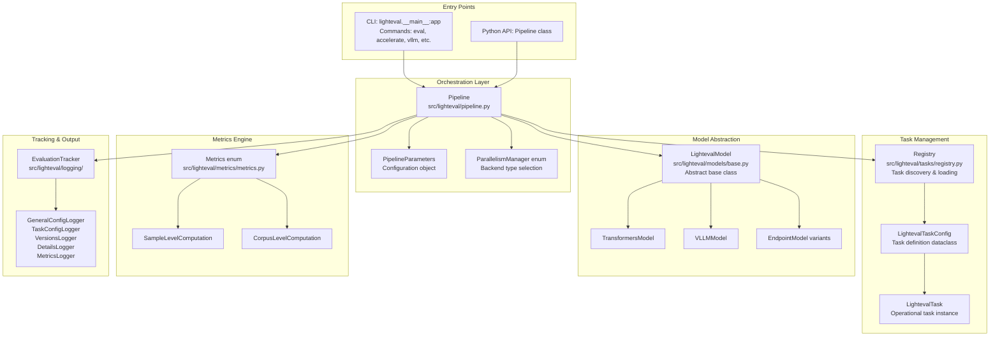
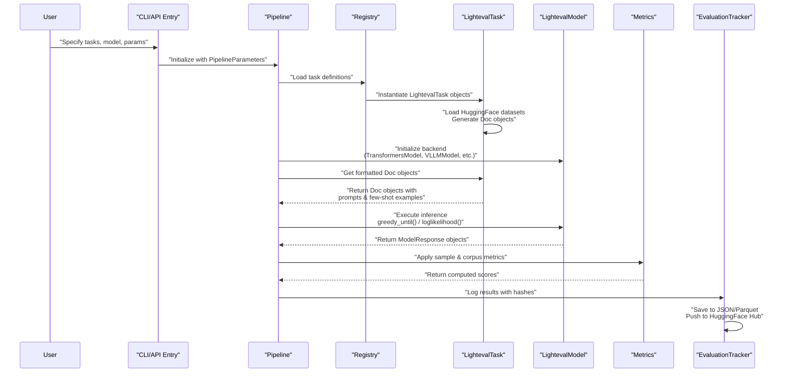
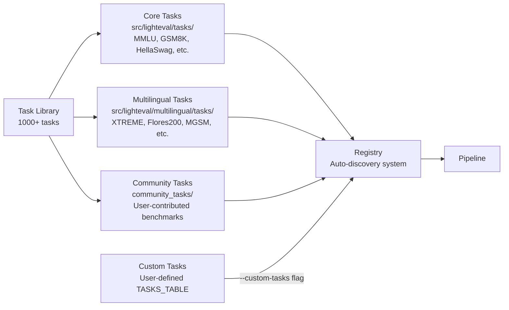
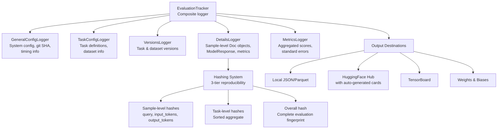

<!-- source: DeepWiki mcp.deepwiki.com · repo huggingface/lighteval · page 1 Overview · fetched 2026-10-26 -->

# Overview

<details>
<summary>Relevant source files</summary>

The following files were used as context for generating this wiki page:

- [README.md](README.md)
- [pyproject.toml](pyproject.toml)

</details>


This document provides a high-level introduction to lighteval, a lightweight framework for evaluating large language models (LLMs). It covers the framework's purpose, key features, and core architectural components.

For installation and quick start examples, see [Installation and Quick Start](#3). For detailed information about specific subsystems, refer to the following pages: [Architecture](#2), [Task System](#5), [Models and Backends](#7), [Metrics System](#8), and [Evaluation Tracking and Output](#9).

## Purpose and Scope

Lighteval is a Python-based evaluation framework designed for benchmarking language models across multiple execution backends. It supports both local model execution (via Transformers, VLLM, SGLang, Nanotron) and remote inference endpoints (via TGI, OpenAI-compatible APIs, HuggingFace Inference Endpoints).

The framework provides:
- **1000+ predefined evaluation tasks** spanning general knowledge, math, code, multilingual benchmarks, and instruction following
- **Multiple backend support** enabling evaluation of models whether served remotely or loaded in memory
- **Sample-level tracking** for detailed result inspection and reproducibility verification
- **Extensible plugin architecture** for custom tasks, metrics, and model backends

**Sources:** [README.md:35-41](), [pyproject.toml:48-59]()

## Project Organization

Lighteval is distributed as a Python package with the following structure:

| Component | Location | Description |
|-----------|----------|-------------|
| Core framework | `src/lighteval/` | Main package containing all evaluation logic |
| Command-line interface | `lighteval.__main__:app` | Entry point defined via `project.scripts` |
| Built-in tasks | `src/lighteval/tasks/` | Core task definitions |
| Multilingual tasks | `src/lighteval/multilingual/tasks/` | Language-specific evaluations |
| Community tasks | `community_tasks/` | Community-contributed task definitions |
| Package metadata | `pyproject.toml` | Dependencies, version (0.13.1.dev0), and optional extras |

**Sources:** [pyproject.toml:30-31](), [pyproject.toml:36-38](), [pyproject.toml:136-137]()

## Core Components



**Diagram: Core Component Architecture**

This diagram maps lighteval's main architectural components to their code locations. The `Pipeline` class orchestrates all evaluation activities, delegating to specialized subsystems for task management (`Registry`), model execution (`LightevalModel` implementations), metrics computation (`Metrics` enum), and result tracking (`EvaluationTracker`).

**Sources:** [README.md:109-127](), [pyproject.toml:136-137]()

## Evaluation Flow



**Diagram: End-to-End Evaluation Sequence**

This sequence diagram illustrates the complete evaluation lifecycle from user input to result output. The `Pipeline.evaluate()` method coordinates all steps, ensuring tasks are loaded, prompts formatted, model inference executed, metrics computed, and results persisted with reproducibility hashes.

**Sources:** [README.md:136-169]()

## Key Features

### Multiple Execution Backends

Lighteval supports 11+ execution backends through the `ParallelismManager` enum:

| Backend | CLI Command | Use Case |
|---------|-------------|----------|
| inspect-ai | `lighteval eval` | Recommended default, uses inspect-ai framework |
| Transformers + Accelerate | `lighteval accelerate` | Multi-GPU with model parallelism |
| VLLM | `lighteval vllm` | High-throughput inference with PagedAttention |
| SGLang | `lighteval sglang` | Structured generation with radix attention |
| Nanotron | `lighteval nanotron` | Distributed training framework integration |
| Inference Endpoints | `lighteval endpoint inference-endpoint` | HuggingFace managed inference |
| TGI | `lighteval endpoint tgi` | Self-hosted Text Generation Inference |
| LiteLLM | `lighteval endpoint litellm` | Universal API gateway (100+ providers) |
| Inference Providers | `lighteval endpoint inference-providers` | HuggingFace inference provider network |

All backends implement the `LightevalModel` interface, providing uniform methods: `tokenizer`, `greedy_until()`, `loglikelihood()`, and `loglikelihood_rolling()`.

**Sources:** [README.md:109-127]()

### Extensive Task Library

The framework includes 1000+ predefined tasks organized across three collections:



**Diagram: Task Organization and Discovery**

Tasks are defined using the `LightevalTaskConfig` dataclass and automatically discovered by the `Registry` class. Users can add custom tasks by creating a Python file with a `TASKS_TABLE` variable and passing it via the `--custom-tasks` CLI flag.

**Sources:** [README.md:43-88]()

### Extensible Metrics System

The metrics system uses an `aenum`-based `Metrics` enum that can be extended at runtime:

| Metric Category | Examples | Base Class |
|----------------|----------|------------|
| Sample-level | ExactMatch, F1Score, LoglikelihoodAcc | `SampleLevelComputation` |
| Corpus-level | Perplexity, BLEU, MatthewsCorrCoef | `CorpusLevelComputation` |
| Sampling metrics | PassAtK, MajAtN, AvgAtN | `SamplingMetric` |
| LLM-as-Judge | MTBench, SimpleQA, MixEval | `JudgeLLM` |

Custom metrics are created by implementing a metric function, wrapping it in `SampleLevelMetric` or `CorpusLevelMetric`, and registering via `extend_enum()`.

**Sources:** [README.md:40](), [pyproject.toml:80]()

### Comprehensive Tracking and Reproducibility

The `EvaluationTracker` class manages five specialized loggers:



**Diagram: Tracking and Reproducibility Architecture**

The tracking system captures detailed sample-level information and computes hierarchical hashes for reproducibility verification. Results can be saved locally or pushed to multiple destinations including HuggingFace Hub with auto-generated dataset cards.

**Sources:** [README.md:100-105](), [pyproject.toml:127-128]()

## Dependencies and Installation

Lighteval has a modular dependency structure defined in `pyproject.toml`:

| Dependency Group | Key Packages | Installation |
|-----------------|--------------|--------------|
| Core | transformers>=4.54.0, inspect-ai>=0.3.140, accelerate, torch>=2.0, datasets>=4.0.0 | `pip install lighteval` |
| Metrics | nltk, scikit-learn, sacrebleu, rouge_score | Included in core |
| VLLM backend | vllm>=0.10.0, ray | `pip install lighteval[vllm]` |
| LiteLLM endpoint | litellm>=1.66.0, diskcache | `pip install lighteval[litellm]` |
| TGI endpoint | text-generation>=0.7.0 | `pip install lighteval[tgi]` |
| Nanotron | nanotron, tensorboardX | `pip install lighteval[nanotron]` |
| Multilingual | stanza, spacy, jieba, pyvi | `pip install lighteval[multilingual]` |
| Development | ruff, pre-commit, pytest | `pip install lighteval[dev]` |

**Sources:** [pyproject.toml:60-129](), [README.md:90-99]()

## Usage Patterns

### CLI Usage

```bash
# Evaluate using inspect-ai backend (recommended)
lighteval eval "hf-inference-providers/openai/gpt-oss-20b" gpqa:diamond

# Evaluate local model with VLLM
lighteval vllm --model_args "pretrained=meta-llama/Llama-2-7b-hf" --tasks "mmlu"

# Evaluate with Transformers + Accelerate
lighteval accelerate --model_args "pretrained=gpt2" --tasks "hellaswag|5"
```

### Python API Usage

The Python API allows evaluation of models already loaded in memory:

```python
from lighteval.pipeline import Pipeline, PipelineParameters, ParallelismManager
from lighteval.logging.evaluation_tracker import EvaluationTracker
from lighteval.models.transformers.transformers_model import TransformersModel, TransformersModelConfig

# Initialize tracking
tracker = EvaluationTracker(output_dir="./results")
params = PipelineParameters(launcher_type=ParallelismManager.NONE, max_samples=10)

# Configure model
config = TransformersModelConfig(model_name="gpt2", batch_size=1)
model = TransformersModel.from_config(config)

# Run evaluation
pipeline = Pipeline(model=model, pipeline_parameters=params, 
                   evaluation_tracker=tracker, tasks="mmlu:abstract_algebra")
results = pipeline.evaluate()
```

**Sources:** [README.md:128-169]()

## Platform Requirements

- **Python version**: >=3.10 (specified in `requires-python`)
- **Operating systems**: Linux and macOS (Windows is untested and unsupported)
- **PyTorch requirement**: >=2.0, <3.0
- **GPU support**: Optional but recommended for local model execution

**Sources:** [pyproject.toml:50](), [pyproject.toml:67](), [README.md:92]()

## Next Steps

- For installation instructions and quick start examples, see [Installation and Quick Start](#3)
- For detailed architectural information, see [Architecture](#2)
- To learn about task configuration and creation, see [Task System](#5)
- For model backend options and configuration, see [Models and Backends](#7)
- For metric definitions and custom metrics, see [Metrics System](#8)
- For CLI reference and configuration options, see [CLI and Configuration](#10)

---

