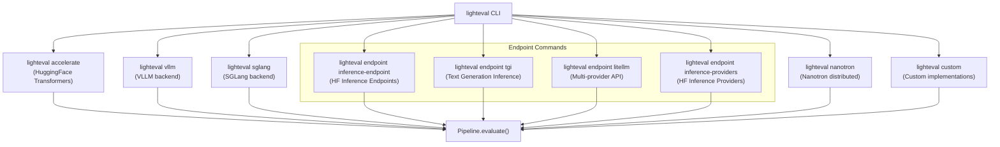
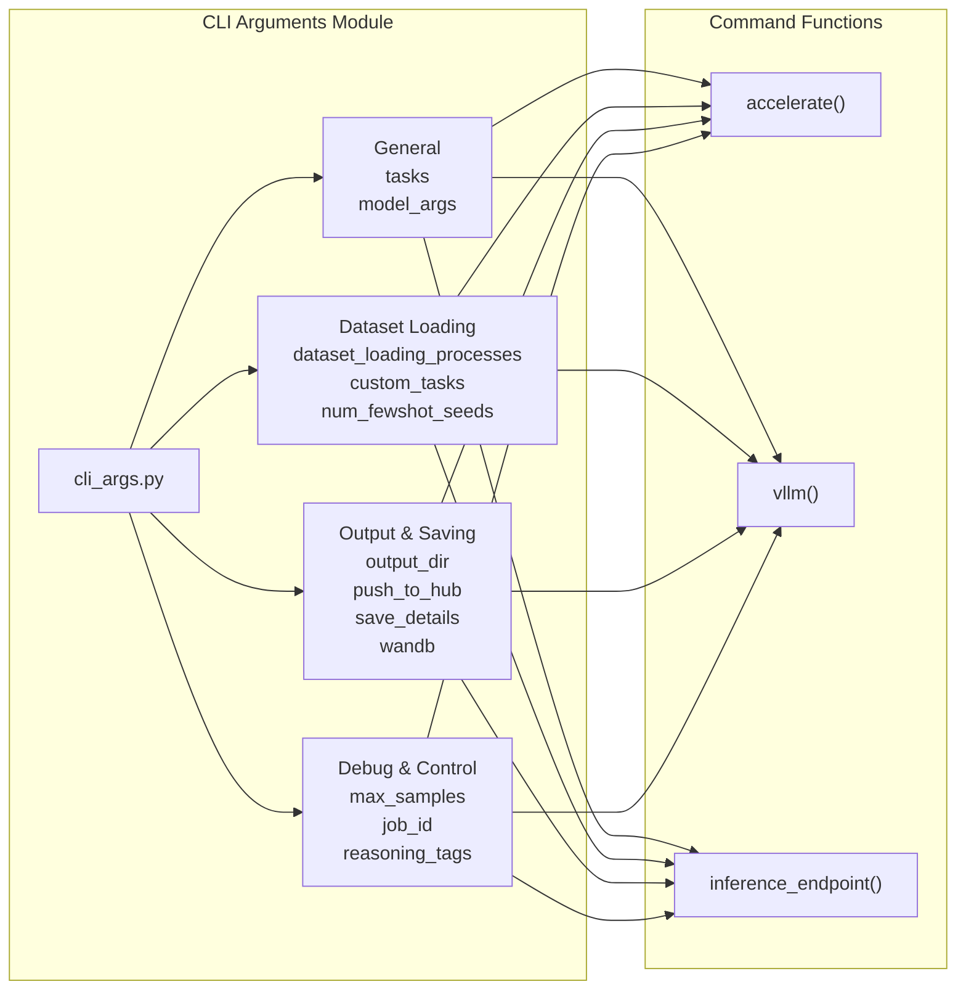
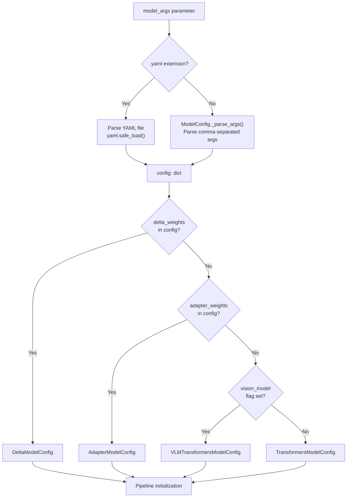
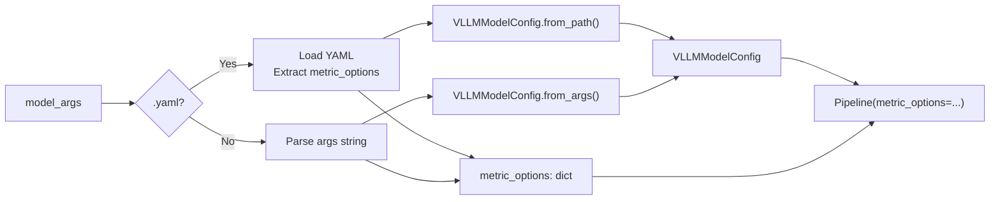
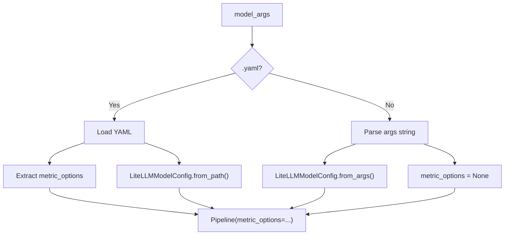
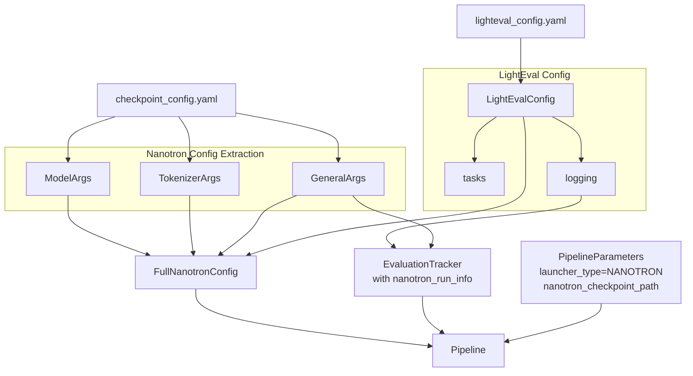
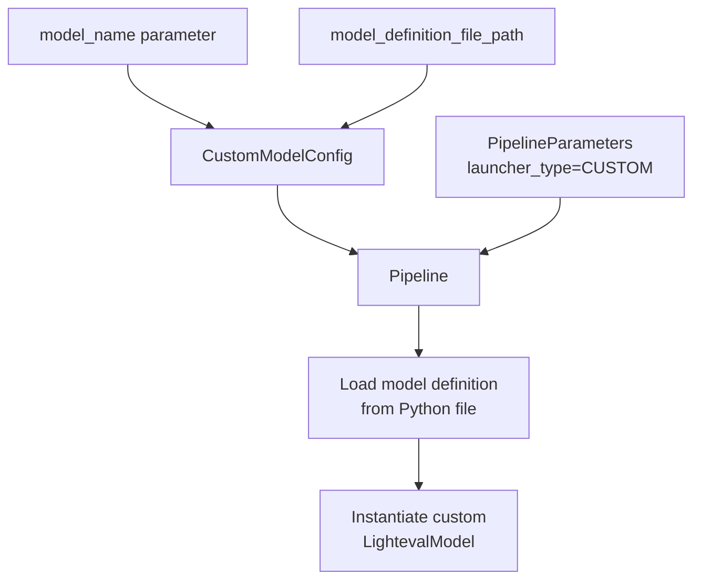

<!-- source: DeepWiki mcp.deepwiki.com · repo huggingface/lighteval · page 10.1 CLI Commands · fetched 2026-10-26 -->

# CLI Commands

<details>
<summary>Relevant source files</summary>

The following files were used as context for generating this wiki page:

- [.github/workflows/pr_style_bot.yaml](.github/workflows/pr_style_bot.yaml)
- [docs/source/adding-a-new-metric.mdx](docs/source/adding-a-new-metric.mdx)
- [src/lighteval/__main__.py](src/lighteval/__main__.py)
- [src/lighteval/logging/evaluation_tracker.py](src/lighteval/logging/evaluation_tracker.py)
- [src/lighteval/main_accelerate.py](src/lighteval/main_accelerate.py)
- [src/lighteval/main_baseline.py](src/lighteval/main_baseline.py)
- [src/lighteval/main_custom.py](src/lighteval/main_custom.py)
- [src/lighteval/main_endpoint.py](src/lighteval/main_endpoint.py)
- [src/lighteval/main_nanotron.py](src/lighteval/main_nanotron.py)
- [src/lighteval/main_sglang.py](src/lighteval/main_sglang.py)
- [src/lighteval/main_vllm.py](src/lighteval/main_vllm.py)

</details>


This document describes all CLI entrypoints provided by lighteval for running model evaluations. Each command corresponds to a different backend or execution mode. For details on model-specific configuration parameters, see [Model Configuration](#10.2). For pipeline execution parameters, see [Pipeline Parameters](#10.3). For controlling text generation behavior, see [Generation Parameters](#10.4).

## Overview

Lighteval provides seven main CLI commands, each optimized for different inference backends and use cases. All commands follow a consistent pattern: they accept task specifications, model configuration, and output settings, then orchestrate the evaluation through the `Pipeline` class.

### Available Commands



**Sources:** [src/lighteval/main_accelerate.py](), [src/lighteval/main_vllm.py](), [src/lighteval/main_sglang.py](), [src/lighteval/main_endpoint.py](), [src/lighteval/main_nanotron.py](), [src/lighteval/main_custom.py]()

### Command-to-Backend Mapping

| Command | Backend | ParallelismManager | Use Case |
|---------|---------|-------------------|----------|
| `accelerate` | HuggingFace Transformers | `ACCELERATE` | Local or distributed evaluation with Accelerate |
| `vllm` | VLLM | `VLLM` | High-performance inference with prefix caching |
| `sglang` | SGLang | `SGLANG` | SGLang-optimized inference |
| `endpoint inference-endpoint` | HF Inference Endpoints | `NONE` | Dedicated inference endpoints |
| `endpoint tgi` | Text Generation Inference | `TGI` | TGI servers |
| `endpoint litellm` | LiteLLM | `NONE` | OpenAI, Anthropic, other API providers |
| `endpoint inference-providers` | HF Inference Providers | `NONE` | Serverless inference APIs |
| `nanotron` | Nanotron | `NANOTRON` | Distributed training integration |
| `custom` | User-defined | `CUSTOM` | Custom model implementations |

**Sources:** [src/lighteval/main_accelerate.py:94-144](), [src/lighteval/main_vllm.py:78-138](), [src/lighteval/main_endpoint.py:50-401]()

## Common Parameters

All CLI commands share a core set of parameters for task specification, output control, and debugging. These parameters are defined in the `cli_args` module and imported into each command module.



**Sources:** [src/lighteval/main_accelerate.py:28-48](), [src/lighteval/cli_args.py]()

### Core Parameters

| Parameter | Type | Default | Description |
|-----------|------|---------|-------------|
| `tasks` | `str` | Required | Comma-separated task names or task group names |
| `model_args` | `str` | Required | Model configuration (YAML path or args string) |
| `output_dir` | `str` | `"./evals/"` | Directory for saving results |
| `custom_tasks` | `str` | `None` | Path to custom task definitions |
| `max_samples` | `int` | `None` | Limit samples per task for testing |

**Sources:** [src/lighteval/cli_args.py]()

### Dataset Loading Parameters

| Parameter | Type | Default | Description |
|-----------|------|---------|-------------|
| `dataset_loading_processes` | `int` | `1` | Number of parallel processes for dataset loading |
| `num_fewshot_seeds` | `int` | `1` | Number of random seeds for few-shot sampling |
| `load_responses_from_details_date_id` | `str` | `None` | Load cached responses from previous run |

**Sources:** [src/lighteval/main_accelerate.py:62-65]()

### Output Parameters

| Parameter | Type | Default | Description |
|-----------|------|---------|-------------|
| `results_path_template` | `str` | Custom template | Template for results file paths |
| `push_to_hub` | `bool` | `False` | Upload results to HuggingFace Hub |
| `push_to_tensorboard` | `bool` | `False` | Log metrics to TensorBoard |
| `public_run` | `bool` | `False` | Make Hub uploads public |
| `results_org` | `str` | `None` | HuggingFace organization for results |
| `save_details` | `bool` | `True` | Save detailed per-sample results |
| `wandb` | `bool` | `False` | Enable Weights & Biases logging |

**Sources:** [src/lighteval/main_accelerate.py:69-76]()

### Reasoning and Debug Parameters

| Parameter | Type | Default | Description |
|-----------|------|---------|-------------|
| `reasoning_tags` | `list[str]` | `None` | XML tags to extract reasoning from responses |
| `remove_reasoning_tags` | `bool` | `False` | Remove reasoning tags before metric computation |
| `job_id` | `str` | Auto-generated | Unique identifier for the evaluation job |

**Sources:** [src/lighteval/main_accelerate.py:66-67, 78-79]()

## lighteval accelerate

The `accelerate` command uses HuggingFace Transformers with Accelerate for distributed evaluation. It supports standard models, delta models, adapter models, and vision-language models.

### Usage

```bash
lighteval accelerate \
    --model-args "pretrained=meta-llama/Llama-2-7b-hf" \
    --tasks "mmlu,hellaswag" \
    --output-dir "./results" \
    --save-details
```

**Sources:** [src/lighteval/main_accelerate.py:54-153]()

### Accelerate-Specific Parameters

| Parameter | Type | Default | Description |
|-----------|------|---------|-------------|
| `vision_model` | `bool` | `False` | Use `VLMTransformersModel` for multimodal evaluation |

**Sources:** [src/lighteval/main_accelerate.py:59-61]()

### Model Configuration Flow



**Sources:** [src/lighteval/main_accelerate.py:118-135]()

### Execution Flow

1. **Tracker Initialization**: Creates `EvaluationTracker` with output configuration [main_accelerate.py:96-105]()
2. **Pipeline Parameters**: Configures `PipelineParameters` with `ParallelismManager.ACCELERATE` [main_accelerate.py:106-116]()
3. **Model Config Selection**: Determines model config class based on YAML or args [main_accelerate.py:118-135]()
4. **Pipeline Creation**: Instantiates `Pipeline` with tasks, params, tracker, and config [main_accelerate.py:137-142]()
5. **Evaluation**: Calls `pipeline.evaluate()` [main_accelerate.py:144]()
6. **Results Display**: Shows and saves results [main_accelerate.py:146-151]()

**Sources:** [src/lighteval/main_accelerate.py:96-153]()

## lighteval vllm

The `vllm` command leverages VLLM for high-performance inference with optimizations like prefix caching and continuous batching.

### Usage

```bash
lighteval vllm \
    --model-args "pretrained=meta-llama/Llama-2-7b-hf,dtype=float16,tensor_parallel_size=2" \
    --tasks "gsm8k,humaneval" \
    --output-dir "./vllm_results"
```

**Sources:** [src/lighteval/main_vllm.py:51-138]()

### VLLM-Specific Parameters

| Parameter | Type | Default | Description |
|-----------|------|---------|-------------|
| `cot_prompt` | `str` | `None` | Chain-of-thought prompt template for reasoning tasks |

**Sources:** [src/lighteval/main_vllm.py:56-58]()

### Configuration Loading



**Sources:** [src/lighteval/main_vllm.py:113-126]()

The VLLM command sets `ParallelismManager.VLLM` and can extract `metric_options` from YAML configuration files for specialized metric computation.

**Sources:** [src/lighteval/main_vllm.py:100-127]()

## lighteval sglang

The `sglang` command uses SGLang as the inference backend, providing efficient batching and caching mechanisms.

### Usage

```bash
lighteval sglang \
    --model-args "pretrained=meta-llama/Llama-2-7b-hf,tensor_parallel_size=4" \
    --tasks "arc:challenge,winogrande" \
    --output-dir "./sglang_results"
```

**Sources:** [src/lighteval/main_sglang.py:45-127]()

### Configuration

The SGLang command follows the same configuration pattern as VLLM:
- Accepts YAML files or argument strings
- Extracts `metric_options` from YAML when provided
- Uses `SGLangModelConfig.from_path()` or `.from_args()`
- Sets `ParallelismManager.SGLANG`

**Sources:** [src/lighteval/main_sglang.py:91-117]()

## Endpoint Commands

The `lighteval endpoint` command group provides four subcommands for API-based and remote inference backends. All endpoint commands use `ParallelismManager.NONE` or `ParallelismManager.TGI` since inference happens remotely.

### lighteval endpoint inference-endpoint

Evaluates models using dedicated HuggingFace Inference Endpoints.

#### Usage

```bash
lighteval endpoint inference-endpoint \
    examples/model_configs/endpoint_model.yaml \
    --tasks "mmlu" \
    --output-dir "./endpoint_results"
```

**Sources:** [src/lighteval/main_endpoint.py:54-140]()

#### Specific Parameters

| Parameter | Type | Default | Description |
|-----------|------|---------|-------------|
| `model_config_path` | `str` | Required | Path to endpoint configuration YAML |
| `free_endpoint` | `bool` | `False` | Use serverless free endpoints instead of dedicated |

The `free_endpoint` flag switches between `ServerlessEndpointModelConfig` and `InferenceEndpointModelConfig`.

**Sources:** [src/lighteval/main_endpoint.py:60-112]()

### lighteval endpoint tgi

Evaluates models using Text Generation Inference (TGI) servers.

#### Usage

```bash
lighteval endpoint tgi \
    examples/model_configs/tgi_model.yaml \
    --tasks "truthfulqa_mc" \
    --output-dir "./tgi_results"
```

**Sources:** [src/lighteval/main_endpoint.py:144-220]()

#### Configuration

- Uses `TGIModelConfig.from_path()` [main_endpoint.py:192]()
- Sets `ParallelismManager.TGI` [main_endpoint.py:190]()
- Requires YAML configuration file

**Sources:** [src/lighteval/main_endpoint.py:176-210]()

### lighteval endpoint litellm

Evaluates models through LiteLLM, which provides a unified interface to multiple API providers (OpenAI, Anthropic, Cohere, etc.).

#### Usage

```bash
# Using config file
lighteval endpoint litellm \
    config.yaml \
    --tasks "gsm8k" \
    --output-dir "./litellm_results"

# Using args string
lighteval endpoint litellm \
    "model_name=gpt-4,provider=openai" \
    --tasks "mmlu" \
    --output-dir "./results"
```

**Sources:** [src/lighteval/main_endpoint.py:224-313]()

#### Configuration Options

LiteLLM supports both YAML and argument string configuration:



**Sources:** [src/lighteval/main_endpoint.py:277-302]()

### lighteval endpoint inference-providers

Evaluates models using HuggingFace's serverless Inference Providers API.

#### Usage

```bash
# Using YAML
lighteval endpoint inference-providers \
    config.yaml \
    --tasks "arc:easy" \
    --output-dir "./providers_results"

# Using args
lighteval endpoint inference-providers \
    "model_name=meta-llama/Llama-2-7b-hf,provider=together" \
    --tasks "hellaswag"
```

**Sources:** [src/lighteval/main_endpoint.py:317-400]()

#### Notable Differences

- Does not support `load_responses_from_details_date_id` parameter [main_endpoint.py:381]()
- Uses `InferenceProvidersModelConfig.from_path()` or `.from_args()` [main_endpoint.py:369-372]()

**Sources:** [src/lighteval/main_endpoint.py:355-390]()

## lighteval nanotron

The `nanotron` command integrates with Nanotron for distributed training and evaluation.

### Usage

```bash
lighteval nanotron \
    --checkpoint-config-path /path/to/nanotron_config.yaml \
    --lighteval-config-path /path/to/lighteval_config.yaml
```

**Sources:** [src/lighteval/main_nanotron.py:42-118]()

### Nanotron-Specific Parameters

| Parameter | Type | Default | Description |
|-----------|------|---------|-------------|
| `checkpoint_config_path` | `str` | Required | Path to Nanotron checkpoint YAML config |
| `lighteval_config_path` | `str` | Required | Path to lighteval-specific YAML config |

**Sources:** [src/lighteval/main_nanotron.py:43-46]()

### Configuration Architecture



**Sources:** [src/lighteval/main_nanotron.py:63-112]()

### Configuration Loading Process

1. **Parse Nanotron YAML**: Loads model, tokenizer, and general configurations using Nanotron's config system [main_nanotron.py:66-77]()
2. **Load LightEval Config**: Parses lighteval-specific settings using `LightEvalConfig` [main_nanotron.py:80-81]()
3. **Create Full Config**: Combines both into `FullNanotronConfig` [main_nanotron.py:81]()
4. **Initialize Tracker**: Creates tracker with `nanotron_run_info` for checkpoint metadata [main_nanotron.py:83-93]()
5. **Set Pipeline Parameters**: Configures with `ParallelismManager.NANOTRON` and checkpoint path [main_nanotron.py:95-105]()

**Sources:** [src/lighteval/main_nanotron.py:63-112]()

## lighteval custom

The `custom` command allows evaluation of arbitrary custom model implementations that conform to the `LightevalModel` interface.

### Usage

```bash
lighteval custom \
    my-custom-model \
    /path/to/model_definition.py \
    --tasks "custom_task_suite" \
    --custom-tasks /path/to/custom_tasks \
    --output-dir "./custom_results"
```

**Sources:** [src/lighteval/main_custom.py:52-121]()

### Custom-Specific Parameters

| Parameter | Type | Default | Description |
|-----------|------|---------|-------------|
| `model_name` | `str` | Required | Name identifier for the custom model |
| `model_definition_file_path` | `str` | Required | Path to Python file containing model implementation |

**Sources:** [src/lighteval/main_custom.py:54-55]()

### Custom Model Requirements

The custom model must:
1. Implement the `LightevalModel` abstract interface
2. Provide required methods: `greedy_until()`, `loglikelihood()`, `loglikelihood_rolling()`
3. Define tokenizer properties: `tokenizer`, `max_length`, `add_special_tokens`

**Sources:** [src/lighteval/main_custom.py:45-94]()

### Execution Flow



**Sources:** [src/lighteval/main_custom.py:93-111]()

The custom command sets `ParallelismManager.CUSTOM` and creates a minimal `CustomModelConfig` that stores the model name and definition file path. The actual model loading happens within the Pipeline initialization.

**Sources:** [src/lighteval/main_custom.py:93-111]()

## Parameter Inheritance and Overrides

All commands construct three core objects that control evaluation behavior:

```mermaid
graph TB
    CLIArgs["CLI Arguments"]
    
    subgraph "Core Objects"
        Tracker["EvaluationTracker"]
        Params["PipelineParameters"]
        ModelConfig["ModelConfig variant"]
    end
    
    Pipeline["Pipeline"]
    
    subgraph "Tracker Configuration"
        OutDir["output_dir"]
        PushHub["push_to_hub"]
        SaveDet["save_details"]
        TBoard["push_to_tensorboard"]
        WandB["use_wandb"]
    end
    
    subgraph "Pipeline Configuration"
        Launcher["launcher_type"]
        JobID["job_id"]
        MaxSamp["max_samples"]
        CustomDir["custom_tasks_directory"]
        Reasoning["reasoning_tags<br/>remove_reasoning_tags"]
    end
    
    subgraph "Model Configuration"
        Pretrained["pretrained"]
        Dtype["dtype"]
        BatchSize["batch_size"]
        Parallel["parallelism settings"]
    end
    
    CLIArgs --> OutDir
    CLIArgs --> PushHub
    CLIArgs --> SaveDet
    CLIArgs --> TBoard
    CLIArgs --> WandB
    
    OutDir --> Tracker
    PushHub --> Tracker
    SaveDet --> Tracker
    TBoard --> Tracker
    WandB --> Tracker
    
    CLIArgs --> Launcher
    CLIArgs --> JobID
    CLIArgs --> MaxSamp
    CLIArgs --> CustomDir
    CLIArgs --> Reasoning
    
    Launcher --> Params
    JobID --> Params
    MaxSamp --> Params
    CustomDir --> Params
    Reasoning --> Params
    
    CLIArgs --> Pretrained
    CLIArgs --> Dtype
    CLIArgs --> BatchSize
    CLIArgs --> Parallel
    
    Pretrained --> ModelConfig
    Dtype --> ModelConfig
    BatchSize --> ModelConfig
    Parallel --> ModelConfig
    
    Tracker --> Pipeline
    Params --> Pipeline
    ModelConfig --> Pipeline
```



**Sources:** [src/lighteval/main_accelerate.py:96-142](), [src/lighteval/main_vllm.py:89-127]()

## Return Values

All CLI commands return evaluation results and optionally detailed per-sample outputs:

| Command | Returns | Details Available |
|---------|---------|-------------------|
| `accelerate` | `(results: dict, details: dict)` | Yes |
| `vllm` | `(results: dict, details: dict)` | Yes |
| `sglang` | `results: dict` | Via `pipeline.get_details()` |
| `endpoint inference-endpoint` | `results: dict` | Via `pipeline.get_details()` |
| `endpoint tgi` | `results: dict` | Via `pipeline.get_details()` |
| `endpoint litellm` | `results: dict` | Via `pipeline.get_details()` |
| `endpoint inference-providers` | `results: dict` | Via `pipeline.get_details()` |
| `nanotron` | None (saves only) | Saved to disk |
| `custom` | `results: dict` | Via `pipeline.get_details()` |

All commands call `pipeline.save_and_push_results()` before returning, which handles output to local files, HuggingFace Hub, TensorBoard, and Weights & Biases as configured.

**Sources:** [src/lighteval/main_accelerate.py:148-153](), [src/lighteval/main_vllm.py:133-138](), [src/lighteval/main_nanotron.py:114-118]()

---

