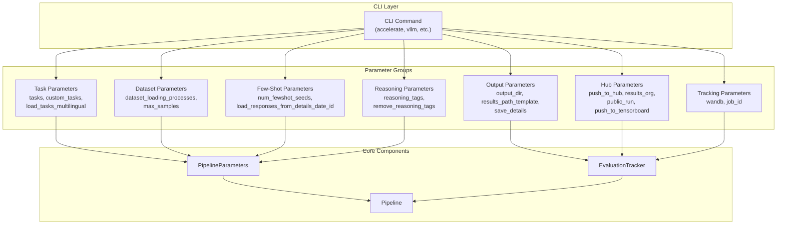
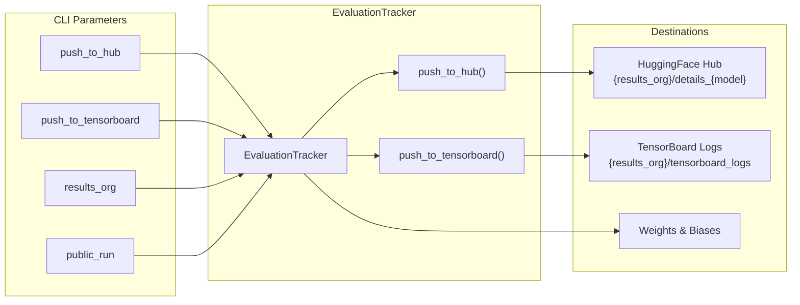

<!-- source: DeepWiki mcp.deepwiki.com · repo huggingface/lighteval · page 10.2 Common CLI Parameters · fetched 2026-10-26 -->

# Common CLI Parameters

<details>
<summary>Relevant source files</summary>

The following files were used as context for generating this wiki page:

- [src/lighteval/logging/evaluation_tracker.py](src/lighteval/logging/evaluation_tracker.py)
- [src/lighteval/main_accelerate.py](src/lighteval/main_accelerate.py)
- [src/lighteval/main_custom.py](src/lighteval/main_custom.py)
- [src/lighteval/main_endpoint.py](src/lighteval/main_endpoint.py)
- [src/lighteval/main_nanotron.py](src/lighteval/main_nanotron.py)
- [src/lighteval/main_sglang.py](src/lighteval/main_sglang.py)
- [src/lighteval/main_vllm.py](src/lighteval/main_vllm.py)

</details>


This page documents the CLI parameters that are shared across most lighteval commands. These parameters control task selection, dataset loading, output configuration, and integration with external services like HuggingFace Hub and Weights & Biases.

For information about the CLI commands themselves and backend-specific parameters, see [CLI Commands](#10.1). For configuration file formats, see [Configuration Files](#10.3). For generation-specific parameters (temperature, top_p, etc.), see [Generation Parameters](#10.4).

## Overview

Lighteval provides a consistent set of CLI parameters across all evaluation backends (accelerate, vllm, endpoint, etc.). These parameters are defined in a central location and imported by each backend command, ensuring uniform behavior regardless of which execution engine is used.

The parameters are organized into several functional categories:

| Category | Parameters | Purpose |
|----------|-----------|---------|
| Task Selection | `tasks`, `custom_tasks`, `load_tasks_multilingual` | Specify which evaluation tasks to run |
| Dataset Loading | `dataset_loading_processes`, `max_samples` | Control dataset loading and sampling |
| Few-Shot Configuration | `num_fewshot_seeds`, `load_responses_from_details_date_id` | Configure few-shot sampling and response caching |
| Reasoning Tags | `reasoning_tags`, `remove_reasoning_tags` | Handle reasoning tags in model outputs |
| Output Configuration | `output_dir`, `results_path_template`, `save_details` | Control local result storage |
| Hub Integration | `push_to_hub`, `push_to_tensorboard`, `results_org`, `public_run` | Configure HuggingFace Hub uploads |
| Tracking | `wandb`, `job_id` | Enable experiment tracking |

Sources: [src/lighteval/main_accelerate.py:28-49](), [src/lighteval/main_endpoint.py:28-48](), [src/lighteval/main_vllm.py:28-48]()

## Parameter Flow Architecture



Sources: [src/lighteval/main_accelerate.py:98-119](), [src/lighteval/main_vllm.py:89-111](), [src/lighteval/main_endpoint.py:98-127]()

## Task Selection Parameters

### `tasks` (Required)

**Type**: `str`  
**Usage**: Positional argument or `--tasks`

Specifies which evaluation tasks to run. Tasks can be specified using several formats:

| Format | Example | Description |
|--------|---------|-------------|
| Task name | `"mmlu"` | Run a single named task |
| Task with few-shot | `"mmlu\|5"` | Task with 5 few-shot examples |
| Task with parameters | `"mmlu\|5@eval\|train\|42"` | Task with few-shot, evaluation split, few-shot split, and seed |
| Multiple tasks | `"mmlu,hellaswag,arc"` | Comma-separated list |
| Task suite | `"leaderboard"` | Named group of tasks |

**Example**:
```bash
lighteval accelerate \
    --tasks "mmlu|5,hellaswag|10,arc_easy|0" \
    ...
```

Sources: [src/lighteval/main_accelerate.py:57-58](), [src/lighteval/main_vllm.py:53-54]()

### `custom_tasks`

**Type**: `str | None`  
**Default**: `None`  
**Flag**: `--custom-tasks`

Path to a Python file or directory containing custom task definitions. The file must define a `TASKS_TABLE` variable containing task configurations.

**Example**:
```bash
lighteval accelerate \
    --custom-tasks ./my_custom_tasks.py \
    --tasks "my_custom_task|5" \
    ...
```

Sources: [src/lighteval/main_accelerate.py:63](), [src/lighteval/main_endpoint.py:71]()

### `load_tasks_multilingual`

**Type**: `bool`  
**Default**: `False`  
**Flag**: `--load-tasks-multilingual`

Whether to load multilingual task variants. When enabled, tasks with language-specific versions will be loaded.

Sources: [src/lighteval/main_accelerate.py:64](), [src/lighteval/main_nanotron.py:48]()

## Dataset Loading Parameters

### `dataset_loading_processes`

**Type**: `int`  
**Default**: `1`  
**Flag**: `--dataset-loading-processes`

Number of parallel processes to use when loading datasets from HuggingFace Hub. Higher values can speed up dataset loading but increase memory usage.

**Recommended Values**:
- Single task: `1-2`
- Multiple tasks: `4-8`
- Large-scale evaluation: `8-16`

Sources: [src/lighteval/main_accelerate.py:65](), [src/lighteval/main_endpoint.py:70]()

### `max_samples`

**Type**: `int | None`  
**Default**: `None`  
**Flag**: `--max-samples`

Limit the number of samples evaluated per task. Useful for debugging or quick testing. When `None`, all samples are evaluated.

**Example**:
```bash
# Quick test with 100 samples per task
lighteval accelerate \
    --tasks "mmlu,hellaswag" \
    --max-samples 100 \
    ...
```

Sources: [src/lighteval/main_accelerate.py:80](), [src/lighteval/main_vllm.py:75]()

## Few-Shot Configuration Parameters

### `num_fewshot_seeds`

**Type**: `int`  
**Default**: `1`  
**Flag**: `--num-fewshot-seeds`

Number of different random seeds to use for few-shot example selection. When greater than 1, the evaluation runs multiple times with different few-shot examples, and results are aggregated.

**Use Cases**:
- `1`: Standard evaluation (default)
- `3-5`: Variance estimation
- `10+`: Robust few-shot analysis

**Example**:
```bash
# Evaluate with 5 different few-shot seeds
lighteval accelerate \
    --tasks "mmlu|5" \
    --num-fewshot-seeds 5 \
    ...
```

Sources: [src/lighteval/main_accelerate.py:66](), [src/lighteval/pipeline.py]()

### `load_responses_from_details_date_id`

**Type**: `str | None`  
**Default**: `None`  
**Flag**: `--load-responses-from-details-date-id`

Load previously cached model responses from a prior evaluation run. Accepts either a timestamp or special values `"first"` or `"last"`.

**Values**:
- `None`: Run fresh inference
- `"last"`: Use most recent cached responses
- `"first"`: Use oldest cached responses
- ISO timestamp: Use specific run (e.g., `"2024-01-15T10-30-00.123456"`)

**Example**:
```bash
# Recompute metrics without re-running inference
lighteval accelerate \
    --tasks "mmlu|5" \
    --load-responses-from-details-date-id "last" \
    ...
```

Sources: [src/lighteval/main_accelerate.py:67](), [src/lighteval/logging/evaluation_tracker.py:334-352]()

## Reasoning Tag Parameters

### `reasoning_tags`

**Type**: `tuple[str, str] | None`  
**Default**: `None`  
**Flag**: `--reasoning-tags`

Opening and closing tags that mark reasoning sections in model outputs (e.g., for chain-of-thought prompts).

**Format**: `"<opening_tag>,<closing_tag>"`

**Example**:
```bash
lighteval vllm \
    --reasoning-tags "" \
    ...
```

Sources: [src/lighteval/main_accelerate.py:69](), [src/lighteval/main_vllm.py:64]()

### `remove_reasoning_tags`

**Type**: `bool`  
**Default**: `False`  
**Flag**: `--remove-reasoning-tags`

Whether to strip reasoning tags and their content from model outputs before metric computation.

**Use Cases**:
- `True`: Evaluate only the final answer (after reasoning)
- `False`: Include reasoning in evaluation

Sources: [src/lighteval/main_accelerate.py:68](), [src/lighteval/main_endpoint.py:74]()

## Output Configuration Parameters

### `output_dir`

**Type**: `str`  
**Default**: `"./evals/"`  
**Flag**: `--output-dir`

Local directory where evaluation results are saved. Results are organized in subdirectories by model name and timestamp.

**Directory Structure**:
```
{output_dir}/
├── results/{model_name}/
│   └── results_{timestamp}.json
└── details/{model_name}/
    └── {timestamp}/
        └── details_{task_name}_{timestamp}.parquet
```

Sources: [src/lighteval/main_accelerate.py:71](), [src/lighteval/logging/evaluation_tracker.py:163]()

### `results_path_template`

**Type**: `str | None`  
**Default**: `None`  
**Flag**: `--results-path-template`

Custom template for results directory structure. Supports placeholders: `{output_dir}`, `{org}`, `{model}`.

**Example**:
```bash
lighteval accelerate \
    --output-dir "./evals" \
    --results-path-template "{output_dir}/results/{org}/{model}" \
    ...
```

This creates: `./evals/results/meta-llama/Llama-3.1-8B/`

Sources: [src/lighteval/main_accelerate.py:72](), [src/lighteval/logging/evaluation_tracker.py:179](), [src/lighteval/logging/evaluation_tracker.py:303-310]()

### `save_details`

**Type**: `bool`  
**Default**: `True`  
**Flag**: `--save-details / --no-save-details`

Whether to save detailed per-sample evaluation data (model inputs, outputs, and metrics). When disabled, only aggregated metrics are saved.

**Storage Impact**:
- Enabled: ~100KB - 10MB per task (depending on task size)
- Disabled: ~1-10KB per task (aggregated metrics only)

Sources: [src/lighteval/main_accelerate.py:77](), [src/lighteval/logging/evaluation_tracker.py:172](), [src/lighteval/logging/evaluation_tracker.py:272-273]()

## Hub Integration Parameters



Sources: [src/lighteval/main_accelerate.py:98-107](), [src/lighteval/logging/evaluation_tracker.py:142-210]()

### `push_to_hub`

**Type**: `bool`  
**Default**: `False`  
**Flag**: `--push-to-hub`

Upload evaluation results and detailed predictions to HuggingFace Hub as a dataset. Requires `results_org` to be specified.

**Hub Repository Structure**:
- Repository name: `{results_org}/details_{sanitized_model_name}_private` (or without `_private` if `public_run=True`)
- Contains: Results JSON, per-task parquet files, auto-generated dataset card

Sources: [src/lighteval/main_accelerate.py:73](), [src/lighteval/logging/evaluation_tracker.py:171](), [src/lighteval/logging/evaluation_tracker.py:387-427]()

### `push_to_tensorboard`

**Type**: `bool`  
**Default**: `False`  
**Flag**: `--push-to-tensorboard`

Push evaluation metrics to TensorBoard logs on HuggingFace Hub. Requires `results_org` to be specified.

**TensorBoard Repository**:
- Repository: `{results_org}/tensorboard_logs`
- Metrics organized by task and metric name
- Supports multi-step tracking for checkpoint evaluations

Sources: [src/lighteval/main_accelerate.py:74](), [src/lighteval/logging/evaluation_tracker.py:175-176](), [src/lighteval/logging/evaluation_tracker.py:662-750]()

### `results_org`

**Type**: `str | None`  
**Default**: `None`  
**Flag**: `--results-org`

HuggingFace Hub organization or username for uploading results. Required when `push_to_hub` or `push_to_tensorboard` is enabled.

**Example**:
```bash
lighteval accelerate \
    --push-to-hub \
    --results-org "my-org" \
    ...
```

Creates repositories under `my-org/` namespace.

Sources: [src/lighteval/main_accelerate.py:76](), [src/lighteval/logging/evaluation_tracker.py:165-169]()

### `public_run`

**Type**: `bool`  
**Default**: `False`  
**Flag**: `--public-run`

Whether to make Hub-uploaded datasets public. When `False`, repositories are created as private (with `_private` suffix in name).

Sources: [src/lighteval/main_accelerate.py:75](), [src/lighteval/logging/evaluation_tracker.py:181](), [src/lighteval/logging/evaluation_tracker.py:399]()

## Tracking and Debug Parameters

### `wandb`

**Type**: `bool`  
**Default**: `False`  
**Flag**: `--wandb`

Enable Weights & Biases experiment tracking. Requires `WANDB_PROJECT` environment variable. Falls back to `trackio` if available.

**Environment Variables**:
- `WANDB_PROJECT`: Project name (required)
- `WANDB_SPACE_ID`: Space ID for trackio (optional)

**Example**:
```bash
export WANDB_PROJECT="my-evals"
lighteval accelerate \
    --wandb \
    --tasks "mmlu" \
    ...
```

Sources: [src/lighteval/main_accelerate.py:78](), [src/lighteval/logging/evaluation_tracker.py:173](), [src/lighteval/logging/evaluation_tracker.py:183-209]()

### `job_id`

**Type**: `str | None`  
**Default**: `None`  
**Flag**: `--job-id`

Identifier for the evaluation job. Often set automatically from environment (e.g., `SLURM_JOB_ID` for Slurm clusters).

**Auto-detection**:
- Nanotron backend: Reads from `SLURM_JOB_ID`
- Other backends: Defaults to `None` if not specified

Sources: [src/lighteval/main_accelerate.py:81](), [src/lighteval/main_nanotron.py:99]()

## Complete Parameter Table

| Parameter | Type | Default | Category | Required |
|-----------|------|---------|----------|----------|
| `tasks` | `str` | - | Task Selection | ✓ |
| `custom_tasks` | `str \| None` | `None` | Task Selection | ✗ |
| `load_tasks_multilingual` | `bool` | `False` | Task Selection | ✗ |
| `dataset_loading_processes` | `int` | `1` | Dataset Loading | ✗ |
| `max_samples` | `int \| None` | `None` | Dataset Loading | ✗ |
| `num_fewshot_seeds` | `int` | `1` | Few-Shot Config | ✗ |
| `load_responses_from_details_date_id` | `str \| None` | `None` | Few-Shot Config | ✗ |
| `reasoning_tags` | `tuple[str, str] \| None` | `None` | Reasoning | ✗ |
| `remove_reasoning_tags` | `bool` | `False` | Reasoning | ✗ |
| `output_dir` | `str` | `"./evals/"` | Output | ✗ |
| `results_path_template` | `str \| None` | `None` | Output | ✗ |
| `save_details` | `bool` | `True` | Output | ✗ |
| `push_to_hub` | `bool` | `False` | Hub Integration | ✗ |
| `push_to_tensorboard` | `bool` | `False` | Hub Integration | ✗ |
| `results_org` | `str \| None` | `None` | Hub Integration | ✓ (if Hub features enabled) |
| `public_run` | `bool` | `False` | Hub Integration | ✗ |
| `wandb` | `bool` | `False` | Tracking | ✗ |
| `job_id` | `str \| None` | `None` | Tracking | ✗ |

Sources: [src/lighteval/main_accelerate.py:55-82](), [src/lighteval/main_vllm.py:51-76](), [src/lighteval/main_endpoint.py:55-87]()

## Usage Examples

### Basic Evaluation

```bash
lighteval accelerate \
    "pretrained=meta-llama/Llama-3.1-8B" \
    "mmlu|5,hellaswag|10" \
    --output-dir "./results"
```

### Full Production Configuration

```bash
lighteval vllm \
    "pretrained=meta-llama/Llama-3.1-8B,tensor_parallel_size=2" \
    "leaderboard" \
    --output-dir "./evals" \
    --results-path-template "{output_dir}/results/{org}/{model}" \
    --push-to-hub \
    --push-to-tensorboard \
    --results-org "my-org" \
    --public-run \
    --save-details \
    --dataset-loading-processes 8 \
    --num-fewshot-seeds 3
```

### Debug Mode

```bash
lighteval accelerate \
    "pretrained=gpt2" \
    "mmlu" \
    --max-samples 10 \
    --output-dir "./debug"
```

### Custom Tasks with Reasoning

```bash
lighteval accelerate \
    "pretrained=meta-llama/Llama-3.1-8B" \
    "my_task|5" \
    --custom-tasks ./my_tasks.py \
    --reasoning-tags "" \
    --remove-reasoning-tags \
    --output-dir "./results"
```

### Cached Response Evaluation

```bash
# First run: Generate and save responses
lighteval accelerate \
    "pretrained=meta-llama/Llama-3.1-8B" \
    "mmlu|5" \
    --save-details \
    --output-dir "./results"

# Second run: Recompute metrics from cached responses
lighteval accelerate \
    "pretrained=meta-llama/Llama-3.1-8B" \
    "mmlu|5" \
    --load-responses-from-details-date-id "last" \
    --output-dir "./results"
```

Sources: [src/lighteval/main_accelerate.py:55-156](), [src/lighteval/main_vllm.py:51-138]()

## Backend-Specific Parameter Variations

While most parameters are consistent across backends, some backends have additional or modified parameters:

### Accelerate Backend

- Adds: `vision_model` flag for VLM evaluation

### VLLM Backend

- Adds: `cot_prompt` for chain-of-thought evaluation

### Endpoint Backends

- Inference Endpoint: Adds `free_endpoint` flag for serverless endpoints
- Some backends may not support `load_responses_from_details_date_id`

### Nanotron Backend

- Uses YAML configuration files instead of individual CLI parameters
- Parameters mapped through `LightEvalConfig` dataclass

Sources: [src/lighteval/main_accelerate.py:60-62](), [src/lighteval/main_vllm.py:56-58](), [src/lighteval/main_endpoint.py:61-67](), [src/lighteval/main_nanotron.py:42-51]()

---

