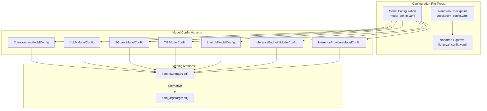
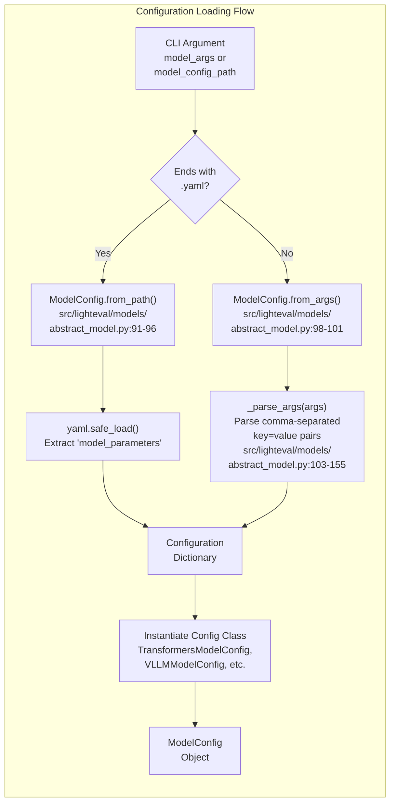

<!-- source: DeepWiki mcp.deepwiki.com · repo huggingface/lighteval · page 10.3 Configuration Files · fetched 2026-10-26 -->

# Configuration Files

<details>
<summary>Relevant source files</summary>

The following files were used as context for generating this wiki page:

- [src/lighteval/logging/evaluation_tracker.py](src/lighteval/logging/evaluation_tracker.py)
- [src/lighteval/main_accelerate.py](src/lighteval/main_accelerate.py)
- [src/lighteval/main_custom.py](src/lighteval/main_custom.py)
- [src/lighteval/main_endpoint.py](src/lighteval/main_endpoint.py)
- [src/lighteval/main_nanotron.py](src/lighteval/main_nanotron.py)
- [src/lighteval/main_sglang.py](src/lighteval/main_sglang.py)
- [src/lighteval/main_vllm.py](src/lighteval/main_vllm.py)
- [src/lighteval/models/abstract_model.py](src/lighteval/models/abstract_model.py)

</details>


This page documents the YAML configuration file format used throughout lighteval for defining model configurations, how the `from_path()` loading mechanism works, and the structure of configuration parameters. For information about command-line parameters, see [Common CLI Parameters](#10.2). For details on generation parameters specifically, see [Generation Parameters](#10.4).

## Overview

Lighteval supports configuration files in YAML format as an alternative to specifying parameters via command-line arguments. Configuration files provide a convenient way to:

- Store reusable model and evaluation configurations
- Share evaluation setups across teams
- Maintain version-controlled evaluation parameters
- Simplify command-line invocations for complex setups

Configuration files are primarily used for model configurations but can also be used for nanotron-specific evaluation setups.

**Sources:** [src/lighteval/models/abstract_model.py:41-156]()

## Configuration File Types



**Diagram: Configuration File Types and Loading Hierarchy**

Lighteval supports three main types of configuration files:

1. **Model Configuration Files**: Define model-specific parameters for any supported backend
2. **Nanotron Checkpoint Configuration**: YAML files defining nanotron model checkpoints
3. **Nanotron Lighteval Configuration**: YAML files defining lighteval-specific settings for nanotron evaluation

**Sources:** [src/lighteval/main_accelerate.py:121-138](), [src/lighteval/main_nanotron.py:44-83](), [src/lighteval/models/abstract_model.py:41-96]()

## Model Configuration File Structure

### Basic YAML Structure

All model configuration files follow a common structure with a top-level `model_parameters` key:

```yaml
model_parameters:
  model_name: "meta-llama/Llama-3.1-8B-Instruct"
  system_prompt: "You are a helpful assistant."
  cache_dir: "~/.cache/huggingface/lighteval"
  generation_parameters:
    temperature: 0.7
    top_p: 0.9
    max_new_tokens: 512
    stop_sequences: ["</s>", "<|endoftext|>"]
```

The `model_parameters` dictionary is extracted by the `from_path()` method and used to instantiate the appropriate configuration class.

**Sources:** [src/lighteval/models/abstract_model.py:91-96]()

### Common Parameters

The following table lists parameters that are common across all model configuration types, inherited from the base `ModelConfig` class:

| Parameter | Type | Default | Description |
|-----------|------|---------|-------------|
| `model_name` | `str` | Required | Model identifier or HuggingFace Hub path |
| `system_prompt` | `str \| None` | `None` | System prompt for chat-based models |
| `cache_dir` | `str` | `"~/.cache/huggingface/lighteval"` | Directory for caching models |
| `generation_parameters` | `GenerationParameters` | Empty object | Text generation configuration (see below) |

**Sources:** [src/lighteval/models/abstract_model.py:41-89]()

### Generation Parameters

Generation parameters can be nested within the `generation_parameters` key. These control the behavior of text generation:

```yaml
model_parameters:
  model_name: "gpt2"
  generation_parameters:
    temperature: 0.7
    top_p: 0.9
    top_k: 50
    max_new_tokens: 512
    min_new_tokens: 1
    do_sample: true
    stop_sequences: ["</s>"]
    repetition_penalty: 1.0
    frequency_penalty: 0.0
    presence_penalty: 0.0
    seed: 42
```

For the complete list of generation parameters and their descriptions, refer to [Generation Parameters](#10.4).

**Sources:** [src/lighteval/models/abstract_model.py:87]()

## Backend-Specific Configuration

### Transformers Backend

For models using the Transformers backend (accessed via `lighteval accelerate`):

```yaml
model_parameters:
  model_name: "meta-llama/Llama-3.1-8B-Instruct"
  dtype: "bfloat16"
  device_map: "auto"
  trust_remote_code: false
  use_flash_attention_2: false
  batch_size: 1
  generation_parameters:
    max_new_tokens: 512
```

**Additional Transformers-specific parameters:**

| Parameter | Type | Default | Description |
|-----------|------|---------|-------------|
| `dtype` | `str` | `"auto"` | Model data type (`"auto"`, `"float16"`, `"bfloat16"`, `"float32"`) |
| `device_map` | `str` | `"auto"` | Device placement strategy for model parallelism |
| `trust_remote_code` | `bool` | `false` | Allow execution of custom model code |
| `use_flash_attention_2` | `bool` | `false` | Enable Flash Attention 2 optimization |
| `batch_size` | `int` | `1` | Batch size for inference |

For delta models (LoRA adapters) or adapter models, additional keys are available:

```yaml
model_parameters:
  model_name: "base-model-name"
  delta_weights: "path/to/adapter"  # or adapter_weights
  # ... other parameters
```

**Sources:** [src/lighteval/main_accelerate.py:121-138]()

### VLLM Backend

For VLLM-accelerated inference (accessed via `lighteval vllm`):

```yaml
model_parameters:
  model_name: "meta-llama/Llama-3.1-8B-Instruct"
  tensor_parallel_size: 1
  pipeline_parallel_size: 1
  data_parallel_size: 1
  dtype: "auto"
  max_model_len: 4096
  gpu_memory_utilization: 0.9
  generation_parameters:
    temperature: 0.7
    max_new_tokens: 512

metric_options:
  # Optional: metric-specific configuration
```

Note that VLLM configurations may include an optional `metric_options` key at the top level for metric-specific settings.

**Sources:** [src/lighteval/main_vllm.py:113-119]()

### SGLang Backend

For SGLang backend (accessed via `lighteval sglang`):

```yaml
model_parameters:
  model_name: "meta-llama/Llama-3.1-8B-Instruct"
  # SGLang-specific parameters
  generation_parameters:
    temperature: 0.7
    max_new_tokens: 512

metric_options:
  # Optional: metric-specific configuration
```

**Sources:** [src/lighteval/main_sglang.py:106-112]()

### Endpoint Configurations

#### TGI (Text Generation Inference)

For TGI endpoints (accessed via `lighteval endpoint tgi`):

```yaml
model_parameters:
  model_name: "model-identifier"
  base_url: "http://localhost:8080"
  generation_parameters:
    temperature: 0.7
    max_new_tokens: 512
```

**Sources:** [src/lighteval/main_endpoint.py:146-196]()

#### LiteLLM

For LiteLLM gateway (accessed via `lighteval endpoint litellm`):

```yaml
model_parameters:
  model_name: "gpt-4"
  base_url: "https://api.openai.com/v1"
  provider: "openai"
  generation_parameters:
    temperature: 0.7
    max_new_tokens: 512

metric_options:
  # Optional: metric-specific configuration
```

**Sources:** [src/lighteval/main_endpoint.py:229-290]()

#### Inference Endpoints

For HuggingFace Inference Endpoints (accessed via `lighteval endpoint inference-endpoint`):

```yaml
model_parameters:
  model_name: "model-identifier"
  endpoint_name: "my-endpoint"
  namespace: "my-org"
  generation_parameters:
    temperature: 0.7
    max_new_tokens: 512
```

**Sources:** [src/lighteval/main_endpoint.py:55-114]()

#### Inference Providers

For HuggingFace Inference Providers (accessed via `lighteval endpoint inference-providers`):

```yaml
model_parameters:
  model_name: "meta-llama/Llama-3.1-8B-Instruct"
  provider: "together-ai"  # or other providers
  generation_parameters:
    temperature: 0.6
```

**Sources:** [src/lighteval/main_endpoint.py:324-380]()

## Loading Configuration Files



**Diagram: Configuration Loading Process**

### The `from_path()` Method

The `from_path()` class method is the primary way to load configuration from YAML files. It is defined in the base `ModelConfig` class and inherited by all model configuration variants:

```python
@classmethod
def from_path(cls, path: str):
    with open(path, "r") as f:
        config = yaml.safe_load(f)
    
    return cls(**config["model_parameters"])
```

**Usage examples:**

```python
# For Transformers backend
from lighteval.models.transformers.transformers_model import TransformersModelConfig
config = TransformersModelConfig.from_path("model_config.yaml")

# For VLLM backend
from lighteval.models.vllm.vllm_model import VLLMModelConfig
config = VLLMModelConfig.from_path("vllm_config.yaml")

# For TGI endpoint
from lighteval.models.endpoints.tgi_model import TGIModelConfig
config = TGIModelConfig.from_path("tgi_config.yaml")
```

The method:
1. Opens the YAML file
2. Parses it using `yaml.safe_load()`
3. Extracts the `model_parameters` dictionary
4. Unpacks it as keyword arguments to instantiate the configuration class

**Sources:** [src/lighteval/models/abstract_model.py:91-96]()

### The `from_args()` Method

As an alternative to YAML files, the `from_args()` method parses comma-separated command-line argument strings:

```python
@classmethod
def from_args(cls, args: str):
    config = cls._parse_args(args)
    return cls(**config)
```

**Usage examples:**

```bash
# Instead of YAML file
model_name=gpt2,dtype=bfloat16,batch_size=8

# With generation parameters
model_name=gpt2,generation_parameters={temperature:0.7,top_p:0.9}

# Boolean flags
model_name=gpt2,trust_remote_code
```

The `_parse_args()` static method handles:
- Comma-separated key-value pairs
- Nested generation parameters in curly braces `{}`
- Boolean flags (specified without `=value`)
- Automatic quoting of keys and string values for JSON parsing

**Sources:** [src/lighteval/models/abstract_model.py:98-155]()

### Automatic Detection

The main entry points automatically detect whether the argument is a YAML file path or an argument string:

```python
if model_args.endswith(".yaml"):
    with open(model_args, "r") as f:
        config = yaml.safe_load(f)["model_parameters"]
else:
    config: dict = ModelConfig._parse_args(model_args)
```

This pattern is consistent across all backend entry points:
- `main_accelerate.py` for Transformers
- `main_vllm.py` for VLLM
- `main_sglang.py` for SGLang
- `main_endpoint.py` for endpoint variants

**Sources:** [src/lighteval/main_accelerate.py:121-126](), [src/lighteval/main_vllm.py:113-119](), [src/lighteval/main_sglang.py:106-112](), [src/lighteval/main_endpoint.py:283-290]()

## Nanotron Configuration Files

Nanotron evaluation requires two separate YAML configuration files:

### Checkpoint Configuration

The checkpoint configuration defines the nanotron model structure:

```yaml
model:
  model_config:
    # Model architecture parameters
    
tokenizer:
  tokenizer_name_or_path: "meta-llama/Llama-3.1-8B-Instruct"
  
general:
  step: 1000
  run: "my-run-name"
```

This file uses nanotron's native configuration format with three top-level sections:
- `model`: Model architecture configuration
- `tokenizer`: Tokenizer configuration
- `general`: General training/evaluation settings

**Sources:** [src/lighteval/main_nanotron.py:68-79]()

### Lighteval Configuration

The lighteval configuration defines evaluation-specific settings:

```yaml
tasks:
  tasks: "lighteval|mmlu:abstract_algebra|5"
  custom_tasks: null
  max_samples: 100
  dataset_loading_processes: 8

logging:
  output_dir: "./results"
  results_path_template: "{output_dir}/results/{org}_{model}"
  results_org: "my-org"
  push_to_hub: true
  push_to_tensorboard: true
  public_run: false
  save_details: true
  tensorboard_metric_prefix: "eval"
```

**Configuration structure:**

| Section | Key | Description |
|---------|-----|-------------|
| `tasks` | `tasks` | Task specification string |
| `tasks` | `custom_tasks` | Path to custom tasks directory |
| `tasks` | `max_samples` | Maximum samples per task |
| `tasks` | `dataset_loading_processes` | Parallel processes for loading |
| `logging` | `output_dir` | Base directory for results |
| `logging` | `results_path_template` | Template for results path |
| `logging` | `results_org` | HuggingFace organization for uploads |
| `logging` | `push_to_hub` | Whether to push results to Hub |
| `logging` | `push_to_tensorboard` | Whether to log to TensorBoard |
| `logging` | `public_run` | Whether results are public |
| `logging` | `save_details` | Whether to save detailed logs |
| `logging` | `tensorboard_metric_prefix` | Prefix for TensorBoard metrics |

These configurations are loaded using nanotron's `get_config_from_file()` function and combined into a `FullNanotronConfig` object.

**Sources:** [src/lighteval/main_nanotron.py:44-96]()

## Usage in CLI Commands

Configuration files are used in CLI commands as follows:

```bash
# Transformers backend
lighteval accelerate model_config.yaml "lighteval|mmlu:abstract_algebra|5"

# VLLM backend
lighteval vllm vllm_config.yaml "lighteval|mmlu:abstract_algebra|5"

# SGLang backend
lighteval sglang sglang_config.yaml "lighteval|mmlu:abstract_algebra|5"

# TGI endpoint
lighteval endpoint tgi tgi_config.yaml "lighteval|mmlu:abstract_algebra|5"

# LiteLLM endpoint
lighteval endpoint litellm litellm_config.yaml "lighteval|mmlu:abstract_algebra|5"

# Inference endpoint
lighteval endpoint inference-endpoint endpoint_config.yaml "lighteval|mmlu:abstract_algebra|5"

# Inference providers
lighteval endpoint inference-providers provider_config.yaml "lighteval|mmlu:abstract_algebra|5"

# Nanotron (requires two config files)
lighteval nanotron \
  --checkpoint-config-path checkpoint_config.yaml \
  --lighteval-config-path lighteval_config.yaml
```

**Sources:** [src/lighteval/main_accelerate.py:55-156](), [src/lighteval/main_vllm.py:51-138](), [src/lighteval/main_endpoint.py:55-409](), [src/lighteval/main_nanotron.py:43-122]()

## Configuration File Locations

While configuration files can be placed anywhere on the filesystem, common conventions include:

1. **Repository examples directory**: `examples/model_configs/`
   - Example configurations for different backends
   - Referenced in CLI help text

2. **User configuration directory**: `~/.config/lighteval/`
   - User-specific default configurations
   - Reusable across projects

3. **Project-specific directory**: `./configs/` or `./model_configs/`
   - Project-specific evaluation configurations
   - Version-controlled with evaluation code

4. **Remote storage**: S3 or other remote filesystems
   - Supported via fsspec for nanotron checkpoint configs
   - Useful for large-scale distributed evaluations

**Sources:** [src/lighteval/main_accelerate.py:121-138](), [src/lighteval/main_endpoint.py:58](), [src/lighteval/main_nanotron.py:45]()

## Error Handling

The configuration loading process includes validation:

1. **File existence**: The YAML file must exist at the specified path
2. **YAML syntax**: The file must be valid YAML
3. **Required keys**: The `model_parameters` key must be present (for model configs)
4. **Parameter validation**: Pydantic validates all parameters against the configuration class schema
5. **Type checking**: Parameters must match expected types (enforced by Pydantic's `extra="forbid"`)

If validation fails, Pydantic raises detailed error messages indicating which parameters are invalid or missing.

**Sources:** [src/lighteval/models/abstract_model.py:41-96]()

---

