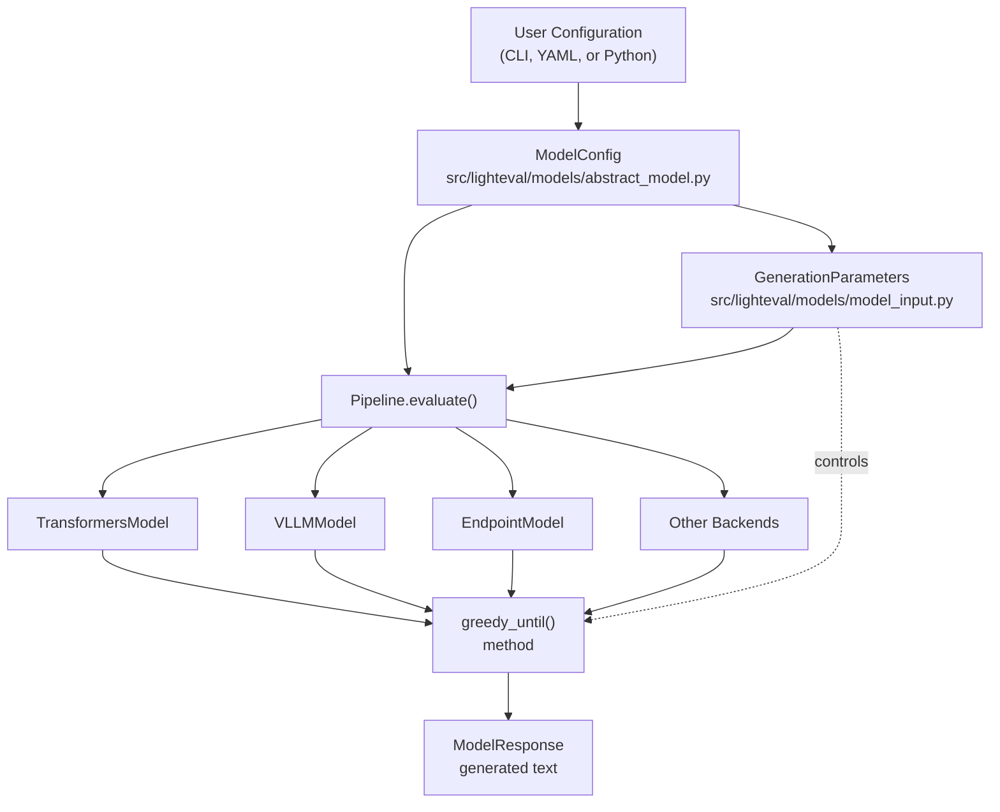
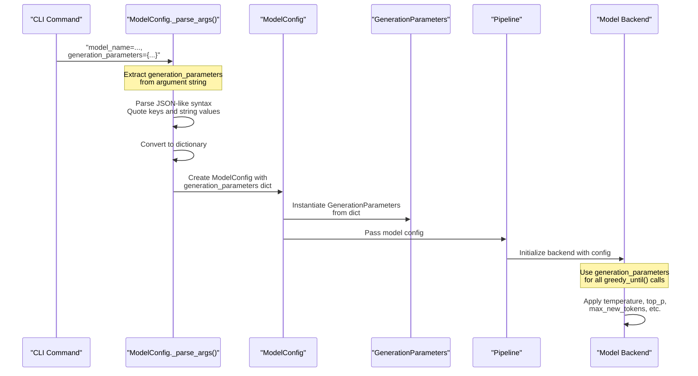
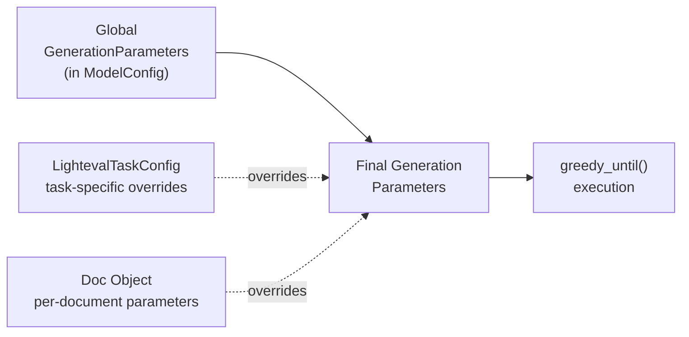

<!-- source: DeepWiki mcp.deepwiki.com · repo huggingface/lighteval · page 10.4 Generation Parameters · fetched 2026-10-26 -->

# Generation Parameters

<details>
<summary>Relevant source files</summary>

The following files were used as context for generating this wiki page:

- [src/lighteval/models/abstract_model.py](src/lighteval/models/abstract_model.py)

</details>


## Purpose and Scope

This document provides a comprehensive reference for generation parameters in lighteval, which control how models generate text during evaluation. These parameters affect sampling behavior, token generation limits, stopping conditions, and other aspects of the generation process.

For information about general model configuration, see [Model Configuration](#7.2). For CLI usage examples, see [Common CLI Parameters](#10.2). For backend-specific generation behavior, see [Models and Backends](#7).

---

## Overview

Generation parameters in lighteval are encapsulated in the `GenerationParameters` class, which is part of every model configuration. These parameters control the behavior of text generation methods like `greedy_until()` and influence how models respond to generative evaluation tasks.

The `GenerationParameters` class is instantiated as part of `ModelConfig` and is used by all model backends to ensure consistent generation behavior across different inference engines.



**Sources**: [src/lighteval/models/abstract_model.py:41-156]()

---

## Core Generation Parameters

The `GenerationParameters` class defines the following parameters that control text generation behavior:

### Temperature

**Type**: `float | None`  
**Default**: `None` (backend-specific default, typically 1.0 for sampling or 0.0 for greedy)

Controls the randomness of predictions. Lower values make the model more deterministic and confident, while higher values increase diversity and randomness:
- `0.0`: Greedy decoding (always select highest probability token)
- `0.1-0.5`: Low temperature, more focused and deterministic
- `0.7-0.9`: Moderate temperature, balanced creativity
- `1.0+`: High temperature, more random and diverse

### Top-p (Nucleus Sampling)

**Type**: `float | None`  
**Default**: `None` (backend-specific default, often 1.0)

Nucleus sampling parameter that considers only the smallest set of tokens whose cumulative probability exceeds the threshold:
- `0.9`: Consider top 90% probability mass
- `0.95`: Consider top 95% probability mass (common default)
- `1.0`: Consider all tokens (no filtering)

Typically used in conjunction with temperature to balance diversity and quality.

### Top-k

**Type**: `int | None`  
**Default**: `None` (no top-k filtering)

Limits sampling to the k most likely tokens at each step:
- `40-50`: Moderate restriction, commonly used
- `1`: Equivalent to greedy decoding
- `None` or `0`: No restriction

### Max New Tokens

**Type**: `int | None`  
**Default**: `None` (task-specific or backend default)

Maximum number of new tokens to generate:
- Prevents infinite generation loops
- Task-specific values override this parameter
- Different tasks may require different limits (e.g., 10 for multiple choice, 512 for open-ended generation)

### Stop Sequences

**Type**: `list[str] | None`  
**Default**: `None`

List of strings that trigger early stopping of generation when encountered:
- Common examples: `["\n\n", "###", "Question:"]`
- Useful for structured output or conversational tasks
- Model stops generating immediately upon producing any stop sequence

### Do Sample

**Type**: `bool | None`  
**Default**: `None` (backend-specific)

Controls whether to use sampling or greedy decoding:
- `True`: Enable sampling with temperature/top-p/top-k
- `False`: Use greedy decoding (deterministic)
- `None`: Backend determines based on other parameters

---

## Additional Parameters

Depending on the backend, additional generation parameters may be available:

| Parameter | Type | Description |
|-----------|------|-------------|
| `frequency_penalty` | `float` | Penalizes tokens based on their frequency in generated text |
| `presence_penalty` | `float` | Penalizes tokens that have already appeared |
| `seed` | `int` | Random seed for reproducible sampling |
| `num_choices` | `int` | Number of alternative completions to generate |
| `best_of` | `int` | Generate n candidates and return the best |
| `log_probs` | `bool` | Return log probabilities with generated tokens |
| `top_logprobs` | `int` | Number of top log probs to return per token |
| `reasoning_effort` | `int` | Reasoning effort level (for models like o1) |
| `reasoning_tokens` | `int` | Max reasoning tokens for reasoning models |

**Note**: Not all backends support all parameters. Refer to backend-specific documentation for details.

**Sources**: [src/lighteval/models/abstract_model.py:158-180]()

---

## Configuration Methods

### Via Python API

When using the Python API, instantiate `GenerationParameters` and pass it to `ModelConfig`:

```python
from lighteval.models.model_input import GenerationParameters
from lighteval.models.model_config import TransformersModelConfig

# Create generation parameters
gen_params = GenerationParameters(
    temperature=0.7,
    top_p=0.9,
    max_new_tokens=256,
    stop_sequences=["\n\n", "###"]
)

# Include in model config
model_config = TransformersModelConfig(
    model_name="meta-llama/Llama-3.1-8B-Instruct",
    generation_parameters=gen_params,
    system_prompt="You are a helpful assistant."
)
```

### Via YAML Configuration

Define generation parameters in a YAML configuration file:

```yaml
model_parameters:
  model_name: meta-llama/Llama-3.1-8B-Instruct
  system_prompt: "You are a helpful assistant."
  generation_parameters:
    temperature: 0.7
    top_p: 0.9
    top_k: 40
    max_new_tokens: 256
    stop_sequences:
      - "\n\n"
      - "###"
```

Load the configuration:

```python
config = ModelConfig.from_path("model_config.yaml")
```

### Via CLI Arguments

Pass generation parameters through the CLI using the `generation_parameters` argument with JSON-like syntax:

```bash
lighteval accelerate \
  --model-args "model_name=meta-llama/Llama-3.1-8B-Instruct,generation_parameters={temperature:0.7,top_p:0.9,max_new_tokens:256}" \
  --tasks "mmlu" \
  --output-dir "./results"
```

**Key Points:**
- Use curly braces `{}` to enclose generation parameters
- Use colons `:` between keys and values
- Separate multiple parameters with commas
- String values are automatically quoted during parsing

**Sources**: [src/lighteval/models/abstract_model.py:104-155]()

---

## Parameter Parsing and Flow



The parsing flow for generation parameters involves several steps:

1. **CLI Argument Parsing** ([src/lighteval/models/abstract_model.py:136-147]()):
   - Extract `generation_parameters={...}` from argument string
   - Convert keys to quoted strings: `temperature:0.7` → `"temperature":0.7`
   - Quote string values: `stop_sequences:[stop]` → `"stop_sequences":["stop"]`
   - Parse as JSON

2. **Config Instantiation** ([src/lighteval/models/abstract_model.py:87-88]()):
   - Pass parsed dictionary to `GenerationParameters` constructor
   - Validate parameter types and values
   - Set defaults for unspecified parameters

3. **Backend Application**:
   - Each backend retrieves `generation_parameters` from model config
   - Translates to backend-specific format
   - Applies during `greedy_until()` method calls

**Sources**: [src/lighteval/models/abstract_model.py:104-156]()

---

## Common Configuration Examples

### Deterministic Evaluation

For reproducible results with minimal randomness:

```python
GenerationParameters(
    temperature=0.0,  # Greedy decoding
    top_p=1.0,
    do_sample=False,
    seed=42
)
```

### Creative Generation

For diverse, creative outputs:

```python
GenerationParameters(
    temperature=0.9,
    top_p=0.95,
    top_k=50,
    max_new_tokens=512
)
```

### Structured Output

For tasks requiring specific formatting:

```python
GenerationParameters(
    temperature=0.3,
    max_new_tokens=100,
    stop_sequences=["\n\n", "Question:", "Answer:"]
)
```

### Multiple Choice Tasks

For tasks like MMLU where short answers are expected:

```python
GenerationParameters(
    temperature=0.0,
    max_new_tokens=5,  # Just need single letter
    do_sample=False
)
```

---

## Backend-Specific Behavior

Different backends may handle generation parameters differently:

| Backend | Temperature Support | Top-p/Top-k | Stop Sequences | Notes |
|---------|-------------------|-------------|----------------|-------|
| **TransformersModel** | Full | Full | Full | Native HuggingFace support |
| **VLLMModel** | Full | Full | Full | High-performance implementation |
| **SGLangModel** | Full | Full | Full | Optimized for structured generation |
| **EndpointModel** | Depends | Depends | Depends | API-dependent support |
| **Nanotron** | Full | Full | Partial | Distributed training focus |

**Important Considerations:**

1. **Parameter Validation**: Backends may silently ignore unsupported parameters or raise errors. Check backend documentation.

2. **Default Behavior**: When `temperature=None`, backends choose their own defaults:
   - Some default to greedy (0.0)
   - Others default to sampling (1.0)

3. **Task Overrides**: Task-specific parameters may override global generation parameters. For example, tasks can specify their own `max_new_tokens` or `stop_sequences`.

4. **Endpoint Limitations**: Remote endpoints (OpenAI, Anthropic, etc.) may have API-specific constraints on parameter values.

**Sources**: [src/lighteval/models/abstract_model.py:41-89]()

---

## Task-Specific Parameters

Individual tasks can override generation parameters through their configuration:



**Override Priority** (highest to lowest):
1. Document-level parameters (if specified in `Doc` objects)
2. Task-level parameters (from `LightevalTaskConfig`)
3. Model-level parameters (from `ModelConfig.generation_parameters`)
4. Backend defaults

This allows fine-grained control where needed while maintaining sensible defaults.

---

## Best Practices

### For Benchmarking

- Use `temperature=0.0` for deterministic, reproducible results
- Set consistent `seed` values across runs
- Disable sampling: `do_sample=False`
- Document all parameter values in results

### For Model Comparison

- Keep generation parameters identical across models
- Use same `max_new_tokens` limits
- Apply same stop sequences
- Report parameters in publication/logs

### For Development

- Start with backend defaults
- Adjust temperature incrementally (0.1 steps)
- Test stop sequences thoroughly
- Monitor token usage with `max_new_tokens`

### For Production

- Set reasonable `max_new_tokens` limits to control costs
- Use stop sequences to prevent runaway generation
- Consider `temperature=0.7-0.8` for balanced output
- Enable logging: `log_probs=True` for debugging

---

## Integration with Other Components

Generation parameters interact with several other lighteval components:

| Component | Interaction | Reference |
|-----------|-------------|-----------|
| **Pipeline** | Passes generation parameters to backends | [#4] |
| **Task Configs** | Can override generation parameters | [#5.1] |
| **Doc Objects** | May contain task-specific generation hints | [#6.1] |
| **Model Backends** | Implement generation with parameters | [#7] |
| **Evaluation Tracker** | Logs generation parameters for reproducibility | [#9] |

**Sources**: [src/lighteval/models/abstract_model.py:41-156]()

---

## Summary

Generation parameters provide fine-grained control over model behavior during evaluation:

- **Core parameters** (temperature, top-p, max_new_tokens) work across all backends
- **Configuration flexibility** through Python API, YAML, or CLI
- **Task-specific overrides** enable per-task customization
- **Backend compatibility** varies; check documentation for supported parameters
- **Reproducibility** requires careful parameter documentation and seed management

For detailed backend-specific implementation, refer to individual backend documentation pages in [Models and Backends](#7).

---

