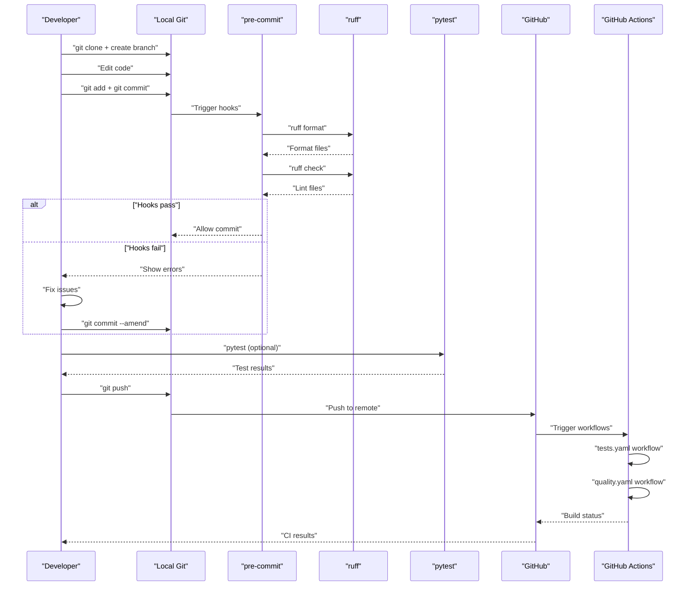

<!-- source: DeepWiki mcp.deepwiki.com · repo huggingface/lighteval · page 11 Development and Contributing · fetched 2026-10-26 -->

# Development and Contributing

<details>
<summary>Relevant source files</summary>

The following files were used as context for generating this wiki page:

- [README.md](README.md)
- [pyproject.toml](pyproject.toml)

</details>


This page documents the development workflow, code quality standards, and contribution guidelines for lighteval. It is intended for developers who want to contribute code, fix bugs, or extend the framework.

For detailed information about specific topics:
- Project organization and module structure: see [Project Structure](11.1)
- Development environment setup: see [Development Setup](11.2)
- Testing and code quality standards: see [Code Quality and Testing](11.3)
- Adding tasks, metrics, and backends: see [Extension Guides](11.4)

## Repository Structure

The lighteval repository follows standard Python package conventions with source code under `src/lighteval/`:

```
lighteval/
├── src/lighteval/           # Main package source
│   ├── __main__.py         # CLI entry point (app: typer.Typer)
│   ├── pipeline.py         # Pipeline class
│   ├── data.py             # Doc, ModelResponse
│   ├── tasks/              # Task system
│   │   ├── registry.py     # Registry, task discovery
│   │   ├── lighteval_task.py  # LightevalTask, LightevalTaskConfig
│   │   ├── prompt_manager.py  # PromptManager
│   │   └── tasks_prompt_formatting.py  # TASKS_TABLE
│   ├── models/             # Model backends
│   │   ├── base_model.py   # LightevalModel (abstract)
│   │   ├── model_config.py # ModelConfig variants
│   │   ├── transformers/   # TransformersModel
│   │   ├── vllm/           # VLLMModel
│   │   └── endpoints/      # Endpoint models
│   ├── metrics/            # Metrics system
│   │   ├── metrics.py      # Metrics enum
│   │   ├── utils/          # Computation classes
│   │   └── llm_as_judge/   # JudgeLLM
│   └── logging/            # Logging system
│       └── evaluation_tracker.py  # EvaluationTracker
├── tests/                  # Test suite
├── examples/               # Usage examples
├── community_tasks/        # Community-contributed tasks
├── docs/                   # Documentation
└── pyproject.toml         # Package configuration
```

**Directory Structure**: Key modules and their primary classes

The `src/` layout is used to ensure clean imports and prevent accidental imports of development files. Package discovery is configured in [pyproject.toml:30-31]().

Sources: [pyproject.toml:30-31]()

## Installation for Development

Clone the repository and install with development dependencies:

```bash
git clone https://github.com/huggingface/lighteval
cd lighteval
pip install -e ".[dev]"
```

The `dev` extra includes all development tools [pyproject.toml:110]():

```python
dev = ["lighteval[accelerate,quality,tests,multilingual,math,extended_tasks,vllm]"]
```

This installs:
- **quality**: `ruff>=v0.11.0` and `pre-commit` [pyproject.toml:108]()
- **tests**: `pytest>=7.4.0`, `deepdiff`, `pip>=25.2` [pyproject.toml:109]()
- **accelerate, vllm**: Core evaluation backends
- **multilingual, math, extended_tasks**: Additional task support

### Pre-commit Hooks

Set up pre-commit hooks to automatically format and lint code before commits:

```bash
pre-commit install
```

Run hooks manually on all files:

```bash
pre-commit run --all-files
```

The hooks run `ruff format` (code formatting) and `ruff check` (linting) before each commit.

Sources: [README.md:187-193](), [pyproject.toml:108-110]()

## Code Quality Standards

Lighteval uses Ruff for code formatting and linting. Configuration is defined in [pyproject.toml:2-23]().

### Ruff Configuration

| Setting | Value | Purpose |
|---------|-------|---------|
| `line-length` | 119 | Maximum line width |
| `quote-style` | `"double"` | String formatting |
| `indent-style` | `"space"` | Code indentation |
| `convention` | `"google"` | Docstring style (pydocstyle) |

**Ruff Configuration**: Key formatting settings

### Linting Rules

Selected rule categories [pyproject.toml:6-9]():

```python
select = ["C", "E", "F", "I", "W", "CPY", "D417", "DOC"]
ignore = ["E501", "D100", "D101", "D102", "D103", "D104", "D415", "D105", "DOC501", "DOC201", "CPY001"]
```

- **C**: Complexity checks
- **E, F, W**: PEP 8 style (pycodestyle, Pyflakes)
- **I**: Import sorting (isort-compatible)
- **D417, DOC**: Docstring checks (Google style)
- **CPY**: Copyright notices (ignored via CPY001)

Line length violations (`E501`) are ignored because the formatter handles line wrapping.

### Import Organization

Imports are sorted with `lighteval` as a known first-party package [pyproject.toml:15-17]():

```python
[tool.ruff.lint.isort]
lines-after-imports = 2
known-first-party = ["lighteval"]
```

Example correct import order:

```python
# Standard library
import os
from typing import Optional


# Third-party
import torch
from transformers import AutoModel


# First-party (lighteval)
from lighteval.models.base_model import LightevalModel
from lighteval.tasks.registry import Registry
```

Sources: [pyproject.toml:2-23]()

## Testing

The test suite uses pytest and is located in the `tests/` directory. Install test dependencies:

```bash
pip install -e ".[tests]"
```

Test dependencies [pyproject.toml:109]():
- `pytest>=7.4.0`: Test framework
- `deepdiff`: For comparing complex data structures
- `pip>=25.2`: For package installation testing

### Running Tests

Run all tests:

```bash
pytest
```

Run specific test files or directories:

```bash
pytest tests/tasks/
pytest tests/models/test_transformers_model.py
```

Run tests matching a pattern:

```bash
pytest -k "test_registry"
```

### Test Structure

Tests are organized to mirror the source structure:

```
tests/
├── tasks/              # Task system tests
├── models/             # Model backend tests
├── metrics/            # Metrics tests
└── logging/            # Logging and tracking tests
```

Sources: [pyproject.toml:109]()

## Contributing Workflow



**Contributing Workflow**: From local changes to CI validation

### Contribution Steps

1. **Fork and clone**: Fork the repository on GitHub, then clone your fork
2. **Install dev dependencies**: Run `pip install -e ".[dev]"`
3. **Set up pre-commit**: Run `pre-commit install`
4. **Create a branch**: Use descriptive branch names (e.g., `fix-registry-bug`, `add-mmlu-pro`)
5. **Make changes**: Edit code following style guidelines
6. **Commit**: Pre-commit hooks automatically format and lint
7. **Test locally**: Run `pytest` to verify changes
8. **Push and PR**: Push to your fork and open a pull request

### Pull Request Guidelines

- **New features**: Open an issue first to discuss the design [README.md:185]()
- **Bug fixes**: Reference the issue number in the PR description
- **Code quality**: Ensure pre-commit hooks pass before pushing
- **Tests**: Add tests for new functionality
- **Documentation**: Update docs if adding user-facing features

### CI Workflows

GitHub Actions runs two workflows on push [README.md:14-15]():

1. **tests.yaml**: Runs pytest suite across Python versions
2. **quality.yaml**: Runs ruff checks to verify code quality

Both workflows must pass before a PR can be merged.

Sources: [README.md:14-15](), [README.md:183-193]()

## Package Configuration

The package is configured in `pyproject.toml` using modern PEP 621 metadata [pyproject.toml:36-93]().

### Build System

```toml
[build-system]
requires = ["setuptools>=61.0"]
build-backend = "setuptools.build_meta"
```

Uses setuptools with package discovery under `src/` [pyproject.toml:26-28](), [pyproject.toml:30-31]().

### Dependencies

Core dependencies [pyproject.toml:60-93]() include:

| Category | Packages |
|----------|----------|
| **Transformers** | `transformers>=4.54.0`, `accelerate`, `torch>=2.0,<3.0` |
| **Inspect-AI** | `inspect-ai>=0.3.140` (recommended backend) |
| **Datasets** | `datasets>=4.0.0`, `huggingface_hub[hf_xet]>=0.30.2` |
| **Metrics** | `nltk`, `scikit-learn`, `sacrebleu`, `rouge_score`, `sentencepiece` |
| **CLI** | `typer>=0.20.0`, `rich`, `colorlog`, `termcolor` |
| **Utilities** | `pydantic`, `numpy>=2`, `GitPython>=3.1.41` |

**Core Dependencies**: Required packages for basic functionality

### Optional Extras

Optional dependency groups [pyproject.toml:95-128]():

| Extra | Purpose | Key Packages |
|-------|---------|--------------|
| `vllm` | VLLM backend | `vllm>=0.10.0,<0.10.2`, `ray`, `more_itertools` |
| `sglang` | SGLang backend | `sglang` |
| `nanotron` | Nanotron backend | `nanotron`, `tensorboardX` |
| `tgi` | Text Generation Inference | `text-generation>=0.7.0` |
| `litellm` | LiteLLM endpoint | `litellm[caching]>=1.66.0`, `diskcache` |
| `multilingual` | Multilingual tasks | `stanza`, `spacy[ja,ko,th]>=3.8.0`, `jieba`, `pyvi` |
| `math` | Math tasks | `latex2sympy2_extended==1.0.6` |
| `extended_tasks` | Additional tasks | `langdetect`, `tiktoken`, `emoji`, `spacy`, `evaluate` |
| `quality` | Code quality | `ruff>=v0.11.0`, `pre-commit` |
| `tests` | Testing | `pytest>=7.4.0`, `deepdiff`, `pip>=25.2` |
| `dev` | Full development | Includes accelerate, quality, tests, multilingual, math, extended_tasks, vllm |
| `wandb` | W&B integration | `wandb` |
| `docs` | Documentation | `hf-doc-builder`, `watchdog` |

**Optional Extras**: Additional features installable via `pip install lighteval[extra]`

Install multiple extras: `pip install lighteval[vllm,math,quality]`

Sources: [pyproject.toml:26-128]()

## CLI Entry Point

The command-line interface is defined in `src/lighteval/__main__.py` and registered in [pyproject.toml:136-137]():

```toml
[project.scripts]
lighteval = "lighteval.__main__:app"
```

This makes the `lighteval` command available after installation. The `app` object is a Typer application that defines all CLI commands (eval, accelerate, vllm, endpoint, etc.).

Sources: [pyproject.toml:136-137]()

## Component Locations

Quick reference for major components:

| Component | Module Path | Key Classes/Functions |
|-----------|-------------|----------------------|
| **Pipeline** | `src/lighteval/pipeline.py` | `Pipeline`, `PipelineParameters`, `ParallelismManager` |
| **Tasks** | `src/lighteval/tasks/lighteval_task.py` | `LightevalTask`, `LightevalTaskConfig` |
| **Registry** | `src/lighteval/tasks/registry.py` | `Registry`, `TASKS_TABLE` |
| **Models** | `src/lighteval/models/base_model.py` | `LightevalModel` (abstract interface) |
| **Model Configs** | `src/lighteval/models/model_config.py` | `ModelConfig` variants |
| **Transformers** | `src/lighteval/models/transformers/transformers_model.py` | `TransformersModel`, `TransformersModelConfig` |
| **VLLM** | `src/lighteval/models/vllm/vllm_model.py` | `VLLMModel`, `VLLMModelConfig` |
| **Data Structures** | `src/lighteval/data.py` | `Doc`, `ModelResponse` |
| **Metrics** | `src/lighteval/metrics/metrics.py` | `Metrics` enum |
| **Metric Utils** | `src/lighteval/metrics/utils/metric_utils.py` | `SampleLevelComputation`, `CorpusLevelComputation` |
| **Tracking** | `src/lighteval/logging/evaluation_tracker.py` | `EvaluationTracker` |
| **Prompt Manager** | `src/lighteval/tasks/prompt_manager.py` | `PromptManager` |
| **CLI** | `src/lighteval/__main__.py` | `app` (Typer application) |

**Component Locations**: Quick reference for navigating the codebase

Sources: Based on repository structure

## Next Steps

To dive deeper into specific development tasks:

1. **Understanding the structure**: Start with [Project Structure](#11.1) to explore the complete package organization
2. **Adding tasks**: Follow [Adding Custom Tasks](#11.2) to create and register new evaluation tasks
3. **Custom metrics**: Use [Adding Custom Metrics](#11.3) to implement specialized evaluation metrics
4. **New backends**: Read [Adding Custom Backends](#11.4) for integrating new inference engines
5. **Quality assurance**: Review [Code Quality and Testing](#11.5) for testing best practices

For questions or discussions about development, open an issue on the [GitHub repository](https://github.com/huggingface/lighteval/issues).

Sources: [README.md:174-180](), [pyproject.toml:125-128]()

---

