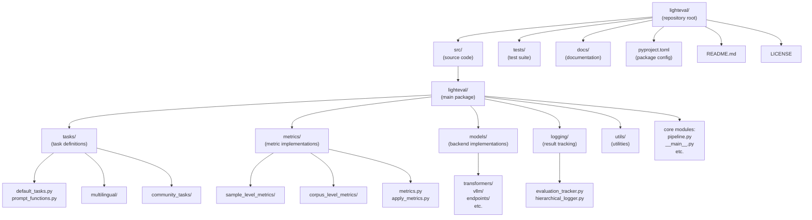
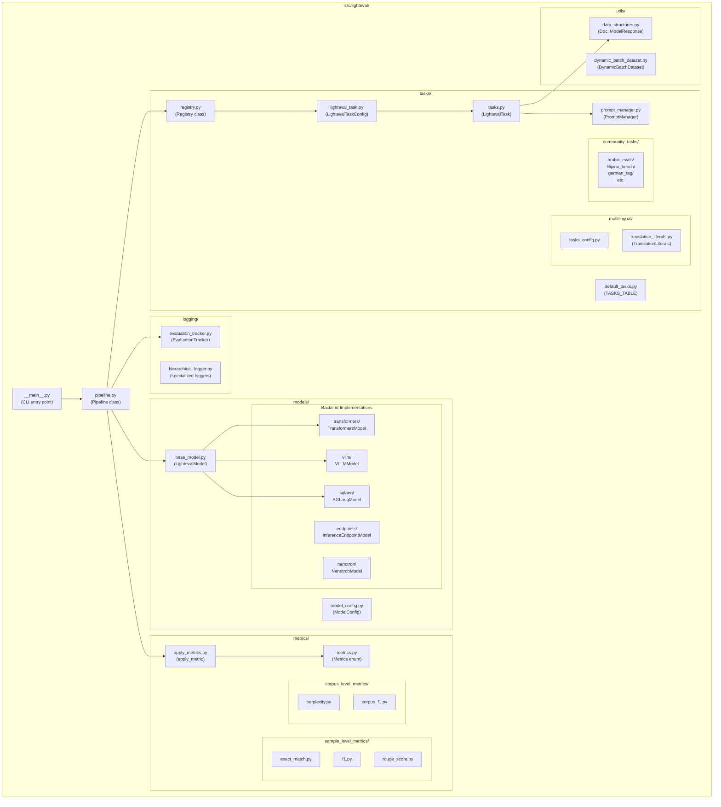
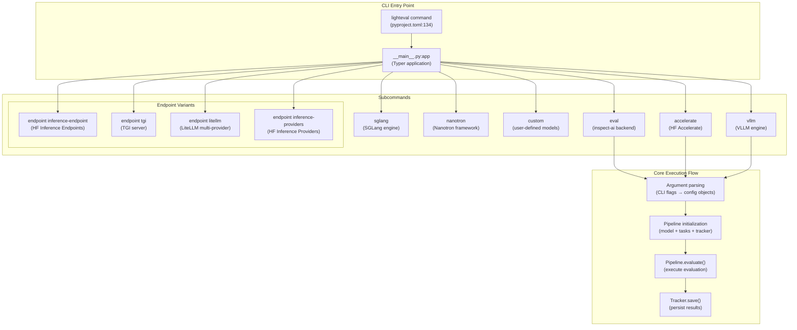
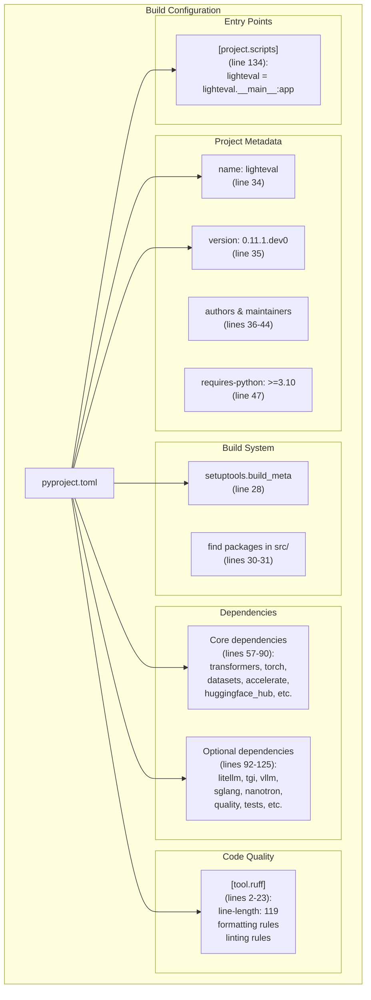

<!-- source: DeepWiki mcp.deepwiki.com · repo huggingface/lighteval · page 11.1 Project Structure · fetched 2026-10-26 -->

# Project Structure

<details>
<summary>Relevant source files</summary>

The following files were used as context for generating this wiki page:

- [README.md](README.md)
- [pyproject.toml](pyproject.toml)

</details>


This document describes the organization of the lighteval repository, including its package structure, key directories, module organization, and how different subsystems are mapped to code entities. Understanding this structure is essential for contributing to the codebase or extending lighteval with custom functionality.

For information about creating custom tasks, see [Adding Custom Tasks](#11.2). For implementing custom metrics, see [Adding Custom Metrics](#11.3). For custom model backends, see [Adding Custom Backends](#11.4).

## Repository Layout

The lighteval repository follows a standard Python package structure with source code organized under `src/` and configuration files at the root level.



**Sources:** [pyproject.toml:30-31](), [README.md:1-204]()

## Package Structure

The main package is located at `src/lighteval/` and contains all core functionality. The package uses a modular design where each major subsystem has its own directory or module.



**Sources:** [pyproject.toml:30-31](), [pyproject.toml:134]()

## Core Module Organization

The following table maps major subsystems to their corresponding modules and primary classes:

| Subsystem | Directory/Module | Key Classes/Functions | Purpose |
|-----------|------------------|----------------------|---------|
| **CLI & Entry Point** | `__main__.py` | `app`, command handlers | Typer-based CLI with subcommands for different backends |
| **Orchestration** | `pipeline.py` | `Pipeline`, `PipelineParameters`, `ParallelismManager` | Coordinates evaluation flow from tasks to results |
| **Task System** | `tasks/` | `LightevalTask`, `LightevalTaskConfig`, `Registry` | Task definition, loading, and execution |
| **Prompt Management** | `tasks/prompt_manager.py` | `PromptManager`, `FewShotSampler` | Formats prompts with chat templates or plain text |
| **Task Registry** | `tasks/registry.py` | `Registry`, `load_all_task_configs` | Discovers and loads tasks from multiple sources |
| **Default Tasks** | `tasks/default_tasks.py` | `TASKS_TABLE` | List of built-in task configurations |
| **Multilingual** | `tasks/multilingual/` | `TranslationLiterals`, `Language` enum | 200+ language support with proper formatting |
| **Community Tasks** | `tasks/community_tasks/` | Various `TASKS_TABLE` lists | Community-contributed task implementations |
| **Model Abstraction** | `models/base_model.py` | `LightevalModel` (abstract) | Common interface for all backends |
| **Model Config** | `models/model_config.py` | `ModelConfig`, `InspectAIModelConfig` | Backend-specific configuration |
| **Transformers** | `models/transformers/` | `TransformersModel`, `TransformersModelConfig` | HuggingFace Transformers backend |
| **VLLM** | `models/vllm/` | `VLLMModel`, `AsyncVLLMModel`, `VLLMModelConfig` | VLLM high-performance backend |
| **SGLang** | `models/sglang/` | `SGLangModel`, `SGLangModelConfig` | SGLang structured generation backend |
| **Endpoints** | `models/endpoints/` | `InferenceEndpointModel`, `TGIModelClient`, `LiteLLMModel` | Remote API backends |
| **Nanotron** | `models/nanotron/` | `NanotronModel`, `FullNanotronConfig` | Nanotron training framework integration |
| **Metrics** | `metrics/metrics.py` | `Metrics` enum, `SampleLevelMetrics`, `CorpusLevelMetrics` | 40+ predefined metrics |
| **Metric Application** | `metrics/apply_metrics.py` | `apply_metric`, `apply_generative_metric` | Dispatches and computes metrics |
| **Sample Metrics** | `metrics/sample_level_metrics/` | `ExactMatches`, `F1_score`, `ROUGE`, etc. | Per-sample metric implementations |
| **Corpus Metrics** | `metrics/corpus_level_metrics/` | `Perplexity`, `F1Score`, `CorpusLevelMetrics` | Aggregated metric implementations |
| **Result Tracking** | `logging/evaluation_tracker.py` | `EvaluationTracker` | Orchestrates result logging and storage |
| **Loggers** | `logging/hierarchical_logger.py` | `DetailsLogger`, `MetricsLogger`, `VersionsLogger` | Specialized logging components |
| **Data Structures** | `utils/data_structures.py` | `Doc`, `ModelResponse`, `GenerationParameters` | Core data types used throughout |
| **Dynamic Batching** | `utils/dynamic_batch_dataset.py` | `DynamicBatchDataset`, `LoglikelihoodDataset` | Smart batching and sorting |

**Sources:** [pyproject.toml:30-134](), [README.md:108-126]()

## Entry Points and CLI Architecture

The lighteval CLI is implemented using Typer and provides multiple subcommands for different backend configurations. The entry point is defined in `pyproject.toml` and maps to the `app` object in `__main__.py`.



**CLI Command Mapping:**

| Command | Backend | Primary Model Class | Config Class | Use Case |
|---------|---------|-------------------|--------------|----------|
| `lighteval eval` | Inspect AI | `InspectAIModelConfig` | `InspectAIModelConfig` | Unified backend with inspect-ai |
| `lighteval accelerate` | Transformers | `TransformersModel` | `TransformersModelConfig` | Local models with HF Accelerate |
| `lighteval vllm` | VLLM | `VLLMModel`, `AsyncVLLMModel` | `VLLMModelConfig` | High-throughput inference |
| `lighteval sglang` | SGLang | `SGLangModel` | `SGLangModelConfig` | Structured generation |
| `lighteval nanotron` | Nanotron | `NanotronModel` | `FullNanotronConfig` | In-training evaluation |
| `lighteval endpoint inference-endpoint` | HF Endpoint | `InferenceEndpointModel` | `EndpointModelConfig` | HF Inference Endpoints |
| `lighteval endpoint tgi` | TGI | `TGIModelClient` | `EndpointModelConfig` | TGI server (local/remote) |
| `lighteval endpoint litellm` | LiteLLM | `LiteLLMModel` | `EndpointModelConfig` | Multi-provider APIs |
| `lighteval endpoint inference-providers` | HF Providers | `InferenceProvidersClient` | `EndpointModelConfig` | HF Inference Providers |
| `lighteval custom` | User-defined | `CustomModel` | `CustomModelConfig` | Custom implementations |

**Sources:** [pyproject.toml:134](), [README.md:108-126]()

## Configuration and Build System

The project uses modern Python packaging with `pyproject.toml` as the single source of configuration.



**Core Dependencies** (always installed):
- `transformers>=4.54.0` - HuggingFace Transformers library
- `torch>=2.0,<3.0` - PyTorch for model inference
- `datasets>=4.0.0` - HuggingFace Datasets for data loading
- `accelerate` - Multi-GPU support
- `huggingface_hub[hf_xet]>=0.30.2` - Hub integration
- `inspect-ai>=0.3.140` - Inspect AI backend
- Metric libraries: `nltk`, `scikit-learn`, `sacrebleu`, `rouge_score`
- Utilities: `typer`, `pydantic`, `rich`, `colorlog`

**Optional Dependencies** (installed as extras):

| Extra | Install Command | Purpose | Key Dependencies |
|-------|----------------|---------|------------------|
| `litellm` | `pip install lighteval[litellm]` | LiteLLM multi-provider support | `litellm[caching]>=1.66.0` |
| `tgi` | `pip install lighteval[tgi]` | TGI server integration | `text-generation>=0.7.0` |
| `vllm` | `pip install lighteval[vllm]` | VLLM high-performance backend | `vllm>=0.10.0`, `ray` |
| `sglang` | `pip install lighteval[sglang]` | SGLang structured generation | `sglang` |
| `nanotron` | `pip install lighteval[nanotron]` | Nanotron framework integration | `nanotron`, `tensorboardX` |
| `quantization` | `pip install lighteval[quantization]` | Model quantization support | `bitsandbytes`, `auto-gptq` |
| `multilingual` | `pip install lighteval[multilingual]` | Multilingual evaluation support | `stanza`, `spacy[ja,ko,th]`, `jieba`, `pyvi` |
| `math` | `pip install lighteval[math]` | Math expression evaluation | `latex2sympy2_extended` |
| `extended_tasks` | `pip install lighteval[extended_tasks]` | Extended task support | `langdetect`, `openai`, `tiktoken`, `evaluate` |
| `wandb` | `pip install lighteval[wandb]` | Weights & Biases tracking | `wandb` |
| `trackio` | `pip install lighteval[trackio]` | Trackio experiment tracking | `trackio` |
| `quality` | `pip install lighteval[quality]` | Code quality tools | `ruff>=v0.11.0`, `pre-commit` |
| `tests` | `pip install lighteval[tests]` | Testing infrastructure | `pytest>=7.4.0`, `deepdiff` |
| `dev` | `pip install lighteval[dev]` | Full development setup | Combines accelerate, quality, tests, multilingual, math, extended_tasks, vllm |

**Sources:** [pyproject.toml:1-135]()

## Code Quality Standards

The project uses Ruff for code formatting and linting, configured in `pyproject.toml`.

**Ruff Configuration:**
- Line length: 119 characters [pyproject.toml:3]()
- Docstring convention: Google style [pyproject.toml:12-13]()
- Import sorting: 2 lines after imports, `lighteval` as first-party [pyproject.toml:15-17]()
- Quote style: double quotes [pyproject.toml:20]()
- Ignored rules: `E501` (line length), docstring rules for private methods [pyproject.toml:8]()
- Selected rules: Pycodestyle (E, W), Pyflakes (F), isort (I), Convention (C), Documentation (DOC) [pyproject.toml:9]()

**Pre-commit Setup:**
```bash
pip install -e .[dev]
pre-commit install
pre-commit run --all-files
```

**Sources:** [pyproject.toml:2-23](), [README.md:186-192]()

## Package Distribution

The package is distributed via PyPI under the name `lighteval` with MIT license.

**Key Metadata:**
- Package name: `lighteval` [pyproject.toml:34]()
- Current version: `0.11.1.dev0` [pyproject.toml:35]()
- Minimum Python: 3.10 [pyproject.toml:47]()
- License: MIT [pyproject.toml:48]()
- Homepage: https://github.com/huggingface/lighteval [pyproject.toml:128]()
- Keywords: `evaluation`, `nlp`, `llm` [pyproject.toml:56]()

**Installation:**
```bash
# Basic installation
pip install lighteval

# With specific backend support
pip install lighteval[vllm]
pip install lighteval[litellm]

# Full development setup
pip install -e .[dev]
```

**Sources:** [pyproject.toml:33-56](), [README.md:89-104]()

---

