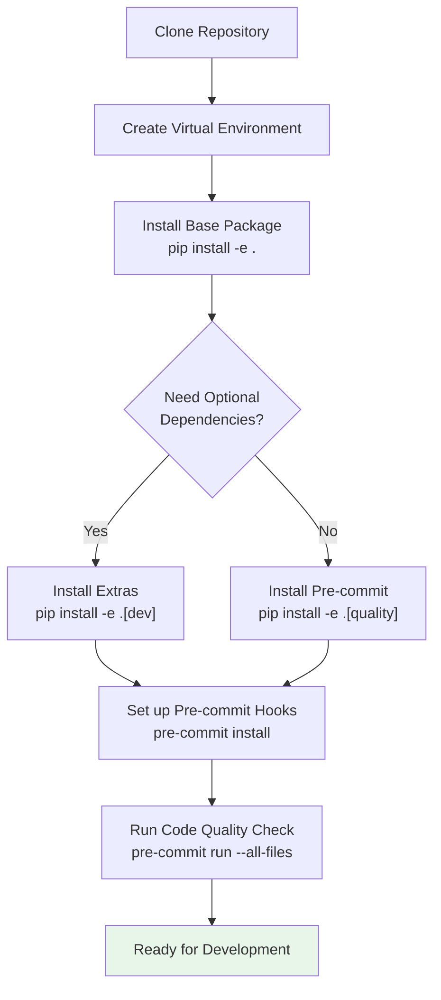
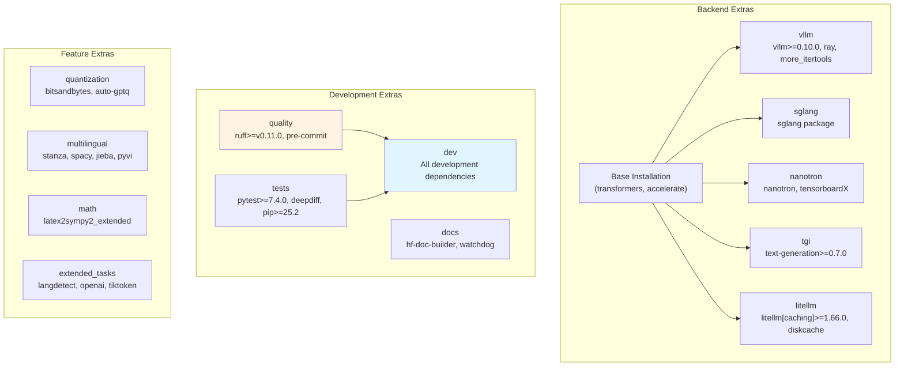
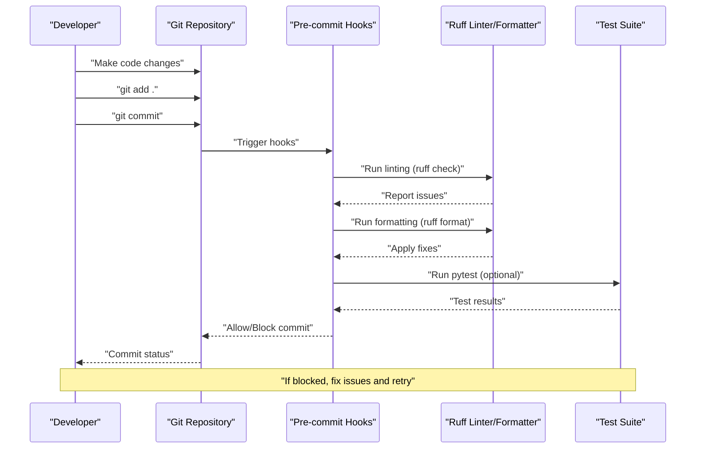

<!-- source: DeepWiki mcp.deepwiki.com · repo huggingface/lighteval · page 11.2 Development Setup · fetched 2026-10-26 -->

# Development Setup

<details>
<summary>Relevant source files</summary>

The following files were used as context for generating this wiki page:

- [README.md](README.md)
- [pyproject.toml](pyproject.toml)

</details>


This page covers setting up a development environment for contributing to lighteval, including installing dependencies, configuring code quality tools, and running tests. For information about project structure, see [Project Structure](#11.1). For guidance on testing practices, see [Code Quality and Testing](#11.3).

## Overview

Lighteval requires Python 3.10 or higher and uses a modern Python toolchain with setuptools, ruff for linting/formatting, and pytest for testing. The project supports multiple optional dependency groups for different backends and features.

**Sources**: [pyproject.toml:50](), [README.md:92]()

## Development Installation Flow



**Sources**: [README.md:189-193]()

## Prerequisites

| Requirement | Minimum Version | Notes |
|------------|-----------------|-------|
| Python | 3.10 | Specified in `pyproject.toml` |
| pip | 25.2+ | Required for tests extra |
| Git | Any recent | For version control and GitPython dependency |

**Sources**: [pyproject.toml:50](), [pyproject.toml:109]()

## Installation Steps

### 1. Clone the Repository

```bash
git clone https://github.com/huggingface/lighteval.git
cd lighteval
```

### 2. Create a Virtual Environment (Recommended)

```bash
python -m venv venv
source venv/bin/activate  # On Windows: venv\Scripts\activate
```

### 3. Install in Editable Mode

For basic development:
```bash
pip install -e .
```

This installs the base dependencies defined in [pyproject.toml:60-93](), including:
- Core libraries: `transformers`, `accelerate`, `torch`, `datasets`
- Evaluation framework: `inspect-ai`, `openai`
- CLI tools: `typer`, `rich`, `colorlog`
- Metrics: `nltk`, `scikit-learn`, `sacrebleu`, `rouge_score`

For full development with all features:
```bash
pip install -e ".[dev]"
```

**Sources**: [README.md:190](), [pyproject.toml:60-93](), [pyproject.toml:110]()

## Optional Dependencies

The project defines multiple optional dependency groups in [pyproject.toml:95-128]():

### Backend-Specific Extras



**Sources**: [pyproject.toml:95-128]()

### Installation Examples

| Use Case | Command |
|----------|---------|
| Development with common backends | `pip install -e ".[dev]"` |
| Quality tools only | `pip install -e ".[quality]"` |
| Testing only | `pip install -e ".[tests]"` |
| VLLM backend | `pip install -e ".[vllm]"` |
| Multilingual support | `pip install -e ".[multilingual]"` |
| Extended tasks (LLM-as-judge) | `pip install -e ".[extended_tasks]"` |
| Logging integrations | `pip install -e ".[wandb,tensorboardX]"` |

**Sources**: [pyproject.toml:95-128]()

## Code Quality Tools Configuration

### Ruff Configuration

Lighteval uses Ruff for both linting and formatting. The configuration is defined in [pyproject.toml:2-23]():

**Linting Rules**:
- Line length: 119 characters
- Enabled checks: `C` (conventions), `E` (errors), `F` (pyflakes), `I` (import sorting), `W` (warnings), `CPY` (copyright), `D417` (docstring args), `DOC` (docstring style)
- Ignored: `E501` (line length), all `D100`-`D105` (missing docstrings), `D415`, `DOC501`, `DOC201`, `CPY001`
- Docstring convention: Google style

**Formatting Rules**:
- Quote style: double quotes
- Indent style: spaces
- Line ending: auto-detect
- Respects magic trailing commas

**Import Sorting**:
- Two lines after imports
- Known first-party: `lighteval`

**Sources**: [pyproject.toml:2-23]()

### Pre-commit Setup

After installing quality tools, set up pre-commit hooks:

```bash
pre-commit install
```

This configures git hooks to automatically run code quality checks before each commit.

To manually run checks on all files:

```bash
pre-commit run --all-files
```

**Sources**: [README.md:191-192]()

## Package Configuration

### Build System

Lighteval uses setuptools with the following configuration:

```python
# From pyproject.toml
[build-system]
requires = ["setuptools>=61.0"]
build-backend = "setuptools.build_meta"

[tool.setuptools.packages.find]
where = ["src"]

[tool.setuptools.package-data]
lighteval = ["py.typed"]
```

The source code is located in `src/lighteval/`, and the package includes type hints (`py.typed`).

**Sources**: [pyproject.toml:26-34]()

### Package Metadata

Key package information from [pyproject.toml:36-59]():

| Property | Value |
|----------|-------|
| Name | `lighteval` |
| Version | `0.13.1.dev0` |
| Python Requirement | `>=3.10` |
| License | MIT |
| Authors | Nathan Habib, Clémentine Fourrier, Thomas Wolf |
| Description | A lightweight and configurable evaluation package |

The package is registered as an entry point script:
- Command: `lighteval`
- Entry point: `lighteval.__main__:app`

**Sources**: [pyproject.toml:36-59](), [pyproject.toml:136-137]()

## Hugging Face Authentication

For pushing results to the Hugging Face Hub, authenticate with:

```bash
huggingface-cli login
```

Or set the `HF_TOKEN` environment variable:

```bash
export HF_TOKEN="your_token_here"
```

**Sources**: [README.md:103-105]()

## Development Workflow Diagram



**Sources**: [README.md:189-192](), [pyproject.toml:2-23]()

## Verifying Installation

To verify your development setup is correct:

1. **Check lighteval CLI is available**:
   ```bash
   lighteval --help
   ```

2. **Run a simple evaluation** (with limited samples):
   ```bash
   lighteval eval "hf-inference-providers/openai/gpt-oss-20b" gpqa:diamond --max-samples 2
   ```

3. **Run code quality checks**:
   ```bash
   pre-commit run --all-files
   ```

4. **Run tests** (if installed with `[tests]` extra):
   ```bash
   pytest tests/
   ```

**Sources**: [README.md:128-132](), [README.md:192]()

## Common Dependencies by Feature

The following table maps common use cases to their required optional dependencies:

| Feature | Required Extra | Key Packages |
|---------|---------------|--------------|
| VLLM high-performance inference | `vllm` | `vllm>=0.10.0`, `ray`, `more_itertools` |
| Distributed evaluation | `nanotron` | `nanotron`, `tensorboardX` |
| API gateway (OpenAI, Anthropic, etc.) | `litellm` | `litellm[caching]>=1.66.0`, `diskcache` |
| Text Generation Inference | `tgi` | `text-generation>=0.7.0` |
| Model quantization | `quantization` | `bitsandbytes>=0.41.0`, `auto-gptq>=0.4.2` |
| Multilingual evaluation | `multilingual` | `stanza`, `spacy[ja,ko,th]`, `jieba`, `pyvi` |
| Advanced math tasks | `math` | `latex2sympy2_extended==1.0.6` |
| LLM-as-judge metrics | `extended_tasks` | `openai>1.87`, `tiktoken`, `langdetect` |
| Weights & Biases logging | `wandb` | `wandb` |
| TensorBoard logging | `tensorboardX` | `tensorboardX` |
| S3 storage | `s3` | `s3fs` |

**Sources**: [pyproject.toml:95-128]()

## Troubleshooting

### Import Errors

If you encounter import errors after installation:
1. Ensure you're in the correct virtual environment
2. Verify installation: `pip show lighteval`
3. Reinstall in editable mode: `pip install -e .`

### Pre-commit Hook Failures

If pre-commit hooks fail:
1. Check Ruff version: `ruff --version` (should be >=0.11.0)
2. Manually run Ruff: `ruff check . --fix` and `ruff format .`
3. Review specific error messages for configuration issues

### Missing Optional Dependencies

If a backend or feature doesn't work:
1. Check installed extras: `pip list | grep -E "vllm|nanotron|litellm"`
2. Install the required extra: `pip install -e ".[feature_name]"`
3. Verify compatibility with `pip check`

**Sources**: [pyproject.toml:95-128](), [pyproject.toml:108]()

---

