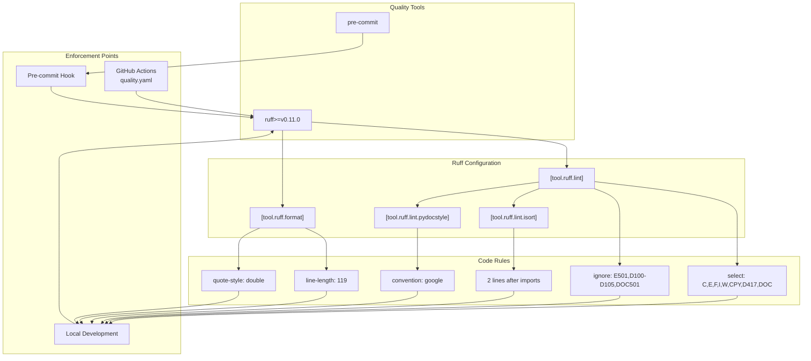
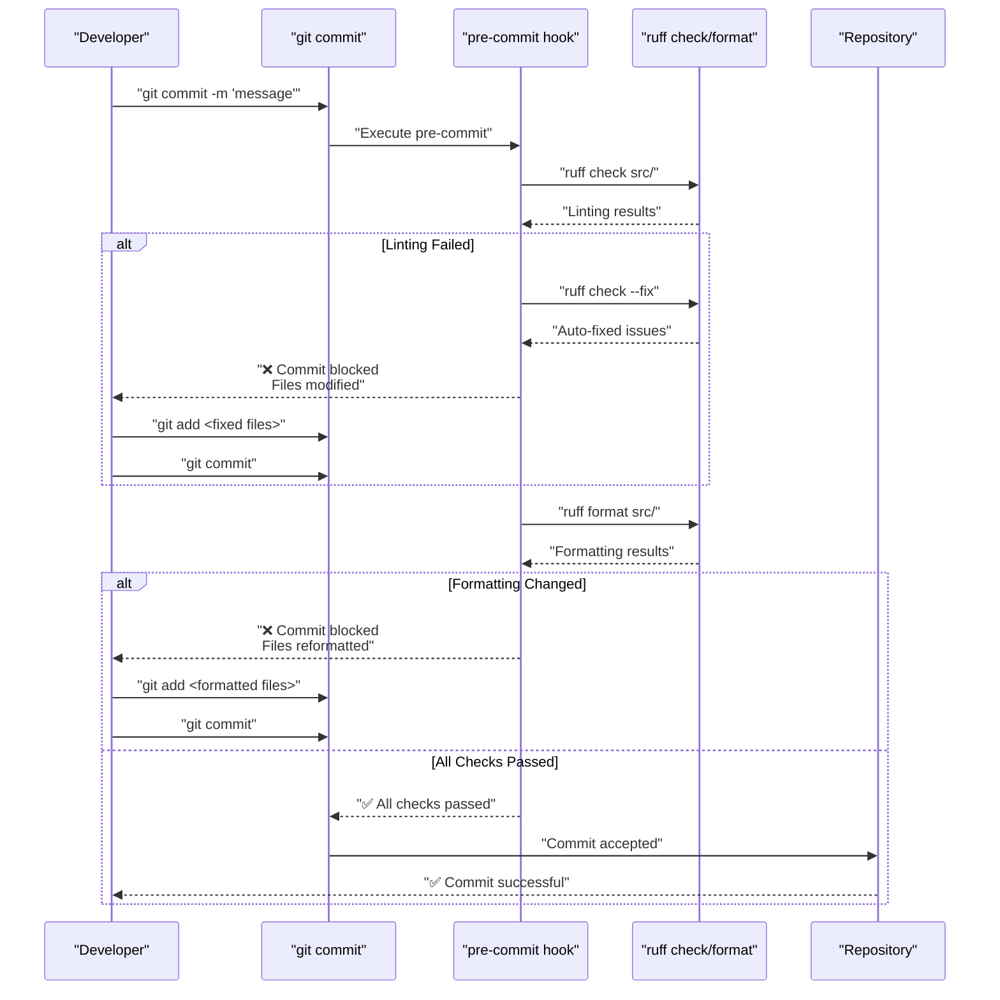
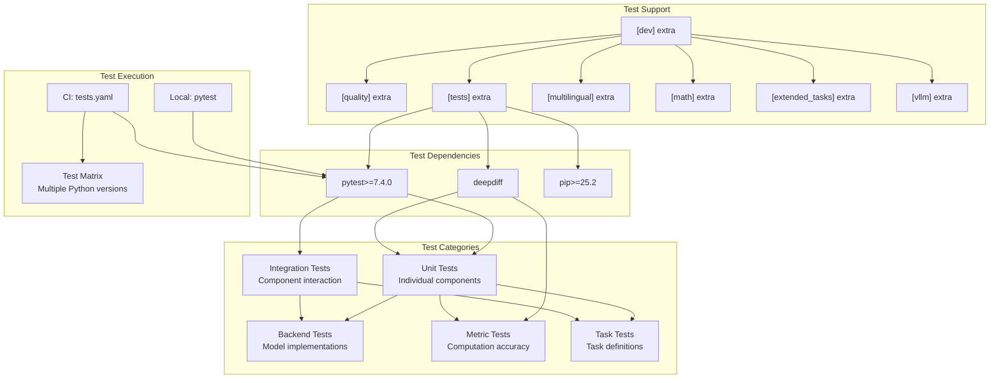
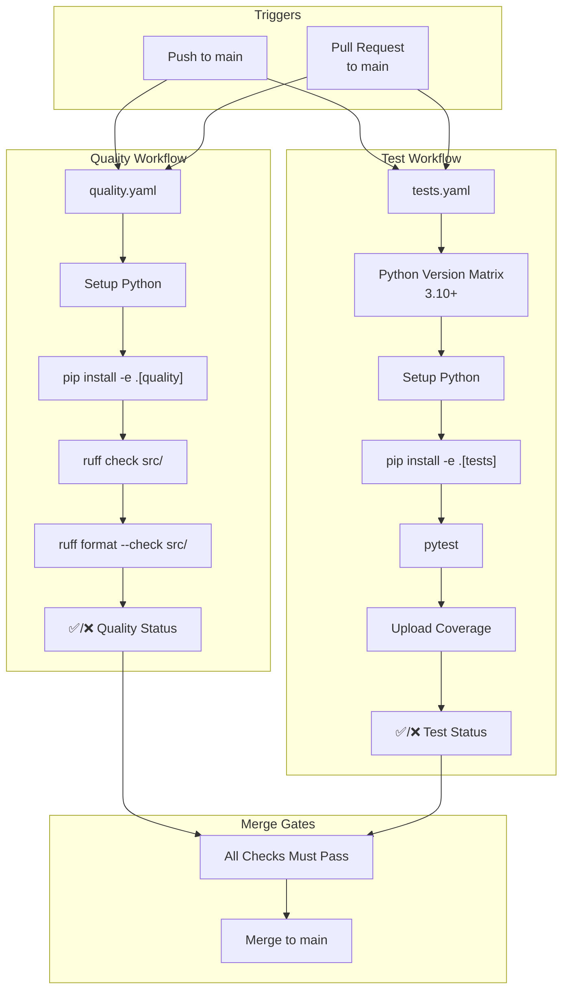
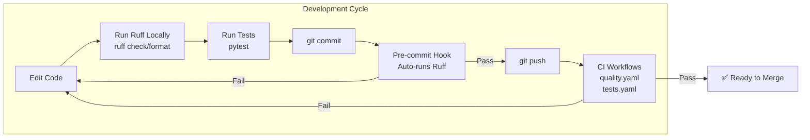

<!-- source: DeepWiki mcp.deepwiki.com · repo huggingface/lighteval · page 11.3 Code Quality and Testing · fetched 2026-10-26 -->

# Code Quality and Testing

<details>
<summary>Relevant source files</summary>

The following files were used as context for generating this wiki page:

- [.github/workflows/pr_style_bot.yaml](.github/workflows/pr_style_bot.yaml)
- [README.md](README.md)
- [docs/source/adding-a-new-metric.mdx](docs/source/adding-a-new-metric.mdx)
- [pyproject.toml](pyproject.toml)
- [src/lighteval/__main__.py](src/lighteval/__main__.py)
- [src/lighteval/main_baseline.py](src/lighteval/main_baseline.py)

</details>


## Purpose and Scope

This document covers the development practices, code quality standards, and testing infrastructure used in the lighteval project. It explains the linting and formatting configuration, pre-commit hooks, test suite organization, and continuous integration setup.

For information about extending the codebase with custom functionality, see:
- Adding custom tasks: [11.2](#11.2)
- Adding custom metrics: [11.3](#11.3)
- Adding custom backends: [11.4](#11.4)

---

## Code Quality Tools

Lighteval enforces code quality standards using [Ruff](https://docs.astral.sh/ruff/), a fast Python linter and formatter that combines the functionality of multiple tools (Flake8, isort, Black, etc.) into a single package.

### Ruff Configuration

The project's Ruff configuration is defined in [pyproject.toml:2-23]() and enforces consistent code style across the codebase.

**Linting Rules**

| Configuration | Value | Purpose |
|--------------|-------|---------|
| `line-length` | 119 | Maximum characters per line |
| `select` | `["C", "E", "F", "I", "W", "CPY", "D417", "DOC"]` | Enabled rule categories |
| `ignore` | `["E501", "D100", "D101", "D102", "D103", "D104", "D415", "D105", "DOC501", "DOC201"]` | Disabled rules |
| `preview` | `true` | Enable preview rules |

**Rule Categories:**
- **C**: Convention violations (mccabe complexity)
- **E**: Error-prone patterns (pycodestyle errors)
- **F**: Logical errors (Pyflakes)
- **I**: Import sorting (isort)
- **W**: Warnings (pycodestyle warnings)
- **CPY**: Copyright headers
- **D417**: Docstring formatting
- **DOC**: Docstring content validation

**Ignored Rules:**
- `E501`: Line length violations (using `line-length` instead)
- `D100-D105`: Missing docstring rules (module, class, method, function, package, magic method)
- `D415`: First line should end with period
- `DOC501`, `DOC201`: Docstring content checks

Sources: [pyproject.toml:2-13]()

**Formatting Rules**

```toml
[tool.ruff.format]
quote-style = "double"
indent-style = "space"
skip-magic-trailing-comma = false
line-ending = "auto"
```

These settings ensure Black-compatible formatting with double-quoted strings, space indentation, and automatic line ending detection.

Sources: [pyproject.toml:19-23]()

**Import Sorting**

```toml
[tool.ruff.lint.isort]
lines-after-imports = 2
known-first-party = ["lighteval"]
```

Import statements are organized with:
- 2 blank lines after import blocks
- `lighteval` recognized as first-party (local) imports
- Standard library, third-party, and local imports grouped separately

Sources: [pyproject.toml:15-17]()

**Docstring Convention**

```toml
[tool.ruff.lint.pydocstyle]
convention = "google"
```

The project uses [Google-style docstrings](https://google.github.io/styleguide/pyguide.html#38-comments-and-docstrings) for all documentation.

Sources: [pyproject.toml:12-13]()

### Quality Tooling Diagram



Sources: [pyproject.toml:2-23](), [pyproject.toml:103]()

---

## Pre-commit Hooks

Pre-commit hooks automatically enforce code quality standards before commits are accepted into version control.

### Installation

```bash
pip install -e .[dev]
pre-commit install
```

The `dev` extra includes all necessary quality tools:

```python
dev = ["lighteval[accelerate,quality,tests,multilingual,math,extended_tasks,vllm]"]
quality = ["ruff>=v0.11.0","pre-commit"]
```

Sources: [pyproject.toml:103](), [pyproject.toml:105](), [README.md:184-186]()

### Running Pre-commit

**On All Files:**
```bash
pre-commit run --all-files
```

**On Staged Files Only:**
```bash
git add <files>
pre-commit run
```

**Automatic on Commit:**
Once installed, pre-commit hooks run automatically on `git commit` for all staged files.

Sources: [README.md:186]()

### Pre-commit Workflow



Sources: [README.md:181-187]()

---

## Testing Infrastructure

Lighteval uses [pytest](https://pytest.org/) for its test suite, with additional dependencies for comprehensive testing.

### Test Dependencies

| Package | Version | Purpose |
|---------|---------|---------|
| `pytest` | `>=7.4.0` | Test framework |
| `deepdiff` | Latest | Deep comparison of data structures |
| `pip` | `>=25.2` | Package installation in tests |

Sources: [pyproject.toml:104]()

### Development Dependencies

The `dev` extra installs all necessary dependencies for development:

```python
dev = [
    "lighteval[accelerate,quality,tests,multilingual,math,extended_tasks,vllm]"
]
```

This includes:
- **accelerate**: Transformers backend testing
- **quality**: Ruff and pre-commit
- **tests**: pytest and related tools
- **multilingual**: Multilingual task testing
- **math**: Mathematical metric testing
- **extended_tasks**: Extended task evaluation
- **vllm**: VLLM backend testing

Sources: [pyproject.toml:105]()

### Running Tests

```bash
# Install development dependencies
pip install -e .[dev]

# Run all tests
pytest

# Run specific test file
pytest tests/test_specific.py

# Run with verbose output
pytest -v

# Run with coverage
pytest --cov=lighteval
```

### Test Infrastructure Diagram



Sources: [pyproject.toml:104-105]()

---

## Continuous Integration

Lighteval uses GitHub Actions for continuous integration, with separate workflows for quality checks and test execution.

### Workflow Overview

| Workflow | File | Purpose | Trigger |
|----------|------|---------|---------|
| Quality | `quality.yaml` | Run Ruff linting and formatting checks | Push, PR to `main` |
| Tests | `tests.yaml` | Execute pytest test suite | Push, PR to `main` |

Sources: [README.md:14-15]()

### Quality Workflow

The quality workflow ensures all code adheres to the project's style guidelines:

**Badge Status:**
[](https://github.com/huggingface/lighteval/actions/workflows/quality.yaml?query=branch%3Amain)

**Typical Steps:**
1. Checkout code
2. Set up Python environment
3. Install quality dependencies: `pip install -e .[quality]`
4. Run `ruff check src/`
5. Run `ruff format --check src/`

### Test Workflow

The test workflow validates code functionality:

**Badge Status:**
[](https://github.com/huggingface/lighteval/actions/workflows/tests.yaml?query=branch%3Amain)

**Typical Steps:**
1. Checkout code
2. Set up Python environment (matrix of versions)
3. Install test dependencies: `pip install -e .[tests]`
4. Run `pytest`
5. Upload coverage reports

Sources: [README.md:14-15]()

### CI/CD Pipeline Flow



Sources: [README.md:14-15]()

---

## Development Setup

### Initial Setup

**1. Clone the repository:**
```bash
git clone https://github.com/huggingface/lighteval.git
cd lighteval
```

**2. Install development dependencies:**
```bash
pip install -e .[dev]
```

This installs:
- Core lighteval package in editable mode
- All quality tools (Ruff, pre-commit)
- All test dependencies (pytest, deepdiff)
- All backend dependencies (accelerate, vllm, etc.)
- All extended functionality (multilingual, math, extended_tasks)

Sources: [pyproject.toml:105](), [README.md:184]()

**3. Set up pre-commit hooks:**
```bash
pre-commit install
```

Sources: [README.md:185]()

### Development Workflow



### Best Practices

**Code Style:**
- Follow Google-style docstrings for all public functions and classes
- Keep lines under 119 characters
- Use double quotes for strings
- Add 2 blank lines after import blocks
- Group imports: standard library, third-party, local

**Testing:**
- Write tests for new features
- Ensure tests pass locally before committing
- Use `deepdiff` for complex data structure comparisons
- Cover edge cases and error conditions

**Pre-commit:**
- Always run `pre-commit run --all-files` before opening a PR
- Fix any auto-fixable issues and re-stage files
- Don't bypass pre-commit hooks (avoid `--no-verify`)

**Pull Requests:**
- Open an issue first for new features (as mentioned in [README.md:179]())
- Ensure all CI checks pass (quality and tests)
- Update documentation if adding new functionality
- Reference related issues in PR description

Sources: [README.md:179-187](), [pyproject.toml:2-23]()

---

## Quality Standards Summary

| Standard | Tool | Configuration | Enforcement |
|----------|------|---------------|-------------|
| **Linting** | Ruff | `[tool.ruff.lint]` | Pre-commit, CI |
| **Formatting** | Ruff | `[tool.ruff.format]` | Pre-commit, CI |
| **Import Sorting** | Ruff (isort) | `[tool.ruff.lint.isort]` | Pre-commit, CI |
| **Docstrings** | Ruff (pydocstyle) | `[tool.ruff.lint.pydocstyle]` | Pre-commit, CI |
| **Testing** | pytest | `[project.optional-dependencies]` | Local, CI |
| **Python Version** | Python | `requires-python = ">=3.10"` | CI matrix |

Sources: [pyproject.toml:2-23](), [pyproject.toml:47](), [pyproject.toml:103-105]()

---

## Package Metadata

Lighteval's package configuration also defines important metadata:

| Property | Value | Location |
|----------|-------|----------|
| **Version** | `0.11.1.dev0` | [pyproject.toml:35]() |
| **Python Requirement** | `>=3.10` | [pyproject.toml:47]() |
| **License** | MIT | [pyproject.toml:48]() |
| **Build Backend** | setuptools | [pyproject.toml:28]() |
| **Package Location** | `src/` | [pyproject.toml:31]() |

Sources: [pyproject.toml:33-55]()

---

