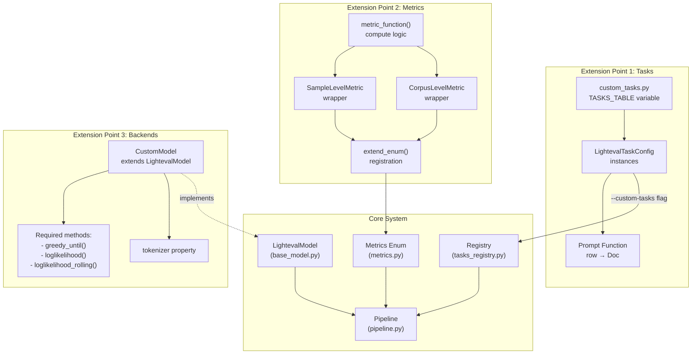
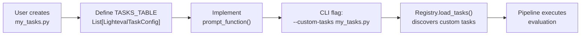
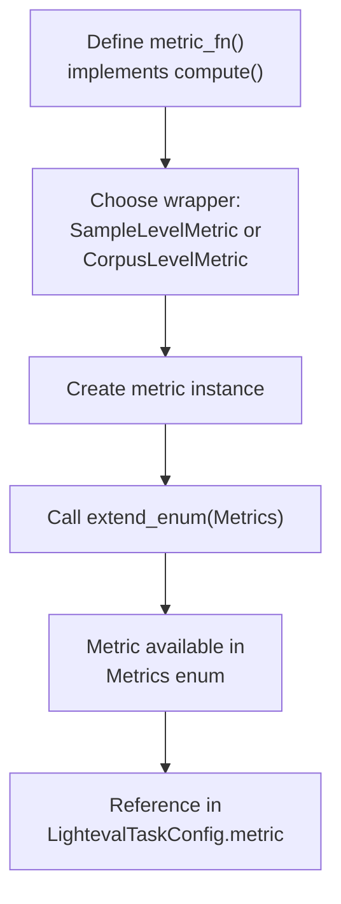
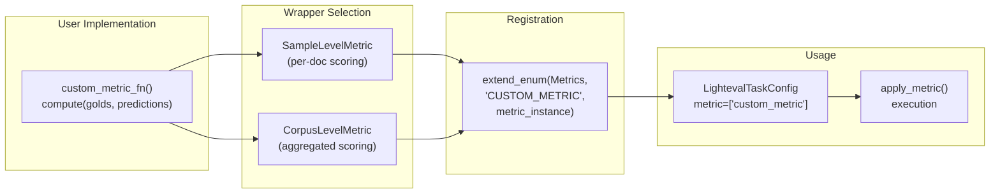
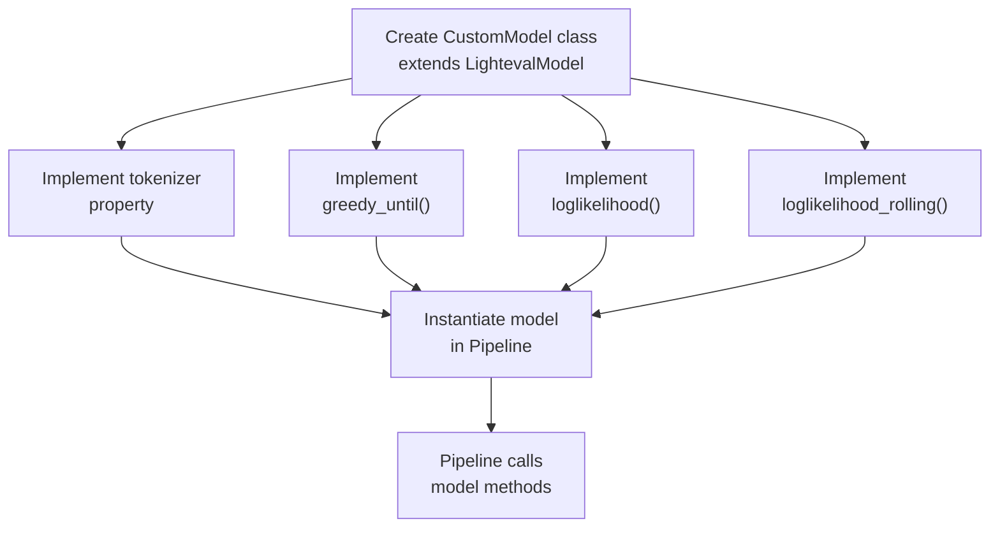
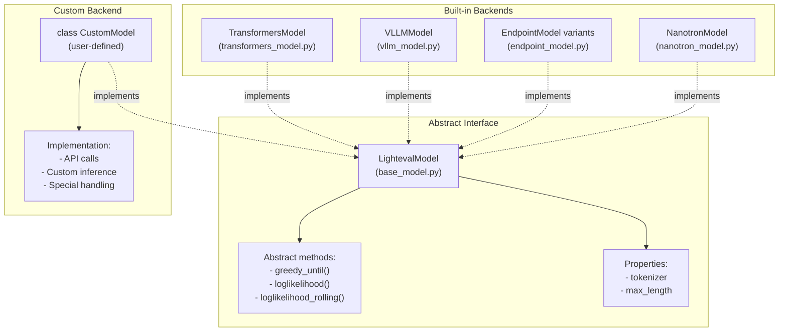
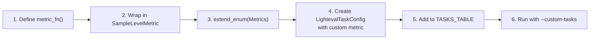
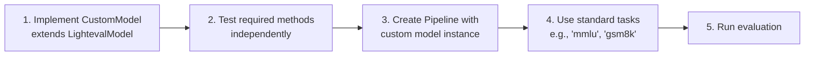
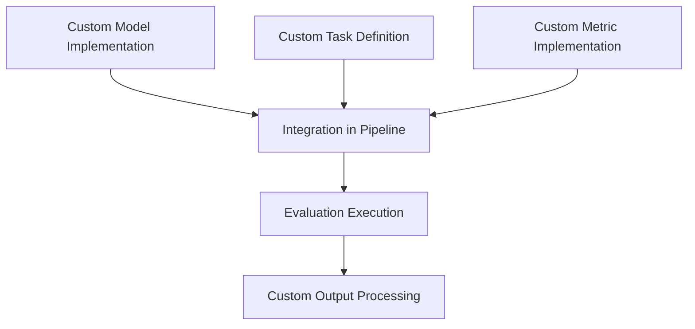

<!-- source: DeepWiki mcp.deepwiki.com · repo huggingface/lighteval · page 11.4 Extension Guides · fetched 2026-10-26 -->

# Extension Guides

<details>
<summary>Relevant source files</summary>

The following files were used as context for generating this wiki page:

- [README.md](README.md)
- [pyproject.toml](pyproject.toml)

</details>


This page provides an overview of lighteval's three primary extension points: **custom tasks**, **custom metrics**, and **custom backends**. These extension mechanisms allow you to adapt lighteval to your specific evaluation needs without modifying the core codebase.

For detailed implementation guides, see:
- Creating custom tasks: [Creating Custom Tasks](#5.6)
- Creating custom metrics: [Creating Custom Metrics](#8.9)
- Custom backend integration: [Custom Backend Integration](#7.9)

## Extension Architecture Overview

Lighteval's architecture is designed around a plugin system with three main extension points. Each operates independently while integrating seamlessly with the core evaluation pipeline.

### System Integration Diagram



**Sources**: [README.md:40](), [README.md:125-126](), Diagram 3 from high-level overview

## Extension Point 1: Custom Tasks

Custom tasks are defined by creating a Python file containing a `TASKS_TABLE` list of `LightevalTaskConfig` objects. This approach allows you to evaluate on proprietary datasets, specialized domains, or new benchmark formats without contributing to the core repository.

### Task Extension Flow



**Sources**: [README.md:40](), Diagram 3 from high-level overview

### Key Components

| Component | Type | Purpose | File Location |
|-----------|------|---------|---------------|
| `TASKS_TABLE` | `list[LightevalTaskConfig]` | Module-level variable containing task definitions | User-defined file |
| `LightevalTaskConfig` | Class | Configuration object specifying task parameters | `src/lighteval/tasks/config.py` |
| `prompt_function` | Function | Converts dataset rows to `Doc` objects | User-defined |
| `--custom-tasks` | CLI flag | Path to custom task file | CLI parameter |
| `Registry.load_tasks()` | Method | Discovers and loads tasks from file | `src/lighteval/tasks/registry.py` |

### Minimal Example Structure

```python
# File: my_custom_tasks.py
from lighteval.tasks.config import LightevalTaskConfig
from lighteval.tasks.requests import Doc

def my_prompt_fn(row, task_name):
    """Convert dataset row to Doc object"""
    return Doc(
        task_name=task_name,
        query=row["question"],
        choices=[row["A"], row["B"], row["C"], row["D"]],
        gold_index=row["answer_idx"],
    )

TASKS_TABLE = [
    LightevalTaskConfig(
        name="my_custom_task",
        prompt_function=my_prompt_fn,
        hf_repo="my_org/my_dataset",
        hf_subset="default",
        metric=["loglikelihood_acc"],
    )
]
```

For complete implementation details, see [Creating Custom Tasks](#5.6).

**Sources**: [README.md:40](), Diagram 3 from high-level overview

## Extension Point 2: Custom Metrics

Custom metrics are implemented as Python functions wrapped in either `SampleLevelMetric` or `CorpusLevelMetric` classes, then registered via the `extend_enum()` function. This allows you to define domain-specific scoring logic while maintaining compatibility with lighteval's evaluation pipeline.

### Metric Extension Flow



**Sources**: [README.md:40](), Diagram 3 from high-level overview

### Metric Types and Wrappers

| Metric Type | Wrapper Class | Computation Level | Returns |
|-------------|---------------|-------------------|---------|
| Sample-level | `SampleLevelMetric` | Per `Doc` + `ModelResponse` pair | Single score per sample |
| Corpus-level | `CorpusLevelMetric` | Aggregated across all samples | Single score for entire corpus |

### Key Components

| Component | Location | Purpose |
|-----------|----------|---------|
| `SampleLevelMetric` | `src/lighteval/metrics/metrics_sample.py` | Base class for per-sample metrics |
| `CorpusLevelMetric` | `src/lighteval/metrics/metrics_corpus.py` | Base class for corpus-level metrics |
| `extend_enum()` | `aenum` library | Dynamically adds metrics to `Metrics` enum |
| `Metrics` | `src/lighteval/metrics/metrics.py` | Enum containing all available metrics |
| `apply_metric()` | `src/lighteval/metrics/metrics.py` | Executes metric computation |

### Implementation Pattern



**Sources**: [README.md:40](), [pyproject.toml:80](), Diagram 3 from high-level overview

For complete implementation details including compute method signatures and normalization options, see [Creating Custom Metrics](#8.9).

## Extension Point 3: Custom Backends

Custom backends are implemented by creating a class that extends `LightevalModel` and implements its abstract interface. This allows you to integrate any model serving infrastructure, API, or custom inference engine with lighteval's evaluation pipeline.

### Backend Extension Flow



**Sources**: [README.md:125-127](), Diagram 5 from high-level overview

### Required Interface

| Method/Property | Signature | Purpose |
|-----------------|-----------|---------|
| `tokenizer` | `@property` returning tokenizer | Provides tokenization for input preparation |
| `greedy_until()` | `(requests: list[Request]) -> list[ModelResponse]` | Generative inference with stopping conditions |
| `loglikelihood()` | `(requests: list[Request]) -> list[ModelResponse]` | Multiple-choice/logprob computation |
| `loglikelihood_rolling()` | `(requests: list[Request]) -> list[ModelResponse]` | Perplexity/language modeling evaluation |
| `max_length` | `@property` returning int | Maximum context length supported |

### Backend Architecture



**Sources**: [README.md:125-127](), Diagram 5 from high-level overview

### Request and Response Types

The three abstract methods operate on standardized request/response objects:

| Type | Location | Key Fields |
|------|----------|------------|
| `Request` | `src/lighteval/tasks/requests.py` | `task_name`, `example`, `request_index` |
| `ModelResponse` | `src/lighteval/models/model_output.py` | `text`, `logprobs`, `output_tokens`, `input_tokens` |
| `Doc` | `src/lighteval/tasks/requests.py` | `query`, `choices`, `gold_index`, `instruction` |

### CLI Integration

Custom backends can be invoked via the `lighteval custom` command:

```bash
lighteval custom \
  --model-config my_model_config.yaml \
  --tasks "mmlu" \
  --output-dir ./results
```

The model config file should specify how to instantiate your custom model class.

For complete implementation details including method signatures and batching strategies, see [Custom Backend Integration](#7.9).

**Sources**: [README.md:125-127](), Diagram 5 from high-level overview

## Extension Comparison Matrix

| Aspect | Custom Tasks | Custom Metrics | Custom Backends |
|--------|--------------|----------------|-----------------|
| **Complexity** | Low | Medium | High |
| **Entry Point** | `TASKS_TABLE` variable | `extend_enum()` function | `LightevalModel` interface |
| **Core Class** | `LightevalTaskConfig` | `SampleLevelMetric` / `CorpusLevelMetric` | `LightevalModel` |
| **Location** | User file passed via `--custom-tasks` | User file imported before evaluation | User module with model class |
| **Required Methods** | `prompt_function(row, task_name) -> Doc` | `compute(golds, predictions, ...) -> float` | `greedy_until()`, `loglikelihood()`, `loglikelihood_rolling()` |
| **Integration** | Automatic via Registry | Manual via `extend_enum()` | Manual instantiation in Pipeline |
| **Typical Use Case** | Proprietary datasets, new benchmarks | Domain-specific scoring, custom aggregation | Custom APIs, specialized inference |
| **Documentation Link** | [Creating Custom Tasks](#5.6) | [Creating Custom Metrics](#8.9) | [Custom Backend Integration](#7.9) |

**Sources**: [README.md:40](), [README.md:125-127](), Diagrams 3 and 5 from high-level overview

## Development Workflow

### Prerequisites

Before implementing custom extensions, ensure your development environment is properly configured:

1. Install lighteval with development dependencies: `pip install -e ".[dev]"` ([pyproject.toml:110]())
2. Configure pre-commit hooks: `pre-commit install` ([README.md:191]())
3. Run code quality checks: `pre-commit run --all-files` ([README.md:192]())

For detailed setup instructions, see [Development Setup](#11.2).

### Testing Custom Extensions

Custom extensions should be tested independently before integration:

| Extension Type | Testing Approach |
|----------------|------------------|
| **Custom Tasks** | Create minimal dataset, run with `--max-samples 10` to verify Doc generation |
| **Custom Metrics** | Test compute function with known inputs/outputs before registration |
| **Custom Backends** | Test each method (`greedy_until`, `loglikelihood`, `loglikelihood_rolling`) with sample requests |

For comprehensive testing guidelines, see [Code Quality and Testing](#11.3).

**Sources**: [README.md:189-193](), [pyproject.toml:109-110]()

## Common Integration Patterns

### Pattern 1: Custom Task with Custom Metric



This pattern is useful for domain-specific evaluations requiring both custom data and custom scoring.

### Pattern 2: Custom Backend with Standard Tasks



This pattern allows you to evaluate models served via custom infrastructure against standard benchmarks.

### Pattern 3: End-to-End Custom Evaluation



This pattern provides maximum flexibility for specialized evaluation scenarios requiring custom components at all levels.

**Sources**: [README.md:136-169](), Diagram 2 from high-level overview

## Additional Resources

- **Project Structure**: Understanding the codebase layout helps locate extension points ([Project Structure](#11.1))
- **Default Tasks**: Browse existing tasks for examples of task configuration ([Default Tasks](#5.3))
- **Predefined Metrics**: Review built-in metrics for implementation patterns ([Predefined Metrics](#8.1))
- **Model Interface**: Study the abstract model interface for backend requirements ([Model Interface](#7.1))
- **API Reference**: Complete API documentation for extension classes ([API Reference](#12))

**Sources**: [README.md:1-205](), [pyproject.toml:1-138]()

---

