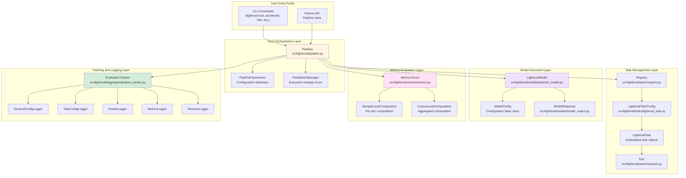
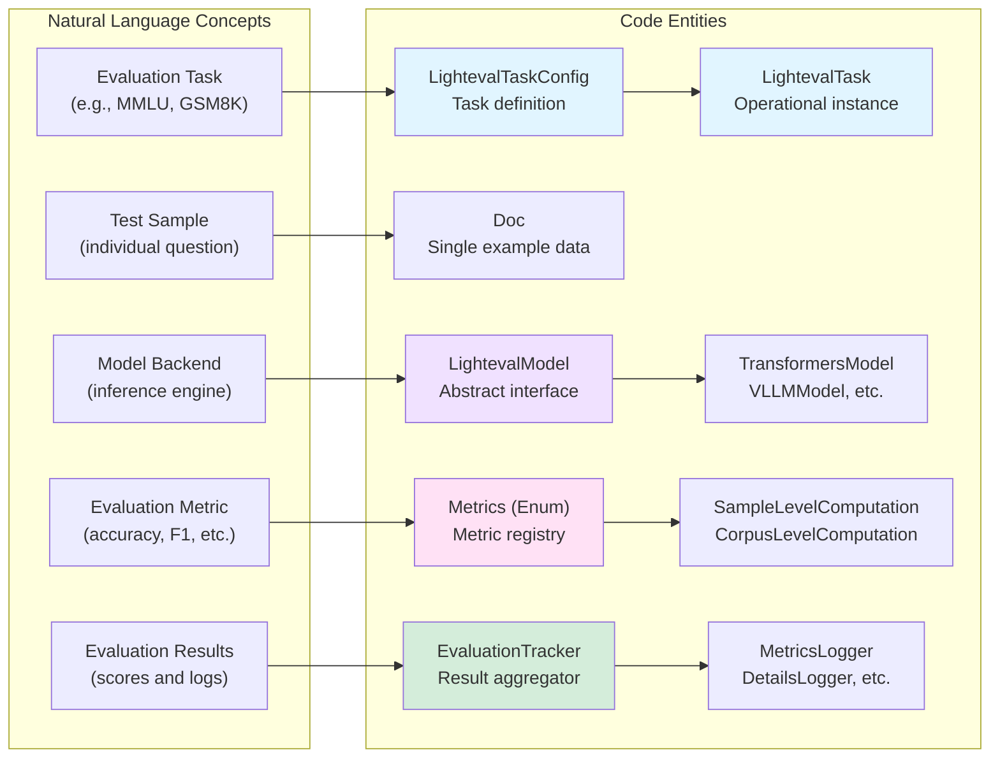
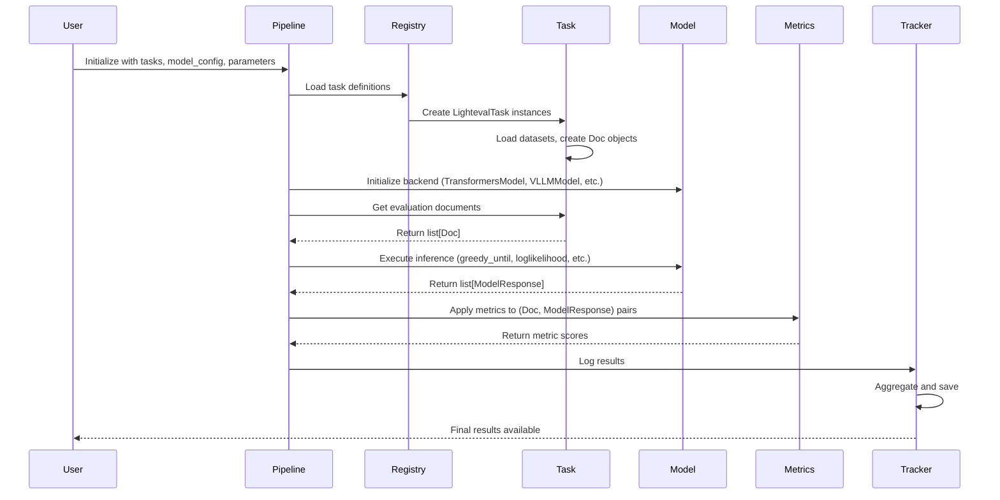
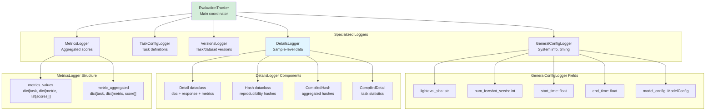

<!-- source: DeepWiki mcp.deepwiki.com · repo huggingface/lighteval · page 12 API Reference · fetched 2026-10-26 -->

# API Reference

<details>
<summary>Relevant source files</summary>

The following files were used as context for generating this wiki page:

- [README.md](README.md)
- [pyproject.toml](pyproject.toml)
- [src/lighteval/logging/info_loggers.py](src/lighteval/logging/info_loggers.py)
- [src/lighteval/pipeline.py](src/lighteval/pipeline.py)

</details>


This section provides comprehensive API documentation for lighteval's public interfaces. The API is organized into five major subsystems that correspond to the core architectural layers of lighteval. For conceptual explanations of how these components work together, see [Architecture](#2).

The API reference covers:

- **Pipeline API** ([#12.1](#12.1)): `Pipeline`, `PipelineParameters`, `ParallelismManager` for orchestrating evaluations
- **Task API** ([#12.2](#12.2)): `LightevalTask`, `LightevalTaskConfig`, `Registry` for task definition and loading
- **Model API** ([#12.3](#12.3)): `LightevalModel`, `ModelConfig` and backend implementations
- **Metrics API** ([#12.4](#12.4)): `Metrics` enum, metric computation classes, and custom metric creation
- **Tracking API** ([#12.5](#12.5)): `EvaluationTracker` and specialized loggers for result persistence

For guides on extending the framework, see [Extension Guides](#11.4).

## API Organization

The lighteval API follows a layered architecture where each layer builds on the one below it:



**Sources:** [src/lighteval/pipeline.py:1-448](), [src/lighteval/logging/info_loggers.py:1-441]()

## Core Concepts and Terminology

The following diagram maps common evaluation concepts to their concrete implementations in the lighteval API:



**Sources:** [src/lighteval/pipeline.py:117-448](), [src/lighteval/logging/info_loggers.py:47-441]()

## Common Data Flow Pattern

All evaluations in lighteval follow a standard data flow pattern through the API layers:



**Sources:** [src/lighteval/pipeline.py:271-448]()

## API Conventions

### Naming Conventions

- **Classes**: PascalCase (e.g., `LightevalTask`, `ModelConfig`)
- **Functions**: snake_case (e.g., `greedy_until`, `load_model`)
- **Enums**: PascalCase class name, UPPER_CASE values (e.g., `ParallelismManager.ACCELERATE`)
- **Dataclasses**: Used for configuration objects (`PipelineParameters`, `LightevalTaskConfig`)

### Configuration Pattern

Most major components use a two-class pattern:
1. A `*Config` dataclass containing configuration parameters
2. A runtime class that accepts the config and implements behavior

Examples:
- `ModelConfig` → `LightevalModel` implementations
- `LightevalTaskConfig` → `LightevalTask`
- `PipelineParameters` → `Pipeline`

### Interface Design

Abstract base classes define required methods:
- `LightevalModel`: Defines `greedy_until()`, `loglikelihood()`, `loglikelihood_rolling()`
- `SampleLevelComputation`: Defines `compute()` for per-sample metrics
- `CorpusLevelComputation`: Defines `compute()` for corpus-level aggregation

**Sources:** [src/lighteval/pipeline.py:70-115](), [pyproject.toml:1-138]()

## Key Enumerations

### ParallelismManager

The `ParallelismManager` enum specifies execution strategies:

| Value | Description | Use Case |
|-------|-------------|----------|
| `ACCELERATE` | HuggingFace Accelerate with multi-GPU support | Local models with model parallelism |
| `NANOTRON` | Distributed training framework | Multi-node distributed evaluation |
| `VLLM` | High-performance inference engine | High-throughput local inference |
| `SGLANG` | Structured generation backend | Tasks requiring structured outputs |
| `TGI` | Text Generation Inference endpoints | Self-hosted API servers |
| `OPENAI` | OpenAI-compatible APIs | Remote model providers |
| `CUSTOM` | User-defined model interface | Custom model implementations |
| `NONE` | No parallelism | Single-process evaluation |

**Sources:** [src/lighteval/pipeline.py:70-78]()

### SamplingMethod

Defines the three types of model inference calls:

| Value | Model Method | Use Case |
|-------|--------------|----------|
| `GENERATIVE` | `greedy_until()` | Generation tasks (open-ended, reasoning) |
| `LOGPROBS` | `loglikelihood()` | Multiple-choice, classification |
| `PERPLEXITY` | `loglikelihood_rolling()` | Language modeling, perplexity |

**Sources:** [src/lighteval/tasks/requests.py]() (referenced in [src/lighteval/pipeline.py:304-328]())

## Configuration Dataclasses

### PipelineParameters

Main configuration for evaluation runs:

| Field | Type | Default | Description |
|-------|------|---------|-------------|
| `launcher_type` | `ParallelismManager` | Required | Execution backend strategy |
| `job_id` | `int` | `0` | Identifier for cluster scheduling |
| `dataset_loading_processes` | `int` | `1` | Parallel workers for dataset loading |
| `nanotron_checkpoint_path` | `str \| None` | `None` | Path for Nanotron model checkpoints |
| `custom_tasks_directory` | `str \| None` | `None` | Directory containing custom task definitions |
| `num_fewshot_seeds` | `int` | `1` | Number of random seeds for few-shot sampling |
| `max_samples` | `int \| None` | `None` | Limit samples per task (for debugging) |
| `cot_prompt` | `str \| None` | `None` | Chain-of-thought prompt template |
| `remove_reasoning_tags` | `bool` | `True` | Strip reasoning tags from outputs |
| `reasoning_tags` | `str \| list[tuple[str, str]]` | `[('')]` | Tag pairs to remove |
| `load_responses_from_details_date_id` | `str \| None` | `None` | Load cached responses instead of running model |
| `bootstrap_iters` | `int` | `1000` | Bootstrap iterations for confidence intervals |
| `load_tasks_multilingual` | `bool` | `False` | Load multilingual task variants |

**Sources:** [src/lighteval/pipeline.py:81-115]()

## Logging System Architecture

The tracking layer uses a composite logger pattern with five specialized loggers:



**Sources:** [src/lighteval/logging/info_loggers.py:47-441]()

### Logger Responsibilities

**GeneralConfigLogger** [src/lighteval/logging/info_loggers.py:47-135]():
- Captures git SHA for reproducibility
- Tracks evaluation timing (start, end, duration)
- Stores model configuration
- Records num_fewshot_seeds and max_samples settings

**TaskConfigLogger** [src/lighteval/logging/info_loggers.py:424-441]():
- Maps task names to their `LightevalTaskConfig` definitions
- Logs original vs effective document counts
- Preserves task configuration for reproducibility

**VersionsLogger** [src/lighteval/logging/info_loggers.py:405-422]():
- Records task version numbers
- Tracks dataset versions
- Enables version-aware result comparison

**DetailsLogger** [src/lighteval/logging/info_loggers.py:137-306]():
- Stores sample-level `Detail` objects (doc, response, metrics)
- Computes hierarchical hashes for reproducibility verification
- Aggregates statistics (truncation, padding counts)
- Provides three-tier hashing: sample → task → overall

**MetricsLogger** [src/lighteval/logging/info_loggers.py:308-403]():
- Collects raw metric values for all samples
- Applies aggregation functions per metric
- Computes bootstrap confidence intervals (stderr)
- Groups subtasks for hierarchical averaging

## Data Classes for Results

### DetailsLogger.Detail

Represents one sample's complete evaluation information:

| Field | Type | Description |
|-------|------|-------------|
| `doc` | `Doc` | Input document with query and context |
| `model_response` | `ModelResponse` | Model outputs (text, tokens, logprobs) |
| `metric` | `dict` | Metric scores for this sample |

**Sources:** [src/lighteval/logging/info_loggers.py:154-166]()

### DetailsLogger.Hash

Hashes for one sample enabling reproducibility verification:

| Field | Type | Description |
|-------|------|-------------|
| `example` | `str` | Hash of `Doc.query` |
| `full_prompt` | `str` | Hash of `Doc.ctx` |
| `input_tokens` | `str` | Hash of `ModelResponse.input_tokens` |
| `cont_tokens` | `str` | Hash of `ModelResponse.output_tokens` |

**Sources:** [src/lighteval/logging/info_loggers.py:209-223]()

### DetailsLogger.CompiledHash

Aggregated hashes for all samples in one task:

| Field | Type | Description |
|-------|------|-------------|
| `hash_examples` | `str` | Sorted aggregate of all example hashes |
| `hash_full_prompts` | `str` | Sorted aggregate of all prompt hashes |
| `hash_input_tokens` | `str` | Sorted aggregate of all input token hashes |
| `hash_cont_tokens` | `str` | Sorted aggregate of all output token hashes |

**Sources:** [src/lighteval/logging/info_loggers.py:226-239]()

### DetailsLogger.CompiledDetail

Statistics compiled across all samples of one task:

| Field | Type | Description |
|-------|------|-------------|
| `hashes` | `dict` | Dictionary form of `CompiledHash` |
| `truncated` | `int` | Number of samples requiring prompt truncation |
| `non_truncated` | `int` | Number of samples without truncation |
| `padded` | `int` | Number of samples requiring padding |
| `non_padded` | `int` | Number of samples without padding |

**Sources:** [src/lighteval/logging/info_loggers.py:169-186]()

## Usage Patterns

### Basic Evaluation Pattern

```python
from lighteval.pipeline import Pipeline, PipelineParameters, ParallelismManager
from lighteval.logging.evaluation_tracker import EvaluationTracker
from lighteval.models.transformers.transformers_model import TransformersModelConfig

# Configure evaluation
evaluation_tracker = EvaluationTracker(output_dir="./results")
pipeline_params = PipelineParameters(
    launcher_type=ParallelismManager.ACCELERATE,
    max_samples=None
)

# Configure model
model_config = TransformersModelConfig(
    model_name="meta-llama/Llama-3-8B",
    batch_size=8
)

# Run evaluation
pipeline = Pipeline(
    tasks="mmlu,gsm8k",
    model_config=model_config,
    pipeline_parameters=pipeline_params,
    evaluation_tracker=evaluation_tracker
)

results = pipeline.evaluate()
pipeline.show_results()
```

### Custom Task Registration Pattern

```python
from lighteval.tasks.registry import Registry
from lighteval.tasks.lighteval_task import LightevalTaskConfig

# Create custom task config
custom_config = LightevalTaskConfig(
    name="my_task",
    prompt_function=my_prompt_fn,
    hf_repo="my-org/my-dataset",
    metric=["exact_match", "f1"]
)

# Register and load
registry = Registry(
    tasks="custom:my_task",
    custom_tasks="./my_tasks.py"
)
tasks_dict = registry.load_tasks()
```

**Sources:** [README.md:136-169](), [src/lighteval/pipeline.py:210-226]()

## Navigation to Detailed API Documentation

For detailed documentation of specific API areas:

- **[Pipeline API](#12.1)**: Complete reference for `Pipeline`, `PipelineParameters`, and `ParallelismManager`
- **[Task API](#12.2)**: Details on `LightevalTask`, `LightevalTaskConfig`, `Registry`, and task creation
- **[Model API](#12.3)**: Model interface specifications, backend implementations, and configuration
- **[Metrics API](#12.4)**: Metric system, custom metric creation, and built-in metrics catalog
- **[Tracking API](#12.5)**: Logging system, reproducibility features, and result persistence

For conceptual guides:
- **[Architecture](#2)**: System architecture overview
- **[Evaluation Pipeline](#4)**: How the evaluation process works end-to-end
- **[Creating Custom Tasks](#5.6)**: Step-by-step guide for custom task definition
- **[Creating Custom Metrics](#8.9)**: Guide for implementing custom metrics

**Sources:** [src/lighteval/pipeline.py:1-448](), [src/lighteval/logging/info_loggers.py:1-441](), [pyproject.toml:1-138]()

---

