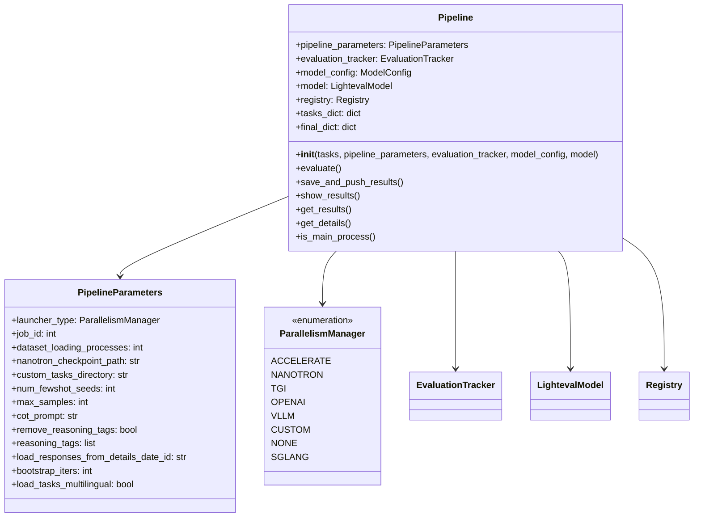
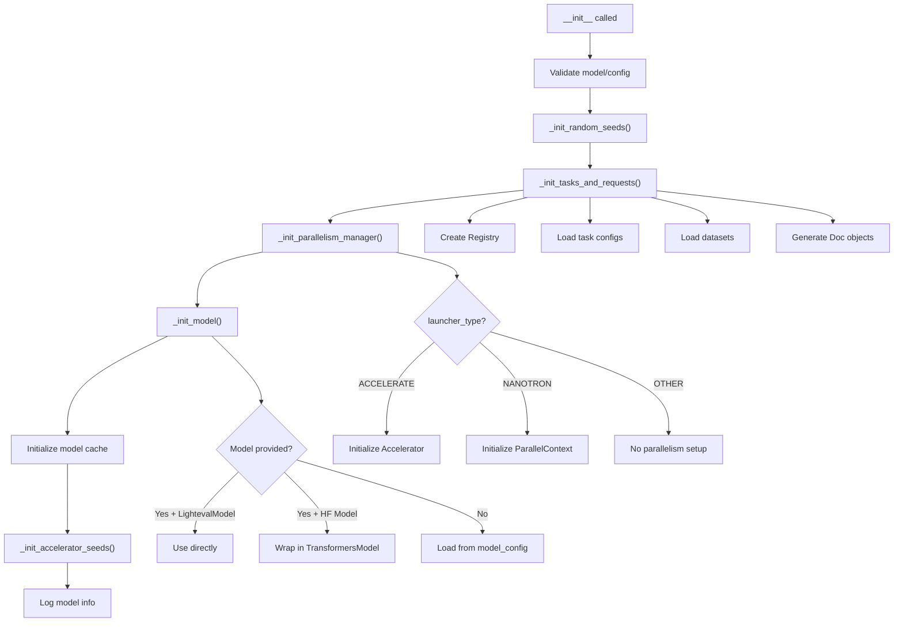
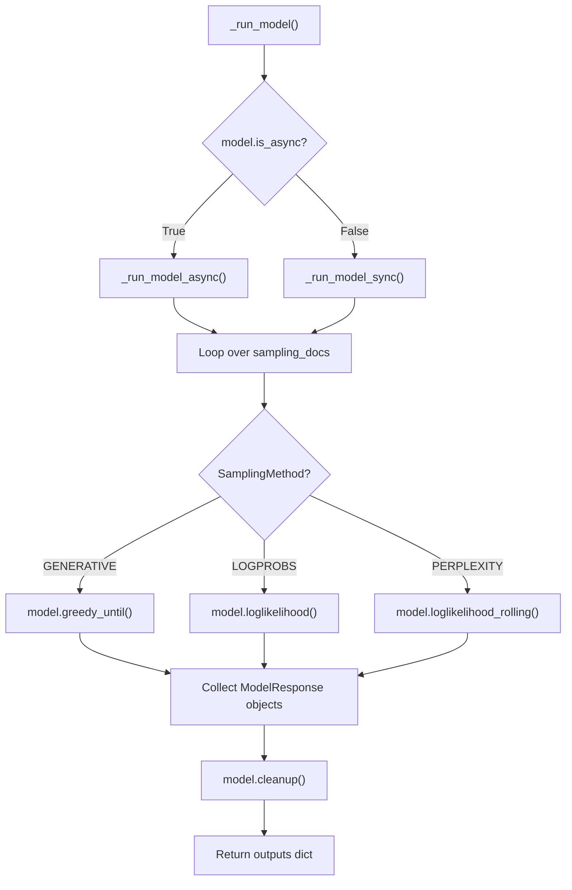
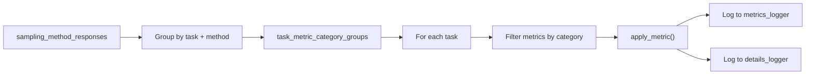
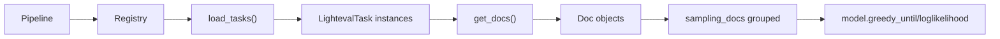
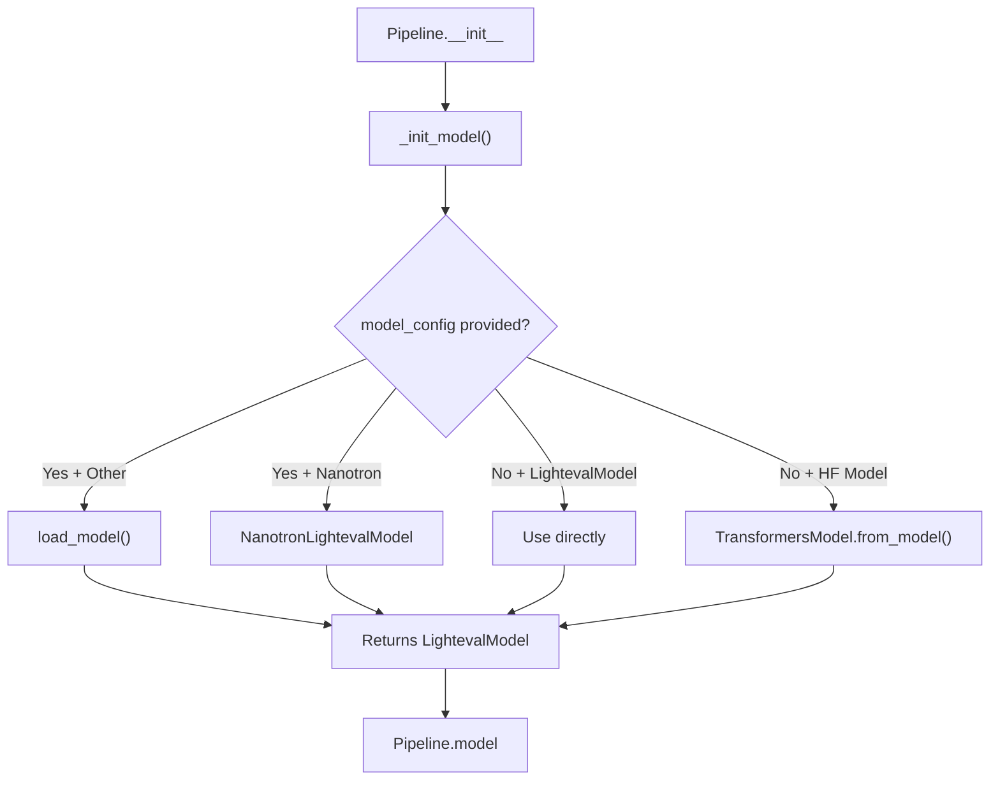
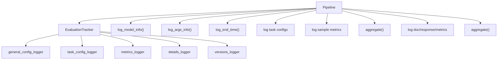

<!-- source: DeepWiki mcp.deepwiki.com · repo huggingface/lighteval · page 12.1 Pipeline API · fetched 2026-10-26 -->

# Pipeline API

<details>
<summary>Relevant source files</summary>

The following files were used as context for generating this wiki page:

- [src/lighteval/logging/info_loggers.py](src/lighteval/logging/info_loggers.py)
- [src/lighteval/pipeline.py](src/lighteval/pipeline.py)

</details>


This page provides the API reference for the core Pipeline system that orchestrates evaluation execution. It documents the `Pipeline` class, `PipelineParameters` configuration dataclass, and `ParallelismManager` enum.

For information about tasks, see [Task API](#12.2). For model backends, see [Model API](#12.3). For metrics computation, see [Metrics API](#12.4). For evaluation tracking and logging, see [Tracking API](#12.5).

**Scope**: This reference covers the entry point for programmatic evaluation (`Pipeline`), its configuration options (`PipelineParameters`), and parallelism strategy selection (`ParallelismManager`).

## Overview

The Pipeline system provides the main orchestration layer for lighteval evaluations. It coordinates task loading, model initialization, inference execution, metric computation, and result tracking.



**Sources**: [src/lighteval/pipeline.py:70-448]()

## ParallelismManager

An enumeration defining available parallelism strategies for model execution.

[src/lighteval/pipeline.py:70-78]()

### Values

| Value | Description |
|-------|-------------|
| `ACCELERATE` | HuggingFace Accelerate backend for multi-GPU inference with device mapping |
| `NANOTRON` | Nanotron distributed training framework with tensor/pipeline/data parallelism |
| `TGI` | Text Generation Inference endpoint backend |
| `OPENAI` | OpenAI API-compatible endpoint backend |
| `VLLM` | VLLM high-performance inference engine |
| `CUSTOM` | User-defined custom model backend |
| `NONE` | Single-process execution without parallelism |
| `SGLANG` | SGLang structured generation backend |

### Usage

```python
from lighteval.pipeline import ParallelismManager, PipelineParameters

params = PipelineParameters(
    launcher_type=ParallelismManager.ACCELERATE,
    # ... other parameters
)
```

**Sources**: [src/lighteval/pipeline.py:70-78]()

## PipelineParameters

A dataclass containing all configuration options for Pipeline initialization and execution.

[src/lighteval/pipeline.py:81-115]()

### Fields

#### Core Configuration

| Field | Type | Default | Description |
|-------|------|---------|-------------|
| `launcher_type` | `ParallelismManager` | (required) | Parallelism strategy for model execution |
| `job_id` | `int` | `0` | Job identifier for Slurm/cluster tracking |

#### Dataset and Task Loading

| Field | Type | Default | Description |
|-------|------|---------|-------------|
| `custom_tasks_directory` | `str \| None` | `None` | Path to directory containing custom task definitions |
| `dataset_loading_processes` | `int` | `1` | Number of parallel processes for dataset loading |
| `load_tasks_multilingual` | `bool` | `False` | Whether to load multilingual task variations |
| `max_samples` | `int \| None` | `None` | Maximum samples per task (for debugging; triggers warning) |

#### Few-Shot and Sampling

| Field | Type | Default | Description |
|-------|------|---------|-------------|
| `num_fewshot_seeds` | `int` | `1` | Number of random seeds for few-shot sampling variance |
| `cot_prompt` | `str \| None` | `None` | Chain-of-thought prompt to prepend to all queries |

#### Reasoning Tag Handling

| Field | Type | Default | Description |
|-------|------|---------|-------------|
| `remove_reasoning_tags` | `bool` | `True` | Whether to strip reasoning tags from model outputs |
| `reasoning_tags` | `str \| list[tuple[str, str]]` | `"[('')]"` | Tag pairs to remove from outputs |

#### Response Caching and Reuse

| Field | Type | Default | Description |
|-------|------|---------|-------------|
| `load_responses_from_details_date_id` | `str \| None` | `None` | Date ID to load cached responses instead of running inference |

#### Metrics and Statistics

| Field | Type | Default | Description |
|-------|------|---------|-------------|
| `bootstrap_iters` | `int` | `1000` | Number of bootstrap iterations for standard error computation |

#### Backend-Specific

| Field | Type | Default | Description |
|-------|------|---------|-------------|
| `nanotron_checkpoint_path` | `str \| None` | `None` | Path to Nanotron checkpoint (only for Nanotron backend) |

### Initialization and Validation

The `__post_init__()` method validates and parses the `reasoning_tags` field:

[src/lighteval/pipeline.py:99-115]()

- Converts string representation to list of tuples if needed
- Validates that all tags are tuples of length 2
- Raises `ValueError` if format is invalid

**Example**:
```python
# Valid formats:
reasoning_tags = [(''), ('<reason>', '</reason>')]
reasoning_tags = "[('')]"  # String will be parsed

# Invalid format (raises ValueError):
reasoning_tags = [('<think>',)]  # Missing closing tag
```

**Sources**: [src/lighteval/pipeline.py:81-115]()

## Pipeline

The main orchestrator class that coordinates the entire evaluation workflow.

[src/lighteval/pipeline.py:117-448]()

### Constructor

```python
def __init__(
    self,
    tasks: str,
    pipeline_parameters: PipelineParameters,
    evaluation_tracker: EvaluationTracker,
    model_config: ModelConfig | None = None,
    model=None,
    metric_options=None,
)
```

[src/lighteval/pipeline.py:118-156]()

#### Parameters

| Parameter | Type | Description |
|-----------|------|-------------|
| `tasks` | `str` | Task specification string (e.g., `"leaderboard\|custom"` or path to custom task file) |
| `pipeline_parameters` | `PipelineParameters` | Configuration object controlling execution behavior |
| `evaluation_tracker` | `EvaluationTracker` | Logger for tracking evaluation progress and results |
| `model_config` | `ModelConfig \| None` | Configuration for model loading (mutually exclusive with `model`) |
| `model` | `LightevalModel \| Any \| None` | Pre-initialized model instance or HF model to wrap |
| `metric_options` | `dict \| None` | Optional metric-specific configuration overrides |

#### Initialization Flow



**Sources**: [src/lighteval/pipeline.py:118-156](), [src/lighteval/pipeline.py:157-175](), [src/lighteval/pipeline.py:177-209](), [src/lighteval/pipeline.py:210-239]()

### Public Methods

#### evaluate()

Executes the complete evaluation pipeline.

[src/lighteval/pipeline.py:271-298]()

```python
def evaluate(self) -> None
```

**Behavior**:
1. Logs evaluation parameters
2. Runs model inference (or loads cached responses)
3. Post-processes outputs (removes reasoning tags if configured)
4. Computes metrics for all tasks
5. Aggregates results and computes standard errors
6. Updates evaluation tracker with all logged data

**Note**: Only the main process performs metric computation and aggregation in distributed settings.

#### save_and_push_results()

Persists evaluation results to configured output destinations.

[src/lighteval/pipeline.py:426-430]()

```python
def save_and_push_results(self) -> None
```

**Behavior**: Delegates to `evaluation_tracker.save()` which handles:
- Saving JSON and Parquet files locally
- Pushing to HuggingFace Hub (if configured)
- Logging to TensorBoard and Weights & Biases

#### show_results()

Prints formatted results table to stdout.

[src/lighteval/pipeline.py:436-441]()

```python
def show_results(self) -> None
```

**Output**: ASCII table with task names, metric names, and scores.

#### get_results()

Returns evaluation results as a dictionary.

[src/lighteval/pipeline.py:442-444]()

```python
def get_results(self) -> dict | None
```

**Returns**: Dictionary mapping task names to metric dictionaries. Returns `None` if not on main process.

**Example structure**:
```python
{
    "gsm8k|5": {
        "exact_match": 0.724,
        "exact_match_stderr": 0.012
    },
    "mmlu:_average|5": {
        "accuracy": 0.642,
        "accuracy_stderr": 0.008
    },
    "all": {
        "exact_match": 0.683,
        "accuracy": 0.642
    }
}
```

#### get_details()

Returns sample-level details for all evaluated examples.

[src/lighteval/pipeline.py:446-448]()

```python
def get_details(self) -> dict[str, list[DetailsLogger.Detail]]
```

**Returns**: Dictionary mapping task names to lists of `Detail` objects containing:
- `doc`: The input document
- `model_response`: The model's output
- `metric`: Per-sample metric scores

#### is_main_process()

Checks if current process is the main process in distributed execution.

[src/lighteval/pipeline.py:264-269]()

```python
def is_main_process(self) -> bool
```

**Returns**: `True` for main process, `False` for worker processes.

**Sources**: [src/lighteval/pipeline.py:264-269](), [src/lighteval/pipeline.py:271-298](), [src/lighteval/pipeline.py:426-448]()

### Key Internal Methods

#### _run_model()

Orchestrates model inference across all evaluation samples.

[src/lighteval/pipeline.py:332-345]()



**Returns**: Dictionary mapping `SamplingMethod` to lists of `ModelResponse` objects.

**Sources**: [src/lighteval/pipeline.py:299-345]()

#### _compute_metrics()

Applies metrics to all evaluated samples and logs results.

[src/lighteval/pipeline.py:362-400]()

**Algorithm**:
1. Groups samples by task name and sampling method
2. For each task, filters metrics matching the sampling method
3. Calls `apply_metric()` for batch computation
4. Logs results to both `metrics_logger` and `details_logger`

**Data Flow**:


**Sources**: [src/lighteval/pipeline.py:362-400]()

#### _post_process_outputs()

Removes reasoning tags from model responses if configured.

[src/lighteval/pipeline.py:347-361]()

**Behavior**: Iterates through all `ModelResponse` objects and applies `remove_reasoning_tags()` to the text field, storing result in `text_post_processed` field.

#### _load_responses_from_details()

Loads previously cached model responses instead of running inference.

[src/lighteval/pipeline.py:401-424]()

**Use Case**: Recompute metrics on existing responses without re-running expensive inference.

**Limitation**: Currently only supports evaluations with a single sampling method.

**Sources**: [src/lighteval/pipeline.py:347-424]()

### Attributes

| Attribute | Type | Description |
|-----------|------|-------------|
| `pipeline_parameters` | `PipelineParameters` | Configuration object |
| `launcher_type` | `ParallelismManager` | Active parallelism strategy |
| `evaluation_tracker` | `EvaluationTracker` | Logging and tracking instance |
| `model_config` | `ModelConfig` | Model configuration |
| `model` | `LightevalModel` | Initialized model backend |
| `accelerator` | `Accelerator \| None` | Accelerate instance (if using ACCELERATE) |
| `parallel_context` | `ParallelContext \| None` | Nanotron context (if using NANOTRON) |
| `registry` | `Registry` | Task registry with all available tasks |
| `tasks_dict` | `dict[str, LightevalTask]` | Loaded task instances |
| `documents_dict` | `dict[str, list[Doc]]` | Doc objects per task |
| `sampling_docs` | `defaultdict[SamplingMethod, list[Doc]]` | Docs grouped by sampling method |
| `final_dict` | `dict \| None` | Cached results dictionary |

**Sources**: [src/lighteval/pipeline.py:117-156]()

## Usage Examples

### Basic Evaluation

```python
from lighteval.pipeline import Pipeline, PipelineParameters, ParallelismManager
from lighteval.logging.evaluation_tracker import EvaluationTracker
from lighteval.models.model_config import TransformersModelConfig

# Configure pipeline
params = PipelineParameters(
    launcher_type=ParallelismManager.ACCELERATE,
    num_fewshot_seeds=1,
    max_samples=100,  # For quick testing
)

# Configure model
model_config = TransformersModelConfig(
    pretrained="gpt2",
    dtype="float16",
)

# Initialize tracker
tracker = EvaluationTracker(output_dir="./results")

# Create and run pipeline
pipeline = Pipeline(
    tasks="leaderboard|5",
    pipeline_parameters=params,
    evaluation_tracker=tracker,
    model_config=model_config,
)

pipeline.evaluate()
pipeline.show_results()
pipeline.save_and_push_results()
```

### Using Custom Tasks

```python
params = PipelineParameters(
    launcher_type=ParallelismManager.VLLM,
    custom_tasks_directory="./my_tasks",
    load_tasks_multilingual=True,
)

pipeline = Pipeline(
    tasks="custom|my_task|3",  # Custom task with 3 few-shot examples
    pipeline_parameters=params,
    evaluation_tracker=tracker,
    model_config=model_config,
)
```

### Caching and Reusing Responses

```python
# First run: Generate and save responses
params1 = PipelineParameters(
    launcher_type=ParallelismManager.ACCELERATE,
)
pipeline1 = Pipeline(tasks="gsm8k|5", pipeline_parameters=params1, ...)
pipeline1.evaluate()
pipeline1.save_and_push_results()
# Results saved with date_id, e.g., "2024-01-15-12-30-45"

# Later: Recompute metrics without re-running inference
params2 = PipelineParameters(
    launcher_type=ParallelismManager.NONE,
    load_responses_from_details_date_id="2024-01-15-12-30-45",
)
pipeline2 = Pipeline(tasks="gsm8k|5", pipeline_parameters=params2, ...)
pipeline2.evaluate()  # Uses cached responses
```

### Multi-Seed Few-Shot Evaluation

```python
params = PipelineParameters(
    launcher_type=ParallelismManager.ACCELERATE,
    num_fewshot_seeds=10,  # HELM-style variance analysis
)

pipeline = Pipeline(
    tasks="mmlu|5",
    pipeline_parameters=params,
    evaluation_tracker=tracker,
    model_config=model_config,
)

pipeline.evaluate()
results = pipeline.get_results()
# Results include standard errors across seeds
```

### Using Pre-initialized Model

```python
from transformers import AutoModelForCausalLM, AutoTokenizer

# Load model with custom settings
hf_model = AutoModelForCausalLM.from_pretrained(
    "meta-llama/Llama-2-7b-hf",
    torch_dtype=torch.float16,
    load_in_8bit=True,
)
tokenizer = AutoTokenizer.from_pretrained("meta-llama/Llama-2-7b-hf")

# Pass to pipeline (will be wrapped automatically)
pipeline = Pipeline(
    tasks="leaderboard|0",
    pipeline_parameters=params,
    evaluation_tracker=tracker,
    model=hf_model,  # No model_config needed
)
```

**Sources**: [src/lighteval/pipeline.py:117-448]()

## Integration with Other Components

### Pipeline to Task System



**Key interactions**:
- Pipeline creates `Registry` with task specification string [src/lighteval/pipeline.py:214-218]()
- Registry loads task configs and instantiates `LightevalTask` objects [src/lighteval/pipeline.py:221]()
- Pipeline calls `LightevalTask.load_datasets()` for all tasks [src/lighteval/pipeline.py:222]()
- Pipeline retrieves documents via `task.get_docs()` [src/lighteval/pipeline.py:223-225]()

### Pipeline to Model Layer



**Key interactions**:
- Model initialization occurs in `_init_model()` [src/lighteval/pipeline.py:177-209]()
- Pipeline calls three main model methods: `greedy_until()`, `loglikelihood()`, `loglikelihood_rolling()` [src/lighteval/pipeline.py:304-328]()
- Model cache registry is initialized with task registry [src/lighteval/pipeline.py:148]()

### Pipeline to Metrics System


**Key interactions**:
- Pipeline groups docs/responses by task and sampling method [src/lighteval/pipeline.py:377-382]()
- Metrics are filtered by category (GENERATIVE/LOGPROBS/PERPLEXITY) [src/lighteval/pipeline.py:386]()
- `apply_metric()` performs batch computation [src/lighteval/pipeline.py:391-395]()
- Results logged to both metrics and details loggers [src/lighteval/pipeline.py:398-399]()

### Pipeline to Tracking System



**Key interactions**:
- Tracker passed to constructor [src/lighteval/pipeline.py:122]()
- Task configs logged during initialization [src/lighteval/pipeline.py:238]()
- Model info logged after model init [src/lighteval/pipeline.py:152]()
- Metrics and details logged during evaluation [src/lighteval/pipeline.py:398-399]()
- Final aggregation performed after all metrics computed [src/lighteval/pipeline.py:294-297]()

**Sources**: [src/lighteval/pipeline.py:117-448]()

---

