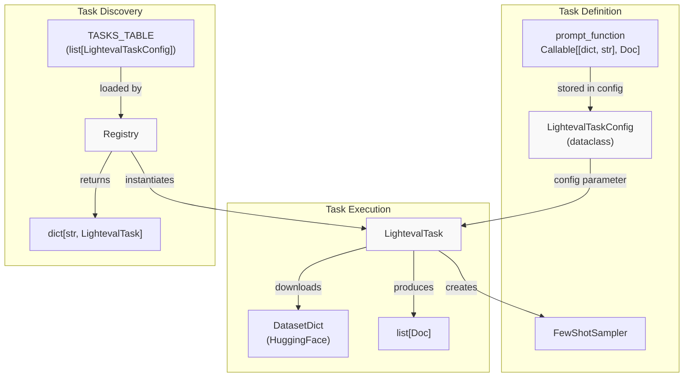
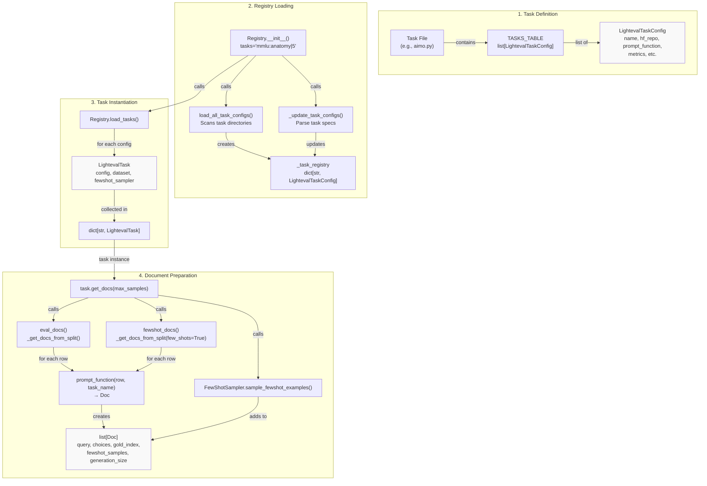
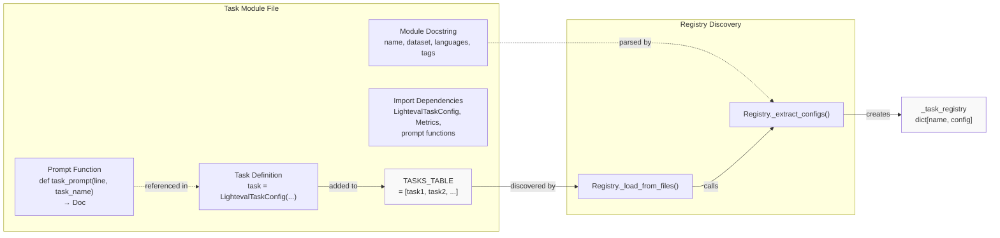

<!-- source: DeepWiki mcp.deepwiki.com · repo huggingface/lighteval · page 12.2 Task API · fetched 2026-10-26 -->

# Task API

<details>
<summary>Relevant source files</summary>

The following files were used as context for generating this wiki page:

- [src/lighteval/main_tasks.py](src/lighteval/main_tasks.py)
- [src/lighteval/metrics/metrics_corpus.py](src/lighteval/metrics/metrics_corpus.py)
- [src/lighteval/tasks/lighteval_task.py](src/lighteval/tasks/lighteval_task.py)
- [src/lighteval/tasks/multilingual/tasks/global_mmlu.py](src/lighteval/tasks/multilingual/tasks/global_mmlu.py)
- [src/lighteval/tasks/registry.py](src/lighteval/tasks/registry.py)
- [src/lighteval/tasks/requests.py](src/lighteval/tasks/requests.py)
- [src/lighteval/tasks/tasks/aimo.py](src/lighteval/tasks/tasks/aimo.py)
- [src/lighteval/tasks/tasks/ifbench/instructions.py](src/lighteval/tasks/tasks/ifbench/instructions.py)

</details>


This page provides a comprehensive API reference for the Task system in lighteval, covering the core classes and data structures used to define, configure, and manage evaluation tasks.

**Scope**: This page documents the programmatic interfaces for `LightevalTaskConfig`, `LightevalTask`, `Registry`, and related data structures. For conceptual information about tasks, see [Task System](#5). For guidance on creating custom tasks, see [Creating Custom Tasks](#5.6). For task-specific configuration examples, see [Task Configuration](#5.1).

---

## Core Task Classes Overview

The Task API consists of three primary classes that work together to define and execute evaluation tasks:



**Sources**: [src/lighteval/tasks/lighteval_task.py:48-463](), [src/lighteval/tasks/registry.py:112-563]()

---

## LightevalTaskConfig

`LightevalTaskConfig` is a dataclass that stores all configuration parameters needed to define an evaluation task.

### Class Definition

**Location**: [src/lighteval/tasks/lighteval_task.py:48-200]()

```python
@dataclass
class LightevalTaskConfig:
    """Configuration dataclass for a LightevalTask."""
```

### Required Fields

| Field | Type | Description |
|-------|------|-------------|
| `name` | `str` | Short name of the evaluation task |
| `prompt_function` | `Callable[[dict, str], Doc]` | Function that converts dataset row to Doc objects |
| `hf_repo` | `str` | HuggingFace Hub repository path containing the dataset |
| `hf_subset` | `str` | Dataset subset/configuration name |
| `metrics` | `ListLike[Metric \| Metrics]` | List of metrics to compute for this task |

### Dataset Configuration Fields

| Field | Type | Default | Description |
|-------|------|---------|-------------|
| `hf_revision` | `str \| None` | `None` | Specific dataset revision to use |
| `hf_filter` | `Callable[[dict], bool] \| None` | `None` | Filter function to apply to dataset items |
| `hf_avail_splits` | `ListLike[str]` | `["train", "validation", "test"]` | Available dataset splits |

### Evaluation Split Configuration

| Field | Type | Default | Description |
|-------|------|---------|-------------|
| `evaluation_splits` | `ListLike[str]` | `["validation"]` | Dataset splits to use for evaluation |
| `few_shots_split` | `str \| None` | `None` | Split to sample few-shot examples from |
| `few_shots_select` | `str \| None` | `None` | Method for selecting few-shot examples |

### Generation Parameters

| Field | Type | Default | Description |
|-------|------|---------|-------------|
| `generation_size` | `int \| None` | `None` | Maximum token length for generated text |
| `generation_grammar` | `TextGenerationInputGrammarType \| None` | `None` | Grammar for structured generation (TGI/Endpoint only) |
| `stop_sequence` | `ListLike[str] \| None` | `None` | Sequences that stop text generation |
| `num_samples` | `list[int] \| None` | `None` | Number of samples to generate per input |

### Task Metadata

| Field | Type | Default | Description |
|-------|------|---------|-------------|
| `version` | `int` | `0` | Task version number (increment when dataset/prompt changes) |
| `num_fewshots` | `int` | `0` | Number of few-shot examples to include |
| `truncate_fewshots` | `bool` | `False` | Whether to truncate few-shot examples |
| `must_remove_duplicate_docs` | `bool` | `False` | Whether to remove duplicate documents |
| `original_num_docs` | `int` | `-1` | Total number of documents in the task |
| `effective_num_docs` | `int` | `-1` | Number of documents actually used in evaluation |

### Methods

#### `__post_init__()`

**Location**: [src/lighteval/tasks/lighteval_task.py:149-157]()

Automatically called after initialization to:
- Convert `Metrics` enums to `Metric` objects
- Convert lists to tuples for hashing
- Set `full_name` to `"{name}|{num_fewshots}"`

#### `__str__(lite: bool = False) -> str`

**Location**: [src/lighteval/tasks/lighteval_task.py:159-196]()

Returns a markdown-formatted table representation of the configuration.

**Parameters**:
- `lite`: If `True`, excludes `original_num_docs` and `effective_num_docs` from output

**Example Output**:
```markdown
| Key               | Value                          |
|-------------------|--------------------------------|
| name              | 'mmlu:anatomy'                 |
| prompt_function   | 'mmlu_prompt'                  |
| hf_repo           | 'cais/mmlu'                    |
| ...               | ...                            |
```

#### `print(lite: bool = False)`

**Location**: [src/lighteval/tasks/lighteval_task.py:198-199]()

Convenience method that prints the string representation.

**Sources**: [src/lighteval/tasks/lighteval_task.py:48-200]()

---

## LightevalTask

`LightevalTask` is the operational class that manages dataset loading, document preparation, and evaluation execution for a specific task.

### Class Definition

**Location**: [src/lighteval/tasks/lighteval_task.py:202-463]()

```python
class LightevalTask:
    def __init__(self, config: LightevalTaskConfig):
        """Initialize a LightEval task."""
```

### Constructor

**Parameters**:
- `config`: `LightevalTaskConfig` object containing task settings

**Initialization Steps**:
1. Stores the config and extracts key fields
2. Initializes dataset-related attributes (dataset path, config name, revision, filter)
3. Sets up few-shot configuration using `get_first_possible_fewshot_splits()`
4. Creates a `FewShotSampler` instance
5. Extracts metrics and sampling methods from config
6. Configures generation parameters

### Instance Attributes

| Attribute | Type | Description |
|-----------|------|-------------|
| `config` | `LightevalTaskConfig` | The task configuration |
| `name` | `str` | Task name from config |
| `version` | `int` | Task version from config |
| `full_name` | `str` | Full name including few-shot count |
| `dataset` | `DatasetDict \| None` | Loaded dataset (lazy-loaded) |
| `dataset_path` | `str` | HuggingFace dataset repository |
| `dataset_config_name` | `str` | Dataset subset name |
| `evaluation_split` | `list[str]` | Splits to evaluate on |
| `fewshot_split` | `str \| None` | Split for few-shot examples |
| `fewshot_sampler` | `FewShotSampler` | Sampler for few-shot examples |
| `metrics` | `tuple[Metric]` | Metrics to compute |
| `sampling_methods` | `list[SamplingMethod]` | List of sampling methods (GENERATIVE/LOGPROBS/PERPLEXITY) |

### Core Methods

#### `get_first_possible_fewshot_splits(available_splits: ListLike[str]) -> str | None`

**Location**: [src/lighteval/tasks/lighteval_task.py:255-278]()

Determines the first available split for few-shot examples by checking splits in order: `["train", "dev", "valid", "default"]`.

**Returns**: First available split name or `None` if no suitable split found

#### `eval_docs() -> list[Doc]`

**Location**: [src/lighteval/tasks/lighteval_task.py:348-358]()

Returns the evaluation documents from the evaluation split(s).

**Behavior**:
- Lazy-loads documents on first call
- Caches results in `self._docs`
- Applies duplicate removal if `must_remove_duplicate_docs=True`

**Returns**: List of `Doc` objects for evaluation

#### `fewshot_docs() -> list[Doc]`

**Location**: [src/lighteval/tasks/lighteval_task.py:329-346]()

Returns documents to be used as few-shot examples.

**Behavior**:
- Lazy-loads documents on first call
- Caches results in `self._fewshot_docs`
- Falls back to evaluation split if no few-shot split available
- Passes `few_shots=True` flag to formatter

**Returns**: List of `Doc` objects for few-shot examples

#### `get_docs(max_samples: int | None = None) -> list[Doc]`

**Location**: [src/lighteval/tasks/lighteval_task.py:360-403]()

Gets evaluation documents with few-shot examples and generation parameters configured.

**Parameters**:
- `max_samples`: Maximum number of documents to return. If `None`, returns all.

**Processing Steps**:
1. Retrieves evaluation documents
2. Shuffles documents with seed=42 for reproducibility
3. Limits to `max_samples` if specified
4. For each document:
   - Sets `task_name` to `full_name`
   - Samples few-shot examples using `fewshot_sampler`
   - Adds sampling methods from task metrics
   - Configures generation parameters

**Returns**: List of fully configured `Doc` objects ready for evaluation

**Raises**: `ValueError` if no documents are available

#### `aggregation() -> dict`

**Location**: [src/lighteval/tasks/lighteval_task.py:405-412]()

Returns a dictionary mapping metric names to their aggregation functions.

**Returns**: `dict[str, Callable]` with metric name → aggregation function mappings

### Dataset Loading Methods

#### `load_datasets(tasks: dict[str, LightevalTask], dataset_loading_processes: int = 1) -> None` (static)

**Location**: [src/lighteval/tasks/lighteval_task.py:414-435]()

Loads datasets from HuggingFace Hub for multiple tasks, optionally in parallel.

**Parameters**:
- `tasks`: Dictionary mapping task names to task objects
- `dataset_loading_processes`: Number of processes for parallel loading (default: 1)

**Behavior**:
- If `dataset_loading_processes <= 1`: Sequential loading
- If `dataset_loading_processes > 1`: Parallel loading using `multiprocessing.Pool`

#### `download_dataset_worker(task: LightevalTask) -> DatasetDict` (static)

**Location**: [src/lighteval/tasks/lighteval_task.py:437-463]()

Worker function to download a single dataset.

**Parameters**:
- `task`: Task object containing dataset configuration

**Processing**:
1. Calls `load_dataset()` with task's repository, subset, and revision
2. Applies filter if `task.dataset_filter` is set
3. Returns the loaded `DatasetDict`

**Returns**: `DatasetDict` containing all dataset splits

### Internal Methods

#### `_get_docs_from_split(splits: list[str], few_shots=False) -> list[Doc]`

**Location**: [src/lighteval/tasks/lighteval_task.py:280-319]()

Retrieves and formats documents from specified dataset splits.

**Parameters**:
- `splits`: List of split names to process
- `few_shots`: Whether documents are for few-shot examples (affects formatting)

**Processing**:
1. Downloads dataset if not already loaded
2. Iterates through specified splits
3. For each item:
   - Sets `__few_shots` flag in item
   - Sets `__index` to track position
   - Calls `self.formatter` (the prompt function) to create `Doc`
   - Skips if formatter returns `None`
   - Configures generation parameters
4. Returns list of `Doc` objects

**Returns**: `list[Doc]`

#### `remove_duplicate_docs(docs: list[Doc]) -> list[Doc]`

**Location**: [src/lighteval/tasks/lighteval_task.py:321-327]()

Removes duplicate documents based on their string representation.

**Returns**: Deduplicated list of `Doc` objects

**Sources**: [src/lighteval/tasks/lighteval_task.py:202-463]()

---

## Registry

The `Registry` class manages task discovery, loading, and instantiation. It serves as the central registry for all available tasks.

### Class Definition

**Location**: [src/lighteval/tasks/registry.py:112-563]()

```python
class Registry:
    """The Registry class is used to manage the task registry and get task classes."""
```

### Constructor

**Location**: [src/lighteval/tasks/registry.py:115-160]()

```python
def __init__(
    self,
    tasks: str | Path | None = None,
    load_multilingual: bool = False,
    custom_tasks: str | Path | ModuleType | None = None,
):
```

**Parameters**:
- `tasks`: Task specification string or path to file containing task list. Can be:
  - Comma-separated task names: `"task1,task2"`
  - Path to text file with task names (one per line)
  - `None` for inspection mode
- `load_multilingual`: Whether to load multilingual tasks
- `custom_tasks`: Custom tasks to include. Can be:
  - String path to Python file
  - `Path` object
  - `ModuleType` object
  - `None`

**Behavior**:
1. Parses task specification into `self.tasks_list`
2. Loads all task configs using `load_all_task_configs()`
3. Updates task configs with parsed parameters via `_update_task_configs()`

### Instance Attributes

| Attribute | Type | Description |
|-----------|------|-------------|
| `tasks_list` | `list[str]` | List of parsed task specifications |
| `_task_registry` | `dict[str, LightevalTaskConfig]` | All available task configs |
| `task_to_configs` | `dict[str, list[LightevalTaskConfig]]` | Task name → config(s) mapping |
| `_load_multilingual` | `bool` | Whether multilingual tasks are loaded |
| `_custom_tasks` | `str \| Path \| ModuleType \| None` | Custom tasks specification |

### Task Specification Format

Tasks are specified using the format: `task_name|num_fewshots@param1=value1@param2=value2`

**Components**:
- `task_name`: Name of the task (may include superset like `mmlu`)
- `num_fewshots`: Number of few-shot examples (optional, defaults to 0)
- `@param=value`: Metric parameters (optional)

**Examples**:
```
mmlu:anatomy|5              # MMLU anatomy with 5 few-shot examples
hellaswag|0                 # HellaSwag with 0-shot
gsm8k|3@temperature=0.7     # GSM8K with 3-shot and custom parameter
```

**Backwards Compatibility**: The format `suite|task|fewshots` is still supported but deprecated; the suite component is ignored.

### Core Methods

#### `load_tasks() -> dict[str, LightevalTask]`

**Location**: [src/lighteval/tasks/registry.py:247-256]()

Instantiates `LightevalTask` objects for all requested tasks.

**Returns**: Dictionary mapping task full names to `LightevalTask` instances

**Behavior**:
- If no tasks specified (inspection mode): Returns all available tasks
- Otherwise: Returns only requested tasks with their configurations

#### `load_all_task_configs(custom_tasks, load_multilingual) -> dict[str, LightevalTaskConfig]` (static)

**Location**: [src/lighteval/tasks/registry.py:344-380]()

Loads all `LightevalTaskConfig` objects from task modules.

**Parameters**:
- `custom_tasks`: Custom task module specification
- `load_multilingual`: Whether to load multilingual tasks

**Loading Sources**:
1. Core tasks from `lighteval.tasks.tasks/`
2. Multilingual tasks from `lighteval.tasks.multilingual.tasks/` (if enabled)
3. Task subdirectories with `main.py` files
4. Custom task modules (if provided)

**Returns**: `dict[str, LightevalTaskConfig]` mapping task names to configs

**Validation**: Raises `ValueError` if custom tasks conflict with built-in task names

#### `print_all_tasks(suites: str | None = None)`

**Location**: [src/lighteval/tasks/registry.py:382-440]()

Prints all tasks organized by suite.

**Parameters**:
- `suites`: Comma-separated list of suites to display. Special values:
  - `None`: Shows core suites only
  - `"all"`: Shows all suites (core + optional)

**Available Suites**:
- Core: `helm`, `bigbench`, `harness`, `leaderboard`, `lighteval`, `original`, `extended`, `custom`, `test`
- Optional: `community`, `multilingual`

**Output Format**:
```
Displaying tasks for suites: helm, bigbench, harness
============================================================

- helm:
  - helm|boolq
  - helm|commonsense_qa
  ...

- bigbench:
  - bigbench|causal_judgment
  ...
```

#### `get_tasks_dump() -> list[dict]`

**Location**: [src/lighteval/tasks/registry.py:442-562]()

Returns all task metadata including docstrings and configurations as a structured Python object.

**Returns**: List of dictionaries with structure:
```python
[
    {
        "module": "lighteval.tasks.tasks.mmlu",
        "docstring": {
            "name": "MMLU",
            "dataset": "cais/mmlu",
            "languages": ["english"],
            "tags": ["knowledge", "multiple-choice"],
            ...
        },
        "tasks": [
            {
                "name": "mmlu:anatomy",
                "config": {...}  # Config dict
            },
            ...
        ]
    },
    ...
]
```

**Docstring Parsing**: Parses structured docstrings with format:
```
key:
value

key2:
value2
```

Fields `dataset`, `languages`, and `tags` are parsed as comma-separated lists.

### Internal Methods

#### `_get_full_task_list_from_input_string(tasks: str | Path) -> list[str]`

**Location**: [src/lighteval/tasks/registry.py:162-182]()

Converts input string to list of task specifications.

**Behavior**:
- If path exists: Reads tasks from file (one per line, ignoring comments)
- Otherwise: Splits by comma
- Removes exact duplicates
- Expands task groups if registered

**Returns**: `list[str]` of task specifications

#### `_update_task_configs() -> dict[str, list[LightevalTaskConfig]]`

**Location**: [src/lighteval/tasks/registry.py:184-245]()

Parses task specifications and updates configs with user-provided parameters.

**Processing**:
1. Parses each task spec to extract name, few-shots, and metric parameters
2. Expands task supersets (e.g., `mmlu` → all mmlu subtasks)
3. Creates config copies with updated `num_fewshots`
4. Sets parametrizable metric attributes
5. Validates required metric parameters are set

**Returns**: `dict[str, list[LightevalTaskConfig]]` mapping task names to configs

**Raises**: `ValueError` if required metric parameters are missing

#### `_expand_task_definition(task_definition: str) -> list[str]`

**Location**: [src/lighteval/tasks/registry.py:275-291]()

Expands task supersets to individual tasks.

**Example**: `"mmlu"` → `["mmlu:anatomy", "mmlu:astronomy", ...]`

**Returns**: List of individual task names

#### `_task_superset_dict` (property)

**Location**: [src/lighteval/tasks/registry.py:258-273]()

Returns dictionary of task supersets (cached).

**Returns**: `dict[str, list[str]]` mapping superset names to task lists

**Example**:
```python
{
    "mmlu": ["mmlu:abstract_algebra", "mmlu:anatomy", ...],
    "hellaswag": ["hellaswag:easy", "hellaswag:hard", ...],
}
```

### Static Helper Methods

#### `create_custom_tasks_module(custom_tasks) -> ModuleType`

**Location**: [src/lighteval/tasks/registry.py:293-316]()

Creates a module from custom task specification.

**Parameters**:
- `custom_tasks`: Can be `ModuleType`, path string, or module name string

**Returns**: Loaded module containing `TASKS_TABLE`

**Raises**: `ValueError` if module cannot be loaded

#### `_extract_configs(module: ModuleType) -> dict[str, LightevalTaskConfig]`

**Location**: [src/lighteval/tasks/registry.py:318-324]()

Extracts task configs from a module's `TASKS_TABLE` attribute.

**Returns**: `dict[str, LightevalTaskConfig]` mapping task names to configs

#### `_load_from_files(files: list[Path], module_prefix: str) -> dict[str, LightevalTaskConfig]`

**Location**: [src/lighteval/tasks/registry.py:326-333]()

Loads configs from multiple Python files.

#### `_load_from_subdirs(subdirs: list[Path]) -> dict[str, LightevalTaskConfig]`

**Location**: [src/lighteval/tasks/registry.py:335-342]()

Loads configs from subdirectories containing `main.py` files.

**Sources**: [src/lighteval/tasks/registry.py:112-563]()

---

## Doc Object

The `Doc` dataclass represents a single evaluation sample with all necessary information for evaluation.

### Class Definition

**Location**: [src/lighteval/tasks/requests.py:43-228]()

```python
@dataclass(slots=True)
class Doc:
    """Dataclass representing a single evaluation sample for a benchmark."""
```

### Core Fields

| Field | Type | Required | Description |
|-------|------|----------|-------------|
| `query` | `str` | ✓ | The main query, prompt, or question |
| `choices` | `list[str]` | ✓ | List of possible answer choices |
| `gold_index` | `int \| list[int]` | ✓ | Index(es) of correct answer(s) |
| `instruction` | `str \| None` | | System prompt or task-specific instructions |
| `images` | `list[Image] \| None` | | PIL Image objects for multimodal tasks |
| `specific` | `dict \| None` | | Task-specific metadata |

### Special Query Fields

| Field | Type | Description |
|-------|------|-------------|
| `unconditioned_query` | `str \| None` | Query without context for PMI normalization |
| `original_query` | `str \| None` | Query before preprocessing |

### Task Identification

| Field | Type | Default | Description |
|-------|------|---------|-------------|
| `id` | `str` | `""` | Unique identifier for this instance |
| `task_name` | `str` | `""` | Name of the task |

### Few-Shot Configuration

| Field | Type | Default | Description |
|-------|------|---------|-------------|
| `fewshot_samples` | `list[Doc]` | `[]` | Few-shot example documents |
| `sampling_methods` | `list[SamplingMethod]` | `[]` | Sampling methods (GENERATIVE/LOGPROBS/PERPLEXITY) |
| `fewshot_sorting_class` | `str \| None` | `None` | Class label for balanced few-shot selection |

### Generation Parameters

| Field | Type | Default | Description |
|-------|------|---------|-------------|
| `generation_size` | `int \| None` | `None` | Maximum tokens to generate |
| `stop_sequences` | `list[str] \| None` | `None` | Generation stop sequences |
| `use_logits` | `bool` | `False` | Whether to return raw logits |
| `num_samples` | `int` | `1` | Number of samples to generate |
| `generation_grammar` | `None` | `None` | Grammar constraints (reserved for future use) |

### Methods

#### `get_golds() -> list[str]`

**Location**: [src/lighteval/tasks/requests.py:217-223]()

Returns the correct answer(s) as strings.

**Behavior**:
- Extracts items from `choices` at indices specified by `gold_index`
- Handles both single index (int) and multiple indices (list[int])
- Flattens nested lists

**Returns**: `list[str]` of correct answer strings

**Example**:
```python
doc = Doc(
    query="What is 2+2?",
    choices=["3", "4", "5"],
    gold_index=1
)
doc.get_golds()  # Returns: ["4"]

# Multiple correct answers
doc2 = Doc(
    query="Select prime numbers:",
    choices=["2", "3", "4", "5"],
    gold_index=[0, 1, 3]
)
doc2.get_golds()  # Returns: ["2", "3", "5"]
```

#### `__repr__() -> str`

**Location**: [src/lighteval/tasks/requests.py:225-227]()

Returns JSON representation of the Doc object.

**Returns**: JSON string of the dataclass fields

### SamplingMethod Enum

**Location**: [src/lighteval/tasks/requests.py:35-41]()

```python
class SamplingMethod(str, Enum):
    GENERATIVE = "GENERATIVE"      # Text generation
    LOGPROBS = "LOGPROBS"          # Logprobs of choices
    PERPLEXITY = "PERPLEXITY"      # Logprobs of whole prompt
```

**Sources**: [src/lighteval/tasks/requests.py:35-228]()

---

## Task Definition to Execution Flow

This diagram shows how task definitions flow from configuration to executable task instances:



**Key Method Calls**:
1. **Registry Construction**: `Registry.__init__()` → `load_all_task_configs()` → `_update_task_configs()`
2. **Task Loading**: `Registry.load_tasks()` → `LightevalTask(config)` for each config
3. **Document Preparation**: `task.get_docs()` → `eval_docs()` + `fewshot_docs()` → `_get_docs_from_split()` → `prompt_function()`

**Sources**: [src/lighteval/tasks/registry.py:112-256](), [src/lighteval/tasks/lighteval_task.py:202-403]()

---

## Task Module Structure

Tasks are organized in modules with a standard structure:



**Example Task Module**: [src/lighteval/tasks/tasks/aimo.py:1-63]()

**Required Elements**:
1. Module docstring with structured metadata (optional but recommended)
2. Import of `LightevalTaskConfig`, `Doc`, and metrics
3. Prompt function(s) that convert dataset rows to `Doc` objects
4. Task configuration(s) using `LightevalTaskConfig`
5. `TASKS_TABLE` variable containing list of configs

**Sources**: [src/lighteval/tasks/tasks/aimo.py:1-63](), [src/lighteval/tasks/multilingual/tasks/global_mmlu.py:1-180](), [src/lighteval/tasks/registry.py:318-342]()

---

## Usage Examples

### Creating a Simple Task

```python
from lighteval.tasks.lighteval_task import LightevalTaskConfig
from lighteval.tasks.requests import Doc
from lighteval.metrics.metrics import Metrics

def my_prompt(line, task_name: str = None):
    """Convert dataset row to Doc object."""
    return Doc(
        task_name=task_name,
        query=line["question"],
        choices=[line["A"], line["B"], line["C"], line["D"]],
        gold_index=["A", "B", "C", "D"].index(line["answer"]),
    )

task = LightevalTaskConfig(
    name="my_task",
    prompt_function=my_prompt,
    hf_repo="my-org/my-dataset",
    hf_subset="default",
    metrics=[Metrics.loglikelihood_acc],
    evaluation_splits=["test"],
    few_shots_split="train",
)

TASKS_TABLE = [task]
```

**Sources**: [src/lighteval/tasks/tasks/aimo.py:29-62]()

### Loading Tasks from Registry

```python
from lighteval.tasks.registry import Registry

# Load specific tasks
registry = Registry(
    tasks="mmlu:anatomy|5,hellaswag|0",
    custom_tasks="path/to/my_tasks.py"
)

# Get task instances
task_dict = registry.load_tasks()

# task_dict = {
#     "mmlu:anatomy|5": LightevalTask(...),
#     "hellaswag|0": LightevalTask(...)
# }
```

**Sources**: [src/lighteval/tasks/registry.py:115-160](), [src/lighteval/tasks/registry.py:247-256]()

### Getting Evaluation Documents

```python
# Get a task instance
task = task_dict["mmlu:anatomy|5"]

# Load the dataset
LightevalTask.load_datasets({"task": task}, dataset_loading_processes=1)

# Get documents ready for evaluation
docs = task.get_docs(max_samples=100)

# Each doc has:
# - query: the formatted prompt
# - choices: answer options
# - gold_index: correct answer index
# - fewshot_samples: 5 few-shot examples
# - generation_size: max tokens to generate
# - sampling_methods: [LOGPROBS, ...] depending on metrics
```

**Sources**: [src/lighteval/tasks/lighteval_task.py:360-403](), [src/lighteval/tasks/lighteval_task.py:414-435]()

### Inspecting Task Configuration

```python
# Print task configuration as markdown table
task.config.print()

# Get metric aggregations
aggregations = task.aggregation()
# aggregations = {
#     "acc": <function weighted_mean>,
#     "acc_norm": <function weighted_mean>,
#     ...
# }
```

**Sources**: [src/lighteval/tasks/lighteval_task.py:198-199](), [src/lighteval/tasks/lighteval_task.py:405-412]()

### Using CLI Task Commands

```bash
# List all available tasks
lighteval tasks list

# List tasks from specific suites
lighteval tasks list --suites helm,bigbench

# Inspect task samples
lighteval tasks inspect "mmlu:anatomy|5" --num-samples 3 --show-config

# Dump task metadata as JSON
lighteval tasks dump > tasks.json
```

**Sources**: [src/lighteval/main_tasks.py:36-109]()

---

## API Summary Tables

### LightevalTaskConfig Fields by Category

| Category | Fields |
|----------|--------|
| **Required** | `name`, `prompt_function`, `hf_repo`, `hf_subset`, `metrics` |
| **Dataset** | `hf_revision`, `hf_filter`, `hf_avail_splits` |
| **Evaluation** | `evaluation_splits`, `few_shots_split`, `few_shots_select` |
| **Generation** | `generation_size`, `generation_grammar`, `stop_sequence`, `num_samples` |
| **Metadata** | `version`, `num_fewshots`, `truncate_fewshots`, `must_remove_duplicate_docs` |

### LightevalTask Key Methods

| Method | Purpose | Returns |
|--------|---------|---------|
| `eval_docs()` | Get evaluation documents | `list[Doc]` |
| `fewshot_docs()` | Get few-shot examples | `list[Doc]` |
| `get_docs(max_samples)` | Get configured evaluation docs | `list[Doc]` |
| `aggregation()` | Get metric aggregations | `dict[str, Callable]` |
| `load_datasets()` (static) | Load datasets for tasks | `None` (updates tasks) |

### Registry Key Methods

| Method | Purpose | Returns |
|--------|---------|---------|
| `load_tasks()` | Instantiate task objects | `dict[str, LightevalTask]` |
| `print_all_tasks(suites)` | Display available tasks | `None` (prints) |
| `get_tasks_dump()` | Export task metadata | `list[dict]` |
| `load_all_task_configs()` (static) | Load all task configs | `dict[str, LightevalTaskConfig]` |

**Sources**: [src/lighteval/tasks/lighteval_task.py:48-463](), [src/lighteval/tasks/registry.py:112-563]()

---

