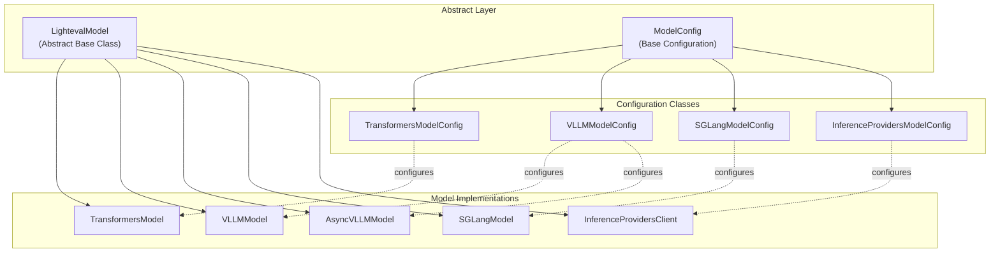
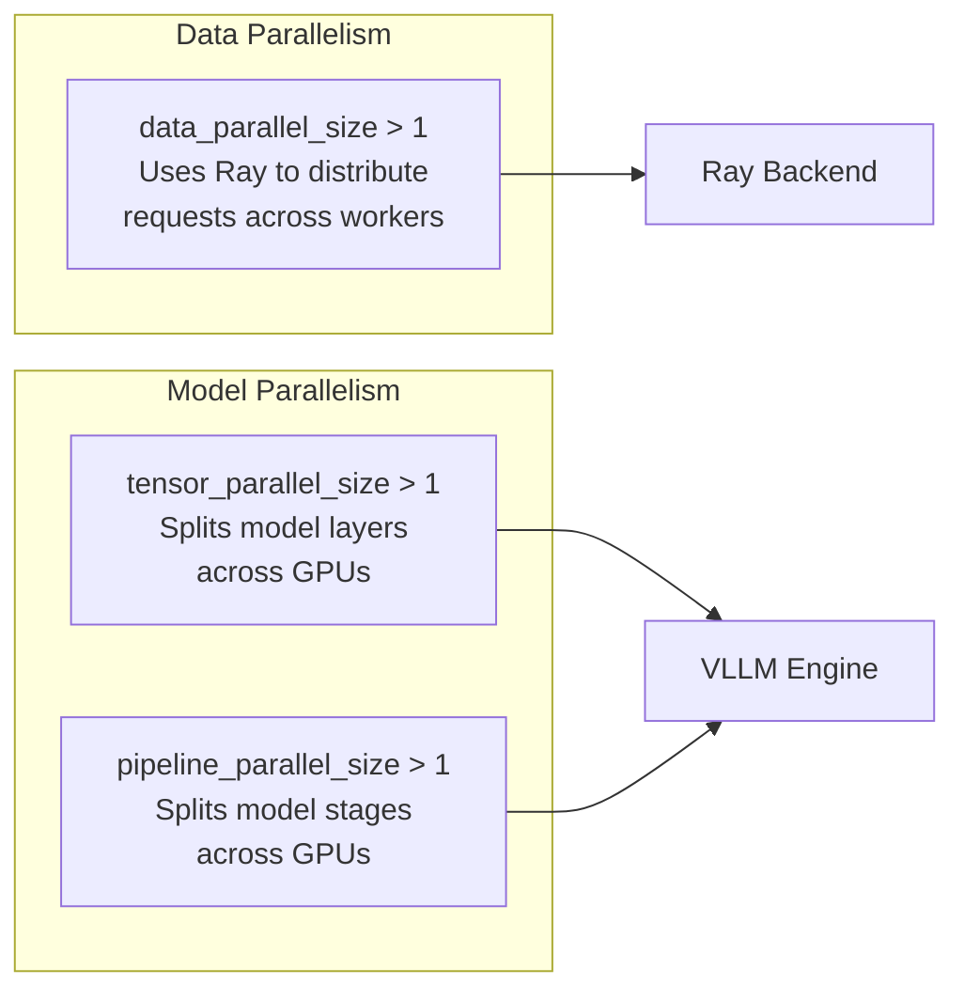
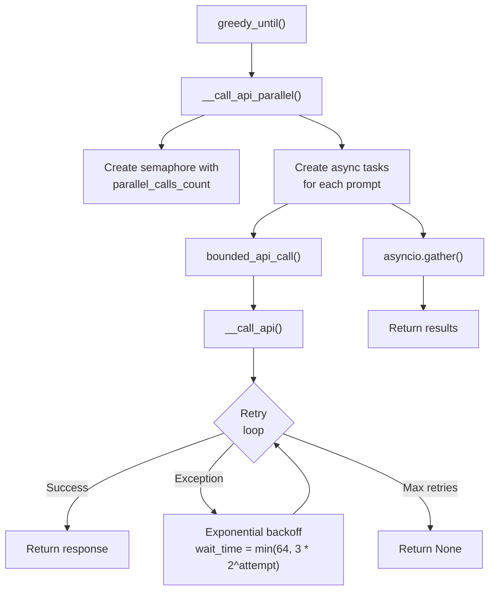
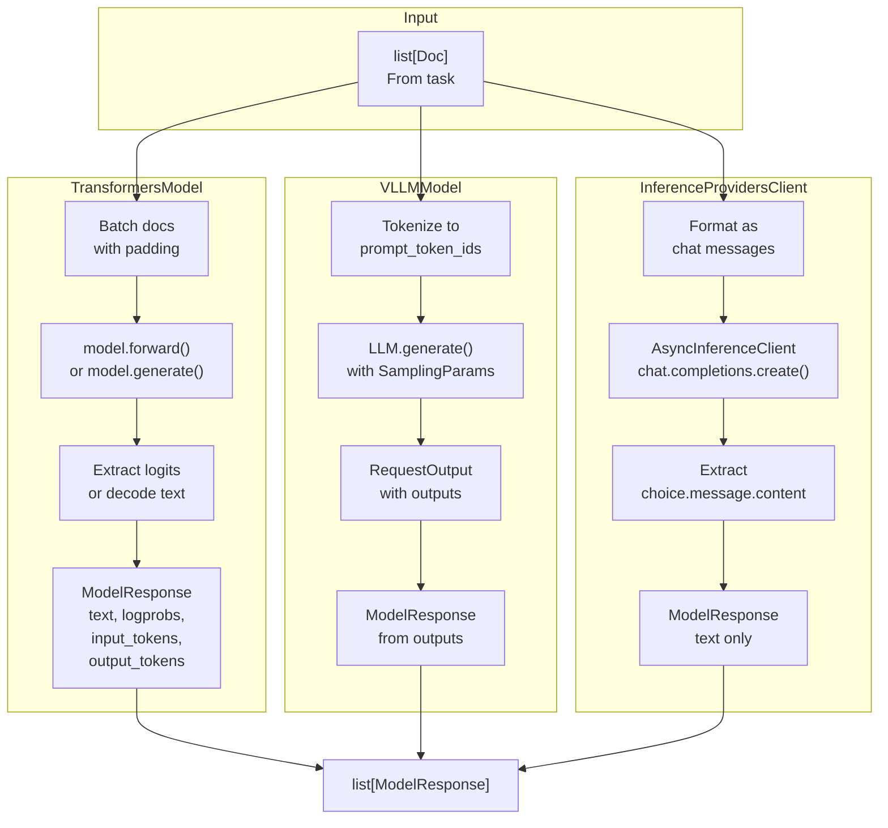

<!-- source: DeepWiki mcp.deepwiki.com · repo huggingface/lighteval · page 12.3 Model API · fetched 2026-10-26 -->

# Model API

<details>
<summary>Relevant source files</summary>

The following files were used as context for generating this wiki page:

- [src/lighteval/models/abstract_model.py](src/lighteval/models/abstract_model.py)
- [src/lighteval/models/endpoints/inference_providers_model.py](src/lighteval/models/endpoints/inference_providers_model.py)
- [src/lighteval/models/sglang/sglang_model.py](src/lighteval/models/sglang/sglang_model.py)
- [src/lighteval/models/transformers/transformers_model.py](src/lighteval/models/transformers/transformers_model.py)
- [src/lighteval/models/utils.py](src/lighteval/models/utils.py)
- [src/lighteval/models/vllm/vllm_model.py](src/lighteval/models/vllm/vllm_model.py)

</details>


This page provides the API reference for the model layer in lighteval. It covers the abstract `LightevalModel` interface that all model backends must implement, the `ModelConfig` base class for configuration, and the concrete implementations for different inference backends (Transformers, VLLM, SGLang, endpoints, etc.).

For information about how to integrate custom model backends, see [Custom Backend Integration](#7.9). For conceptual overview of the model layer architecture, see [Models and Backends](#7).

---

## Architecture Overview

The model API is structured around an abstract interface pattern that enables pluggable backend support:



**Sources:** [src/lighteval/models/abstract_model.py:1-352](), [src/lighteval/models/transformers/transformers_model.py:1-194](), [src/lighteval/models/vllm/vllm_model.py:1-697](), [src/lighteval/models/sglang/sglang_model.py:1-423](), [src/lighteval/models/endpoints/inference_providers_model.py:1-270]()

---

## LightevalModel Abstract Base Class

The `LightevalModel` class defines the interface that all model backends must implement. It provides a uniform API for evaluation regardless of the underlying inference engine.

### Class Definition

Location: [src/lighteval/models/abstract_model.py:220-352]()

```python
class LightevalModel(ABC):
    DATASET_SPLITS = 4
    is_async = False
```

### Required Properties

All implementations must provide these properties:

| Property | Type | Description |
|----------|------|-------------|
| `tokenizer` | `PreTrainedTokenizerBase` | The tokenizer instance for the model |
| `add_special_tokens` | `bool` | Whether special tokens should be added during tokenization |
| `max_length` | `int` | Maximum sequence length supported by the model |
| `disable_tqdm` | `bool` | Whether to disable progress bars (default: `False`) |

### Required Methods

#### greedy_until

```python
@abstractmethod
def greedy_until(self, docs: list[Doc]) -> list[ModelResponse]:
    """Generates responses using a greedy decoding strategy until certain ending conditions are met.
    
    Args:
        docs (list[Doc]): List of documents containing the context for generation.
        
    Returns:
        list[ModelResponse]: list of generated responses.
    """
```

This method handles generative tasks where the model produces text continuations. It is called for tasks with `SamplingMethod.GENERATIVE`.

**Sources:** [src/lighteval/models/abstract_model.py:251-263]()

#### loglikelihood

```python
@abstractmethod
def loglikelihood(self, docs: list[Doc]) -> list[ModelResponse]:
    """Tokenize the context and continuation and compute the log likelihood of those
    tokenized sequences.
    
    Returns:
        list[ModelResponse]: List of model responses containing log likelihood scores
    """
```

This method handles multiple-choice and classification tasks by computing log probabilities for different continuations. It is called for tasks with `SamplingMethod.LOGPROBS`.

**Sources:** [src/lighteval/models/abstract_model.py:266-273]()

#### loglikelihood_rolling

```python
@abstractmethod
def loglikelihood_rolling(self, docs: list[Doc]) -> list[ModelResponse]:
    """This function is used to compute the log likelihood of the context for perplexity metrics.
    
    Returns:
        list[ModelResponse]: List of model responses containing log likelihood scores
    """
```

This method handles perplexity evaluation by computing rolling log probabilities. It is called for tasks with `SamplingMethod.PERPLEXITY`.

**Sources:** [src/lighteval/models/abstract_model.py:276-282]()

#### cleanup

```python
def cleanup(self):
    """Clean up operations if needed, such as closing an endpoint."""
```

Optional method for resource cleanup when evaluation completes.

**Sources:** [src/lighteval/models/abstract_model.py:226-228]()

### Tokenization Utilities

The base class provides helper methods for tokenization:

#### tok_encode

```python
def tok_encode(self, str_to_encode: str | list[str], add_special_tokens: Optional[bool] = None) -> TokenSequence
```

Encodes a string or list of strings into token IDs. If `add_special_tokens` is `None`, uses `self.add_special_tokens`.

**Sources:** [src/lighteval/models/abstract_model.py:285-295]()

#### tok_encode_pair

```python
def tok_encode_pair(self, context, continuations: list[str], pairwise: bool = False)
```

Encodes a context with multiple continuations, handling spacing correctly. Two modes:
- **Pairwise** (`pairwise=True`): Encodes context and continuations separately, aligning with how LLMs predict tokens
- **Joint** (`pairwise=False`): Encodes together then splits (faster but may have tokenization mismatches)

Returns a tuple of `(context_encodings, continuation_encodings)` where both are lists.

**Sources:** [src/lighteval/models/abstract_model.py:297-348]()

#### tok_decode

```python
def tok_decode(self, tokens: torch.LongTensor) -> list[str]
```

Decodes token IDs back to text strings.

**Sources:** [src/lighteval/models/abstract_model.py:350-351]()

---

## ModelConfig Base Class

The `ModelConfig` class is the foundation for all model-specific configuration classes. It uses Pydantic for validation and provides convenient loading mechanisms.

### Class Definition

Location: [src/lighteval/models/abstract_model.py:41-156]()

### Base Attributes

| Attribute | Type | Default | Description |
|-----------|------|---------|-------------|
| `model_name` | `str` | Required | Model identifier or path |
| `generation_parameters` | `GenerationParameters` | Empty | Controls text generation behavior (temperature, top_p, etc.) |
| `system_prompt` | `str \| None` | `None` | System prompt for chat models |
| `cache_dir` | `str` | `"~/.cache/huggingface/lighteval"` | Directory for model caching |

### Loading Methods

#### from_path

```python
@classmethod
def from_path(cls, path: str):
    """Load configuration from a YAML file.
    
    Expected YAML structure:
    model_parameters:
      model_name: ...
      other_field: ...
    """
```

**Example:**
```yaml
model_parameters:
  model_name: meta-llama/Llama-3.1-8B-Instruct
  dtype: float16
  batch_size: 4
  generation_parameters:
    temperature: 0.7
    max_new_tokens: 100
```

**Sources:** [src/lighteval/models/abstract_model.py:91-96]()

#### from_args

```python
@classmethod
def from_args(cls, args: str):
    """Parse configuration from a command-line argument string.
    
    Format: "key1=value1,key2=value2,generation_parameters={temp:0.7,top_p:0.9}"
    """
```

**Example:**
```python
config = ModelConfig.from_args(
    "model_name=gpt2,batch_size=4,generation_parameters={temperature:0.7,top_p:0.9}"
)
```

**Sources:** [src/lighteval/models/abstract_model.py:98-155]()

---

## TransformersModel

The `TransformersModel` backend uses HuggingFace Transformers with Accelerate for multi-GPU support and efficient inference.

### Configuration Class: TransformersModelConfig

Location: [src/lighteval/models/transformers/transformers_model.py:73-192]()

#### Key Attributes

| Attribute | Type | Default | Description |
|-----------|------|---------|-------------|
| `model_name` | `str` | Required | HuggingFace Hub model ID or local path |
| `tokenizer` | `str \| None` | `None` | Tokenizer ID (uses `model_name` if not specified) |
| `revision` | `str` | `"main"` | Git revision to load |
| `batch_size` | `PositiveInt \| None` | `None` | Batch size (auto-determined if `None`) |
| `max_length` | `PositiveInt \| None` | `None` | Max sequence length (uses model default if `None`) |
| `dtype` | `str \| None` | `None` | Data type: `"float16"`, `"bfloat16"`, `"float32"`, `"auto"`, `"4bit"`, `"8bit"` |
| `device` | `Union[int, str]` | `"cuda"` | Device to load model on |
| `model_parallel` | `bool \| None` | `None` | Whether to use model parallelism (auto-determined if `None`) |
| `trust_remote_code` | `bool` | `False` | Whether to trust remote code |
| `compile` | `bool` | `False` | Whether to use `torch.compile` |
| `multichoice_continuations_start_space` | `bool \| None` | `None` | Control spacing in multiple choice continuations |
| `pairwise_tokenization` | `bool` | `False` | Use pairwise tokenization for loglikelihood |
| `continuous_batching` | `bool` | `False` | Enable continuous batching for generation |
| `add_special_tokens` | `bool` | `True` | Add special tokens during tokenization |
| `skip_special_tokens` | `bool` | `True` | Skip special tokens in output (needed for reasoning models) |
| `override_chat_template` | `bool \| None` | `None` | Override chat template detection |

#### Helper Methods

```python
def get_transformers_config(self) -> PretrainedConfig
```
Returns the HuggingFace config for the model.

```python
def get_model_sha(self) -> str
```
Returns the git SHA of the model revision.

**Sources:** [src/lighteval/models/transformers/transformers_model.py:73-192]()

### Model Class: TransformersModel

Location: [src/lighteval/models/transformers/transformers_model.py:194-1054]()

#### Initialization

```python
def __init__(self, config: TransformersModelConfig):
    """Initializes a HuggingFace AutoModel and AutoTokenizer for evaluation."""
```

The initialization process:
1. Creates an `Accelerator` instance for distributed support
2. Initializes tokenizer with left padding/truncation
3. Loads model with appropriate quantization and parallelism settings
4. Sets up `PromptManager` for prompt formatting
5. Initializes `SampleCache` for caching

**Sources:** [src/lighteval/models/transformers/transformers_model.py:195-239]()

#### Alternative Constructor: from_model

```python
@classmethod
def from_model(
    cls,
    model: AutoModelForCausalLM,
    config: TransformersModelConfig,
    accelerator: Accelerator | None = None,
) -> "TransformersModel"
```

Creates a `TransformersModel` from an already-instantiated model object. Useful when you want to load the model yourself with custom settings.

**Sources:** [src/lighteval/models/transformers/transformers_model.py:246-304]()

#### Implementation Details

The class provides two generation strategies:

**Padded Batching** (default):
- Groups requests into fixed-size batches
- Pads sequences to same length
- More memory efficient
- Implementation: [src/lighteval/models/transformers/transformers_model.py:627-782]()

**Continuous Batching**:
- Dynamic batching with variable sequence lengths
- Better GPU utilization
- Requires `continuous_batching=True` in config
- Implementation: [src/lighteval/models/transformers/transformers_model.py:524-625]()

#### Key Methods

```python
@cached(SamplingMethod.GENERATIVE)
def greedy_until(self, docs: list[Doc]) -> list[ModelResponse]
```

Implements text generation with automatic batch size detection and context truncation.

```python
@cached(SamplingMethod.LOGPROBS)
def loglikelihood(self, docs: list[Doc]) -> list[ModelResponse]
```

Computes log probabilities for multiple choice tasks. Supports both pairwise and joint tokenization.

```python
@cached(SamplingMethod.PERPLEXITY)
def loglikelihood_rolling(self, docs: list[Doc]) -> list[ModelResponse]
```

Computes rolling log probabilities for perplexity evaluation.

**Sources:** [src/lighteval/models/transformers/transformers_model.py:194-1054]()

---

## VLLMModel

The VLLM backend provides high-performance inference with PagedAttention, continuous batching, and distributed execution support via Ray.

### Configuration Class: VLLMModelConfig

Location: [src/lighteval/models/vllm/vllm_model.py:76-183]()

#### Key Attributes

| Attribute | Type | Default | Description |
|-----------|------|---------|-------------|
| `model_name` | `str` | Required | HuggingFace Hub model ID or path |
| `tokenizer` | `str \| None` | `None` | Tokenizer ID |
| `revision` | `str` | `"main"` | Git revision |
| `dtype` | `str` | `"bfloat16"` | Data type for weights |
| `tensor_parallel_size` | `PositiveInt` | `1` | Number of GPUs for tensor parallelism |
| `data_parallel_size` | `PositiveInt` | `1` | Number of GPUs for data parallelism |
| `pipeline_parallel_size` | `PositiveInt` | `1` | Number of GPUs for pipeline parallelism |
| `gpu_memory_utilization` | `NonNegativeFloat` | `0.9` | Fraction of GPU memory to use |
| `enable_prefix_caching` | `bool` | `None` | Enable prefix caching (speeds up generation, uses more memory) |
| `max_model_length` | `PositiveInt \| None` | `None` | Max sequence length (auto-inferred if `None`) |
| `quantization` | `str \| None` | `None` | Quantization method |
| `load_format` | `str \| None` | `None` | Model weight format (`"auto"`, `"pt"`, `"safetensors"`, etc.) |
| `swap_space` | `PositiveInt` | `4` | CPU swap space size in GiB per GPU |
| `seed` | `NonNegativeInt` | `1234` | Random seed |
| `max_num_seqs` | `PositiveInt` | `128` | Max sequences per iteration (controls prefill batch size) |
| `max_num_batched_tokens` | `PositiveInt` | `2048` | Max tokens per batch |
| `pairwise_tokenization` | `bool` | `False` | Use pairwise tokenization |
| `is_async` | `bool` | `False` | Use async VLLM (v1 API) |

**Sources:** [src/lighteval/models/vllm/vllm_model.py:76-183]()

### Model Class: VLLMModel

Location: [src/lighteval/models/vllm/vllm_model.py:186-537]()

#### Parallelism Strategy



**Sources:** [src/lighteval/models/vllm/vllm_model.py:243-296]()

#### Key Methods

```python
def _create_auto_model(self, config: VLLMModelConfig) -> Optional[LLM]
```

Creates the VLLM engine with specified parallelism settings. If `data_parallel_size > 1`, returns `None` and defers model creation to Ray workers.

**Sources:** [src/lighteval/models/vllm/vllm_model.py:243-296]()

```python
def _generate(
    self,
    inputs: list[list[int]],
    max_new_tokens: Optional[int] = None,
    stop_tokens: Optional[list[str]] = None,
    returns_logits: Optional[bool] = False,
    num_samples: int = 1,
    generate: bool = True,
) -> list
```

Core generation logic that:
- Builds `SamplingParams` from config
- Dispatches to Ray workers if data parallelism is enabled
- Otherwise uses local VLLM engine
- Returns `RequestOutput` objects

**Sources:** [src/lighteval/models/vllm/vllm_model.py:408-463]()

```python
@cached(SamplingMethod.GENERATIVE)
def greedy_until(self, docs: list[Doc]) -> list[ModelResponse]
```

Implements generation with automatic context truncation to fit within `max_model_length`.

**Sources:** [src/lighteval/models/vllm/vllm_model.py:309-406]()

```python
@cached(SamplingMethod.LOGPROBS)
def loglikelihood(self, docs: list[Doc]) -> list[ModelResponse]
```

Computes log probabilities by setting `prompt_logprobs=1` in sampling params and extracting continuation probabilities.

**Sources:** [src/lighteval/models/vllm/vllm_model.py:466-532]()

#### Cleanup

```python
def cleanup(self):
    """Cleans up Ray and VLLM resources."""
```

Calls `destroy_model_parallel()`, shuts down Ray, and clears CUDA cache.

**Sources:** [src/lighteval/models/vllm/vllm_model.py:226-233]()

---

## AsyncVLLMModel

The async variant of VLLM uses the v1 API for native asynchronous inference without Ray. It supports data and pipeline/tensor parallelism but only batch size 1.

### Model Class: AsyncVLLMModel

Location: [src/lighteval/models/vllm/vllm_model.py:540-697]()

#### Key Differences from VLLMModel

| Feature | VLLMModel | AsyncVLLMModel |
|---------|-----------|----------------|
| API Version | v0 (sync) | v1 (async) |
| Data Parallelism | Via Ray | Native in v1 |
| Batch Size | Auto-detected | 1 (enforced) |
| Splits | 4 | 1 |
| Class Variable | `DATASET_SPLITS = 4` | `DATASET_SPLITS = 1` |

#### Async Methods

```python
async def _async_one_item(
    self,
    index: int,
    doc: Doc,
    generative: bool,
) -> Coroutine[None, list, str]
```

Processes a single document asynchronously. For generative tasks, prepares full prompt. For loglikelihood, appends choice to context.

**Sources:** [src/lighteval/models/vllm/vllm_model.py:585-621]()

```python
async def _async_batch(self, docs: list[Doc], generative: bool) -> list
```

Creates async tasks for all documents and gathers results using `asyncio.gather()`.

**Sources:** [src/lighteval/models/vllm/vllm_model.py:623-628]()

```python
@cached(SamplingMethod.GENERATIVE)
async def greedy_until(self, docs: list[Doc]) -> list[ModelResponse]
```

Note the `async` keyword - this method must be awaited when called.

**Sources:** [src/lighteval/models/vllm/vllm_model.py:630-662]()

---

## SGLangModel

The SGLang backend provides high-performance inference with radix attention and structured generation capabilities.

### Configuration Class: SGLangModelConfig

Location: [src/lighteval/models/sglang/sglang_model.py:54-139]()

#### Key Attributes

| Attribute | Type | Default | Description |
|-----------|------|---------|-------------|
| `model_name` | `str` | Required | HuggingFace Hub model ID or path |
| `load_format` | `str` | `"auto"` | Weight format |
| `dtype` | `str` | `"auto"` | Data type |
| `tp_size` | `PositiveInt` | `1` | Tensor parallelism size |
| `dp_size` | `PositiveInt` | `1` | Data parallelism size |
| `context_length` | `PositiveInt \| None` | `None` | Max context length |
| `random_seed` | `PositiveInt \| None` | `1234` | Random seed |
| `sampling_backend` | `str \| None` | `None` | Sampling backend to use |
| `attention_backend` | `str \| None` | `None` | Attention backend to use |
| `mem_fraction_static` | `PositiveFloat` | `0.8` | Fraction of GPU memory for static allocation |
| `chunked_prefill_size` | `PositiveInt` | `4096` | Chunk size for prefill |
| `pairwise_tokenization` | `bool` | `False` | Use pairwise tokenization |

**Sources:** [src/lighteval/models/sglang/sglang_model.py:54-139]()

### Model Class: SGLangModel

Location: [src/lighteval/models/sglang/sglang_model.py:141-423]()

#### Engine Creation

```python
def _create_auto_model(self, config: SGLangModelConfig) -> Optional[Engine]
```

Creates an SGLang `Engine` with specified backends and parallelism. Key engine args:
- `disable_radix_cache=True` for consistent evaluation
- `schedule_policy="fcfs"` for first-come-first-serve scheduling
- `chunked_prefill_size` for memory-efficient prefill

**Sources:** [src/lighteval/models/sglang/sglang_model.py:189-212]()

#### Generation

```python
@requires("sglang")
def _generate(
    self,
    inputs: list[list[int]],
    max_new_tokens: Optional[int] = None,
    stop_tokens: Optional[list[str]] = None,
    num_samples: int = 1,
    generate: bool = True,
) -> list
```

Calls `engine.generate()` with:
- `return_logprob=True` to get token-level logprobs
- `logprob_start_len=0` and `top_logprobs_num=1` for loglikelihood mode
- Returns list of dicts with `"text"` and `"meta_info"` fields

**Sources:** [src/lighteval/models/sglang/sglang_model.py:316-349]()

#### Loglikelihood Implementation

The `loglikelihood` method extracts logprobs from SGLang's `meta_info`:
```python
input_top_logprobs = meta_info["input_top_logprobs"][::-1]
input_token_logprobs = meta_info["input_token_logprobs"][::-1]
```

Both are reversed ([::-1]) to align with continuation tokens.

**Sources:** [src/lighteval/models/sglang/sglang_model.py:355-418]()

---

## InferenceProvidersClient

The endpoint-based client for HuggingFace's inference provider network (Together AI, Anyscale, etc.).

### Configuration Class: InferenceProvidersModelConfig

Location: [src/lighteval/models/endpoints/inference_providers_model.py:45-95]()

#### Key Attributes

| Attribute | Type | Default | Description |
|-----------|------|---------|-------------|
| `model_name` | `str` | Required | Model identifier for the provider |
| `provider` | `str` | Required | Provider name (`"together"`, `"anyscale"`, etc.) |
| `timeout` | `int \| None` | `None` | Request timeout in seconds |
| `proxies` | `Any \| None` | `None` | Proxy configuration |
| `org_to_bill` | `str \| None` | `None` | Organization to bill |
| `parallel_calls_count` | `NonNegativeInt` | `10` | Number of parallel API calls |

**Sources:** [src/lighteval/models/endpoints/inference_providers_model.py:45-95]()

### Model Class: InferenceProvidersClient

Location: [src/lighteval/models/endpoints/inference_providers_model.py:97-270]()

#### Initialization

```python
def __init__(self, config: InferenceProvidersModelConfig) -> None
```

Creates an `AsyncInferenceClient` from `huggingface_hub` with specified provider and billing settings. Attempts to load tokenizer (with fallback to `None` if unavailable).

**Sources:** [src/lighteval/models/endpoints/inference_providers_model.py:104-138]()

#### API Call Logic



**Sources:** [src/lighteval/models/endpoints/inference_providers_model.py:140-200]()

#### Key Methods

```python
async def __call_api(self, prompt: List[dict], num_samples: int) -> Optional[ChatCompletionOutput]
```

Makes a single API call with exponential backoff retry (max 5 attempts). Uses `client.chat.completions.create()` with generation parameters.

**Sources:** [src/lighteval/models/endpoints/inference_providers_model.py:140-173]()

```python
async def __call_api_parallel(
    self,
    prompts,
    num_samples: int | list[int],
)
```

Parallelizes API calls using `asyncio.Semaphore` to limit concurrency to `parallel_calls_count`. Uses `async_tqdm.gather()` for progress tracking.

**Sources:** [src/lighteval/models/endpoints/inference_providers_model.py:175-200]()

```python
@cached(SamplingMethod.GENERATIVE)
def greedy_until(self, docs: list[Doc]) -> list[ModelResponse]
```

Only method implemented (loglikelihood methods raise `NotImplementedError`). Uses `asyncio.run()` to execute async batch processing.

**Sources:** [src/lighteval/models/endpoints/inference_providers_model.py:202-240]()

#### Limitations

- Only supports generative tasks (`greedy_until`)
- `loglikelihood` and `loglikelihood_rolling` are not implemented
- Requires API keys in environment variables
- Subject to provider rate limits and pricing

**Sources:** [src/lighteval/models/endpoints/inference_providers_model.py:259-269]()

---

## Model Response Flow

The following diagram shows how different implementations produce `ModelResponse` objects:



**Sources:** [src/lighteval/models/transformers/transformers_model.py:627-782](), [src/lighteval/models/vllm/vllm_model.py:309-406](), [src/lighteval/models/endpoints/inference_providers_model.py:202-240]()

---

## Utility Functions

Location: [src/lighteval/models/utils.py:1-138]()

### _get_dtype

```python
def _get_dtype(dtype: Union[str, torch.dtype, None], config: Optional[AutoConfig] = None) -> Optional[torch.dtype]
```

Converts string dtype specifications to `torch.dtype`. Handles special cases:
- `"auto"`, `"4bit"`, `"8bit"` return `None` (infered by framework)
- String types like `"float16"` convert to `torch.float16`
- Falls back to config's `torch_dtype` if available

**Sources:** [src/lighteval/models/utils.py:37-61]()

### _simplify_name

```python
def _simplify_name(name_or_path: str) -> str
```

Simplifies model paths for display:
- `/path/models--org--model_name/revision/files` → `"org/model_name"`
- Other disk paths → path with `/` replaced by `_`
- Hub names → unchanged

**Sources:** [src/lighteval/models/utils.py:64-88]()

### _get_model_sha

```python
def _get_model_sha(repo_id: str, revision: str) -> str
```

Fetches the git SHA of a model revision from HuggingFace Hub using `HfApi`. Returns empty string on failure.

**Sources:** [src/lighteval/models/utils.py:91-97]()

### uses_chat_template

```python
def uses_chat_template(
    model_name: str = None, 
    tokenizer: AutoTokenizer = None, 
    override_chat_template: bool = None
) -> bool
```

Determines if a model should use chat template formatting:
- If `override_chat_template` is set, returns that value
- Otherwise, checks if tokenizer has `chat_template` attribute
- Returns `True` on error (assumes chat template)

Used by models to decide between `PromptManager.prepare_prompt()` (chat) and direct string formatting (non-chat).

**Sources:** [src/lighteval/models/utils.py:109-137]()

---

## Configuration Comparison Table

This table summarizes key configuration differences across backends:

| Feature | TransformersModel | VLLMModel | SGLangModel | InferenceProviders |
|---------|-------------------|-----------|-------------|-------------------|
| **Parallelism** | Model parallel via Accelerate | TP/PP/DP via Ray | TP/DP native | N/A (remote) |
| **Quantization** | 4-bit/8-bit via BitsAndBytes | Via VLLM config | Via SGLang config | N/A |
| **Batch Size** | Auto-detected or manual | Auto via `max_num_seqs` | Single-item | Single-item |
| **Caching** | Optional continuous batching | Prefix caching | Radix caching (disabled) | N/A |
| **Chat Template** | Auto-detected from tokenizer | Auto-detected | Auto-detected | Always enabled |
| **Loglikelihood** | Full support | Full support | Full support | Not supported |
| **Perplexity** | Full support | Not implemented | Not implemented | Not supported |
| **Async Support** | No | Via `AsyncVLLMModel` | No | Native |

---

## Common Patterns

### Creating a Model Instance

All models follow the same pattern:

```python
# 1. Create config
config = TransformersModelConfig(
    model_name="meta-llama/Llama-3.1-8B-Instruct",
    dtype="float16",
    generation_parameters=GenerationParameters(temperature=0.7)
)

# 2. Instantiate model
model = TransformersModel(config)

# 3. Use model (via Pipeline, not directly)
# Pipeline handles calling greedy_until(), loglikelihood(), etc.

# 4. Cleanup when done
model.cleanup()
```

### Caching Decorator

All three core methods use the `@cached` decorator:

```python
@cached(SamplingMethod.GENERATIVE)
def greedy_until(self, docs: list[Doc]) -> list[ModelResponse]:
    ...
```

This decorator:
- Checks `self._cache` for previously computed results
- Caches new results keyed by `SamplingMethod` and doc hash
- Significantly speeds up re-evaluation

**Sources:** [src/lighteval/models/abstract_model.py:251-282]()

### Context Truncation Logic

Most implementations follow this pattern for handling long contexts:

```python
context_size = len(tokenized_input)
if max_new_tokens is not None:
    if context_size + max_new_tokens > self.max_length:
        logger.warning(f"Truncating context to {self.max_length - max_new_tokens}")
        context_size = self.max_length - max_new_tokens
        inputs = [input[-context_size:] for input in inputs]  # Left truncate
```

This ensures generation has room to produce `max_new_tokens` by truncating from the left (preserving the end of the prompt).

**Sources:** [src/lighteval/models/transformers/transformers_model.py:569-588](), [src/lighteval/models/vllm/vllm_model.py:360-383](), [src/lighteval/models/sglang/sglang_model.py:273-292]()

---

## Implementation Checklist

To implement a custom model backend, you must:

- [ ] Inherit from `LightevalModel`
- [ ] Create a config class inheriting from `ModelConfig`
- [ ] Implement `tokenizer` property returning `PreTrainedTokenizerBase`
- [ ] Implement `add_special_tokens` property returning `bool`
- [ ] Implement `max_length` property returning `int`
- [ ] Implement `greedy_until(docs: list[Doc]) -> list[ModelResponse]`
- [ ] Implement `loglikelihood(docs: list[Doc]) -> list[ModelResponse]`
- [ ] Implement `loglikelihood_rolling(docs: list[Doc]) -> list[ModelResponse]`
- [ ] Add `@cached(SamplingMethod.XXX)` decorators to methods
- [ ] Initialize `self._cache = SampleCache(config)` in `__init__`
- [ ] Initialize `self.prompt_manager = PromptManager(...)` in `__init__`
- [ ] Optionally implement `cleanup()` for resource management
- [ ] Set `is_async = True` if methods are async (like `AsyncVLLMModel`)

See [Custom Backend Integration](#7.9) for detailed guidance.

**Sources:** [src/lighteval/models/abstract_model.py:220-352]()

---

