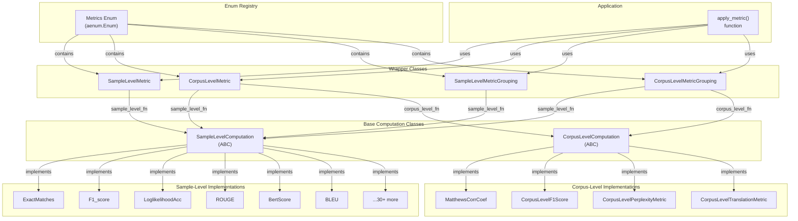
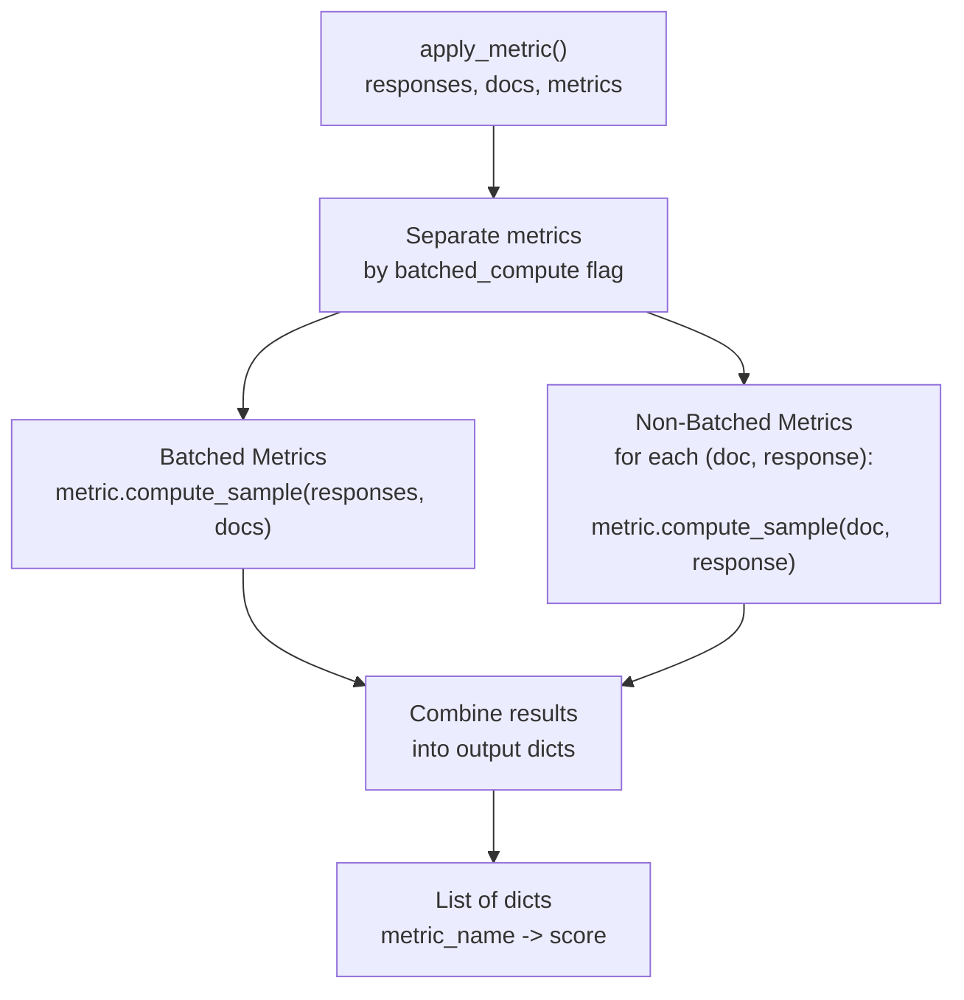
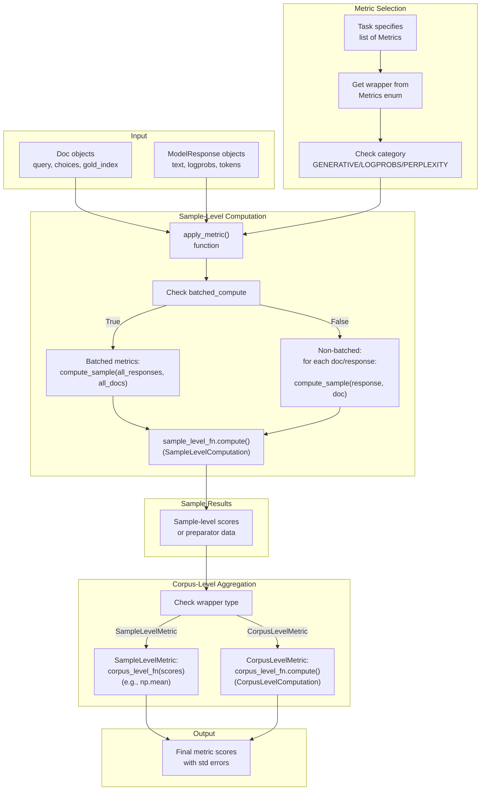

<!-- source: DeepWiki mcp.deepwiki.com · repo huggingface/lighteval · page 12.4 Metrics API · fetched 2026-10-26 -->

# Metrics API

<details>
<summary>Relevant source files</summary>

The following files were used as context for generating this wiki page:

- [src/lighteval/data.py](src/lighteval/data.py)
- [src/lighteval/metrics/__init__.py](src/lighteval/metrics/__init__.py)
- [src/lighteval/metrics/metrics.py](src/lighteval/metrics/metrics.py)
- [src/lighteval/metrics/metrics_sample.py](src/lighteval/metrics/metrics_sample.py)
- [tests/test_unit_harness_metrics.py](tests/test_unit_harness_metrics.py)

</details>


This page provides API reference documentation for the metrics system in lighteval. It covers the `Metrics` enum, base classes for metric computation, wrapper classes that define metric behavior, and the metric application function. For conceptual information about how metrics work, see [Metrics System](#8). For guidance on creating custom metrics, see [Creating Custom Metrics](#8.9).

## Overview

The metrics API is organized around several key abstractions:

- **Metrics Enum**: Central registry of all available metrics ([src/lighteval/metrics/metrics.py:146-634]())
- **Computation Classes**: `SampleLevelComputation` and `CorpusLevelComputation` base classes that implement metric logic
- **Wrapper Classes**: `SampleLevelMetric`, `CorpusLevelMetric`, and their grouping variants that configure how metrics are computed and aggregated
- **Application Function**: `apply_metric()` orchestrates metric computation across samples

**Sources**: [src/lighteval/metrics/metrics.py:1-634](), [src/lighteval/metrics/metrics_sample.py:1-1527](), [src/lighteval/metrics/__init__.py:1-63]()

## Metric System Architecture



**Sources**: [src/lighteval/metrics/metrics.py:146-634](), [src/lighteval/metrics/metrics_sample.py:64-1527]()

## Metrics Enum

The `Metrics` enum is the central registry of all available metrics in lighteval. It uses the `aenum.Enum` class to enable dynamic extension via `extend_enum()`.

### Class Definition

[src/lighteval/metrics/metrics.py:146-634]()

```python
class Metrics(Enum):
    # 60+ predefined metrics
    exact_match = SampleLevelMetric(...)
    f1_score = SampleLevelMetric(...)
    loglikelihood_acc = SampleLevelMetric(...)
    # ... many more
```

### Key Methods

| Method | Description |
|--------|-------------|
| `__str__()` | Returns the metric name with `@` replacing `_at_` (e.g., `"pass@k"` instead of `"pass_at_k"`) |
| `__call__(sample_params)` | Returns a deep copy of the metric value with parameterization applied |

[src/lighteval/metrics/metrics.py:626-633]()

### Accessing Metrics

Metrics can be accessed by name:

```python
from lighteval.metrics.metrics import Metrics

# Access by attribute
metric = Metrics.exact_match

# Access by string name
metric = Metrics["exact_match"]

# Get the wrapper object
metric_wrapper = metric.value  # Returns SampleLevelMetric instance
```

### Common Metrics in the Enum

| Metric Name | Type | Category | Description |
|-------------|------|----------|-------------|
| `exact_match` | SampleLevelMetric | GENERATIVE | Exact string matching |
| `f1_score` | SampleLevelMetric | GENERATIVE | F1 score over bag of words |
| `loglikelihood_acc` | SampleLevelMetric | LOGPROBS | Multiple choice accuracy |
| `rouge1`, `rouge2`, `rougeL` | SampleLevelMetric | GENERATIVE | ROUGE text similarity |
| `bert_score` | SampleLevelMetricGrouping | GENERATIVE | BERTScore (P, R, F1) |
| `bleu` | CorpusLevelMetric | GENERATIVE | Corpus-level BLEU |
| `mcc` | CorpusLevelMetric | LOGPROBS | Matthews Correlation Coefficient |
| `pass_at_k` | SampleLevelMetric | GENERATIVE | Code generation pass@k |
| `perplexity` | CorpusLevelMetric | PERPLEXITY | Language model perplexity |

[src/lighteval/metrics/metrics.py:146-624]()

**Sources**: [src/lighteval/metrics/metrics.py:146-634]()

## SampleLevelComputation Base Class

The `SampleLevelComputation` abstract base class defines the interface for all sample-level metric implementations.

### Class Definition

[src/lighteval/metrics/metrics_sample.py:64-79]()

```python
class SampleLevelComputation(ABC):
    @abstractmethod
    def compute(self, doc: Doc, model_response: ModelResponse, **kwargs):
        raise NotImplementedError

    def __str__(self):
        # Returns string representation with callable names
        ...
```

### Abstract Method: compute()

All subclasses must implement the `compute()` method:

| Parameter | Type | Description |
|-----------|------|-------------|
| `doc` | `Doc` | Document containing query, choices, gold_index, etc. |
| `model_response` | `ModelResponse` | Model output containing text, logprobs, tokens |
| `**kwargs` | dict | Additional keyword arguments (often unused) |
| **Returns** | `float` or `dict` | Metric score(s) for this sample |

### Implementation Pattern

```python
class MyMetric(SampleLevelComputation):
    def __init__(self, param1, param2):
        self.param1 = param1
        self.param2 = param2
    
    def compute(self, doc: Doc, model_response: ModelResponse, **kwargs):
        golds = doc.get_golds()
        predictions = model_response.final_text
        # Compute and return score
        return score
```

**Sources**: [src/lighteval/metrics/metrics_sample.py:64-79]()

## Metric Wrapper Classes

Wrapper classes configure how metrics are computed and aggregated. They are used as values in the `Metrics` enum.

### SampleLevelMetric

Defines a metric that computes sample-level scores and aggregates them with a simple function (like `np.mean`).

**Constructor Parameters**:

| Parameter | Type | Description |
|-----------|------|-------------|
| `metric_name` | `str` | Name of the metric in results |
| `sample_level_fn` | `SampleLevelComputation` | Computation object for sample scoring |
| `category` | `SamplingMethod` | GENERATIVE, LOGPROBS, or PERPLEXITY |
| `corpus_level_fn` | `Callable` | Aggregation function (e.g., `np.mean`, `max`) |
| `higher_is_better` | `bool` | Whether higher scores are better |
| `batched_compute` | `bool` | Whether metric supports batched computation (default: False) |

**Example**:
[src/lighteval/metrics/metrics.py:255-261]()

```python
exact_match = SampleLevelMetric(
    metric_name="em",
    sample_level_fn=ExactMatches(strip_strings=True),
    category=SamplingMethod.GENERATIVE,
    corpus_level_fn=np.mean,
    higher_is_better=True,
)
```

### CorpusLevelMetric

Defines a metric that requires corpus-level computation (cannot be averaged from sample scores).

**Constructor Parameters**:

| Parameter | Type | Description |
|-----------|------|-------------|
| `metric_name` | `str` | Name of the metric in results |
| `sample_level_fn` | `SampleLevelComputation` | Preparator that collects necessary data |
| `category` | `SamplingMethod` | GENERATIVE, LOGPROBS, or PERPLEXITY |
| `corpus_level_fn` | `CorpusLevelComputation` | Corpus-level computation object |
| `higher_is_better` | `bool` | Whether higher scores are better |

**Example**:
[src/lighteval/metrics/metrics.py:441-447]()

```python
mcc = CorpusLevelMetric(
    metric_name="mcc",
    sample_level_fn=LoglikelihoodPreparator(),
    category=SamplingMethod.LOGPROBS,
    corpus_level_fn=MatthewsCorrCoef(),
    higher_is_better=True,
)
```

### SampleLevelMetricGrouping

For metrics that return multiple scores (as a dict) from a single computation.

**Constructor Parameters**:

| Parameter | Type | Description |
|-----------|------|-------------|
| `metric_name` | `list[str]` | List of metric names returned |
| `sample_level_fn` | `SampleLevelComputation` | Computation returning dict of scores |
| `category` | `SamplingMethod` | GENERATIVE, LOGPROBS, or PERPLEXITY |
| `corpus_level_fn` | `dict[str, Callable]` | Aggregation functions for each metric |
| `higher_is_better` | `dict[str, bool]` | Whether higher is better for each metric |

**Example**:
[src/lighteval/metrics/metrics.py:175-181]()

```python
bert_score = SampleLevelMetricGrouping(
    metric_name=["BERTScore-P", "BERTScore-R", "BERTScore-F"],
    sample_level_fn=BertScore(...),
    category=SamplingMethod.GENERATIVE,
    corpus_level_fn={"BERTScore-P": np.mean, "BERTScore-R": np.mean, "BERTScore-F": np.mean},
    higher_is_better={"BERTScore-P": True, "BERTScore-R": True, "BERTScore-F": True},
)
```

### CorpusLevelMetricGrouping

For corpus-level metrics that return multiple scores.

**Constructor Parameters**: Same as `CorpusLevelMetricGrouping` but with `corpus_level_fn` being a `CorpusLevelComputation` subclass.

**Sources**: [src/lighteval/metrics/metrics.py:146-634]()

## apply_metric Function

The `apply_metric()` function is the entry point for computing metrics on model outputs.

### Function Signature

[src/lighteval/metrics/__init__.py:29-62]()

```python
def apply_metric(
    responses: list[ModelResponse],
    docs: list[Doc],
    metrics: list[Metric]
) -> list[dict]:
    """
    Apply metrics to model responses and documents.
    
    Args:
        responses: List of model responses (one per document)
        docs: List of documents (one per response)
        metrics: List of Metric wrapper objects to compute
        
    Returns:
        List of dicts, one per document, mapping metric names to scores
    """
```

### Batched vs Non-Batched Computation

The function separates metrics into two categories:

1. **Non-batched metrics**: Computed one sample at a time
2. **Batched metrics**: Computed across all samples at once (for efficiency)

**Computation Flow**:



[src/lighteval/metrics/__init__.py:29-62]()

### Return Format

Returns a list of dictionaries, one per document:

```python
[
    {"em": 1.0, "f1": 0.8},  # Sample 0
    {"em": 0.0, "f1": 0.5},  # Sample 1
    # ...
]
```

**Sources**: [src/lighteval/metrics/__init__.py:29-62]()

## Sample-Level Metric Implementations

This section documents key `SampleLevelComputation` implementations.

### ExactMatches

Tests for exact string matching between predictions and gold references.

**Constructor**:
[src/lighteval/metrics/metrics_sample.py:81-117]()

| Parameter | Type | Default | Description |
|-----------|------|---------|-------------|
| `aggregation_function` | `Callable` | `max` | How to aggregate when multiple golds/predictions |
| `normalize_gold` | `Callable` or `None` | `None` | Gold normalization function |
| `normalize_pred` | `Callable` or `None` | `None` | Prediction normalization function |
| `strip_strings` | `bool` | `False` | Whether to strip whitespace |
| `type_exact_match` | `str` | `"full"` | Match type: `"full"`, `"prefix"`, or `"suffix"` |

**Methods**:
- `compute(doc, model_response)`: Returns 1.0 if any pred/gold pair matches, else 0.0
- `compute_one_item(gold, pred)`: Compares two individual strings

[src/lighteval/metrics/metrics_sample.py:118-167]()

### F1_score

Computes F1 score over bag of words using NLTK.

**Constructor**:
[src/lighteval/metrics/metrics_sample.py:170-196]()

| Parameter | Type | Default | Description |
|-----------|------|---------|-------------|
| `aggregation_function` | `Callable` | `max` | How to aggregate scores |
| `normalize_gold` | `Callable` or `None` | `None` | Gold normalization function |
| `normalize_pred` | `Callable` or `None` | `None` | Prediction normalization function |
| `strip_strings` | `bool` | `False` | Whether to strip whitespace |

**Methods**:
- `compute(doc, model_response)`: Returns aggregated F1 score
- `compute_one_item(gold, pred)`: Computes F1 for one pair using `nltk.scores.f_measure`

[src/lighteval/metrics/metrics_sample.py:197-240]()

### LoglikelihoodAcc

Tests if the highest log-probability choice is in the gold indices (multiple choice accuracy).

**Constructor**:
[src/lighteval/metrics/metrics_sample.py:243-252]()

| Parameter | Type | Default | Description |
|-----------|------|---------|-------------|
| `logprob_normalization` | `LogProbNormalization` or `None` | `None` | Normalization to apply to log probabilities |

**Normalization options**:
- `None`: No normalization
- `LogProbNormalization`: Normalize by choice length, unconditional probability, etc.

**Method**:
- `compute(doc, model_response)`: Returns 1 if argmax(logprobs) is in gold indices, else 0

[src/lighteval/metrics/metrics_sample.py:254-294]()

### ROUGE

Wrapper for ROUGE metrics (rouge1, rouge2, rougeL, rougeLsum) using `rouge_scorer`.

**Constructor**:
[src/lighteval/metrics/metrics_sample.py:486-531]()

| Parameter | Type | Default | Description |
|-----------|------|---------|-------------|
| `methods` | `str` or `list[str]` | Required | ROUGE methods to compute |
| `multiple_golds` | `bool` | `False` | Whether to use multi-gold scoring |
| `bootstrap` | `bool` | `False` | Whether to use bootstrap aggregation |
| `aggregation_function` | `Callable` or `None` | `np.mean` | Aggregation function |
| `normalize_gold` | `Callable` or `None` | `None` | Gold normalization function |
| `normalize_pred` | `Callable` or `None` | `None` | Prediction normalization function |
| `tokenizer` | `object` or `None` | `None` | Custom tokenizer for ROUGE scorer |

**Methods**:
- `compute(doc, model_response)`: Returns float or dict of ROUGE scores

[src/lighteval/metrics/metrics_sample.py:533-595]()

### BertScore

Computes BERTScore (Precision, Recall, F1) using contextual embeddings.

**Constructor**:
[src/lighteval/metrics/metrics_sample.py:598-627]()

| Parameter | Type | Default | Description |
|-----------|------|---------|-------------|
| `normalize_gold` | `Callable` or `None` | `None` | Gold normalization function |
| `normalize_pred` | `Callable` or `None` | `None` | Prediction normalization function |

Uses `microsoft/deberta-large-mnli` model by default.

**Method**:
- `compute(doc, model_response)`: Returns dict with `"BERTScore-P"`, `"BERTScore-R"`, `"BERTScore-F"`

[src/lighteval/metrics/metrics_sample.py:628-658]()

### PassAtK

Estimates pass@k for code generation tasks (unbiased estimator).

**Constructor**:
[src/lighteval/metrics/metrics_sample.py:950-970]()

| Parameter | Type | Default | Description |
|-----------|------|---------|-------------|
| `strip_strings` | `bool` | `False` | Whether to strip predictions |
| `sample_scoring_function` | `SampleLevelComputation` or `None` | `None` | Custom scoring function (default: exact match) |

**Method**:
- `compute(doc, model_response)`: Uses hypergeometric distribution to estimate pass@k

[src/lighteval/metrics/metrics_sample.py:972-1015]()

### Other Notable Implementations

| Class | Description | Location |
|-------|-------------|----------|
| `BLEU` | Sentence-level BLEU using NLTK | [metrics_sample.py:805-844]() |
| `BLEURT` | BLEURT metric using transformers | [metrics_sample.py:765-802]() |
| `StringDistance` | Edit distance, longest common prefix | [metrics_sample.py:847-934]() |
| `MRR` | Mean Reciprocal Rank | [metrics_sample.py:438-468]() |
| `Recall` | Recall@k for multiple choice | [metrics_sample.py:408-435]() |
| `Extractiveness` | Coverage, density, compression | [metrics_sample.py:661-714]() |
| `Faithfulness` | SummaC faithfulness scorer | [metrics_sample.py:717-762]() |

**Sources**: [src/lighteval/metrics/metrics_sample.py:81-1527]()

## Corpus-Level Metric Implementations

Corpus-level metrics aggregate information across all samples before computing the final score.

### Common Corpus-Level Metrics

| Class | Description | File Reference |
|-------|-------------|----------------|
| `MatthewsCorrCoef` | Matthews Correlation Coefficient | [metrics_corpus.py]() |
| `CorpusLevelF1Score` | Macro/micro F1 across corpus | [metrics_corpus.py]() |
| `CorpusLevelPerplexityMetric` | Perplexity, bits per byte | [metrics_corpus.py]() |
| `CorpusLevelTranslationMetric` | BLEU, chrF, TER using sacrebleu | [metrics_corpus.py]() |

### Sample Preparators

Preparator classes collect data at the sample level for later corpus-level aggregation:

| Class | Purpose | Used By |
|-------|---------|---------|
| `LoglikelihoodPreparator` | Collects predictions and golds | F1, MCC metrics |
| `GenerativePreparator` | Collects generated text and references | Translation metrics |
| `PerplexityPreparator` | Collects log probabilities and lengths | Perplexity metrics |
| `TargetPerplexityPreparator` | Collects target-specific perplexity data | Target perplexity |

**Sources**: [src/lighteval/metrics/metrics.py:34-39](), [src/lighteval/metrics/metrics.py:60-66]()

## Metric Data Flow



**Sources**: [src/lighteval/metrics/__init__.py:29-62](), [src/lighteval/metrics/metrics_sample.py:64-79]()

## Usage Examples

### Accessing and Using a Metric

```python
from lighteval.metrics.metrics import Metrics
from lighteval.metrics import apply_metric
from lighteval.tasks.requests import Doc
from lighteval.models.model_output import ModelResponse

# Get metric from enum
metric = Metrics.exact_match.value

# Create sample data
doc = Doc(
    query="What is 2+2?",
    choices=None,
    gold_index=None,
    instruction="",
    specific={"gold": ["4", "four"]}
)

response = ModelResponse(
    text=["4"],
    output_tokens=[[]],
    input_tokens=[]
)

# Apply metric
results = apply_metric(
    responses=[response],
    docs=[doc],
    metrics=[metric]
)
# Returns: [{"em": 1.0}]
```

### Creating a Custom Metric Computation

```python
from lighteval.metrics.metrics_sample import SampleLevelComputation
from lighteval.metrics.utils.metric_utils import SampleLevelMetric
from lighteval.metrics.metrics import Metrics
from lighteval.utils.utils import extend_enum
import numpy as np

class MyCustomMetric(SampleLevelComputation):
    def __init__(self, threshold: float = 0.5):
        self.threshold = threshold
    
    def compute(self, doc, model_response, **kwargs):
        prediction = model_response.final_text[0]
        gold = doc.get_golds()[0]
        # Custom logic here
        score = len(set(prediction) & set(gold)) / len(set(gold))
        return 1.0 if score >= self.threshold else 0.0

# Wrap and register
my_metric = SampleLevelMetric(
    metric_name="my_custom",
    sample_level_fn=MyCustomMetric(threshold=0.5),
    category=SamplingMethod.GENERATIVE,
    corpus_level_fn=np.mean,
    higher_is_better=True,
)

extend_enum(Metrics, "my_custom", my_metric)
```

### Testing Metric Computation

[tests/test_unit_harness_metrics.py:65-139]()

The test suite shows how metrics are applied:

```python
# Example from test file
metric = Metrics["exact_match"].value
doc = Doc(
    query="full prompt text",
    choices=None,
    gold_index=None,
    specific={"gold": ["answer"]}
)

response = ModelResponse(
    text=["answer"],
    output_tokens=[[]],
    input_tokens=[]
)

results = apply_metric(
    responses=[response],
    docs=[doc],
    metrics=[metric]
)
```

**Sources**: [tests/test_unit_harness_metrics.py:65-139](), [src/lighteval/metrics/metrics_sample.py:81-240]()

---

