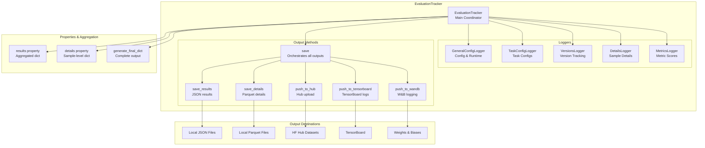
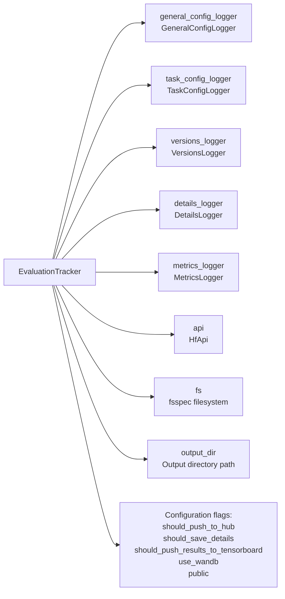
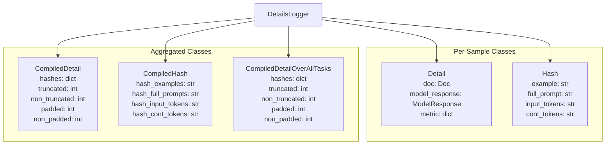
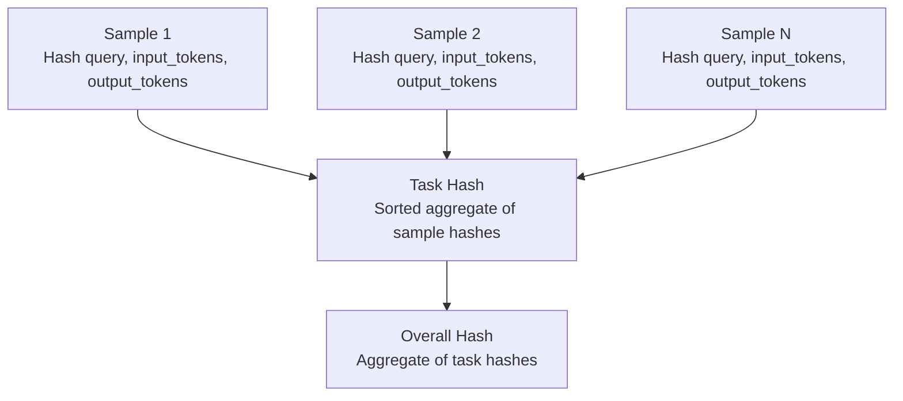
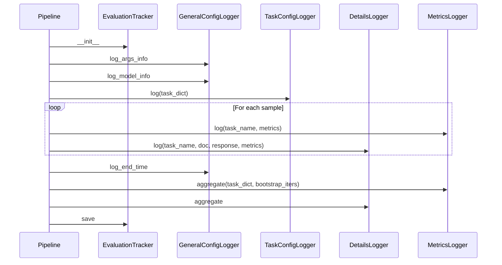

<!-- source: DeepWiki mcp.deepwiki.com · repo huggingface/lighteval · page 12.5 Tracking API · fetched 2026-10-26 -->

# Tracking API

<details>
<summary>Relevant source files</summary>

The following files were used as context for generating this wiki page:

- [src/lighteval/logging/evaluation_tracker.py](src/lighteval/logging/evaluation_tracker.py)
- [src/lighteval/logging/info_loggers.py](src/lighteval/logging/info_loggers.py)
- [src/lighteval/main_accelerate.py](src/lighteval/main_accelerate.py)
- [src/lighteval/main_custom.py](src/lighteval/main_custom.py)
- [src/lighteval/main_endpoint.py](src/lighteval/main_endpoint.py)
- [src/lighteval/main_nanotron.py](src/lighteval/main_nanotron.py)
- [src/lighteval/main_sglang.py](src/lighteval/main_sglang.py)
- [src/lighteval/main_vllm.py](src/lighteval/main_vllm.py)
- [src/lighteval/pipeline.py](src/lighteval/pipeline.py)

</details>


This page documents the API reference for the evaluation tracking system in lighteval. The tracking API is responsible for logging, persisting, and publishing evaluation results with full reproducibility guarantees.

For conceptual information about how tracking works in the evaluation pipeline, see [Evaluation Tracking and Output](#9). For information about specific output formats and destinations, see [Output Destinations](#9.4).

## Overview

The tracking API centers around the `EvaluationTracker` class, which coordinates five specialized logger components to capture different aspects of evaluation runs. All tracking classes are located in [src/lighteval/logging/]().

**Key Components:**
- **EvaluationTracker**: Main orchestrator that manages all loggers and handles output destinations
- **GeneralConfigLogger**: Records evaluation configuration and runtime metadata
- **TaskConfigLogger**: Stores task-specific configuration details
- **VersionsLogger**: Tracks task and dataset version information
- **DetailsLogger**: Logs sample-level evaluation details and predictions
- **MetricsLogger**: Aggregates and stores metric scores

Sources: [src/lighteval/logging/evaluation_tracker.py:95-140](), [src/lighteval/logging/info_loggers.py:1-50]()

## Architecture Overview



Sources: [src/lighteval/logging/evaluation_tracker.py:95-292]()

## EvaluationTracker Class

The `EvaluationTracker` class is the main entry point for tracking evaluation results. It aggregates all logger components and manages output to various destinations.

### Constructor Parameters

| Parameter | Type | Default | Description |
|-----------|------|---------|-------------|
| `output_dir` | str | Required | Local directory for saving results and logs |
| `results_path_template` | str \| None | None | Template for results directory structure (e.g., `"{output_dir}/results/{org}_{model}"`) |
| `save_details` | bool | True | Whether to save detailed per-sample evaluation records |
| `push_to_hub` | bool | False | Whether to push results to HuggingFace Hub |
| `push_to_tensorboard` | bool | False | Whether to push metrics to TensorBoard |
| `hub_results_org` | str \| None | "" | HuggingFace Hub organization for results |
| `tensorboard_metric_prefix` | str | "eval" | Prefix for TensorBoard metrics |
| `public` | bool | False | Whether to make Hub datasets public |
| `nanotron_run_info` | GeneralArgs | None | Nanotron run information (for distributed training) |
| `use_wandb` | bool | False | Whether to log to W&B or Trackio |

Sources: [src/lighteval/logging/evaluation_tracker.py:142-182]()

### Instance Attributes



Sources: [src/lighteval/logging/evaluation_tracker.py:156-210]()

### Core Properties

#### results

Returns a dictionary containing all aggregated evaluation information:

```python
@property
def results(self) -> dict:
    """Aggregated evaluation results including config, metrics, and summaries."""
```

**Returns:**
- `config_general`: General configuration from `GeneralConfigLogger`
- `results`: Aggregated metrics from `MetricsLogger.metric_aggregated`
- `versions`: Task versions from `VersionsLogger.versions`
- `config_tasks`: Task configurations from `TaskConfigLogger.tasks_configs`
- `summary_tasks`: Compiled details per task from `DetailsLogger.compiled_details`
- `summary_general`: Overall compiled details from `DetailsLogger.compiled_details_over_all_tasks`

Sources: [src/lighteval/logging/evaluation_tracker.py:211-223]()

#### details

Returns sample-level evaluation details as a dictionary:

```python
@property
def details(self) -> dict[str, list[dict]]:
    """Per-sample evaluation details for each task."""
```

**Returns:** Dictionary mapping task names to lists of detail dictionaries (converted from `Detail` dataclasses)

Sources: [src/lighteval/logging/evaluation_tracker.py:225-230]()

### Core Methods

#### save()

Main method for saving all evaluation results. Orchestrates saving to local filesystem and pushing to remote destinations.

```python
def save(self) -> None:
    """Saves the experiment information and results to files, and to the hub if requested."""
```

**Process:**
1. Creates timestamped ID (`date_id`)
2. Converts details to HuggingFace Datasets
3. Calls `save_results()` to save JSON
4. Calls `save_details()` to save Parquet files (if `save_details=True`)
5. Calls `push_to_hub()` (if `push_to_hub=True`)
6. Calls `push_to_wandb()` (if `use_wandb=True`)
7. Calls `push_to_tensorboard()` (if `push_to_tensorboard=True`)

Sources: [src/lighteval/logging/evaluation_tracker.py:247-292]()

#### save_results()

Saves aggregated results to a JSON file:

```python
def save_results(self, date_id: str, results_dict: dict) -> None:
```

**Parameters:**
- `date_id`: Timestamp identifier for the run
- `results_dict`: Dictionary containing all results

**Output:** JSON file at `{output_dir}/results/{model_name}/results_{date_id}.json`

Sources: [src/lighteval/logging/evaluation_tracker.py:302-316]()

#### save_details()

Saves per-sample details to Parquet files:

```python
def save_details(self, date_id: str, details_datasets: dict[str, Dataset]) -> None:
```

**Parameters:**
- `date_id`: Timestamp identifier
- `details_datasets`: Dictionary mapping task names to HuggingFace Datasets

**Output:** Parquet files at `{output_dir}/details/{model_name}/{date_id}/details_{task_name}_{date_id}.parquet`

Sources: [src/lighteval/logging/evaluation_tracker.py:354-362]()

#### load_details_datasets()

Loads previously saved details from Parquet files:

```python
def load_details_datasets(self, date_id: str, task_names: list[str]) -> dict[str, Dataset]:
```

**Parameters:**
- `date_id`: Timestamp identifier, or "first"/"last" to load earliest/latest run
- `task_names`: List of task names to load

**Returns:** Dictionary mapping task names to loaded Datasets

**Use Case:** Enables loading previous model responses to recompute metrics without re-running inference

Sources: [src/lighteval/logging/evaluation_tracker.py:334-352]()

#### push_to_hub()

Uploads evaluation results and details to HuggingFace Hub:

```python
def push_to_hub(
    self,
    date_id: str,
    details: dict[str, Dataset],
    results_dict: dict,
) -> None:
```

**Parameters:**
- `date_id`: Timestamp identifier
- `details`: Per-task detail datasets
- `results_dict`: Aggregated results

**Repository Structure:**
- Public runs: `{hub_results_org}/details_{model_name}`
- Private runs: `{hub_results_org}/details_{model_name}_private`

**Uploaded Files:**
- `results_{date_id}.json` and `.parquet`
- `{date_id}/details_{task_name}_{date_id}.parquet` for each task

**Additional Actions:**
- Calls `recreate_metadata_card()` to generate dataset card

Sources: [src/lighteval/logging/evaluation_tracker.py:387-428]()

#### push_to_tensorboard()

Pushes metrics to TensorBoard for visualization:

```python
def push_to_tensorboard(
    self,
    results: dict[str, dict[str, float]],
    details: dict[str, DetailsLogger.CompiledDetail]
) -> None:
```

**Requirements:** Requires `tensorboardX` and `nanotron` packages

**Features:**
- Groups metrics by task and benchmark suite
- Computes averages for benchmark suites (e.g., MMLU subtasks)
- Uses global step from nanotron run info if available
- Renames files to ensure correct ordering in TensorBoard

Sources: [src/lighteval/logging/evaluation_tracker.py:662-751]()

#### push_to_wandb()

Logs results to Weights & Biases or Trackio:

```python
def push_to_wandb(self, results_dict: dict, details_datasets: dict) -> None:
```

**Notes:**
- Automatically uses Trackio if available, otherwise W&B
- Reformats metric keys (replaces `:` with `/`)
- Requires `WANDB_PROJECT` environment variable

Sources: [src/lighteval/logging/evaluation_tracker.py:293-300]()

#### recreate_metadata_card()

Generates or updates the dataset card on HuggingFace Hub:

```python
def recreate_metadata_card(self, repo_id: str) -> None:
```

**Generated Card Includes:**
- Dataset summary with evaluation details
- Latest results display
- Configuration YAML for each task
- Special handling for benchmark suites (e.g., MMLU with all subtasks)
- Multiple date splits for historical results

Sources: [src/lighteval/logging/evaluation_tracker.py:454-661]()

#### generate_final_dict()

Creates a formatted dictionary of all evaluation information:

```python
def generate_final_dict(self) -> dict:
```

**Returns:** Dictionary with task names formatted (replacing `|` with `:`) containing:
- `config_general`
- `results`
- `versions`
- `config_tasks`
- `summary_tasks`
- `summary_general`

Sources: [src/lighteval/logging/evaluation_tracker.py:363-385]()

#### preview_outputs()

Prints a preview of outputs for each task (useful for debugging):

```python
def preview_outputs(self) -> None:
```

**Output:** Pretty-prints one sample per task showing model response text, input, and metrics

Sources: [src/lighteval/logging/evaluation_tracker.py:232-246]()

## Logger Components

### GeneralConfigLogger

Records general configuration and runtime information for reproducibility.

**Location:** [src/lighteval/logging/info_loggers.py:47-135]()

#### Attributes

| Attribute | Type | Description |
|-----------|------|-------------|
| `lighteval_sha` | str | Git commit SHA of lighteval (for reproducibility) |
| `num_fewshot_seeds` | int | Number of random seeds for few-shot sampling |
| `max_samples` | int \| None | Maximum samples per task (debug only) |
| `job_id` | int \| None | Slurm job ID if running on cluster |
| `start_time` | float | Unix timestamp when evaluation started |
| `end_time` | float | Unix timestamp when evaluation completed |
| `total_evaluation_time_secondes` | str | Total runtime in seconds |
| `model_config` | ModelConfig | Complete model configuration |
| `model_name` | str | Model identifier |

#### Methods

```python
def __init__(self) -> None:
    """Stores current lighteval commit and starts timer."""

def log_args_info(
    self,
    num_fewshot_seeds: int,
    max_samples: int | None,
    job_id: str,
) -> None:
    """Logs evaluation arguments."""

def log_model_info(self, model_config: ModelConfig) -> None:
    """Logs model configuration."""

def log_end_time(self) -> None:
    """Records evaluation end time and computes total duration."""
```

Sources: [src/lighteval/logging/info_loggers.py:48-135]()

### TaskConfigLogger

Stores per-task configuration details.

**Location:** [src/lighteval/logging/info_loggers.py:424-441]()

#### Attributes

| Attribute | Type | Description |
|-----------|------|-------------|
| `tasks_configs` | dict[str, LightevalTaskConfig] | Maps task names to their configurations |

#### Methods

```python
def log(self, task_dict: dict[str, LightevalTask]) -> None:
    """Logs task configurations from task dictionary."""

def log_num_docs(self, task_name: str, original_num_docs: int, effective_num_docs: int) -> None:
    """Updates document counts for a task."""
```

Sources: [src/lighteval/logging/info_loggers.py:424-441]()

### VersionsLogger

Tracks task and dataset version information.

**Location:** [src/lighteval/logging/info_loggers.py:405-422]()

#### Attributes

| Attribute | Type | Description |
|-----------|------|-------------|
| `versions` | dict[str, int] | Maps task names to version numbers |

#### Methods

```python
def log(self, task_name: str, task_version: int) -> None:
    """Logs task version."""
```

Sources: [src/lighteval/logging/info_loggers.py:405-422]()

### DetailsLogger

Logs sample-level evaluation details and computes hashes for reproducibility.

**Location:** [src/lighteval/logging/info_loggers.py:137-306]()

#### Data Structures



#### Attributes

| Attribute | Type | Description |
|-----------|------|-------------|
| `details` | dict[str, list[Detail]] | Maps task names to lists of sample details |
| `hashes` | dict[str, list[Hash]] | Maps task names to lists of sample hashes |
| `compiled_details` | dict[str, CompiledDetail] | Aggregated details per task |
| `compiled_hashes` | dict[str, CompiledHash] | Aggregated hashes per task |
| `compiled_details_over_all_tasks` | CompiledDetailOverAllTasks | Overall aggregated details |

#### Methods

```python
def log(
    self,
    task_name: str,
    doc: Doc,
    model_response: ModelResponse,
    metrics: dict,
) -> None:
    """Logs one sample's evaluation details and computes its hash."""

def aggregate(self) -> None:
    """Aggregates hashes and details across all samples and tasks."""
```

#### Nested Classes

**Detail:**
- `doc`: The Doc object with example information
- `model_response`: Model's response for the example
- `metric`: Metric scores for the example

**Hash:**
- `example`: xxhash of `Doc.query`
- `full_prompt`: xxhash of full prompt (currently unused)
- `input_tokens`: xxhash of `ModelResponse.input_tokens`
- `cont_tokens`: xxhash of `ModelResponse.output_tokens`

**CompiledHash:**
- `hash_examples`: Sorted aggregate hash of all sample query hashes
- `hash_full_prompts`: Sorted aggregate hash of all full prompt hashes
- `hash_input_tokens`: Sorted aggregate hash of all input token hashes
- `hash_cont_tokens`: Sorted aggregate hash of all output token hashes

**CompiledDetail:**
- `hashes`: Dictionary version of CompiledHash
- `truncated`/`non_truncated`: Truncation statistics (currently unused)
- `padded`/`non_padded`: Padding statistics (currently unused)

**CompiledDetailOverAllTasks:**
- Same structure as CompiledDetail but aggregated across all tasks

Sources: [src/lighteval/logging/info_loggers.py:138-306]()

### MetricsLogger

Logs and aggregates metric scores for each task.

**Location:** [src/lighteval/logging/info_loggers.py:308-403]()

#### Attributes

| Attribute | Type | Description |
|-----------|------|-------------|
| `metrics_values` | dict[str, dict[str, list[float]]] | Raw per-sample metric values |
| `metric_aggregated` | dict[str, dict[str, float]] | Aggregated metric scores |

#### Methods

```python
def log(self, task_name: str, metrics: dict) -> None:
    """Logs metric values for one sample."""

def aggregate(self, task_dict: dict[str, LightevalTask], bootstrap_iters: int = 1000) -> None:
    """Aggregates metrics using task-specific aggregation functions."""
```

#### Aggregation Process

The `aggregate()` method performs several operations:

1. **Per-Task Aggregation**: Applies each task's aggregation function to metric values
2. **Standard Error Computation**: Uses bootstrap sampling (configurable iterations) to compute stderr
3. **Subtask Grouping**: Groups related tasks (e.g., MMLU subtasks) and computes averages
4. **Suite Average**: Computes overall average across all tasks under the special key `"all"`

**Subtask Grouping Example:**
```
mmlu:anatomy|5_0 }
mmlu:astronomy|5_0  } → Grouped as "mmlu:_average|5_0"
mmlu:biology|5_0    }
```

Sources: [src/lighteval/logging/info_loggers.py:308-403]()

## Hashing System

The hashing system provides reproducibility verification at three levels:



### Hash Computation

**Sample Level** (uses xxhash):
- Query: `xxhash.xxh64(doc.query).hexdigest()`
- Input tokens: `xxhash.xxh64(str(model_response.input_tokens)).hexdigest()`
- Output tokens: `xxhash.xxh64(str(model_response.output_tokens)).hexdigest()`

**Task Level** (sorted for order-independence):
- Example: `xxhash.xxh64("".join(sorted(hash.example for hash in task_hashes))).hexdigest()`
- Similar for other hash types

**Overall Level**:
- Aggregates sorted task-level hashes across all tasks

Sources: [src/lighteval/logging/info_loggers.py:271-306]()

## Helper Classes

### EnhancedJSONEncoder

Custom JSON encoder for handling lighteval-specific types.

**Location:** [src/lighteval/logging/evaluation_tracker.py:61-93]()

**Handles:**
- Dataclasses → converts to dict via `asdict()` or `__dict__`
- Callables → extracts `__name__` or `func.__name__`
- torch.dtype → converts to string
- Enums → extracts `.name`
- Other objects → converts to string or type name

**Usage:**
```python
json.dumps(results_dict, cls=EnhancedJSONEncoder, indent=2, ensure_ascii=False)
```

Sources: [src/lighteval/logging/evaluation_tracker.py:61-93]()

## Usage Examples

### Basic Tracking Setup

```python
from lighteval.logging.evaluation_tracker import EvaluationTracker

tracker = EvaluationTracker(
    output_dir="./eval_results",
    save_details=True,
    push_to_hub=False,
)
```

### Recording Evaluation Results

```python
# In Pipeline.evaluate()
tracker.general_config_logger.log_args_info(
    num_fewshot_seeds=1,
    max_samples=None,
    job_id="12345",
)

tracker.general_config_logger.log_model_info(model_config=config)

# During metric computation
for doc, response, metrics in zip(docs, responses, metric_outputs):
    tracker.metrics_logger.log(task_name, metrics)
    tracker.details_logger.log(task_name, doc, response, metrics)

# After evaluation
tracker.general_config_logger.log_end_time()
tracker.metrics_logger.aggregate(task_dict=tasks, bootstrap_iters=1000)
tracker.details_logger.aggregate()
```

### Saving Results

```python
# Save everything
tracker.save()  # Handles all output destinations

# Or save selectively
results_dict = tracker.results
details_dict = tracker.details
tracker.save_results(date_id="2024-01-15T10:30:00", results_dict=results_dict)
```

### Loading Previous Results

```python
# Load most recent details
details_datasets = tracker.load_details_datasets(
    date_id="last",  # or "first" or specific timestamp
    task_names=["mmlu|5_0", "gsm8k|5_0"]
)
```

Sources: [src/lighteval/pipeline.py:271-297](), [src/lighteval/pipeline.py:362-400](), [src/lighteval/logging/evaluation_tracker.py:247-292]()

## Integration with Pipeline

The tracking system is tightly integrated with the Pipeline:



**Pipeline Integration Points:**
- Constructor: [src/lighteval/pipeline.py:122]()
- Model info logging: [src/lighteval/pipeline.py:152]()
- Task config logging: [src/lighteval/pipeline.py:238]()
- Evaluation args logging: [src/lighteval/pipeline.py:272-276]()
- Metric/detail logging: [src/lighteval/pipeline.py:397-399]()
- Aggregation: [src/lighteval/pipeline.py:293-297]()
- Saving: [src/lighteval/pipeline.py:426-429]()

Sources: [src/lighteval/pipeline.py:117-155](), [src/lighteval/pipeline.py:271-297](), [src/lighteval/pipeline.py:362-400](), [src/lighteval/pipeline.py:426-429]()

## Output File Structure

### Local Filesystem

```
{output_dir}/
├── results/
│   └── {model_name}/
│       └── results_{date_id}.json
└── details/
    └── {model_name}/
        └── {date_id}/
            ├── details_task1_{date_id}.parquet
            ├── details_task2_{date_id}.parquet
            └── ...
```

### HuggingFace Hub Repository

```
{hub_results_org}/details_{model_name}/
├── results_{date_id}.json
├── results_{date_id}.parquet
└── {date_id}/
    ├── details_task1_{date_id}.parquet
    ├── details_task2_{date_id}.parquet
    └── ...
```

**Dataset Configuration Splits:**
- Each task has splits for different evaluation dates
- Special `"latest"` split points to most recent evaluation
- Special configurations for benchmark suites (e.g., `lighteval_mmlu_5_0` contains all MMLU subtasks)

Sources: [src/lighteval/logging/evaluation_tracker.py:302-362](), [src/lighteval/logging/evaluation_tracker.py:387-428](), [src/lighteval/logging/evaluation_tracker.py:454-661]()