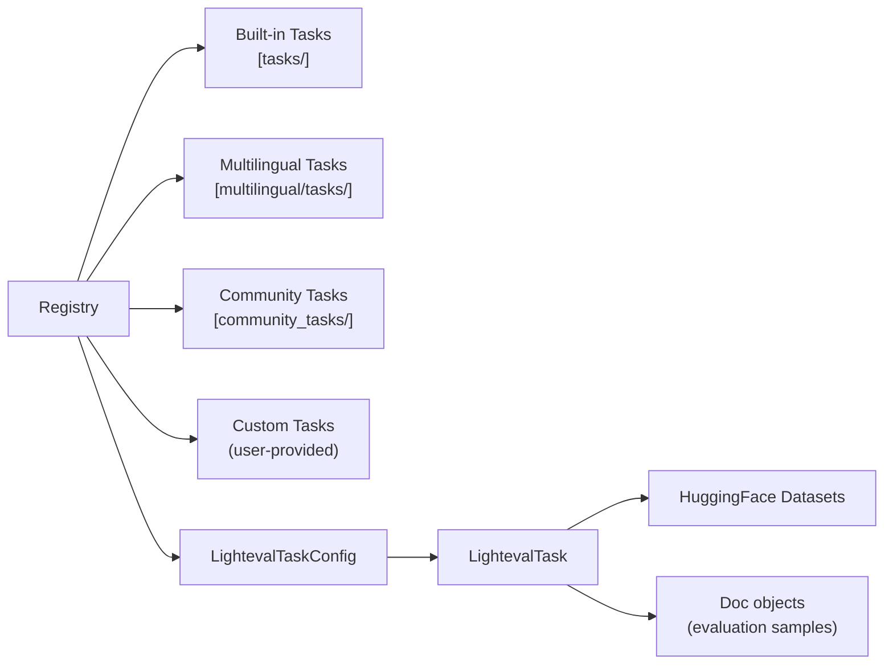
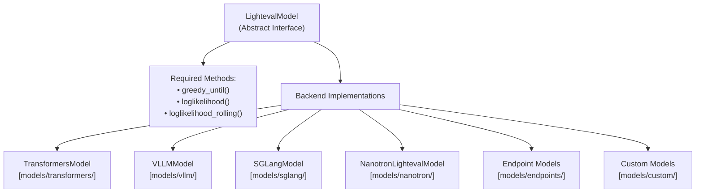
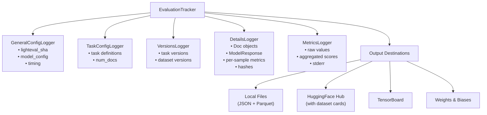
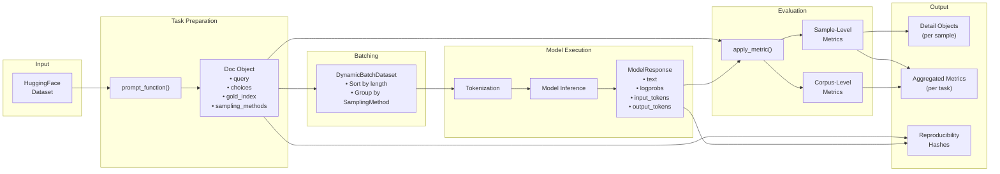
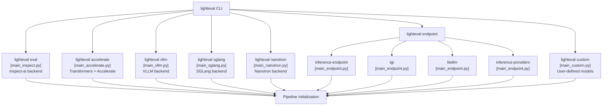
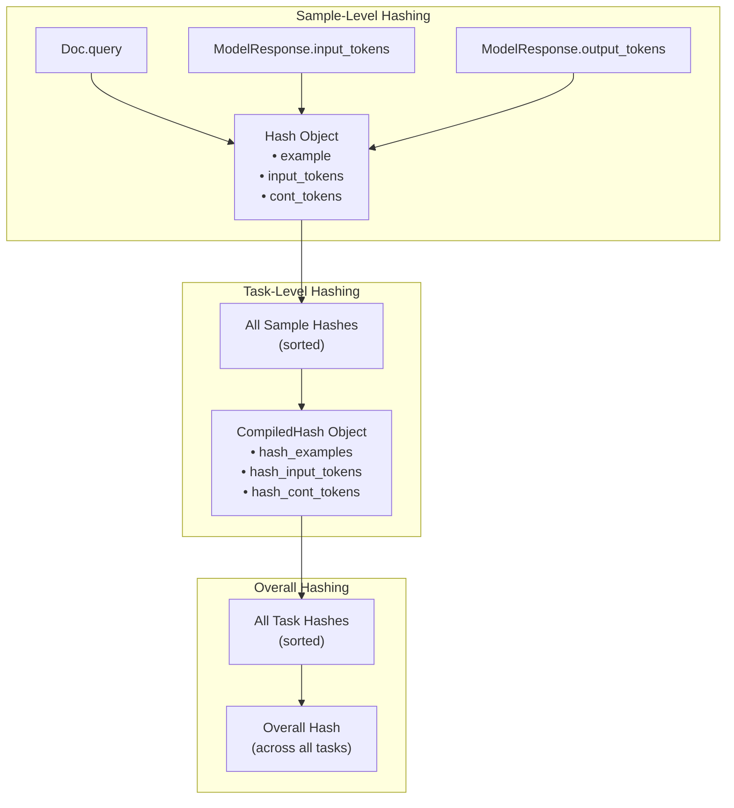

<!-- source: DeepWiki mcp.deepwiki.com · repo huggingface/lighteval · page 2 Architecture · fetched 2026-10-26 -->

# Architecture

<details>
<summary>Relevant source files</summary>

The following files were used as context for generating this wiki page:

- [README.md](README.md)
- [pyproject.toml](pyproject.toml)
- [src/lighteval/logging/evaluation_tracker.py](src/lighteval/logging/evaluation_tracker.py)
- [src/lighteval/logging/info_loggers.py](src/lighteval/logging/info_loggers.py)
- [src/lighteval/main_accelerate.py](src/lighteval/main_accelerate.py)
- [src/lighteval/main_custom.py](src/lighteval/main_custom.py)
- [src/lighteval/main_endpoint.py](src/lighteval/main_endpoint.py)
- [src/lighteval/main_nanotron.py](src/lighteval/main_nanotron.py)
- [src/lighteval/main_sglang.py](src/lighteval/main_sglang.py)
- [src/lighteval/main_vllm.py](src/lighteval/main_vllm.py)
- [src/lighteval/pipeline.py](src/lighteval/pipeline.py)

</details>


This document explains the overall system architecture of lighteval, showing how the major components interact to orchestrate model evaluation. It covers the core components (`Pipeline`, `Registry`, `EvaluationTracker`, task system, model layer, and metrics system) and their relationships.

For information about specific CLI commands and configuration options, see [CLI and Configuration](#10). For details on extending the system with custom tasks, metrics, or models, see [Development and Contributing](#11).

## Core Components

The lighteval architecture is organized around six primary components that work together to execute evaluations:

```mermaid
graph TB
    subgraph "Orchestration Layer"
        Pipeline["Pipeline<br/>[pipeline.py:117-448]"]
        PipelineParameters["PipelineParameters<br/>[pipeline.py:82-115]"]
        ParallelismManager["ParallelismManager<br/>[pipeline.py:70-78]"]
    end
    
    subgraph "Task Management"
        Registry["Registry<br/>[tasks/registry.py]"]
        LightevalTask["LightevalTask<br/>[tasks/lighteval_task.py]"]
        LightevalTaskConfig["LightevalTaskConfig<br/>[tasks/lighteval_task.py]"]
    end
    
    subgraph "Model Abstraction"
        LightevalModel["LightevalModel<br/>[models/abstract_model.py]"]
        ModelConfig["ModelConfig<br/>[models/abstract_model.py]"]
        TransformersModel["TransformersModel"]
        VLLMModel["VLLMModel"]
        EndpointModels["EndpointModels"]
    end
    
    subgraph "Evaluation Tracking"
        EvaluationTracker["EvaluationTracker<br/>[logging/evaluation_tracker.py:95-747]"]
        GeneralConfigLogger["GeneralConfigLogger<br/>[logging/info_loggers.py:47-135]"]
        DetailsLogger["DetailsLogger<br/>[logging/info_loggers.py:137-306]"]
        MetricsLogger["MetricsLogger<br/>[logging/info_loggers.py:308-403]"]
        TaskConfigLogger["TaskConfigLogger<br/>[logging/info_loggers.py:424-441]"]
        VersionsLogger["VersionsLogger<br/>[logging/info_loggers.py:405-422]"]
    end
    
    subgraph "Metrics System"
        MetricsEnum["Metrics Enum<br/>[metrics/]"]
        ApplyMetric["apply_metric()<br/>[metrics/__init__.py]"]
    end
    
    subgraph "Data Flow"
        Doc["Doc<br/>[tasks/requests.py]"]
        ModelResponse["ModelResponse<br/>[models/model_output.py]"]
    end
    
    Pipeline --> PipelineParameters
    Pipeline --> ParallelismManager
    Pipeline --> Registry
    Pipeline --> LightevalModel
    Pipeline --> EvaluationTracker
    Pipeline --> ApplyMetric
    
    Registry --> LightevalTask
    LightevalTask --> LightevalTaskConfig
    LightevalTask --> Doc
    
    LightevalModel --> ModelConfig
    LightevalModel --> TransformersModel
    LightevalModel --> VLLMModel
    LightevalModel --> EndpointModels
    LightevalModel --> ModelResponse
    
    EvaluationTracker --> GeneralConfigLogger
    EvaluationTracker --> DetailsLogger
    EvaluationTracker --> MetricsLogger
    EvaluationTracker --> TaskConfigLogger
    EvaluationTracker --> VersionsLogger
    
    ApplyMetric --> MetricsEnum
    ApplyMetric --> Doc
    ApplyMetric --> ModelResponse
```



**Sources:** [src/lighteval/pipeline.py:1-448](), [src/lighteval/logging/evaluation_tracker.py:1-747](), [src/lighteval/logging/info_loggers.py:1-441]()

### Pipeline

The `Pipeline` class [src/lighteval/pipeline.py:117-448]() is the central orchestrator that coordinates all evaluation activities. It initializes and manages:

- **Task loading and preparation** via `Registry` [src/lighteval/pipeline.py:210-238]()
- **Model initialization** through backend-specific configurations [src/lighteval/pipeline.py:177-209]()
- **Parallelism management** using `ParallelismManager` enum [src/lighteval/pipeline.py:70-78]()
- **Evaluation execution** in the `evaluate()` method [src/lighteval/pipeline.py:271-298]()
- **Metrics computation** and result aggregation [src/lighteval/pipeline.py:362-400]()

The `PipelineParameters` dataclass [src/lighteval/pipeline.py:82-115]() encapsulates all configuration:

| Parameter | Purpose |
|-----------|---------|
| `launcher_type` | Specifies which `ParallelismManager` backend to use |
| `dataset_loading_processes` | Number of parallel processes for dataset loading |
| `max_samples` | Limits samples per task (for debugging) |
| `num_fewshot_seeds` | Number of few-shot sampling seeds |
| `custom_tasks_directory` | Path to custom task definitions |
| `reasoning_tags` | Tags to remove from model outputs |
| `load_responses_from_details_date_id` | Enables loading cached responses |

**Sources:** [src/lighteval/pipeline.py:82-448]()

### Registry and Task System

The `Registry` class discovers and loads evaluation tasks from multiple sources:



The `LightevalTask` represents an operational task instance with:
- Dataset loading and caching
- Document preparation via prompt functions
- Few-shot example sampling
- Metric definitions

**Sources:** [src/lighteval/pipeline.py:210-238]()

### Model Layer

The model layer provides a uniform interface through the `LightevalModel` abstract base class. All backends implement three core methods:



The `ParallelismManager` enum [src/lighteval/pipeline.py:70-78]() determines which backend to use:

| Enum Value | Backend | Use Case |
|------------|---------|----------|
| `ACCELERATE` | `TransformersModel` | Local models with HuggingFace Accelerate |
| `VLLM` | `VLLMModel` | High-throughput inference |
| `SGLANG` | `SGLangModel` | Structured generation |
| `NANOTRON` | `NanotronLightevalModel` | Distributed training framework |
| `TGI` / `OPENAI` | Endpoint models | Remote inference services |
| `NONE` | Generic endpoints | Serverless or custom endpoints |
| `CUSTOM` | User-defined | Custom model implementations |

**Sources:** [src/lighteval/pipeline.py:70-78](), [src/lighteval/pipeline.py:157-209]()

### EvaluationTracker

The `EvaluationTracker` [src/lighteval/logging/evaluation_tracker.py:95-747]() aggregates five specialized loggers:



Each logger has a specific responsibility:

- **GeneralConfigLogger** [src/lighteval/logging/info_loggers.py:47-135](): Captures git SHA, model configuration, timing
- **TaskConfigLogger** [src/lighteval/logging/info_loggers.py:424-441](): Records task configurations
- **VersionsLogger** [src/lighteval/logging/info_loggers.py:405-422](): Tracks task and dataset versions
- **DetailsLogger** [src/lighteval/logging/info_loggers.py:137-306](): Stores sample-level details and reproducibility hashes
- **MetricsLogger** [src/lighteval/logging/info_loggers.py:308-403](): Aggregates metrics with statistical measures

**Sources:** [src/lighteval/logging/evaluation_tracker.py:95-210](), [src/lighteval/logging/info_loggers.py:47-441]()

### Metrics System

The metrics system applies evaluation metrics to model outputs through the `apply_metric()` function. Metrics are organized by their sampling method category:

| Sampling Method | Description | Model Method |
|----------------|-------------|--------------|
| `GENERATIVE` | Text generation tasks | `greedy_until()` |
| `LOGPROBS` | Multiple-choice/classification | `loglikelihood()` |
| `PERPLEXITY` | Language modeling | `loglikelihood_rolling()` |

Metrics can be sample-level (computed per document) or corpus-level (computed over all documents).

**Sources:** [src/lighteval/pipeline.py:362-400]()

## Evaluation Flow

The following diagram shows how components interact during a complete evaluation run:

```mermaid
sequenceDiagram
    participant User
    participant MainEntry["main_*.py<br/>(Entry Point)"]
    participant Pipeline["Pipeline"]
    participant Registry["Registry"]
    participant Task["LightevalTask"]
    participant Model["LightevalModel"]
    participant Metrics["apply_metric()"]
    participant Tracker["EvaluationTracker"]
    
    User->>MainEntry: "Execute CLI command"
    MainEntry->>MainEntry: "Parse arguments<br/>Create ModelConfig"
    MainEntry->>Tracker: "Initialize EvaluationTracker"
    MainEntry->>Pipeline: "Initialize Pipeline"
    
    Pipeline->>Registry: "_init_tasks_and_requests()"
    Registry->>Task: "load_tasks()"
    Task->>Task: "load_datasets()<br/>get_docs()"
    Task-->>Pipeline: "documents_dict"
    
    Pipeline->>Pipeline: "_init_model()"
    Pipeline->>Model: "load_model(config)"
    Model-->>Pipeline: "Initialized model"
    
    User->>Pipeline: "evaluate()"
    Pipeline->>Tracker: "log_args_info()"
    
    Pipeline->>Pipeline: "_run_model()"
    
    loop "For each sampling_method"
        Pipeline->>Model: "greedy_until() / loglikelihood() /<br/>loglikelihood_rolling()"
        Model-->>Pipeline: "ModelResponse objects"
    end
    
    Pipeline->>Pipeline: "_post_process_outputs()"
    
    Pipeline->>Pipeline: "_compute_metrics()"
    
    loop "For each task and sampling_method"
        Pipeline->>Metrics: "apply_metric(docs, responses, metrics)"
        Metrics-->>Pipeline: "metric scores"
        Pipeline->>Tracker: "metrics_logger.log()<br/>details_logger.log()"
    end
    
    Pipeline->>Tracker: "metrics_logger.aggregate()"
    Pipeline->>Tracker: "details_logger.aggregate()"
    
    Pipeline->>Pipeline: "save_and_push_results()"
    Pipeline->>Tracker: "save()"
    
    Tracker->>Tracker: "save_results()<br/>save_details()<br/>push_to_hub()"
    
    Pipeline-->>User: "Show and return results"
```

**Key Flow Steps:**

1. **Initialization** [src/lighteval/pipeline.py:118-153](): Parse configuration, create `Pipeline`, `EvaluationTracker`, and `ModelConfig`
2. **Task Loading** [src/lighteval/pipeline.py:210-238](): Registry discovers tasks, loads datasets, prepares `Doc` objects
3. **Model Loading** [src/lighteval/pipeline.py:177-209](): Initialize backend-specific model implementation
4. **Execution** [src/lighteval/pipeline.py:271-345](): Run model inference grouped by sampling method
5. **Post-Processing** [src/lighteval/pipeline.py:347-361](): Remove reasoning tags if configured
6. **Metrics Computation** [src/lighteval/pipeline.py:362-400](): Apply metrics, log results
7. **Aggregation** [src/lighteval/pipeline.py:294-297](): Aggregate metrics with statistical measures
8. **Persistence** [src/lighteval/logging/evaluation_tracker.py:247-292](): Save to local files and push to Hub

**Sources:** [src/lighteval/pipeline.py:271-448](), [src/lighteval/logging/evaluation_tracker.py:247-292]()

## Data Flow and Transformations

Data flows through several transformation stages from raw datasets to final results:



**Transformation Details:**

1. **Doc Creation**: Prompt functions transform dataset rows into `Doc` objects with formatted queries and metadata
2. **Batching**: `DynamicBatchDataset` sorts documents by length and groups by `SamplingMethod` for efficient processing
3. **Inference**: Models tokenize inputs, perform inference, and decode outputs into `ModelResponse` objects
4. **Metrics**: Both sample-level and corpus-level metrics are computed and logged
5. **Hashing**: Three-tier hash system (sample → task → overall) ensures reproducibility

**Sources:** [src/lighteval/pipeline.py:210-400]()

## Entry Points and Backend Selection

Lighteval provides multiple entry points, each corresponding to a different backend:



**Entry Point Patterns:**

Each entry point follows a consistent pattern:

1. Parse command-line arguments
2. Create backend-specific `ModelConfig` (e.g., `TransformersModelConfig`, `VLLMModelConfig`)
3. Initialize `EvaluationTracker` with output configuration
4. Create `PipelineParameters` with the appropriate `ParallelismManager`
5. Initialize `Pipeline` with tasks, model config, and tracker
6. Execute `pipeline.evaluate()`
7. Display and save results

**Backend Selection:**

| Entry Point | File | ParallelismManager | ModelConfig Type |
|------------|------|-------------------|-----------------|
| `eval` | N/A (inspect-ai) | N/A | inspect-ai model |
| `accelerate` | [main_accelerate.py:55-156]() | `ACCELERATE` | `TransformersModelConfig` |
| `vllm` | [main_vllm.py:51-138]() | `VLLM` | `VLLMModelConfig` |
| `sglang` | [main_sglang.py:46-130]() | `SGLANG` | `SGLangModelConfig` |
| `nanotron` | [main_nanotron.py:42-122]() | `NANOTRON` | `FullNanotronConfig` |
| `endpoint *` | [main_endpoint.py:54-409]() | `NONE` or `TGI` | Various endpoint configs |
| `custom` | [main_custom.py:52-124]() | `CUSTOM` | `CustomModelConfig` |

**Sources:** [src/lighteval/main_accelerate.py:55-156](), [src/lighteval/main_vllm.py:51-138](), [src/lighteval/main_sglang.py:46-130](), [src/lighteval/main_nanotron.py:42-122](), [src/lighteval/main_endpoint.py:54-409](), [src/lighteval/main_custom.py:52-124]()

## Reproducibility Architecture

The `DetailsLogger` implements a three-tier hashing system for reproducibility:



**Hash Computation** [src/lighteval/logging/info_loggers.py:253-306]():

1. **Sample-Level**: Hash each `Doc.query`, `input_tokens`, and `output_tokens` using `xxhash.xxh64`
2. **Task-Level**: Sort all sample hashes and aggregate them into a `CompiledHash`
3. **Overall**: Aggregate all task-level hashes across all tasks

This hierarchical structure enables detection of differences at any granularity level and is robust to execution order variations.

**Sources:** [src/lighteval/logging/info_loggers.py:137-306]()

## Configuration Management

The architecture supports configuration through multiple mechanisms:

**ModelConfig Hierarchy:**

All model configurations inherit from the abstract `ModelConfig` base class, which provides:
- `from_path(yaml_path)`: Load configuration from YAML files
- `from_args(args_string)`: Parse comma-separated argument strings
- `model_dump()`: Serialize configuration

**PipelineParameters:**

The `PipelineParameters` dataclass [src/lighteval/pipeline.py:82-115]() centralizes evaluation parameters:
- Task selection and filtering
- Few-shot configuration
- Sampling limits
- Post-processing options (reasoning tag removal)
- Response caching configuration

**Tracker Configuration:**

The `EvaluationTracker` [src/lighteval/logging/evaluation_tracker.py:142-210]() accepts configuration for:
- Output directory and path templates
- Hub upload settings (organization, public/private)
- External integrations (TensorBoard, W&B)
- Detail saving preferences

**Sources:** [src/lighteval/pipeline.py:82-115](), [src/lighteval/logging/evaluation_tracker.py:142-210]()

---

