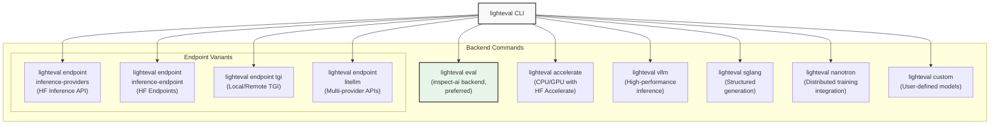
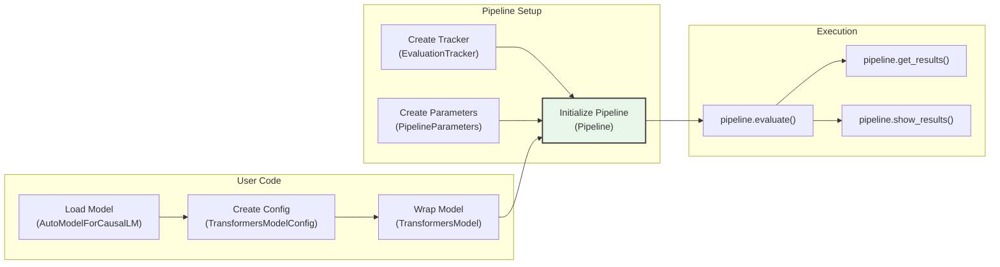
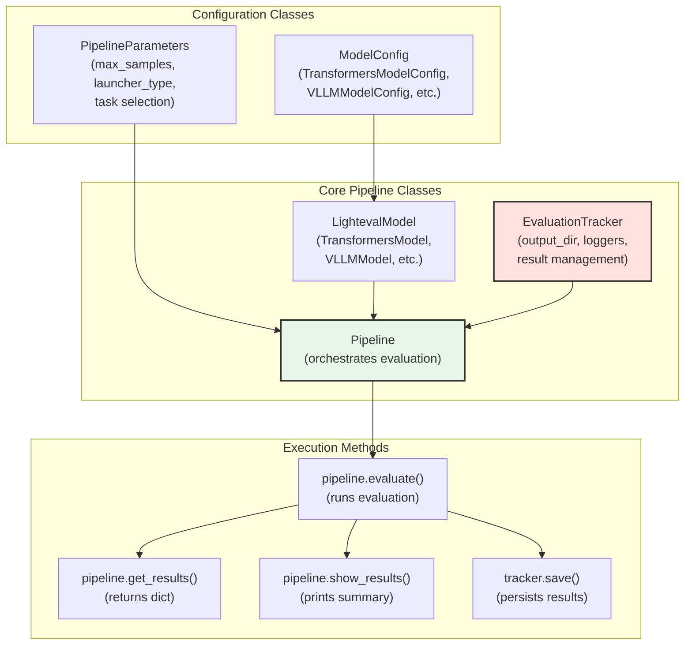

<!-- source: DeepWiki mcp.deepwiki.com · repo huggingface/lighteval · page 3 Installation and Quick Start · fetched 2026-10-26 -->

# Installation and Quick Start

<details>
<summary>Relevant source files</summary>

The following files were used as context for generating this wiki page:

- [README.md](README.md)
- [pyproject.toml](pyproject.toml)

</details>


This document covers the installation of lighteval, authentication setup, and basic usage examples for both command-line and Python API interfaces. For detailed information about specific evaluation backends, see [Models and Backends](#7). For comprehensive pipeline configuration options, see [Pipeline Parameters](#10.3).

## Purpose and Scope

This page provides the essential steps to install lighteval and run your first evaluation. It covers:
- Installing the core package and optional dependencies
- Setting up authentication for HuggingFace Hub integration
- Running evaluations via CLI commands
- Using the Python API for programmatic evaluation

---

## System Requirements

**Python Version**: Python 3.10 or higher is required.

**Operating System**: Lighteval is tested and supported on Linux and macOS. Windows support is currently untested and not officially supported.

**Sources**: [pyproject.toml:47](), [README.md:91-92]()

---

## Installation

### Basic Installation

Install lighteval from PyPI using pip:

```bash
pip install lighteval
```

This installs the core package with all required dependencies, including:
- `transformers` (≥4.54.0) for model loading
- `inspect-ai` (≥0.3.140) for evaluation backend
- `accelerate` for distributed evaluation
- `torch` (≥2.0, <3.0) for tensor operations
- `datasets` (≥4.0.0) for loading evaluation datasets
- Base metrics libraries: `nltk`, `scikit-learn`, `sacrebleu`, `rouge_score`

**Sources**: [pyproject.toml:57-90]()

---

### Optional Dependencies

Lighteval supports numerous optional features through extras. Install them using the `[extra_name]` syntax:

```bash
pip install lighteval[vllm,multilingual,math]
```

#### Available Optional Extras

| Extra | Purpose | Key Dependencies |
|-------|---------|------------------|
| `vllm` | High-performance inference with VLLM backend | `vllm>=0.10.0`, `ray`, `more_itertools` |
| `sglang` | Structured generation with SGLang backend | `sglang` |
| `tgi` | Text Generation Inference backend | `text-generation>=0.7.0` |
| `litellm` | Multi-provider API support (OpenAI, Anthropic, etc.) | `litellm[caching]>=1.66.0`, `diskcache` |
| `nanotron` | Nanotron training framework integration | `nanotron`, `tensorboardX` |
| `multilingual` | Multilingual evaluation support | `stanza`, `spacy[ja,ko,th]`, `jieba`, `pyvi` |
| `math` | Mathematical evaluation metrics | `latex2sympy2_extended` |
| `extended_tasks` | Extended task suite (IFEval, MT-Bench, etc.) | `langdetect`, `tiktoken`, `emoji`, `spacy`, `syllapy` |
| `quantization` | Model quantization support | `bitsandbytes`, `auto-gptq` |
| `adapters` | LoRA/adapter support | `peft` |
| `wandb` | Weights & Biases experiment tracking | `wandb` |
| `trackio` | Trackio experiment tracking | `trackio` |
| `quality` | Code quality tools for development | `ruff`, `pre-commit` |
| `tests` | Testing infrastructure | `pytest`, `deepdiff` |
| `dev` | Complete development environment | Includes `accelerate`, `quality`, `tests`, `multilingual`, `math`, `extended_tasks`, `vllm` |

#### Development Installation

For contributors or developers working on lighteval:

```bash
pip install -e .[dev]
pre-commit install
```

This installs the package in editable mode with all development dependencies and sets up pre-commit hooks for code quality checks.

**Sources**: [pyproject.toml:92-126](), [README.md:97](), [README.md:189-191]()

---

## Authentication Setup

### HuggingFace Hub

To push evaluation results to the HuggingFace Hub or access gated models, authenticate using the `huggingface-cli`:

```bash
huggingface-cli login
```

This command prompts you to enter your HuggingFace access token and stores it locally for future use. Alternatively, set the token as an environment variable:

```bash
export HUGGING_FACE_HUB_TOKEN="your_token_here"
```

**Sources**: [README.md:99-104]()

---

## Quick Start: CLI Usage

Lighteval provides multiple CLI entry points, each corresponding to a different model backend. The general command structure is:

```bash
lighteval [backend] [model] [tasks] [options]
```

### Available CLI Entry Points



**Diagram: CLI Backend Entry Points and Their Purposes**

**Sources**: [README.md:108-126](), [pyproject.toml:133-134]()

---

### Basic Evaluation Command

The simplest way to evaluate a model is using the `lighteval eval` command with the inspect-ai backend (preferred):

```bash
lighteval eval "hf-inference-providers/openai/gpt-oss-20b" gpqa:diamond
```

This command:
1. Uses the HuggingFace Inference Providers backend
2. Evaluates the model on the GPQA Diamond benchmark
3. Saves results to the default output directory

**Sources**: [README.md:129-131]()

---

### Backend-Specific Examples

#### Accelerate Backend (Local Models)

Evaluate a model loaded locally using HuggingFace Accelerate:

```bash
lighteval accelerate \
    "meta-llama/Meta-Llama-3-8B-Instruct" \
    "mmlu:abstract_algebra,mmlu:anatomy" \
    --output-dir "./results" \
    --max-samples 100
```

#### VLLM Backend (High Performance)

For high-throughput evaluation with VLLM:

```bash
lighteval vllm \
    "meta-llama/Meta-Llama-3-8B-Instruct" \
    "gsm8k,math" \
    --tensor-parallel-size 4 \
    --output-dir "./results"
```

#### SGLang Backend (Structured Generation)

For structured generation tasks:

```bash
lighteval sglang \
    "meta-llama/Meta-Llama-3-8B-Instruct" \
    "ifeval" \
    --output-dir "./results"
```

#### Inference Endpoints

Evaluate models via HuggingFace Inference Endpoints:

```bash
lighteval endpoint inference-endpoint \
    "https://your-endpoint.endpoints.huggingface.cloud" \
    "hellaswag,winogrande" \
    --output-dir "./results"
```

#### LiteLLM (Multi-Provider APIs)

Evaluate any OpenAI-compatible API using LiteLLM:

```bash
lighteval endpoint litellm \
    "openai/gpt-4" \
    "mmlu,gsm8k" \
    --output-dir "./results"
```

**Sources**: [README.md:110-126]()

---

### Common CLI Options

All CLI commands support common options:

| Option | Description | Example |
|--------|-------------|---------|
| `--output-dir` | Directory for saving results | `--output-dir "./results"` |
| `--max-samples` | Limit samples per task | `--max-samples 100` |
| `--override-batch-size` | Set batch size | `--override-batch-size 8` |
| `--custom-tasks` | Load custom tasks from file | `--custom-tasks my_tasks.py` |
| `--use-chat-template` | Format prompts as chat messages | `--use-chat-template` |
| `--push-to-hub` | Push results to HuggingFace Hub | `--push-to-hub` |
| `--push-to-tensorboard` | Log to TensorBoard | `--push-to-tensorboard` |

For a complete list of options, see [CLI Commands](#10.1).

---

## Quick Start: Python API

The Python API provides programmatic control over evaluation, allowing you to evaluate models already loaded in memory or customize the evaluation pipeline.

### Basic API Flow



**Diagram: Python API Evaluation Flow with Core Classes**

**Sources**: [README.md:133-168]()

---

### Complete Python Example

Here's a complete example evaluating a pre-loaded model:

```python
from transformers import AutoModelForCausalLM

from lighteval.logging.evaluation_tracker import EvaluationTracker
from lighteval.models.transformers.transformers_model import TransformersModel, TransformersModelConfig
from lighteval.pipeline import ParallelismManager, Pipeline, PipelineParameters


MODEL_NAME = "meta-llama/Meta-Llama-3-8B-Instruct"
BENCHMARKS = "gsm8k"

# Create evaluation tracker for output management
evaluation_tracker = EvaluationTracker(output_dir="./results")

# Configure pipeline parameters
pipeline_params = PipelineParameters(
    launcher_type=ParallelismManager.NONE,
    max_samples=2
)

# Load model using HuggingFace transformers
model = AutoModelForCausalLM.from_pretrained(
    MODEL_NAME, device_map="auto"
)

# Create model configuration
config = TransformersModelConfig(model_name=MODEL_NAME, batch_size=1)

# Wrap model in lighteval's interface
model = TransformersModel.from_model(model, config)

# Initialize pipeline
pipeline = Pipeline(
    model=model,
    pipeline_parameters=pipeline_params,
    evaluation_tracker=evaluation_tracker,
    tasks=BENCHMARKS,
)

# Run evaluation
results = pipeline.evaluate()

# Display and retrieve results
pipeline.show_results()
results = pipeline.get_results()
```

**Sources**: [README.md:135-168]()

---

### Key Python API Components



**Diagram: Python API Core Classes and Their Relationships**

**Sources**: [README.md:138-168]()

---

### API Component Descriptions

#### `EvaluationTracker`

The `EvaluationTracker` class manages result logging and output destinations. Key parameters:

- `output_dir`: Directory path for saving results
- `push_results_to_hub`: Boolean to enable HuggingFace Hub publishing
- `push_details_to_hub`: Boolean to publish detailed sample-level results
- `tensorboard_metric_prefix`: Prefix for TensorBoard logging

For detailed configuration, see [EvaluationTracker](#9.1).

#### `PipelineParameters`

The `PipelineParameters` class configures pipeline behavior. Key parameters:

- `launcher_type`: Parallelism strategy (e.g., `ParallelismManager.NONE`, `ParallelismManager.ACCELERATE`)
- `max_samples`: Maximum samples to evaluate per task (useful for quick tests)
- `override_batch_size`: Override default batch size
- `custom_tasks_directory`: Path to custom task modules

For complete options, see [Pipeline Parameters](#10.3).

#### `TransformersModelConfig`

Configuration for models using the Transformers backend. Key parameters:

- `model_name`: HuggingFace model identifier
- `batch_size`: Number of samples per batch
- `device_map`: Device placement strategy (e.g., `"auto"`)
- `dtype`: Model precision (e.g., `torch.float16`)

For other backend configurations, see [Model Configuration](#10.2).

#### `Pipeline`

The central orchestrator that coordinates evaluation. Required parameters:

- `model`: Wrapped model instance (e.g., `TransformersModel`)
- `tasks`: Task specification (string or list of task names)
- `pipeline_parameters`: `PipelineParameters` instance
- `evaluation_tracker`: `EvaluationTracker` instance

For detailed pipeline architecture, see [Evaluation Pipeline](#4).

**Sources**: [README.md:138-168]()

---

### Loading Custom Tasks

Load custom tasks from a Python module:

```python
from lighteval.pipeline import Pipeline, PipelineParameters
from lighteval.logging.evaluation_tracker import EvaluationTracker

# Specify custom tasks file
pipeline_params = PipelineParameters(
    launcher_type=ParallelismManager.NONE,
    custom_tasks_directory="path/to/my_tasks.py"
)

# Initialize pipeline with custom tasks
pipeline = Pipeline(
    model=model,
    pipeline_parameters=pipeline_params,
    evaluation_tracker=evaluation_tracker,
    tasks="my_custom_task",  # Reference task from custom file
)
```

For detailed instructions on creating custom tasks, see [Custom Tasks](#5.6).

---

## Verification

After installation, verify that lighteval is working correctly:

```bash
# Check version
lighteval --version

# Run a quick test evaluation with limited samples
lighteval eval "hf-inference-providers/openai/gpt-oss-20b" hellaswag --max-samples 5
```

The test evaluation should complete within a few minutes and save results to the default output directory.

---

## Next Steps

After completing installation and running your first evaluation:

1. **Explore Available Tasks**: Browse the 1000+ evaluation tasks at [Default Tasks](#5.3) and [Multilingual Tasks](#5.4)
2. **Try Different Backends**: Experiment with different backends for your use case (see [Models and Backends](#7))
3. **Customize Evaluation**: Learn to create custom tasks and metrics (see [Custom Tasks](#5.6) and [Custom Metrics](#8))
4. **Advanced Configuration**: Explore advanced pipeline configuration options (see [Pipeline Parameters](#10.3))
5. **Result Management**: Understand output formats and result publishing (see [Evaluation Tracking and Output](#9))

---

## Troubleshooting

### Common Installation Issues

**Issue**: Import errors after installation
- **Solution**: Ensure you're using Python 3.10 or higher and reinstall with `pip install --upgrade lighteval`

**Issue**: Missing optional dependencies for specific backends
- **Solution**: Install the required extra: `pip install lighteval[vllm]` for VLLM backend

**Issue**: Authentication failures when accessing gated models
- **Solution**: Run `huggingface-cli login` and ensure your token has the required permissions

**Issue**: CUDA out of memory errors
- **Solution**: Reduce `--override-batch-size` or use a backend with better memory management like VLLM

For more detailed troubleshooting and backend-specific issues, refer to the individual backend documentation in [Models and Backends](#7).

**Sources**: [README.md:89-104](), [pyproject.toml:92-126]()

---

