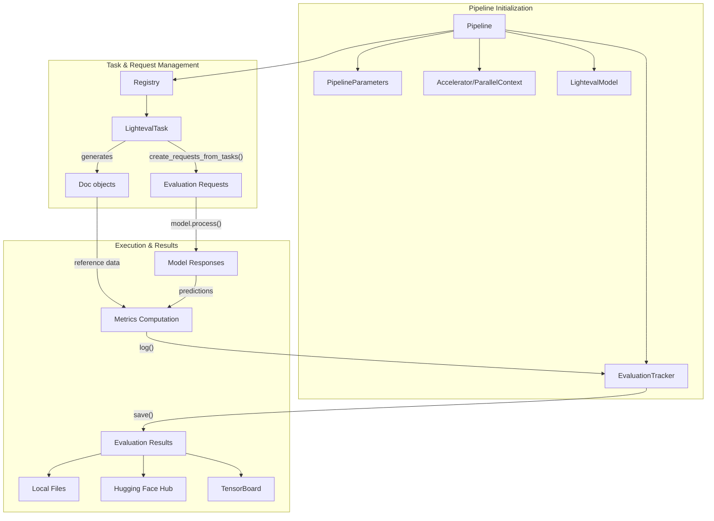
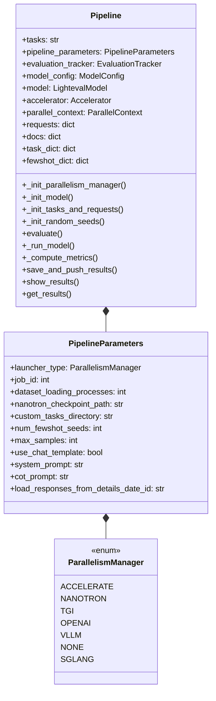
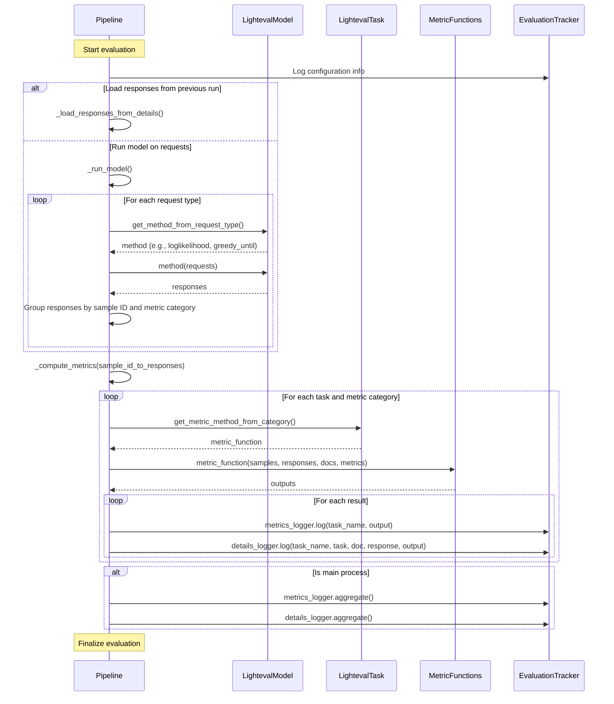
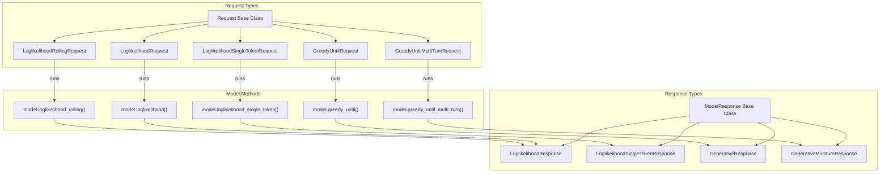
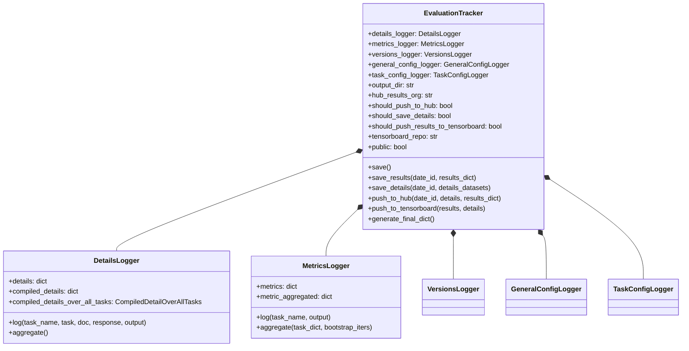
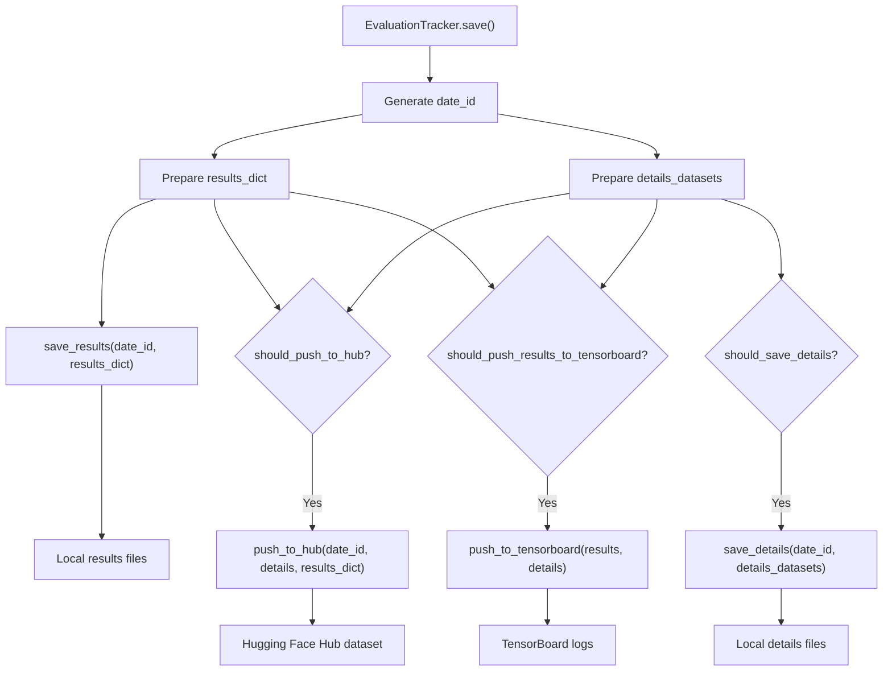
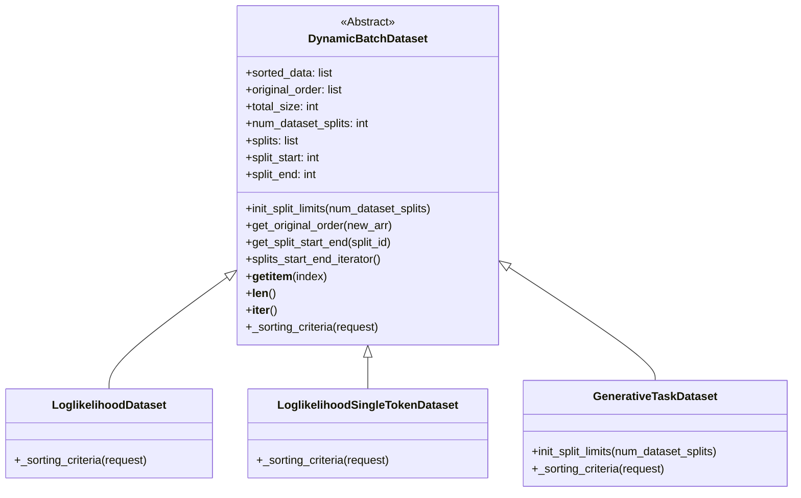
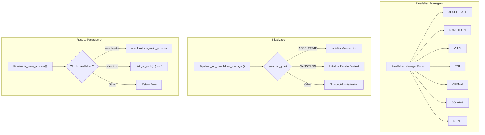

<!-- source: DeepWiki mcp.deepwiki.com · repo huggingface/lighteval · page 4 Evaluation Pipeline · fetched 2026-10-26 -->

# Evaluation Pipeline

<details>
<summary>Relevant source files</summary>

The following files were used as context for generating this wiki page:

- [src/lighteval/logging/evaluation_tracker.py](src/lighteval/logging/evaluation_tracker.py)
- [src/lighteval/logging/info_loggers.py](src/lighteval/logging/info_loggers.py)
- [src/lighteval/main_accelerate.py](src/lighteval/main_accelerate.py)
- [src/lighteval/main_custom.py](src/lighteval/main_custom.py)
- [src/lighteval/main_endpoint.py](src/lighteval/main_endpoint.py)
- [src/lighteval/main_nanotron.py](src/lighteval/main_nanotron.py)
- [src/lighteval/main_sglang.py](src/lighteval/main_sglang.py)
- [src/lighteval/main_vllm.py](src/lighteval/main_vllm.py)
- [src/lighteval/pipeline.py](src/lighteval/pipeline.py)

</details>


The Evaluation Pipeline is the core execution system in LightEval that orchestrates the model evaluation process from start to finish. It manages loading models, creating and executing evaluation requests, computing metrics from model responses, and tracking results.

This page details how the pipeline works, from initialization to results tracking. For information about specific evaluation tasks, see [Tasks](#4), and for metrics systems, see [Metrics](#5).

## Core Components and Data Flow

The Evaluation Pipeline coordinates several key components that work together to evaluate language models:



Sources: 
- [src/lighteval/pipeline.py:131-156]
- [src/lighteval/pipeline.py:209-242]
- [src/lighteval/pipeline.py:458-477]

## Pipeline Initialization

The `Pipeline` class is initialized with task specifications, model configuration, and evaluation parameters:



Sources: 
- [src/lighteval/pipeline.py:131-164]
- [src/lighteval/pipeline.py:94-129]
- [src/lighteval/pipeline.py:84-91]

The initialization process involves these key steps:

1. Setup the parallelism manager based on the backend type (Accelerate, Nanotron, etc.)
2. Load the model with the appropriate configuration
3. Initialize the task registry and create evaluation requests
4. Set random seeds for reproducibility

```python
def __init__(self, tasks, pipeline_parameters, evaluation_tracker, model_config=None, model=None, metric_options=None):
    # Initialize components
    self.accelerator, self.parallel_context = self._init_parallelism_manager()
    self.model = self._init_model(model_config, model)
    
    # Log model information
    self.evaluation_tracker.general_config_logger.log_model_info(...)
    
    # Initialize tasks and requests
    self._init_random_seeds()
    self._init_tasks_and_requests(tasks=tasks)
```

Sources: 
- [src/lighteval/pipeline.py:132-164]

## The Evaluation Process

The complete evaluation workflow is orchestrated by the `evaluate()` method:



Sources:
- [src/lighteval/pipeline.py:272-304]
- [src/lighteval/pipeline.py:458-527]

## Request and Response Flow

The pipeline handles different request types, each processed by specific model methods:



Sources:
- [src/lighteval/models/model_output.py:40-46]
- [src/lighteval/tasks/requests.py:49]

The `_run_model` method executes requests and organizes responses:

```python
def _run_model(self):
    # Dictionary to store responses, keyed by (sample_id, metric_category)
    sample_id_to_responses = collections.defaultdict(list)
    
    # Process each request type (loglikelihood, generative, etc.)
    for request_type, requests in self.requests.items():
        # Get the appropriate model method for this request type
        run_model = self.model.get_method_from_request_type(request_type=request_type)
        # Execute all requests of this type in batch
        responses = run_model(requests)
        
        # Store the responses by sample ID and metric category
        for response, request in zip(responses, requests):
            for metric_category in request.metric_categories:
                sample_id = SampleUid(request.task_name, request.sample_index)
                sample_id_to_responses[(sample_id, metric_category)].append(response)
    
    return sample_id_to_responses
```

Sources:
- [src/lighteval/pipeline.py:458-477]

## Metrics Computation

After collecting model responses, the pipeline computes metrics through the `_compute_metrics` method:

```mermaid
graph TD
    subgraph "Metrics Computation Flow"
        Responses["Model Responses"] --> Group["Group by Task + Metric Category"]
        Group --> |"For each task"| TaskProcess["Process Task"]
        TaskProcess --> |"For each metric category"| MetricProcess["Process Metric Category"]
        MetricProcess --> |"Get metric function"| MetricFunc["task.get_metric_method_from_category()"]
        MetricFunc --> MetricApply["Apply metric function"]
        MetricApply --> Outputs["Metric Outputs"]
        Outputs --> Log["Log results to tracker"]
    end
    
    subgraph "Metric Categories"
        MC["MetricCategory"] --> PERP["PERPLEXITY"]
        MC --> TPERP["TARGET_PERPLEXITY"]
        MC --> GEN["GENERATIVE"]
        MC --> MCPMI["MULTICHOICE_PMI"]
        MC --> MCH["MULTICHOICE"]
        MC --> MCHOT["MULTICHOICE_ONE_TOKEN"]
        MC --> LLMJ["LLM_AS_JUDGE"]
    end
    
    subgraph "Metric Functions"
        PERP --> APM["apply_perplexity_metric()"]
        TPERP --> ATPM["apply_target_perplexity_metric()"]
        GEN --> AGM["apply_generative_metric()"]
        MCPMI --> AMCM["apply_multichoice_metric()"]
        MCH --> AMCM
        MCHOT --> AMCOTM["apply_multichoice_metric_one_token()"]
        LLMJ --> ALLMJM["apply_llm_as_judge_metric()"]
    end
```



Sources:
- [src/lighteval/pipeline.py:484-527]
- [src/lighteval/metrics/__init__.py:30-241]

The metric computation process follows these steps:

1. Group responses by task name and metric category
2. For each task and metric category:
   - Get the appropriate metric function based on the category
   - Apply the function to the responses and reference data
   - Log the results to the `metrics_logger` and `details_logger`

```python
def _compute_metrics(self, sample_id_to_responses):
    # Group responses by task and metric category
    task_metric_category_groups = collections.defaultdict(
        lambda: collections.defaultdict(lambda: collections.defaultdict(list))
    )
    
    for (sample_id, metric_category), sample_responses in sample_id_to_responses.items():
        task_metric_category_groups[sample_id.task_name][metric_category]["ids"].append(sample_id.doc_id_seed)
        task_metric_category_groups[sample_id.task_name][metric_category]["responses"].append(sample_responses)
        task_metric_category_groups[sample_id.task_name][metric_category]["docs"].append(self.docs[sample_id])
    
    # Process each group and apply metrics
    for task_name, samples_per_metric in task_metric_category_groups.items():
        task = self._get_task(task_name)
        
        for metric_category, samples in samples_per_metric.items():
            metric_function = task.get_metric_method_from_category(metric_category=metric_category)
            metric_category_metrics = [m for m in task.metrics if m.category == metric_category]
            
            outputs = metric_function(
                sample_ids=samples["ids"],
                responses=samples["responses"],
                formatted_docs=samples["docs"],
                metrics=metric_category_metrics,
            )
            
            # Log results
            for output, doc, response in zip(outputs, samples["docs"], samples["responses"]):
                self.evaluation_tracker.metrics_logger.log(task_name, output)
                self.evaluation_tracker.details_logger.log(task_name, task, doc, response, output)
```

Sources:
- [src/lighteval/pipeline.py:484-527]

## Results Tracking and Management

The `EvaluationTracker` class is responsible for tracking and managing evaluation results:



Sources:
- [src/lighteval/logging/evaluation_tracker.py:87-669]

The `save` method in `EvaluationTracker` handles saving results and optionally pushing to the Hugging Face Hub:



Sources:
- [src/lighteval/logging/evaluation_tracker.py:178-228]

The saved results include:
- General configuration information
- Task configurations and versions
- Metric results for each task
- Detailed information about each evaluation sample
- Summary statistics across all tasks

```python
# Structure of the results_dict
results_dict = {
    "config_general": config_general,
    "results": self.metrics_logger.metric_aggregated,
    "versions": self.versions_logger.versions,
    "config_tasks": self.task_config_logger.tasks_configs,
    "summary_tasks": self.details_logger.compiled_details,
    "summary_general": asdict(self.details_logger.compiled_details_over_all_tasks),
}
```

Sources:
- [src/lighteval/logging/evaluation_tracker.py:188-195]

## Dynamic Batching for Performance

The evaluation pipeline uses dynamic batching to process requests efficiently:



Sources:
- [src/lighteval/data.py:50-303]

The dynamic batching system:
1. Sorts requests based on a criterion (typically sequence length)
2. Splits the dataset into manageable chunks
3. Processes each chunk with an appropriate batch size
4. Restores the original ordering of results

This efficient batching approach allows for maximum GPU utilization by grouping similar-length requests together, reducing padding waste and memory usage.

## Integration with Distributed Computing

The Pipeline supports distributed evaluation through different parallelism managers:



Sources:
- [src/lighteval/pipeline.py:84-91]
- [src/lighteval/pipeline.py:165-184]
- [src/lighteval/pipeline.py:265-270]

This distributed computing support enables efficient evaluation of large models across multiple GPUs and nodes.

## Summary

The Evaluation Pipeline is the core orchestration system in LightEval that:

1. Loads models and tasks
2. Creates evaluation requests based on task configurations
3. Processes requests with the appropriate model backend
4. Computes metrics from model responses
5. Tracks, aggregates, and saves results

This flexible architecture allows LightEval to evaluate various language models across different tasks and metrics while providing comprehensive result tracking and analysis capabilities.

Sources:
- [src/lighteval/pipeline.py]
- [src/lighteval/logging/evaluation_tracker.py]
- [src/lighteval/metrics/__init__.py]
- [src/lighteval/data.py]

---

