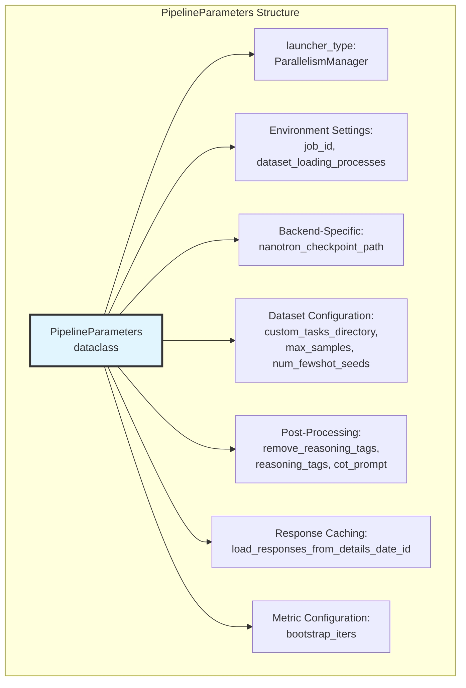
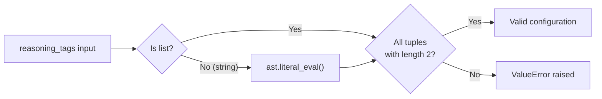
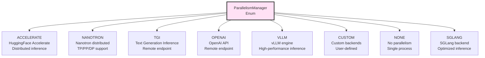
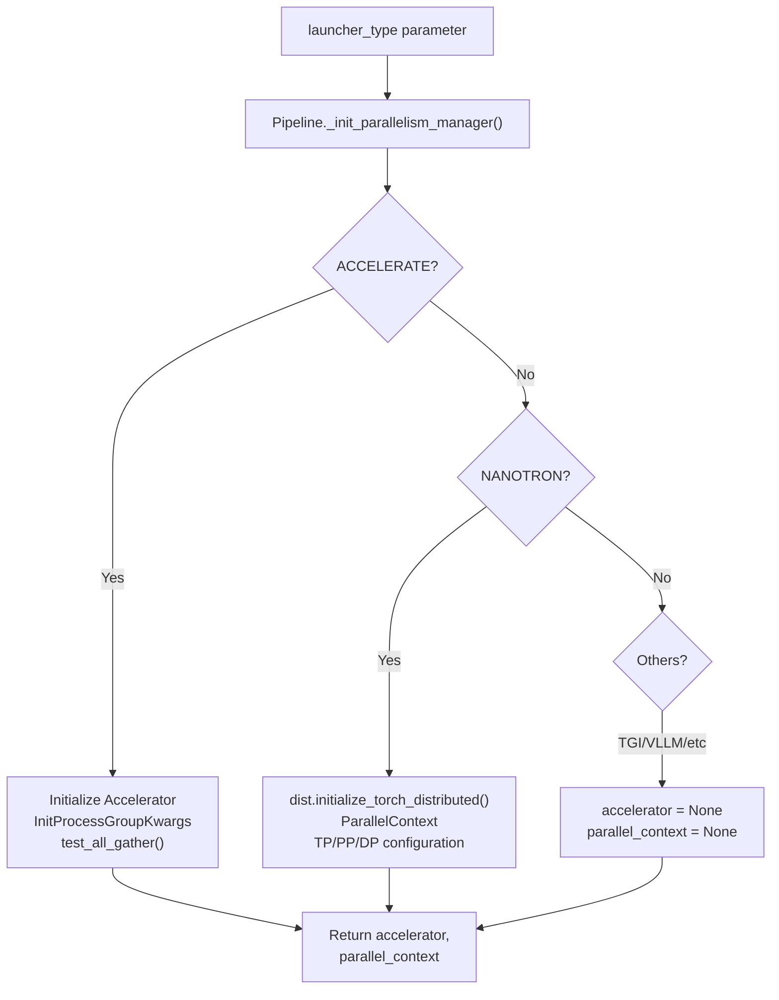
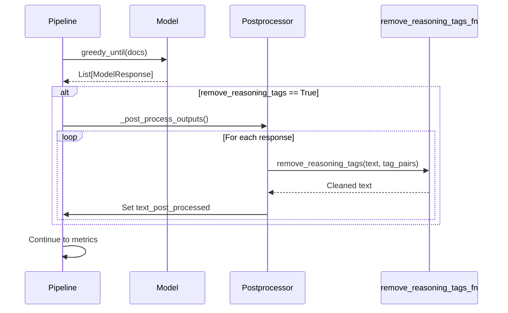
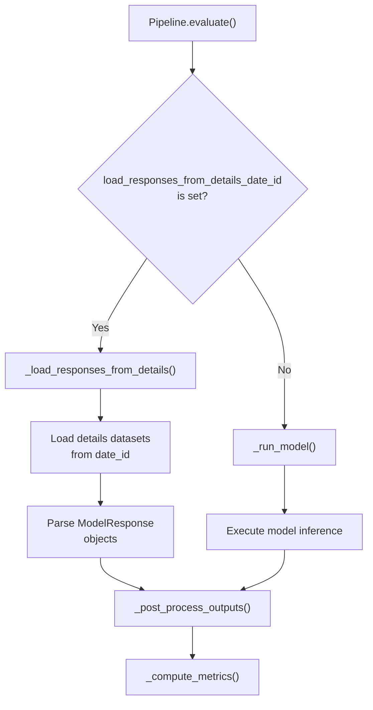
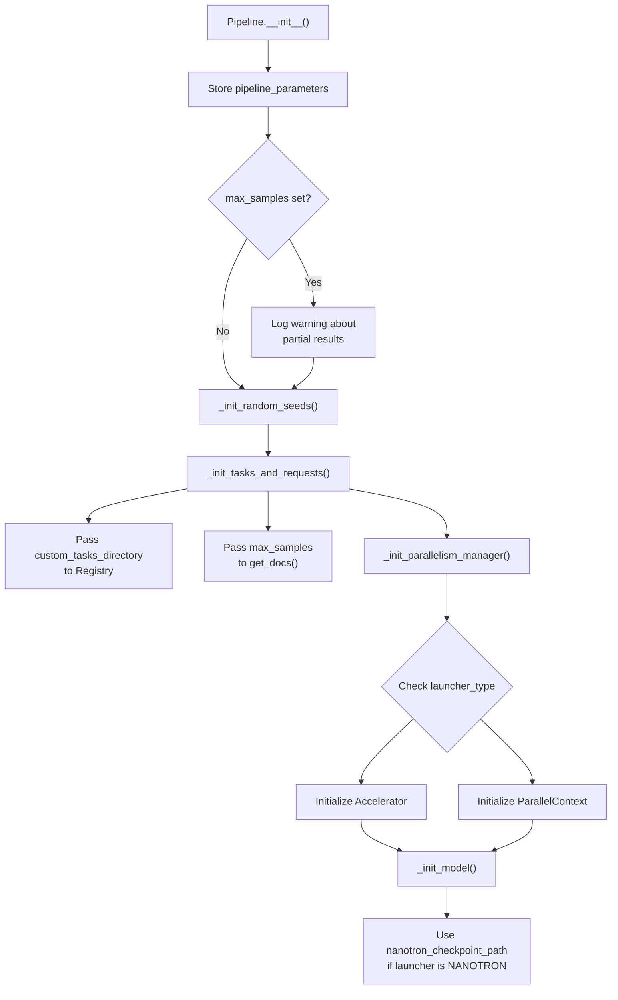

<!-- source: DeepWiki mcp.deepwiki.com · repo huggingface/lighteval · page 4.1 Pipeline Parameters · fetched 2026-10-26 -->

# Pipeline Parameters

<details>
<summary>Relevant source files</summary>

The following files were used as context for generating this wiki page:

- [src/lighteval/logging/info_loggers.py](src/lighteval/logging/info_loggers.py)
- [src/lighteval/pipeline.py](src/lighteval/pipeline.py)

</details>


This document describes the `PipelineParameters` dataclass, which encapsulates all configuration options for controlling the evaluation pipeline's behavior. These parameters control parallelism strategies, dataset sampling, output post-processing, and other runtime behaviors.

For information about model-specific configuration, see [Model Configuration](#10.2). For information about generation-specific parameters (temperature, top_p, etc.), see [Generation Parameters](#10.4). For the overall Pipeline orchestration system, see [Evaluation Pipeline](#4).

## Overview

The `PipelineParameters` dataclass provides a centralized configuration interface for the `Pipeline` class. It determines how the pipeline executes evaluations, including:

- **Parallelism strategy** via `launcher_type` and `ParallelismManager`
- **Dataset sampling** via `max_samples` and `num_fewshot_seeds`
- **Output post-processing** via `remove_reasoning_tags` and `reasoning_tags`
- **Result caching** via `load_responses_from_details_date_id`
- **Backend-specific settings** like `nanotron_checkpoint_path`

## PipelineParameters Dataclass

### Structure

The `PipelineParameters` dataclass is defined in [src/lighteval/pipeline.py:81-114]() and contains all configuration parameters needed to initialize and control the evaluation pipeline.



**Diagram: PipelineParameters Parameter Groups**

Sources: [src/lighteval/pipeline.py:81-114]()

### Parameter Reference

| Parameter | Type | Default | Description |
|-----------|------|---------|-------------|
| `launcher_type` | `ParallelismManager` | Required | Parallelism strategy for model execution |
| `job_id` | `int` | `0` | Unique identifier for the evaluation job |
| `dataset_loading_processes` | `int` | `1` | Number of parallel processes for loading datasets |
| `nanotron_checkpoint_path` | `str \| None` | `None` | Path to Nanotron checkpoint (Nanotron backend only) |
| `custom_tasks_directory` | `str \| None` | `None` | Directory containing custom task definitions |
| `num_fewshot_seeds` | `int` | `1` | Number of random seeds for few-shot sampling |
| `max_samples` | `int \| None` | `None` | Maximum number of samples to evaluate per task |
| `cot_prompt` | `str \| None` | `None` | Chain-of-thought prompt prefix |
| `remove_reasoning_tags` | `bool` | `True` | Whether to remove reasoning tags from model outputs |
| `reasoning_tags` | `str \| list[tuple[str, str]]` | `"[('')]"` | Tag pairs to remove from outputs |
| `load_responses_from_details_date_id` | `str \| None` | `None` | Load cached responses from previous run |
| `bootstrap_iters` | `int` | `1000` | Number of bootstrap iterations for metric confidence intervals |

Sources: [src/lighteval/pipeline.py:81-97]()

### Initialization and Validation

The `__post_init__` method performs validation and parsing of the `reasoning_tags` parameter:



**Diagram: reasoning_tags Validation Flow**

The validation ensures that `reasoning_tags` is a list of 2-tuples representing start/end tag pairs. String inputs are parsed using `ast.literal_eval()` at [src/lighteval/pipeline.py:98-113]().

Sources: [src/lighteval/pipeline.py:98-114]()

## ParallelismManager Enum

The `ParallelismManager` enum defines the available parallelism strategies for model execution. Each strategy corresponds to a different backend or execution mode.

### Enum Values



**Diagram: ParallelismManager Backend Options**

Sources: [src/lighteval/pipeline.py:70-78]()

| Launcher Type | Backend | Use Case | Parallelism Support |
|---------------|---------|----------|---------------------|
| `ACCELERATE` | HuggingFace Accelerate | Local/distributed model inference | Data parallelism, model parallelism |
| `NANOTRON` | Nanotron | Large-scale distributed training integration | Tensor, pipeline, data parallelism |
| `TGI` | Text Generation Inference | Production API endpoints | Server-side parallelism |
| `OPENAI` | OpenAI API | Commercial API providers | N/A (remote) |
| `VLLM` | vLLM | High-throughput inference | Tensor/data parallelism via Ray |
| `SGLANG` | SGLang | SGLang optimized inference | SGLang-specific parallelism |
| `CUSTOM` | User-defined | Custom model implementations | User-controlled |
| `NONE` | Single process | Local evaluation without parallelism | None |

Sources: [src/lighteval/pipeline.py:70-78]()

## Key Configuration Parameters

### launcher_type: Parallelism Strategy

The `launcher_type` parameter determines which parallelism manager is initialized and how the model is executed. The Pipeline uses this to initialize the appropriate infrastructure.



**Diagram: Parallelism Manager Initialization Flow**

The initialization occurs at [src/lighteval/pipeline.py:156-174]():
- `ACCELERATE`: Creates an `Accelerator` instance with timeout configuration
- `NANOTRON`: Initializes distributed PyTorch and creates `ParallelContext` with TP/PP/DP sizes
- Other backends: No explicit parallelism manager (handled by backend)

Sources: [src/lighteval/pipeline.py:156-174]()

### max_samples: Dataset Sampling Limit

The `max_samples` parameter limits the number of samples evaluated per task. This is useful for:
- Quick testing and debugging
- Resource-constrained environments
- Preliminary benchmarking

**Important**: When `max_samples` is set, the Pipeline logs a warning at [src/lighteval/pipeline.py:130-133]():

> "max_samples WAS SET. THESE NUMBERS ARE ONLY PARTIAL AND SHOULD NOT BE USED FOR COMPARISON UNLESS YOU KNOW WHAT YOU ARE DOING."

The parameter is passed to each task's `get_docs()` method at [src/lighteval/pipeline.py:219]() to truncate the document list.

Sources: [src/lighteval/pipeline.py:130-133](), [src/lighteval/pipeline.py:219]()

### remove_reasoning_tags and reasoning_tags: Output Post-Processing

These parameters control automatic removal of reasoning/thinking tags from model outputs.

#### Configuration

- `remove_reasoning_tags`: Boolean flag to enable/disable tag removal (default: `True`)
- `reasoning_tags`: List of `(start_tag, end_tag)` tuples to remove from outputs

Default reasoning tags: `[('')]`

#### Processing Flow



**Diagram: Reasoning Tag Removal Sequence**

The post-processing occurs at [src/lighteval/pipeline.py:342-356]():
1. Check if `remove_reasoning_tags` is `True`
2. Iterate through all model responses
3. Apply `remove_reasoning_tags()` function with configured tag pairs
4. Store cleaned text in `response.text_post_processed`

The `remove_reasoning_tags()` utility function is imported from [src/lighteval/utils/utils.py:47]().

Sources: [src/lighteval/pipeline.py:342-356](), [src/lighteval/utils/utils.py:47]()

### num_fewshot_seeds: Few-Shot Sampling Variation

The `num_fewshot_seeds` parameter controls how many different random seeds are used for few-shot example sampling. This enables evaluation across multiple few-shot configurations to measure stability.

- Default: `1` (single seed)
- Higher values provide more robust evaluation but increase computation

The parameter is logged to the evaluation tracker at [src/lighteval/pipeline.py:268]().

Sources: [src/lighteval/pipeline.py:268]()

### custom_tasks_directory: Custom Task Loading

The `custom_tasks_directory` parameter specifies the directory containing user-defined task definitions. This directory is passed to the `Registry` during task initialization at [src/lighteval/pipeline.py:213]().

For detailed information about creating custom tasks, see [Custom Tasks](#5.5).

Sources: [src/lighteval/pipeline.py:213]()

### load_responses_from_details_date_id: Response Caching

This parameter enables loading model responses from a previous evaluation run, bypassing model inference. This is useful for:
- Re-computing metrics with different configurations
- Testing new metrics on existing model outputs
- Debugging metric implementations

#### Usage Flow



**Diagram: Response Caching Flow**

The caching mechanism:
1. Checks if `load_responses_from_details_date_id` is set at [src/lighteval/pipeline.py:273]()
2. Attempts to load cached responses via `_load_responses_from_details()` at [src/lighteval/pipeline.py:396-419]()
3. Falls back to running the model if cache is not found (with warning)
4. Reconstructs `ModelResponse` objects from saved details

**Limitation**: Currently only supports single request type (raises error for multiple sampling methods) at [src/lighteval/pipeline.py:402-405]().

Sources: [src/lighteval/pipeline.py:273-282](), [src/lighteval/pipeline.py:396-419]()

### bootstrap_iters: Metric Confidence Intervals

The `bootstrap_iters` parameter controls the number of bootstrap iterations used for computing confidence intervals for metrics. Default value is `1000`.

This parameter is passed to the `MetricsLogger.aggregate()` method at [src/lighteval/pipeline.py:290]() during the final metric aggregation phase.

Sources: [src/lighteval/pipeline.py:290]()

### dataset_loading_processes: Parallel Dataset Loading

The `dataset_loading_processes` parameter specifies how many parallel processes to use when loading datasets. Default is `1` (sequential loading).

This parameter is passed to `LightevalTask.load_datasets()` at [src/lighteval/pipeline.py:217]() to enable parallel loading of multiple task datasets.

Sources: [src/lighteval/pipeline.py:217]()

### nanotron_checkpoint_path: Nanotron-Specific Configuration

The `nanotron_checkpoint_path` parameter is only used when `launcher_type` is `ParallelismManager.NANOTRON`. It specifies the path to the Nanotron checkpoint directory.

The path is processed at [src/lighteval/pipeline.py:198]() where `os.path.dirname()` extracts the directory path before passing it to `NanotronLightevalModel`.

Sources: [src/lighteval/pipeline.py:198-205]()

## Integration with Pipeline

### Initialization Flow



**Diagram: PipelineParameters Usage in Pipeline Initialization**

The `PipelineParameters` object is stored as `self.pipeline_parameters` at [src/lighteval/pipeline.py:129]() and its individual parameters are accessed throughout the Pipeline lifecycle:

1. **Initialization phase** ([src/lighteval/pipeline.py:117-152]()):
   - `max_samples` triggers warning
   - `custom_tasks_directory` passed to Registry
   - `launcher_type` determines parallelism setup
   - `nanotron_checkpoint_path` used for Nanotron models

2. **Evaluation phase** ([src/lighteval/pipeline.py:266-292]()):
   - `num_fewshot_seeds` logged
   - `max_samples` logged
   - `job_id` logged
   - `load_responses_from_details_date_id` determines caching behavior
   - `bootstrap_iters` used for aggregation

3. **Post-processing phase** ([src/lighteval/pipeline.py:342-356]()):
   - `remove_reasoning_tags` enables/disables tag removal
   - `reasoning_tags` provides tag pairs for removal

Sources: [src/lighteval/pipeline.py:117-152](), [src/lighteval/pipeline.py:266-292](), [src/lighteval/pipeline.py:342-356]()

### Parameter Access Patterns

| Parameter | Primary Access Location | Purpose |
|-----------|------------------------|---------|
| `launcher_type` | `_init_parallelism_manager()` | Determine backend setup |
| `max_samples` | `_init_tasks_and_requests()`, `evaluate()` | Limit sample count |
| `custom_tasks_directory` | `_init_tasks_and_requests()` | Load custom tasks |
| `num_fewshot_seeds` | `evaluate()` | Log configuration |
| `remove_reasoning_tags` | `_post_process_outputs()` | Enable/disable post-processing |
| `reasoning_tags` | `_post_process_outputs()` | Define tags to remove |
| `load_responses_from_details_date_id` | `evaluate()` | Enable response caching |
| `bootstrap_iters` | `evaluate()` | Configure metric aggregation |
| `dataset_loading_processes` | `_init_tasks_and_requests()` | Parallel dataset loading |
| `nanotron_checkpoint_path` | `_init_model()` | Load Nanotron checkpoint |

Sources: [src/lighteval/pipeline.py:1-443]()

## Usage Examples

### Basic Configuration

```python
from lighteval.pipeline import Pipeline, PipelineParameters, ParallelismManager

# Minimal configuration for Accelerate backend
params = PipelineParameters(
    launcher_type=ParallelismManager.ACCELERATE
)
```

### Limited Evaluation for Testing

```python
# Quick evaluation with sample limit
params = PipelineParameters(
    launcher_type=ParallelismManager.VLLM,
    max_samples=100,  # Only evaluate 100 samples per task
    num_fewshot_seeds=3  # Test with 3 different few-shot configurations
)
```

### Custom Tasks and Reasoning Tag Removal

```python
# Custom tasks with reasoning tag configuration
params = PipelineParameters(
    launcher_type=ParallelismManager.ACCELERATE,
    custom_tasks_directory="./my_custom_tasks",
    remove_reasoning_tags=True,
    reasoning_tags=[
        (''),
        ('[REASONING]', '[/REASONING]')
    ]
)
```

### Response Caching for Metric Re-computation

```python
# Load cached responses from previous run
params = PipelineParameters(
    launcher_type=ParallelismManager.ACCELERATE,
    load_responses_from_details_date_id="2024-01-15-12-30-45",
    bootstrap_iters=5000  # More iterations for better confidence intervals
)
```

### Nanotron Distributed Evaluation

```python
# Nanotron backend with checkpoint path
params = PipelineParameters(
    launcher_type=ParallelismManager.NANOTRON,
    nanotron_checkpoint_path="/path/to/checkpoint/dir/model.safetensors"
)
```

Sources: [src/lighteval/pipeline.py:81-114]()

---

