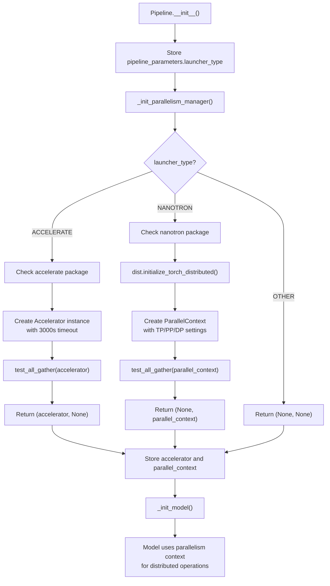
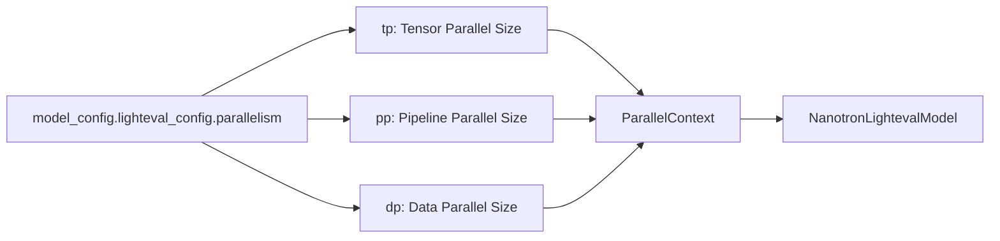
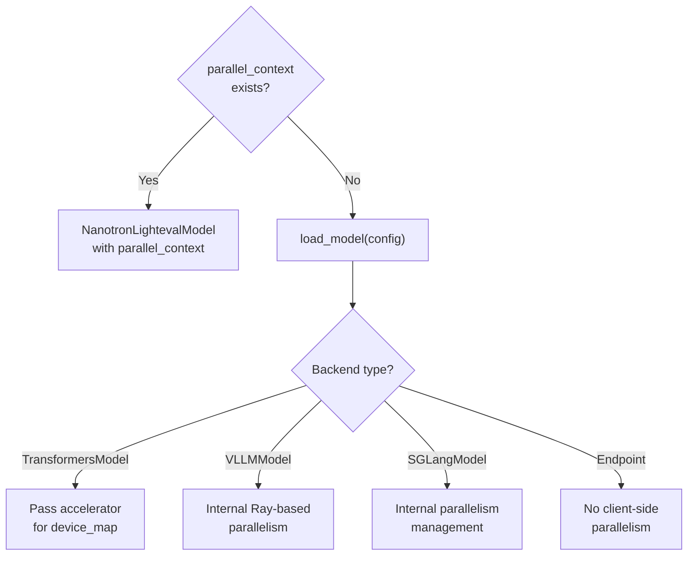
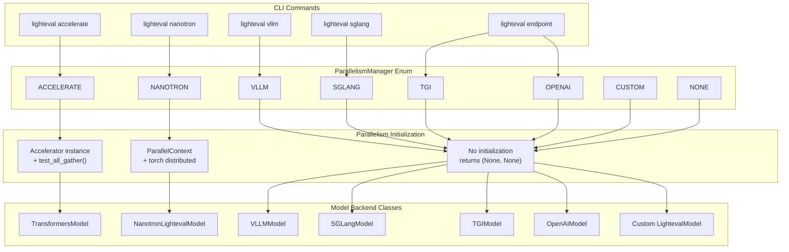

<!-- source: DeepWiki mcp.deepwiki.com · repo huggingface/lighteval · page 4.2 Parallelism Management · fetched 2026-10-26 -->

# Parallelism Management

<details>
<summary>Relevant source files</summary>

The following files were used as context for generating this wiki page:

- [src/lighteval/logging/info_loggers.py](src/lighteval/logging/info_loggers.py)
- [src/lighteval/pipeline.py](src/lighteval/pipeline.py)

</details>


This document explains the `ParallelismManager` enum and how lighteval configures different parallelism strategies for distributed evaluation. The `ParallelismManager` serves as a high-level strategy selector that determines how the evaluation pipeline initializes distributed computing resources.

For details on specific model backends that use these parallelism strategies, see [Models and Backends](#7). For pipeline initialization and configuration, see [Pipeline Parameters](#4.1).

## Overview

The `ParallelismManager` enum in [src/lighteval/pipeline.py:70-78]() defines the available parallelism strategies for model evaluation. Each strategy corresponds to a different approach for distributing computation across GPUs or nodes:

| ParallelismManager Value | Purpose | Initialization Method | Typical Use Case |
|-------------------------|---------|----------------------|------------------|
| `ACCELERATE` | HuggingFace Accelerate multi-GPU | Creates `Accelerator` instance | Local multi-GPU evaluation with model parallelism |
| `NANOTRON` | Nanotron distributed framework | Initializes `ParallelContext` with TP/PP/DP | Large-scale multi-node distributed evaluation |
| `VLLM` | VLLM inference engine | No pipeline-level initialization | High-throughput inference with internal parallelism |
| `SGLANG` | SGLang structured generation | No pipeline-level initialization | Structured generation with internal parallelism |
| `TGI` | Text Generation Inference endpoint | No pipeline-level initialization | Remote TGI server evaluation |
| `OPENAI` | OpenAI-compatible endpoints | No pipeline-level initialization | API-based model evaluation |
| `CUSTOM` | User-defined backends | No pipeline-level initialization | Custom model implementations |
| `NONE` | Single-process execution | No pipeline-level initialization | Non-distributed evaluation |

Sources: [src/lighteval/pipeline.py:70-78](), [src/lighteval/pipeline.py:81-98]()

## ParallelismManager in PipelineParameters

The parallelism strategy is specified via the `launcher_type` field in `PipelineParameters`:

```python
@dataclass
class PipelineParameters:
    launcher_type: ParallelismManager
    # ... other fields
```

This parameter is set during pipeline initialization and determines which distributed computing resources are initialized. For NANOTRON-based evaluation, additional configuration is required via the `nanotron_checkpoint_path` field.

Sources: [src/lighteval/pipeline.py:81-98]()

## Parallelism Initialization Flow



**Parallelism Initialization Flow**: Shows how the Pipeline initializes distributed computing resources based on the `launcher_type` setting.

Sources: [src/lighteval/pipeline.py:157-175](), [src/lighteval/pipeline.py:117-156]()

## ACCELERATE Strategy

The `ACCELERATE` strategy uses HuggingFace's Accelerate library for multi-GPU model parallelism. When this strategy is selected:

1. **Package Verification**: Checks that `accelerate` is installed [src/lighteval/pipeline.py:160-161]()
2. **Accelerator Creation**: Creates an `Accelerator` instance with a 3000-second timeout for distributed operations [src/lighteval/pipeline.py:162]()
3. **Communication Test**: Calls `test_all_gather()` to verify that all processes can communicate [src/lighteval/pipeline.py:163]()
4. **Model Integration**: The `accelerator` object is passed to `TransformersModel` for device placement and distributed operations [src/lighteval/pipeline.py:185-189]()

The timeout configuration is critical for large model loading operations that may take several minutes across multiple GPUs.

Sources: [src/lighteval/pipeline.py:159-163](), [src/lighteval/utils/parallelism.py]()

## NANOTRON Strategy

The `NANOTRON` strategy initializes the nanotron distributed training framework for large-scale multi-node evaluation:

1. **Package Verification**: Checks that `nanotron` is installed [src/lighteval/pipeline.py:165-166]()
2. **Torch Distributed**: Initializes PyTorch's distributed backend via `dist.initialize_torch_distributed()` [src/lighteval/pipeline.py:167]()
3. **ParallelContext Creation**: Creates a `ParallelContext` with tensor parallelism (TP), pipeline parallelism (PP), and data parallelism (DP) settings [src/lighteval/pipeline.py:168-172]()
4. **Communication Test**: Verifies distributed communication with `test_all_gather()` [src/lighteval/pipeline.py:173]()
5. **Model Loading**: The `parallel_context` is passed to `NanotronLightevalModel` for distributed model initialization [src/lighteval/pipeline.py:197-206]()

The parallelism dimensions (TP, PP, DP) are read from `model_config.lighteval_config.parallelism`:



**NANOTRON Parallelism Configuration**: The three parallelism dimensions are extracted from model configuration and used to create the ParallelContext.

Sources: [src/lighteval/pipeline.py:164-173](), [src/lighteval/pipeline.py:197-206]()

## Non-Initialized Strategies

For the following strategies, `_init_parallelism_manager()` returns `(None, None)`:

- **VLLM**: Parallelism is managed internally by the VLLM engine using Ray for tensor/pipeline/data parallelism
- **SGLANG**: Internal parallelism management for structured generation workloads  
- **TGI**: Server-side parallelism on remote Text Generation Inference endpoints
- **OPENAI**: API-based evaluation with provider-managed parallelism
- **CUSTOM**: User-defined backends handle their own parallelism
- **NONE**: Single-process evaluation without distributed computing

These strategies do not require pipeline-level parallelism initialization because:
1. They manage parallelism internally within their backend implementation
2. They communicate with remote services that handle parallelism server-side
3. They run in single-process mode

Sources: [src/lighteval/pipeline.py:157-175]()

## Parallelism Context Usage

The initialized parallelism context (`accelerator` or `parallel_context`) is used throughout the pipeline:

### Process Coordination

```python
def is_main_process(self):
    if self.accelerator:
        return self.accelerator.is_main_process
    if self.parallel_context:
        return dist.get_rank(self.parallel_context.world_pg) == 0
    return True
```

The `is_main_process()` method checks the parallelism context to determine which process should perform IO operations like saving results [src/lighteval/pipeline.py:264-269]().

### Synchronization Barriers

The pipeline uses parallelism-specific barriers to synchronize processes:

```python
def _init_accelerator_seeds(self):
    if self.accelerator is not None:
        self.accelerator.wait_for_everyone()
    if self.parallel_context is not None:
        dist.barrier()
```

This ensures all processes complete initialization before evaluation begins [src/lighteval/pipeline.py:258-262]().

### Model Initialization

The parallelism context determines how models are loaded:



**Model Initialization with Parallelism**: Different backends use the parallelism context differently during model loading.

Sources: [src/lighteval/pipeline.py:177-209](), [src/lighteval/pipeline.py:264-269]()

## Mapping ParallelismManager to Model Backends



**ParallelismManager to Backend Mapping**: Shows the relationship between CLI commands, ParallelismManager values, initialization logic, and model backend classes.

Sources: [src/lighteval/pipeline.py:70-78](), [src/lighteval/pipeline.py:157-175](), [src/lighteval/pipeline.py:177-209]()

## Configuration Example

When creating a pipeline, the parallelism strategy is specified in `PipelineParameters`:

```python
# ACCELERATE strategy for multi-GPU evaluation
pipeline_params = PipelineParameters(
    launcher_type=ParallelismManager.ACCELERATE,
    dataset_loading_processes=4,
    max_samples=None
)

# NANOTRON strategy for distributed evaluation
pipeline_params = PipelineParameters(
    launcher_type=ParallelismManager.NANOTRON,
    nanotron_checkpoint_path="/path/to/checkpoint",
    dataset_loading_processes=1
)

# VLLM strategy (no pipeline-level parallelism init)
pipeline_params = PipelineParameters(
    launcher_type=ParallelismManager.VLLM,
    dataset_loading_processes=1
)
```

The `launcher_type` must match the model backend being used. Mismatches will result in initialization errors or inefficient resource usage.

Sources: [src/lighteval/pipeline.py:81-98](), [src/lighteval/pipeline.py:117-156]()

## Error Handling

The parallelism initialization includes package availability checks:

- **ACCELERATE**: Raises `ValueError` if `accelerate` is not installed [src/lighteval/pipeline.py:160-161]()
- **NANOTRON**: Raises `ValueError` if `nanotron` is not installed [src/lighteval/pipeline.py:165-166]()

The `test_all_gather()` function verifies that distributed communication works correctly, raising errors if processes cannot synchronize [src/lighteval/utils/parallelism.py]().

Sources: [src/lighteval/pipeline.py:157-175]()

## Integration with GeneralConfigLogger

The parallelism configuration is logged for reproducibility tracking. The `GeneralConfigLogger` captures:

- Model configuration including parallelism settings [src/lighteval/logging/info_loggers.py:123-130]()
- Model name and initialization parameters [src/lighteval/logging/info_loggers.py:93-94]()

This ensures that evaluation runs can be reproduced with identical parallelism configurations.

Sources: [src/lighteval/pipeline.py:152](), [src/lighteval/logging/info_loggers.py:47-135]()

---

