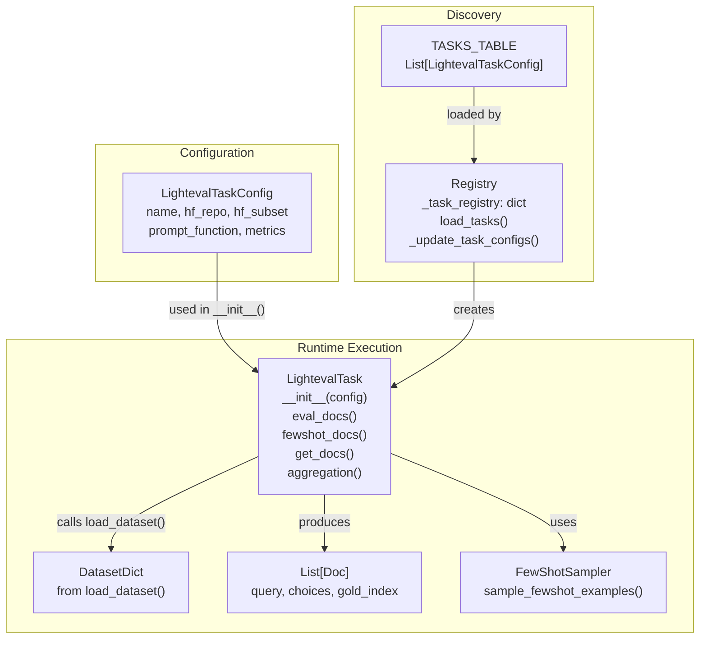
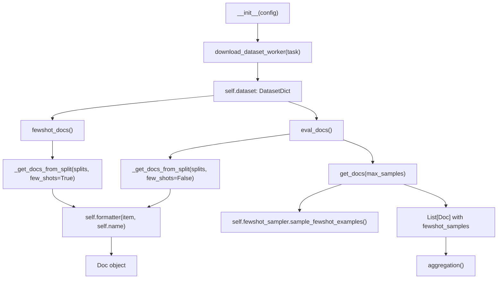
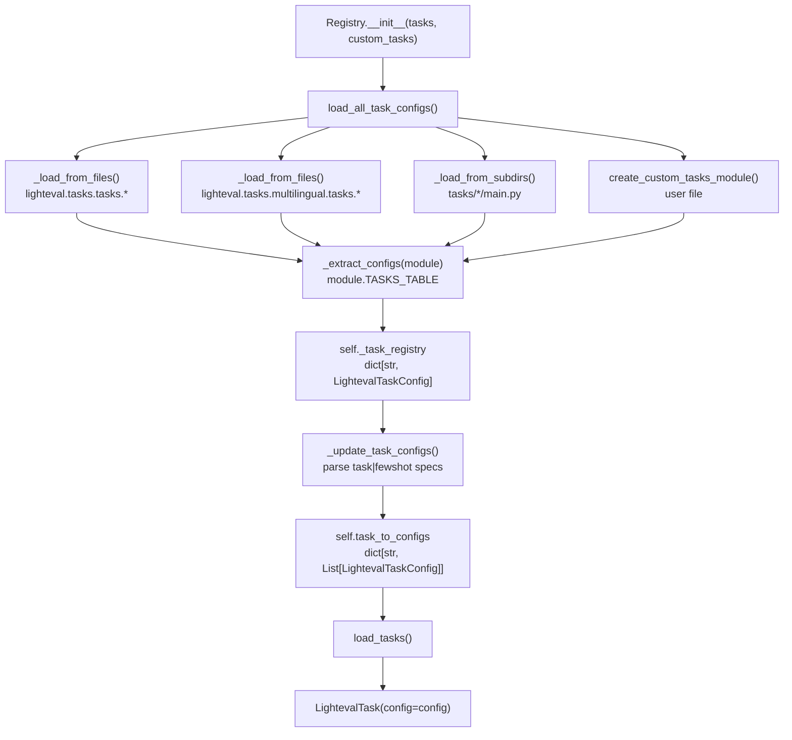
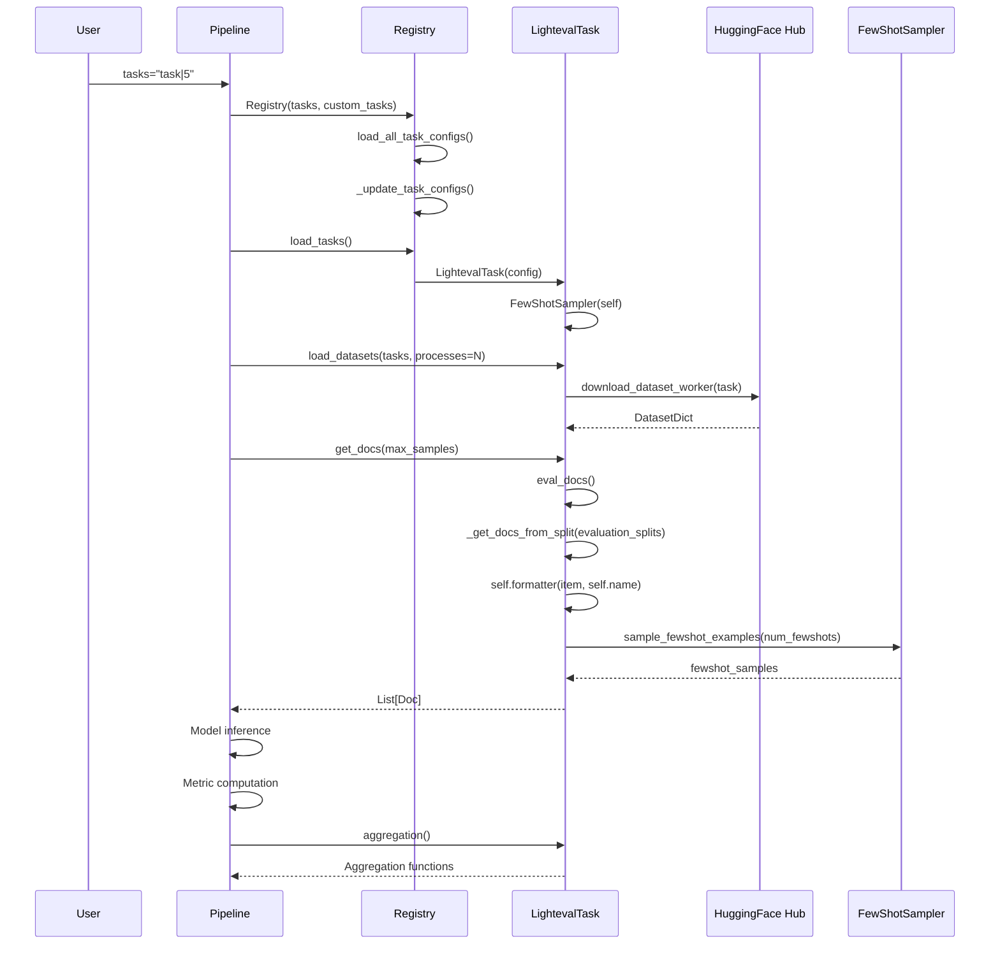
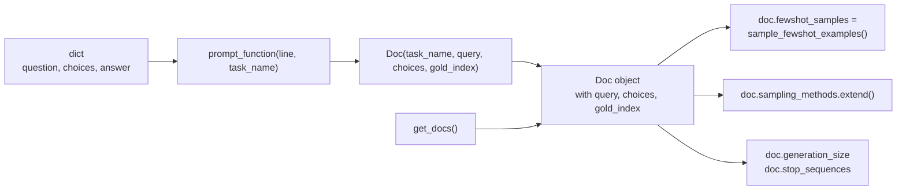
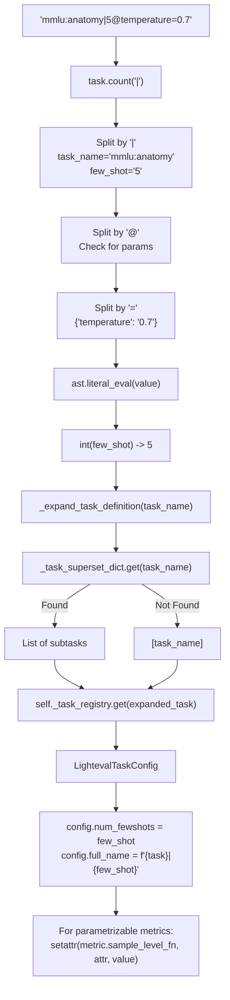
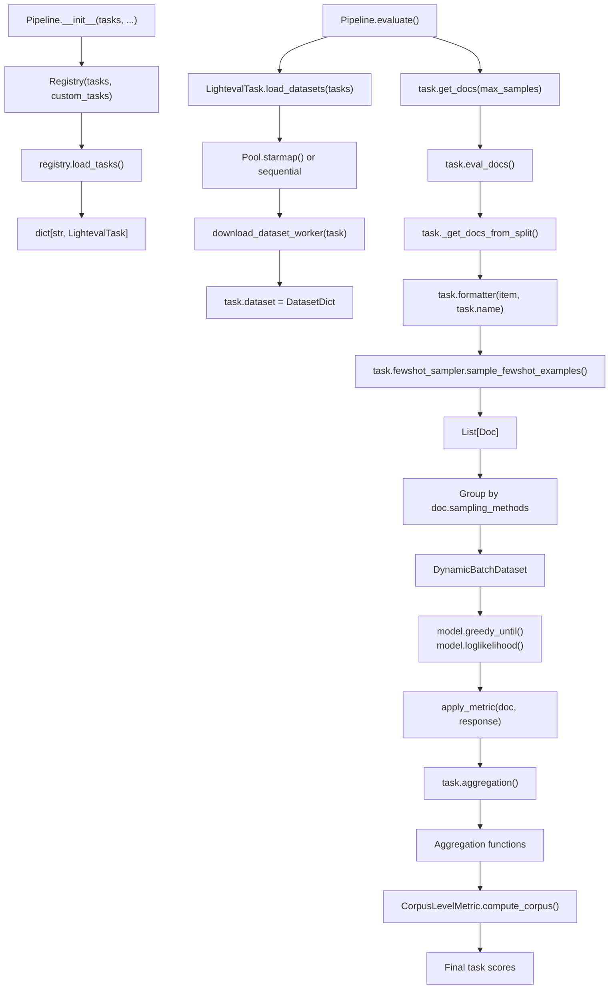

<!-- source: DeepWiki mcp.deepwiki.com · repo huggingface/lighteval · page 5 Task System · fetched 2026-10-26 -->

# Task System

<details>
<summary>Relevant source files</summary>

The following files were used as context for generating this wiki page:

- [src/lighteval/main_tasks.py](src/lighteval/main_tasks.py)
- [src/lighteval/metrics/metrics_corpus.py](src/lighteval/metrics/metrics_corpus.py)
- [src/lighteval/tasks/lighteval_task.py](src/lighteval/tasks/lighteval_task.py)
- [src/lighteval/tasks/multilingual/tasks/global_mmlu.py](src/lighteval/tasks/multilingual/tasks/global_mmlu.py)
- [src/lighteval/tasks/registry.py](src/lighteval/tasks/registry.py)
- [src/lighteval/tasks/requests.py](src/lighteval/tasks/requests.py)
- [src/lighteval/tasks/tasks/aimo.py](src/lighteval/tasks/tasks/aimo.py)
- [src/lighteval/tasks/tasks/ifbench/instructions.py](src/lighteval/tasks/tasks/ifbench/instructions.py)

</details>


The task system defines evaluation benchmarks by encapsulating dataset loading, prompt formatting, few-shot sampling, metric selection, and result aggregation. The system consists of three core classes:

| Class | Purpose | Location |
|-------|---------|----------|
| `LightevalTaskConfig` | Configuration dataclass defining task parameters | [src/lighteval/tasks/lighteval_task.py:48-200]() |
| `LightevalTask` | Runtime task execution and document preparation | [src/lighteval/tasks/lighteval_task.py:202-463]() |
| `Registry` | Task discovery, loading, and instantiation | [src/lighteval/tasks/registry.py:112-562]() |

Related pages: [Task Configuration](5.1), [Default Tasks](5.3), [Custom Tasks](5.6)

Sources: [src/lighteval/tasks/lighteval_task.py:48-463](), [src/lighteval/tasks/registry.py:112-562]()

## Core Components

**Task System Component Architecture**


Sources: [src/lighteval/tasks/lighteval_task.py:48-463](), [src/lighteval/tasks/registry.py:112-562]()

### LightevalTaskConfig

The `LightevalTaskConfig` dataclass at [src/lighteval/tasks/lighteval_task.py:48-200]() stores task configuration:

| Category | Fields | Purpose |
|----------|--------|---------|
| **Dataset** | `hf_repo`, `hf_subset`, `hf_revision`, `hf_filter` | Specify HuggingFace dataset source and filtering |
| **Evaluation** | `evaluation_splits`, `few_shots_split`, `few_shots_select` | Define data splits and few-shot selection strategy |
| **Prompt** | `prompt_function: Callable[[dict, str], Doc]` | Transform dataset rows to `Doc` objects |
| **Metrics** | `metrics: ListLike[Metric \| Metrics]` | List of evaluation metrics to compute |
| **Generation** | `generation_size`, `stop_sequence`, `generation_grammar` | Control text generation parameters |
| **Metadata** | `name`, `version`, `must_remove_duplicate_docs` | Task identification and configuration |

The `__post_init__` method at [src/lighteval/tasks/lighteval_task.py:149-157]() converts `Metrics` enums to `Metric` objects and sets the `full_name` attribute.

Sources: [src/lighteval/tasks/lighteval_task.py:48-200]()

### LightevalTask

The `LightevalTask` class at [src/lighteval/tasks/lighteval_task.py:202-463]() executes evaluation logic:

**LightevalTask Method Call Flow**


**Key methods:**
- `download_dataset_worker(task)` at [src/lighteval/tasks/lighteval_task.py:437-463](): Downloads dataset from HuggingFace Hub
- `_get_docs_from_split(splits, few_shots)` at [src/lighteval/tasks/lighteval_task.py:280-319](): Applies `prompt_function` to rows, creates `Doc` objects
- `fewshot_docs()` at [src/lighteval/tasks/lighteval_task.py:329-346](): Returns documents for few-shot pool
- `eval_docs()` at [src/lighteval/tasks/lighteval_task.py:348-358](): Returns evaluation documents
- `get_docs(max_samples)` at [src/lighteval/tasks/lighteval_task.py:360-403](): Attaches few-shot samples to evaluation docs
- `aggregation()` at [src/lighteval/tasks/lighteval_task.py:405-412](): Returns metric aggregation functions

Sources: [src/lighteval/tasks/lighteval_task.py:202-463]()

### Registry

The `Registry` class at [src/lighteval/tasks/registry.py:112-562]() manages task discovery and instantiation:

**Registry Task Loading Flow**


**Key methods:**
- `__init__(tasks, load_multilingual, custom_tasks)` at [src/lighteval/tasks/registry.py:115-160](): Initializes registry and loads task configs
- `load_all_task_configs(custom_tasks, load_multilingual)` at [src/lighteval/tasks/registry.py:344-380](): Static method loading all available task configs
- `_update_task_configs()` at [src/lighteval/tasks/registry.py:184-245](): Parses task specifications like `task|fewshot@param=value`
- `load_tasks()` at [src/lighteval/tasks/registry.py:247-256](): Creates `LightevalTask` instances
- `_expand_task_definition(task_definition)` at [src/lighteval/tasks/registry.py:275-291](): Expands task supersets

Sources: [src/lighteval/tasks/registry.py:112-562]()

## Task Lifecycle

**Task Execution Lifecycle**


Sources: [src/lighteval/tasks/lighteval_task.py:202-463](), [src/lighteval/tasks/registry.py:112-562]()

### Task Definition and Registration

Tasks are defined as `LightevalTaskConfig` instances and collected in module-level `TASKS_TABLE` lists. Example from [src/lighteval/tasks/tasks/aimo.py:42-62]():

```python
task = LightevalTaskConfig(
    name="aimo_progress_prize_1",
    prompt_function=aimo_prompt,
    hf_repo="lighteval/aimo_progress_prize_1",
    hf_subset="",
    evaluation_splits=["train"],
    metrics=[Metrics.exact_match(...)],
    generation_size=2048,
)

TASKS_TABLE = [task]
```

The `Registry.load_all_task_configs()` method at [src/lighteval/tasks/registry.py:344-380]() discovers and loads all `TASKS_TABLE` lists from:
- Core tasks: `src/lighteval/tasks/tasks/*.py`
- Multilingual tasks: `src/lighteval/tasks/multilingual/tasks/*.py`
- Subdirectory tasks: `src/lighteval/tasks/tasks/*/main.py`
- Custom tasks: User-provided file or module

### Task Instantiation

The `Registry._update_task_configs()` method at [src/lighteval/tasks/registry.py:184-245]() parses task specifications:

| Specification Format | Description | Example |
|---------------------|-------------|---------|
| `task` | Task with default few-shots | `"arc:challenge"` |
| `task\|fewshot` | Task with N few-shot examples | `"arc:challenge\|5"` |
| `task@param=value` | Task with metric parameters | `"task@temperature=0.5"` |

The `Registry.load_tasks()` method at [src/lighteval/tasks/registry.py:247-256]() creates `LightevalTask` instances:
```python
return {
    f"{config.full_name}": LightevalTask(config=config)
    for configs in self.task_to_configs.values()
    for config in configs
}
```

### Dataset Loading and Document Preparation

The `download_dataset_worker()` method at [src/lighteval/tasks/lighteval_task.py:437-463]() loads datasets:
```python
dataset = load_dataset(
    path=task.dataset_path,
    name=task.dataset_config_name,
    revision=task.dataset_revision,
)
if task.dataset_filter is not None:
    dataset = dataset.filter(task.dataset_filter)
return dataset
```

The `_get_docs_from_split()` method at [src/lighteval/tasks/lighteval_task.py:280-319]() transforms rows to `Doc` objects:
```python
for ix, item in enumerate(self.dataset[split]):
    item["__few_shots"] = few_shots
    item["__index"] = ix
    doc = self.formatter(item, self.name)
    doc.id = str(ix)
    doc.generation_grammar = self.generation_grammar
    doc.generation_size = self.generation_size
    doc.stop_sequences = self.stop_sequence
    docs.append(doc)
```

### Few-Shot Attachment and Aggregation

The `get_docs()` method at [src/lighteval/tasks/lighteval_task.py:360-403]() attaches few-shot samples:
```python
for doc in eval_docs[:n_samples]:
    doc.fewshot_samples = self.fewshot_sampler.sample_fewshot_examples(
        num_fewshots, 0, formatted_doc=doc, sampler=rnd
    )
    doc.sampling_methods.extend(self.sampling_methods)
```

The `aggregation()` method at [src/lighteval/tasks/lighteval_task.py:405-412]() returns aggregation functions:
```python
def aggregation(self):
    aggregations = {}
    for metric in self.metrics:
        aggregations.update(metric.get_corpus_aggregations())
    return aggregations
```

Sources: [src/lighteval/tasks/lighteval_task.py:202-463](), [src/lighteval/tasks/registry.py:112-562](), [src/lighteval/tasks/tasks/aimo.py:1-63]()

## Prompt Functions and Doc Creation

The `prompt_function` field in `LightevalTaskConfig` transforms dataset rows to `Doc` objects. Type signature at [src/lighteval/tasks/lighteval_task.py:110-112]():
```python
prompt_function: Callable[[dict, str], Doc]
```

**Prompt Function Execution**


Example from [src/lighteval/tasks/tasks/aimo.py:29-35]():
```python
def aimo_prompt(line, task_name: str = None):
    return Doc(
        task_name=task_name,
        choices=[str(line["answer"])],
        gold_index=0,
        query=line["problem"],
    )
```

The `Doc` dataclass at [src/lighteval/tasks/requests.py:43-227]() stores:
- `query: str` - Input text for the model
- `choices: list[str]` - Answer options (for multiple-choice)
- `gold_index: Union[int, list[int]]` - Index(es) of correct answer(s)
- `instruction: str | None` - System prompt or task instruction
- `fewshot_samples: list` - Few-shot examples (populated by `FewShotSampler`)
- `sampling_methods: list[SamplingMethod]` - Evaluation methods (`GENERATIVE`, `LOGPROBS`, `PERPLEXITY`)
- `generation_size: int | None` - Maximum tokens to generate
- `stop_sequences: list[str] | None` - Generation stopping sequences
- `images: list["Image"] | None` - For multimodal tasks

See [Data Structures](6) for complete `Doc` documentation.

Sources: [src/lighteval/tasks/lighteval_task.py:110-112](), [src/lighteval/tasks/requests.py:43-227](), [src/lighteval/tasks/tasks/aimo.py:29-35]()

## Task Naming and Registry Operations

**Task Specification Parsing**


Task naming conventions:
- Basic: `"task_name"` - Uses default few-shots
- With few-shots: `"task_name|5"` - Specifies 5 few-shot examples
- With parameters: `"task_name@param=value"` - Sets metric parameters
- Combined: `"task_name|5@temperature=0.7"` - Both few-shots and parameters

The `_update_task_configs()` method at [src/lighteval/tasks/registry.py:184-245]() handles parsing.

Sources: [src/lighteval/tasks/registry.py:184-291]()

### Task Supersets and Expansion

The `_task_superset_dict` property at [src/lighteval/tasks/registry.py:258-273]() groups tasks by prefix:

```python
@property
@lru_cache
def _task_superset_dict(self):
    # Group by prefix before colon
    superset_dict = {
        k: list(v) 
        for k, v in groupby(sorted(self._task_registry.keys()), 
                           lambda x: x.split(":")[0])
    }
    # Only supersets with multiple tasks
    return {k: v for k, v in superset_dict.items() if len(v) > 1}
```

Example: The task specification `"global_mmlu_all_arabic_mcf"` expands to all Global MMLU subtasks for Arabic:
- `"global_mmlu_all_arabic_mcf:abstract_algebra"`
- `"global_mmlu_all_arabic_mcf:anatomy"`
- `"global_mmlu_all_arabic_mcf:astronomy"`
- ... (57 total subtasks)

The `_expand_task_definition()` method at [src/lighteval/tasks/registry.py:275-291]() checks for superset matches:
```python
def _expand_task_definition(self, task_definition: str):
    tasks = self._task_superset_dict.get(task_definition, None)
    if tasks is not None:
        return tasks
    return [task_definition]
```

### Registry Utilities

| Method | Purpose | Location |
|--------|---------|----------|
| `load_tasks()` | Creates `LightevalTask` instances | [src/lighteval/tasks/registry.py:247-256]() |
| `print_all_tasks(suites)` | Displays available tasks | [src/lighteval/tasks/registry.py:382-440]() |
| `get_tasks_dump()` | Exports task metadata as JSON | [src/lighteval/tasks/registry.py:442-562]() |
| `create_custom_tasks_module(path)` | Loads custom tasks from file | [src/lighteval/tasks/registry.py:293-316]() |

Sources: [src/lighteval/tasks/registry.py:247-562](), [src/lighteval/tasks/multilingual/tasks/global_mmlu.py:104-179]()

## Integration with Pipeline

The task system integrates with the Pipeline through several key interfaces:

**Task-Pipeline Integration Points**


**Key integration points:**
1. `Registry(tasks, custom_tasks)` at [src/lighteval/tasks/registry.py:115-160]() - Pipeline initializes registry with task specifications
2. `registry.load_tasks()` at [src/lighteval/tasks/registry.py:247-256]() - Pipeline gets dictionary of instantiated tasks
3. `LightevalTask.load_datasets(tasks, dataset_loading_processes)` at [src/lighteval/tasks/lighteval_task.py:414-435]() - Pipeline loads datasets in parallel
4. `task.get_docs(max_samples)` at [src/lighteval/tasks/lighteval_task.py:360-403]() - Pipeline requests evaluation documents
5. `task.aggregation()` at [src/lighteval/tasks/lighteval_task.py:405-412]() - Pipeline gets metric aggregation functions

The `Doc` objects from tasks flow into the Pipeline's batching system (`DynamicBatchDataset`), then to model inference, then to metric computation, and finally back to task aggregation functions. See [Evaluation Pipeline](4) for details.

Sources: [src/lighteval/tasks/lighteval_task.py:202-463](), [src/lighteval/tasks/registry.py:115-256]()

## Task Organization

Tasks are organized in the codebase:

| Location | Description | Example Files |
|----------|-------------|---------------|
| `src/lighteval/tasks/tasks/*.py` | Core task definitions | `arc.py`, `hellaswag.py`, `mmlu.py` |
| `src/lighteval/tasks/tasks/*/main.py` | Multi-file task suites | `ifeval/main.py`, `bbh/main.py` |
| `src/lighteval/tasks/multilingual/tasks/*.py` | Multilingual tasks | `global_mmlu.py`, `mgsm.py` |
| `community_tasks/*.py` | Community contributions | Custom benchmarks |
| User files | Custom task definitions | Any file with `TASKS_TABLE` |

Suite classification constants at [src/lighteval/tasks/registry.py:91-109]():
```python
CORE_SUITES = [
    "helm", "bigbench", "harness", "leaderboard", 
    "lighteval", "original", "extended", "custom", "test"
]
OPTIONAL_SUITES = ["community", "multilingual"]
DEFAULT_SUITES = CORE_SUITES + OPTIONAL_SUITES
```

The `print_all_tasks(suites)` method at [src/lighteval/tasks/registry.py:382-440]() displays tasks by suite:
```bash
# List core tasks only
lighteval tasks list

# List all including multilingual
lighteval tasks list --load_multilingual
```

Related pages: [Default Tasks](5.3), [Multilingual Tasks](5.4), [Community Tasks](5.5), [Creating Custom Tasks](5.6)

Sources: [src/lighteval/tasks/registry.py:91-440]()

## Summary

The task system in LightEval provides a comprehensive framework for defining, configuring, and running evaluation benchmarks for language models. Its key features include:

1. **Flexible Configuration**: Tasks can be precisely configured using `LightevalTaskConfig`
2. **Dataset Integration**: Seamless loading from Hugging Face Hub datasets
3. **Few-Shot Support**: Built-in management of few-shot examples
4. **Multiple Metrics**: Support for various evaluation methodologies
5. **Extensibility**: Easy creation of custom tasks and benchmarks
6. **Organization**: Tasks are organized into suites and can form hierarchical relationships

This architecture makes it simple to define standard benchmarks, create custom evaluation scenarios, and systematically evaluate language models on a wide range of tasks.

---

