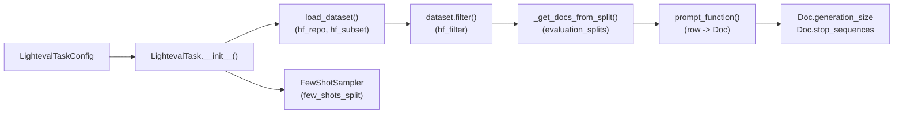
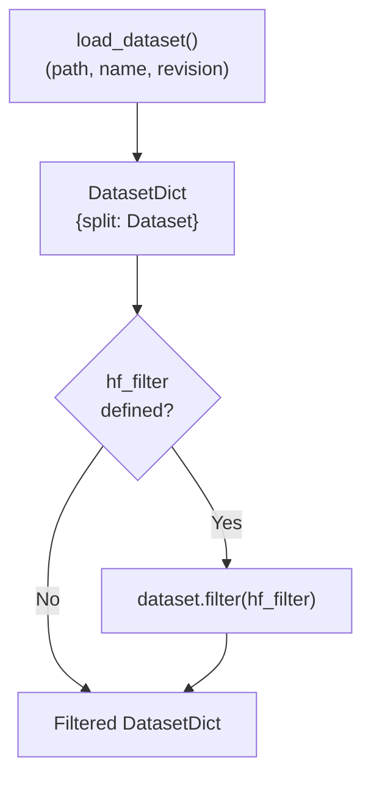
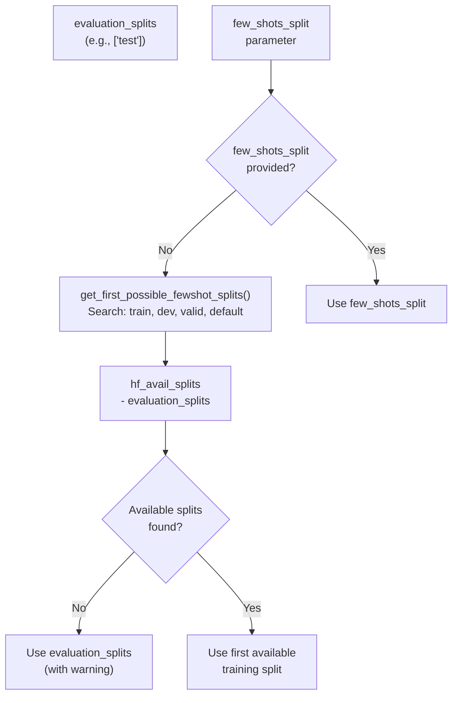
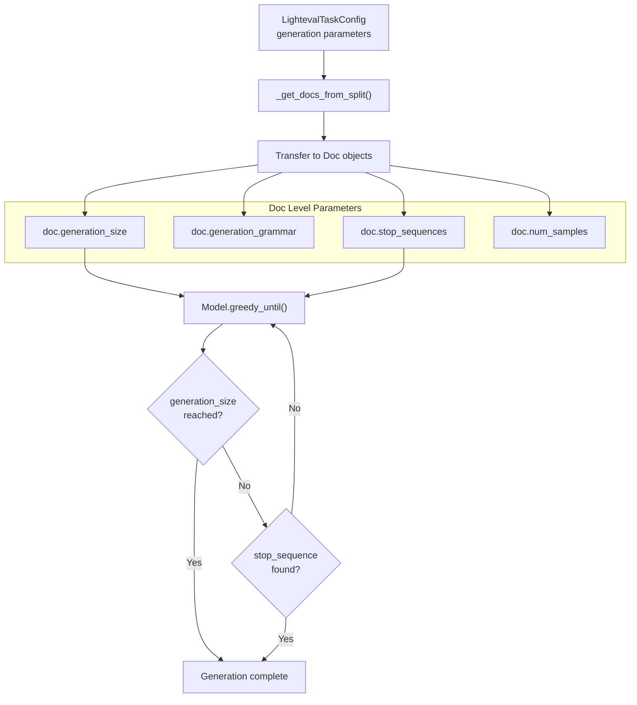
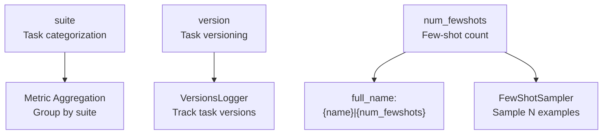
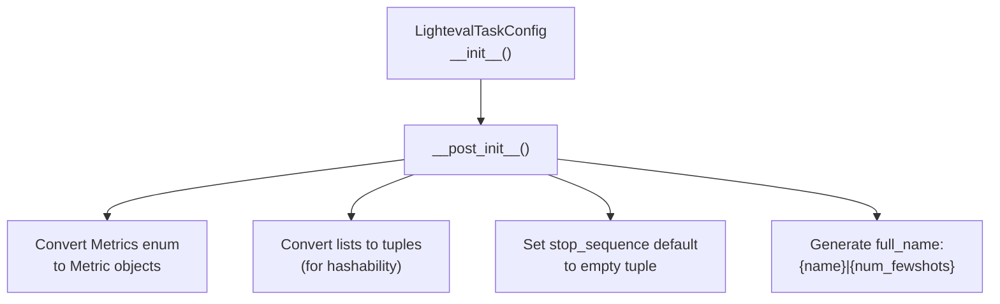
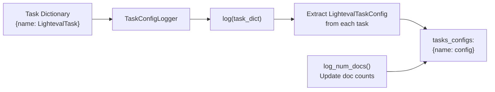

<!-- source: DeepWiki mcp.deepwiki.com · repo huggingface/lighteval · page 5.1 Task Configuration · fetched 2026-10-26 -->

# Task Configuration

<details>
<summary>Relevant source files</summary>

The following files were used as context for generating this wiki page:

- [src/lighteval/tasks/lighteval_task.py](src/lighteval/tasks/lighteval_task.py)
- [src/lighteval/tasks/requests.py](src/lighteval/tasks/requests.py)

</details>


This page details the `LightevalTaskConfig` dataclass, which defines all configuration parameters for evaluation tasks in lighteval. Task configuration controls dataset selection, prompt formatting, metric selection, evaluation splits, generation parameters, and task metadata. For information about how tasks are instantiated and used during evaluation, see [Task System](#5). For details on built-in tasks, see [Default Tasks](#5.2). For creating custom tasks, see [Custom Tasks](#5.5).

---

## LightevalTaskConfig Overview

The `LightevalTaskConfig` dataclass is the central configuration structure for all evaluation tasks. Every task in lighteval—whether built-in or custom—is defined by instantiating this dataclass with appropriate parameters. The configuration is then passed to the `LightevalTask` class, which uses it to load datasets, format prompts, and execute evaluation.

```mermaid
graph TB
    TaskConfig["LightevalTaskConfig<br/>(dataclass)"]
    
    subgraph "Required Core Parameters"
        Name["name: str"]
        PromptFunc["prompt_function: Callable"]
        HFRepo["hf_repo: str"]
        HFSubset["hf_subset: str"]
        Metrics["metrics: ListLike[Metric]"]
    end
    
    subgraph "Dataset Configuration"
        HFRev["hf_revision: str | None"]
        HFFilter["hf_filter: Callable | None"]
        HFSplits["hf_avail_splits: ListLike[str]"]
    end
    
    subgraph "Evaluation Splits"
        EvalSplits["evaluation_splits: ListLike[str]"]
        FewShotsSplit["few_shots_split: str | None"]
        FewShotsSelect["few_shots_select: str | None"]
    end
    
    subgraph "Generation Parameters"
        GenSize["generation_size: int | None"]
        GenGrammar["generation_grammar:<br/>TextGenerationInputGrammarType"]
        StopSeq["stop_sequence: ListLike[str]"]
        NumSamples["num_samples: list[int]"]
    end
    
    subgraph "Task Metadata"
        Suite["suite: ListLike[str]"]
        Version["version: int"]
        NumFewshots["num_fewshots: int"]
        TruncFS["truncate_fewshots: bool"]
        RemoveDup["must_remove_duplicate_docs: bool"]
        OrigDocs["original_num_docs: int"]
        EffDocs["effective_num_docs: int"]
    end
    
    TaskConfig --> Name
    TaskConfig --> PromptFunc
    TaskConfig --> HFRepo
    TaskConfig --> HFSubset
    TaskConfig --> Metrics
    
    TaskConfig --> HFRev
    TaskConfig --> HFFilter
    TaskConfig --> HFSplits
    
    TaskConfig --> EvalSplits
    TaskConfig --> FewShotsSplit
    TaskConfig --> FewShotsSelect
    
    TaskConfig --> GenSize
    TaskConfig --> GenGrammar
    TaskConfig --> StopSeq
    TaskConfig --> NumSamples
    
    TaskConfig --> Suite
    TaskConfig --> Version
    TaskConfig --> NumFewshots
    TaskConfig --> TruncFS
    TaskConfig --> RemoveDup
    TaskConfig --> OrigDocs
    TaskConfig --> EffDocs
```



**Configuration to Execution Flow**



Sources: [src/lighteval/tasks/lighteval_task.py:47-191]()

---

## Required Parameters

Five parameters are mandatory for every task configuration. These define the task identity, data source, prompt transformation, and evaluation metrics.

| Parameter | Type | Description |
|-----------|------|-------------|
| `name` | `str` | Short, unique identifier for the task (e.g., "mmlu:anatomy", "gsm8k") |
| `prompt_function` | `Callable[[dict, str], Doc]` | Function that transforms dataset rows into `Doc` objects |
| `hf_repo` | `str` | HuggingFace Hub repository path for the dataset |
| `hf_subset` | `str` | Dataset configuration/subset name within the repository |
| `metrics` | `ListLike[Metric]` | List of metrics to compute (from `Metrics` enum or custom) |

### Parameter Details

**`name`**: Task names typically follow the pattern `suite:task` (e.g., "mmlu:anatomy") or simply `task` (e.g., "gsm8k"). The name becomes part of the full task identifier when combined with few-shot count: `{name}|{num_fewshots}`. This identifier is used throughout result logging and aggregation.

**`prompt_function`**: The prompt function is the core transformation that converts raw dataset rows into `Doc` objects for evaluation. It receives two arguments:
- `line`: A dictionary containing one row from the HuggingFace dataset
- `task_name`: The task name (optional, for logging purposes)

The function must return a `Doc` object (or `None` to skip the sample, or a list of `Doc` objects for multi-query samples). The `Doc` object specifies the query, choices, correct answer index, and optional metadata.

**`hf_repo` and `hf_subset`**: These parameters are passed directly to HuggingFace's `load_dataset()` function. For example:
- `hf_repo="ai2_arc"`, `hf_subset="ARC-Challenge"` loads the ARC Challenge dataset
- `hf_repo="tasksource/bigbench"`, `hf_subset="arithmetic"` loads BigBench arithmetic

**`metrics`**: Metrics can be specified as `Metrics` enum values (e.g., `Metrics.loglikelihood_acc`) or as custom `Metric` instances. Multiple metrics can be specified for a single task. Metrics can also be parameterized using the `.value` or function call syntax (e.g., `Metrics.exact_match(sample_params={"normalize_gold": helm_normalizer})`).

### Example: Basic Task Configuration

```python
# From src/lighteval/tasks/default_tasks.py
arc_challenge_leaderboard = LightevalTaskConfig(
    name="arc:challenge",
    suite=["leaderboard", "arc"],
    prompt_function=prompt.arc,
    hf_repo="ai2_arc",
    hf_subset="ARC-Challenge",
    hf_avail_splits=["train", "test"],
    evaluation_splits=["test"],
    few_shots_split=None,
    few_shots_select="random_sampling_from_train",
    generation_size=1,
    metrics=[
        Metrics.loglikelihood_acc,
        Metrics.loglikelihood_acc(
            sample_params={"logprob_normalization": LogProbCharNorm(ignore_first_space=True)}
        ),
    ],
    stop_sequence=["\n"],
    version=0,
)
```

Sources: [src/lighteval/tasks/lighteval_task.py:109-115](), [src/lighteval/tasks/default_tasks.py:628-645]()

---

## Dataset Configuration

These optional parameters control how datasets are loaded and filtered from HuggingFace Hub.

| Parameter | Type | Default | Description |
|-----------|------|---------|-------------|
| `hf_revision` | `str \| None` | `None` | Git revision (commit SHA, tag, or branch) of the dataset to load |
| `hf_filter` | `Callable[[dict], bool] \| None` | `None` | Filter function applied to each dataset row; returns `True` to keep |
| `hf_avail_splits` | `ListLike[str]` | `["train", "validation", "test"]` | List of all splits available in the dataset |

### Dataset Loading Flow



### Parameter Details

**`hf_revision`**: Specifies an exact dataset version for reproducibility. If `None`, the latest version is used. Example: `hf_revision="3.0.0"` or `hf_revision="refs/convert/parquet"`.

**`hf_filter`**: A function that receives a dataset row (as a dictionary) and returns `True` to include the row or `False` to exclude it. This is useful for filtering out invalid samples, applying subset selection, or removing samples based on metadata.

Example filter function:
```python
def filter_short_contexts(row):
    return len(row["context"].split()) > 50

task_config = LightevalTaskConfig(
    # ... other parameters
    hf_filter=filter_short_contexts,
)
```

**`hf_avail_splits`**: This parameter informs the task system which splits exist in the dataset. It's used by `LightevalTask` to automatically select appropriate few-shot splits when `few_shots_split` is not explicitly provided. The system prefers training splits over validation splits for few-shot sampling.

Sources: [src/lighteval/tasks/lighteval_task.py:117-120](), [src/lighteval/tasks/lighteval_task.py:431-456]()

---

## Evaluation Splits

These parameters control which dataset splits are used for evaluation and few-shot example sampling.

| Parameter | Type | Default | Description |
|-----------|------|---------|-------------|
| `evaluation_splits` | `ListLike[str]` | `["validation"]` | Splits to use for evaluation (main task samples) |
| `few_shots_split` | `str \| None` | `None` | Split to sample few-shot examples from |
| `few_shots_select` | `str \| None` | `None` | Selection method for few-shot examples |

### Split Selection Logic



### Parameter Details

**`evaluation_splits`**: Specifies which dataset splits contain the samples to evaluate. Can be a single split or multiple splits. All samples from these splits are combined into the evaluation set. Common values:
- `["test"]` - Use only test split
- `["validation"]` - Use only validation split
- `["validation", "test"]` - Combine validation and test splits

**`few_shots_split`**: Specifies the split to sample few-shot examples from. If `None`, the system automatically selects an appropriate split using `get_first_possible_fewshot_splits()`, which searches for splits in this order:
1. Any split containing "train" (e.g., "train", "train_r1", "training")
2. Any split containing "dev" (e.g., "dev", "dev_r1")
3. Any split containing "valid" (e.g., "valid", "validation")
4. Any split containing "default"

If no suitable split is found, the evaluation split is used (with a warning logged).

**`few_shots_select`**: Specifies the method for selecting few-shot examples. Allowed values from `FewShotSelection`:
- `"balanced"` - Balance examples across different answer classes
- `"random"` - Random selection with fixed seed for reproducibility
- `"sequential"` - Take first N examples from the split
- `"random_sampling_from_train"` - Random sampling (assumes no overlap with eval set)
- `"random_sampling"` - Random sampling (may have overlap with eval set)

If `None`, defaults to `"balanced"`. See [Prompt Management](#5.6) for details on few-shot sampling.

### Example: Multi-Split Evaluation

```python
# From src/lighteval/tasks/default_tasks.py
anli_r1_lighteval = LightevalTaskConfig(
    name="anli:r1",
    suite=["lighteval", "anli"],
    prompt_function=prompt.anli,
    hf_repo="anli",
    hf_subset="plain_text",
    hf_avail_splits=["train_r1", "dev_r1", "test_r1"],
    evaluation_splits=["test_r1"],  # Evaluate on test split
    few_shots_split="train_r1",      # Sample few-shots from train split
    few_shots_select="random_sampling_from_train",
    generation_size=1,
    metrics=[Metrics.loglikelihood_acc],
    stop_sequence=["\n"],
    version=0,
)
```

Sources: [src/lighteval/tasks/lighteval_task.py:122-125](), [src/lighteval/tasks/lighteval_task.py:222-270](), [src/lighteval/tasks/prompt_manager.py:181-196]()

---

## Generation Parameters

These parameters control text generation behavior for generative tasks (those using `greedy_until` or sampling-based evaluation).

| Parameter | Type | Default | Description |
|-----------|------|---------|-------------|
| `generation_size` | `int \| None` | `None` | Maximum number of tokens to generate |
| `generation_grammar` | `TextGenerationInputGrammarType \| None` | `None` | Grammar specification for constrained generation (TGI/Inference Endpoint only) |
| `stop_sequence` | `ListLike[str] \| None` | `None` | Sequences that trigger generation termination |
| `num_samples` | `list[int] \| None` | `None` | Number of samples to generate per input (for pass@k metrics) |

### Generation Configuration Flow



### Parameter Details

**`generation_size`**: Maximum number of tokens to generate. Special values:
- `None`: Generate until model's EOS token or maximum context length
- `-1`: Generate until model's EOS token (alternative to `None`)
- Positive integer: Generate exactly this many tokens (or until stop sequence)

For loglikelihood-based tasks (multiple-choice), this is typically `1` or the length of the longest answer choice.

**`generation_grammar`**: Structured generation constraint (JSON schema, regex, etc.) enforced during generation. Only supported by TGI (Text Generation Inference) and HuggingFace Inference Endpoint backends. Example:
```python
from huggingface_hub import TextGenerationInputGrammarType

generation_grammar = {
    "type": TextGenerationInputGrammarType.JSON,
    "value": {
        "type": "object",
        "properties": {
            "answer": {"type": "string"}
        }
    }
}
```

**`stop_sequence`**: List of strings that terminate generation when encountered. Common stop sequences:
- `["\n"]` - Stop at first newline (for single-line answers)
- `["\n\n"]` - Stop at double newline (for paragraph answers)
- `["</s>", "\n\n"]` - Stop at EOS token or double newline

Multiple stop sequences can be specified; generation stops at the first match.

**`num_samples`**: Relevant only for sampling-based metrics like `pass_at_k`. The actual number of samples generated is determined by the maximum across all metrics. For example, if a task has `Metrics.pass_at_k(sample_params={"k": 1, "n": 10})`, the system generates 10 samples per input.

### Example: Generative Math Task

```python
# From src/lighteval/tasks/default_tasks.py
aime24_gpassk = LightevalTaskConfig(
    name="aime24_gpassk",
    suite=["lighteval"],
    prompt_function=prompt.aime_prompt_fn,
    hf_repo="HuggingFaceH4/aime_2024",
    hf_subset="default",
    hf_avail_splits=["train"],
    evaluation_splits=["train"],
    few_shots_split=None,
    few_shots_select=None,
    generation_size=8192,  # Generate up to 8192 tokens for complex reasoning
    metrics=[Metrics.g_pass_at_k_math(sample_params={"k": 16, "n": 48})],
    version=1,
)
```

Sources: [src/lighteval/tasks/lighteval_task.py:127-131](), [src/lighteval/tasks/lighteval_task.py:236-239](), [src/lighteval/tasks/lighteval_task.py:306-309]()

---

## Task Metadata

Metadata parameters provide information about the task itself, including versioning, categorization, and few-shot configuration.

| Parameter | Type | Default | Description |
|-----------|------|---------|-------------|
| `suite` | `ListLike[str]` | `["custom"]` | Evaluation suites or categories this task belongs to |
| `version` | `int` | `0` | Task version number (increment when dataset or prompts change) |
| `num_fewshots` | `int` | `0` | Number of few-shot examples to include in each prompt |
| `truncate_fewshots` | `bool` | `False` | Whether to truncate few-shot examples to fit context |
| `must_remove_duplicate_docs` | `bool` | `False` | Whether to deduplicate evaluation samples |
| `original_num_docs` | `int` | `-1` | Total document count (populated during evaluation) |
| `effective_num_docs` | `int` | `-1` | Actual document count after filtering (populated during evaluation) |

### Metadata Usage



### Parameter Details

**`suite`**: Tags for organizing tasks into evaluation suites. Multiple suites can be assigned. Common values:
- `["lighteval"]` - Official lighteval task
- `["leaderboard"]` - Used in HuggingFace leaderboards
- `["harness"]` - Compatible with EleutherAI harness
- `["mmlu"]` - Part of MMLU benchmark
- `["custom"]` - User-defined task

Suites are used during metric aggregation to compute average scores across task groups.

**`version`**: Version number for the task definition. Should be incremented whenever:
- The prompt function changes
- The dataset is updated
- Metric definitions change
- Any parameter affecting evaluation changes

This ensures reproducibility and allows comparison of results across versions.

**`num_fewshots`**: Number of few-shot examples to prepend to each evaluation query. Set to `0` for zero-shot evaluation. The actual examples are sampled by `FewShotSampler` according to `few_shots_select` strategy.

**`truncate_fewshots`**: If `True`, few-shot examples are truncated when the full prompt exceeds the model's context length. If `False` (default), an error is raised when truncation would be necessary.

**`must_remove_duplicate_docs`**: If `True`, duplicate evaluation samples (based on string representation of `Doc` objects) are removed. Useful for datasets with known duplicates or when combining multiple evaluation splits.

**`original_num_docs` and `effective_num_docs`**: These are automatically populated during evaluation by `TaskConfigLogger`. They track the total number of samples before and after any filtering or max_samples truncation.

### Example: MMLU Task with Metadata

```python
# From src/lighteval/tasks/default_tasks.py
mmlu_anatomy = LightevalTaskConfig(
    name="mmlu:anatomy",
    suite=["lighteval", "mmlu"],  # Part of both lighteval and MMLU suites
    prompt_function=lambda line, task_name: mmlu(line, "anatomy", task_name),
    hf_repo="cais/mmlu",
    hf_subset="anatomy",
    hf_avail_splits=["auxiliary_train", "test", "validation", "dev"],
    evaluation_splits=["test"],
    few_shots_split="dev",
    few_shots_select="sequential",
    generation_size=-1,
    metrics=[Metrics.loglikelihood_acc],
    stop_sequence=["\n"],
    num_fewshots=5,  # 5-shot evaluation
    version=0,
)
```

Sources: [src/lighteval/tasks/lighteval_task.py:133-143](), [src/lighteval/tasks/lighteval_task.py:154](), [src/lighteval/logging/info_loggers.py:424-440]()

---

## Configuration Post-Processing

When a `LightevalTaskConfig` is instantiated, the `__post_init__` method performs several transformations:



The post-processing performs these operations:

1. **Metric Conversion**: If metrics are specified as `Metrics` enum values, they are converted to `Metric` objects via `.value`
2. **Tuple Conversion**: Lists are converted to tuples for `metrics`, `hf_avail_splits`, `evaluation_splits`, `suite`, and `stop_sequence` to make the config hashable
3. **Stop Sequence Default**: If `stop_sequence` is `None`, it's set to an empty tuple `()`
4. **Full Name Generation**: Creates `full_name` by combining `name` and `num_fewshots`: `f"{name}|{num_fewshots}"`

Sources: [src/lighteval/tasks/lighteval_task.py:144-154]()

---

## Complete Configuration Example

Below is a comprehensive example showing all major parameter categories:

```python
from lighteval.tasks.lighteval_task import LightevalTaskConfig
from lighteval.metrics.metrics import Metrics
from lighteval.metrics.normalizations import LogProbCharNorm
import lighteval.tasks.default_prompts as prompt

# A complete task configuration with all major parameters
complex_task = LightevalTaskConfig(
    # Required parameters
    name="example:complex_task",
    prompt_function=prompt.mmlu,  # Function: dataset row -> Doc
    hf_repo="example/dataset",
    hf_subset="default",
    metrics=[
        Metrics.loglikelihood_acc,
        Metrics.exact_match(sample_params={"normalize_gold": lambda x: x.lower()}),
    ],
    
    # Dataset configuration
    hf_revision="1.0.0",
    hf_filter=lambda row: len(row["context"]) > 100,
    hf_avail_splits=["train", "validation", "test"],
    
    # Evaluation splits
    evaluation_splits=["test"],
    few_shots_split="train",
    few_shots_select="balanced",
    
    # Generation parameters
    generation_size=512,
    generation_grammar=None,
    stop_sequence=["\n\n", "###"],
    num_samples=None,
    
    # Task metadata
    suite=["custom", "leaderboard"],
    version=2,
    num_fewshots=5,
    truncate_fewshots=False,
    must_remove_duplicate_docs=True,
)

# The config is then used to create a LightevalTask
from lighteval.tasks.lighteval_task import LightevalTask
task = LightevalTask(config=complex_task)
```

---

## Configuration in Practice

Task configurations are typically defined in three locations:

1. **Built-in Tasks**: `src/lighteval/tasks/default_tasks.py` contains 7000+ predefined tasks
2. **Multilingual Tasks**: `src/lighteval/tasks/multilingual/tasks.py` contains language-specific variants
3. **Custom Tasks**: User-defined tasks in custom Python modules

### Accessing Task Configuration

Task configurations are collected into the `TASKS_TABLE` dictionary and accessed by name:

```python
# From src/lighteval/tasks/default_tasks.py
TASKS_TABLE = [
    arc_challenge_leaderboard,
    arc_easy_lighteval,
    mmlu_anatomy,
    gsm8k,
    # ... thousands more
]

# Tasks are registered by name for lookup
task_config = TASKS_TABLE["mmlu:anatomy|5"]  # Name includes few-shot count
```

### Configuration Logging

During evaluation, task configurations are logged for reproducibility:



The logged configurations are saved to `results.json` and enable exact reproduction of evaluation conditions.

Sources: [src/lighteval/tasks/default_tasks.py:1-100](), [src/lighteval/logging/info_loggers.py:424-440]()

---

## Configuration Best Practices

### Task Naming
- Use descriptive, hierarchical names: `benchmark:subtask`
- Include dataset version when relevant: `mmlu_v2:anatomy`
- Be consistent with existing naming conventions

### Prompt Functions
- Keep prompt functions pure (no side effects)
- Return `None` to skip invalid samples
- Return list of `Doc` for multi-query tasks
- Document expected dataset schema in docstrings

### Metrics Selection
- Choose metrics appropriate for task type (loglikelihood for MCQ, exact_match for generation)
- Include normalized variants when text preprocessing is important
- Use multiple metrics to capture different aspects (e.g., accuracy + F1)

### Version Management
- Increment version when any evaluation-affecting parameter changes
- Document version changes in comments
- Keep old versions for comparison

### Few-Shot Configuration
- Use separate splits for few-shots and evaluation
- Set `few_shots_select="balanced"` for multiple-choice tasks
- Set `few_shots_select="random_sampling_from_train"` when splits are disjoint
- Choose `num_fewshots` based on task complexity and model context length

### Generation Parameters
- Set `generation_size` conservatively to avoid timeout/memory issues
- Use specific stop sequences rather than relying on EOS
- Test stop sequences to ensure clean answer extraction

Sources: [src/lighteval/tasks/lighteval_task.py:47-191]()

---

