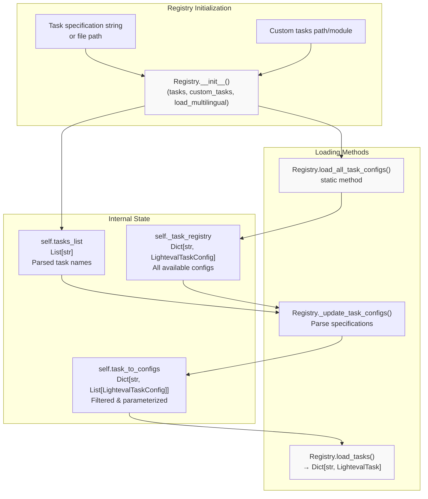
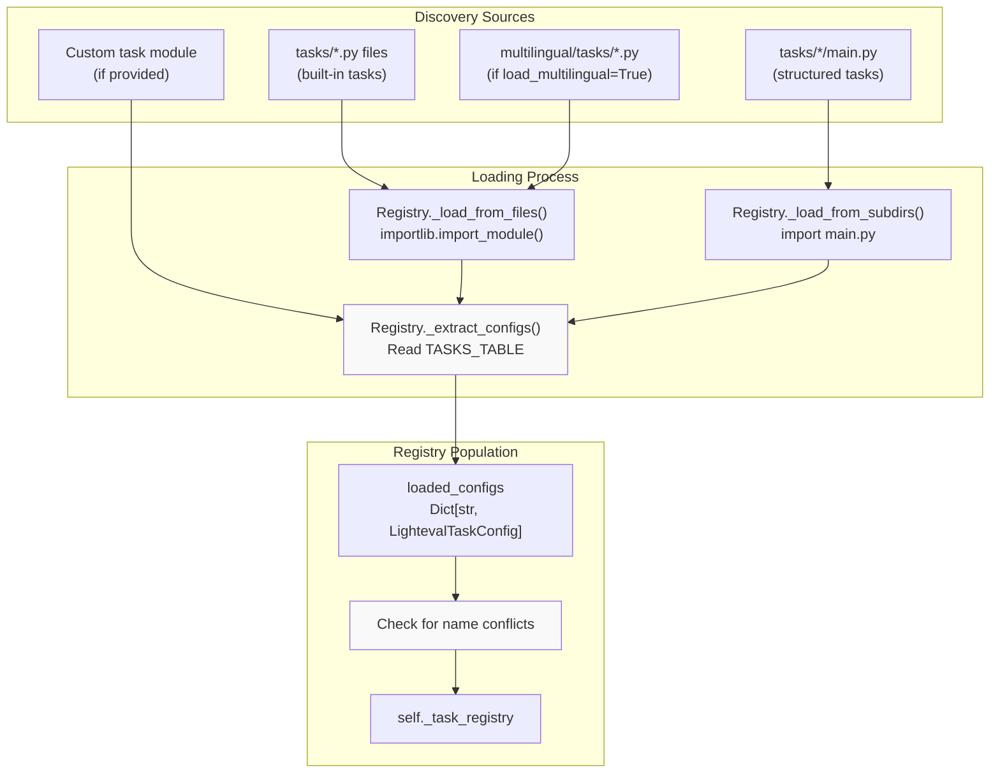
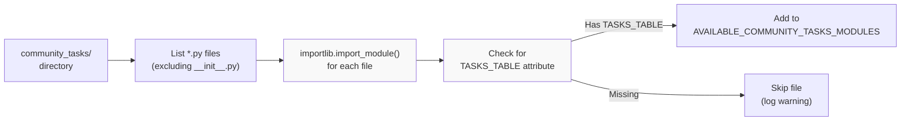
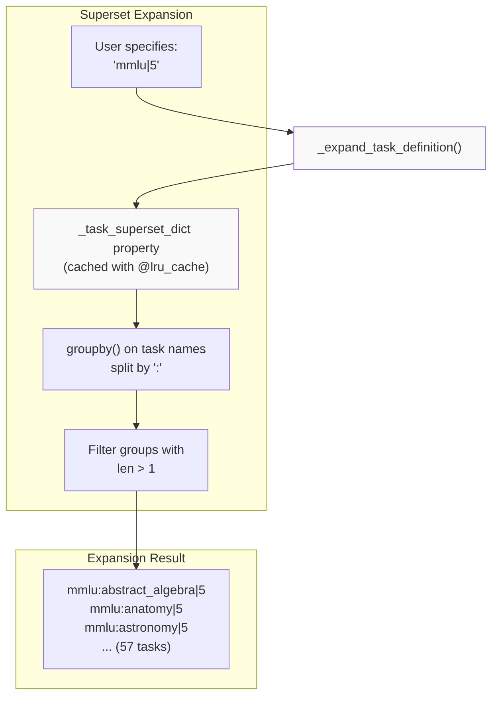

<!-- source: DeepWiki mcp.deepwiki.com · repo huggingface/lighteval · page 5.2 Task Registry · fetched 2026-10-26 -->

# Task Registry

<details>
<summary>Relevant source files</summary>

The following files were used as context for generating this wiki page:

- [src/lighteval/main_tasks.py](src/lighteval/main_tasks.py)
- [src/lighteval/metrics/metrics_corpus.py](src/lighteval/metrics/metrics_corpus.py)
- [src/lighteval/tasks/multilingual/tasks/global_mmlu.py](src/lighteval/tasks/multilingual/tasks/global_mmlu.py)
- [src/lighteval/tasks/registry.py](src/lighteval/tasks/registry.py)
- [src/lighteval/tasks/tasks/aimo.py](src/lighteval/tasks/tasks/aimo.py)
- [src/lighteval/tasks/tasks/ifbench/instructions.py](src/lighteval/tasks/tasks/ifbench/instructions.py)

</details>


The Task Registry is lighteval's centralized discovery and loading system for evaluation tasks. The `Registry` class manages a dictionary of task configurations, discovers tasks from multiple sources (built-in, custom, multilingual, and community), and instantiates `LightevalTask` objects on demand. It also handles task specification parsing, including few-shot configuration, parametrizable metrics, and task supersets that expand into multiple subtasks.

For information about how tasks are configured and defined, see [Task Configuration](#5.1). For details on creating custom tasks, see [Creating Custom Tasks](#5.6).

## Registry Class Architecture

The `Registry` class serves as the central task management system. It maintains a registry of all available task configurations and provides methods to load, filter, and instantiate tasks.



**Sources:** [src/lighteval/tasks/registry.py:112-161]()

### Key Components

| Component | Type | Purpose |
|-----------|------|---------|
| `tasks_list` | `List[str]` | Parsed task specifications from user input |
| `_task_registry` | `Dict[str, LightevalTaskConfig]` | Registry of all available task configurations |
| `task_to_configs` | `Dict[str, List[LightevalTaskConfig]]` | Filtered and parameterized configs for requested tasks |
| `_task_superset_dict` | `Dict[str, List[str]]` | Cached mapping of superset names to subtask lists |

**Sources:** [src/lighteval/tasks/registry.py:112-161]()

## Task Discovery Process

The `Registry` discovers tasks through a multi-stage loading process that scans predefined directories and optionally loads custom task modules.



**Sources:** [src/lighteval/tasks/registry.py:344-380]()

### Task Loading Sequence

The `load_all_task_configs()` static method orchestrates the discovery process:

1. **Core Tasks**: Loads all `.py` files from `tasks/` directory
2. **Structured Tasks**: Loads `main.py` from subdirectories in `tasks/`
3. **Multilingual Tasks**: Optionally loads from `multilingual/tasks/` directory
4. **Custom Tasks**: Loads user-provided task modules
5. **Conflict Detection**: Raises `ValueError` if custom tasks conflict with built-in names

**Sources:** [src/lighteval/tasks/registry.py:344-380]()

## Task Loading from Different Sources

### Built-in Tasks

Built-in tasks are discovered automatically from the `tasks/` directory. Each Python file or subdirectory with a `main.py` must expose a `TASKS_TABLE` variable containing a list of `LightevalTaskConfig` objects.

```python
# Example structure in tasks/aimo.py
TASKS_TABLE = [
    LightevalTaskConfig(
        name="aimo_progress_prize_1",
        prompt_function=aimo_prompt,
        hf_repo="lighteval/aimo_progress_prize_1",
        # ... other config fields
    )
]
```

The Registry uses `importlib` to dynamically load these modules:

```python
# From registry.py
for task_file in task_files:
    module_name = task_file.stem
    module = importlib.import_module(f"lighteval.tasks.tasks.{module_name}")
    configs.update(Registry._extract_configs(module))
```

**Sources:** [src/lighteval/tasks/registry.py:327-333](), [src/lighteval/tasks/tasks/aimo.py:42-62]()

### Custom Tasks

Custom tasks are provided via the `custom_tasks` parameter, which accepts:
- A string path to a Python file
- A `Path` object pointing to a file
- A module object directly

The `create_custom_tasks_module()` method handles all three formats:

| Input Type | Loading Method |
|------------|---------------|
| `ModuleType` | Return as-is |
| `str` or `Path` (file exists) | Use `importlib.util.spec_from_file_location()` |
| `str` or `Path` (module name) | Use `importlib.import_module()` |

Custom tasks must follow the same structure as built-in tasks, exposing a `TASKS_TABLE` variable. The Registry checks for name conflicts and raises an error if custom task names overlap with built-in tasks.

**Sources:** [src/lighteval/tasks/registry.py:293-316](), [src/lighteval/tasks/registry.py:369-376]()

### Multilingual Tasks

Multilingual tasks are loaded from the `multilingual/tasks/` directory when `load_multilingual=True`. These tasks follow the same structure as core tasks but are typically parameterized by language.

Example from `global_mmlu.py`:

```python
TASKS_TABLE = [
    LightevalTaskConfig(
        name=f"global_mmlu_{sensitivity_label.lower()}_{language.value}_{formulation.name.lower()}:{subset}",
        # ... config for each language/subset combination
    )
    for subset in MMLU_SUBSETS
    for language in [Language.AMHARIC, Language.ARABIC, ...]
    for formulation in [MCFFormulation()]
    for sensitivity_label in ["ALL"]
]
```

This pattern generates hundreds of task configurations from a single file.

**Sources:** [src/lighteval/tasks/registry.py:363-366](), [src/lighteval/tasks/multilingual/tasks/global_mmlu.py:104-179]()

### Community Tasks

Community tasks are loaded from the `community_tasks/` directory using the `load_community_tasks()` function. This function handles errors gracefully, logging warnings if individual community task modules fail to load.



**Sources:** [src/lighteval/tasks/registry.py:46-78]()

## Task Specification Format

The Registry supports a flexible task specification syntax that allows users to configure tasks at runtime without modifying code.

### Basic Format: `task|few_shots`

The simplest format specifies a task name and the number of few-shot examples:

```
task_name|5      # Use 5 few-shot examples
task_name        # Use 0 few-shot examples (default)
```

Backward compatibility is maintained for the deprecated `suite|task|few_shots` format, but the suite component is ignored:

```python
# Parsing logic in _update_task_configs()
if task.count("|") == 2:
    logger.warning("Deprecation warning: Provided suite|task|few_shot; `suite` is ignored.")
    _, task_name, few_shot = tuple(task.split("|"))
elif task.count("|") == 1:
    task_name, few_shot = tuple(task.split("|"))
else:
    task_name = task
    few_shot = 0
```

**Sources:** [src/lighteval/tasks/registry.py:196-217]()

### Parametrizable Metrics: `@key=value`

Tasks can specify metric parameters using the `@` syntax:

```
task_name|5@temperature=0.7@top_p=0.9
```

The Registry parses these parameters and applies them to parametrizable metrics:

1. Split on `@` to extract key-value pairs
2. Parse each pair as `key=value`
3. Use `ast.literal_eval()` to convert values to appropriate types
4. Set attributes on the metric's `sample_level_fn`

```python
# Parameter parsing
if "@" in task_name:
    split_task_name = task_name.split("@")
    task_name, metric_params = split_task_name[0], split_task_name[1:]
    metric_params_dict = dict(item.split("=") for item in metric_params if item)
    metric_params_dict = {k: ast.literal_eval(v) for k, v in metric_params_dict.items()}
```

The Registry validates that required attributes are set:

```python
for metric in [m for m in config.metrics if "@" in m.metric_name]:
    for attribute, value in metric_params_dict.items():
        setattr(metric.sample_level_fn, attribute, value)
    required = getattr(metric.sample_level_fn, "attribute_must_be_set", [])
    for attribute in required:
        if getattr(metric.sample_level_fn, attribute) is None:
            raise ValueError(f"Metric {metric.metric_name} for task {expanded_task} "
                           f"was not correctly parametrized. Forgot to set '{attribute}'.")
```

**Sources:** [src/lighteval/tasks/registry.py:208-241]()

## Task Supersets

Task supersets allow users to specify a group name that expands into multiple subtasks. For example, `mmlu` expands to all MMLU subtasks like `mmlu:abstract_algebra`, `mmlu:anatomy`, etc.



**Sources:** [src/lighteval/tasks/registry.py:258-291]()

### Superset Dictionary Construction

The `_task_superset_dict` property builds a mapping of superset names to subtask lists:

1. Sort all task names (required for `groupby`)
2. Group by the prefix before the first `:`
3. Filter to only include groups with more than one task
4. Return as a dictionary

```python
@property
@lru_cache
def _task_superset_dict(self):
    # Note: sorted before groupby is important
    superset_dict = {k: list(v) for k, v in groupby(sorted(self._task_registry.keys()), 
                                                      lambda x: x.split(":")[0])}
    # Only consider supersets with more than one task
    return {k: v for k, v in superset_dict.items() if len(v) > 1}
```

The expansion logic in `_expand_task_definition()`:

```python
def _expand_task_definition(self, task_definition: str):
    # Try if it's a task superset
    tasks = self._task_superset_dict.get(task_definition, None)
    if tasks is not None:
        return tasks
    # Then it must be a single task
    return [task_definition]
```

**Sources:** [src/lighteval/tasks/registry.py:258-291]()

## Task Listing and Inspection

The Registry provides methods for listing and inspecting available tasks.

### Listing Tasks by Suite

The `print_all_tasks()` method displays tasks organized by suite:

```python
registry.print_all_tasks(suites="helm,harness")  # Show specific suites
registry.print_all_tasks(suites="all")           # Show all suites (core + optional)
registry.print_all_tasks()                        # Show core suites only
```

| Suite Category | Suites |
|----------------|--------|
| Core (always available) | `helm`, `bigbench`, `harness`, `leaderboard`, `lighteval`, `original`, `extended`, `custom`, `test` |
| Optional (require dependencies) | `community`, `multilingual` |

The method handles dependency checking for optional suites:

```python
if "multilingual" in requested_suites:
    import importlib.util
    if importlib.util.find_spec("langcodes") is None:
        logger.warning("Multilingual tasks require additional dependencies (langcodes). "
                      "Install them with: pip install langcodes")
        requested_suites.remove("multilingual")
```

**Sources:** [src/lighteval/tasks/registry.py:382-440](), [src/lighteval/tasks/registry.py:91-109]()

### Dumping Task Metadata

The `get_tasks_dump()` method returns structured task metadata including docstrings:

```python
modules_data = registry.get_tasks_dump()
# Returns: List[Dict] with structure:
# {
#   "module": "lighteval.tasks.tasks.aimo",
#   "docstring": {"name": "...", "dataset": "...", ...},
#   "tasks": [{"name": "task_name", "config": {...}}]
# }
```

This method:
1. Parses module docstrings using a structured format
2. Extracts task configurations as dictionaries
3. Groups tasks by their source module

The docstring parser supports fields like `name`, `dataset`, `languages`, `tags`, etc., with special handling for list fields (comma-separated values):

```python
list_fields = {"dataset", "languages", "tags"}
# Converts "english, french, german" → ["english", "french", "german"]
```

**Sources:** [src/lighteval/tasks/registry.py:442-562]()

### CLI Integration

The Registry integrates with the CLI through commands in `main_tasks.py`:

| Command | Purpose |
|---------|---------|
| `lighteval tasks list` | Display all available tasks |
| `lighteval tasks inspect <task>` | Show task configuration and sample documents |
| `lighteval tasks dump` | Output JSON metadata for all tasks |
| `lighteval tasks create` | Generate a new task file from a template |

**Sources:** [src/lighteval/main_tasks.py:35-110]()

## Task Input Parsing

The Registry accepts task specifications in two formats:

1. **Comma-separated string**: `"task1|5,task2|10,mmlu|0"`
2. **File path**: A text file with one task per line (lines starting with `#` are treated as comments)

```python
def _get_full_task_list_from_input_string(self, tasks: str | Path) -> list[str]:
    if os.path.exists(tasks):
        with open(tasks, "r") as f:
            tasks_list = [line.strip() for line in f 
                         if line.strip() and not line.startswith("#")]
    else:
        tasks_list = tasks.split(",")
    
    # Remove duplicates
    expanded_tasks_list = list(set(expanded_tasks_list))
    return expanded_tasks_list
```

**Sources:** [src/lighteval/tasks/registry.py:162-182]()

---

