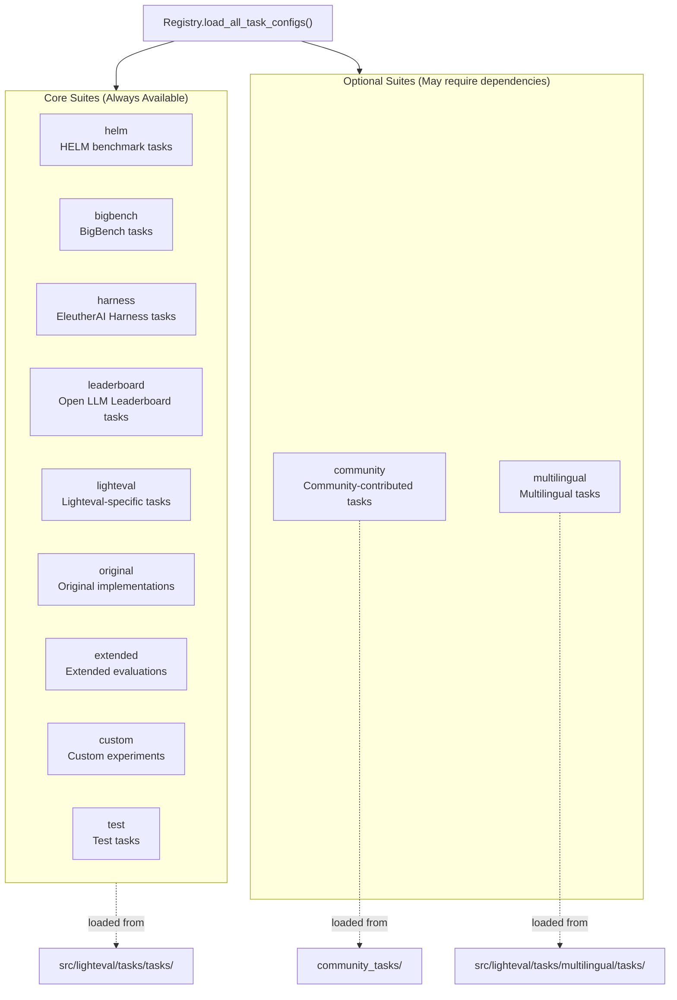
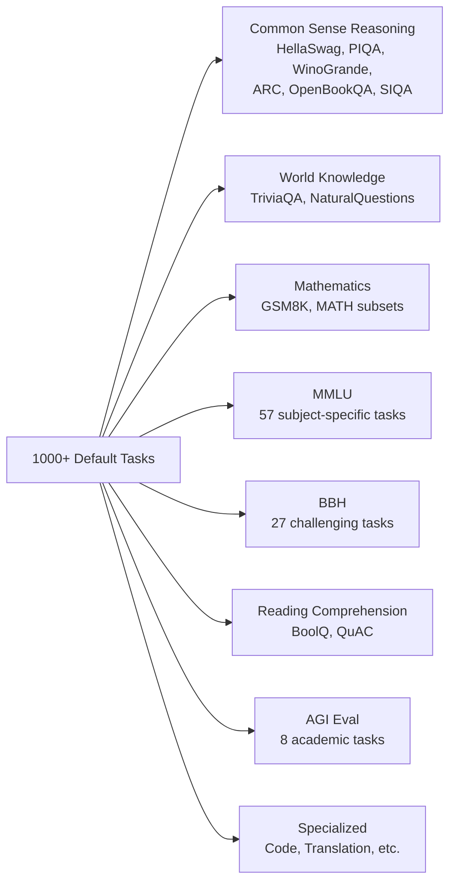
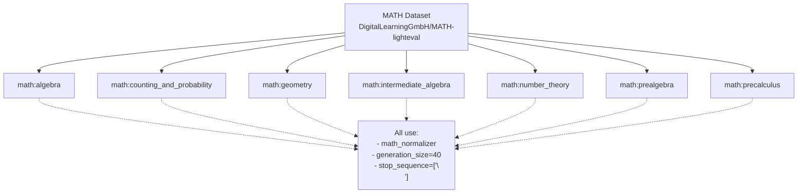
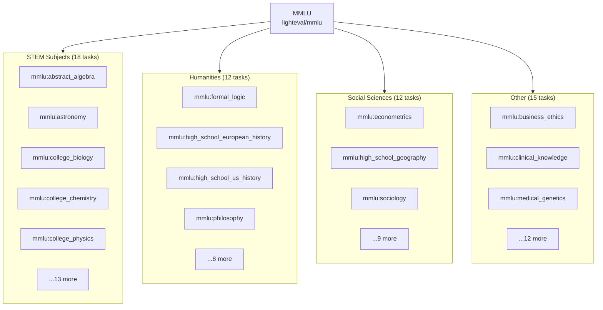
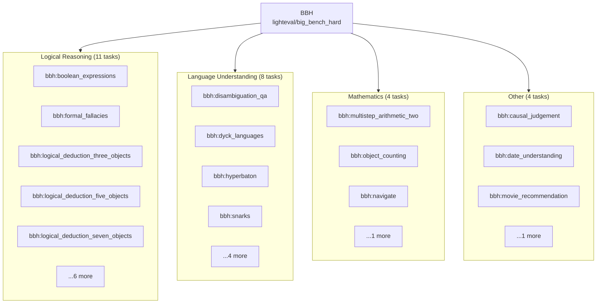
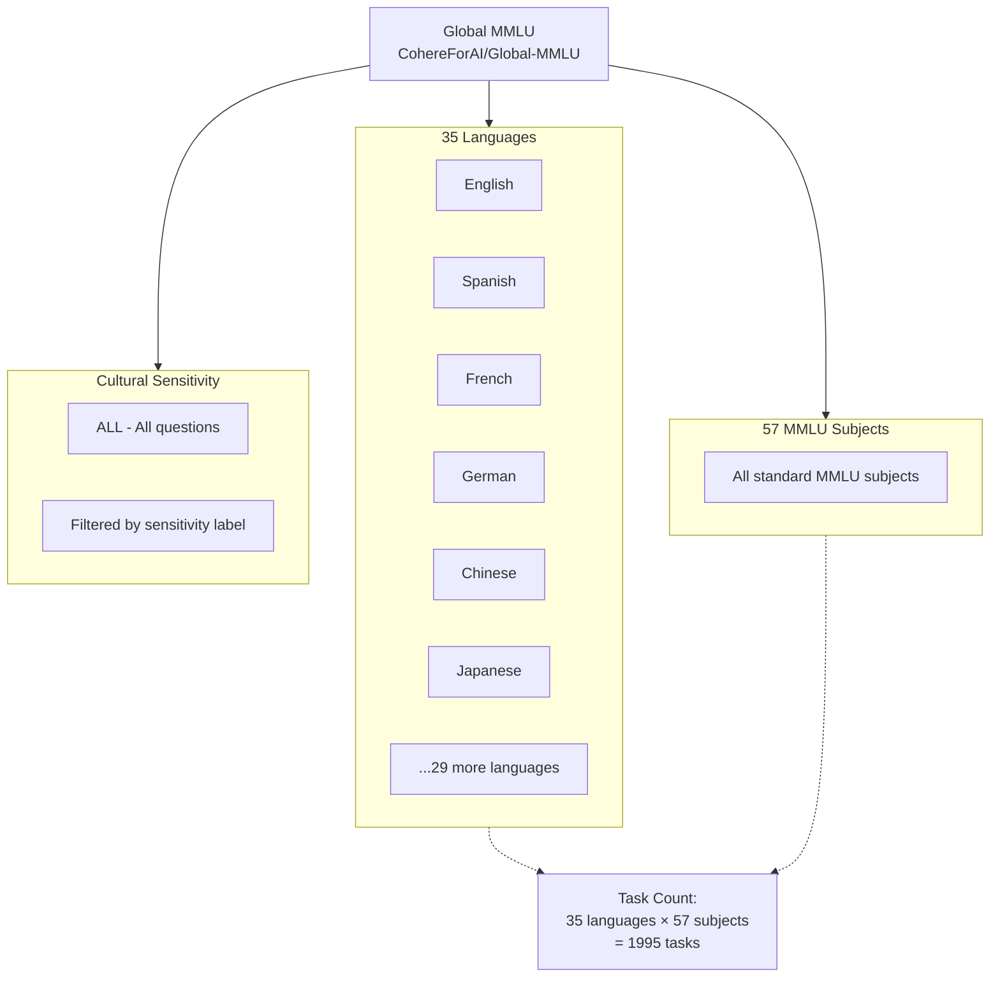
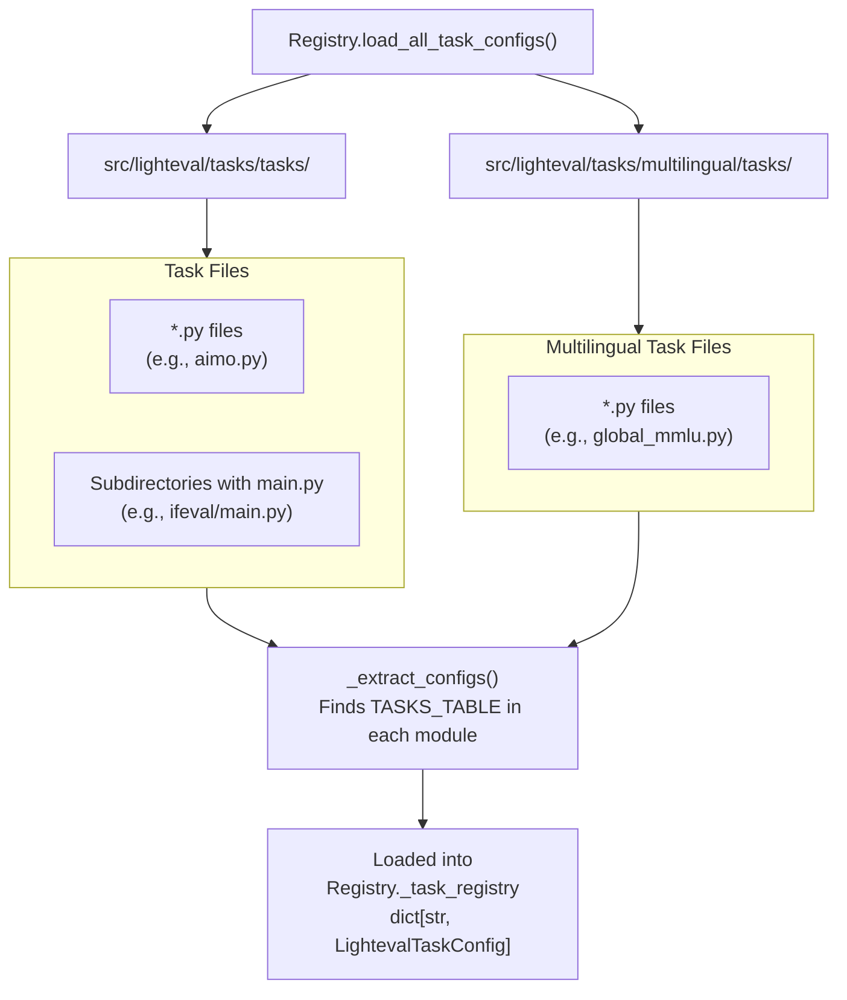
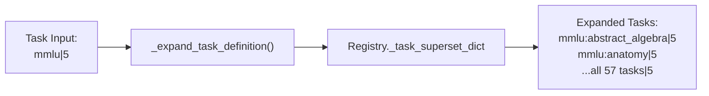

<!-- source: DeepWiki mcp.deepwiki.com · repo huggingface/lighteval · page 5.3 Default Tasks · fetched 2026-10-26 -->

# Default Tasks

<details>
<summary>Relevant source files</summary>

The following files were used as context for generating this wiki page:

- [examples/nanotron/custom_evaluation_tasks.py](examples/nanotron/custom_evaluation_tasks.py)
- [examples/nanotron/custom_task.py](examples/nanotron/custom_task.py)
- [src/lighteval/main_tasks.py](src/lighteval/main_tasks.py)
- [src/lighteval/metrics/metrics_corpus.py](src/lighteval/metrics/metrics_corpus.py)
- [src/lighteval/tasks/multilingual/tasks/global_mmlu.py](src/lighteval/tasks/multilingual/tasks/global_mmlu.py)
- [src/lighteval/tasks/registry.py](src/lighteval/tasks/registry.py)
- [src/lighteval/tasks/tasks/aimo.py](src/lighteval/tasks/tasks/aimo.py)
- [src/lighteval/tasks/tasks/ifbench/instructions.py](src/lighteval/tasks/tasks/ifbench/instructions.py)

</details>


This page provides an overview of the 1000+ built-in evaluation tasks that come pre-configured with lighteval. These tasks span multiple evaluation suites and cover diverse capabilities including common sense reasoning, world knowledge, mathematics, language understanding, and specialized domains.

For information about creating your own tasks, see [Creating Custom Tasks](#5.6). For details on task configuration structure, see [Task Configuration](#5.1). For information about how tasks are discovered and loaded, see [Task Registry](#5.2).

---

## Task Suite Organization

Lighteval organizes its default tasks into **suites**, which are logical groupings of related evaluation benchmarks. The Registry system automatically discovers and loads tasks from predefined directories based on these suite designations.

### Suite Categories



**Sources:** [src/lighteval/tasks/registry.py:91-110]()

The Registry class loads tasks from different locations based on suite type:

| Suite Type | Location | Loaded By Default |
|------------|----------|-------------------|
| Core Suites | `src/lighteval/tasks/tasks/` | Yes |
| Multilingual | `src/lighteval/tasks/multilingual/tasks/` | If `load_multilingual=True` |
| Community | `community_tasks/` | Always attempted, errors logged |

**Sources:** [src/lighteval/tasks/registry.py:345-380]()

---

## Core Task Categories

Default tasks are organized into semantic categories based on the capabilities they evaluate. Each task is defined using `LightevalTaskConfig` and registered in a `TASKS_TABLE` within its module.

### Category Overview



**Sources:** [examples/nanotron/custom_evaluation_tasks.py:48-693]()

### Task Naming Convention

Tasks follow the naming pattern: `suite|task_name` or `suite|task_name:subset`

Examples:
- `leaderboard|hellaswag` - HellaSwag from the leaderboard suite
- `lighteval|mmlu:anatomy` - MMLU anatomy subset
- `helm|natural_questions` - Natural Questions from HELM suite

When running evaluations, tasks are specified with few-shot counts: `task_name|num_fewshots`

**Sources:** [src/lighteval/tasks/registry.py:184-218]()

---

## Common Sense Reasoning Tasks

These tasks evaluate a model's ability to apply everyday reasoning and common sense knowledge.

### Task Implementations

| Task | Description | Metric | Typical Few-Shot |
|------|-------------|--------|------------------|
| `hellaswag` | Commonsense inference completion | Loglikelihood Accuracy | 0 |
| `piqa` | Physical interaction reasoning | Loglikelihood Accuracy | 0 |
| `winogrande` | Pronoun resolution | Loglikelihood Accuracy | 0 |
| `arc:easy` | Grade-school science questions (easy) | Loglikelihood Accuracy | 0 |
| `arc:challenge` | Grade-school science questions (hard) | Loglikelihood Accuracy | 0 |
| `openbookqa` | Elementary science with open book | Loglikelihood Accuracy | 0 |
| `siqa` | Social interaction QA | Loglikelihood Accuracy | 0 |
| `commonsense_qa` | Commonsense question answering | Loglikelihood Accuracy | 0 |

**Example Configuration:**

```python
# From hellaswag task
LightevalTaskConfig(
    name="hellaswag",
    prompt_function=hellaswag_prompt,
    hf_repo="hellaswag",
    hf_subset="default",
    metrics=[
        Metrics.loglikelihood_acc,
        Metrics.loglikelihood_acc(
            sample_params={"logprob_normalization": LogProbCharNorm(ignore_first_space=True)}
        ),
    ],
    stop_sequence=["\n"],
)
```

**Sources:** [examples/nanotron/custom_evaluation_tasks.py:93-203]()

---

## World Knowledge Tasks

Tasks that assess factual knowledge and information retrieval capabilities.

### Task Implementations

| Task | Description | Metric | Generation Size |
|------|-------------|--------|-----------------|
| `trivia_qa` | Trivia questions from web documents | Exact Match (HELM normalized) | 20 tokens |
| `natural_questions` | Questions from Google search queries | Exact Match (HELM normalized) | 20 tokens |

**Example Configuration:**

```python
LightevalTaskConfig(
    name="trivia_qa",
    prompt_function=triviaqa_prompt,
    hf_repo="trivia_qa",
    hf_subset="rc.nocontext",
    metrics=[
        Metrics.exact_match(
            sample_params={"normalize_gold": helm_normalizer, "normalize_pred": helm_normalizer}
        )
    ],
    generation_size=20,
    stop_sequence=["\n", ".", ","],
)
```

These tasks use **generative evaluation** (models produce text answers) rather than multiple-choice loglikelihood scoring.

**Sources:** [examples/nanotron/custom_evaluation_tasks.py:213-246]()

---

## Mathematics Tasks

Tasks evaluating mathematical reasoning and problem-solving across different difficulty levels.

### MATH Dataset (7 subsets)



**Sources:** [examples/nanotron/custom_evaluation_tasks.py:294-336]()

### GSM8K

```python
LightevalTaskConfig(
    name="gsm8k",
    prompt_function=gsm8k_prompt,
    hf_repo="gsm8k",
    hf_subset="main",
    evaluation_splits=["test"],
    metrics=[Metrics.perfect_exact_match],
    generation_size=10,
    stop_sequence=["\n"],
)
```

GSM8K evaluates grade-school math word problems with 8-shot few-shot learning by default.

**Sources:** [examples/nanotron/custom_evaluation_tasks.py:337-348]()

### AIMO Progress Prize

For advanced mathematical problem solving:

```python
LightevalTaskConfig(
    name="aimo_progress_prize_1",
    prompt_function=aimo_prompt,
    hf_repo="lighteval/aimo_progress_prize_1",
    metrics=[
        Metrics.exact_match(
            sample_params={"normalize_gold": math_normalizer, "normalize_pred": math_normalizer}
        )
    ],
    generation_size=2048,
)
```

**Sources:** [src/lighteval/tasks/tasks/aimo.py:42-59]()

---

## MMLU (Massive Multitask Language Understanding)

MMLU comprises 57 subject-specific tasks covering STEM, humanities, social sciences, and more. Each task evaluates knowledge in a specific domain using multiple-choice questions.

### MMLU Structure



**Sources:** [examples/nanotron/custom_evaluation_tasks.py:427-487]()

### MMLU Task Configuration Pattern

All MMLU tasks follow a consistent pattern using the `CustomMMLUEvaluationTask` class:

```python
CustomMMLUEvaluationTask(
    name="mmlu:anatomy",
    hf_subset="anatomy",
    prompt_function=mmlu_prompt,
    hf_repo="lighteval/mmlu",
    metrics=[
        Metrics.loglikelihood_acc,
        Metrics.loglikelihood_acc(
            sample_params={"logprob_normalization": LogProbCharNorm(ignore_first_space=True)}
        ),
    ],
    evaluation_splits=["test"],
    few_shots_split="dev",
)
```

Each task:
- Uses the `dev` split for few-shot examples
- Evaluates on the `test` split
- Reports both raw and character-normalized loglikelihood accuracy
- Uses multiple-choice format with choices mapped to full answer text

**Sources:** [examples/nanotron/custom_evaluation_tasks.py:392-424]()

### Complete MMLU Subject List

The 57 MMLU subjects include:
- **STEM**: abstract_algebra, anatomy, astronomy, college_biology, college_chemistry, college_computer_science, college_mathematics, college_medicine, college_physics, computer_security, conceptual_physics, electrical_engineering, elementary_mathematics, high_school_biology, high_school_chemistry, high_school_computer_science, high_school_mathematics, high_school_physics, high_school_statistics, machine_learning
- **Humanities**: formal_logic, high_school_european_history, high_school_us_history, high_school_world_history, international_law, jurisprudence, logical_fallacies, moral_disputes, moral_scenarios, philosophy, prehistory, professional_law, world_religions
- **Social Sciences**: econometrics, high_school_geography, high_school_government_and_politics, high_school_macroeconomics, high_school_microeconomics, high_school_psychology, human_sexuality, professional_psychology, public_relations, security_studies, sociology, us_foreign_policy
- **Other**: business_ethics, clinical_knowledge, human_aging, management, marketing, medical_genetics, miscellaneous, nutrition, professional_accounting, professional_medicine, virology

**Sources:** [examples/nanotron/custom_evaluation_tasks.py:428-486]()

---

## BBH (Big Bench Hard)

BBH consists of 27 challenging tasks selected from BigBench that are difficult for current language models.

### BBH Task Categories



**Sources:** [examples/nanotron/custom_evaluation_tasks.py:536-572]()

### BBH Task Configuration

BBH tasks use generative evaluation with exact match scoring:

```python
CustomBBHEvaluationTask(
    name="bbh:boolean_expressions",
    hf_subset="boolean_expressions",
    prompt_function=bbh_prompt,
    hf_repo="lighteval/big_bench_hard",
    metrics=[Metrics.exact_match],
    evaluation_splits=["train"],
    few_shots_split="train",
    generation_size=4,
    stop_sequence=["\n"],
)
```

All BBH tasks:
- Use the `train` split for both evaluation and few-shot examples
- Generate short answers (4 tokens)
- Use exact match scoring
- Stop generation at newline

**Sources:** [examples/nanotron/custom_evaluation_tasks.py:506-533]()

### Complete BBH Task List

The 27 BBH tasks are:
- boolean_expressions, causal_judgement, date_understanding, disambiguation_qa
- dyck_languages, formal_fallacies, geometric_shapes, hyperbaton
- logical_deduction_three_objects, logical_deduction_five_objects, logical_deduction_seven_objects
- movie_recommendation, multistep_arithmetic_two, navigate, object_counting
- penguins_in_a_table, reasoning_about_colored_objects, ruin_names
- salient_translation_error_detection, snarks, sports_understanding, temporal_sequences
- tracking_shuffled_objects_three_objects, tracking_shuffled_objects_five_objects, tracking_shuffled_objects_seven_objects
- web_of_lies, word_sorting

**Sources:** [examples/nanotron/custom_evaluation_tasks.py:536-572]()

---

## Reading Comprehension Tasks

Tasks evaluating reading comprehension and question answering capabilities.

### Task Implementations

| Task | Description | Format | Metric |
|------|-------------|--------|--------|
| `super_glue:boolq` | Boolean questions about passages | Multiple Choice | Target Perplexity |
| `quac` | Conversational question answering | Generative | Exact Match (HELM) |

**Example Configurations:**

```python
# BoolQ - Multiple choice with perplexity
LightevalTaskConfig(
    name="super_glue:boolq",
    prompt_function=boolq_prompt,
    hf_repo="super_glue",
    hf_subset="boolq",
    metrics=[Metrics.target_perplexity],
    stop_sequence=["\n"],
)

# QuAC - Generative with exact match
LightevalTaskConfig(
    name="quac",
    prompt_function=quac_prompt,
    hf_repo="lighteval/quac_helm",
    metrics=[
        Metrics.exact_match(
            sample_params={"normalize_gold": helm_normalizer, "normalize_pred": helm_normalizer}
        )
    ],
    generation_size=20,
    stop_sequence=["\n", ".", ","],
)
```

**Sources:** [examples/nanotron/custom_evaluation_tasks.py:256-285]()

---

## AGI Eval Tasks

AGI Eval includes academic and standardized test questions designed to assess AGI progress.

### AGI Eval Task Categories

| Task | Description | Format |
|------|-------------|--------|
| `agi_eval:aqua_rat` | Algebraic reasoning | Multiple Choice |
| `agi_eval:logiqa-en` | Logical reasoning | Multiple Choice |
| `agi_eval:lsat-ar` | LSAT analytical reasoning | Multiple Choice |
| `agi_eval:lsat-lr` | LSAT logical reasoning | Multiple Choice |
| `agi_eval:lsat-rc` | LSAT reading comprehension | Multiple Choice |
| `agi_eval:math` | Math problems | Generative |
| `agi_eval:sat-en` | SAT English | Multiple Choice |
| `agi_eval:sat-math` | SAT Math | Multiple Choice |

**Example Configuration:**

```python
CustomAGIEvalEvaluationTask(
    name="agi_eval:lsat-lr",
    hf_subset="lsat-lr",
    prompt_function=agi_eval_prompt_no_letters,
    hf_repo="lighteval/agi_eval_en",
    metrics=[
        Metrics.loglikelihood_acc,
        Metrics.loglikelihood_acc(
            sample_params={"logprob_normalization": LogProbCharNorm(ignore_first_space=True)}
        ),
    ],
    evaluation_splits=["train"],
    few_shots_split="validation",
)
```

**Sources:** [examples/nanotron/custom_evaluation_tasks.py:633-686]()

---

## Multilingual Tasks

Lighteval includes extensive multilingual evaluation capabilities through the optional `multilingual` suite.

### Global MMLU Example

Global MMLU provides MMLU translations across 35 languages with cultural sensitivity annotations:



**Task Naming Pattern:**
```
global_mmlu_{sensitivity}_{language}_{formulation}:{subset}
```

Example: `global_mmlu_all_spanish_mcf:anatomy`

**Supported Languages:**
Amharic, Arabic, Bengali, Chinese, Czech, Dutch, English, French, German, Hebrew, Hindi, Indonesian, Italian, Japanese, Korean, Malay, Norwegian, Polish, Portuguese, Romanian, Russian, Serbian, Spanish, Swahili, Swedish, Tamil, Telugu, Thai, Turkish, Ukrainian, Urdu, Vietnamese, Yoruba, Zulu

**Sources:** [src/lighteval/tasks/multilingual/tasks/global_mmlu.py:104-179]()

---

## Task Discovery and Listing

### Listing Available Tasks

The CLI provides commands to explore default tasks:

```bash
# List all core suite tasks
lighteval tasks list

# List tasks from specific suites
lighteval tasks list --suites helm,bigbench,mmlu

# List all tasks including optional suites
lighteval tasks list --suites all

# List multilingual tasks (requires langcodes package)
lighteval tasks list --load-tasks-multilingual
```

**Sources:** [src/lighteval/main_tasks.py:68-76]()

### Inspecting Task Details

```bash
# Inspect specific tasks
lighteval tasks inspect "mmlu:anatomy|5"

# Show full task configuration
lighteval tasks inspect "hellaswag|0" --show-config

# Inspect multiple tasks
lighteval tasks inspect "arc:easy|0,arc:challenge|0" --num-samples 5
```

**Sources:** [src/lighteval/main_tasks.py:36-65]()

### Dumping Task Metadata

```bash
# Export all task metadata as JSON
lighteval tasks dump --load-tasks-multilingual > tasks.json
```

This produces structured metadata including:
- Module name
- Parsed docstrings with dataset info, languages, tags
- Task configurations for each task in the module

**Sources:** [src/lighteval/main_tasks.py:99-109]()

---

## Task Loading Implementation

### Directory Structure



**Sources:** [src/lighteval/tasks/registry.py:326-380]()

### Loading Process

The Registry loads tasks in several steps:

1. **Scan directories** for Python files and subdirectories with `main.py`
2. **Import modules** dynamically using `importlib`
3. **Extract `TASKS_TABLE`** from each module (list of `LightevalTaskConfig` objects)
4. **Build registry** as `dict[str, LightevalTaskConfig]` keyed by task name
5. **Handle custom tasks** by importing user-provided files/modules

**Key Functions:**

- `Registry._load_from_files()` - Loads tasks from individual Python files
- `Registry._load_from_subdirs()` - Loads tasks from subdirectories with main.py
- `Registry._extract_configs()` - Extracts TASKS_TABLE from a module
- `Registry.create_custom_tasks_module()` - Imports custom task modules

**Sources:** [src/lighteval/tasks/registry.py:318-343]()

---

## Task Supersets

Many task collections support **supersets** - a single name that expands to multiple related tasks.

### Superset Expansion

When you specify a task superset, the Registry automatically expands it to all matching tasks:

```python
# Specifying "mmlu" expands to all 57 MMLU tasks
"lighteval|mmlu" → [
    "lighteval|mmlu:abstract_algebra",
    "lighteval|mmlu:anatomy",
    "lighteval|mmlu:astronomy",
    ...
    "lighteval|mmlu:world_religions"
]
```

**Implementation:**



The `_task_superset_dict` property groups tasks by their prefix (before the `:` separator). Any group with more than one task becomes a superset.

**Sources:** [src/lighteval/tasks/registry.py:259-291]()

---

## Summary

Lighteval provides comprehensive default task coverage organized into logical suites:

| Category | Task Count | Key Examples |
|----------|------------|--------------|
| Common Sense | 8 | hellaswag, piqa, winogrande, arc |
| World Knowledge | 2 | triviaqa, natural_questions |
| Mathematics | 8 | gsm8k, MATH subsets |
| MMLU | 57 | All academic subjects |
| BBH | 27 | Hard reasoning tasks |
| AGI Eval | 8 | Standardized test questions |
| Multilingual | 1995+ | Global MMLU and others |
| Specialized | 100+ | Code, translation, QA |

All default tasks:
- Are automatically discovered by the Registry from predefined directories
- Use standardized `LightevalTaskConfig` definitions
- Support few-shot evaluation with configurable example counts
- Can be listed, inspected, and filtered using CLI commands
- Are organized by suite for easy selection

For details on other aspects of the task system:
- [Task Configuration](#5.1) - Structure of `LightevalTaskConfig`
- [Task Registry](#5.2) - Discovery and loading mechanism
- [Creating Custom Tasks](#5.6) - How to add your own tasks
- [Multilingual Tasks](#5.4) - Language-specific features

**Sources:** [src/lighteval/tasks/registry.py:1-563](), [examples/nanotron/custom_evaluation_tasks.py:1-713]()

---

