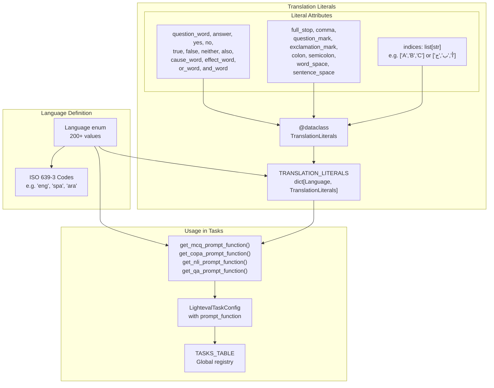
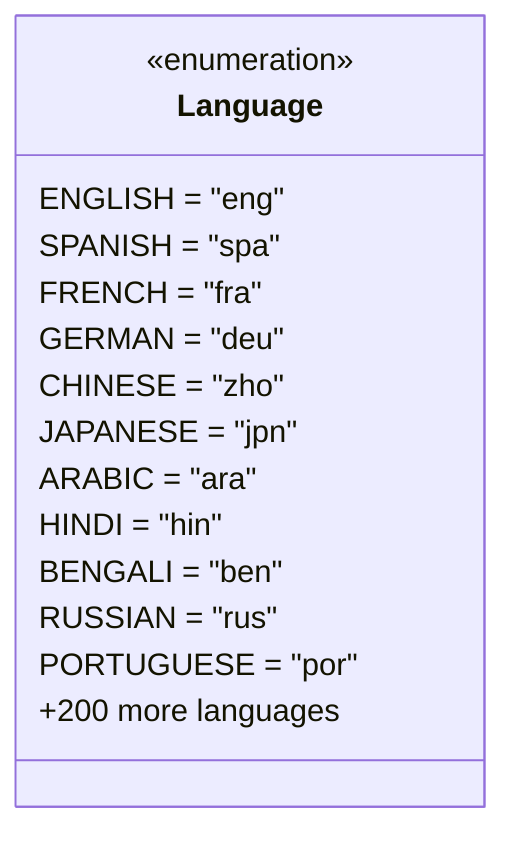
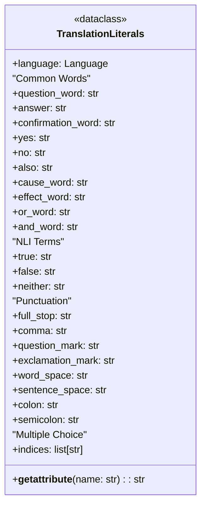
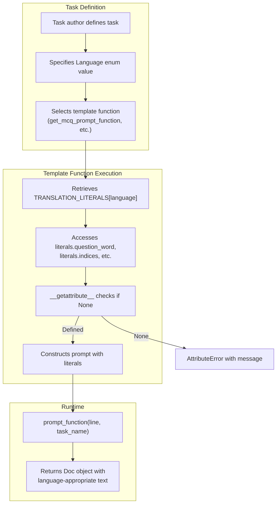
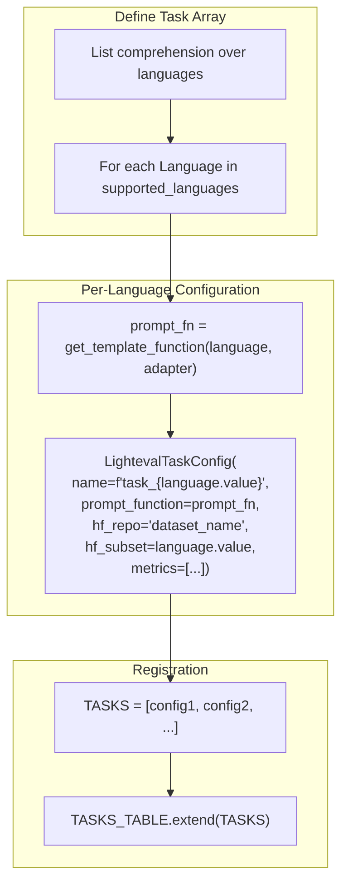
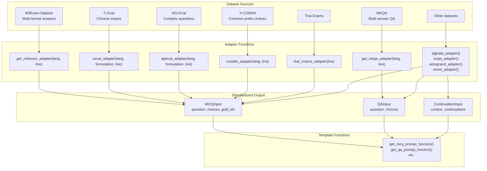
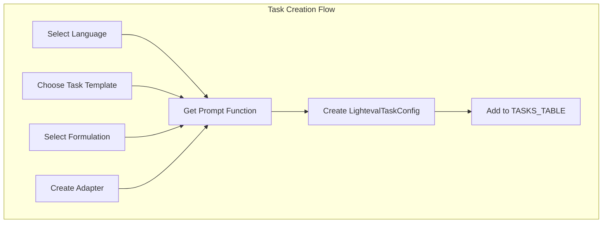

<!-- source: DeepWiki mcp.deepwiki.com · repo huggingface/lighteval · page 5.4 Multilingual Tasks · fetched 2026-10-26 -->

# Multilingual Tasks

<details>
<summary>Relevant source files</summary>

The following files were used as context for generating this wiki page:

- [src/lighteval/tasks/multilingual/adapters.py](src/lighteval/tasks/multilingual/adapters.py)
- [src/lighteval/tasks/templates/qa.py](src/lighteval/tasks/templates/qa.py)
- [src/lighteval/tasks/templates/utils/translation_literals.py](src/lighteval/tasks/templates/utils/translation_literals.py)
- [src/lighteval/utils/language.py](src/lighteval/utils/language.py)

</details>


This page documents LightEval's multilingual evaluation system, which supports evaluation across 200+ languages. The system is built around two core components: the `Language` enum that provides standardized ISO 639-3 language codes, and the `TranslationLiterals` system that supplies language-specific text elements for prompt construction.

## Language System Overview

LightEval's multilingual architecture consists of:

1. **Language Enum**: Defines 200+ languages with ISO 639-3 codes
2. **TranslationLiterals**: Provides language-specific text elements (punctuation, keywords, indices)
3. **Task Templates**: Generic prompt functions that accept a `Language` parameter
4. **Multilingual Task Definitions**: Language-specific task configurations using templates

The system enables consistent evaluation across languages by abstracting language-specific formatting into reusable components.

**Multilingual System Architecture**



Sources:
- [src/lighteval/utils/language.py:18-241]()
- [src/lighteval/tasks/templates/utils/translation_literals.py:31-74]()
- [src/lighteval/tasks/templates/utils/translation_literals.py:77-1417]()

## Language Enum

The `Language` enum in [src/lighteval/utils/language.py:18-241]() defines 200+ languages using ISO 639-3 three-letter codes. This standardization ensures consistent language identification across the framework.

**Language Enum Structure**



### Language Coverage

The enum includes:

| Language Family | Example Languages | ISO Codes |
|----------------|-------------------|-----------|
| **Indo-European** | English, Spanish, French, German, Russian, Hindi | eng, spa, fra, deu, rus, hin |
| **Sino-Tibetan** | Chinese (Mandarin), Tibetan, Burmese | zho, bod, mya |
| **Afro-Asiatic** | Arabic, Hebrew, Amharic, Hausa | ara, heb, amh, hau |
| **Austronesian** | Tagalog, Indonesian, Malay, Javanese, Cebuano | tgl, ind, msa, jav, ceb |
| **Niger-Congo** | Swahili, Yoruba, Igbo, Zulu, Shona | swa, yor, ibo, zul, sna |
| **Dravidian** | Tamil, Telugu, Kannada, Malayalam | tam, tel, kan, mal |
| **Turkic** | Turkish, Uzbek, Kazakh, Azerbaijani | tur, uzb, kaz, aze |

### Language Mapping Utilities

The module provides mapping functions for handling language code variations:

- `manage_duplicate_language_codes()`: Normalizes duplicate codes (e.g., "npi" → "nep" for Nepali)
- `iso_639_3_ind_to_iso_639_3_macro`: Maps individual ISO 639-3 codes to macro language codes

Sources:
- [src/lighteval/utils/language.py:18-241]()
- [src/lighteval/utils/language.py:259-385]()

## TranslationLiterals System

The `TranslationLiterals` dataclass in [src/lighteval/tasks/templates/utils/translation_literals.py:31-74]() provides language-specific text elements for prompt construction. It contains three categories of attributes:

**TranslationLiterals Structure**



### Attribute Categories

**1. Common Words** (lines 36-45)
- `question_word`: Label for questions (e.g., "question" / "سؤال" / "问题")
- `answer`: Label for answers
- `yes` / `no`: Boolean responses
- `also`, `cause_word`, `effect_word`: Logical connectors
- `or_word`, `and_word`: Conjunctions

**2. NLI (Natural Language Inference) Terms** (lines 47-50)
- `true`, `false`, `neither`: For entailment classification tasks

**3. Punctuation** (lines 52-60)
- `full_stop`, `comma`, `question_mark`, `exclamation_mark`: Sentence terminators
- `word_space`, `sentence_space`: Spacing (varies by language; e.g., Chinese uses "" for no space)
- `colon`, `semicolon`: Delimiters

**4. Multiple Choice Indices** (line 63)
- `indices`: List of characters for answer choices (defaults to `ascii_uppercase`)
- Language-specific: Latin "A, B, C, D" vs Arabic "أ, ب, ج, د" vs Greek "Α, Β, Γ, Δ"

### Error Handling Mechanism

The `__getattribute__` method (lines 65-74) enforces required translations:

```python
def __getattribute__(self, name: str) -> str:
    value = super().__getattribute__(name)
    if value is None:
        raise AttributeError(
            f"Translation for '{name}' is needed for {self.language}. "
            "Please provide its implementation..."
        )
    return value
```

This ensures that when a prompt function accesses an undefined literal, a clear error message directs developers to add the translation.

### Translation Coverage

The `TRANSLATION_LITERALS` dictionary (lines 77-1417) maps each `Language` enum value to its `TranslationLiterals` instance. Coverage varies by language:

| Language | Status | Example Literals |
|----------|--------|------------------|
| **English** | Full | question="question", yes="yes", indices=["A", "B", ...] |
| **Arabic** | Full | question="سؤال", yes="نعم", indices=["أ", "ب", "ج", "د"] |
| **Chinese** | Full | question="问题", full_stop="。", word_space="" (no space) |
| **Japanese** | Full | question="質問", comma="、", word_space="" |
| **Russian** | Full | question="вопрос", indices=["А", "Б", "В", "Г"] |
| **Spanish** | Full | question="pregunta", yes="sí", or_word="o" |
| **Hindi** | Full | question="सवाल", full_stop="।", indices=["क", "ख", "ग"] |
| **Many others** | Partial | Only `language` field defined; others raise AttributeError when accessed |

**Example: Arabic TranslationLiterals** (lines 83-106)
```python
Language.ARABIC: TranslationLiterals(
    language=Language.ARABIC,
    question_word="سؤال",
    answer="إجابة",
    yes="نعم",
    no="لا",
    comma="،",  # Arabic comma
    question_mark="؟",  # Arabic question mark
    indices=["أ", "ب", "ج", "د", "هـ", "و", "ز", "ح"],
    # ... other fields
)
```

**Example: Chinese TranslationLiterals** (lines 283-306)
- Uses Chinese-specific punctuation: full_stop="。", comma="，", question_mark="？"
- No spaces between words: word_space="", sentence_space=""
- Uses Latin indices: indices=["A", "B", "C", ...]

Sources:
- [src/lighteval/tasks/templates/utils/translation_literals.py:31-74]()
- [src/lighteval/tasks/templates/utils/translation_literals.py:83-106]()
- [src/lighteval/tasks/templates/utils/translation_literals.py:283-306]()
- [src/lighteval/tasks/templates/utils/translation_literals.py:408-430]()

## Using TranslationLiterals in Tasks

Task templates access `TranslationLiterals` through the `TRANSLATION_LITERALS` dictionary to construct language-appropriate prompts. Template functions like `get_mcq_prompt_function()`, `get_qa_prompt_function()`, etc., accept a `Language` parameter and retrieve the corresponding literals.

**Translation Literals Usage Flow**



### Example: QA Template with Language Support

The `get_qa_prompt_function()` in [src/lighteval/tasks/templates/qa.py:46-80]() demonstrates how templates use the `Language` parameter:

```python
def get_qa_prompt_function(
    language: Language, 
    adapter: Callable[[dict], QAInput | None] | QAAdapter
):
    """Create a templated prompt function for a QA task."""
    # Internally delegates to get_mcq_prompt_function
    # which accesses TRANSLATION_LITERALS[language]
    multichoice_prompt_fn = get_mcq_prompt_function(
        language, 
        adapter=adapter_for_mcq, 
        formulation=CFFormulation()
    )
    return multichoice_prompt_fn
```

The `get_mcq_prompt_function()` internally:
1. Retrieves `literals = TRANSLATION_LITERALS[language]`
2. Accesses attributes like `literals.indices`, `literals.question_word`, etc.
3. Constructs prompts using these language-specific elements
4. If any required literal is `None`, raises `AttributeError` with guidance

### Multilingual Task Creation Pattern

**Pattern for Creating Multilingual Tasks**



**Example: Creating multilingual NLI tasks**
```python
XNLI_LANGUAGES = [Language.ENGLISH, Language.FRENCH, Language.SPANISH, ...]

XNLI_TASKS = [
    LightevalTaskConfig(
        name=f"xnli_{lang.value}",
        prompt_function=get_nli_prompt_function(
            language=lang,
            adapter=xnli_adapter,
            formulation=MCFFormulation()
        ),
        hf_repo="facebook/xnli",
        hf_subset=lang.value,
        metrics=[Metrics.loglikelihood_acc_norm],
        ...
    )
    for lang in XNLI_LANGUAGES
]

TASKS_TABLE.extend(XNLI_TASKS)
```

Sources:
- [src/lighteval/tasks/templates/qa.py:46-80]()
- [src/lighteval/tasks/templates/utils/translation_literals.py:77-1417]()

## Language-Specific Formatting Considerations

Different languages require different formatting approaches in prompts:

### Punctuation Variations

| Language | Full Stop | Comma | Question Mark | Word Space |
|----------|-----------|-------|---------------|------------|
| English | `.` | `,` | `?` | `" "` (space) |
| Arabic | `.` | `،` (Arabic comma) | `؟` (Arabic question mark) | `" "` |
| Chinese | `。` | `，` | `？` | `""` (no space) |
| Japanese | `。` | `、` | `？` | `""` (no space) |
| Greek | `.` | `,` | `;` (Greek question mark!) | `" "` |
| Hindi | `।` (Devanagari danda) | `,` | `?` | `" "` |

### Multiple Choice Indices

Different scripts use different characters for answer choices:

| Language | Indices Example |
|----------|-----------------|
| **Latin-based** | A, B, C, D, E, F, G, H |
| **Arabic** | أ, ب, ج, د, هـ, و, ز, ح |
| **Cyrillic** (Russian, Bulgarian, etc.) | А, Б, В, Г, Д, Е |
| **Devanagari** (Hindi) | क, ख, ग, घ, ङ, च |
| **Bengali** | ক, খ, গ, ঘ, ঙ, চ |
| **Thai** | ๑, ๒, ๓, ๔, ๕, ๖, ๗, ๘, ๙, ๐ |

These indices are accessed via `TRANSLATION_LITERALS[language].indices` and used in multiple-choice task formatting.

### Spacing Conventions

Languages differ in word spacing:
- **Space-separated**: Most European, Semitic, Indic languages use `word_space=" "`
- **No word spacing**: Chinese, Japanese, Thai use `word_space=""`
- **Sentence spacing**: May differ from word spacing (e.g., Thai: `word_space=""`, `sentence_space=" "`)

Sources:
- [src/lighteval/tasks/templates/utils/translation_literals.py:83-106]() (Arabic)
- [src/lighteval/tasks/templates/utils/translation_literals.py:283-306]() (Chinese)
- [src/lighteval/tasks/templates/utils/translation_literals.py:723-745]() (Japanese)
- [src/lighteval/tasks/templates/utils/translation_literals.py:1242-1264]() (Thai)

## Language-Specific Dataset Adapters

Multilingual benchmarks often have language-specific formatting quirks that require specialized adapters. The `src/lighteval/tasks/multilingual/adapters.py` module provides adapter functions that handle dataset-specific formatting and convert raw data into standardized input formats (`MCQInput`, `QAInput`, `ContinuationInput`).

**Adapter Function Architecture**



### Common Adapter Patterns

**1. Answer Format Normalization**

Many datasets use inconsistent answer formats. Adapters normalize these:

| Adapter Function | Dataset | Answer Format Issue | Solution |
|-----------------|---------|---------------------|----------|
| `get_m3exam_adapter()` | M3Exam | Answers prefixed with "(A)" or "A." | Regex `M3_EXAM_ANSWER_PREFIX_RE` removes prefixes (line 44) |
| `thai_exams_adapter()` | Thai exams | Letter-based keys (a, b, c, d, e) | Extracts choices by lowercase letter keys (lines 65-77) |
| `ceval_adapter()` | C-Eval | Embedded Chinese number choices (①②③④) | Extracts from question text (lines 104-157) |
| `agieval_adapter()` | AGI-Eval | Multi-choice with Chinese numbers | Extracts and converts to single choice (lines 160-220) |

**2. Question Parsing and Cleaning**

Some datasets embed choices within question text. Adapters extract and separate them:

**C-Eval Adapter Logic** ([src/lighteval/tasks/multilingual/adapters.py:104-157]())
```python
def ceval_adapter(lang: Language, formulation: Formulation, line: dict) -> MCQInput | None:
    # 1. Split question from embedded answer indicators
    parts = line["question"].rsplit("____", maxsplit=1)
    cleaned_question = parts[0].rstrip(WHITESPACES)
    possible_answers_part = parts[1].lstrip(PUNCT + WHITESPACES).rstrip()
    
    # 2. Extract Chinese number choices if present (①②③④)
    maybe_extracted_answers = extract_answers_from_string(...)
    
    # 3. Reconstruct clean question and choices
    # Returns MCQInput with cleaned components
```

**AGI-Eval Adapter Logic** ([src/lighteval/tasks/multilingual/adapters.py:160-220]())
```python
def agieval_adapter(lang: Language, formulation: Formulation, line: dict) -> MCQInput | None:
    # 1. Parse structured format: "问题：... 选项：... 答案：..."
    context, rest = line["query"].split("问题：", maxsplit=1)
    question, _ = rest.split(" 选项：", maxsplit=1)
    
    # 2. Clean answer prefixes and extract full answers from question
    # 3. Convert multi-choice to single choice using multichoice_to_single_choice()
    # 4. Validate choices are substantive (not just numbers)
```

**3. Common Prefix Extraction**

Some datasets have common prefixes in all choices. Adapters remove these for cleaner prompts:

**X-CODAH Adapter** ([src/lighteval/tasks/multilingual/adapters.py:223-248]())
```python
def xcodah_adapter(lang: Language, line: dict) -> MCQInput | None:
    choices = line["question"]["choices"]["text"]
    
    # Find common prefix across all choices
    common_prefix = os.path.commonprefix(choices)
    
    # Backtrack to first word boundary
    first_word = common_prefix.rfind(translation_literals.word_space)
    common_prefix = common_prefix[:first_word] if first_word != -1 else ""
    
    # Remove common prefix from each choice, use as question
    cleaned_choices = [choice[len(common_prefix):] for choice in choices]
    
    return {
        "question": common_prefix,
        "choices": cleaned_choices,
        "gold_idx": gold_index,
    }
```

**4. Multi-Answer Handling**

QA datasets may have multiple valid answers (aliases). Adapters aggregate these:

**MKQA Adapter** ([src/lighteval/tasks/multilingual/adapters.py:268-285]())
```python
def get_mkqa_adapter(lang: Language, line: dict) -> QAInput | None:
    lang_key = "zh_cn" if lang == Language.CHINESE else standardize_tag(lang.value)
    
    # Collect main answer and aliases
    text = line["answers"][lang_key][0]["text"]
    aliases = line["answers"][lang_key][0]["aliases"]
    answers = list(filter(lambda x: len(x.strip()) > 0, [text] + aliases))
    
    # Validate reasonable number of answers (heuristic for broken data)
    if len(answers) == 0 or len(answers) > 5:
        return None
    
    return {
        "question": line["queries"][lang_key],
        "choices": answers,  # All valid answers
    }
```

### Adapter Utility Functions

The module includes utility functions in [src/lighteval/tasks/multilingual/utils/adapters_utils.py]():

| Function | Purpose | Used By |
|----------|---------|---------|
| `extract_answers_from_string()` | Extracts numbered choices (①②③④) from text | `ceval_adapter()`, `agieval_adapter()` |
| `multichoice_join()` | Joins multiple correct answers with proper formatting | `ceval_adapter()`, `agieval_adapter()` |
| `multichoice_to_single_choice()` | Converts multi-answer choices to single flattened choices | `agieval_adapter()` |

### Creating Custom Adapters

When adding a new multilingual dataset, create an adapter function that:

1. **Signature**: Takes `line: dict` (and optionally `lang: Language`, `formulation: Formulation`) and returns `MCQInput | QAInput | ContinuationInput | None`
2. **Validation**: Returns `None` for malformed samples (missing data, empty choices, invalid indices)
3. **Cleaning**: Removes dataset-specific formatting artifacts (prefixes, embedded markers, etc.)
4. **Standardization**: Maps to the appropriate input type with required fields

**Example: Custom Adapter Template**
```python
def my_dataset_adapter(lang: Language, line: dict) -> MCQInput | None:
    # 1. Validate required fields exist
    if "question" not in line or "options" not in line:
        return None
    
    # 2. Clean and extract components
    question = line["question"].strip()
    choices = [clean_text(opt) for opt in line["options"]]
    gold_idx = int(line["correct_answer_index"])
    
    # 3. Validate data quality
    if not all(len(c) > 0 for c in choices) or gold_idx >= len(choices):
        return None
    
    # 4. Return standardized format
    return {
        "question": question,
        "choices": choices,
        "gold_idx": gold_idx,
        "context": line.get("context", ""),  # Optional fields
    }
```

Sources:
- [src/lighteval/tasks/multilingual/adapters.py:44-301]()
- [src/lighteval/tasks/multilingual/utils/adapters_utils.py]()

## Supported Multilingual Task Types

LightEval includes several categories of multilingual tasks, each implemented with appropriate templates and adapters:

### NLI (Natural Language Inference) Tasks

NLI tasks evaluate a model's ability to determine relationships between sentences across languages.

**Implementation Pattern**: Uses `get_nli_prompt_function()` with `MCFFormulation()` or `CFFormulation()`

| Task Family | Datasets | Languages | Adapter |
|-------------|----------|-----------|---------|
| **XNLI** | facebook/xnli | 15 languages | Direct field mapping |
| **XNLI 2.0** | Haerae-Hub/XNLI2.0 | 18 languages | Direct field mapping |
| **Indic XNLI** | Divyanshu/indicxnli | 11 Indic languages | Direct field mapping |
| **African XNLI** | masakhane/africanli | African languages | Direct field mapping |
| **PAWS-X** | google-research-datasets/paws-x | 7 languages | Paraphrase detection |

Example task names: `xnli_ara`, `xnli2_spa`, `indicxnli_hin`, `pawsx_fra`

Sources:
- [src/lighteval/tasks/multilingual/tasks.py:65-454]()

### COPA (Choice of Plausible Alternatives) Tasks

COPA tasks test common sense reasoning and causal inference.

**Implementation Pattern**: Uses `get_copa_prompt_function()` which accesses `translation_literals.cause_word` and `translation_literals.effect_word`

| Task Family | Dataset | Languages | Adapter |
|-------------|---------|-----------|---------|
| **XCOPA** | stanfordnlp/xcopa | 11 languages | Direct field mapping |
| **IndicCOPA** | ai4bharat/IndicCOPA | 13 Indic languages | Direct field mapping |
| **PARus** | russian-nlp/parus | Russian | Direct field mapping |

Example task names: `xcopa_vi`, `indiccopa_ta`, `parus`

Sources:
- [src/lighteval/tasks/multilingual/tasks.py:456-595]()

### Hellaswag Tasks

Hellaswag evaluates commonsense reasoning through scenario completion.

**Implementation Pattern**: Uses `get_hellaswag_prompt_function()` with language-specific context and activity labels

| Task Family | Dataset | Languages | Notes |
|-------------|---------|-----------|-------|
| **MLMM-Hellaswag** | jon-tow/okapi_hellaswag | 70+ languages | Multilingual machine-translated |
| **Language-specific** | Various | Turkish, Thai, Hindi, Telugu | Native language adaptations |

Example task names: `mlmm_hellaswag_tur`, `hellaswag_thai`, `hellaswag_hindi`

Sources:
- [src/lighteval/tasks/multilingual/tasks.py:596-811]()

### Reading Comprehension Tasks

QA tasks evaluate understanding and information extraction across languages.

**Implementation Pattern**: Uses `get_qa_prompt_function()` or extractive QA templates with language-specific adapters

| Task Family | Dataset | Languages | Adapter Function |
|-------------|---------|-----------|------------------|
| **XQuAD** | google/xquad | 11 languages | Direct field mapping |
| **MKQA** | apple/mkqa | 26 languages | `get_mkqa_adapter()` (handles aliases) |
| **MLQA** | facebook/mlqa | 7 languages | Direct field mapping |
| **TyDi QA** | google-research-datasets/tydiqa | 11 languages | Extractive QA format |

Example task names: `xquad_es`, `mkqa_ja`, `mlqa_de`, `tydiqa_ar`

Sources:
- [src/lighteval/tasks/multilingual/tasks.py:812-1083]()
- [src/lighteval/tasks/multilingual/adapters.py:268-285]()

### Exam and Knowledge Tasks

Tasks based on educational exams and knowledge assessments, often requiring specialized adapters.

| Task Family | Dataset | Languages | Adapter Function | Special Handling |
|-------------|---------|-----------|------------------|------------------|
| **M3Exam** | DAMO-NLP-SG/M3Exam | Multilingual | `get_m3exam_adapter()` | Removes answer prefixes |
| **C-Eval** | ceval/ceval-exam | Chinese | `ceval_adapter()` | Extracts embedded choices |
| **AGI-Eval** | ruixing76/agi-eval | Chinese | `agieval_adapter()` | Multi-choice to single |
| **Thai Exams** | scb10x/thai_exam | Thai | `thai_exams_adapter()` | Letter key mapping |
| **ENEM** | brazilianmodels/enem | Portuguese | `enem_adapter()` | Placeholder substitution |

Example task names: `m3exam_tha`, `ceval_chinese`, `agieval_chinese`, `thai_exams`, `enem`

Sources:
- [src/lighteval/tasks/multilingual/adapters.py:48-301]()

## Task Implementation Pattern

Multilingual tasks follow a common implementation pattern:



Common implementation pattern:

1. Create an array of tasks using list comprehension
2. For each language and formulation:
   - Get appropriate prompt function
   - Create a task config with language-specific settings
   - Configure metrics, data sources, and evaluation parameters
3. Add to the global `TASKS_TABLE`

Sources:
- [src/lighteval/tasks/multilingual/tasks.py:74-123]()
- [src/lighteval/tasks/multilingual/tasks.py:463-503]()

## Creating Custom Multilingual Tasks

### Step-by-Step Process

**1. Verify Language Support**

Check if your language exists in the `Language` enum ([src/lighteval/utils/language.py:18-241]()). If not, add it with its ISO 639-3 code.

**2. Add or Verify Translation Literals**

Check `TRANSLATION_LITERALS` for your language. If missing or incomplete, add literals following the pattern in [src/lighteval/tasks/templates/utils/translation_literals.py:77-1417]().

**3. Create Dataset Adapter**

Define an adapter function that maps your dataset's structure to the expected input format:

```python
def my_adapter(line: dict) -> MCQInput | None:
    return {
        "context": line.get("passage", ""),
        "question": line["question"],
        "choices": line["options"],
        "gold_idx": line["correct_answer_index"],
        "instruction": line.get("instructions", ""),
    }
```

**4. Select Task Template**

Choose the appropriate template function based on task type:

| Task Type | Template Function | Use Case |
|-----------|------------------|----------|
| Multiple Choice | `get_mcq_prompt_function(language, adapter, formulation)` | Classification, QA with options |
| QA | `get_qa_prompt_function(language, adapter)` | Open-ended QA, extractive QA |
| NLI | `get_nli_prompt_function(language, adapter, formulation)` | Entailment tasks |
| COPA | `get_copa_prompt_function(language, adapter)` | Causal reasoning |
| Hellaswag | `get_hellaswag_prompt_function(language, adapter)` | Commonsense completion |
| BoolQ | `get_boolq_prompt_function(language, adapter)` | Yes/no questions |

**5. Create Task Configuration**

```python
from lighteval.tasks.lighteval_task import LightevalTaskConfig
from lighteval.metrics.metrics import Metrics
from lighteval.utils.language import Language

MY_TASK = LightevalTaskConfig(
    name="my_custom_task_ara",  # Include language code in name
    prompt_function=get_mcq_prompt_function(
        language=Language.ARABIC,
        adapter=my_adapter,
        formulation=MCFFormulation()
    ),
    hf_repo="organization/dataset_name",
    hf_subset="arabic",  # Dataset subset for the language
    evaluation_splits=["test"],
    few_shots_split="train",
    few_shots_select="sequential",
    metric=[Metrics.loglikelihood_acc, Metrics.loglikelihood_acc_norm],
    generation_size=-1,  # -1 for loglikelihood tasks
    trust_dataset=True,
    version=0,
)
```

**6. Register Task**

Add to `TASKS_TABLE` in your tasks file:
```python
TASKS_TABLE = [MY_TASK]  # or TASKS_TABLE.extend([...])
```

### Example: Multilingual Task Array

Create tasks for multiple languages at once:

```python
SUPPORTED_LANGUAGES = [
    Language.ENGLISH, Language.SPANISH, Language.FRENCH, 
    Language.GERMAN, Language.CHINESE, Language.ARABIC
]

MY_MULTILINGUAL_TASKS = [
    LightevalTaskConfig(
        name=f"my_benchmark_{lang.value}",
        prompt_function=get_mcq_prompt_function(
            language=lang,
            adapter=my_adapter,
            formulation=MCFFormulation()
        ),
        hf_repo="my_org/my_multilingual_dataset",
        hf_subset=lang.value,
        evaluation_splits=["test"],
        metric=[Metrics.loglikelihood_acc_norm],
        ...
    )
    for lang in SUPPORTED_LANGUAGES
]

TASKS_TABLE.extend(MY_MULTILINGUAL_TASKS)
```

### Combining Adapters with Templates

When your dataset requires both language-specific cleaning and template formatting, chain the adapter with the template function:

**Example: C-Eval with Language-Specific Adapter**
```python
from functools import partial

# Create language-specific adapter with formulation
ceval_mcf_adapter = partial(
    ceval_adapter, 
    lang=Language.CHINESE, 
    formulation=MCFFormulation()
)

# Use adapter in task configuration
CEVAL_TASK = LightevalTaskConfig(
    name="ceval_chinese_mcf",
    prompt_function=get_mcq_prompt_function(
        language=Language.CHINESE,
        adapter=ceval_mcf_adapter,
        formulation=MCFFormulation()
    ),
    hf_repo="ceval/ceval-exam",
    hf_subset="default",
    ...
)
```

This pattern is used throughout [src/lighteval/tasks/multilingual/tasks.py]() for datasets with complex formatting requirements.

### Handling Missing Translations

If your task accesses a `TranslationLiterals` attribute that's not defined for your language:

1. The `__getattribute__` method will raise `AttributeError` with a message:
   ```
   Translation for 'question_word' is needed for Language.EXAMPLE. 
   Please provide its implementation by editing 
   'src/lighteval/tasks/templates/utils/translation_literals.py'
   ```

2. Add the translation to the `TRANSLATION_LITERALS` dictionary for that language
3. Re-run your evaluation

Sources:
- [src/lighteval/tasks/templates/utils/translation_literals.py:65-74]()
- [src/lighteval/tasks/templates/qa.py:46-80]()
- [src/lighteval/tasks/multilingual/adapters.py:104-220]()

## Language Support Status

### Fully Supported Languages

Languages with complete `TranslationLiterals` definitions (all required fields populated):

| Region | Languages (count) | Example Codes |
|--------|------------------|---------------|
| **European** | 25+ | English (eng), Spanish (spa), French (fra), German (deu), Russian (rus), Polish (pol), Italian (ita), Portuguese (por), Dutch (nld), Swedish (swe), Norwegian (nor), Danish (dan), Finnish (fin), Czech (ces), Slovak (slk), Croatian (hrv), Serbian (srp), Bulgarian (bul), Greek (ell), Ukrainian (ukr), Belarusian (bel), Romanian (ron), Hungarian (hun), Icelandic (isl), Estonian (est), Catalan (cat), Galician (glg), Basque (eus) |
| **Asian** | 15+ | Chinese (zho), Japanese (jpn), Korean (kor), Vietnamese (vie), Thai (tha), Indonesian (ind), Tagalog (tgl), Cebuano (ceb), Turkish (tur), Uzbek (uzb) |
| **Indic** | 8+ | Hindi (hin), Bengali (ben), Tamil (tam), Telugu (tel), Gujarati (guj), Punjabi (pan) |
| **Middle Eastern** | 5+ | Arabic (ara), Hebrew (heb), Persian (fas), Urdu (urd) |
| **African** | 3+ | Swahili (swa), Amharic (amh) |
| **Other** | 5+ | Bashkir (bak), Tatar (tat), Udmurt (udm), Shan (shn) |

### Partially Supported Languages

200+ languages defined in `Language` enum but with minimal `TranslationLiterals` (only `language` field). These can be used for tasks that don't require language-specific literals, or will raise `AttributeError` when literals are accessed.

Examples: Acehnese, Afrikaans, Akan, Albanian, Amharic (various African and regional languages).

### Adding Full Support for a Language

To promote a language from partial to full support:

1. Add a `TranslationLiterals` entry in `TRANSLATION_LITERALS` dictionary
2. Populate all relevant fields (see example below)
3. Test with existing task templates

**Example: Adding Full Support for a New Language**
```python
# In translation_literals.py
Language.NEW_LANGUAGE: TranslationLiterals(
    language=Language.NEW_LANGUAGE,
    question_word="...",
    answer="...",
    confirmation_word="...",
    yes="...",
    no="...",
    also="...",
    cause_word="...",
    effect_word="...",
    or_word="...",
    and_word="...",
    true="...",
    false="...",
    neither="...",
    full_stop=".",
    comma=",",
    question_mark="?",
    exclamation_mark="!",
    word_space=" ",
    sentence_space=" ",
    colon=":",
    semicolon=";",
    indices=["A", "B", "C", "D", "E", "F"],  # Or language-specific
)
```

Sources:
- [src/lighteval/utils/language.py:18-241]()
- [src/lighteval/tasks/templates/utils/translation_literals.py:77-1417]()

## Adding Support for New Languages

To add support for a new language:

1. Add the language to the `Language` enum with its ISO 639-3 code
2. Create a `TranslationLiterals` instance for the language with appropriate translations
3. Add the language to the `TRANSLATION_LITERALS` dictionary
4. Create task configurations for the language using appropriate templates

When adding translations, ensure you provide all required literals such as question words, yes/no terms, and appropriate punctuation for the language.

Sources:
- [src/lighteval/tasks/templates/utils/translation_literals.py:69-73]()
- [src/lighteval/tasks/templates/utils/translation_literals.py:77-1085]()

## Community Contributions

The framework supports community contributions of language-specific tasks, as demonstrated by the Arabic evaluation tasks. These contributions can include:

- Language-specific benchmarks (e.g., ArabicMMLU)
- Translated versions of existing benchmarks (e.g., Arabic MMLU Human Translated)
- Culture-specific evaluation datasets (e.g., ACVA - Arabic Cultural Values Assessment)

Sources:
- [community_tasks/arabic_evals.py]()

---

