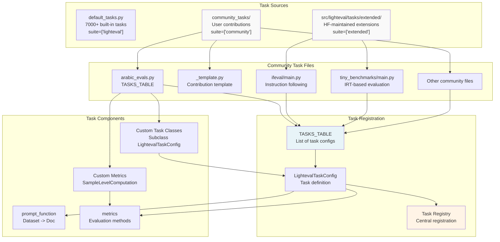
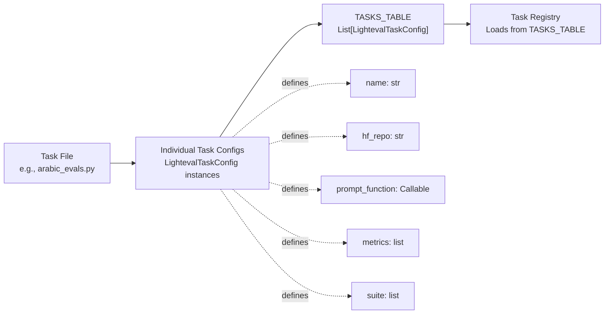
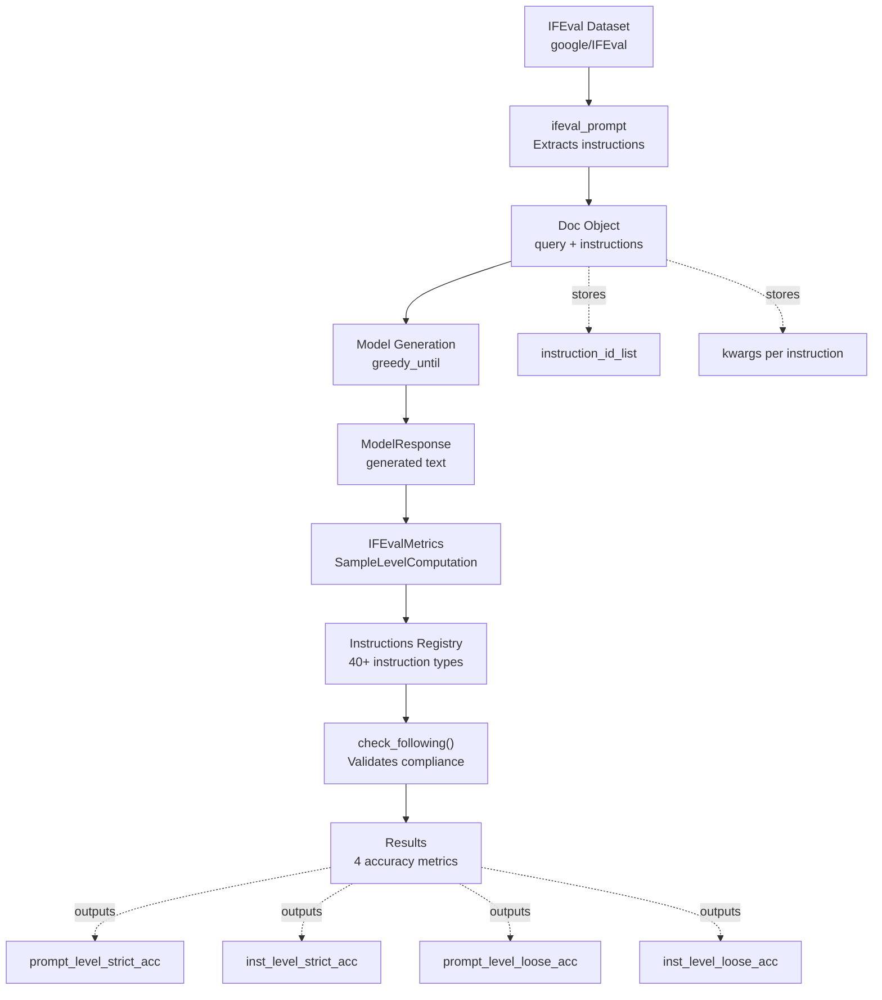
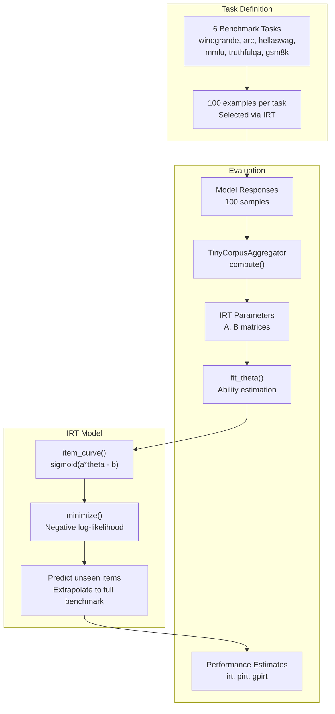
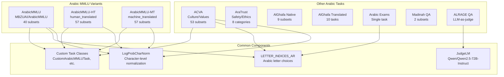
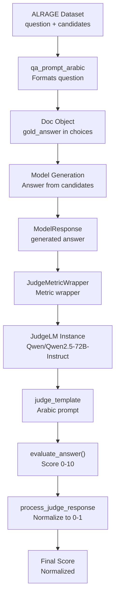
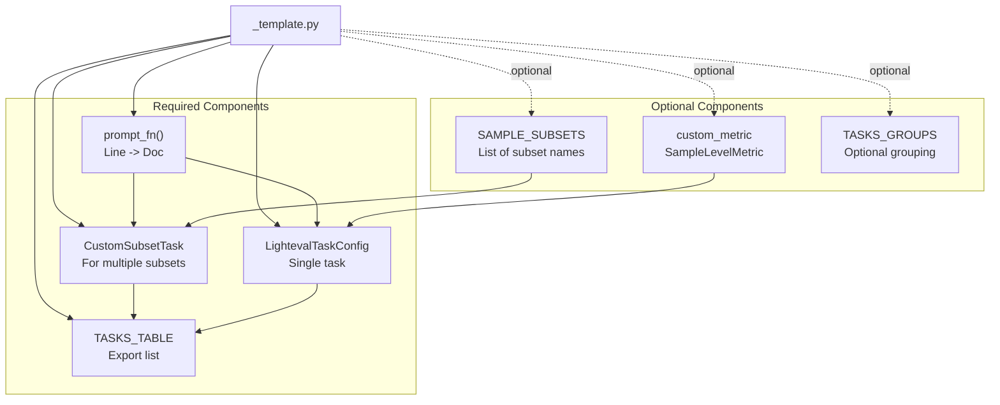

<!-- source: DeepWiki mcp.deepwiki.com · repo huggingface/lighteval · page 5.5 Community Tasks · fetched 2026-10-26 -->

# Community Tasks

<details>
<summary>Relevant source files</summary>

The following files were used as context for generating this wiki page:

- [examples/nanotron/custom_evaluation_tasks.py](examples/nanotron/custom_evaluation_tasks.py)
- [examples/nanotron/custom_task.py](examples/nanotron/custom_task.py)
- [src/lighteval/main_tasks.py](src/lighteval/main_tasks.py)
- [src/lighteval/metrics/metrics_corpus.py](src/lighteval/metrics/metrics_corpus.py)
- [src/lighteval/tasks/multilingual/tasks/global_mmlu.py](src/lighteval/tasks/multilingual/tasks/global_mmlu.py)
- [src/lighteval/tasks/registry.py](src/lighteval/tasks/registry.py)
- [src/lighteval/tasks/tasks/aimo.py](src/lighteval/tasks/tasks/aimo.py)
- [src/lighteval/tasks/tasks/ifbench/instructions.py](src/lighteval/tasks/tasks/ifbench/instructions.py)

</details>


This page documents extended and community-contributed evaluation tasks in lighteval. Community tasks are specialized evaluations that extend beyond the default task library, including instruction following benchmarks, language-specific evaluations, and research-oriented assessments.

**Related pages**: For information about the built-in task library, see [Default Tasks](#5.2). For multilingual tasks using `TranslationLiterals`, see [Multilingual Tasks](#5.3). For creating your own custom tasks from scratch, see [Custom Tasks](#5.5).

## Purpose and Scope

Community tasks serve two primary purposes:

1. **Extended tasks**: Advanced evaluation tasks maintained by the HuggingFace team that require specialized metrics or evaluation logic (e.g., IFEval for instruction following, Tiny Benchmarks for IRT-based evaluation)
2. **Community contributions**: Domain-specific, language-specific, or research-oriented tasks contributed by the community (e.g., Arabic language evaluations, specialized benchmarks)

Community tasks are distinguished from default tasks by their `suite` designation (`"community"` or `"extended"`) and their location in the repository structure.

## Architecture Overview



**Diagram**: Community Tasks Architecture - Shows how community and extended tasks are organized, defined, and registered in the lighteval system.

**Sources**: [community_tasks/arabic_evals.py:1-1052](), [src/lighteval/tasks/extended/ifeval/main.py:1-167](), [community_tasks/_template.py:1-115]()

## Directory Structure

Community tasks are organized in two primary locations:

| Location | Purpose | Suite Designation | Access Pattern |
|----------|---------|-------------------|----------------|
| `community_tasks/` | User-contributed tasks | `suite=["community"]` | `community\|task_name\|num_shots` |
| `src/lighteval/tasks/extended/` | HF-maintained extensions | `suite=["extended"]` | `extended\|task_name\|num_shots` |

Each location contains Python files that define `TASKS_TABLE`, a list of `LightevalTaskConfig` objects.

**Sources**: [community_tasks/arabic_evals.py:27-28](), [src/lighteval/tasks/extended/ifeval/main.py:152-153]()

## Task Definition Pattern

### TASKS_TABLE Convention

All community task files must export a `TASKS_TABLE` variable containing a list of `LightevalTaskConfig` instances:



**Diagram**: TASKS_TABLE Pattern - Standard structure for defining community tasks that the registry can discover and load.

**Sources**: [community_tasks/arabic_evals.py:1030-1052](), [community_tasks/_template.py:103-104]()

### Basic Task Definition

A simple community task follows this pattern:

```python
# Define prompt function
def prompt_fn(line, task_name: str = None):
    return Doc(
        task_name=task_name,
        query=line["question"],
        choices=line["choices"],
        gold_index=line["answer"],
        instruction=""
    )

# Define task config
task = LightevalTaskConfig(
    name="my_task",
    prompt_function=prompt_fn,
    suite=["community"],
    hf_repo="org/dataset",
    hf_subset="default",
    hf_avail_splits=["train", "test"],
    evaluation_splits=["test"],
    few_shots_split="train",
    few_shots_select="random_sampling",
    metrics=[Metrics.loglikelihood_acc],
    generation_size=-1,
    stop_sequence=None,
    version=0
)

# Export for registry
TASKS_TABLE = [task]
```

**Sources**: [community_tasks/_template.py:41-69]()

## Extended Tasks

Extended tasks are advanced evaluations maintained by the HuggingFace team that require specialized logic or metrics.

### IFEval: Instruction Following Evaluation

IFEval tests whether models can follow specific format instructions (e.g., "include exactly 3 bullet points", "end with 'P.S.'"):



**Diagram**: IFEval Evaluation Flow - Shows how instruction-following compliance is checked against a registry of instruction types.

Key components:
- **Prompt function**: [src/lighteval/tasks/extended/ifeval/main.py:38-47]() - Stores instruction IDs and kwargs in `Doc.specific`
- **Metrics**: [src/lighteval/tasks/extended/ifeval/main.py:62-126]() - `IFEvalMetrics` class checks compliance
- **Instruction registry**: [src/lighteval/tasks/extended/ifeval/instructions_registry.py]() - 40+ instruction types
- **Aggregation**: [src/lighteval/tasks/extended/ifeval/main.py:135-146]() - Both prompt-level and instruction-level accuracy

**Sources**: [src/lighteval/tasks/extended/ifeval/main.py:1-167]()

### Tiny Benchmarks: IRT-Based Evaluation

Tiny Benchmarks uses Item Response Theory (IRT) to estimate full benchmark performance from a small subset of examples:



**Diagram**: Tiny Benchmarks IRT Pipeline - Shows how IRT parameters are used to estimate full benchmark scores from 100 examples.

Key components:
- **Aggregator**: [src/lighteval/tasks/extended/tiny_benchmarks/main.py:74-182]() - `TinyCorpusAggregator` implements both sample and corpus level computation
- **IRT fitting**: [src/lighteval/tasks/extended/tiny_benchmarks/main.py:57-71]() - `fit_theta()` estimates model ability
- **Three estimates**: 
  - `irt`: Direct average of seen examples
  - `pirt`: Partial IRT combining seen + predicted unseen
  - `gpirt`: Generalized IRT with optimal weighting
- **Task creation**: [src/lighteval/tasks/extended/tiny_benchmarks/main.py:185-263]() - Generates 6 tasks with custom metrics

**Sources**: [src/lighteval/tasks/extended/tiny_benchmarks/main.py:1-284]()

## Community-Contributed Tasks

### Arabic Language Evaluations

The Arabic evaluations showcase comprehensive community contributions with multiple task variants:



**Diagram**: Arabic Evaluations Structure - Shows the comprehensive set of Arabic language tasks with shared components.

#### Task Categories

| Task Family | Subsets | HF Repository | Description |
|-------------|---------|---------------|-------------|
| Arabic MMLU | 40 | `MBZUAI/ArabicMMLU` | Native Arabic multiple-choice QA |
| Arabic MMLU-HT | 57 | `MBZUAI/human_translated_arabic_mmlu` | Human-translated MMLU |
| Arabic MMLU-MT | 57 | `OALL/Arabic_MMLU` | Machine-translated MMLU |
| ACVA | 53 | `OALL/ACVA` | Arabic Culture and Values Assessment |
| AraTrust | 8 | `asas-ai/AraTrust-categorized` | Safety and ethics evaluation |
| AlGhafa Native | 9 | `OALL/AlGhafa-Arabic-LLM-Benchmark-Native` | Native Arabic benchmarks |
| AlGhafa Translated | 10 | `OALL/AlGhafa-Arabic-LLM-Benchmark-Translated` | Translated benchmarks |
| Arabic Exams | 1 | `OALL/Arabic_EXAMS` | Educational exam questions |
| Madinah QA | 2 | `MBZUAI/MadinahQA` | Arabic language comprehension |
| ALRAGE QA | 1 | `OALL/ALRAGE` | Retrieval-augmented QA with LLM judge |

#### Custom Task Classes

For tasks with many subsets, a custom class pattern simplifies definition:

```python
class CustomArabicMMLUTask(LightevalTaskConfig):
    def __init__(self, name, hf_subset):
        super().__init__(
            name=name,
            hf_subset=hf_subset,
            prompt_function=arabic_mmlu_pfn,
            hf_repo="MBZUAI/ArabicMMLU",
            metrics=[Metrics.loglikelihood_acc(
                sample_params={"logprob_normalization": LogProbCharNorm()}
            )],
            hf_avail_splits=["test"],
            evaluation_splits=["test"],
            few_shots_split=["dev"],
            few_shots_select="sequential",
            suite=["community"],
            generation_size=-1,
            stop_sequence=None,
            version=0,
        )

# Generate all subset tasks
ARABIC_MMLU_TASKS = [
    CustomArabicMMLUTask(name=f"arabic_mmlu:{subset}", hf_subset=subset) 
    for subset in ARABIC_MMLU_SUBSETS
]
```

**Sources**: [community_tasks/arabic_evals.py:97-122]()

#### Arabic Letter Indices

Arabic tasks use Arabic letters for multiple-choice options:

```python
LETTER_INDICES_AR = ["أ", "ب", "ج", "د", "هـ", "و", "ز", "ح", ...]
```

Prompt functions map between Latin and Arabic letters:

```python
def arabic_mmlu_pfn(line, task_name: str = None):
    latin_to_arabic = {"A": "أ", "B": "ب", "C": "ج", "D": "د", "E": "هـ"}
    
    # Build choices with Arabic letters
    choices = []
    valid_keys_arabic = []
    for idx, key in enumerate(["A", "B", "C", "D", "E"]):
        option = line.get(f"Option {idx + 1}")
        if option:
            choices.append(option)
            valid_keys_arabic.append(latin_to_arabic[key])
    
    # Find correct answer index
    answer_index = valid_keys_latin.index(line["Answer Key"])
    
    query = f"{instruction}{line['Question']}\n"
    query += "".join([f"{key}. {choice}\n" 
                     for key, choice in zip(valid_keys_arabic, choices)])
    
    return Doc(
        task_name=task_name,
        query=query,
        choices=valid_keys_arabic,
        gold_index=answer_index,
        instruction=instruction,
    )
```

**Sources**: [community_tasks/arabic_evals.py:44-94]()

#### LLM-as-Judge for Arabic QA

The ALRAGE task demonstrates advanced custom metrics using an LLM as judge:



**Diagram**: LLM-as-Judge Flow for ALRAGE - Shows how a separate LLM evaluates generated answers for Arabic QA.

Key components:
- **Judge template**: [community_tasks/arabic_evals.py:939-988]() - Arabic system and user prompts with scoring criteria
- **JudgeLM instance**: [community_tasks/arabic_evals.py:1006-1011]() - Configured with Qwen model and VLLM backend
- **Metric wrapper**: [community_tasks/arabic_evals.py:822-867]() - Implements `Metric` interface
- **Response processor**: [community_tasks/arabic_evals.py:990-1004]() - Extracts and normalizes 0-10 scores to 0-1 range
- **Task configuration**: [community_tasks/arabic_evals.py:1016-1028]() - Generative task with LLM judge metric

**Sources**: [community_tasks/arabic_evals.py:822-1028]()

## Using the Template

The template file provides a starting point for community contributions:

### Template Structure



**Diagram**: Template Structure - Components provided in the community task template file.

### Single Task Example

For a simple evaluation with no subsets:

```python
def prompt_fn(line, task_name: str = None):
    return Doc(
        task_name=task_name,
        query=line["question"],
        choices=line["options"],
        gold_index=line["answer"],
        instruction="",
    )

task = LightevalTaskConfig(
    name="myothertask",
    prompt_function=prompt_fn,
    suite=["community"],
    hf_repo="org/dataset",
    hf_subset="default",
    hf_avail_splits=["train", "test"],
    evaluation_splits=["test"],
    few_shots_split="train",
    few_shots_select="random_sampling",
    metrics=[Metrics.loglikelihood_acc],
)

TASKS_TABLE = [task]
```

**Sources**: [community_tasks/_template.py:41-69]()

### Subset Task Example

For evaluations with multiple subsets (like MMLU):

```python
SAMPLE_SUBSETS = ["algebra", "geometry", "calculus"]

class CustomSubsetTask(LightevalTaskConfig):
    def __init__(self, name, hf_subset):
        super().__init__(
            name=name,
            hf_subset=hf_subset,
            prompt_function=prompt_fn,
            hf_repo="org/dataset",
            metrics=[Metrics.loglikelihood_acc],
            hf_avail_splits=["test"],
            evaluation_splits=["test"],
            few_shots_split="dev",
            few_shots_select="sequential",
            suite=["community"],
            generation_size=-1,
            stop_sequence=None,
        )

SUBSET_TASKS = [
    CustomSubsetTask(name=f"mytask:{subset}", hf_subset=subset) 
    for subset in SAMPLE_SUBSETS
]

TASKS_TABLE = SUBSET_TASKS
```

**Sources**: [community_tasks/_template.py:75-104]()

### Custom Metric Example

For specialized evaluation metrics:

```python
custom_metric = SampleLevelMetric(
    metric_name="my_custom_metric_name",
    higher_is_better=True,
    category=SamplingMethod.GENERATIVE,
    sample_level_fn=lambda x: x,  # Compute score for one sample
    corpus_level_fn=np.mean,      # Aggregation function
)

task = LightevalTaskConfig(
    name="task_with_custom_metric",
    prompt_function=prompt_fn,
    suite=["community"],
    hf_repo="org/dataset",
    metrics=[custom_metric],
    # ... other parameters
)
```

**Sources**: [community_tasks/_template.py:107-114]()

## Task Naming Conventions

Community tasks follow specific naming patterns:

| Pattern | Example | Usage |
|---------|---------|-------|
| `task_name` | `arabic_exams` | Simple task |
| `task_name:subset` | `arabic_mmlu:Islamic Studies` | Task with subset |
| `task_name:variant:subset` | `agi_eval:math` | Task with variant |

These names are used when specifying tasks in CLI commands:
- Single task: `community|arabic_exams|5`
- Subset task: `community|arabic_mmlu:Islamic Studies|5`

**Sources**: [community_tasks/arabic_evals.py:120-122](), [examples/nanotron/custom_evaluation_tasks.py:424-484]()

## Suite Designation

The `suite` parameter determines task discoverability:

| Suite Value | Location | Purpose | Access Pattern |
|-------------|----------|---------|----------------|
| `["community"]` | `community_tasks/` | Community contributions | `community\|name\|shots` |
| `["extended"]` | `src/lighteval/tasks/extended/` | HF extensions | `extended\|name\|shots` |
| `["lighteval"]` | `src/lighteval/tasks/default_tasks.py` | Built-in tasks | `lighteval\|name\|shots` |
| `["custom"]` | User-specified path | Custom imports | `custom\|name\|shots` |

**Sources**: [community_tasks/arabic_evals.py:113](), [src/lighteval/tasks/extended/ifeval/main.py:152](), [community_tasks/_template.py:61]()

## Advanced Patterns

### Multiple Metrics per Task

Tasks can specify multiple metrics for comprehensive evaluation:

```python
task = LightevalTaskConfig(
    name="task_with_multiple_metrics",
    metrics=[
        Metrics.loglikelihood_acc,
        Metrics.loglikelihood_acc(
            sample_params={"logprob_normalization": LogProbCharNorm()}
        ),
        Metrics.exact_match,
        Metrics.f1_score,
    ],
    # ... other parameters
)
```

**Sources**: [examples/nanotron/custom_evaluation_tasks.py:92-97]()

### Conditional Task Logic

Tasks can include conditional behavior in prompt functions:

```python
def conditional_prompt(line, task_name: str = None):
    is_few_shots = line.get("__few_shots", False)
    
    # Different formatting for few-shot examples
    if is_few_shots:
        choices = [" A", " B", " C", " D"]  # With space
    else:
        choices = ["A", "B", "C", "D"]      # Without space
    
    return Doc(
        task_name=task_name,
        query=line["question"],
        choices=choices,
        gold_index=line["answer"],
    )
```

**Sources**: [examples/nanotron/custom_evaluation_tasks.py:352-369]()

### Corpus-Level Metrics

Advanced metrics can aggregate across entire corpus:

```python
class CustomCorpusMetric(CorpusLevelComputation):
    def compute(self, doc: Doc, model_response: ModelResponse, **kwargs):
        # Sample-level computation
        return {"score": self.calculate_sample_score(doc, model_response)}
    
    def compute_corpus(self, sample_results: list):
        # Corpus-level aggregation
        scores = [r["score"] for r in sample_results]
        return {
            "mean": np.mean(scores),
            "median": np.median(scores),
            "std": np.std(scores),
        }
```

**Sources**: [src/lighteval/tasks/extended/tiny_benchmarks/main.py:74-182]()

## Contributing Guidelines

To contribute a community task:

1. **Choose location**:
   - `community_tasks/` for general contributions
   - Contact HF team for `src/lighteval/tasks/extended/` additions

2. **Use template**: Copy [community_tasks/_template.py:1-115]() as starting point

3. **Define components**:
   - Prompt function converting dataset rows to `Doc` objects
   - `LightevalTaskConfig` with all required parameters
   - `TASKS_TABLE` list export

4. **Follow conventions**:
   - Use `suite=["community"]` for community tasks
   - Use descriptive task names with colons for subsets
   - Include `version` parameter for tracking changes
   - Document any custom metrics

5. **Test locally**:
   ```bash
   lighteval accelerate \
     --model_args "pretrained=model_id" \
     --tasks "community|your_task|0" \
     --custom_tasks community_tasks/your_file.py
   ```

6. **Submit PR**: Open pull request to `https://github.com/huggingface/lighteval` with:
   - Task file in `community_tasks/`
   - Documentation of task purpose and dataset
   - Example evaluation command

**Sources**: [community_tasks/_template.py:24-30](), [examples/nanotron/custom_evaluation_tasks.py:1-714]()

## Summary

| Aspect | Details |
|--------|---------|
| **Purpose** | Extended and community-contributed evaluation tasks |
| **Locations** | `community_tasks/` and `src/lighteval/tasks/extended/` |
| **Structure** | Python files with `TASKS_TABLE` export |
| **Suite Types** | `"community"` for contributions, `"extended"` for HF extensions |
| **Key Examples** | IFEval (instruction following), Tiny Benchmarks (IRT), Arabic evaluations |
| **Template** | [community_tasks/_template.py]() provides starting structure |
| **Access** | Via `community|task_name|shots` or `extended|task_name|shots` strings |

Community tasks extend lighteval's evaluation capabilities while maintaining the same `LightevalTaskConfig` interface as default tasks, enabling seamless integration with the evaluation pipeline.

---

