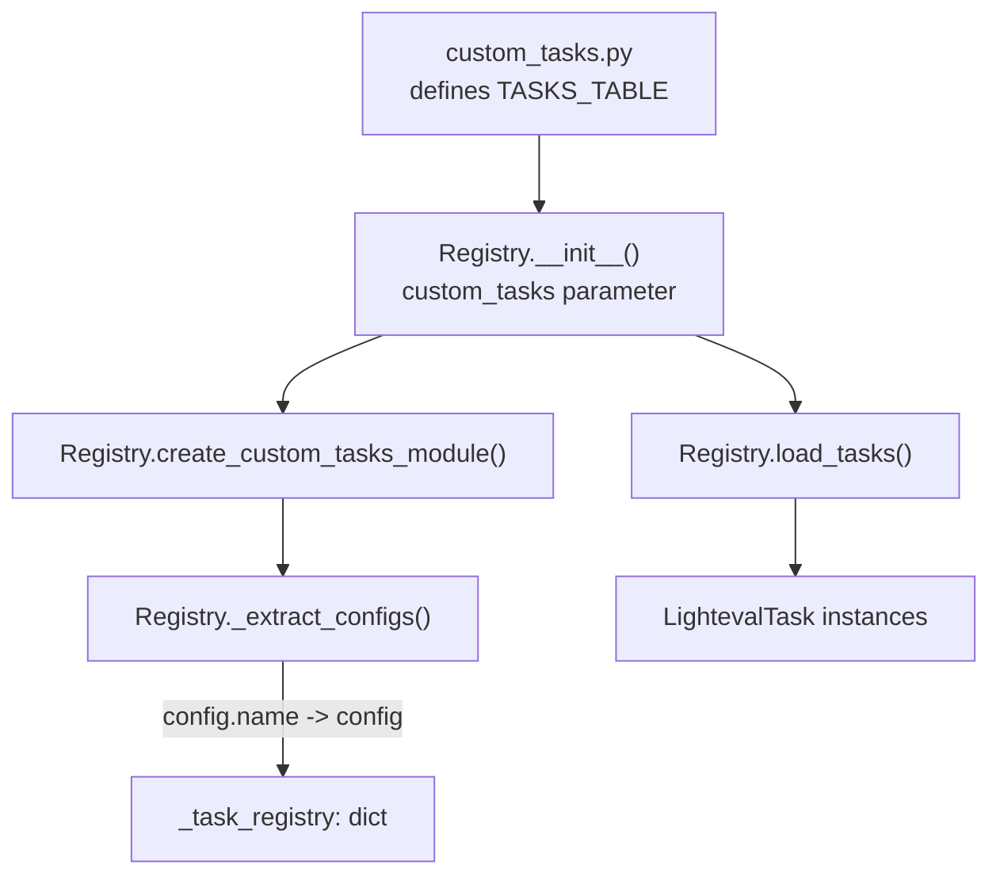
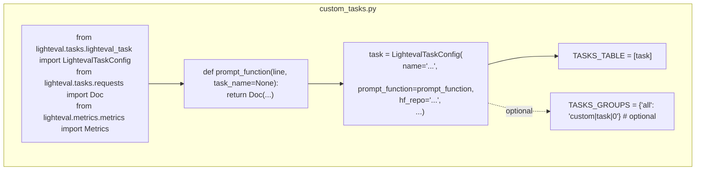
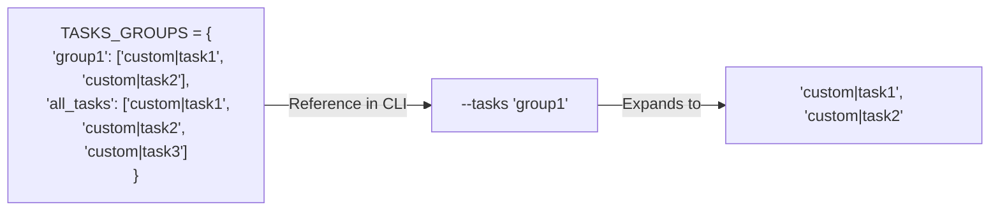
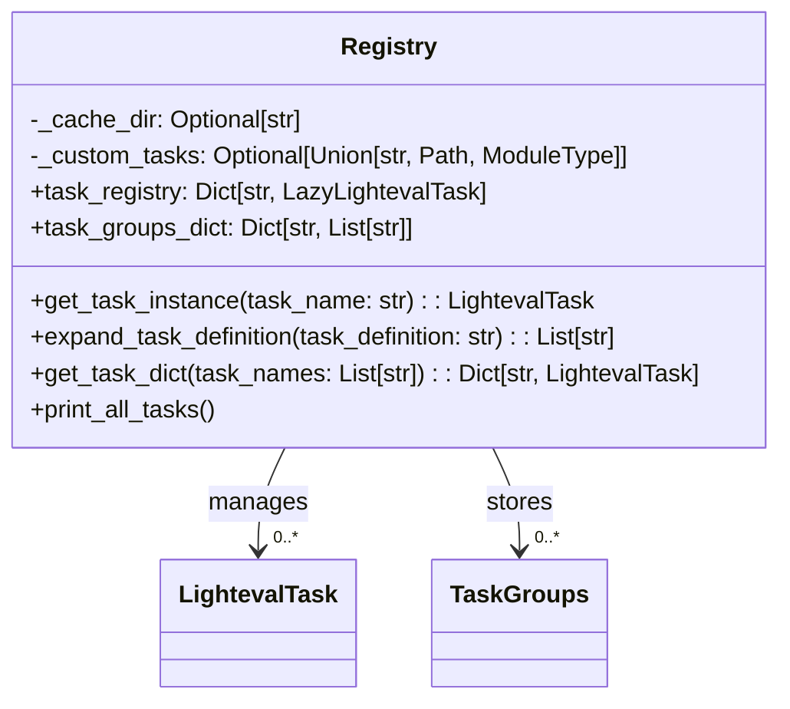

<!-- source: DeepWiki mcp.deepwiki.com · repo huggingface/lighteval · page 5.6 Creating Custom Tasks · fetched 2026-10-26 -->

# Custom Tasks

<details>
<summary>Relevant source files</summary>

The following files were used as context for generating this wiki page:

- [examples/nanotron/custom_evaluation_tasks.py](examples/nanotron/custom_evaluation_tasks.py)
- [examples/nanotron/custom_task.py](examples/nanotron/custom_task.py)
- [src/lighteval/main_tasks.py](src/lighteval/main_tasks.py)
- [src/lighteval/metrics/metrics_corpus.py](src/lighteval/metrics/metrics_corpus.py)
- [src/lighteval/tasks/lighteval_task.py](src/lighteval/tasks/lighteval_task.py)
- [src/lighteval/tasks/multilingual/tasks/global_mmlu.py](src/lighteval/tasks/multilingual/tasks/global_mmlu.py)
- [src/lighteval/tasks/registry.py](src/lighteval/tasks/registry.py)
- [src/lighteval/tasks/requests.py](src/lighteval/tasks/requests.py)
- [src/lighteval/tasks/tasks/aimo.py](src/lighteval/tasks/tasks/aimo.py)
- [src/lighteval/tasks/tasks/ifbench/instructions.py](src/lighteval/tasks/tasks/ifbench/instructions.py)

</details>


This page provides a guide for creating custom evaluation tasks in LightEval. Custom tasks allow you to evaluate models on datasets beyond the 1000+ built-in tasks. For information about default tasks, see page 5.3. For multilingual support, see page 5.4.

## Overview

Custom tasks are Python modules that define `LightevalTaskConfig` objects and expose them via a `TASKS_TABLE` list. The `Registry` class discovers and loads these tasks by importing the module and extracting the `TASKS_TABLE`.

**Custom Task Loading Flow**



Sources: [src/lighteval/tasks/registry.py:112-160](), [src/lighteval/tasks/registry.py:294-324]()
</thinking>

The `Registry.create_custom_tasks_module()` method accepts three input types:
- File path as string or `Path` object
- Module name as string (for importable modules)
- `ModuleType` object directly

Sources: [src/lighteval/tasks/registry.py:294-316]()

## Task File Structure

A custom task file must contain a `TASKS_TABLE` variable that holds a list of `LightevalTaskConfig` objects. Optionally, it may contain `TASKS_GROUPS` for organizing related tasks.

**Required Structure**



The `Registry._extract_configs()` method searches for `TASKS_TABLE` in the module:

Sources: [src/lighteval/tasks/registry.py:318-324](), [src/lighteval/tasks/tasks/aimo.py:1-53]()

## Prompt Functions

Prompt functions transform dataset rows into `Doc` objects. The function receives a dictionary (dataset row) and must return a `Doc` instance.

**Doc Object Structure**

| Field | Type | Purpose | Required |
|-------|------|---------|----------|
| `task_name` | `str` | Task identifier | No |
| `query` | `str` | The prompt text | Yes |
| `choices` | `List[str]` | Answer choices for multiple choice or gold answer(s) for generation | Yes |
| `gold_index` | `int` | Index of correct choice (for multiple choice) | Yes for logprob tasks |
| `instruction` | `str` | System instruction or task description | No |
| `specific` | `dict` | Task-specific metadata | No |

**Simple Prompt Function Example**

The AIMO task demonstrates a minimal prompt function:

```python
def aimo_prompt(line, task_name: str = None):
    return Doc(
        task_name=task_name,
        choices=[str(line["answer"])],
        gold_index=0,
        query=line["problem"],
    )
```

Sources: [src/lighteval/tasks/tasks/aimo.py:26-32]()

**Multiple Choice Prompt Function Pattern**

The custom evaluation tasks file shows a more complex pattern for multiple choice:

```python
def mmlu_prompt(line, task_name: str = None):
    topic = line["subject"]
    prompt = f"The following are questions about {topic.replace('_', ' ')}.\nQuestion: "
    prompt += line["question"] + "\nAnswer:"
    
    return Doc(
        task_name=task_name,
        query=prompt,
        choices=[f" {c}" for c in line["choices"]],
        gold_index=line["answer"],
        instruction=f"The following are questions about {topic.replace('_', ' ')}.\n",
    )
```

Sources: [examples/nanotron/custom_evaluation_tasks.py:377-389]()

**Prompt Function with Preprocessing**

HellaSwag demonstrates text preprocessing in the prompt function:

```python
def hellaswag_prompt(line, task_name: str = None):
    def preprocess(text):
        text = text.replace(" [title]", ". ")
        text = re.sub("\\[.*?\\]", "", text)
        text = text.replace("  ", " ")
        return text
    
    ctx = f"{line['ctx_a']} {line['ctx_b'].capitalize()} "
    return Doc(
        task_name=task_name,
        query=preprocess(line["activity_label"] + ": " + ctx),
        choices=[" " + preprocess(ending) for ending in line["endings"]],
        gold_index=int(line["label"]) if line["label"] != "" else -1,
    )
```

Sources: [examples/nanotron/custom_evaluation_tasks.py:73-90]()

## LightevalTaskConfig

The `LightevalTaskConfig` dataclass defines all task parameters. Key fields:

| Field | Type | Description |
|-------|------|-------------|
| `name` | `str` | Unique task identifier |
| `prompt_function` | `Callable` | Function that returns `Doc` objects |
| `hf_repo` | `str` | HuggingFace dataset repository |
| `hf_subset` | `str` | Dataset configuration name |
| `hf_avail_splits` | `List[str]` | Available dataset splits |
| `evaluation_splits` | `List[str]` | Splits to evaluate on |
| `few_shots_split` | `str` | Split to sample few-shot examples from |
| `few_shots_select` | `str` | Selection method: `"random_sampling"`, `"sequential"`, `"balanced"` |
| `metrics` | `List[Metrics]` | Metrics to compute |
| `generation_size` | `int` | Max tokens for generation tasks |
| `stop_sequence` | `List[str]` | Stop sequences for generation |

For the complete field list, see page 5.1.

**Minimal Task Configuration**

```python
task = LightevalTaskConfig(
    name="aimo_progress_prize_1",
    prompt_function=aimo_prompt,
    hf_repo="lighteval/aimo_progress_prize_1",
    hf_subset="",
    hf_avail_splits=["train"],
    evaluation_splits=["train"],
    metrics=[Metrics.exact_match(
        sample_params={"normalize_gold": math_normalizer, "normalize_pred": math_normalizer}
    )],
    generation_size=2048,
)
```

Sources: [src/lighteval/tasks/tasks/aimo.py:35-49]()

**Task Configuration with Few-Shot Settings**

```python
task = LightevalTaskConfig(
    name="gsm8k",
    prompt_function=gsm8k_prompt,
    hf_repo="gsm8k",
    hf_subset="main",
    hf_avail_splits=["train", "test"],
    evaluation_splits=["test"],
    few_shots_split="train",
    few_shots_select="random_sampling",
    metrics=[Metrics.perfect_exact_match],
    generation_size=10,
    stop_sequence=["\n"],
)
```

Sources: [examples/nanotron/custom_evaluation_tasks.py:337-347]()

## Creating Task Subsets

For benchmarks with multiple subsets (e.g., MMLU has 57 subjects), use list comprehensions or loops to generate task configurations.

**Pattern: Custom Task Class**

```python
class CustomMMLUEvaluationTask(LightevalTaskConfig):
    def __init__(self, name, hf_subset, **kwargs):
        super().__init__(
            name=name,
            prompt_function=mmlu_prompt,
            hf_repo="lighteval/mmlu",
            hf_subset=hf_subset,
            metrics=[Metrics.loglikelihood_acc],
            evaluation_splits=["test"],
            few_shots_split="dev",
            **kwargs
        )

MMLU_TASKS = [
    CustomMMLUEvaluationTask(name="mmlu:abstract_algebra", hf_subset="abstract_algebra"),
    CustomMMLUEvaluationTask(name="mmlu:anatomy", hf_subset="anatomy"),
    # ... 55 more subsets
]

TASKS_TABLE = MMLU_TASKS
```

Sources: [examples/nanotron/custom_evaluation_tasks.py:392-424](), [examples/nanotron/custom_evaluation_tasks.py:427-487]()

**Pattern: List Comprehension**

The Global MMLU task generates 3,400+ task variants using list comprehension:

```python
TASKS_TABLE = [
    LightevalTaskConfig(
        name=f"global_mmlu_{sensitivity_label.lower()}_{language.value}_{formulation.name.lower()}:{subset}",
        prompt_function=get_mcq_prompt_function(language, adapter, formulation),
        hf_repo="CohereForAI/Global-MMLU",
        hf_subset=standardize_tag(language.value),
        evaluation_splits=("test",),
        metrics=get_metrics_for_formulation(formulation, metrics_list),
    )
    for subset in MMLU_SUBSETS
    for language in [Language.ARABIC, Language.CHINESE, ...]
    for formulation in [MCFFormulation()]
    for sensitivity_label in ["ALL"]
]
```

Sources: [src/lighteval/tasks/multilingual/tasks/global_mmlu.py:104-179]()

## Custom Metrics

For tasks requiring custom evaluation logic beyond built-in metrics, define custom metric classes. See page 8 for the metrics system architecture.

**Pattern: Sample-Level + Corpus-Level Metric**

The Tiny Benchmarks task demonstrates both sample and corpus level computation:

```python
class TinyCorpusAggregator(SampleLevelComputation, CorpusLevelComputation):
    def compute(self, doc: Doc, model_response: ModelResponse, **kwargs) -> float:
        # Per-sample computation
        if self.task == "gsm8k":
            return ExactMatches(normalize_pred=gsm8k_normalizer).compute(doc, model_response)
        else:
            return LoglikelihoodAcc().compute(doc, model_response)
    
    def compute_corpus(self, items):
        # Aggregate over all samples using IRT models
        theta = fit_theta(responses, seen_examples, A, B)
        estimates = {}
        # ... complex aggregation logic
        return estimates[self.task]

# Usage in task config
metrics = CorpusLevelMetricGrouping(
    metric_name=["irt", "pirt", "gpirt"],
    sample_level_fn=TinyCorpusAggregator(name),
    corpus_level_fn=TinyCorpusAggregator(name),
)
```

Sources: [src/lighteval/tasks/tasks/tiny_benchmarks/main.py:74-182](), [src/lighteval/tasks/tasks/tiny_benchmarks/main.py:242-259]()

**Pattern: Custom Instructions with Verification**

The IFEval task uses custom instruction classes to verify constraint following:

```python
class WordCountRangeChecker(Instruction):
    def build_description(self, *, min_words=None, max_words=None):
        self._min_words = min_words or random.randint(100, 500)
        self._max_words = max_words or self._min_words + random.randint(...)
        return f"The response must contain between {self._min_words} and {self._max_words} words."
    
    def check_following(self, value):
        num_words = instructions_util.count_words(value)
        return self._min_words <= num_words <= self._max_words
```

Sources: [src/lighteval/tasks/tasks/ifbench/instructions.py:107-145]()

## Using Custom Tasks in Evaluation

To use custom tasks in your evaluation:

1. Create your custom task file(s)
2. Pass the file path to LightEval using the `--custom_tasks` argument:

```
lighteval ... --custom_tasks path/to/your_custom_tasks.py --tasks "custom|your_task_name|0|0"
```

The task naming follows the format `suite|task|few_shot|truncate_few_shots`. For custom tasks, the suite should be "custom".

Sources: [src/lighteval/tasks/registry.py:267-328]()

## Task Groups

You can define task groups to run multiple tasks together:



This allows you to run groups of related tasks with a single command.

Sources: [src/lighteval/tasks/registry.py:176-197]()

## Behind the Scenes: Registry

The `Registry` class manages task registration and retrieval:



When using custom tasks, the Registry:
1. Imports your custom tasks module
2. Extracts the `TASKS_TABLE` and optional `TASKS_GROUPS`
3. Creates lazy task instances
4. Makes tasks available to the evaluation pipeline

Sources: [src/lighteval/tasks/registry.py:68-158](), [src/lighteval/tasks/registry.py:246-263]()

## Summary

Custom tasks in LightEval provide a flexible way to create your own evaluation benchmarks. By defining prompt functions, task configurations, and optional custom metrics, you can evaluate models on any dataset or task of interest. The system integrates seamlessly with the main evaluation pipeline, allowing you to mix built-in and custom tasks in your evaluations.

---

