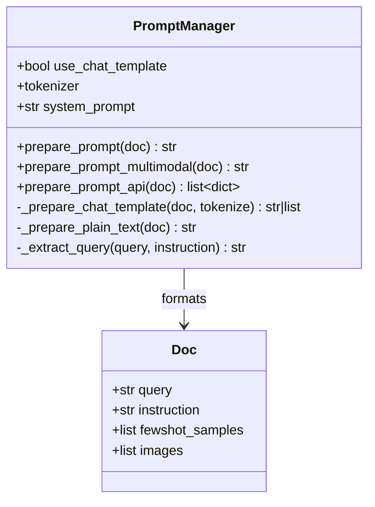
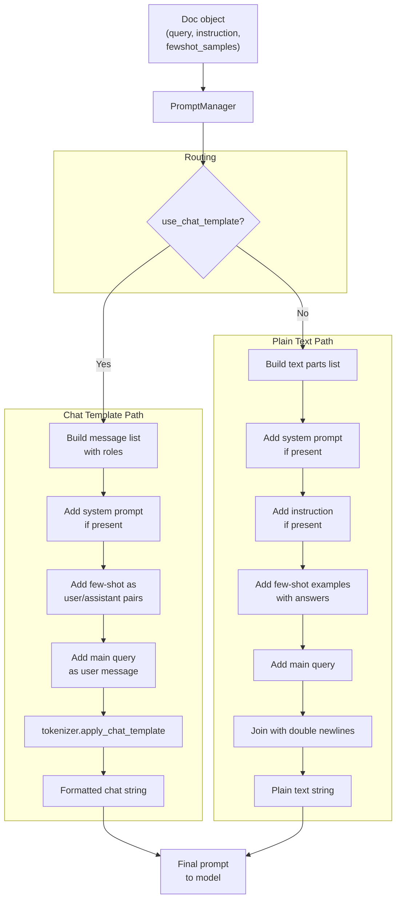
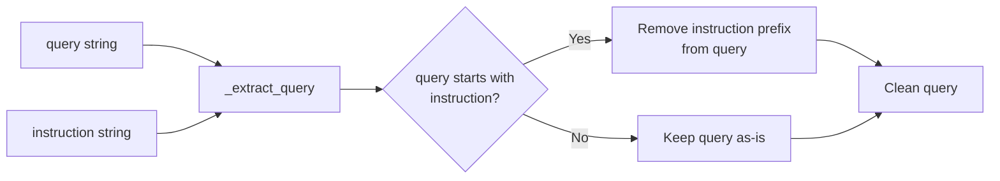
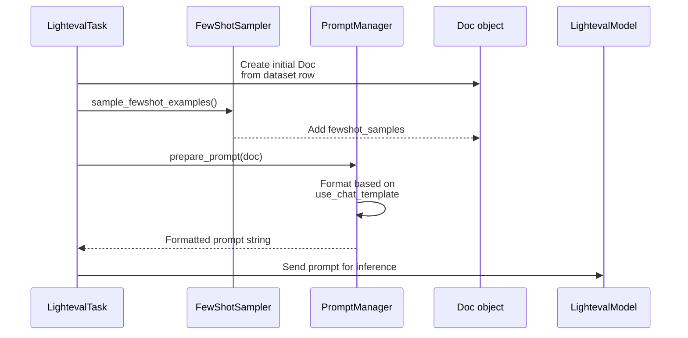

<!-- source: DeepWiki mcp.deepwiki.com · repo huggingface/lighteval · page 5.7 Prompt Management · fetched 2026-10-26 -->

# Prompt Management

<details>
<summary>Relevant source files</summary>

The following files were used as context for generating this wiki page:

- [src/lighteval/tasks/prompt_manager.py](src/lighteval/tasks/prompt_manager.py)

</details>


This document covers the `PromptManager` class, which is responsible for formatting prompts from Doc objects into the final text (or structured messages) that models receive. The PromptManager handles chat template formatting, plain text formatting, multimodal prompts, and API-specific message preparation.

For information about how few-shot examples are selected and added to Doc objects before prompt formatting, see [Few-Shot Sampling](#5.8). For the overall task creation process, see [Task Configuration](#5.1).

## Overview

The `PromptManager` class serves as the final formatting layer in the task preparation pipeline. It takes Doc objects (which already contain the query, instruction, and few-shot samples) and converts them into the actual prompt strings that will be sent to models. The manager supports multiple formatting strategies to accommodate different model architectures and use cases.

**Key responsibilities:**
- Format prompts using chat templates or plain text
- Handle system prompts and task instructions
- Process few-shot examples into the prompt format
- Support multimodal prompts with images
- Generate API-compatible message structures

**Sources:** [src/lighteval/tasks/prompt_manager.py:42-179]()

## PromptManager Class

The `PromptManager` class is initialized with configuration that determines how prompts will be formatted throughout an evaluation run.



### Initialization Parameters

| Parameter | Type | Purpose |
|-----------|------|---------|
| `use_chat_template` | bool | If True, use tokenizer's chat template; if False, use plain text formatting |
| `tokenizer` | Tokenizer | HuggingFace tokenizer with `apply_chat_template` method (required for chat templates) |
| `system_prompt` | str \| None | Optional system-level instruction prepended to all prompts |

**Sources:** [src/lighteval/tasks/prompt_manager.py:42-46]()

## Prompt Formatting Workflow

The following diagram shows how Doc objects flow through the PromptManager to produce final prompts:



**Sources:** [src/lighteval/tasks/prompt_manager.py:48-165]()

## Chat Template Mode

When `use_chat_template=True`, the PromptManager uses the tokenizer's `apply_chat_template` method to format prompts. This produces prompts that follow the model's expected conversation format, including special tokens for role transitions.

### Message Structure

Chat templates use a list of message dictionaries with `role` and `content` fields:

```python
messages = [
    {"role": "system", "content": "System prompt text"},
    {"role": "user", "content": "Few-shot query 1"},
    {"role": "assistant", "content": "Few-shot answer 1"},
    {"role": "user", "content": "Main query"}
]
```

### Chat Template Processing Steps

1. **System Prompt Addition**: If `system_prompt` is set during initialization, it becomes the first message with role "system" [src/lighteval/tasks/prompt_manager.py:107-108]()

2. **Few-Shot Example Formatting**: Each few-shot sample becomes a user/assistant message pair [src/lighteval/tasks/prompt_manager.py:111-118]()
   - The first few-shot example includes the instruction (if present) prepended to its query
   - Subsequent few-shots exclude the instruction to avoid repetition

3. **Instruction Handling**: The `doc.instruction` field is prepended to the main query if it wasn't already used in a few-shot example [src/lighteval/tasks/prompt_manager.py:123-125]()

4. **Template Application**: The message list is passed to `tokenizer.apply_chat_template` with `tokenize=False` and `add_generation_prompt=True` [src/lighteval/tasks/prompt_manager.py:132-136]()

### Query Extraction

The `_extract_query` method removes instruction prefixes from queries to prevent duplication when instructions are added separately:



**Sources:** [src/lighteval/tasks/prompt_manager.py:97-139](), [src/lighteval/tasks/prompt_manager.py:167-178]()

## Plain Text Mode

When `use_chat_template=False`, the PromptManager creates prompts by concatenating text segments with double newlines (`\n\n`).

### Plain Text Structure

The plain text format assembles the following components in order:

1. System prompt (if provided)
2. Instruction (if present in Doc)
3. Few-shot examples (query + answer pairs)
4. Main query

### Plain Text Example

Given:
- System prompt: "You are a helpful assistant."
- Instruction: "Answer the question."
- One few-shot: query="What is 2+2?", answer="4"
- Main query: "What is 3+3?"

The output would be:
```
You are a helpful assistant.

Answer the question.

What is 2+2? 4

What is 3+3?
```

### Implementation

The `_prepare_plain_text` method builds a list of parts and joins them with double newlines. Few-shot answers are appended directly after queries with a single space separator [src/lighteval/tasks/prompt_manager.py:141-165]().

**Sources:** [src/lighteval/tasks/prompt_manager.py:141-165]()

## Multimodal Prompt Handling

The `prepare_prompt_multimodal` method supports prompts that include both text and images. This is designed for vision-language models that can process visual inputs.

### Multimodal Requirements

- `use_chat_template` must be True
- `tokenizer` must be set
- `doc.images` must be provided (list of image objects)

### Content Structure

Multimodal prompts use a structured content format where each content item has a `type` field:

```python
text_content = [{"type": "text", "text": doc.query}]
image_content = [{"type": "image", "image": image} for image in doc.images]
message = {
    "role": "user", 
    "content": text_content + image_content
}
```

### System Prompt and Instruction Merging

When both `system_prompt` and `doc.instruction` are present, they are concatenated into a single system message [src/lighteval/tasks/prompt_manager.py:70-80]():

```python
system_prompt_text = self.system_prompt + doc.instruction
system_content = [{"type": "text", "text": system_prompt_text}]
system_message = {"role": "system", "content": system_content}
```

**Sources:** [src/lighteval/tasks/prompt_manager.py:59-86]()

## API-Specific Formatting

The `prepare_prompt_api` method generates prompts for remote API calls where the API provider handles tokenization. This method returns message dictionaries instead of tokenized strings.

### API vs Local Model Formatting

| Aspect | Local Models | API Models |
|--------|-------------|------------|
| Method | `prepare_prompt()` | `prepare_prompt_api()` |
| Output | str (tokenized) | list[dict[str, str]] |
| Template application | `tokenize=True` | `tokenize=False` |
| Use case | VLLM, Transformers, etc. | OpenAI, TGI endpoints, etc. |

### Implementation

The API method delegates to `_prepare_chat_template` with `tokenize=False` [src/lighteval/tasks/prompt_manager.py:88-95]():

```python
def prepare_prompt_api(self, doc: Doc) -> list[dict[str, str]]:
    return self._prepare_chat_template(doc, tokenize=False)
```

This returns the raw message list, which APIs can process according to their own tokenization and formatting rules.

**Sources:** [src/lighteval/tasks/prompt_manager.py:88-95]()

## Integration with Task System

The PromptManager is instantiated by LightevalTask objects and used during document preparation. The following diagram shows where PromptManager fits in the task evaluation flow:



The task instantiates a PromptManager during its initialization, configuring it based on task requirements. Each Doc object passes through the PromptManager exactly once to receive its final formatting before model execution.

**Sources:** [src/lighteval/tasks/prompt_manager.py:42-179]()

## Key Design Decisions

### Instruction Placement

Instructions are handled differently in chat templates to avoid repetition:
- For few-shot examples: Only the first few-shot includes the instruction prepended [src/lighteval/tasks/prompt_manager.py:113-115]()
- For the main query: The instruction is prepended if it wasn't used in few-shots [src/lighteval/tasks/prompt_manager.py:123-125]()

This ensures the model sees the instruction at least once while avoiding redundancy.

### Query Extraction Logic

The `_extract_query` method removes instruction prefixes from queries when appropriate. This prevents duplication when prompts are assembled, since instructions may be added separately as system messages or query prefixes depending on the formatting mode.

### Tokenization Control

The `tokenize` parameter in `_prepare_chat_template` allows the same message construction logic to serve both local models (which need tokenized strings) and API endpoints (which need raw message dictionaries). This promotes code reuse while accommodating different execution environments.

**Sources:** [src/lighteval/tasks/prompt_manager.py:97-178]()

---

