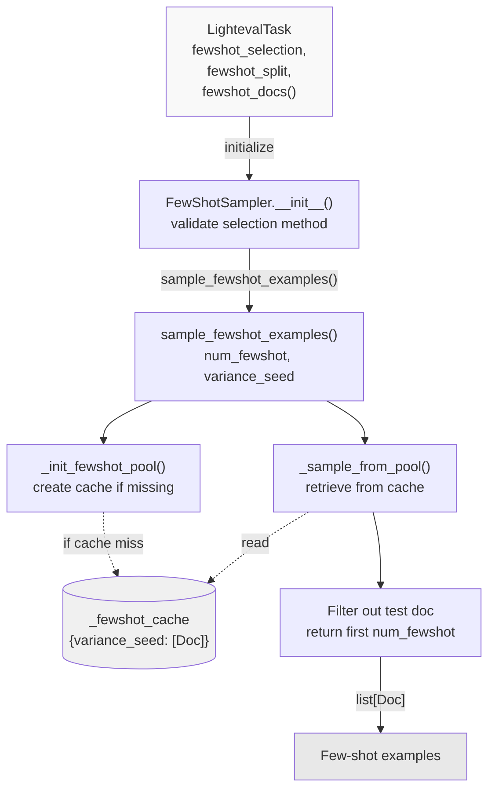
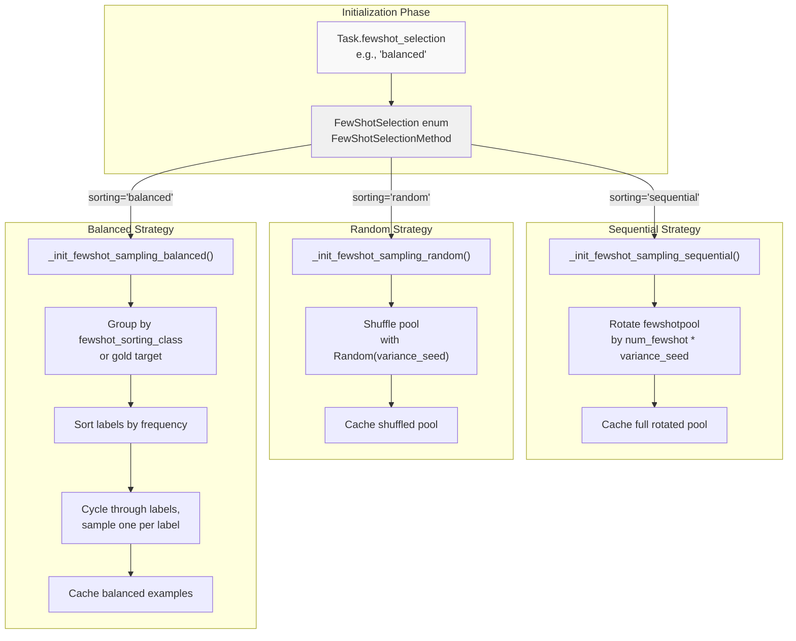
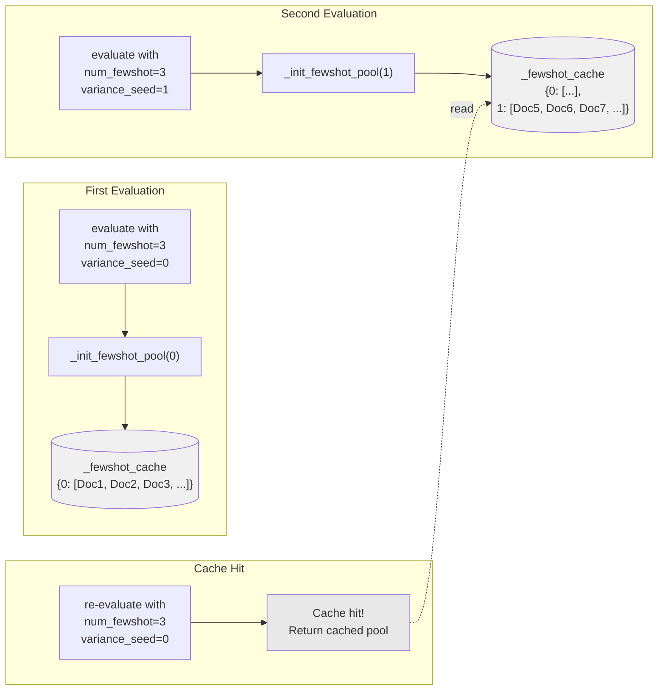
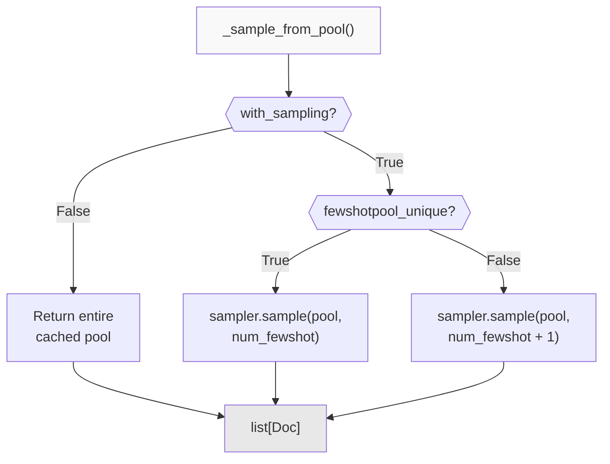
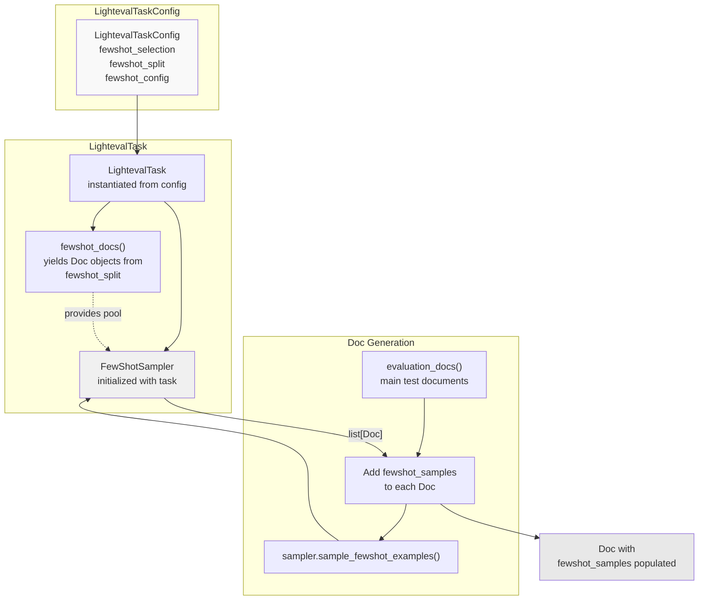

<!-- source: DeepWiki mcp.deepwiki.com · repo huggingface/lighteval · page 5.8 Few-Shot Sampling · fetched 2026-10-26 -->

# Few-Shot Sampling

<details>
<summary>Relevant source files</summary>

The following files were used as context for generating this wiki page:

- [src/lighteval/tasks/prompt_manager.py](src/lighteval/tasks/prompt_manager.py)

</details>


Few-shot sampling is the process of selecting example demonstrations from a pool of labeled data to include in evaluation prompts. These examples help the model understand the task format and expected output before being evaluated on the actual test instance. This document explains how lighteval's `FewShotSampler` selects, caches, and provides few-shot examples to tasks.

For information about how these examples are formatted into prompts, see [Prompt Management](#5.7).

## Purpose and Scope

The `FewShotSampler` class in [src/lighteval/tasks/prompt_manager.py:199-336]() manages the selection of few-shot examples for each evaluation document. It supports multiple selection strategies (balanced, random, sequential), maintains separate caches for different variance seeds to enable reproducible sampling experiments, and ensures that test documents are not accidentally included in their own few-shot context.

## FewShotSampler Overview

The `FewShotSampler` is initialized with a `LightevalTask` and configured based on the task's `fewshot_selection` and `fewshot_split` parameters. It maintains an internal cache (`_fewshot_cache`) indexed by variance seeds to avoid recomputing the few-shot pool for repeated evaluations.



**Diagram: FewShotSampler Workflow**

Sources: [src/lighteval/tasks/prompt_manager.py:199-232]()

## Selection Strategies

Lighteval supports five few-shot selection strategies, defined in the `FewShotSelection` enum. Each strategy is characterized by three properties: sorting method, with_sampling flag, and fewshotpool_unique flag.

### Strategy Types

| Strategy | Sorting | With Sampling | Pool Unique | Description |
|----------|---------|---------------|-------------|-------------|
| `balanced` | balanced | False | False | Samples examples uniformly across classes |
| `random` | random | False | False | Shuffles pool once by variance seed |
| `sequential` | sequential | False | False | Takes first N items, rotated by seed |
| `random_sampling` | random | True | False | Randomly samples N+1 from shuffled pool |
| `random_sampling_from_train` | random | True | True | Randomly samples N from unique train pool |

The `FewShotSelectionMethod` dataclass [src/lighteval/tasks/prompt_manager.py:182-186]() stores these three configuration properties for each strategy:

- **sorting**: Controls how the few-shot pool is organized (`"balanced"`, `"random"`, `"sequential"`)
- **with_sampling**: If `True`, randomly sub-samples from the pool using the provided sampler
- **fewshotpool_unique**: If `True`, assumes no overlap between few-shot pool and test set (samples exactly `num_fewshot` items instead of `num_fewshot + 1`)



**Diagram: Selection Strategy Branching**

Sources: [src/lighteval/tasks/prompt_manager.py:188-196](), [src/lighteval/tasks/prompt_manager.py:233-248]()

### Sequential Sampling

Sequential sampling [src/lighteval/tasks/prompt_manager.py:261-267]() takes the first items from the few-shot pool in order. To provide variety across different variance seeds, it rotates the pool by `num_fewshot * variance_seed` positions. This ensures different few-shot sets for different seeds while maintaining determinism.

```python
# Example: with fewshotpool = [A, B, C, D, E] and num_fewshot = 2
# variance_seed=0: [A, B, C, D, E] -> take first 2 = [A, B]
# variance_seed=1: [C, D, E, A, B] -> take first 2 = [C, D]
# variance_seed=2: [E, A, B, C, D] -> take first 2 = [E, A]
```

### Random Sampling

Random sampling [src/lighteval/tasks/prompt_manager.py:269-276]() shuffles the entire few-shot pool using `random.Random(variance_seed)` for reproducibility. If `variance_seed=0`, the pool is returned unshuffled. Otherwise, a new shuffled order is generated and cached.

### Balanced Sampling

Balanced sampling [src/lighteval/tasks/prompt_manager.py:278-326]() aims to distribute few-shot examples evenly across different classes or labels. The algorithm:

1. Groups all few-shot documents by their `fewshot_sorting_class` field (or the gold target if undefined)
2. Sorts labels by the number of instances available (descending)
3. Breaks ties by shuffling labels with the same count
4. Cycles through labels, randomly sampling one instance per label
5. Continues until `num_fewshot + 1` examples are selected

The `+ 1` accounts for the possibility that the test document might appear in the few-shot pool; it will be filtered out later in [src/lighteval/tasks/prompt_manager.py:231]().

Sources: [src/lighteval/tasks/prompt_manager.py:261-326]()

## Variance Seeds and Caching

Variance seeds enable multiple few-shot sampling experiments with different example sets while maintaining reproducibility. Each variance seed produces a deterministic few-shot pool that is cached in `_fewshot_cache` to avoid recomputing.



**Diagram: Variance Seed Caching Mechanism**

The `get_fewshot_seeds()` method [src/lighteval/tasks/prompt_manager.py:328-335]() generates a list of variance seeds for running multiple few-shot iterations. If `few_shot_iterations <= 1`, it returns `[0]`. Otherwise, it returns `range(few_shot_iterations)`, typically `[0, 1, 2, ..., n-1]`.

Sources: [src/lighteval/tasks/prompt_manager.py:233-248](), [src/lighteval/tasks/prompt_manager.py:328-335]()

## Sampling from Pool

After the few-shot pool is initialized and cached, `_sample_from_pool()` [src/lighteval/tasks/prompt_manager.py:249-259]() retrieves examples based on the strategy's `with_sampling` flag:

- **Without sampling** (`with_sampling=False`): Returns the entire cached pool. The caller will take the first `num_fewshot` examples after filtering.
  
- **With sampling** (`with_sampling=True`): Uses the provided `sampler` (a `random.Random` instance) to randomly select from the cached pool:
  - If `fewshotpool_unique=True`: Samples exactly `num_fewshot` examples (assumes no test/pool overlap)
  - If `fewshotpool_unique=False`: Samples `num_fewshot + 1` examples (one extra to account for potential test doc removal)



**Diagram: Sampling from Pool Decision Tree**

Sources: [src/lighteval/tasks/prompt_manager.py:249-259]()

## Test Document Filtering

After retrieving examples from the pool, `sample_fewshot_examples()` filters out the test document itself [src/lighteval/tasks/prompt_manager.py:231]() to prevent data contamination (where the model sees the answer in the few-shot context). The filtering uses Python's equality operator on `Doc` objects, so documents must define proper equality semantics.

```python
# From line 231:
return [x for x in samples if x != formatted_doc][:num_fewshot]
```

This ensures that even if the test document appears in the few-shot pool, it will not be included in its own context. The slice `[:num_fewshot]` guarantees exactly `num_fewshot` examples are returned (assuming sufficient pool size).

Sources: [src/lighteval/tasks/prompt_manager.py:217-232]()

## Integration with Task System

The `FewShotSampler` is instantiated within a `LightevalTask` and relies on the task's configuration:



**Diagram: FewShotSampler Integration with Task**

The task's `fewshot_docs()` method returns an iterator over the few-shot pool (typically from a designated split like `"train"` or `"dev"`). The `FewShotSampler` consumes this pool and provides sampled examples back to the task's evaluation document generation process.

Sources: [src/lighteval/tasks/prompt_manager.py:199-214]()

## Configuration Parameters

Few-shot sampling is controlled by three task-level parameters:

| Parameter | Type | Description |
|-----------|------|-------------|
| `fewshot_selection` | str | Selection strategy name from `FewShotSelection` enum |
| `fewshot_split` | str | Dataset split to use as few-shot pool (e.g., `"train"`, `"dev"`) |
| `fewshot_config` | dict | Additional configuration passed to few-shot pool loading |

The `fewshot_selection` defaults to `"balanced"` if not specified [src/lighteval/tasks/prompt_manager.py:204-205]().

### Validation

During initialization, the sampler validates that `fewshot_selection` is one of the allowed values [src/lighteval/tasks/prompt_manager.py:207-210]():

```python
if few_shots_select not in ALLOWED_SELECTIONS:
    raise ValueError(
        f"few_shots_select must be one of f{','.join(ALLOWED_SELECTIONS[:-1])} or {ALLOWED_SELECTIONS[-1]}, not {few_shots_select}"
    )
```

The allowed selections are defined as [src/lighteval/tasks/prompt_manager.py:196]():

```python
ALLOWED_SELECTIONS = FewShotSelection._member_names_
# ['balanced', 'random', 'sequential', 'random_sampling_from_train', 'random_sampling']
```

Sources: [src/lighteval/tasks/prompt_manager.py:196](), [src/lighteval/tasks/prompt_manager.py:204-214]()

## Example Usage Patterns

### Zero-Shot Evaluation

When `num_fewshot=0`, the sampler short-circuits and returns an empty list [src/lighteval/tasks/prompt_manager.py:224-225]():

```python
if num_fewshot == 0:
    return []
```

### Single Variance Seed

Most evaluations use `variance_seed=0` for a single, deterministic few-shot set:

```python
fewshot_examples = sampler.sample_fewshot_examples(
    num_fewshot=5,
    variance_seed=0,
    formatted_doc=current_test_doc
)
```

### Multiple Variance Seeds

For robustness experiments, tasks can evaluate with multiple few-shot configurations:

```python
seeds = sampler.get_fewshot_seeds(few_shot_iterations=5)
# Returns [0, 1, 2, 3, 4]

for seed in seeds:
    fewshot_examples = sampler.sample_fewshot_examples(
        num_fewshot=5,
        variance_seed=seed,
        formatted_doc=current_test_doc
    )
    # Each seed produces a different set of examples
```

Sources: [src/lighteval/tasks/prompt_manager.py:224-232](), [src/lighteval/tasks/prompt_manager.py:328-335]()

## Performance Considerations

### Caching Strategy

The `_fewshot_cache` dictionary prevents redundant pool initialization. Once a pool is created for a given variance seed, all subsequent requests for that seed reuse the cached pool. This is especially important for:

- Large few-shot pools with thousands of examples
- Expensive balanced sampling that requires sorting and grouping
- Evaluations with many test documents sharing the same few-shot configuration

### Memory Usage

Each variance seed stores a separate copy of the few-shot pool in memory. For tasks with large pools and many variance seeds, memory usage can grow significantly. The pool size varies by strategy:

- **Sequential/Random**: Stores the entire dataset split
- **Balanced**: Stores up to `num_fewshot + 1` examples per seed
- **With sampling**: Stores the pre-processed pool, then samples from it

### Computation Cost

| Strategy | Initialization Cost | Notes |
|----------|-------------------|-------|
| Sequential | O(num_fewshot * variance_seed) | Rotation operations |
| Random | O(n) | Single shuffle of pool |
| Balanced | O(n log n) | Sorting and grouping by labels |

Sources: [src/lighteval/tasks/prompt_manager.py:233-326]()

---

