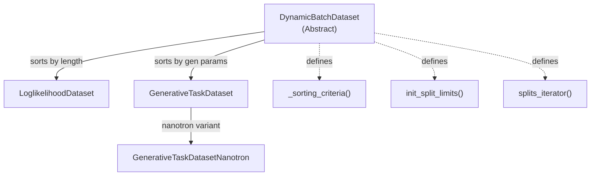
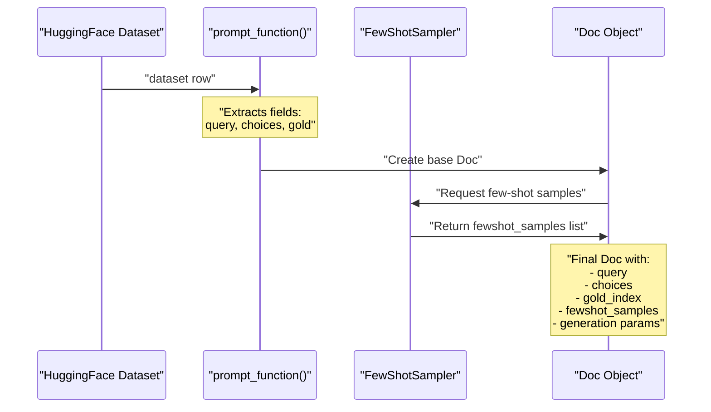
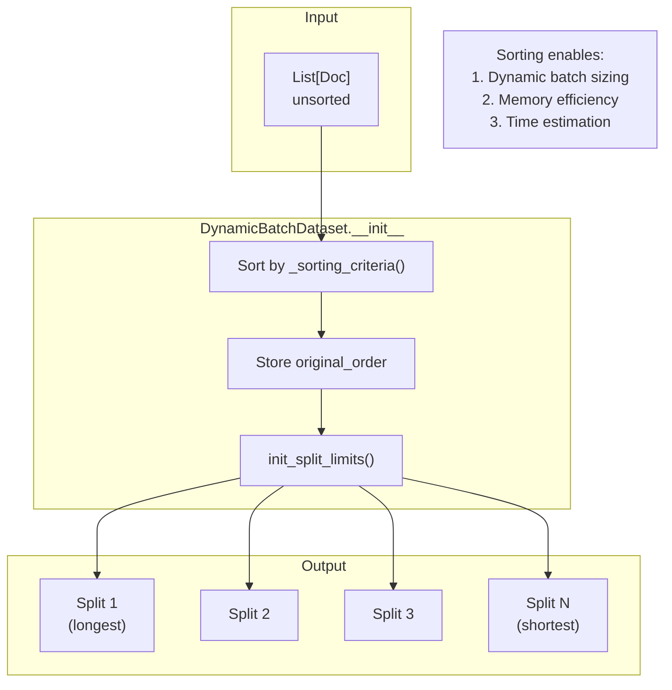
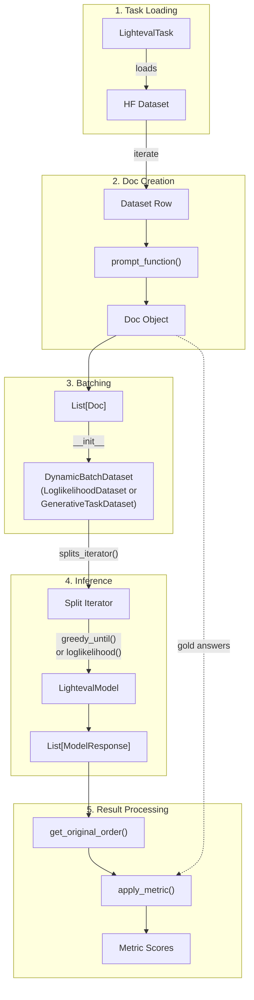
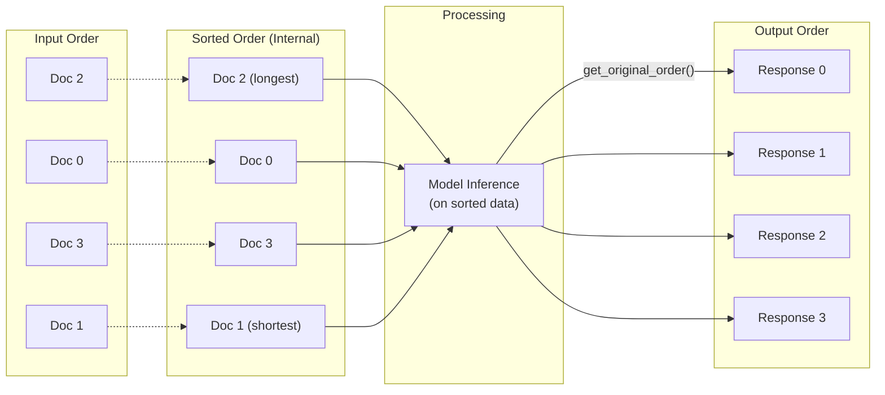
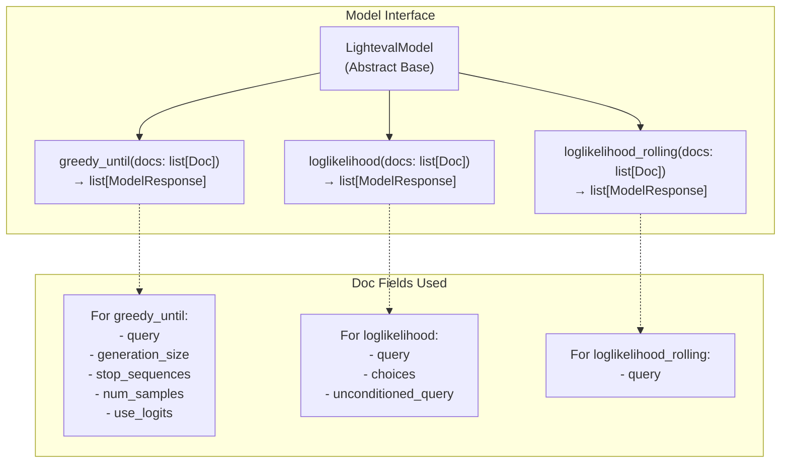
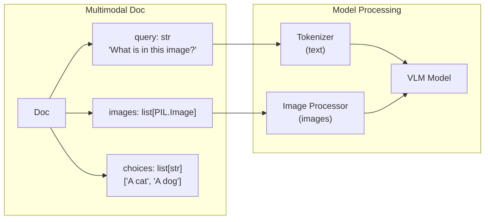

<!-- source: DeepWiki mcp.deepwiki.com · repo huggingface/lighteval · page 6 Data Structures · fetched 2026-10-26 -->

# Data Structures

<details>
<summary>Relevant source files</summary>

The following files were used as context for generating this wiki page:

- [src/lighteval/data.py](src/lighteval/data.py)
- [src/lighteval/metrics/__init__.py](src/lighteval/metrics/__init__.py)
- [src/lighteval/tasks/lighteval_task.py](src/lighteval/tasks/lighteval_task.py)
- [src/lighteval/tasks/requests.py](src/lighteval/tasks/requests.py)
- [tests/test_unit_harness_metrics.py](tests/test_unit_harness_metrics.py)

</details>


## Purpose and Scope

This page provides an overview of the core data structures used throughout the lighteval evaluation pipeline. These structures form the backbone of how data flows from task definition through model inference to metric computation.

The three primary data structures are:
- **Doc**: Represents a single evaluation sample with all context and parameters
- **ModelResponse**: Contains model outputs including generated text, logprobs, and tokens
- **DynamicBatchDataset**: Manages efficient batching and sorting of evaluation samples

For detailed information about each structure, see:
- Doc objects and their fields: [Doc Objects](#6.1)
- ModelResponse structure and usage: [ModelResponse](#6.2)
- Dynamic batching implementation: [Dynamic Batching](#6.3)

For information about how tasks create Doc objects, see [Task System](#5). For how models consume Doc objects and produce ModelResponse objects, see [Models and Backends](#7).

## Overview of Core Structures

The evaluation pipeline transforms data through three key data structures that form a unidirectional flow:


**Sources:** [src/lighteval/tasks/requests.py](), [src/lighteval/data.py](), [src/lighteval/models/abstract_model.py]()

### Doc Structure

The `Doc` class ([src/lighteval/tasks/requests.py:43-228]()) is a dataclass that encapsulates a single evaluation instance. It contains:

| Field Category | Key Fields | Purpose |
|---|---|---|
| **Core Content** | `query`, `choices`, `gold_index` | The question/prompt, possible answers, and correct answer indices |
| **Task Context** | `task_name`, `id`, `instruction` | Identifies the task and provides system prompts |
| **Few-shot Learning** | `fewshot_samples`, `fewshot_sorting_class` | Few-shot examples to prepend to the query |
| **Generation Control** | `generation_size`, `stop_sequences`, `num_samples` | Parameters controlling text generation |
| **Multimodal** | `images` | PIL Image objects for vision-language tasks |
| **Sampling** | `sampling_methods`, `use_logits` | Which inference methods to apply |

**Sources:** [src/lighteval/tasks/requests.py:43-228]()

### ModelResponse Structure

`ModelResponse` (referenced in [src/lighteval/models/abstract_model.py:34]()) contains the outputs from model inference. While the full definition is in `model_output.py` (not provided in files), it typically includes:

- `final_text`: The generated or selected text
- `logprobs`: Log probabilities for tokens or choices
- `tokens`: Token IDs corresponding to the output
- Additional metadata depending on the sampling method

**Sources:** [src/lighteval/models/abstract_model.py:34]()

### DynamicBatchDataset Family

The `DynamicBatchDataset` class ([src/lighteval/data.py:44-159]()) and its subclasses provide efficient batching by sorting requests by length and generation parameters:



**Sources:** [src/lighteval/data.py:44-300]()

## Data Flow and Transformation

### From Dataset to Doc

The transformation from raw datasets to Doc objects occurs in task definitions:



**Sources:** [src/lighteval/tasks/requests.py:43-228]()

### From Doc to Batched Dataset

Doc objects are sorted and split for efficient inference:



**Sources:** [src/lighteval/data.py:44-159]()

### Sorting Strategies by Dataset Type

Different dataset types use different sorting criteria:

**LoglikelihoodDataset** ([src/lighteval/data.py:161-184]()):
```python
# Sorts by total length (query + longest choice)
def _sorting_criteria(self, doc: Doc) -> int:
    len_doc_query = len(doc.query)
    max_len_choices = max(len(choice) for choice in doc.choices)
    return -(len_doc_query + max_len_choices)  # Negative for descending
```

**GenerativeTaskDataset** ([src/lighteval/data.py:186-252]()):
```python
# Sorts by generation parameters, then length
def _sorting_criteria(self, doc: Doc) -> tuple:
    return (
        doc.num_samples,           # Group by sample count
        doc.use_logits,            # Group by logits requirement
        tuple(doc.stop_sequences), # Group by stop sequences
        doc.generation_size,       # Group by generation length
        -(len(doc.query) + doc.generation_size)  # Then by total length
    )
```

**Sources:** [src/lighteval/data.py:161-252]()

## SamplingMethod Enum

The `SamplingMethod` enum ([src/lighteval/tasks/requests.py:35-41]()) defines the three types of model inference:

| Method | Purpose | Model Method Called | Output Type |
|---|---|---|---|
| `GENERATIVE` | Generate new text | `greedy_until()` | Generated text, optional logits |
| `LOGPROBS` | Score answer choices | `loglikelihood()` | Log probabilities for each choice |
| `PERPLEXITY` | Compute perplexity | `loglikelihood_rolling()` | Log probabilities for full context |

Each Doc object has a `sampling_methods` field that specifies which inference methods should be applied to it.

**Sources:** [src/lighteval/tasks/requests.py:35-41]()

## Data Structure Lifecycle

The complete lifecycle of data structures through evaluation:



**Sources:** [src/lighteval/data.py:44-159](), [src/lighteval/tasks/requests.py:43-228](), [src/lighteval/models/abstract_model.py:158-290]()

## Key Methods and Operations

### DynamicBatchDataset Core Methods

| Method | Purpose | Returns |
|---|---|---|
| `__init__(requests, num_splits)` | Sort requests and initialize splits | None |
| `_sorting_criteria(doc)` | Abstract method defining sort key | int or tuple |
| `init_split_limits(num_splits)` | Calculate split boundaries | (num_splits, split_indices) |
| `splits_iterator()` | Iterate over dataset splits | Iterator[Subset] |
| `get_original_order(new_arr)` | Restore original request order | list |

**Sources:** [src/lighteval/data.py:44-159]()

### Split Management

The dataset is divided into splits to enable:

1. **Dynamic batch sizing**: Start with small batches for long sequences, increase for shorter ones
2. **Time estimation**: First split processes longest items, providing accurate time estimates
3. **Memory efficiency**: Avoid OOM errors by processing longest sequences first with smaller batches
4. **Parameter grouping**: For generative tasks, group by generation parameters for efficient processing

Split boundaries are calculated in `init_split_limits()` ([src/lighteval/data.py:74-86]()) and accessed via `splits_iterator()` ([src/lighteval/data.py:110-122]()).

**Sources:** [src/lighteval/data.py:74-122]()

## Order Preservation

A critical feature of `DynamicBatchDataset` is order preservation:



The `original_order` field ([src/lighteval/data.py:68]()) stores the mapping from sorted to original indices, and `get_original_order()` ([src/lighteval/data.py:88-108]()) restores results to their original sequence.

**Sources:** [src/lighteval/data.py:64-108]()

## Integration with Model Interface

The `LightevalModel` abstract class ([src/lighteval/models/abstract_model.py:158-290]()) defines three methods that consume Doc objects:



**Sources:** [src/lighteval/models/abstract_model.py:158-221]()

## Multimodal Support

Doc objects support multimodal evaluation through the `images` field ([src/lighteval/tasks/requests.py:79-80](), [193]()):



**Sources:** [src/lighteval/tasks/requests.py:79-80](), [193]()

## Summary

The data structures in lighteval form a clean pipeline:

1. **Doc** objects encapsulate everything needed for one evaluation instance
2. **DynamicBatchDataset** sorts and batches Doc objects for efficient inference
3. **ModelResponse** objects capture model outputs for metric computation

These structures maintain clear separation of concerns:
- Doc objects are task-focused (what to evaluate)
- DynamicBatchDataset is efficiency-focused (how to batch)
- ModelResponse is output-focused (what was generated)

The sorting and order preservation mechanisms ensure efficient processing while maintaining correct result alignment. For detailed information about each structure, see the child pages [Doc Objects](#6.1), [ModelResponse](#6.2), and [Dynamic Batching](#6.3).

**Sources:** [src/lighteval/tasks/requests.py](), [src/lighteval/data.py](), [src/lighteval/models/abstract_model.py]()

---

