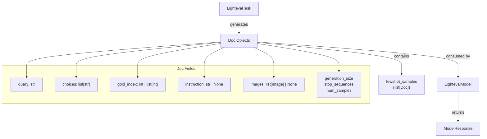
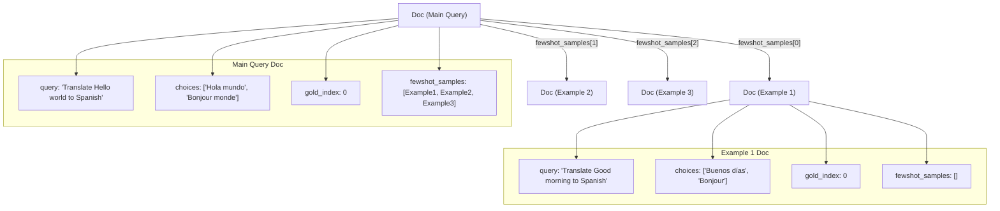
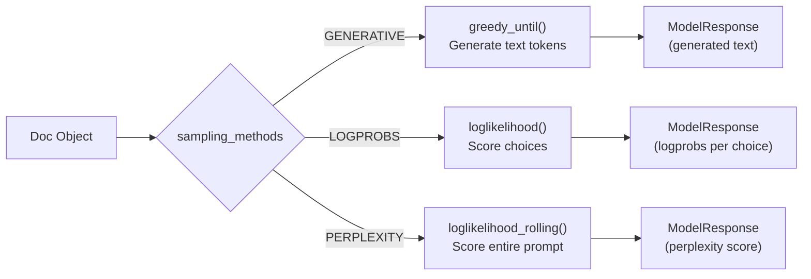
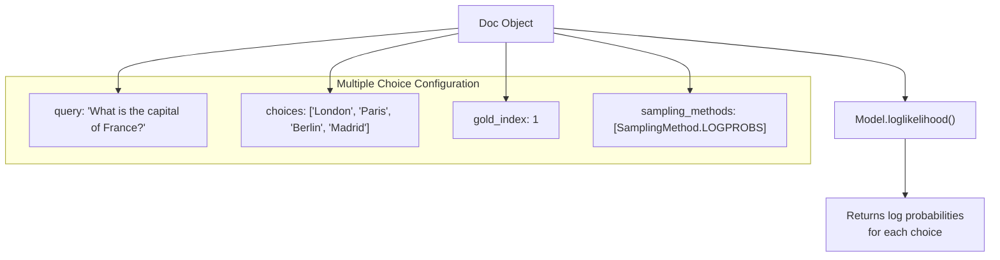
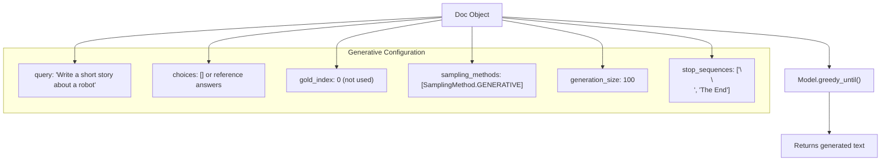
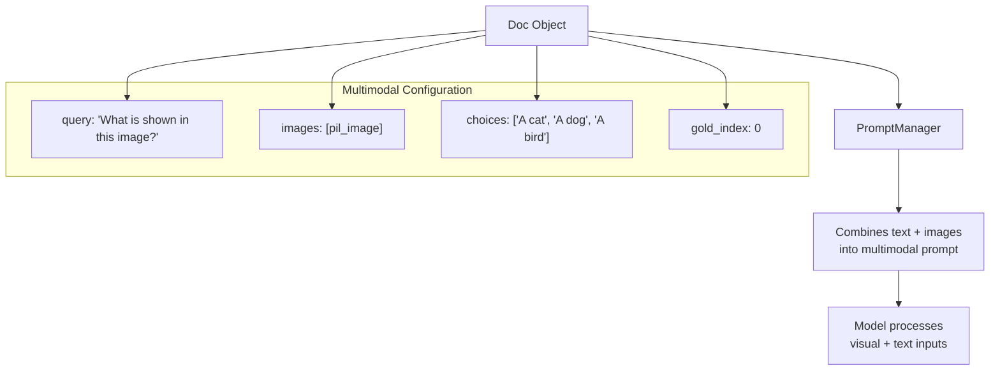
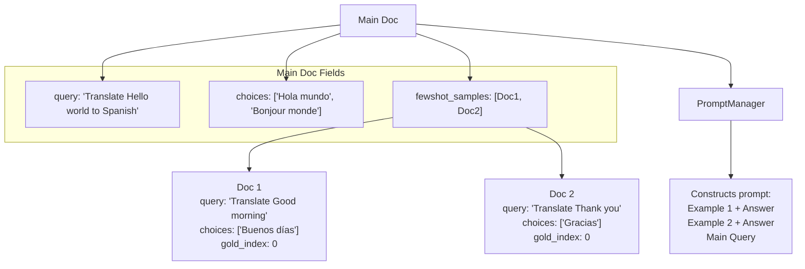
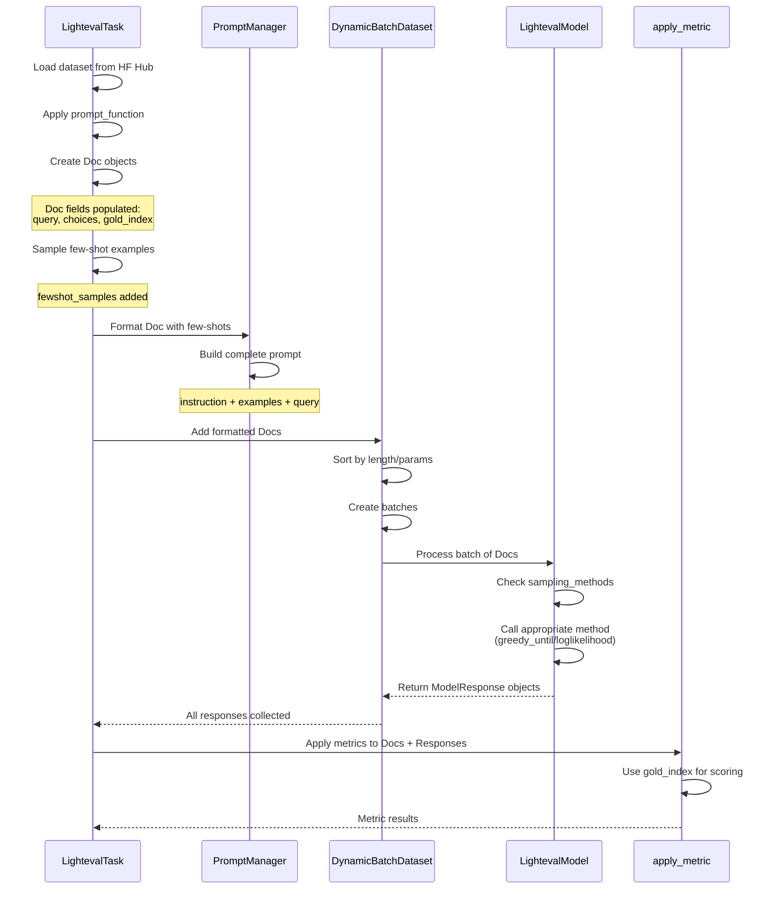

<!-- source: DeepWiki mcp.deepwiki.com · repo huggingface/lighteval · page 6.1 Doc Objects · fetched 2026-10-26 -->

# Doc Objects

<details>
<summary>Relevant source files</summary>

The following files were used as context for generating this wiki page:

- [src/lighteval/tasks/lighteval_task.py](src/lighteval/tasks/lighteval_task.py)
- [src/lighteval/tasks/requests.py](src/lighteval/tasks/requests.py)

</details>


This page documents the `Doc` dataclass, which is the fundamental data structure representing a single evaluation sample in lighteval. A `Doc` object encapsulates all information needed to evaluate a model on one task instance, including the input query, expected outputs, few-shot examples, and generation parameters.

For information about how `Doc` objects are created from tasks, see [Task Configuration](#5.1). For details on how models process `Doc` objects, see [Model Interface](#7.1). For information about the response format, see [ModelResponse](#6.2).

## Purpose and Structure

The `Doc` dataclass serves as the standardized interface between the task system and model backends. Every evaluation sample, regardless of task type or model backend, is represented as a `Doc` object.



**Sources:** [src/lighteval/tasks/requests.py:43-228]()

## Field Categories

The `Doc` dataclass organizes its fields into several logical categories:

### Core Evaluation Fields

These fields are required and define the fundamental evaluation sample:

| Field | Type | Description |
|-------|------|-------------|
| `query` | `str` | The main prompt or question to send to the model |
| `choices` | `list[str]` | Available answer choices (for multiple choice) or reference answers (for generative) |
| `gold_index` | `int \| list[int]` | Index(es) of correct answer(s) in the choices list |

**Sources:** [src/lighteval/tasks/requests.py:189-191]()

### Optional Context Fields

These fields provide additional context or metadata:

| Field | Type | Description |
|-------|------|-------------|
| `instruction` | `str \| None` | Task-specific system prompt, appended to model-specific system prompt |
| `images` | `list[Image] \| None` | PIL Image objects for multimodal tasks |
| `specific` | `dict \| None` | Task-specific metadata or additional information |
| `unconditioned_query` | `str \| None` | Query without task context, used for PMI normalization: log P(choice \| Query) - log P(choice \| Unconditioned Query) |
| `original_query` | `str \| None` | Query before any preprocessing or modification |

**Sources:** [src/lighteval/tasks/requests.py:192-200]()

### Task Metadata Fields

Set by the task system, not by users:

| Field | Type | Description |
|-------|------|-------------|
| `id` | `str` | Unique identifier for this evaluation instance |
| `task_name` | `str` | Name of the task or benchmark this Doc belongs to |

**Sources:** [src/lighteval/tasks/requests.py:202-203]()

### Few-Shot Learning Fields

These fields support in-context learning:

| Field | Type | Default | Description |
|-------|------|---------|-------------|
| `fewshot_samples` | `list[Doc]` | `[]` | List of Doc objects representing few-shot examples (self-referential) |
| `sampling_methods` | `list[SamplingMethod]` | `[]` | Sampling methods to use: GENERATIVE, LOGPROBS, or PERPLEXITY |
| `fewshot_sorting_class` | `str \| None` | `None` | Class label for balanced few-shot example selection |

**Sources:** [src/lighteval/tasks/requests.py:206-208]()

### Generation Control Fields

These fields control model generation behavior:

| Field | Type | Default | Description |
|-------|------|---------|-------------|
| `generation_size` | `int \| None` | `None` | Maximum number of tokens to generate for this instance |
| `stop_sequences` | `list[str] \| None` | `None` | Strings that should stop generation when encountered |
| `use_logits` | `bool` | `False` | Whether to return logits (raw model outputs) in addition to text |
| `num_samples` | `int` | `1` | Number of different samples to generate for this instance |
| `generation_grammar` | `None` | `None` | Grammar constraints for generation (reserved for future use) |

**Sources:** [src/lighteval/tasks/requests.py:211-215]()

## Self-Referential Structure

One of the key features of the `Doc` dataclass is its self-referential structure through the `fewshot_samples` field. This field contains a list of other `Doc` objects that serve as few-shot examples, enabling in-context learning.



This recursive structure allows:
- **Flexible few-shot configuration**: Each main Doc can have its own set of examples
- **Consistent formatting**: Few-shot examples are formatted the same way as the main query
- **Context preservation**: All necessary information is bundled together
- **Prompt construction**: The PromptManager can construct complete prompts by iterating through fewshot_samples

**Sources:** [src/lighteval/tasks/requests.py:206](), [src/lighteval/tasks/requests.py:162-176]()

## SamplingMethod Enum

The `SamplingMethod` enum defines how the model should process the Doc:



| Method | Value | Model Method | Use Case |
|--------|-------|--------------|----------|
| `GENERATIVE` | `"GENERATIVE"` | `greedy_until()` | Open-ended generation, extractive QA |
| `LOGPROBS` | `"LOGPROBS"` | `loglikelihood()` | Multiple choice, classification |
| `PERPLEXITY` | `"PERPLEXITY"` | `loglikelihood_rolling()` | Language modeling, perplexity evaluation |

**Sources:** [src/lighteval/tasks/requests.py:35-41](), [src/lighteval/models/abstract_model.py:251-282]()

## Doc Methods

### get_golds()

Returns the correct answer(s) as strings by extracting them from the `choices` list using `gold_index`:

```python
def get_golds(self):
    """Return gold targets extracted from the target dict"""
    gold_indices = as_list(self.gold_index)
    golds = []
    for gold_ix in gold_indices:
        golds.extend(as_list(self.choices[gold_ix]))
    return golds
```

This method handles both:
- **Single correct answer**: `gold_index=1` returns `[choices[1]]`
- **Multiple correct answers**: `gold_index=[0, 2]` returns `[choices[0], choices[2]]`
- **Nested lists**: If a choice is itself a list, it flattens the result

**Sources:** [src/lighteval/tasks/requests.py:217-223]()

### __repr__()

Converts the Doc to a JSON string representation for debugging and logging:

```python
def __repr__(self):
    doc_dict = asdict(self)
    return json.dumps(doc_dict)
```

**Sources:** [src/lighteval/tasks/requests.py:225-227]()

## Usage Patterns by Task Type

### Multiple Choice Tasks

For tasks like MMLU, ARC, or HellaSwag:



**Key characteristics:**
- `choices` contains all answer options
- `gold_index` points to the correct choice
- `sampling_methods` typically includes `LOGPROBS`
- Model computes log probability for each choice

**Sources:** [src/lighteval/tasks/requests.py:140-148]()

### Generative Tasks

For tasks like GSM8K, HumanEval, or open-ended QA:



**Key characteristics:**
- `choices` may be empty or contain reference answers
- `sampling_methods` includes `GENERATIVE`
- `generation_size` and `stop_sequences` control generation
- Model generates tokens until stop condition

**Sources:** [src/lighteval/tasks/requests.py:150-159]()

### Multimodal Tasks

For vision-language tasks:



**Key characteristics:**
- `images` field contains PIL Image objects
- PromptManager handles multimodal formatting
- Both text and visual information are processed together

**Sources:** [src/lighteval/tasks/requests.py:178-186](), [src/lighteval/tasks/requests.py:193]()

### Few-Shot Learning Tasks

For in-context learning scenarios:



**Key characteristics:**
- `fewshot_samples` contains other Doc objects
- PromptManager formats examples before main query
- Self-referential structure enables flexible prompting

**Sources:** [src/lighteval/tasks/requests.py:162-176]()

## Doc Lifecycle in Evaluation Pipeline



**Key stages:**

1. **Creation**: Task's prompt function creates Doc objects from raw dataset samples
2. **Enhancement**: Few-shot examples are sampled and added to `fewshot_samples`
3. **Formatting**: PromptManager formats the complete prompt from Doc fields
4. **Batching**: DynamicBatchDataset organizes Docs for efficient inference
5. **Inference**: Model processes Docs according to `sampling_methods`
6. **Evaluation**: Metrics compare model outputs to `gold_index` values

**Sources:** [src/lighteval/tasks/requests.py:43-228]()

## Field Access Patterns

Different components access different Doc fields:

| Component | Primary Fields Used | Purpose |
|-----------|---------------------|---------|
| **PromptManager** | `query`, `choices`, `instruction`, `images`, `fewshot_samples` | Construct complete prompts |
| **LightevalModel** | `query`, `choices`, `sampling_methods`, `generation_size`, `stop_sequences`, `num_samples` | Determine inference method and parameters |
| **DynamicBatchDataset** | `generation_size`, `stop_sequences`, `num_samples` | Group similar Docs for efficient batching |
| **Metrics** | `gold_index`, `choices`, `specific` | Compare predictions to ground truth |
| **EvaluationTracker** | `id`, `task_name`, `query`, `choices` | Log detailed results |

**Sources:** [src/lighteval/tasks/requests.py:43-228]()

## Special Considerations

### PMI Normalization

The `unconditioned_query` field enables Pointwise Mutual Information (PMI) normalization:

```
PMI_score = log P(choice | query) - log P(choice | unconditioned_query)
```

This helps correct for model biases toward certain answer choices by normalizing with an unconditioned baseline.

**Sources:** [src/lighteval/tasks/requests.py:196-199]()

### Generation Parameter Precedence

Generation parameters can be specified at multiple levels:
1. Task-level defaults (in `LightevalTaskConfig`)
2. Doc-level overrides (`generation_size`, `stop_sequences` fields)
3. Model-level configuration (`GenerationParameters`)

Doc-level parameters take precedence when present, allowing per-sample customization.

**Sources:** [src/lighteval/tasks/requests.py:211-215]()

### Dataclass Slots

The Doc class uses `slots=True` for memory efficiency:

```python
@dataclass(slots=True)
class Doc:
    ...
```

This reduces memory overhead when handling thousands of evaluation samples, but prevents adding attributes at runtime.

**Sources:** [src/lighteval/tasks/requests.py:43]()

## Related Data Structures

- **[ModelResponse](#6.2)**: The output structure returned by models after processing Docs
- **[DynamicBatchDataset](#6.3)**: Organizes Docs into efficient batches for inference
- **[LightevalTaskConfig](#5.1)**: Defines how to create Docs from raw dataset samples
- **[PromptManager](#5.7)**: Formats Docs into complete prompts for models

---

