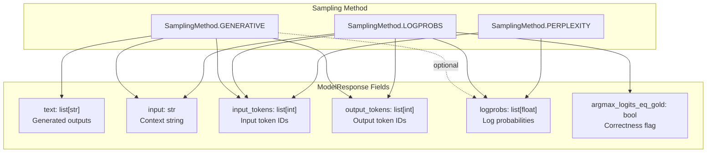
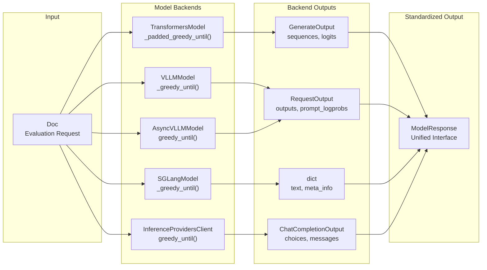
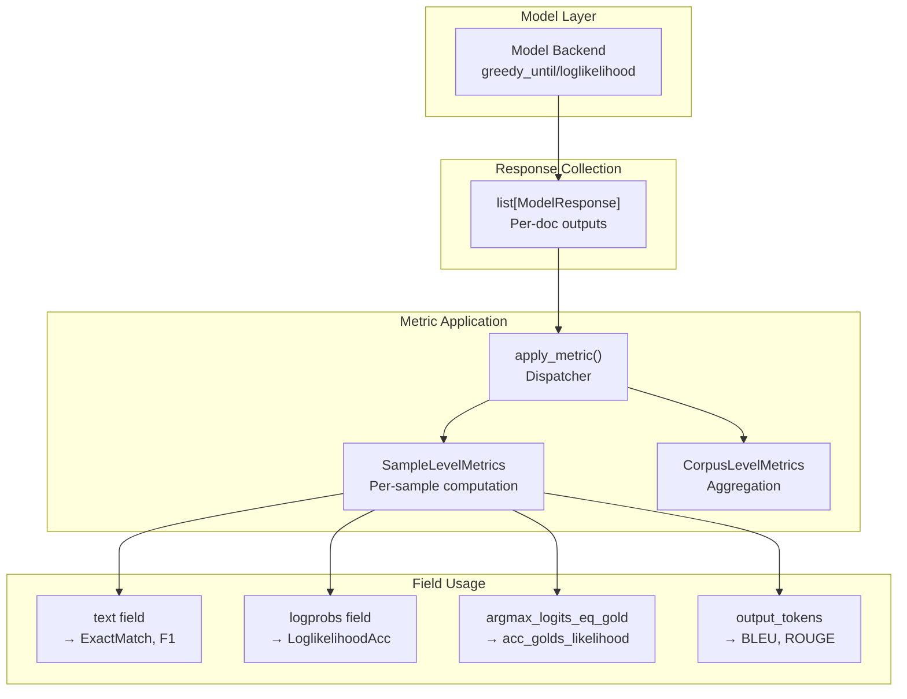
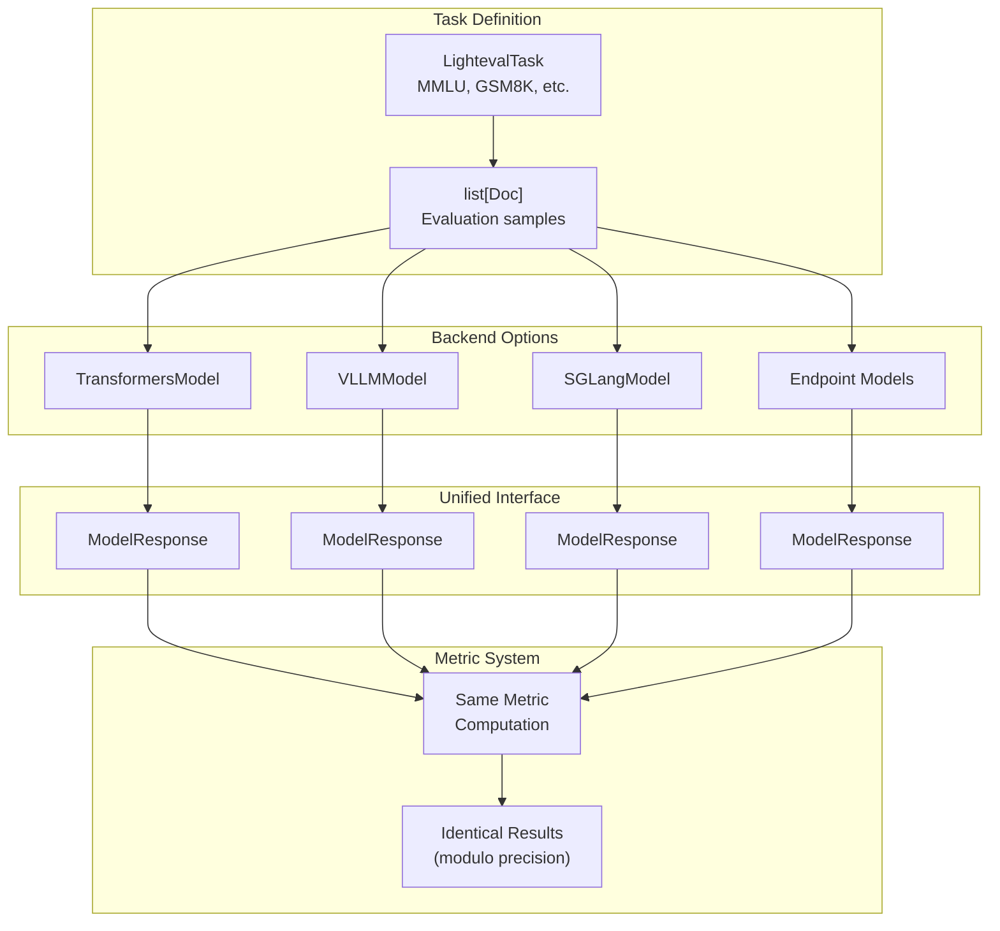

<!-- source: DeepWiki mcp.deepwiki.com · repo huggingface/lighteval · page 6.2 ModelResponse · fetched 2026-10-26 -->

# ModelResponse

<details>
<summary>Relevant source files</summary>

The following files were used as context for generating this wiki page:

- [src/lighteval/models/endpoints/inference_providers_model.py](src/lighteval/models/endpoints/inference_providers_model.py)
- [src/lighteval/models/sglang/sglang_model.py](src/lighteval/models/sglang/sglang_model.py)
- [src/lighteval/models/transformers/transformers_model.py](src/lighteval/models/transformers/transformers_model.py)
- [src/lighteval/models/utils.py](src/lighteval/models/utils.py)
- [src/lighteval/models/vllm/vllm_model.py](src/lighteval/models/vllm/vllm_model.py)

</details>


The `ModelResponse` class is the standardized data structure that encapsulates the output from model inference across all backends in lighteval. It serves as the uniform interface between model backends (Transformers, VLLM, SGLang, endpoints, etc.) and the metric computation system, ensuring consistent evaluation regardless of which backend is used.

For information about the input data structure that models consume, see [Doc Objects](#6.1). For details on model backends that produce ModelResponse objects, see [Models and Backends](#7).

---

## Overview

`ModelResponse` is the core output format returned by all three model inference methods defined in the `LightevalModel` abstract interface:
- `greedy_until()` - for generative tasks
- `loglikelihood()` - for multiple-choice tasks
- `loglikelihood_rolling()` - for perplexity computation

The structure is flexible, containing different fields depending on the sampling method used, but always maintains the same class interface across all backends.

**Sources:** [src/lighteval/models/abstract_model.py:34](), [src/lighteval/models/abstract_model.py:250-282]()

---

## Data Structure Fields

While the exact implementation is in `src/lighteval/models/model_output.py` (not shown in provided files), the usage patterns reveal the following fields:

| Field | Type | Purpose | Populated By |
|-------|------|---------|--------------|
| `input` | `str \| None` | Raw input prompt/context string | GENERATIVE, LOGPROBS |
| `text` | `list[str] \| None` | Generated text outputs (can be multiple samples) | GENERATIVE |
| `input_tokens` | `list[int] \| list[list[int]] \| None` | Tokenized input sequence(s) | All methods |
| `output_tokens` | `list[int] \| list[list[int]] \| None` | Tokenized output sequence(s) | All methods |
| `logprobs` | `float \| list[float] \| None` | Log probabilities of tokens | GENERATIVE (optional), LOGPROBS, PERPLEXITY |
| `argmax_logits_eq_gold` | `bool \| list[bool] \| None` | Whether argmax prediction equals gold answer | LOGPROBS |

The fields vary in structure based on the evaluation context:
- **Single sample**: Fields contain single values or simple lists
- **Multiple samples** (num_samples > 1): Fields contain nested lists
- **Multiple choices** (loglikelihood): Fields contain lists of values, one per choice

**Sources:** [src/lighteval/models/vllm/vllm_model.py:398-404](), [src/lighteval/models/vllm/vllm_model.py:522-528](), [src/lighteval/models/transformers/transformers_model.py:615-620](), [src/lighteval/models/sglang/sglang_model.py:307-312]()

---

## ModelResponse by Sampling Method

### Diagram: ModelResponse Population Patterns



**Sources:** [src/lighteval/tasks/requests.py:35-41](), [src/lighteval/models/abstract_model.py:250-282]()

### Generative Tasks (greedy_until)

For text generation tasks, `ModelResponse` contains:

```python
ModelResponse(
    input="What is the capital of France?",  # Optional: raw prompt
    text=["Paris"],  # Generated text (list for multiple samples)
    input_tokens=[1234, 5678, ...],  # Tokenized prompt
    output_tokens=[9012, 3456],  # Tokenized generation
    logprobs=[0.95, 0.87, ...],  # Optional: per-token logprobs
)
```

When `num_samples > 1` (for Pass@K or sampling metrics):
```python
ModelResponse(
    text=["Paris", "Paris, France", "The capital is Paris"],  # Multiple samples
    output_tokens=[[9012, 3456], [9012, 3457, 3458], ...],  # Multiple token sequences
    logprobs=[[0.95, 0.87], [0.93, 0.88, 0.82], ...],  # Per-sample logprobs
)
```

**Sources:** [src/lighteval/models/vllm/vllm_model.py:308-406](), [src/lighteval/models/transformers/transformers_model.py:625-750]()

### Multiple Choice Tasks (loglikelihood)

For tasks requiring probability comparison across choices:

```python
# Single doc with 4 choices generates 1 ModelResponse with 4 sets of values
ModelResponse(
    input="Question: What is 2+2? Choices:",  # Context
    input_tokens=[[ctx_tokens], [ctx_tokens], [ctx_tokens], [ctx_tokens]],  # Same context 4x
    output_tokens=[[tok_A], [tok_B], [tok_C], [tok_D]],  # Tokens for each choice
    logprobs=[-0.05, -2.3, -3.1, -4.2],  # Sum of logprobs per choice
    argmax_logits_eq_gold=[True, False, False, False],  # Greedy prediction matches
)
```

The `argmax_logits_eq_gold` field indicates whether the model would have selected this choice greedily (when all token predictions were the most likely). This is used for metrics like `acc_golds_likelihood`.

**Sources:** [src/lighteval/models/vllm/vllm_model.py:465-532](), [src/lighteval/models/transformers/transformers_model.py:752-850](), [src/lighteval/models/sglang/sglang_model.py:351-418]()

### Perplexity Tasks (loglikelihood_rolling)

For perplexity computation over entire sequences:

```python
ModelResponse(
    input_tokens=[full_sequence_tokens],  # Complete tokenized text
    logprobs=[-0.5, -1.2, -0.8, ...],  # Per-token log probabilities
)
```

**Sources:** [src/lighteval/models/transformers/transformers_model.py:852-911]()

---

## Backend-Specific Implementation

### Diagram: ModelResponse Creation Flow



**Sources:** [src/lighteval/models/transformers/transformers_model.py:191-228](), [src/lighteval/models/vllm/vllm_model.py:186-221](), [src/lighteval/models/sglang/sglang_model.py:141-168]()

### Transformers Backend

The Transformers backend creates `ModelResponse` from HuggingFace's `GenerateOutput`:

```python
# From transformers_model.py:732-750
outputs: GenerateOutput = self.model.generate(...)
for batch_idx, (context, output) in enumerate(zip(contexts, outputs)):
    output_token_ids = output[context_size:]
    result = self.tokenizer.decode(output_token_ids, skip_special_tokens=True)
    
    cur_response = ModelResponse(
        text=[result],
        logprobs=logprobs if use_logits else [],
        output_tokens=[output_token_ids.tolist()],
        input_tokens=context_tokens,
    )
```

**Sources:** [src/lighteval/models/transformers/transformers_model.py:625-750]()

### VLLM Backend

VLLM provides rich output with per-token logprobs via `RequestOutput`:

```python
# From vllm_model.py:393-404
for i, vllm_output in enumerate(vllm_outputs):
    output_token_ids = [outputs.token_ids for outputs in vllm_output.outputs]
    result = [output.text for output in vllm_output.outputs]
    input_token_ids = vllm_output.prompt_token_ids
    
    cur_response = ModelResponse(
        input=context[i],
        text=result,
        output_tokens=list(output_token_ids),
        input_tokens=input_token_ids,
    )
```

For loglikelihood, VLLM's `prompt_logprobs` provides the necessary probabilities:

```python
# From vllm_model.py:510-520
for token, logprobs in zip(continuation[::-1], output.prompt_logprobs[::-1]):
    continuation_logprobs.append(logprobs[token])

bool_score = all(logprob.rank == 1 for logprob in continuation_logprobs)
continuation_logprobs = [logprob.logprob for logprob in continuation_logprobs]
```

**Sources:** [src/lighteval/models/vllm/vllm_model.py:323-406](), [src/lighteval/models/vllm/vllm_model.py:469-532]()

### SGLang Backend

SGLang provides output in a dictionary format with metadata:

```python
# From sglang_model.py:301-312
for input_token_ids, sglang_output in zip(inputs, sglang_outputs):
    meta_info = sglang_output["meta_info"]
    output_token_logprobs = meta_info["output_token_logprobs"]
    output_token_ids = [output[1] for output in output_token_logprobs]
    logprobs = [output[0] for output in output_token_logprobs]
    result = [sglang_output["text"]]
    
    cur_response = ModelResponse(
        text=result,
        logprobs=logprobs,
        output_tokens=list(output_token_ids),
        input_tokens=input_token_ids,
    )
```

**Sources:** [src/lighteval/models/sglang/sglang_model.py:239-314]()

### Endpoint Backends

API-based backends (InferenceProviders, LiteLLM, etc.) typically only return text:

```python
# From inference_providers_model.py:230-237
for response, context in zip(responses, contexts):
    result: list[str] = [choice.message.content for choice in response.choices]
    
    cur_response = ModelResponse(
        text=result if result[0] else [""],
        input=context,
    )
```

These backends cannot provide token-level information or logprobs since the API doesn't expose them.

**Sources:** [src/lighteval/models/endpoints/inference_providers_model.py:202-240]()

---

## Usage in Metric Computation

`ModelResponse` objects are consumed by the metric system through the `apply_metric` function:

### Diagram: ModelResponse to Metrics Flow



**Sources:** [src/lighteval/models/abstract_model.py:250-282]()

### Field Access Patterns

Different metrics access different fields:

**Text-based metrics** (ExactMatch, F1, BLEU):
```python
# Access ModelResponse.text for generated strings
predictions = [response.text[0] for response in responses]
```

**Logprob-based metrics** (LoglikelihoodAcc, Perplexity):
```python
# Access ModelResponse.logprobs for probability scores
logprobs = [response.logprobs for response in responses]
```

**Token-based metrics** (ROUGE, BERTScore):
```python
# Access ModelResponse.output_tokens for token-level analysis
tokens = [response.output_tokens for response in responses]
```

**Correctness metrics** (acc_golds_likelihood):
```python
# Access ModelResponse.argmax_logits_eq_gold for greedy predictions
greedy_correct = [response.argmax_logits_eq_gold for response in responses]
```

---

## Consistency Across Backends

The `ModelResponse` structure ensures that evaluation results are backend-agnostic. A task evaluated with the Transformers backend produces the same metrics as when evaluated with VLLM, because both populate the same `ModelResponse` fields.

### Diagram: Backend Independence



This design principle is fundamental to lighteval's architecture: evaluation logic is completely decoupled from inference implementation.

**Sources:** [src/lighteval/models/abstract_model.py:220-283]()

---

## Relationship with Other Data Structures

### Input: Doc Objects

`ModelResponse` is the output counterpart to `Doc` objects (the input):
- **Doc** → Model Backend → **ModelResponse** → Metrics

`Doc` contains the evaluation request (query, choices, gold_index), while `ModelResponse` contains the model's output for that request.

See [Doc Objects](#6.1) for details on the input structure.

### Batch Structure

In the Transformers backend, `ModelResponse` objects are created from a `Batch` dataclass:

```python
# From transformers_model.py:50-51
from lighteval.models.model_output import (
    Batch,
    ModelResponse,
)
```

The `Batch` class groups multiple inputs for efficient processing, while `ModelResponse` represents individual outputs.

**Sources:** [src/lighteval/models/transformers/transformers_model.py:47-52]()

### Caching

`ModelResponse` objects are cached using the `@cached` decorator:

```python
@cached(SamplingMethod.GENERATIVE)
def greedy_until(self, docs: list[Doc]) -> list[ModelResponse]:
    ...
```

The cache key is based on the input `Doc` content and sampling method, allowing previously computed responses to be reused across evaluation runs.

See the `SampleCache` class in [src/lighteval/utils/cache_management.py]() for implementation details.

**Sources:** [src/lighteval/models/vllm/vllm_model.py:308](), [src/lighteval/models/transformers/transformers_model.py:913]()

---

## Summary

`ModelResponse` is the foundational output data structure in lighteval that:

1. **Standardizes** model outputs across 10+ different backends
2. **Separates** inference implementation from evaluation logic
3. **Supports** three sampling methods (GENERATIVE, LOGPROBS, PERPLEXITY)
4. **Enables** 40+ different metrics to access the same unified interface
5. **Allows** backend-agnostic evaluation with consistent results

The structure's flexibility (optional fields, variable list structures) accommodates the diverse requirements of different evaluation scenarios while maintaining a single, consistent interface for metric computation.

**Sources:** [src/lighteval/models/abstract_model.py:34](), [src/lighteval/models/vllm/vllm_model.py:36](), [src/lighteval/models/transformers/transformers_model.py:49-52](), [src/lighteval/models/sglang/sglang_model.py:33](), [src/lighteval/models/endpoints/inference_providers_model.py:36]()

---

