<!-- source: DeepWiki mcp.deepwiki.com · repo huggingface/lighteval · page 6.3 Dynamic Batching · fetched 2026-10-26 -->

# Dynamic Batching

<details>
<summary>Relevant source files</summary>

The following files were used as context for generating this wiki page:

- [src/lighteval/data.py](src/lighteval/data.py)
- [src/lighteval/metrics/__init__.py](src/lighteval/metrics/__init__.py)
- [tests/test_unit_harness_metrics.py](tests/test_unit_harness_metrics.py)

</details>


## Purpose and Scope

This document describes the dynamic batching system in lighteval, which optimizes inference efficiency by intelligently organizing evaluation requests into batches. The system sorts requests by length or generation parameters, splits them into groups, and maintains original ordering for result reconstruction. For information about the data structures used in these batches, see [Doc Objects](#6.1) and [ModelResponse](#6.2).

---

## Overview

Dynamic batching is a core optimization technique used during model inference to minimize padding overhead and maximize throughput. Rather than using a fixed batch size for all requests, lighteval's dynamic batching system:

1. **Sorts** requests by relevant criteria (length, generation parameters)
2. **Splits** the sorted dataset into groups with similar characteristics
3. **Processes** each split with appropriately sized batches
4. **Restores** results to their original order

This approach reduces wasted computation from padding tokens and enables better resource utilization, especially important when evaluating models on diverse task sets.

**Sources:** [src/lighteval/data.py:44-62]()

---

## Architecture

### Class Hierarchy

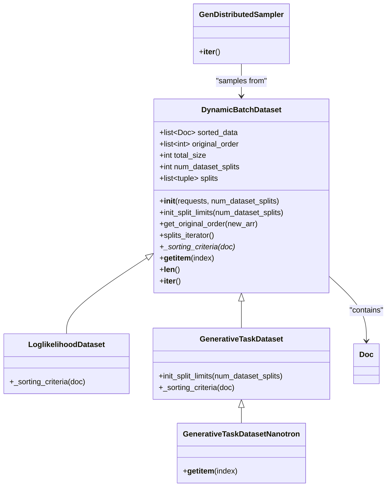

**Sources:** [src/lighteval/data.py:44-252](), [src/lighteval/data.py:270-299]()

---

## DynamicBatchDataset Base Class

The `DynamicBatchDataset` class provides the foundational implementation for all dynamic batching strategies. It inherits from PyTorch's `Dataset` class and adds sorting and splitting capabilities.

### Initialization

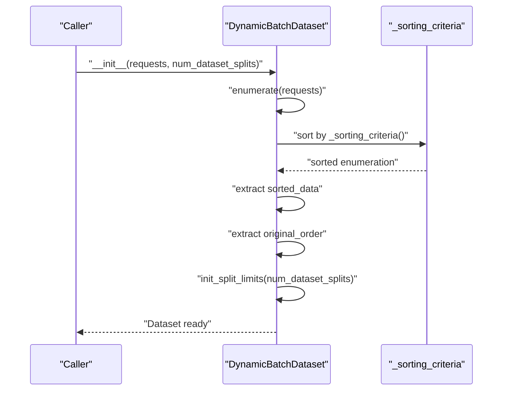

The initialization process performs the following steps:

1. **Enumerate** the input requests to track original positions [src/lighteval/data.py:64]()
2. **Sort** by the `_sorting_criteria` method (implemented by subclasses) [src/lighteval/data.py:65]()
3. **Store** sorted data and original indices separately [src/lighteval/data.py:67-68]()
4. **Initialize** split boundaries based on the total size [src/lighteval/data.py:72]()

**Sources:** [src/lighteval/data.py:45-72]()

### Split Management

The `init_split_limits` method divides the dataset into roughly equal splits:

| Operation | Description |
|-----------|-------------|
| **Size Validation** | If `num_dataset_splits >= total_size`, reduces to 1 split |
| **Split Calculation** | Each split has `ceil(total_size / num_dataset_splits)` items |
| **Index Ranges** | Creates tuples `(start_index, end_index)` for each split |

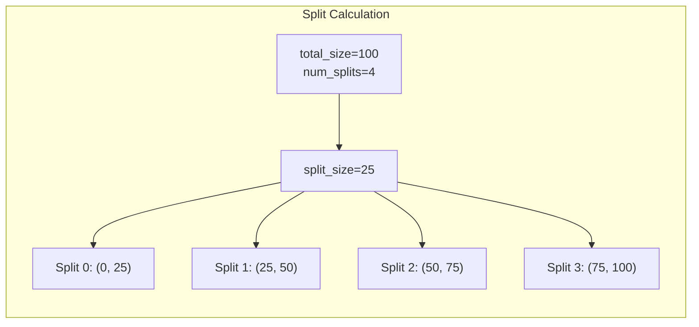

**Sources:** [src/lighteval/data.py:74-86]()

### Order Preservation

The `get_original_order` method restores results to their original sequence:

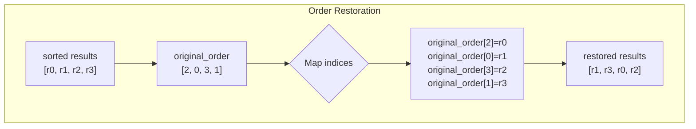

This is critical because model inference processes documents in sorted order for efficiency, but results must be returned in the original order for correct metric computation.

**Sources:** [src/lighteval/data.py:88-108]()

### Split Iteration

The `splits_iterator` method yields `Subset` objects for each split, enabling progressive batch processing:

```python
for split_subset in dataset.splits_iterator():
    # Process this split with appropriate batch size
    # Earlier splits have longer sequences, later splits shorter
```

**Sources:** [src/lighteval/data.py:110-121]()

---

## LoglikelihoodDataset

The `LoglikelihoodDataset` class is designed for tasks that compute log-likelihood scores over choice continuations (e.g., multiple-choice questions).

### Sorting Criteria

The sorting function returns the **negative** sum of query length and maximum choice length:

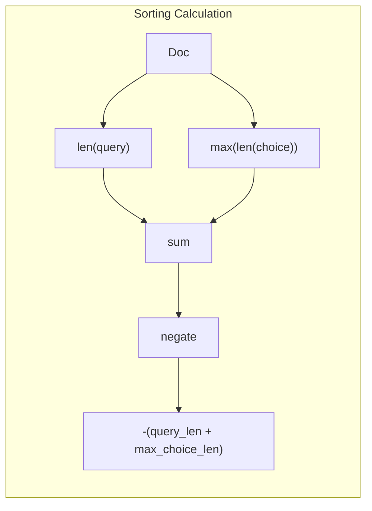

**Rationale for negative sorting:**
- **Descending order**: Longest sequences processed first
- **Early OOM detection**: Out-of-memory errors happen immediately, not near completion
- **Batch size estimation**: First item in a batch determines the padded length
- **Time estimates**: Always overestimate rather than underestimate remaining time

| Example | Query Length | Max Choice Length | Sort Key |
|---------|--------------|-------------------|----------|
| Doc A | 50 | 20 | -70 |
| Doc B | 100 | 30 | -130 |
| Doc C | 30 | 10 | -40 |
| **Order** | B → A → C | | -130, -70, -40 |

**Sources:** [src/lighteval/data.py:161-183]()

---

## GenerativeTaskDataset

The `GenerativeTaskDataset` class handles open-ended generation tasks where the model produces text continuations.

### Generation Parameter Grouping

Unlike `LoglikelihoodDataset`, which uses a simple length-based split, `GenerativeTaskDataset` creates splits based on **generation parameters** to ensure similar requests are batched together.

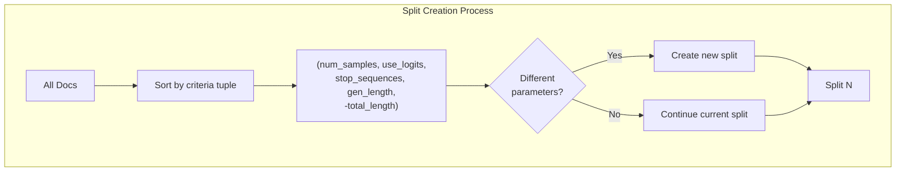

The `init_split_limits` method automatically infers the number of splits based on unique generation parameter combinations rather than using a fixed count.

**Sources:** [src/lighteval/data.py:187-226]()

### Sorting Criteria

The sorting function returns a **5-tuple** for hierarchical sorting:

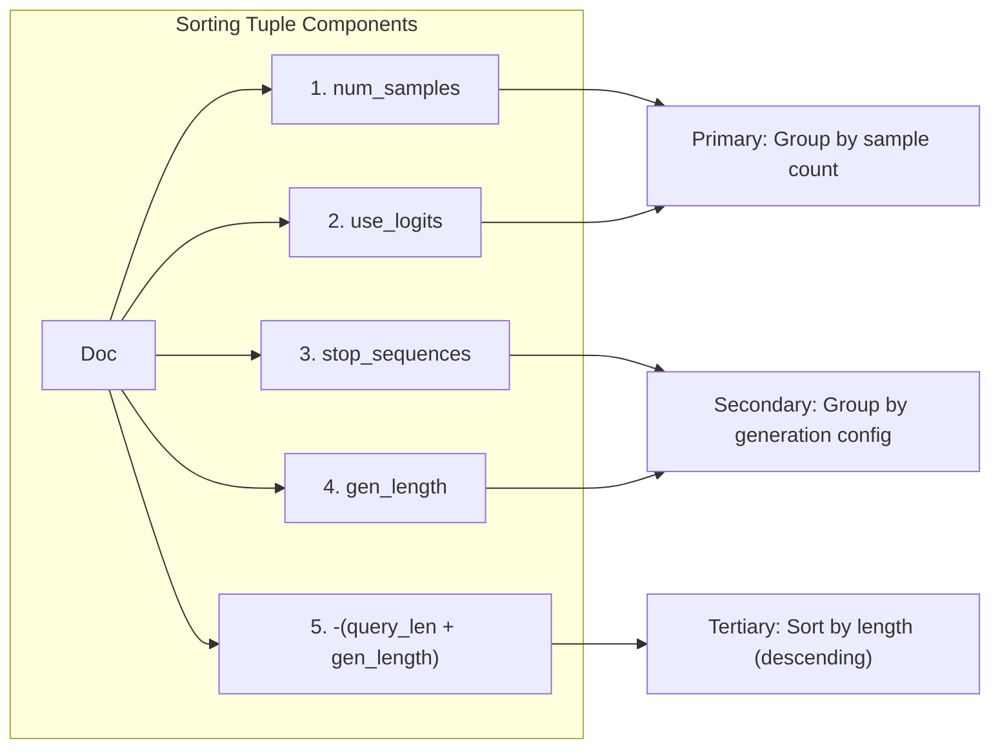

| Priority | Field | Purpose |
|----------|-------|---------|
| 1 | `num_samples` | Group requests with same sampling requirements |
| 2 | `use_logits` | Separate logit-based vs token-based generation |
| 3 | `stop_sequences` | Ensure compatible stopping criteria |
| 4 | `gen_length` | Group by target generation length |
| 5 | `-total_length` | Within groups, longest first |

**Example:**
```
Request A: (samples=1, logits=False, stop=["END"], gen=50, length=-120)
Request B: (samples=1, logits=False, stop=["END"], gen=50, length=-80)
Request C: (samples=5, logits=False, stop=["END"], gen=50, length=-100)
```

These would create 2 splits:
- **Split 1**: Requests A and B (same parameters except length, A before B)
- **Split 2**: Request C (different `num_samples`)

**Sources:** [src/lighteval/data.py:228-251]()

---

## GenerativeTaskDatasetNanotron

A specialized variant for Nanotron distributed training that modifies the `__getitem__` method to return both the index and the document. This enables Nanotron's distributed processing to track which worker processes which samples.

**Sources:** [src/lighteval/data.py:254-268]()

---

## GenDistributedSampler

The `GenDistributedSampler` extends PyTorch's `DistributedSampler` with a custom padding strategy for distributed evaluation.

### Standard vs Custom Padding

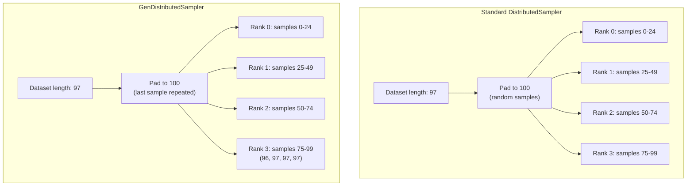

**Key difference:** When `drop_last=False`, the sampler pads with **copies of the last sample** instead of random samples. This is beneficial because:

1. Samples are already sorted by length
2. Last samples are shortest
3. Minimal padding overhead for the final batch

**Sources:** [src/lighteval/data.py:270-299]()

---

## Integration with Model Backends

The default number of dataset splits is defined in the `LightevalModel` base class:

```python
class LightevalModel(ABC):
    DATASET_SPLITS = 4
```

Model implementations use dynamic batching datasets through their inference methods:

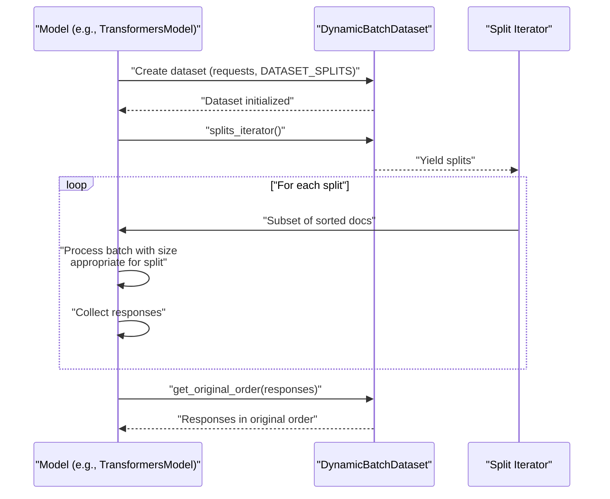

**Sources:** [src/lighteval/models/abstract_model.py:159]()

---

## Performance Considerations

### Batch Size Strategy

The split-based approach enables adaptive batch sizing:

| Split | Sequence Length | Suggested Batch Size Strategy |
|-------|-----------------|-------------------------------|
| 1 | Longest sequences | Small batch size (e.g., 1-2) |
| 2 | Medium-long | Medium batch size (e.g., 4-8) |
| 3 | Medium-short | Larger batch size (e.g., 16-32) |
| 4 | Shortest sequences | Largest batch size (e.g., 64+) |

### Memory Efficiency

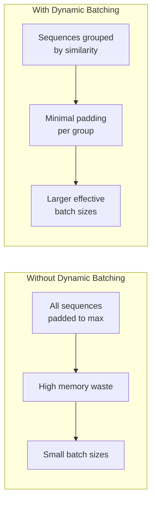

By processing similar-length sequences together, padding overhead is minimized, allowing for larger batch sizes and higher GPU utilization.

**Sources:** [src/lighteval/data.py:44-62]()

---

## Complete Data Flow Example

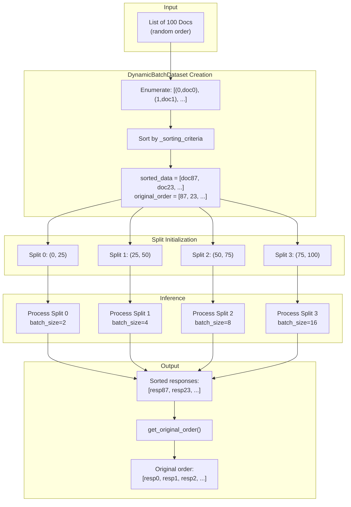

**Sources:** [src/lighteval/data.py:44-143]()

---

## Summary

The dynamic batching system in lighteval provides efficient request processing through:

- **Abstract base class** (`DynamicBatchDataset`) for common functionality
- **Task-specific implementations** (`LoglikelihoodDataset`, `GenerativeTaskDataset`) with custom sorting
- **Automatic split management** based on dataset characteristics
- **Order preservation** for correct result mapping
- **Distributed sampling support** via `GenDistributedSampler`

This architecture enables lighteval to efficiently evaluate models across diverse tasks while maintaining correctness and maximizing hardware utilization.

---

