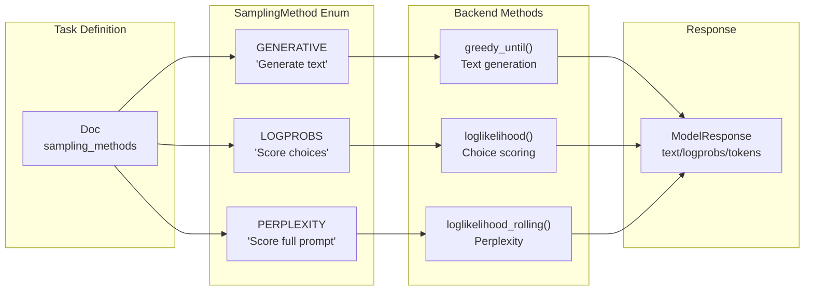
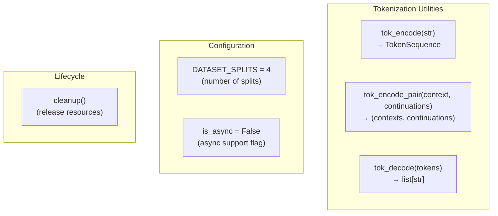
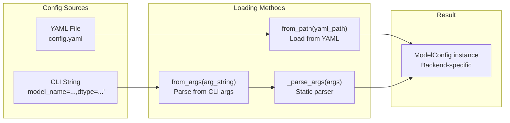
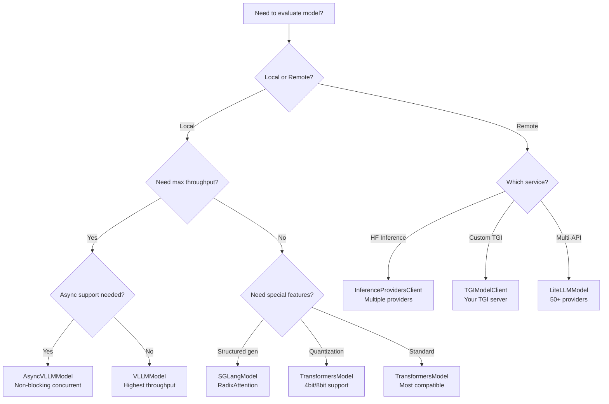
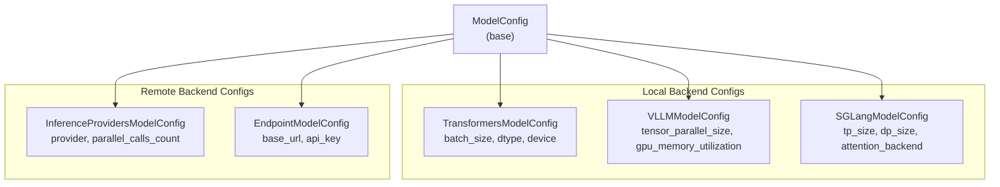
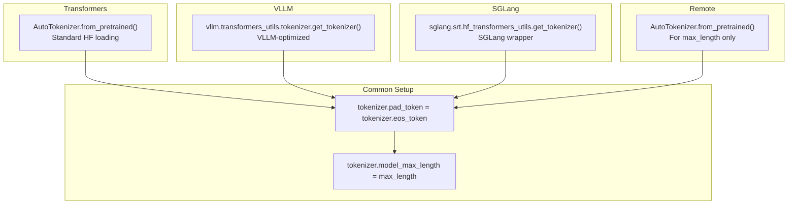
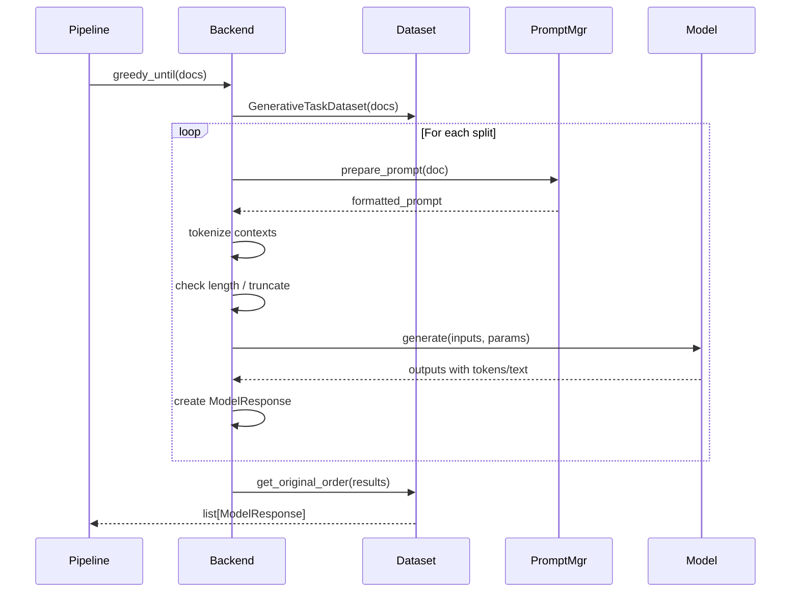
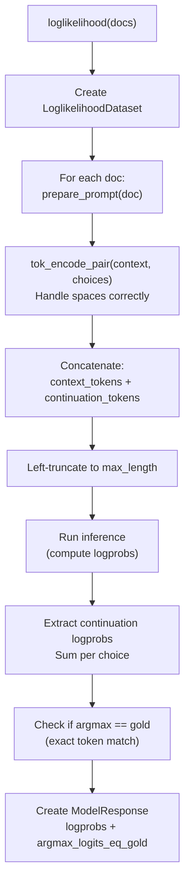
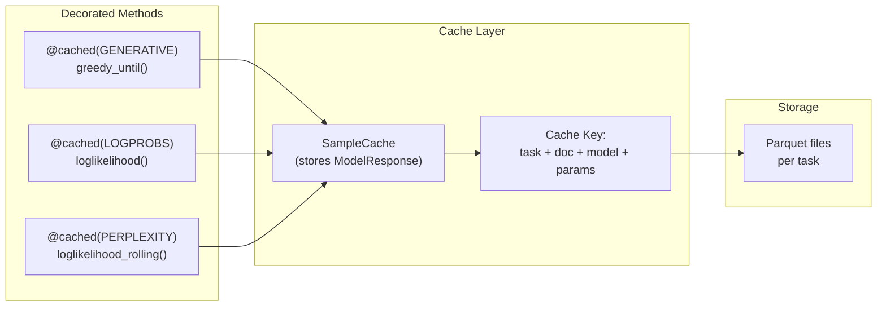

<!-- source: DeepWiki mcp.deepwiki.com · repo huggingface/lighteval · page 7 Models and Backends · fetched 2026-10-26 -->

# Models and Backends

<details>
<summary>Relevant source files</summary>

The following files were used as context for generating this wiki page:

- [src/lighteval/models/abstract_model.py](src/lighteval/models/abstract_model.py)
- [src/lighteval/models/endpoints/inference_providers_model.py](src/lighteval/models/endpoints/inference_providers_model.py)
- [src/lighteval/models/sglang/sglang_model.py](src/lighteval/models/sglang/sglang_model.py)
- [src/lighteval/models/transformers/transformers_model.py](src/lighteval/models/transformers/transformers_model.py)
- [src/lighteval/models/utils.py](src/lighteval/models/utils.py)
- [src/lighteval/models/vllm/vllm_model.py](src/lighteval/models/vllm/vllm_model.py)

</details>


This document provides a comprehensive overview of the model backend system in lighteval. It covers the abstract interfaces that all model backends must implement, the configuration system, and the various backend implementations available for evaluating language models.

For information about how models are used in the evaluation pipeline, see [Evaluation Pipeline](#4). For details on model configuration files and CLI usage, see [Model Configuration](#10.2).

## Purpose and Scope

The model backend system enables lighteval to evaluate language models from diverse sources and frameworks using a unified interface. This abstraction allows tasks and metrics to remain backend-agnostic while supporting local inference (Transformers, VLLM, SGLang), remote APIs (HuggingFace Inference, TGI, LiteLLM), and custom implementations.

**This page covers:**
- The `LightevalModel` abstract interface and contract
- The `ModelConfig` configuration system
- Available backend implementations and their characteristics
- How backends handle different inference modes
- Tokenization and prompt formatting integration

**Related pages:**
- For task-specific prompt formatting with backends, see [Prompt Management](#5.7)
- For data structures exchanged with backends, see [Doc Objects](#6.1) and [ModelResponse](#6.2)
- For CLI commands to use different backends, see [CLI Commands](#10.1)

## Backend System Architecture

The backend system follows a clear separation of concerns, where all model implementations inherit from `LightevalModel` and implement three core methods for different evaluation modes.

### Backend Interface Overview

```mermaid
graph TB
    subgraph "Abstract Layer"
        LM["LightevalModel<br/>(abstract base class)"]
        MC["ModelConfig<br/>(base config)"]
    end
    
    subgraph "Core Methods"
        GU["greedy_until(docs)<br/>→ list[ModelResponse]"]
        LL["loglikelihood(docs)<br/>→ list[ModelResponse]"]
        LLR["loglikelihood_rolling(docs)<br/>→ list[ModelResponse]"]
    end
    
    subgraph "Properties"
        TOK["tokenizer<br/>PreTrainedTokenizerBase"]
        ML["max_length<br/>int"]
        AST["add_special_tokens<br/>bool"]
    end
    
    subgraph "Local Implementations"
        TF["TransformersModel<br/>TransformersModelConfig"]
        VLLM["VLLMModel<br/>VLLMModelConfig"]
        ASYNC["AsyncVLLMModel<br/>VLLMModelConfig"]
        SGL["SGLangModel<br/>SGLangModelConfig"]
    end
    
    subgraph "Remote Implementations"
        IP["InferenceProvidersClient<br/>InferenceProvidersModelConfig"]
        IE["InferenceEndpointModel<br/>EndpointModelConfig"]
        TGI["TGIModelClient<br/>EndpointModelConfig"]
        LITE["LiteLLMModel<br/>EndpointModelConfig"]
    end
    
    LM --> GU
    LM --> LL
    LM --> LLR
    LM --> TOK
    LM --> ML
    LM --> AST
    
    LM -.inherits.-> TF
    LM -.inherits.-> VLLM
    LM -.inherits.-> ASYNC
    LM -.inherits.-> SGL
    LM -.inherits.-> IP
    LM -.inherits.-> IE
    LM -.inherits.-> TGI
    LM -.inherits.-> LITE
    
    MC -.configures.-> TF
    MC -.configures.-> VLLM
    MC -.configures.-> SGL
    MC -.configures.-> IP
```



**Sources:** [src/lighteval/models/abstract_model.py:220-352](), [src/lighteval/models/transformers/transformers_model.py:191-308](), [src/lighteval/models/vllm/vllm_model.py:186-241]()

### Inference Mode Dispatch

The evaluation pipeline dispatches to different backend methods based on the task's `SamplingMethod`:



**Sources:** [src/lighteval/tasks/requests.py:35-41](), [src/lighteval/models/abstract_model.py:250-282]()

## Core Abstractions

### LightevalModel Abstract Base Class

The `LightevalModel` class defines the contract that all model backends must implement. It provides both abstract methods (must be overridden) and concrete utility methods for tokenization.

**Key Abstract Methods:**

| Method | Purpose | Returns |
|--------|---------|---------|
| `greedy_until(docs)` | Generate text until stop conditions | `list[ModelResponse]` |
| `loglikelihood(docs)` | Compute log-likelihood of continuations | `list[ModelResponse]` |
| `loglikelihood_rolling(docs)` | Compute log-likelihood for perplexity | `list[ModelResponse]` |

**Key Abstract Properties:**

| Property | Type | Purpose |
|----------|------|---------|
| `tokenizer` | `PreTrainedTokenizerBase` | Tokenizer instance for encoding/decoding |
| `max_length` | `int` | Maximum sequence length supported |
| `add_special_tokens` | `bool` | Whether to add BOS/EOS tokens |

**Concrete Utility Methods:**



The `tok_encode_pair` method is particularly important as it handles space management between context and continuations correctly:

```python
# From src/lighteval/models/abstract_model.py:297-348
# Handles trailing spaces in context
n_spaces = len(context) - len(context.rstrip())
if n_spaces > 0:
    continuations = [context[-n_spaces:] + cont for cont in continuations]
    context = context[:-n_spaces]

# Two modes: pairwise (separate) or joint encoding
if pairwise:
    context_enc = self.tok_encode(context, add_special_tokens=self.add_special_tokens)
    continuation_enc = [self.tok_encode(cont, add_special_tokens=False) for cont in continuations]
```

**Sources:** [src/lighteval/models/abstract_model.py:220-352]()

### ModelConfig Base Class

The `ModelConfig` class provides the foundation for all backend-specific configuration classes. It includes common parameters and parsing utilities.

**Common Attributes:**

| Attribute | Type | Default | Purpose |
|-----------|------|---------|---------|
| `model_name` | `str` | Required | Model identifier (HF Hub ID or path) |
| `generation_parameters` | `GenerationParameters` | Empty | Temperature, top_p, max_new_tokens, etc. |
| `system_prompt` | `str \| None` | `None` | System prompt for chat models |
| `cache_dir` | `str` | `"~/.cache/huggingface/lighteval"` | Model cache directory |

**Configuration Loading Methods:**



**Example Configuration Parsing:**

```python
# From src/lighteval/models/abstract_model.py:103-155
# Parses: "model_name=gpt2,generation_parameters={temperature:0.7,top_p:0.9}"
pattern = re.compile(r"(\w+)=(\{.*\}|[^,]+)")
matches = pattern.findall(args)
# Handles nested generation_parameters dict specially
generation_parameters_dict = json.loads(gen_params)
```

**Sources:** [src/lighteval/models/abstract_model.py:41-156]()

## Backend Implementations Comparison

### Feature Matrix

| Backend | Local/Remote | Async | DP | TP | PP | Quantization | Prefix Cache | Best For |
|---------|-------------|-------|----|----|----|--------------|--------------| ---------|
| **Transformers** | Local | No | ✓ | ✓ | - | 4bit/8bit | - | Flexibility, debugging |
| **VLLM** | Local | Optional | ✓ | ✓ | ✓ | Multiple | ✓ | High throughput |
| **AsyncVLLM** | Local | Yes | ✓ | ✓ | ✓ | Multiple | ✓ | Concurrent requests |
| **SGLang** | Local | No | ✓ | ✓ | - | - | Radix | Structured generation |
| **InferenceProviders** | Remote | Yes | - | - | - | - | - | Quick start, managed |
| **TGI** | Remote | No | - | - | - | - | - | Custom TGI servers |
| **LiteLLM** | Remote | No | - | - | - | - | - | Multi-provider support |

**Legend:** DP = Data Parallelism, TP = Tensor Parallelism, PP = Pipeline Parallelism

**Sources:** [src/lighteval/models/transformers/transformers_model.py:70-162](), [src/lighteval/models/vllm/vllm_model.py:76-183](), [src/lighteval/models/sglang/sglang_model.py:54-139]()

### Backend Selection Decision Tree



**Sources:** Analysis based on [src/lighteval/models/vllm/vllm_model.py:76-183](), [src/lighteval/models/transformers/transformers_model.py:70-162](), [src/lighteval/models/sglang/sglang_model.py:54-139]()

## Key Backend Components

### Configuration Classes

Each backend has a corresponding configuration class that extends `ModelConfig`:



**TransformersModelConfig Highlights:**

```python
# From src/lighteval/models/transformers/transformers_model.py:70-162
class TransformersModelConfig(ModelConfig):
    model_name: str
    batch_size: PositiveInt | None = None  # Auto-detected if None
    dtype: str | None = None  # "float16", "bfloat16", "4bit", "8bit", "auto"
    model_parallel: bool | None = None  # Auto-detected based on GPUs
    compile: bool = False  # torch.compile optimization
    continuous_batching: bool = False  # For generation
    pairwise_tokenization: bool = False  # Context/continuation encoding
```

**VLLMModelConfig Highlights:**

```python
# From src/lighteval/models/vllm/vllm_model.py:76-183
class VLLMModelConfig(ModelConfig):
    tensor_parallel_size: PositiveInt = 1  # GPUs for tensor parallelism
    data_parallel_size: PositiveInt = 1  # GPUs for data parallelism
    pipeline_parallel_size: PositiveInt = 1  # GPUs for pipeline parallelism
    gpu_memory_utilization: NonNegativeFloat = 0.9  # Memory fraction
    enable_prefix_caching: bool = None  # Speed up repeated prefixes
    max_num_seqs: PositiveInt = 128  # Batch size at prefill
    max_num_batched_tokens: PositiveInt = 2048  # Max tokens per batch
```

**Sources:** [src/lighteval/models/transformers/transformers_model.py:70-162](), [src/lighteval/models/vllm/vllm_model.py:76-183](), [src/lighteval/models/sglang/sglang_model.py:54-139]()

### Tokenizer Integration

All backends must provide a tokenizer that implements the `PreTrainedTokenizerBase` interface. The tokenizer is used by the `PromptManager` for formatting and by the backend for encoding/decoding.

**Tokenizer Creation Patterns:**



**Sources:** [src/lighteval/models/transformers/transformers_model.py:429-453](), [src/lighteval/models/vllm/vllm_model.py:298-306](), [src/lighteval/models/sglang/sglang_model.py:214-222]()

### Chat Template Detection

Backends automatically detect whether to use chat templates based on tokenizer configuration:

```python
# From src/lighteval/models/utils.py:109-138
def uses_chat_template(
    model_name: str = None, 
    tokenizer: AutoTokenizer = None, 
    override_chat_template: bool = None
) -> bool:
    if override_chat_template is not None:
        return override_chat_template
    
    # Auto-detect from tokenizer
    tk = tokenizer or AutoTokenizer.from_pretrained(model_name)
    return tk.chat_template is not None
```

**Usage in Backends:**

```python
# From src/lighteval/models/vllm/vllm_model.py:193-217
self.use_chat_template = uses_chat_template(
    model_name=config.model_name, 
    override_chat_template=config.override_chat_template
)
# Later used for stop token handling
if self.use_chat_template:
    stop_tokens = []  # EOS handles stopping
else:
    stop_tokens = split[0].stop_sequences or []
```

**Sources:** [src/lighteval/models/utils.py:109-138](), [src/lighteval/models/vllm/vllm_model.py:193-217]()

## Inference Method Implementation Patterns

### greedy_until Implementation

The `greedy_until` method generates text using greedy decoding (or sampling if configured). All backends follow a similar pattern:

**Common Flow:**



**TransformersModel Approach:**

```python
# From src/lighteval/models/transformers/transformers_model.py:625-776
def _padded_greedy_until(self, docs: list[Doc]) -> list[ModelResponse]:
    dataset = GenerativeTaskDataset(requests=docs, num_dataset_splits=self.DATASET_SPLITS)
    
    for split in tqdm(dataset.splits_iterator()):
        # Auto-detect optimal batch size based on context length
        batch_size = self._get_batch_size(
            override_bs=self.config.batch_size,
            max_input_length=max_context_continuation_size_allowed
        )
        
        dataloader = DataLoader(split, batch_size=batch_size, collate_fn=lambda batch: batch)
        
        for batch in dataloader:
            contexts = [self.prompt_manager.prepare_prompt(doc) for doc in batch]
            tokenized = self.tokenizer(contexts, truncation="longest_first", padding="longest")
            
            # Generate with model
            outputs = self._generate(batch=prepared_batch, ...)
```

**VLLMModel Approach:**

```python
# From src/lighteval/models/vllm/vllm_model.py:323-406
def _greedy_until(self, docs: list[Doc]) -> list[ModelResponse]:
    dataset = GenerativeTaskDataset(requests=docs, num_dataset_splits=self.DATASET_SPLITS)
    
    for split in tqdm(dataset.splits_iterator()):
        context = [self.prompt_manager.prepare_prompt(doc) for doc in split]
        tokenized = self.tokenizer(context, add_special_tokens=self.add_special_tokens)
        
        # VLLM handles batching internally
        vllm_outputs = self._generate(
            inputs=inputs,
            max_new_tokens=max_new_tokens,
            stop_tokens=stop_tokens,
            num_samples=num_samples,
        )
        
        # Extract results from VLLM RequestOutput objects
        for vllm_output in vllm_outputs:
            output_token_ids = [outputs.token_ids for outputs in vllm_output.outputs]
            result = [output.text for output in vllm_output.outputs]
```

**AsyncVLLMModel Approach (Concurrent):**

```python
# From src/lighteval/models/vllm/vllm_model.py:630-662
async def greedy_until(self, docs: list[Doc]) -> list[ModelResponse]:
    responses = await self._async_batch(docs=docs, generative=True)
    
    for response in responses:
        output_token_ids = [outputs.token_ids for outputs in response.outputs]
        result = [output.text for output in response.outputs]
        # Create ModelResponse...

# Non-blocking concurrent execution
async def _async_batch(self, docs: list[Doc], generative: bool) -> list:
    processed_requests = [
        self._async_one_item(index=index, doc=doc, generative=generative) 
        for index, doc in enumerate(docs)
    ]
    results = await asyncio.gather(*processed_requests)
```

**Sources:** [src/lighteval/models/transformers/transformers_model.py:625-776](), [src/lighteval/models/vllm/vllm_model.py:308-406](), [src/lighteval/models/vllm/vllm_model.py:630-662]()

### loglikelihood Implementation

The `loglikelihood` method computes log-probabilities for multiple-choice tasks. It requires careful tokenization of context and continuations.

**Common Flow:**



**VLLM Implementation Details:**

```python
# From src/lighteval/models/vllm/vllm_model.py:469-532
def _loglikelihood_tokens(self, docs: list[Doc]) -> list[ModelResponse]:
    dataset = LoglikelihoodDataset(requests=docs, num_dataset_splits=1)
    
    for split in tqdm(dataset.splits_iterator()):
        contexts = [self.prompt_manager.prepare_prompt(doc) for doc in split]
        
        # Tokenize context and each continuation
        for context, doc in zip(contexts, split):
            tokenized_contexts, tokenized_continuations = self.tok_encode_pair(
                context, doc.choices, pairwise=self.pairwise_tokenization
            )
            # Concatenate for full sequence
            for tokenized_context, tokenized_continuation in zip(...):
                inputs.append(tokenized_context + tokenized_continuation)
        
        # Generate with prompt_logprobs enabled
        outputs = self._generate(inputs, generate=False)  # Sets prompt_logprobs=1
        
        # Extract logprobs for continuation tokens only
        for output, context, continuation in zip(outputs_doc, ...):
            continuation_logprobs = []
            for token, logprobs in zip(continuation[::-1], output.prompt_logprobs[::-1]):
                continuation_logprobs.append(logprobs[token])
            
            # Check if continuation was most likely (argmax)
            bool_score = all(logprob.rank == 1 for logprob in continuation_logprobs)
```

**Sources:** [src/lighteval/models/vllm/vllm_model.py:465-532](), [src/lighteval/models/transformers/transformers_model.py:778-896]()

## Backend-Specific Features

### Transformers Backend

**Distributed Execution with Accelerate:**

```python
# From src/lighteval/models/transformers/transformers_model.py:332-373
def init_model_parallel(self, model_parallel: bool | None = None):
    self.num_local_processes = int(os.environ.get("LOCAL_WORLD_SIZE", 1))
    self.num_machines = torch.cuda.device_count() // self.num_local_processes
    
    if model_parallel is None:
        max_memory_all_gpus = get_max_memory()
        model_parallel = bool(self.num_local_processes < len(max_memory_all_gpus))
    
    if model_parallel is True:
        max_mem_this_process = {
            k: v for k, v in max_memory_all_gpus.items()
            if k % self.num_local_processes == (self.accelerator.process_index % self.num_local_processes)
        }
        device_map = "auto"
```

**Automatic Batch Size Detection:**

```python
# From src/lighteval/models/transformers/transformers_model.py:503-521
@find_executable_batch_size(starting_batch_size=starting_batch_size)
def forward_batch(batch_size):
    test_batch = torch.ones((batch_size + int(0.1 * batch_size), max_input_length), device=self.device).long()
    F.log_softmax(self._model_call(test_batch).float(), dim=-1).cpu()
    return batch_size

batch_size = forward_batch()  # Auto-detects largest working batch size
```

**Sources:** [src/lighteval/models/transformers/transformers_model.py:191-521]()

### VLLM Backend

**Data Parallelism with Ray:**

```python
# From src/lighteval/models/vllm/vllm_model.py:435-463
if self.data_parallel_size > 1:
    @ray.remote(num_gpus=self.tensor_parallel_size)
    def run_inference_one_model(model_args: dict, sampling_params: SamplingParams, requests):
        llm = LLM(**model_args)
        return llm.generate(prompt_token_ids=requests, sampling_params=sampling_params)
    
    # Distribute requests across workers in interleaved fashion
    requests = [list(x) for x in distribute(self.data_parallel_size, inputs)]
    object_refs = [run_inference_one_model.remote(*x) for x in inputs]
    results = ray.get(object_refs)
    ray.shutdown()
```

**Prefix Caching:**

```python
# From src/lighteval/models/vllm/vllm_model.py:252-296
self.model_args = {
    "enable_prefix_caching": config.enable_prefix_caching,  # Cache common prefixes
    "max_num_seqs": int(config.max_num_seqs),  # Batch size at prefill
    "max_num_batched_tokens": int(config.max_num_batched_tokens),  # Token batching
}
```

**Sources:** [src/lighteval/models/vllm/vllm_model.py:186-463]()

### SGLang Backend

**RadixAttention and Memory Management:**

```python
# From src/lighteval/models/sglang/sglang_model.py:189-212
self.model_args = {
    "model_path": config.model_name,
    "dp_size": config.dp_size,  # Data parallelism
    "tp_size": config.tp_size,  # Tensor parallelism
    "sampling_backend": config.sampling_backend,
    "attention_backend": config.attention_backend,  # RadixAttention
    "mem_fraction_static": config.mem_fraction_static,  # Memory allocation
    "chunked_prefill_size": config.chunked_prefill_size,  # Prefill chunking
    "disable_radix_cache": True,  # Disable for evaluation consistency
}
```

**Sources:** [src/lighteval/models/sglang/sglang_model.py:141-213]()

### Remote Backend Pattern

**Async API Calls with Retry Logic:**

```python
# From src/lighteval/models/endpoints/inference_providers_model.py:140-173
async def __call_api(self, prompt: List[dict], num_samples: int):
    for attempt in range(self.API_MAX_RETRY):
        try:
            kwargs = {
                "model": self.model_name,
                "messages": prompt,
                "n": num_samples,
            }
            kwargs.update(self.generation_parameters.to_inference_providers_dict())
            response = await self.client.chat.completions.create(**kwargs)
            return response
        except Exception as e:
            wait_time = min(64, self.API_RETRY_SLEEP * (2**attempt))  # Exponential backoff
            await asyncio.sleep(wait_time)
```

**Parallel Request Handling with Semaphore:**

```python
# From src/lighteval/models/endpoints/inference_providers_model.py:175-200
async def __call_api_parallel(self, prompts, num_samples):
    semaphore = asyncio.Semaphore(self.parallel_calls_count)  # Rate limiting
    
    async def bounded_api_call(prompt, num_samples):
        async with semaphore:
            return await self.__call_api(prompt, num_samples)
    
    tasks = [bounded_api_call(prompt, num_samples) for prompt, num_samples in zip(prompts, num_sampless)]
    results = await async_tqdm.gather(*tasks)
```

**Sources:** [src/lighteval/models/endpoints/inference_providers_model.py:97-240]()

## Caching System

All backends integrate with the `SampleCache` for result persistence across runs:



**Usage Pattern:**

```python
# From src/lighteval/models/vllm/vllm_model.py:308-321
@cached(SamplingMethod.GENERATIVE)
def greedy_until(self, docs: list[Doc]) -> list[ModelResponse]:
    return self._greedy_until(docs)

# Cache checks:
# 1. Hash doc content + model config + generation params
# 2. Look up in cache file
# 3. If found, return cached ModelResponse
# 4. If not found, run _greedy_until and cache result
```

**Sources:** [src/lighteval/utils/cache_management.py]() (not provided but referenced), [src/lighteval/models/vllm/vllm_model.py:308-321]()

## Configuration Examples

### Local Transformers Model

```yaml
# Example: Standard local evaluation
model_parameters:
  model_name: "meta-llama/Llama-3.1-8B-Instruct"
  dtype: "bfloat16"
  batch_size: 8
  max_length: 4096
  trust_remote_code: false
  generation_parameters:
    temperature: 0.7
    max_new_tokens: 512
    top_p: 0.95
  system_prompt: "You are a helpful assistant."
```

### VLLM with Parallelism

```yaml
# Example: High-throughput evaluation
model_parameters:
  model_name: "meta-llama/Meta-Llama-3-70B-Instruct"
  dtype: "bfloat16"
  tensor_parallel_size: 4  # 4 GPUs for model
  data_parallel_size: 2    # 2 groups of 4 GPUs
  gpu_memory_utilization: 0.85
  enable_prefix_caching: true
  max_model_length: 8192
  max_num_seqs: 256
  generation_parameters:
    max_new_tokens: 512
```

### Remote Inference Provider

```yaml
# Example: API-based evaluation
model_parameters:
  model_name: "deepseek-ai/DeepSeek-R1"
  provider: "together"
  parallel_calls_count: 20
  generation_parameters:
    temperature: 0.8
    max_new_tokens: 2048
```

**Sources:** [src/lighteval/models/abstract_model.py:91-102]()

## Summary

The lighteval backend system provides a flexible abstraction layer that enables evaluation across diverse model sources and frameworks. Key design principles include:

1. **Unified Interface**: All backends implement the same `LightevalModel` contract
2. **Backend Agnostic**: Tasks and metrics work with any backend
3. **Flexible Configuration**: YAML or CLI-based configuration per backend
4. **Automatic Optimization**: Auto-detection of batch sizes, parallelism, and chat templates
5. **Result Caching**: Persistent caching across evaluation runs
6. **Extensibility**: Easy to add custom backends by implementing the abstract interface

For detailed information on specific backends, see the following subsections:
- [Model Interface](#7.1) - Abstract base class details
- [Transformers Backend](#7.2) - HuggingFace Transformers implementation
- [VLLM Backend](#7.3) - VLLM and AsyncVLLM implementations
- [SGLang Backend](#7.4) - SGLang implementation
- [Endpoint Models](#7.5) - Remote API backends
- [Custom Backends](#7.7) - Implementing your own backend

**Sources:** [src/lighteval/models/abstract_model.py:220-352](), [src/lighteval/models/transformers/transformers_model.py:191-308](), [src/lighteval/models/vllm/vllm_model.py:186-241](), [src/lighteval/models/endpoints/inference_providers_model.py:97-240]()

---

