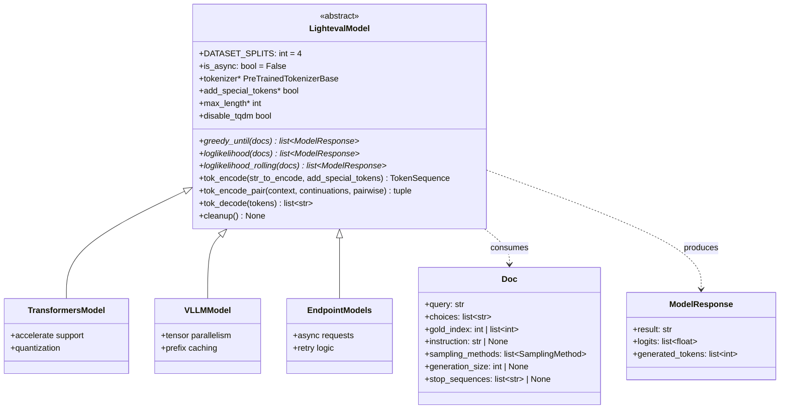
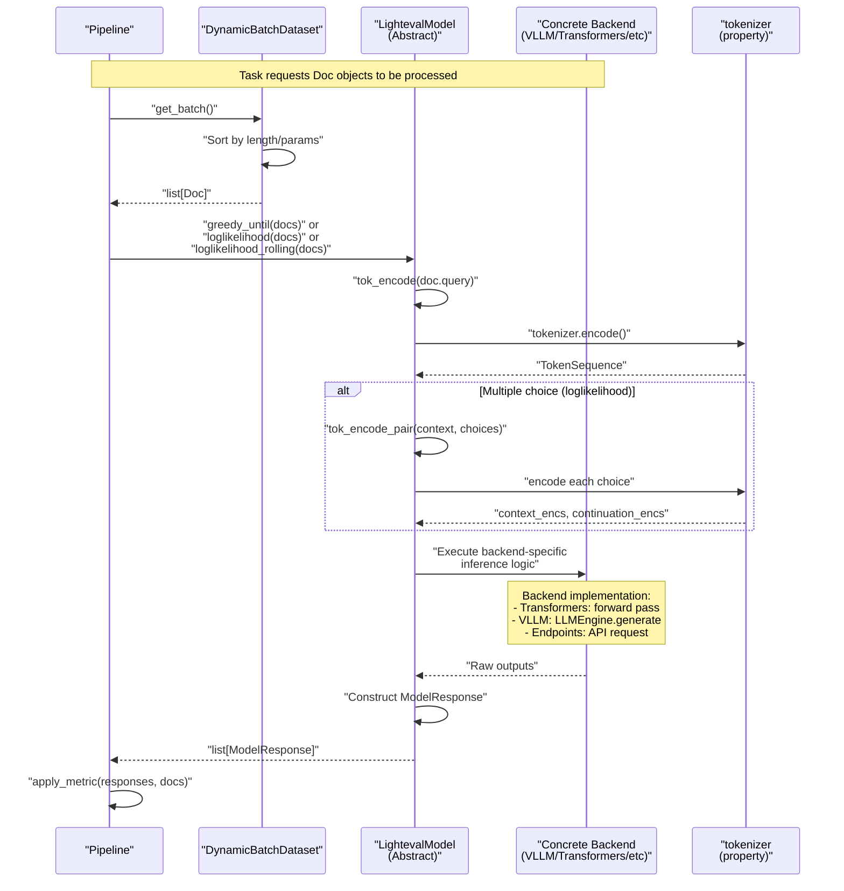
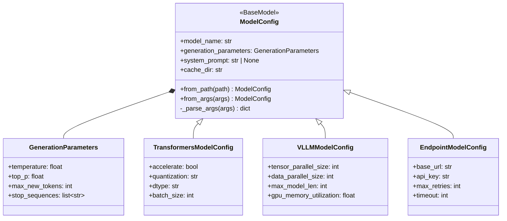

<!-- source: DeepWiki mcp.deepwiki.com · repo huggingface/lighteval · page 7.1 Model Interface · fetched 2026-10-26 -->

# Model Interface

<details>
<summary>Relevant source files</summary>

The following files were used as context for generating this wiki page:

- [src/lighteval/models/abstract_model.py](src/lighteval/models/abstract_model.py)

</details>


This document describes the `LightevalModel` abstract base class, which defines the interface that all model backends in lighteval must implement. This interface enables backend-agnostic evaluation by providing a uniform API for model inference, regardless of whether the model runs locally (Transformers, VLLM, SGLang) or remotely (API endpoints).

For information about specific backend implementations, see:
- Transformers Backend: [#7.2](#7.2)
- VLLM Backend: [#7.3](#7.3)
- SGLang Backend: [#7.4](#7.4)
- Endpoint Models: [#7.5](#7.5)
- Nanotron Backend: [#7.6](#7.6)
- Custom Backends: [#7.7](#7.7)

For information about the configuration system used across backends, see [Pipeline Parameters](#10.3).

## Overview

The `LightevalModel` abstract class [src/lighteval/models/abstract_model.py:220-352]() serves as the foundation for all model backends in lighteval. It defines three core inference methods that correspond to the three evaluation modes supported by the framework:

| Method | Sampling Method | Use Case |
|--------|----------------|----------|
| `greedy_until` | `GENERATIVE` | Open-ended generation tasks |
| `loglikelihood` | `LOGPROBS` | Multiple-choice tasks, next-token prediction |
| `loglikelihood_rolling` | `PERPLEXITY` | Perplexity computation, language modeling |

This abstraction ensures that the evaluation pipeline [Pipeline](#4) can process any task using any backend without modification, as all backends expose the same interface.

Sources: [src/lighteval/models/abstract_model.py:220-352]()

## Abstract Class Structure

The following diagram shows the structure of the `LightevalModel` abstract class and how it relates to concrete implementations:



Sources: [src/lighteval/models/abstract_model.py:220-352](), [src/lighteval/tasks/requests.py:43-228]()

## Required Abstract Methods

All concrete model implementations must override these three methods:

### greedy_until

```python
@abstractmethod
def greedy_until(self, docs: list[Doc]) -> list[ModelResponse]:
    """Generates responses using greedy decoding until ending conditions are met."""
```

[src/lighteval/models/abstract_model.py:251-263]()

This method handles generative evaluation tasks (sampling method `GENERATIVE`). It:
- Takes a list of `Doc` objects containing prompts and generation parameters
- Uses greedy decoding (selecting the highest probability token at each step)
- Stops generation when:
  - `generation_size` tokens have been generated
  - A string in `stop_sequences` is encountered
  - The model's EOS token is generated
- Returns `ModelResponse` objects containing the generated text

**Use cases**: Open-ended generation tasks, instruction following, code generation

Sources: [src/lighteval/models/abstract_model.py:251-263]()

### loglikelihood

```python
@abstractmethod
def loglikelihood(self, docs: list[Doc]) -> list[ModelResponse]:
    """Compute log likelihood of tokenized context + continuation sequences."""
```

[src/lighteval/models/abstract_model.py:266-273]()

This method handles multiple-choice and completion tasks (sampling method `LOGPROBS`). It:
- Takes a list of `Doc` objects where `choices` contains candidate completions
- For each choice, computes: log P(continuation | context)
- Returns `ModelResponse` objects containing log probabilities and logits
- Typically processes multiple choices per document in batch

**Use cases**: Multiple-choice QA (MMLU, ARC), next-token prediction, answer selection

Sources: [src/lighteval/models/abstract_model.py:266-273]()

### loglikelihood_rolling

```python
@abstractmethod
def loglikelihood_rolling(self, docs: list[Doc]) -> list[ModelResponse]:
    """Compute log likelihood of the entire context for perplexity metrics."""
```

[src/lighteval/models/abstract_model.py:276-282]()

This method computes perplexity and language modeling metrics (sampling method `PERPLEXITY`). It:
- Takes a list of `Doc` objects where `query` contains the full text sequence
- Computes log P(token_i | token_1, ..., token_{i-1}) for each token
- Returns `ModelResponse` objects with per-token log probabilities
- Used to evaluate the model's predictive quality on a corpus

**Use cases**: Perplexity computation, language modeling evaluation, text likelihood assessment

Sources: [src/lighteval/models/abstract_model.py:276-282]()

## Required Properties

Concrete implementations must provide these properties:

### tokenizer

```python
@property
@abstractmethod
def tokenizer(self) -> PreTrainedTokenizerBase:
    """Returns the tokenizer instance used by the model."""
```

[src/lighteval/models/abstract_model.py:230-233]()

The tokenizer property provides access to the HuggingFace tokenizer instance. This is used by:
- The base class tokenization utilities (`tok_encode`, `tok_decode`)
- The prompt manager [#5.7](#5.7) for applying chat templates
- Metric computation for token-based analysis

Sources: [src/lighteval/models/abstract_model.py:230-233]()

### add_special_tokens

```python
@property
@abstractmethod
def add_special_tokens(self) -> bool:
    """Controls whether special tokens (BOS, EOS) are added during encoding."""
```

[src/lighteval/models/abstract_model.py:235-238]()

This boolean property determines the default behavior for special token handling. When `True`:
- BOS (beginning of sequence) tokens are prepended to inputs
- EOS (end of sequence) tokens are appended where appropriate

This setting affects tokenization consistency across backends and is particularly important for:
- Chat models that require special formatting tokens
- Continuation encoding where BOS should not be added between context and continuation

Sources: [src/lighteval/models/abstract_model.py:235-238]()

### max_length

```python
@property
@abstractmethod
def max_length(self) -> int:
    """Returns the maximum sequence length supported by the model."""
```

[src/lighteval/models/abstract_model.py:240-244]()

This property specifies the model's maximum context window in tokens. It is used by:
- The batching system [#6.3](#6.3) to filter out samples that exceed the limit
- The pipeline to warn about truncation
- Task configuration to validate generation parameters

Sources: [src/lighteval/models/abstract_model.py:240-244]()

## Tokenization Utilities

The base class provides three utility methods that concrete implementations inherit without modification:

### tok_encode

```python
def tok_encode(self, str_to_encode: str | list[str], 
               add_special_tokens: Optional[bool] = None) -> TokenSequence
```

[src/lighteval/models/abstract_model.py:285-295]()

Encodes text into token IDs. Handles both single strings and batches:
- **Single string**: Returns `list[int]` of token IDs
- **List of strings**: Returns `BatchEncoding` with padding and tensors

The `add_special_tokens` parameter can override the model's default `add_special_tokens` property.

Sources: [src/lighteval/models/abstract_model.py:285-295]()

### tok_encode_pair

```python
def tok_encode_pair(self, context: str, continuations: list[str], 
                    pairwise: bool = False) -> tuple[list[TokenSequence], list[TokenSequence]]
```

[src/lighteval/models/abstract_model.py:297-348]()

Encodes a context with multiple continuations, handling tokenization edge cases:

**Space handling**: If context ends with spaces, they are prepended to each continuation to ensure proper tokenization.

**Pairwise mode** (`pairwise=True`):
- Encodes context and continuations separately
- Removes EOS token from context if present (prevents model from ignoring context)
- Does not add special tokens to continuations
- **Advantage**: Aligns with how LLMs predict tokens autoregressively

**Non-pairwise mode** (`pairwise=False`):
- Encodes `context + continuation` as a single string
- Splits the tokens at the context/continuation boundary
- **Advantage**: Handles cases where `tok(context + cont) ≠ tok(context) + tok(cont)` (common in Chinese and other languages without spaces)

Returns: `(context_encodings, continuation_encodings)` where each is a list matching the length of `continuations`.

Sources: [src/lighteval/models/abstract_model.py:297-348]()

### tok_decode

```python
def tok_decode(self, tokens: torch.LongTensor) -> list[str]
```

[src/lighteval/models/abstract_model.py:350-351]()

Decodes token IDs back to text strings. Uses batch decoding and skips special tokens by default.

Sources: [src/lighteval/models/abstract_model.py:350-351]()

## Data Flow Through the Model Interface

The following diagram illustrates how data flows through the model interface during evaluation:



Sources: [src/lighteval/models/abstract_model.py:220-352](), [src/lighteval/tasks/requests.py:43-228]()

## ModelConfig Base Class

The `ModelConfig` class [src/lighteval/models/abstract_model.py:41-156]() provides the foundation for all backend-specific configurations:



### Configuration Fields

| Field | Type | Default | Description |
|-------|------|---------|-------------|
| `model_name` | `str` | `None` | Model identifier (HF repo ID or path) |
| `generation_parameters` | `GenerationParameters` | `GenerationParameters()` | Controls temperature, top_p, max_new_tokens, etc. |
| `system_prompt` | `str \| None` | `None` | System prompt for chat models |
| `cache_dir` | `str` | `"~/.cache/huggingface/lighteval"` | Directory for caching model files |

Sources: [src/lighteval/models/abstract_model.py:41-156]()

### Loading Configuration

The `ModelConfig` class supports two loading methods:

**From YAML file**:
```python
config = ModelConfig.from_path("config.yaml")
```

[src/lighteval/models/abstract_model.py:91-96]()

**From command-line arguments**:
```python
config = ModelConfig.from_args("model_name=gpt2,generation_parameters={temperature:0.7,top_p:0.9}")
```

[src/lighteval/models/abstract_model.py:98-101]()

The `_parse_args` method [src/lighteval/models/abstract_model.py:103-155]() handles parsing of nested generation parameters from the argument string format, converting them into properly structured dictionaries.

Sources: [src/lighteval/models/abstract_model.py:41-156]()

## Helper Methods

### cleanup

```python
def cleanup(self):
    """Clean up operations if needed, such as closing an endpoint."""
```

[src/lighteval/models/abstract_model.py:226-228]()

This method provides a hook for backends to perform cleanup operations:
- Closing remote connections
- Shutting down local servers
- Releasing GPU memory
- Cleaning up temporary files

The default implementation is a no-op, but backends can override it as needed.

Sources: [src/lighteval/models/abstract_model.py:226-228]()

### disable_tqdm

```python
@property
def disable_tqdm(self) -> bool:
    return False
```

[src/lighteval/models/abstract_model.py:246-248]()

Controls whether progress bars are disabled for this backend. Useful for:
- Remote endpoints where progress tracking is not meaningful
- Async backends where multiple operations run concurrently
- Debugging scenarios where progress bars clutter output

Sources: [src/lighteval/models/abstract_model.py:246-248]()

## Interface Contract

The following table summarizes the complete interface contract that all backends must satisfy:

| Category | Member | Type | Required | Default Implementation |
|----------|--------|------|----------|----------------------|
| **Properties** | `tokenizer` | `PreTrainedTokenizerBase` | ✓ | None |
| | `add_special_tokens` | `bool` | ✓ | None |
| | `max_length` | `int` | ✓ | None |
| | `disable_tqdm` | `bool` | ✗ | `False` |
| **Inference Methods** | `greedy_until` | `list[Doc] → list[ModelResponse]` | ✓ | None |
| | `loglikelihood` | `list[Doc] → list[ModelResponse]` | ✓ | None |
| | `loglikelihood_rolling` | `list[Doc] → list[ModelResponse]` | ✓ | None |
| **Tokenization** | `tok_encode` | `str → TokenSequence` | ✗ | Provided |
| | `tok_encode_pair` | `(str, list[str]) → tuple` | ✗ | Provided |
| | `tok_decode` | `TokenSequence → list[str]` | ✗ | Provided |
| **Lifecycle** | `cleanup` | `() → None` | ✗ | No-op |
| **Class Attributes** | `DATASET_SPLITS` | `int` | ✗ | `4` |
| | `is_async` | `bool` | ✗ | `False` |

Sources: [src/lighteval/models/abstract_model.py:220-352]()

## Type Definitions

The model interface uses the following type definitions:

```python
TokenSequence = Union[list[int], torch.LongTensor, torch.Tensor, BatchEncoding]
```

[src/lighteval/models/abstract_model.py:38]()

This union type allows tokenization methods to return various representations:
- `list[int]`: Simple token ID list
- `torch.LongTensor`: Single tensor of token IDs
- `torch.Tensor`: General tensor (for compatibility)
- `BatchEncoding`: Full tokenizer output with attention masks and other metadata

Sources: [src/lighteval/models/abstract_model.py:38]()

## Implementation Guidelines

When implementing a custom backend:

1. **Inherit from `LightevalModel`**: All backends must subclass the abstract class
2. **Implement all abstract methods**: `greedy_until`, `loglikelihood`, `loglikelihood_rolling`
3. **Provide required properties**: `tokenizer`, `add_special_tokens`, `max_length`
4. **Use provided tokenization utilities**: Leverage `tok_encode`, `tok_encode_pair`, `tok_decode` for consistency
5. **Handle Doc parameters correctly**: Respect `generation_size`, `stop_sequences`, `num_samples`, etc.
6. **Return proper ModelResponse objects**: Ensure all required fields are populated
7. **Override cleanup if needed**: Release resources properly when evaluation completes
8. **Set is_async appropriately**: Set to `True` for async backends to enable proper handling

For detailed implementation examples, see the backend-specific pages ([#7.2](#7.2) through [#7.7](#7.7)).

Sources: [src/lighteval/models/abstract_model.py:220-352]()

---

