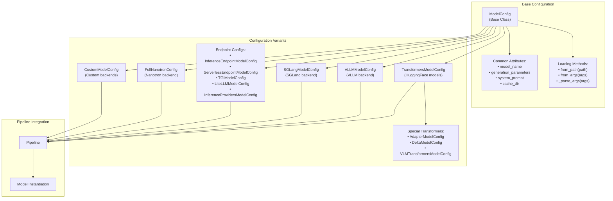
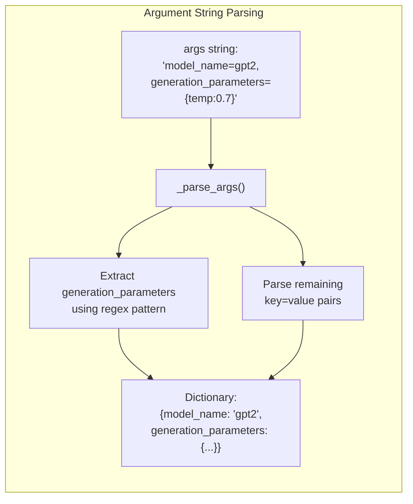
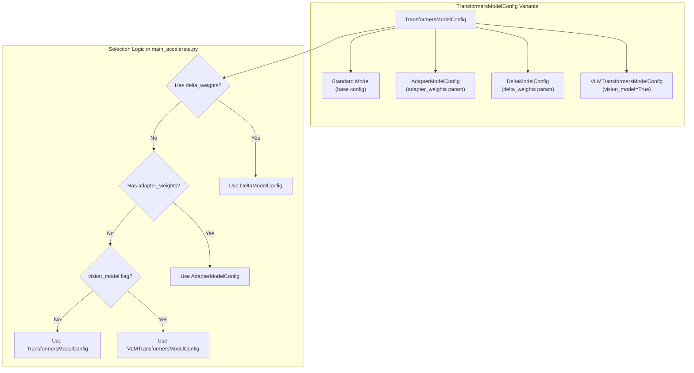
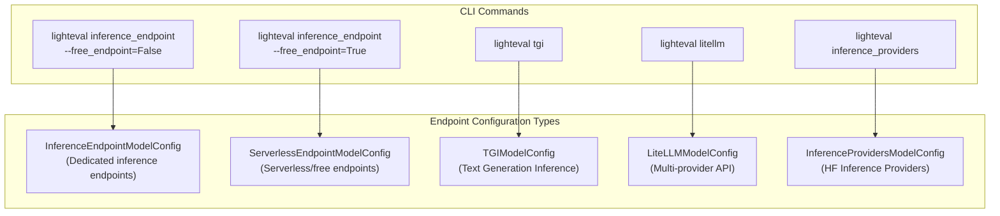
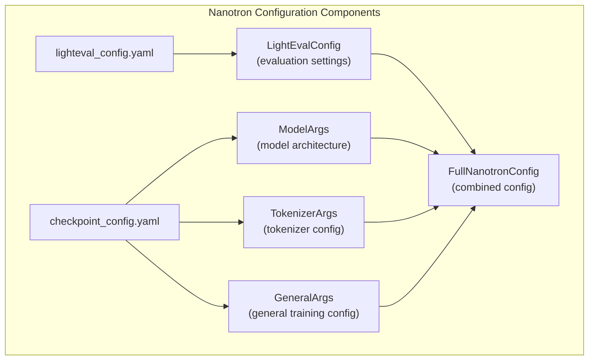
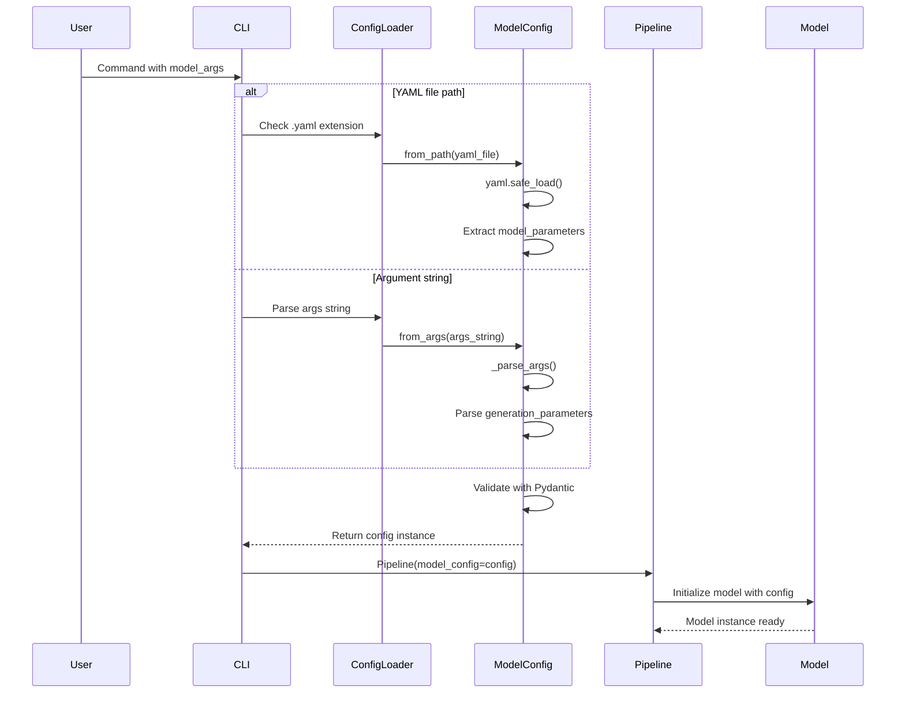
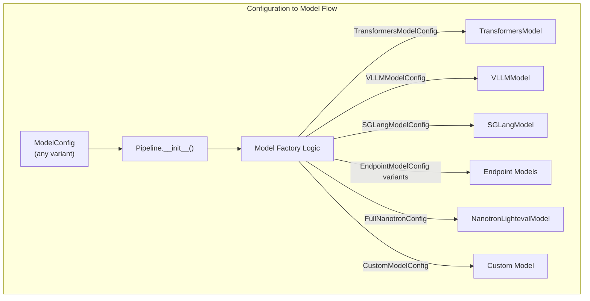

<!-- source: DeepWiki mcp.deepwiki.com · repo huggingface/lighteval · page 7.2 Model Configuration · fetched 2026-10-26 -->

# Model Configuration

<details>
<summary>Relevant source files</summary>

The following files were used as context for generating this wiki page:

- [src/lighteval/models/abstract_model.py](src/lighteval/models/abstract_model.py)
- [src/lighteval/models/endpoints/inference_providers_model.py](src/lighteval/models/endpoints/inference_providers_model.py)
- [src/lighteval/models/sglang/sglang_model.py](src/lighteval/models/sglang/sglang_model.py)
- [src/lighteval/models/transformers/transformers_model.py](src/lighteval/models/transformers/transformers_model.py)
- [src/lighteval/models/utils.py](src/lighteval/models/utils.py)
- [src/lighteval/models/vllm/vllm_model.py](src/lighteval/models/vllm/vllm_model.py)

</details>


## Purpose and Scope

This page documents the model configuration system in Lighteval, which defines how models are instantiated and configured for evaluation. `ModelConfig` classes specify the model to evaluate, backend-specific parameters, and generation settings. This page covers:

- The base `ModelConfig` class and its common attributes
- All model configuration variants for different backends
- Loading configurations from YAML files or command-line arguments
- Configuration parameters and their usage

For information about the model implementations themselves, see [Models and Backends](#7). For generation-specific parameters, see [Generation Parameters](#10.4). For pipeline-level configuration, see [Pipeline Parameters](#10.3).

---

## Base ModelConfig Class

The `ModelConfig` class serves as the foundation for all model configurations in Lighteval. It provides common functionality for parsing configuration from files and command-line arguments.

### Core Architecture



**Sources:** [src/lighteval/models/abstract_model.py:41-156](), [src/lighteval/main_accelerate.py:89-135]()

### Common Attributes

All model configurations inherit the following attributes from the base `ModelConfig` class:

| Attribute | Type | Default | Description |
|-----------|------|---------|-------------|
| `model_name` | `str` | `None` | Model identifier or HuggingFace Hub path |
| `generation_parameters` | `GenerationParameters` | `GenerationParameters()` | Controls generation behavior (temperature, top_p, etc.) |
| `system_prompt` | `str \| None` | `None` | System prompt for chat models |
| `cache_dir` | `str` | `"~/.cache/huggingface/lighteval"` | Directory for caching model files |

**Sources:** [src/lighteval/models/abstract_model.py:85-89]()

### Loading Methods

The base `ModelConfig` class provides two primary methods for loading configurations:

#### from_path()

Loads configuration from a YAML file:

```python
config = ModelConfig.from_path("model_config.yaml")
```

The YAML file structure:

```yaml
model_parameters:
  model_name: "meta-llama/Llama-3.1-8B-Instruct"
  system_prompt: "You are a helpful assistant."
  generation_parameters:
    temperature: 0.7
    max_new_tokens: 512
  cache_dir: "~/.cache/models"
```

**Sources:** [src/lighteval/models/abstract_model.py:92-96](), [src/lighteval/main_accelerate.py:118-120]()

#### from_args()

Parses configuration from a comma-separated string:

```python
config = ModelConfig.from_args("model_name=gpt2,system_prompt='You are helpful.',generation_parameters={temperature:0.7,top_p:0.9}")
```

The `from_args()` method uses `_parse_args()` internally to parse the argument string into a configuration dictionary.

**Sources:** [src/lighteval/models/abstract_model.py:98-101]()

### Argument Parsing Details



The `_parse_args()` method:
1. Searches for `generation_parameters={...}` using regex
2. Converts keys/values to proper JSON format with quoted strings
3. Parses remaining comma-separated key-value pairs
4. Handles boolean flags (keys without `=` become `True`)

**Sources:** [src/lighteval/models/abstract_model.py:103-155]()

---

## Configuration Variants by Backend

### Transformers Backend Configurations



The selection logic in `main_accelerate.py`:

1. If `delta_weights` is present → `DeltaModelConfig`
2. Else if `adapter_weights` is present → `AdapterModelConfig`
3. Else if `vision_model=True` flag → `VLMTransformersModelConfig`
4. Else → standard `TransformersModelConfig`

**Sources:** [src/lighteval/main_accelerate.py:125-135]()

### VLLM Backend Configuration

`VLLMModelConfig` is used for high-performance inference with the VLLM backend. Configuration can be loaded from YAML or command-line arguments:

```python
# From YAML
model_config = VLLMModelConfig.from_path(model_args)

# From args string
model_config = VLLMModelConfig.from_args(model_args)
```

When loading from YAML, the system also extracts `metric_options` if present:

```python
with open(model_args, "r") as f:
    metric_options = yaml.safe_load(f).get("metric_options", {})
```

**Sources:** [src/lighteval/main_vllm.py:113-119]()

### SGLang Backend Configuration

`SGLangModelConfig` follows the same pattern as VLLM:

```python
# From YAML with metric_options
if model_args.endswith(".yaml"):
    with open(model_args, "r") as f:
        metric_options = yaml.safe_load(f).get("metric_options", {})
    model_config = SGLangModelConfig.from_path(model_args)
else:
    metric_options = {}
    model_config = SGLangModelConfig.from_args(model_args)
```

**Sources:** [src/lighteval/main_sglang.py:103-109]()

### Endpoint Model Configurations



Each endpoint configuration is loaded based on the CLI command and `free_endpoint` flag:

**Inference Endpoints:**
```python
if free_endpoint:
    model_config = ServerlessEndpointModelConfig.from_path(model_config_path)
else:
    model_config = InferenceEndpointModelConfig.from_path(model_config_path)
```

**TGI:**
```python
model_config = TGIModelConfig.from_path(model_config_path)
```

**LiteLLM:**
```python
if model_args.endswith(".yaml"):
    model_config = LiteLLMModelConfig.from_path(model_args)
else:
    model_config = LiteLLMModelConfig.from_args(model_args)
```

**Inference Providers:**
```python
if model_args.endswith(".yaml"):
    model_config = InferenceProvidersModelConfig.from_path(model_args)
else:
    model_config = InferenceProvidersModelConfig.from_args(model_args)
```

**Sources:** [src/lighteval/main_endpoint.py:109-112](), [src/lighteval/main_endpoint.py:192](), [src/lighteval/main_endpoint.py:277-284](), [src/lighteval/main_endpoint.py:369-372]()

### Nanotron Backend Configuration

`FullNanotronConfig` is a composite configuration that combines multiple Nanotron configuration objects:



The configuration is loaded from two YAML files:

```python
# Load checkpoint config
with open(checkpoint_config_path) as f:
    nanotron_yaml = yaml.load(f, Loader=SafeLoader)

model_config, tokenizer_config, general_config = [
    get_config_from_dict(nanotron_yaml[key], config_class=config_class, ...)
    for key, config_class in [
        ("model", ModelArgs), 
        ("tokenizer", TokenizerArgs), 
        ("general", GeneralArgs)
    ]
]

# Load lighteval config
lighteval_config = get_config_from_file(lighteval_config_path, config_class=LightEvalConfig)

# Combine into FullNanotronConfig
nanotron_config = FullNanotronConfig(
    lighteval_config, model_config, tokenizer_config, general_config
)
```

**Sources:** [src/lighteval/main_nanotron.py:62-81]()

### Custom Backend Configuration

`CustomModelConfig` is the simplest configuration, requiring only a model name and definition file path:

```python
model_config = CustomModelConfig(
    model_name=model_name,
    model_definition_file_path=model_definition_file_path
)
```

**Sources:** [src/lighteval/main_custom.py:94]()

---

## Configuration Loading Workflow

### Complete Configuration Flow



**Sources:** [src/lighteval/main_accelerate.py:118-135](), [src/lighteval/models/abstract_model.py:92-101]()

### YAML Configuration Example

A complete YAML configuration file structure:

```yaml
model_parameters:
  model_name: "meta-llama/Llama-3.1-8B-Instruct"
  
  # Optional system prompt for chat models
  system_prompt: "You are a helpful AI assistant."
  
  # Cache directory for model files
  cache_dir: "~/.cache/huggingface/lighteval"
  
  # Generation parameters
  generation_parameters:
    temperature: 0.7
    top_p: 0.9
    max_new_tokens: 512
    stop_sequences: ["<|eot_id|>", "<|end_of_text|>"]
    
# Optional metric options (VLLM/SGLang/LiteLLM)
metric_options:
  # Custom metric configurations
```

**Sources:** [src/lighteval/main_accelerate.py:118-120](), [src/lighteval/main_vllm.py:113-116]()

### Argument String Parsing

```mermaid
graph TB
    subgraph "Parsing Steps"
        Input["'model_name=gpt2,use_cache,generation_parameters={temperature:0.7,top_p:0.9}'"]
        
        Step1["1. Find generation_parameters with regex:<br/>pattern = r'(\w+)=(\{.*\}|[^,]+)'"]
        Step2["2. Extract and format as JSON:<br/>- Quote keys: 'temperature' → '\"temperature\"'<br/>- Quote string values"]
        Step3["3. Parse remaining key=value pairs:<br/>- 'model_name=gpt2' → {model_name: 'gpt2'}<br/>- 'use_cache' → {use_cache: True}"]
        Step4["4. Combine into final dict"]
        
        Output["{'model_name': 'gpt2',<br/>'use_cache': True,<br/>'generation_parameters': {<br/>  'temperature': 0.7,<br/>  'top_p': 0.9<br/>}}"]
    end
    
    Input --> Step1
    Step1 --> Step2
    Step2 --> Step3
    Step3 --> Step4
    Step4 --> Output
```

The `_parse_args()` method handles:
- Key-value pairs: `key=value`
- Boolean flags: `key` (becomes `True`)
- Nested generation parameters: `generation_parameters={...}`
- JSON conversion of nested parameters

**Sources:** [src/lighteval/models/abstract_model.py:136-155]()

---

## Backend-Specific Configuration Parameters

### Configuration Parameter Summary

| Backend | Config Class | Key Parameters | Loading Method |
|---------|-------------|----------------|----------------|
| Transformers | `TransformersModelConfig` | model_name, cache_dir, dtype, device_map | YAML or args |
| Transformers (Adapter) | `AdapterModelConfig` | adapter_weights, base_model | YAML or args |
| Transformers (Delta) | `DeltaModelConfig` | delta_weights, base_model | YAML or args |
| Transformers (VLM) | `VLMTransformersModelConfig` | vision-specific params | YAML or args |
| VLLM | `VLLMModelConfig` | tensor_parallel_size, data_parallel_size | YAML or args |
| SGLang | `SGLangModelConfig` | backend-specific params | YAML or args |
| Inference Endpoint | `InferenceEndpointModelConfig` | endpoint_name, namespace | YAML only |
| Serverless Endpoint | `ServerlessEndpointModelConfig` | model_name | YAML only |
| TGI | `TGIModelConfig` | base_url, model_id | YAML only |
| LiteLLM | `LiteLLMModelConfig` | model_name, provider, base_url | YAML or args |
| Inference Providers | `InferenceProvidersModelConfig` | model_name, provider | YAML or args |
| Nanotron | `FullNanotronConfig` | checkpoint_path, lighteval_config | YAML only |
| Custom | `CustomModelConfig` | model_definition_file_path | Direct init |

**Sources:** [src/lighteval/main_accelerate.py:125-135](), [src/lighteval/main_vllm.py:113-119](), [src/lighteval/main_endpoint.py:109-112](), [src/lighteval/main_nanotron.py:81]()

### Generation Parameters Integration

All model configurations include `generation_parameters` from the `GenerationParameters` class. These parameters control the model's text generation behavior and are documented in detail on the [Generation Parameters](#10.4) page.

Common generation parameters include:
- `temperature`: Controls randomness in generation
- `top_p`: Nucleus sampling parameter
- `max_new_tokens`: Maximum tokens to generate
- `stop_sequences`: Sequences that stop generation

**Sources:** [src/lighteval/models/abstract_model.py:87]()

---

## Integration with Pipeline

### Pipeline Initialization with ModelConfig



The `Pipeline` class receives a `ModelConfig` instance and uses it to instantiate the appropriate model implementation:

```python
pipeline = Pipeline(
    tasks=tasks,
    pipeline_parameters=pipeline_params,
    evaluation_tracker=evaluation_tracker,
    model_config=model_config,  # ModelConfig instance
)
```

The Pipeline's model factory logic determines which concrete model class to instantiate based on the config type.

**Sources:** [src/lighteval/main_accelerate.py:137-142](), [src/lighteval/main_vllm.py:121-127]()

### Configuration Validation

All `ModelConfig` classes use Pydantic for validation:

```python
class ModelConfig(BaseModel, extra="forbid"):
    # Pydantic validates types and forbids extra fields
    model_name: str = None
    generation_parameters: GenerationParameters = GenerationParameters()
    # ...
```

The `extra="forbid"` setting ensures that only defined fields are accepted, catching configuration errors early.

**Sources:** [src/lighteval/models/abstract_model.py:41]()

---

## Usage Examples

### Example 1: Basic Transformers Configuration

**YAML Configuration:**
```yaml
model_parameters:
  model_name: "meta-llama/Llama-3.1-8B-Instruct"
  cache_dir: "~/.cache/models"
  generation_parameters:
    temperature: 0.7
    max_new_tokens: 512
```

**Command Line:**
```bash
lighteval accelerate \
  --model-args "model_name=meta-llama/Llama-3.1-8B-Instruct,cache_dir=~/.cache/models,generation_parameters={temperature:0.7,max_new_tokens:512}" \
  --tasks "mmlu"
```

**Sources:** [src/lighteval/main_accelerate.py:118-135]()

### Example 2: VLLM Configuration with Metric Options

**YAML Configuration:**
```yaml
model_parameters:
  model_name: "meta-llama/Llama-3.1-8B-Instruct"
  tensor_parallel_size: 2
  generation_parameters:
    temperature: 0.0
    max_new_tokens: 1024

metric_options:
  # Custom metric configurations
```

**Loading:**
```python
with open(model_args, "r") as f:
    metric_options = yaml.safe_load(f).get("metric_options", {})
model_config = VLLMModelConfig.from_path(model_args)
```

**Sources:** [src/lighteval/main_vllm.py:113-116]()

### Example 3: Endpoint Configuration

**YAML Configuration (TGI):**
```yaml
model_parameters:
  base_url: "http://localhost:8080"
  model_id: "meta-llama/Llama-3.1-8B-Instruct"
```

**Command Line:**
```bash
lighteval tgi \
  model_configs/tgi_model.yaml \
  --tasks "hellaswag"
```

**Sources:** [src/lighteval/main_endpoint.py:192]()

### Example 4: Adapter Model Configuration

**YAML Configuration:**
```yaml
model_parameters:
  model_name: "meta-llama/Llama-3.1-8B"
  adapter_weights: "path/to/adapter"
  generation_parameters:
    temperature: 0.5
```

The presence of `adapter_weights` triggers the use of `AdapterModelConfig`:

```python
if config.get("adapter_weights", False):
    config.pop("adapter_weights")
    model_config = AdapterModelConfig(**config)
```

**Sources:** [src/lighteval/main_accelerate.py:128-130]()

### Example 5: Nanotron Configuration

**Checkpoint Config (checkpoint_config.yaml):**
```yaml
model:
  # Model architecture parameters
tokenizer:
  # Tokenizer configuration
general:
  # General training parameters
```

**LightEval Config (lighteval_config.yaml):**
```yaml
tasks:
  tasks: "mmlu"
  max_samples: 1000
logging:
  output_dir: "results"
```

**Command Line:**
```bash
lighteval nanotron \
  --checkpoint-config-path checkpoint_config.yaml \
  --lighteval-config-path lighteval_config.yaml
```

**Sources:** [src/lighteval/main_nanotron.py:66-81]()

---

