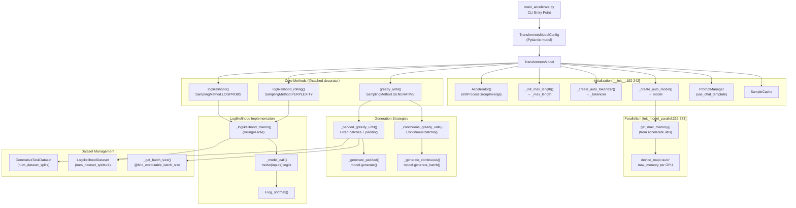
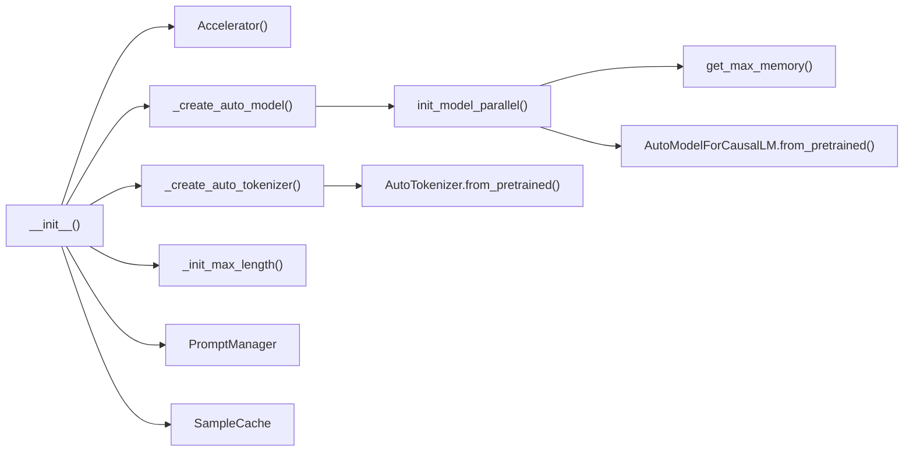
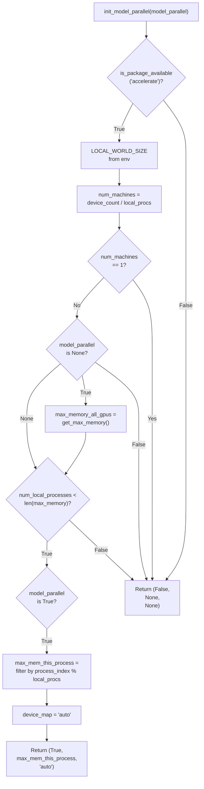
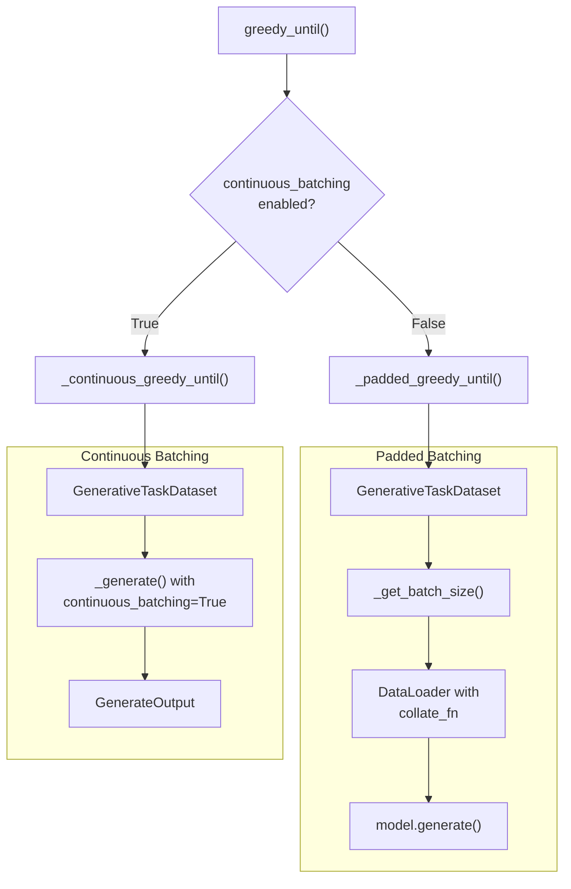
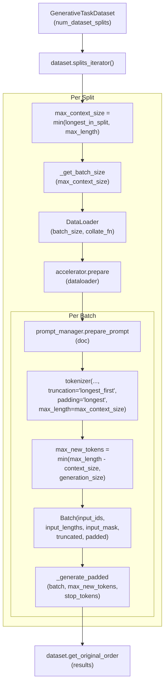
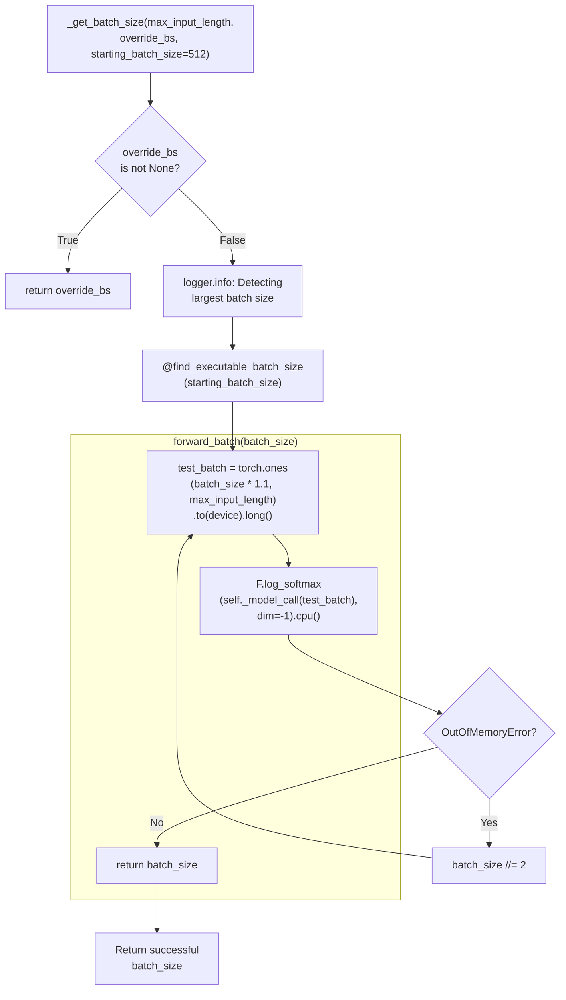

<!-- source: DeepWiki mcp.deepwiki.com · repo huggingface/lighteval · page 7.3 Transformers Backend · fetched 2026-10-26 -->

# Transformers Backend

<details>
<summary>Relevant source files</summary>

The following files were used as context for generating this wiki page:

- [src/lighteval/models/endpoints/inference_providers_model.py](src/lighteval/models/endpoints/inference_providers_model.py)
- [src/lighteval/models/sglang/sglang_model.py](src/lighteval/models/sglang/sglang_model.py)
- [src/lighteval/models/transformers/transformers_model.py](src/lighteval/models/transformers/transformers_model.py)
- [src/lighteval/models/utils.py](src/lighteval/models/utils.py)
- [src/lighteval/models/vllm/vllm_model.py](src/lighteval/models/vllm/vllm_model.py)

</details>


## Purpose and Scope

The **Transformers Backend** provides model evaluation using the HuggingFace Transformers library with Accelerate for distributed inference. This backend is implemented in the `TransformersModel` class [src/lighteval/models/transformers/transformers_model.py:191-1163](), which loads models locally using `AutoModelForCausalLM.from_pretrained()` and supports data/model parallelism, quantization (4-bit/8-bit via BitsAndBytes), and dynamic batch size detection.

**Key characteristics:**
- **Flexibility**: Supports any HuggingFace model, quantization, and custom loading arguments
- **Distributed Execution**: Uses Accelerate for multi-GPU data/model parallelism
- **Memory Efficiency**: Automatic batch size detection and optional quantization
- **Slower than Specialized Backends**: VLLM (page 7.3) and SGLang (page 7.4) offer higher throughput

The backend implements the `LightevalModel` interface (page 7.1), providing three core methods: `greedy_until()`, `loglikelihood()`, and `loglikelihood_rolling()`.

**Sources:** [src/lighteval/models/transformers/transformers_model.py:191-242](), [src/lighteval/models/abstract_model.py]()

---

## Architecture Overview



**Diagram: TransformersModel Class Structure and Method Flow**

This diagram maps the key classes and methods in the Transformers backend, showing initialization flow, parallelism setup, and the three core inference methods with their implementation strategies.

**Sources:** [src/lighteval/models/transformers/transformers_model.py:191-242](), [src/lighteval/models/transformers/transformers_model.py:332-373](), [src/lighteval/models/transformers/transformers_model.py:744-752](), [src/lighteval/models/transformers/transformers_model.py:873-898]()

---

## Configuration

### TransformersModelConfig

The `TransformersModelConfig` class [src/lighteval/models/transformers/transformers_model.py:70-162]() is a Pydantic model that extends `ModelConfig` from the base interface. It defines all parameters for loading and running Transformers models.

| Parameter | Type | Default | Description |
|-----------|------|---------|-------------|
| `model_name` | `str` | (required) | HuggingFace Hub model ID or local path |
| `tokenizer` | `str \| None` | `None` | Optional separate tokenizer ID; if None, uses `model_name` |
| `subfolder` | `str \| None` | `None` | Subfolder within model repository |
| `revision` | `str` | `"main"` | Git revision (branch/tag/commit) to load |
| `batch_size` | `PositiveInt \| None` | `None` | Batch size; if None, uses `_get_batch_size()` auto-detection |
| `max_length` | `PositiveInt \| None` | `None` | Maximum sequence length; if None, inferred from model config |
| `model_loading_kwargs` | `dict` | `Field(default_factory=dict)` | Additional kwargs passed to `AutoModelForCausalLM.from_pretrained()` |
| `add_special_tokens` | `bool` | `True` | Whether to add special tokens during `tok_encode()` |
| `skip_special_tokens` | `bool` | `True` | Whether to skip special tokens in `tok_decode()` (needed for reasoning models) |
| `model_parallel` | `bool \| None` | `None` | Enable model parallelism; if None, auto-determined by `init_model_parallel()` |
| `dtype` | `str \| None` | `None` | Model dtype: "float16", "bfloat16", "float32", "auto", "4bit", "8bit" |
| `device` | `Union[int, str]` | `"cuda"` | Device to load model on (ignored if using Accelerate) |
| `trust_remote_code` | `bool` | `False` | Trust remote code when loading model/tokenizer |
| `compile` | `bool` | `False` | Use `torch.compile()` for optimization |
| `multichoice_continuations_start_space` | `bool \| None` | `None` | If True, adds space before continuations; if False, removes it; if None, no change |
| `pairwise_tokenization` | `bool` | `False` | If True, tokenize context and continuation separately in `tok_encode_pair()` |
| `continuous_batching` | `bool` | `False` | Enable experimental continuous batching (uses `model.generate_batch()`) |
| `override_chat_template` | `bool \| None` | `None` | Force chat template usage (True) or disable it (False); None = auto-detect |

**Inherited from ModelConfig:**
- `generation_parameters`: `GenerationParameters` - Temperature, top_p, max_new_tokens, etc.
- `system_prompt`: `str | None` - Optional system prompt for chat models
- `cache_dir`: `str` - Cache directory (default: `~/.cache/huggingface/lighteval`)

**Sources:** [src/lighteval/models/transformers/transformers_model.py:70-162](), [src/lighteval/models/abstract_model.py]()

#### Configuration Methods

```python
def get_transformers_config(self) -> PretrainedConfig:
    # Returns AutoConfig for the model
    
def get_model_sha(self) -> str:
    # Returns git SHA of the model revision
```

**Sources:** [src/lighteval/models/transformers/transformers_model.py:173-189]()

---

## Model Initialization

### TransformersModel Class

The `TransformersModel` class implements the `LightevalModel` interface for HuggingFace Transformers models.



**Diagram: Model Initialization Flow**

**Sources:** [src/lighteval/models/transformers/transformers_model.py:191-242]()

### Model Loading Process

The `_create_auto_model()` method [src/lighteval/models/transformers/transformers_model.py:375-427]() handles model initialization:

**Step 1: Parallelism Setup**
```python
model_parallel, max_memory, device_map = self.init_model_parallel(self.config.model_parallel)
self.config.model_parallel = model_parallel
```
Calls `init_model_parallel()` [src/lighteval/models/transformers/transformers_model.py:332-373]() to determine parallelism strategy and compute `max_memory` dict and `device_map`.

**Step 2: Quantization Configuration**
```python
if self.config.dtype == "4bit":
    quantization_config = BitsAndBytesConfig(load_in_4bit=True, bnb_4bit_compute_dtype=torch.float16)
elif self.config.dtype == "8bit":
    quantization_config = BitsAndBytesConfig(load_in_8bit=True)
```
Creates `BitsAndBytesConfig` for 4-bit/8-bit quantization via BitsAndBytes library.

**Step 3: Dtype Conversion**
```python
torch_dtype = _get_dtype(self.config.dtype)
```
Converts string dtype to `torch.dtype` using `_get_dtype()` [src/lighteval/models/utils.py:37-61]().

**Step 4: Model Loading**
```python
model = AutoModelForCausalLM.from_pretrained(
    self.config.model_name,
    revision=revision,
    max_memory=max_memory,      # From init_model_parallel()
    device_map=device_map,      # "auto" for model parallel
    torch_dtype=torch_dtype,
    trust_remote_code=self.config.trust_remote_code,
    **kwargs,
)
```

**Step 5: Post-Loading Setup**
```python
model.eval()
torch.set_grad_enabled(False)
if self.continuous_batching:
    generation_config = GenerationConfig(**self.generation_config_dict)
    model.generation_config = generation_config
```
Sets model to evaluation mode, disables gradients, and optionally sets generation config for continuous batching.

**Sources:** [src/lighteval/models/transformers/transformers_model.py:375-427](), [src/lighteval/models/transformers/transformers_model.py:332-373](), [src/lighteval/models/utils.py:37-61]()

### Tokenizer Creation

The `_create_auto_tokenizer()` method [src/lighteval/models/transformers/transformers_model.py:429-452]() initializes the tokenizer:

```python
tokenizer_name = self.config.tokenizer or self.config.model_name
subfolder = self.config.subfolder
revision = self.config.revision + (f"/{subfolder}" if subfolder is not None else "")

tokenizer = AutoTokenizer.from_pretrained(
    tokenizer_name,
    revision=revision,
    trust_remote_code=self.config.trust_remote_code,
    padding_side="left",      # Critical for causal LMs
    truncation_side="left",   # Preserve recent context
)
tokenizer.pad_token = tokenizer.eos_token
tokenizer.model_max_length = self.max_length
```

**Key behaviors:**
- **Left-side padding/truncation**: Causal language models attend to left context, so padding/truncating on the left preserves the most recent context
- **EOS as pad token**: Ensures padding tokens don't affect logits
- **Respects max_length**: Sets `tokenizer.model_max_length` to the computed `self.max_length`

**Chat Template Detection:**
```python
self.use_chat_template = uses_chat_template(
    tokenizer=self._tokenizer, 
    override_chat_template=config.override_chat_template
)
```
The `uses_chat_template()` function [src/lighteval/models/utils.py:109-137]() checks if `tokenizer.chat_template is not None`, allowing the `PromptManager` to format prompts appropriately.

**Sources:** [src/lighteval/models/transformers/transformers_model.py:429-452](), [src/lighteval/models/utils.py:109-137]()

### Maximum Length Determination

The `_init_max_length()` method determines the maximum sequence length:

1. Uses explicit `config.max_length` if provided
2. Otherwise checks model config attributes: `n_positions`, `max_position_embeddings`, `n_ctx`
3. Falls back to 2048 with a warning

**Sources:** [src/lighteval/models/transformers/transformers_model.py:454-480]()

---

## Parallelism Management

### Model Parallelism Decision Logic

The `init_model_parallel()` method [src/lighteval/models/transformers/transformers_model.py:332-373]() determines the parallelism strategy:



**Diagram: init_model_parallel() Decision Tree**

**Key Logic:**
1. **Check Accelerate**: Returns data parallelism if Accelerate not available
2. **Check Distribution**: `num_machines = torch.cuda.device_count() // num_local_processes`. If single machine, returns data parallelism
3. **Auto-Detection**: If `model_parallel=None`, compares `num_local_processes < len(max_memory_all_gpus)`. If true, enables model parallelism
4. **Memory Filtering**: When model parallel, filters `max_memory` dict to only include GPUs for this process:
   ```python
   max_mem_this_process = {
       k: v for k, v in max_memory_all_gpus.items()
       if k % self.num_local_processes == (self.accelerator.process_index % self.num_local_processes)
   }
   ```
5. **Device Map**: Returns `device_map="auto"` for automatic layer placement across GPUs

**Environment Variables Used:**
- `LOCAL_WORLD_SIZE`: Number of processes per machine
- `RANK`/`LOCAL_RANK`: Process indices (from Accelerate)

**Sources:** [src/lighteval/models/transformers/transformers_model.py:332-373](), [accelerate.utils.get_max_memory]()

### Data Parallelism with Accelerate

When model parallelism is disabled, the model uses data parallelism:

```python
if config.model_parallel is False and self.config.dtype not in ["4bit", "8bit"]:
    logger.info(f"Using Data Parallelism, putting model on device {self._device}")
    self.model = self.model.to(self._device)
```

The `Accelerator` instance coordinates:
- Process synchronization across distributed processes
- Automatic DataLoader preparation with `accelerator.prepare()`
- Result gathering with `gather_object()`

**Sources:** [src/lighteval/models/transformers/transformers_model.py:217-220]()

---

## Inference Methods

### Greedy Generation

The `greedy_until()` method generates text using greedy decoding. It supports two batching strategies:



**Diagram: Greedy Generation Dispatch**

**Sources:** [src/lighteval/models/transformers/transformers_model.py:783-807]()

#### Padded Batching Strategy

The `_padded_greedy_until()` method [src/lighteval/models/transformers/transformers_model.py:625-742]() processes requests in fixed-size batches with padding:



**Diagram: _padded_greedy_until() Flow**

**Key Steps:**

1. **Dataset Creation**: `GenerativeTaskDataset` sorts requests by `generation_size` (descending) and splits into chunks
   
2. **Batch Size Detection**: For each split, calls `_get_batch_size(max_input_length)` [src/lighteval/models/transformers/transformers_model.py:503-520]() to find largest batch that fits in memory. Uses `@find_executable_batch_size` decorator that halves batch size on OOM.

3. **Tokenization**: Uses `tokenizer()` with:
   - `truncation="longest_first"`: Truncates to `max_length` if needed
   - `padding="longest"`: Pads to longest in batch
   - `return_tensors="pt"`: Returns PyTorch tensors
   - `add_special_tokens=self.add_special_tokens`

4. **Max Tokens Calculation**:
   ```python
   context_size = tokenized["input_ids"].shape[1]
   if max_new_tokens is None:
       max_new_tokens = self.max_length - context_size
   else:
       max_new_tokens = min(self.max_length - context_size, max_new_tokens)
   ```

5. **Batch Object**: Creates `Batch` dataclass [src/lighteval/models/model_output.py]() tracking:
   - `input_ids`: Token IDs tensor
   - `input_lengths`: Length of each sequence
   - `input_mask`: Attention mask
   - `truncated`: Number of tokens truncated per sample
   - `padded`: Number of padding tokens per sample

6. **Generation**: Calls `_generate_padded()` which uses `model.generate()` with stopping criteria

**Sources:** [src/lighteval/models/transformers/transformers_model.py:625-742](), [src/lighteval/models/transformers/transformers_model.py:503-520](), [src/lighteval/data.py](), [src/lighteval/models/model_output.py]()

#### Continuous Batching Strategy

The `_continuous_greedy_until()` method uses continuous batching for potentially higher throughput:

**Process:**
1. Split requests into manageable batches
2. Tokenize inputs
3. Call `_generate()` with `continuous_batching=True`
4. Process `GenerateOutput` objects containing:
   - `generated_tokens`: Output token IDs
   - `prompt_ids`: Input token IDs

**Note:** Continuous batching is marked as experimental and may have limitations with logprobs extraction.

**Sources:** [src/lighteval/models/transformers/transformers_model.py:519-620]()

### Loglikelihood Computation

The `loglikelihood()` method [src/lighteval/models/transformers/transformers_model.py:873-887]() computes log probabilities for multiple-choice evaluation by calling `_loglikelihood_tokens()` [src/lighteval/models/transformers/transformers_model.py:900-1062]():

```mermaid
graph TB
    LogLike["loglikelihood(docs)"]
    CallTokens["_loglikelihood_tokens<br/>(docs, rolling=False)"]
    
    subgraph "Dataset Processing"
        CreateLogData["LoglikelihoodDataset<br/>(num_dataset_splits=1)"]
        SplitsIter["dataset.splits_iterator()"]
    end
    
    subgraph "Per Split"
        PrepPrompts["prompt_manager.prepare_prompt<br/>(doc)"]
        TokenizePair["tok_encode_pair<br/>(context, choices,<br/>pairwise=pairwise_tokenization)"]
        FlattenInputs["Flatten: inputs = []<br/>for each choice:<br/>  inputs.append(ctx + cont)"]
        GetBatchSize["_get_batch_size<br/>(max_input_length)"]
        CreateDL["DataLoader(batch_size)"]
        
        subgraph "Per Batch"
            PadSeq["pad_sequence<br/>(left padding)"]
            ToDevice[".to(self.device)"]
            ModelCall["_model_call(inputs)<br/>→ logits"]
            LogSoftmax["F.log_softmax(logits, dim=-1)"]
            GatherLogits["gather logits for<br/>each token position"]
            ExtractCont["Extract continuation<br/>logprobs only"]
            SumLogprobs["Sum over continuation"]
            CheckArgmax["Check if argmax<br/>matches tokens"]
        end
    end
    
    PadGather["pad_and_gather<br/>(accelerator)"]
    CreateResp["ModelResponse(logprobs,<br/>argmax_logits_eq_gold)"]
    GetOrigOrder["dataset.get_original_order"]
    
    LogLike --> CallTokens
    CallTokens --> CreateLogData
    CreateLogData --> SplitsIter
    SplitsIter --> PrepPrompts
    PrepPrompts --> TokenizePair
    TokenizePair --> FlattenInputs
    FlattenInputs --> GetBatchSize
    GetBatchSize --> CreateDL
    CreateDL --> PadSeq
    PadSeq --> ToDevice
    ToDevice --> ModelCall
    ModelCall --> LogSoftmax
    LogSoftmax --> GatherLogits
    GatherLogits --> ExtractCont
    ExtractCont --> SumLogprobs
    SumLogprobs --> CheckArgmax
    CheckArgmax --> PadGather
    PadGather --> CreateResp
    CreateResp --> GetOrigOrder
```



**Diagram: Loglikelihood Computation Pipeline**

**Detailed Process:**

1. **Dataset Preparation**: `LoglikelihoodDataset` sorts by `len(context) + max(len(choices))` to group similar lengths
   
2. **Tokenization**: `tok_encode_pair()` [src/lighteval/models/transformers/transformers_model.py:1064-1127]() handles two modes:
   - **Pairwise** (`pairwise=True`): Encodes context and continuation separately, then concatenates token IDs
   - **Concatenated** (`pairwise=False`): Encodes full string `context + continuation`

3. **Flattening**: For each doc with `n` choices, creates `n` input sequences:
   ```python
   for choice in doc.choices:
       tokenized_context, tokenized_continuation = tok_encode_pair(context, choice)
       inputs.append(tokenized_context + tokenized_continuation)
       tokenized_continuations_batch.append(tokenized_continuation)
       tokenized_contexts_batch.append(tokenized_context)
   ```

4. **Batching and Padding**: Uses `pad_sequence()` with `padding_value=tokenizer.eos_token_id` and left padding

5. **Forward Pass**:
   ```python
   logits = self._model_call(inputs)  # Returns model(inputs).logits
   logits = F.log_softmax(logits.float(), dim=-1)
   ```

6. **Logprob Extraction**:
   ```python
   # For each token in continuation
   for i, token_id in enumerate(continuation_tokens):
       token_logprob = logits[i, token_id].item()
       continuation_logprobs.append(token_logprob)
   ```

7. **Argmax Check**:
   ```python
   # Check if greedy decoding would produce continuation
   greedy_tokens = torch.argmax(logits, dim=-1)
   is_greedy = torch.equal(greedy_tokens, continuation_tokens)
   ```

8. **Response Creation**: Returns `ModelResponse` with:
   - `logprobs`: Sum of log probabilities for continuation tokens
   - `argmax_logits_eq_gold`: Boolean indicating greedy match

**Sources:** [src/lighteval/models/transformers/transformers_model.py:873-887](), [src/lighteval/models/transformers/transformers_model.py:900-1062](), [src/lighteval/models/transformers/transformers_model.py:1064-1127]()

#### Pairwise vs. Concatenated Tokenization

The `tok_encode_pair()` method supports two tokenization modes:

**Pairwise (`pairwise=True`):**
```python
# Tokenize separately, then concatenate token IDs
context_enc = tokenizer.encode(context)
continuation_enc = tokenizer.encode(continuation)
full_enc = context_enc + continuation_enc
```

**Concatenated (`pairwise=False`):**
```python
# Tokenize the full string at once
full_enc = tokenizer.encode(context + continuation)
```

This matters because some tokenizers apply different rules at string boundaries.

**Sources:** [src/lighteval/models/transformers/transformers_model.py:1064-1127]()

### Loglikelihood Rolling (Perplexity)

The `loglikelihood_rolling()` method computes perplexity by sliding a window over long sequences:

**Process:**
1. Create `LoglikelihoodDataset`
2. For each sequence:
   - Split into overlapping windows of size `max_length`
   - Compute log probabilities for each window
   - Sum across all tokens
3. Return per-sequence perplexity scores

**Sources:** [src/lighteval/models/transformers/transformers_model.py:952-1062]()

---

## Batch Size Management

### Automatic Batch Size Detection

The `_get_batch_size()` method [src/lighteval/models/transformers/transformers_model.py:503-520]() automatically determines the largest feasible batch size:



**Diagram: _get_batch_size() with @find_executable_batch_size Decorator**

**Algorithm Details:**

1. **Override Check**: If `override_bs` is provided, returns it immediately

2. **Decorator Wrapper**: The `@find_executable_batch_size` decorator [src/lighteval/utils/parallelism.py]() wraps `forward_batch()`:
   - Starts with `starting_batch_size` (default 512)
   - On `OutOfMemoryError`, halves batch size and retries
   - Returns largest successful batch size

3. **Test Batch**: Creates a batch with 10% margin:
   ```python
   test_batch = torch.ones((batch_size + int(0.1 * batch_size), max_input_length), device=self.device).long()
   ```
   The 10% margin ensures the detected batch size has headroom.

4. **Test Forward Pass**: Runs a complete forward pass including log_softmax to simulate actual memory usage:
   ```python
   F.log_softmax(self._model_call(test_batch).float(), dim=-1).cpu()
   ```

5. **Progressive Scaling**: For next split, starts with `batch_size * 2` since shorter sequences allow larger batches

**Sources:** [src/lighteval/models/transformers/transformers_model.py:503-520](), [src/lighteval/utils/parallelism.py]()

---

## Advanced Features

### Quantization Support

The Transformers backend supports 4-bit and 8-bit quantization via BitsAndBytes [src/lighteval/models/transformers/transformers_model.py:384-399]():

```python
if self.config.dtype == "4bit":
    quantization_config = BitsAndBytesConfig(
        load_in_4bit=True, 
        bnb_4bit_compute_dtype=torch.float16
    )
elif self.config.dtype == "8bit":
    quantization_config = BitsAndBytesConfig(load_in_8bit=True)
else:
    quantization_config = None

# Add to model loading kwargs
kwargs = self.config.model_loading_kwargs.copy()
if "quantization_config" not in pretrained_config.to_dict():
    kwargs["quantization_config"] = quantization_config
```

**Implementation Notes:**

1. **4-bit Quantization**: Uses NF4 (Normal Float 4) quantization with `bfloat16` compute dtype for better numerical stability
   
2. **8-bit Quantization**: Uses `LLM.int8()` algorithm from the BitsAndBytes paper

3. **Config Override**: If model already has `quantization_config` in its pretrained config, respects that instead

4. **Compatibility**: Quantized models cannot use data parallelism across multiple GPUs:
   ```python
   if config.model_parallel is False and self.config.dtype not in ["4bit", "8bit"]:
       self.model = self.model.to(self._device)
   ```

**CLI Usage:**
```bash
# 4-bit quantization
lighteval accelerate \
    --model-args "model_name=meta-llama/Llama-2-7b-hf,dtype=4bit" \
    --tasks "mmlu"

# 8-bit quantization
lighteval accelerate \
    --model-args "model_name=meta-llama/Llama-2-7b-hf,dtype=8bit" \
    --tasks "arc:challenge"
```

**Memory Savings:**
- 4-bit: ~4x reduction (e.g., 7B model: 28GB → ~7GB)
- 8-bit: ~2x reduction (e.g., 7B model: 28GB → ~14GB)

**Sources:** [src/lighteval/models/transformers/transformers_model.py:384-399](), [src/lighteval/models/transformers/transformers_model.py:217-220]()

### Compilation

The backend supports `torch.compile()` for potential speedups:

```python
if config.compile:
    try:
        logger.info("Compiling the model")
        self.model.model.compile()
    except AttributeError as e:
        logger.warning("Could not compile the model because: ", e)
```

**Usage:**
```bash
lighteval accelerate \
    --model-args "model_name=gpt2,compile=True" \
    --tasks "lambada"
```

**Sources:** [src/lighteval/models/transformers/transformers_model.py:221-226]()

### Chat Template Handling

The backend automatically detects and uses chat templates [src/lighteval/models/transformers/transformers_model.py:212-214]():

```python
self.use_chat_template = uses_chat_template(
    tokenizer=self._tokenizer,
    override_chat_template=config.override_chat_template
)
```

The `uses_chat_template()` function [src/lighteval/models/utils.py:109-137]() implements the detection logic:

```python
def uses_chat_template(model_name: str = None, tokenizer: AutoTokenizer = None, override_chat_template: bool = None) -> bool:
    if override_chat_template is not None:
        return override_chat_template
    if model_name is None and tokenizer is None:
        raise Exception("`uses_chat_template` requires either a tokenizer or model name as input")
    try:
        if tokenizer:
            tk = tokenizer
        else:
            tk = AutoTokenizer.from_pretrained(model_name)
        return tk.chat_template is not None
    except Exception:
        logger.warning("Could not detect chat template, assuming True")
        return True
```

**Behavior:**
- `override_chat_template=True`: Forces chat template usage (even if tokenizer doesn't have one)
- `override_chat_template=False`: Prevents chat template usage (even if tokenizer has one)
- `override_chat_template=None`: Auto-detects by checking `tokenizer.chat_template is not None`

**Impact on Prompt Formatting:**

The `use_chat_template` flag is passed to `PromptManager` [src/lighteval/models/transformers/transformers_model.py:236-238]():

```python
self.prompt_manager = PromptManager(
    use_chat_template=self.use_chat_template, 
    tokenizer=self.tokenizer, 
    system_prompt=config.system_prompt
)
```

When `use_chat_template=True`, the `PromptManager` uses `tokenizer.apply_chat_template()` to format prompts as message lists. See page 5.7 for details.

**Sources:** [src/lighteval/models/transformers/transformers_model.py:212-214](), [src/lighteval/models/transformers/transformers_model.py:236-238](), [src/lighteval/models/utils.py:109-137]()

---

## CLI Integration

### Using the Accelerate CLI

The `lighteval accelerate` command [src/lighteval/main_accelerate.py]() initializes and runs the Transformers backend:

```bash
lighteval accelerate \
    --model-args "model_name=meta-llama/Llama-3.1-8B-Instruct,dtype=bfloat16,batch_size=8" \
    --tasks "mmlu|5" \
    --output-dir "./results"
```

**CLI Entry Point:**
```python
# src/lighteval/main_accelerate.py
def main():
    parser = ModelArguments.parser()
    # ... parse args ...
    
    # Load model config
    if args.vision_model:
        config_class = VLMTransformersModelConfig
    else:
        config_class = TransformersModelConfig
    
    model_config: TransformersModelConfig = config_class.model_validate(
        load_model_config_from_file(args.model_args) if args.model_args_path else load_model_config_from_args(args)
    )
    
    # Initialize model
    lighteval_model = TransformersModel(model_config)
    
    # Run evaluation
    evaluation_tracker = evaluate(lighteval_model, ...)
```

### Configuration via YAML

Models can be configured using YAML files [src/lighteval/main_accelerate.py:118-135]():

```yaml
model_parameters:
  model_name: "meta-llama/Llama-3.1-8B-Instruct"
  dtype: "bfloat16"
  batch_size: 8
  max_length: 4096
  trust_remote_code: false
  generation_parameters:
    temperature: 0.7
    max_new_tokens: 100
    top_p: 0.9
  system_prompt: "You are a helpful assistant."
```

**Usage:**
```bash
lighteval accelerate \
    --model-args "config.yaml" \
    --tasks "mmlu"
```

**Config Loading Process:**
1. `load_model_config_from_file()` reads YAML
2. Pydantic validates against `TransformersModelConfig` schema
3. `TransformersModel.__init__()` receives validated config

### Multi-GPU Execution with Accelerate

To use data parallelism across multiple GPUs:

```bash
accelerate launch --num_processes=4 -m lighteval accelerate \
    --model-args "model_name=meta-llama/Llama-3.1-8B-Instruct,dtype=bfloat16" \
    --tasks "mmlu" \
    --output-dir "./results"
```

The `Accelerator` instance [src/lighteval/models/transformers/transformers_model.py:198]() automatically:
- Distributes model to GPUs (if `model_parallel=False`)
- Prepares DataLoaders with `accelerator.prepare()`
- Gathers results with `accelerator.gather_for_metrics()`

**Sources:** [src/lighteval/main_accelerate.py:54-153](), [src/lighteval/models/transformers/transformers_model.py:198]()

### Model Variants

The accelerate CLI supports specialized model types:

| Variant | Config Class | Description |
|---------|--------------|-------------|
| Standard | `TransformersModelConfig` | Default HF Transformers model |
| Delta Weights | `DeltaModelConfig` | Model with delta weights applied |
| Adapter | `AdapterModelConfig` | Model with adapters/LoRA |
| VLM | `VLMTransformersModelConfig` | Vision-language model (use `--vision-model` flag) |

```bash
# VLM evaluation
lighteval accelerate \
    --model-args "model_name=llava-hf/llava-1.5-7b-hf" \
    --tasks "vqa_v2" \
    --vision-model
```

**Sources:** [src/lighteval/main_accelerate.py:125-135]()

---

## Alternative: from_model() Constructor

The `TransformersModel` can also be initialized from an existing model instance:

```python
from transformers import AutoModelForCausalLM
from lighteval.models.transformers.transformers_model import (
    TransformersModel,
    TransformersModelConfig
)

model = AutoModelForCausalLM.from_pretrained("gpt2")
config = TransformersModelConfig(model_name="gpt2")

lighteval_model = TransformersModel.from_model(
    model=model,
    config=config,
    accelerator=None  # optional
)
```

This is useful for custom model initialization or when integrating lighteval into existing workflows.

**Sources:** [src/lighteval/models/transformers/transformers_model.py:249-307]()

---

## Key Properties and Methods

### Properties

| Property | Type | Description |
|----------|------|-------------|
| `tokenizer` | `AutoTokenizer` | The model's tokenizer |
| `add_special_tokens` | `bool` | Whether to add special tokens |
| `max_length` | `int` | Maximum sequence length |
| `device` | `torch.device` | Device model is on |
| `disable_tqdm` | `bool` | Whether to disable progress bars |

### Core Methods

| Method | Purpose |
|--------|---------|
| `greedy_until()` | Generate text with greedy decoding |
| `loglikelihood()` | Compute log probabilities for choices |
| `loglikelihood_rolling()` | Compute perplexity over long sequences |
| `tok_encode()` | Encode text to token IDs |
| `tok_decode()` | Decode token IDs to text |
| `tok_encode_pair()` | Encode context+continuation pair |

**Sources:** [src/lighteval/models/transformers/transformers_model.py:309-331]()

---

## Performance Considerations

### Memory Management

**Reducing memory usage:**

| Technique | Configuration | Memory Reduction | Trade-offs |
|-----------|---------------|------------------|------------|
| 4-bit quantization | `dtype="4bit"` | ~75% | Slight accuracy loss, no multi-GPU |
| 8-bit quantization | `dtype="8bit"` | ~50% | Minimal accuracy loss, no multi-GPU |
| Reduce batch size | `batch_size=1` | Variable | Lower throughput |
| Reduce max length | `max_length=2048` | Proportional | May truncate context |
| Model parallelism | `model_parallel=True` | Splits across GPUs | Requires multiple GPUs |
| Gradient checkpointing | `model_loading_kwargs={"use_cache": False}` | ~30-40% | Slower inference |

**Example configuration for memory-constrained setup:**
```python
TransformersModelConfig(
    model_name="meta-llama/Llama-3.1-70B-Instruct",
    dtype="4bit",
    max_length=2048,
    model_parallel=True,  # Split across available GPUs
)
```

### Throughput Optimization

**Maximizing throughput:**

1. **Auto-detect batch size**: Don't set `batch_size` explicitly; let `_get_batch_size()` find the optimal value [src/lighteval/models/transformers/transformers_model.py:503-520]()

2. **Use data parallelism**: For models ≤13B on multiple GPUs:
   ```bash
   accelerate launch --num_processes=4 -m lighteval accelerate \
       --model-args "model_name=meta-llama/Llama-3.1-8B-Instruct,model_parallel=False" \
       --tasks "mmlu"
   ```

3. **Enable torch.compile()**: For PyTorch ≥2.0, can provide 1.5-2x speedup:
   ```python
   TransformersModelConfig(model_name="gpt2", compile=True)
   ```

4. **Use bfloat16**: Better numerical stability than float16 with similar speed:
   ```python
   TransformersModelConfig(model_name="...", dtype="bfloat16")
   ```

5. **Consider specialized backends**: For production workloads:
   - VLLM (page 7.3): 2-10x faster for serving workloads
   - SGLang (page 7.4): Optimized for structured generation

**Throughput Comparison:**

| Backend | Relative Speed | Use Case |
|---------|---------------|----------|
| Transformers | 1x (baseline) | Development, debugging, full flexibility |
| Transformers + compile | 1.5-2x | Production with latest PyTorch |
| VLLM | 3-10x | High-throughput serving |
| SGLang | 2-8x | Structured/constrained generation |

**Sources:** [src/lighteval/models/transformers/transformers_model.py:503-520](), [src/lighteval/models/transformers/transformers_model.py:221-226]()

---

## Common Configuration Examples

### Standard Evaluation
```python
TransformersModelConfig(
    model_name="meta-llama/Llama-3.1-8B-Instruct",
    dtype="bfloat16",
    batch_size=4,
)
```

### Large Model with Model Parallelism
```python
TransformersModelConfig(
    model_name="meta-llama/Llama-3.1-70B-Instruct",
    dtype="bfloat16",
    model_parallel=True,
    max_length=4096,
)
```

### Quantized Inference
```python
TransformersModelConfig(
    model_name="meta-llama/Llama-2-7b-hf",
    dtype="4bit",
    max_length=2048,
)
```

### Chat Model with Custom System Prompt
```python
TransformersModelConfig(
    model_name="HuggingFaceH4/zephyr-7b-beta",
    system_prompt="You are a helpful assistant.",
    generation_parameters=GenerationParameters(
        temperature=0.7,
        max_new_tokens=256,
    )
)
```

**Sources:** [src/lighteval/models/transformers/transformers_model.py:125-141]()

---

