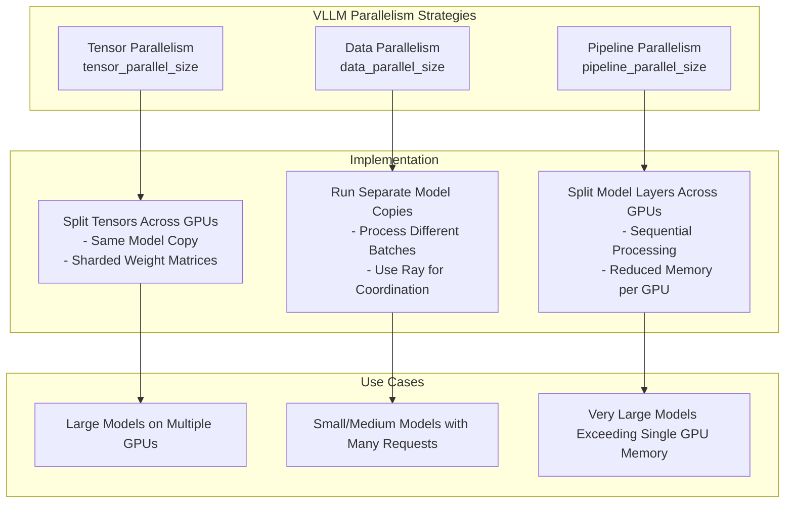
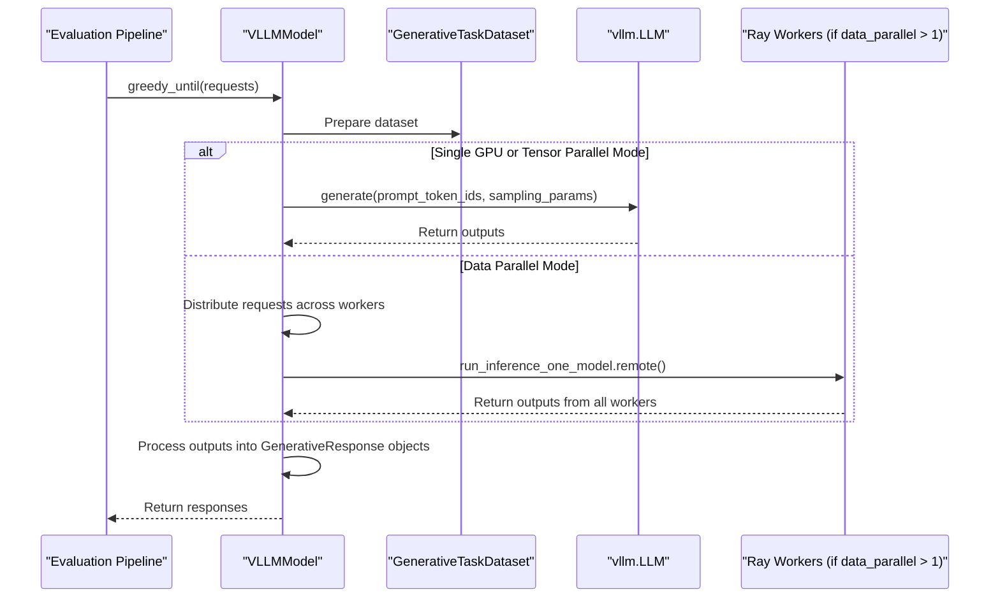

<!-- source: DeepWiki mcp.deepwiki.com · repo huggingface/lighteval · page 7.4 VLLM Backend · fetched 2026-10-26 -->

# VLLM Backend

<details>
<summary>Relevant source files</summary>

The following files were used as context for generating this wiki page:

- [src/lighteval/models/endpoints/inference_providers_model.py](src/lighteval/models/endpoints/inference_providers_model.py)
- [src/lighteval/models/sglang/sglang_model.py](src/lighteval/models/sglang/sglang_model.py)
- [src/lighteval/models/transformers/transformers_model.py](src/lighteval/models/transformers/transformers_model.py)
- [src/lighteval/models/utils.py](src/lighteval/models/utils.py)
- [src/lighteval/models/vllm/vllm_model.py](src/lighteval/models/vllm/vllm_model.py)

</details>


## Overview

The VLLM Backend provides an efficient inference system for evaluating large language models in LightEval, leveraging vLLM's optimized text generation capabilities. This backend offers significant performance improvements compared to the standard [Accelerate Backend](#6.3) through engine-level optimizations like PagedAttention, continuous batching, and various parallelism strategies.

This document covers the implementation, configuration, and usage of the VLLM Backend in LightEval, including its architecture, parallelism options, and integration with the evaluation pipeline.

Sources: [src/lighteval/models/vllm/vllm_model.py:98-125](). [docs/source/use-vllm-as-backend.mdx:1-10]()

## Architecture and Components

The VLLM Backend consists of two primary components: the configuration class (`VLLMModelConfig`) and the model implementation (`VLLMModel`). These components integrate with the broader LightEval evaluation pipeline to provide optimized inference capabilities.

```mermaid
flowchart TD
    subgraph "LightEval Command Line Interface"
        CLI["lighteval vllm"]
    end

    subgraph "Model Configuration"
        VMC["VLLMModelConfig"]
    end

    subgraph "Model Implementation"
        VM["VLLMModel"]
        
        IM["_create_auto_model()"]
        IT["_create_auto_tokenizer()"]
        GU["greedy_until()"]
        LL["loglikelihood()"]
    end

    subgraph "VLLM Library"
        VLLM_LLM["vllm.LLM"]
        VLLM_SP["vllm.SamplingParams"]
        VLLM_TK["vllm.get_tokenizer()"]
    end

    CLI --> VMC
    VMC --> VM
    VM --> IM
    VM --> IT
    VM --> GU
    VM --> LL
    
    IM --> VLLM_LLM
    IM --> VLLM_SP
    IT --> VLLM_TK
    
    GU --> "_generate()"
    LL --> "_loglikelihood_tokens()"
```

### VLLMModelConfig

The `VLLMModelConfig` class extends the base `ModelConfig` class and defines all configuration parameters required for initializing and using a model with the vLLM backend. Key parameters include:

- Model specification: `model_name`, `revision`, `subfolder`
- Parallelism options: `tensor_parallel_size`, `data_parallel_size`, `pipeline_parallel_size`
- Memory management: `gpu_memory_utilization`, `max_model_length`, `swap_space`
- Model precision: `dtype`
- Tokenization options: `add_special_tokens`, `pairwise_tokenization`
- Generation parameters: temperature, top_p, repetition_penalty, etc.

Sources: [src/lighteval/models/vllm/vllm_model.py:75-96]()

### VLLMModel

The `VLLMModel` class implements the abstract `LightevalModel` interface, providing the necessary methods for model evaluation. Key methods include:

- `_create_auto_model()`: Initializes the vLLM model with the specified configuration
- `_create_auto_tokenizer()`: Sets up the tokenizer for the model
- `greedy_until()`: Performs text generation using greedy decoding
- `loglikelihood()`: Calculates log likelihoods for given context-choice pairs
- `cleanup()`: Properly frees resources when the model is no longer needed

Sources: [src/lighteval/models/vllm/vllm_model.py:98-125](). [src/lighteval/models/vllm/vllm_model.py:147-163]()

## Parallelism Strategies

The VLLM Backend supports three types of parallelism strategies to efficiently utilize multiple GPUs:



### Tensor Parallelism

Tensor parallelism splits individual tensors across multiple GPUs, allowing larger models to fit in memory while still operating as a single logical model. This is configured using the `tensor_parallel_size` parameter.

### Data Parallelism

Data parallelism runs independent copies of the model on different GPUs, processing different batches of data in parallel. The VLLM Backend uses Ray for coordination when data parallelism is enabled (`data_parallel_size > 1`).

For data parallelism, the code uses a Ray remote function to distribute requests to different model instances:

```python
@ray.remote(num_gpus=1 if self.tensor_parallel_size == 1 else None)
def run_inference_one_model(model_args: dict, sampling_params: SamplingParams, requests):
    llm = LLM(**model_args)
    return llm.generate(prompt_token_ids=requests, sampling_params=sampling_params)
```

### Pipeline Parallelism

Pipeline parallelism distributes model layers across multiple GPUs, with each GPU handling a subset of the layers. This is configured using the `pipeline_parallel_size` parameter.

Sources: [src/lighteval/models/vllm/vllm_model.py:80-82](). [src/lighteval/models/vllm/vllm_model.py:330-353]().

## Request Processing Flow

The VLLM Backend processes evaluation requests through specific pathways depending on the request type. The following diagram illustrates this flow:



### Generation Process

For text generation using `greedy_until()`, the model:

1. Prepares the input requests and tokenizes the context
2. Sets up appropriate stopping conditions and parameters
3. Truncates inputs if needed to fit the model's maximum length
4. Calls the underlying vLLM engine to generate text
5. Processes the outputs to create standardized `GenerativeResponse` objects

### Log-likelihood Calculation

For log-likelihood tasks, the model:

1. Tokenizes the context and continuation
2. Uses the vLLM engine to get prompt log probabilities
3. Extracts the log probabilities for the continuation tokens
4. Returns the results as `LoglikelihoodResponse` objects

Sources: [src/lighteval/models/vllm/vllm_model.py:204-301](). [src/lighteval/models/vllm/vllm_model.py:363-407]()

## Configuration and Usage

### Command Line Interface

The VLLM Backend can be invoked directly from the LightEval CLI:

```bash
lighteval vllm "model_name=HuggingFaceH4/zephyr-7b-beta,dtype=float16" "task1|task2|0|0"
```

The `model_args` parameter can be provided as either:
- A comma-separated list of key-value pairs
- A path to a YAML configuration file

Sources: [src/lighteval/main_vllm.py:34-147]()

### Configuration File

For more complex configurations, a YAML file can be used:

```yaml
model_parameters:
  model_name: "HuggingFaceTB/SmolLM2-1.7B-Instruct"
  revision: "main"
  dtype: "bfloat16"
  tensor_parallel_size: 1
  data_parallel_size: 1
  pipeline_parallel_size: 1
  gpu_memory_utilization: 0.9
  max_model_length: 2048
  swap_space: 4
  seed: 1
  trust_remote_code: False
  use_chat_template: True
  add_special_tokens: True
  multichoice_continuations_start_space: True
  pairwise_tokenization: False
  max_num_seqs: 128
  max_num_batched_tokens: 2048
  generation_parameters:
    presence_penalty: 0.0
    repetition_penalty: 1.0
    frequency_penalty: 0.0
    temperature: 0.3
    top_k: 50
    top_p: 0.9
    seed: 42
    max_new_tokens: 2048
```

Sources: [examples/model_configs/vllm_model_config.yaml:1-33]()

### Key Configuration Parameters

| Parameter | Description | Default |
|-----------|-------------|---------|
| `model_name` | HuggingFace model ID or local path | Required |
| `revision` | Model revision/tag | "main" |
| `dtype` | Model precision (float16, bfloat16, etc.) | "bfloat16" |
| `tensor_parallel_size` | Number of GPUs for tensor parallelism | 1 |
| `data_parallel_size` | Number of GPUs for data parallelism | 1 |
| `pipeline_parallel_size` | Number of GPUs for pipeline parallelism | 1 |
| `gpu_memory_utilization` | Fraction of GPU memory to use | 0.9 |
| `max_model_length` | Maximum sequence length | Auto-detected |
| `swap_space` | CPU swap space in GB per GPU | 4 |
| `use_chat_template` | Use model's chat template | False |
| `add_special_tokens` | Add special tokens to inputs | True |

Sources: [src/lighteval/models/vllm/vllm_model.py:75-96]()

### Metric Configuration

Special metric configurations can be specified in the YAML configuration file:

```yaml
metric_options:
  codegen_pass@1:16:
    num_samples: 16
```

This allows customizing metric-specific parameters like the number of samples for Pass@K evaluations.

Sources: [docs/source/use-vllm-as-backend.mdx:84-128]()

## Best Practices and Troubleshooting

### Memory Management

When encountering Out of Memory (OOM) issues:

1. Reduce `gpu_memory_utilization` from the default 0.9 to a lower value
2. Set a smaller `max_model_length` to limit context size
3. Adjust `max_num_seqs` and `max_num_batched_tokens` to control batch size
4. Enable tensor parallelism to distribute model weights across multiple GPUs

### Parallelism Selection

- **Tensor Parallelism**: Best for large models that don't fit on a single GPU
- **Data Parallelism**: Best for models that fit on a single GPU but need to process many evaluation requests quickly
- **Pipeline Parallelism**: Useful for extremely large models when tensor parallelism alone is insufficient

### Performance Optimization

- Set `dtype` to the fastest precision your hardware supports (e.g., "float16" for most GPUs, "bfloat16" for A100/H100)
- Increase `max_num_batched_tokens` to process more tokens in parallel (if memory allows)
- For generation tasks, adjust `max_new_tokens` to the minimum needed to avoid unnecessary computation

Sources: [docs/source/use-vllm-as-backend.mdx:79-82]()

---

