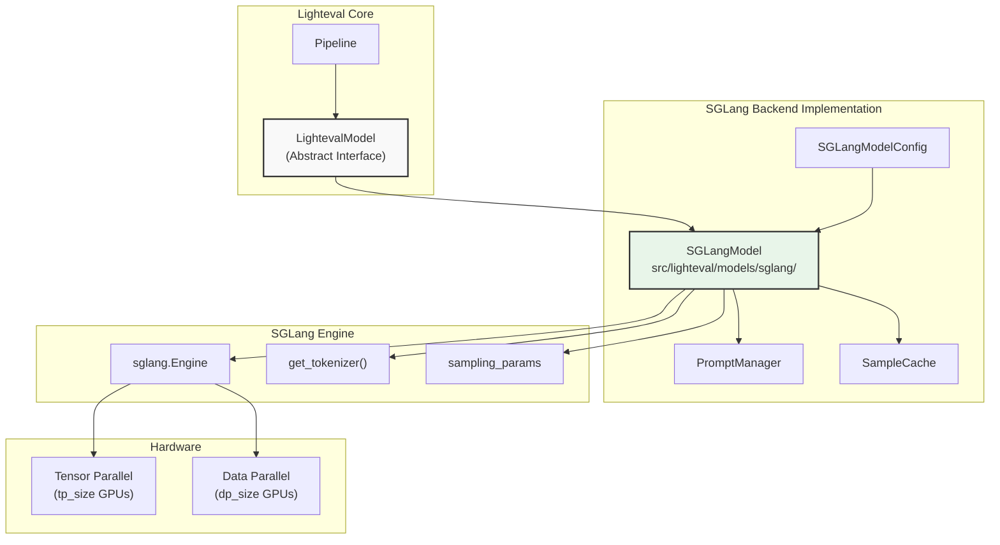
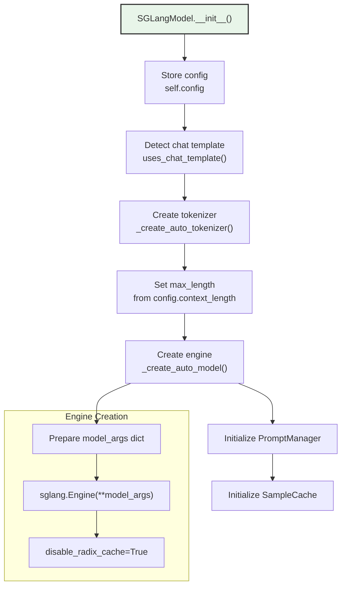
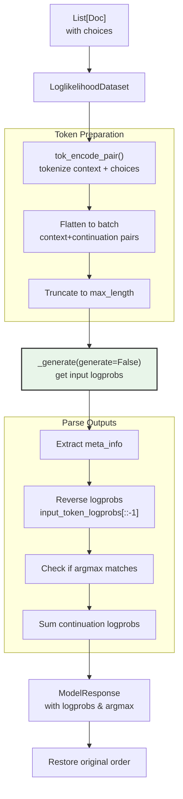
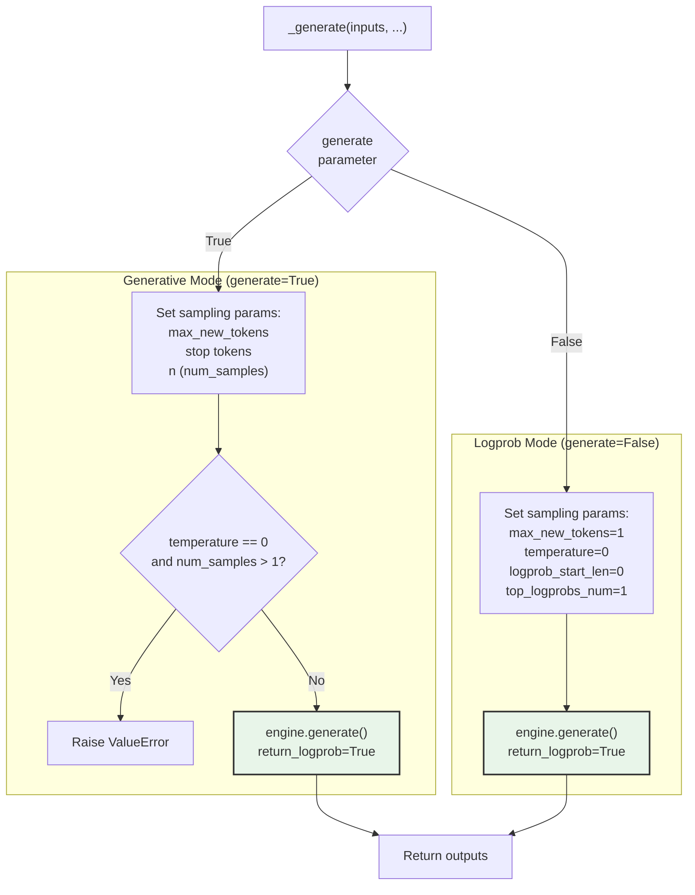
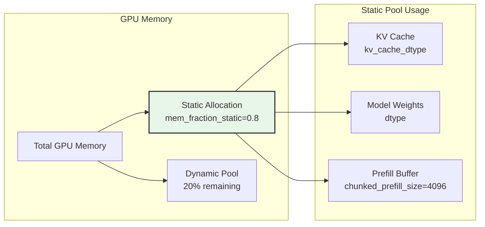
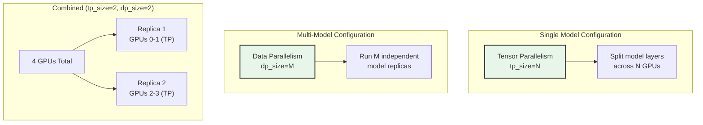
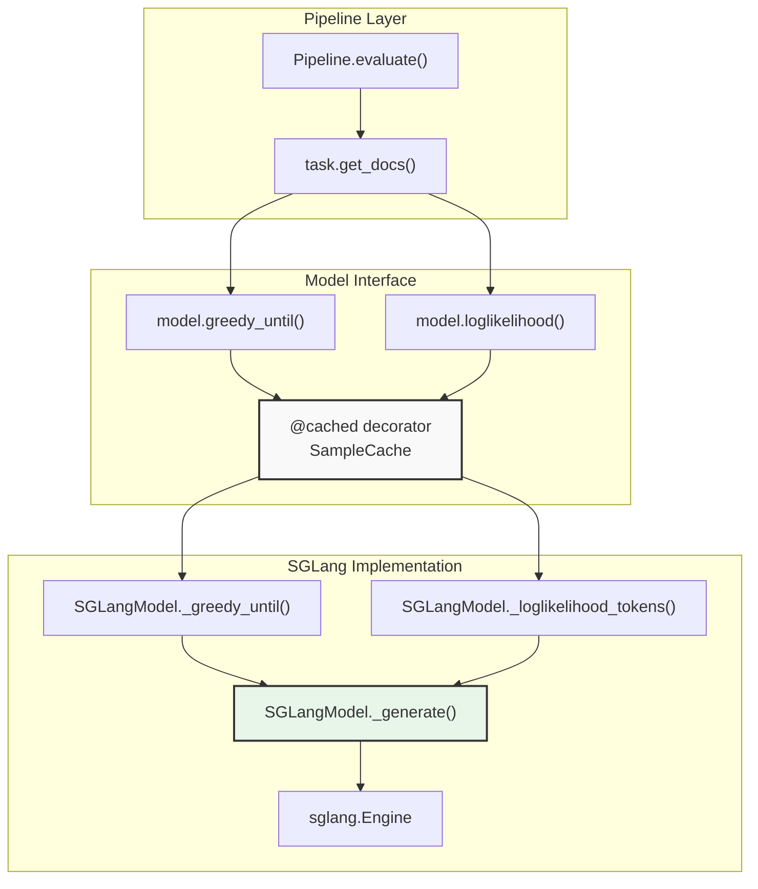

<!-- source: DeepWiki mcp.deepwiki.com · repo huggingface/lighteval · page 7.5 SGLang Backend · fetched 2026-10-26 -->

# SGLang Backend

<details>
<summary>Relevant source files</summary>

The following files were used as context for generating this wiki page:

- [src/lighteval/models/endpoints/inference_providers_model.py](src/lighteval/models/endpoints/inference_providers_model.py)
- [src/lighteval/models/sglang/sglang_model.py](src/lighteval/models/sglang/sglang_model.py)
- [src/lighteval/models/transformers/transformers_model.py](src/lighteval/models/transformers/transformers_model.py)
- [src/lighteval/models/utils.py](src/lighteval/models/utils.py)
- [src/lighteval/models/vllm/vllm_model.py](src/lighteval/models/vllm/vllm_model.py)

</details>


The SGLang backend provides high-performance inference for language models using the SGLang engine, optimized for structured generation and efficient memory management. This document covers the `SGLangModel` and `SGLangModelConfig` classes, their configuration options, and how they integrate with lighteval's evaluation pipeline.

For information about the abstract model interface that SGLang implements, see [Model Interface](#7.1). For alternative high-performance backends, see [VLLM Backend](#7.3). For remote inference options, see [Endpoint Models](#7.5).

## Overview

The SGLang backend wraps the SGLang inference engine to provide consistent evaluation capabilities within lighteval. SGLang is specialized for structured generation tasks and offers RadixAttention for efficient prefix caching.



Sources: [src/lighteval/models/sglang/sglang_model.py:1-423]()

## Configuration

The `SGLangModelConfig` class defines all parameters for initializing an SGLang model. It inherits from `ModelConfig` and adds SGLang-specific settings.

### SGLangModelConfig Fields

| Field | Type | Default | Description |
|-------|------|---------|-------------|
| `model_name` | `str` | Required | HuggingFace Hub model ID or path |
| `load_format` | `str` | `"auto"` | Model weight format (auto, pt, safetensors, gguf, etc.) |
| `dtype` | `str` | `"auto"` | Data type for model weights (auto, float16, bfloat16, float32) |
| `tp_size` | `PositiveInt` | `1` | Number of GPUs for tensor parallelism |
| `dp_size` | `PositiveInt` | `1` | Number of GPUs for data parallelism |
| `context_length` | `PositiveInt \| None` | `None` | Maximum context length (auto-detected if None) |
| `random_seed` | `PositiveInt \| None` | `1234` | Random seed for reproducibility |
| `trust_remote_code` | `bool` | `False` | Whether to trust remote code |
| `device` | `str` | `"cuda"` | Device for model placement |
| `skip_tokenizer_init` | `bool` | `False` | Whether to skip tokenizer initialization |
| `kv_cache_dtype` | `str` | `"auto"` | Data type for key-value cache |
| `add_special_tokens` | `bool` | `True` | Add special tokens during tokenization |
| `pairwise_tokenization` | `bool` | `False` | Tokenize context and continuation separately |
| `sampling_backend` | `str \| None` | `None` | Sampling backend (uses default if None) |
| `attention_backend` | `str \| None` | `None` | Attention backend (uses default if None) |
| `mem_fraction_static` | `PositiveFloat` | `0.8` | Fraction of GPU memory for static allocation |
| `chunked_prefill_size` | `PositiveInt` | `4096` | Size of chunks for prefill operations |
| `override_chat_template` | `bool \| None` | `None` | Force or prevent chat template usage |

Sources: [src/lighteval/models/sglang/sglang_model.py:54-139]()

### Example Configuration

```python
config = SGLangModelConfig(
    model_name="meta-llama/Llama-3.1-8B-Instruct",
    tp_size=2,
    context_length=8192,
    mem_fraction_static=0.85,
    generation_parameters=GenerationParameters(
        temperature=0.7,
        max_new_tokens=100
    )
)
```

Sources: [src/lighteval/models/sglang/sglang_model.py:107-118]()

## Model Initialization

The `SGLangModel` class initialization follows a structured process to set up the engine, tokenizer, and supporting components.



Sources: [src/lighteval/models/sglang/sglang_model.py:142-168]()

### Tokenizer Creation

The tokenizer is created using SGLang's `get_tokenizer` utility, which handles various tokenizer formats and configurations:

```python
# From _create_auto_tokenizer()
tokenizer = get_tokenizer(
    config.model_name,
    tokenizer_mode="auto",
    trust_remote_code=config.trust_remote_code,
    tokenizer_revision="main",
)
tokenizer.pad_token = tokenizer.eos_token
```

Sources: [src/lighteval/models/sglang/sglang_model.py:214-222]()

### Engine Initialization

The SGLang engine is initialized with a comprehensive set of arguments that control parallelism, memory management, and optimization features:

```python
# From _create_auto_model()
self.model_args = {
    "model_path": config.model_name,
    "trust_remote_code": config.trust_remote_code,
    "dtype": config.dtype,
    "device": "cuda",
    "random_seed": config.random_seed,
    "load_format": config.load_format,
    "context_length": self._max_length,
    "dp_size": config.dp_size,
    "tp_size": config.tp_size,
    "sampling_backend": config.sampling_backend,
    "attention_backend": config.attention_backend,
    "mem_fraction_static": config.mem_fraction_static,
    "schedule_policy": "fcfs",  # First-come, first-served
    "chunked_prefill_size": config.chunked_prefill_size,
    "disable_radix_cache": True,  # Disabled for evaluation
}
model = Engine(**self.model_args)
```

**Note**: RadixAttention caching is disabled (`disable_radix_cache=True`) to ensure consistent evaluation results. While RadixAttention provides significant speedups in production, deterministic evaluation requires it to be disabled.

Sources: [src/lighteval/models/sglang/sglang_model.py:189-212]()

## Core Evaluation Methods

The SGLang backend implements the three core methods required by the `LightevalModel` interface: `greedy_until`, `loglikelihood`, and `loglikelihood_rolling`.

### Greedy Until (Generative Tasks)

The `greedy_until` method handles generative evaluation tasks where the model produces free-form text until stopping conditions are met.

```mermaid
graph LR
    Input["List[Doc]"]
    Dataset["GenerativeTaskDataset<br/>sorting & splitting"]
    
    subgraph "For each split"
        Prepare["Prepare prompts<br/>PromptManager"]
        Tokenize["Tokenize inputs"]
        Truncate["Handle context overflow"]
        Generate["_generate()<br/>call engine"]
        Parse["Parse sglang_outputs<br/>extract tokens & logprobs"]
    end
    
    Reorder["Restore original order<br/>dataset.get_original_order()"]
    Output["List[ModelResponse]"]
    
    Input --> Dataset
    Dataset --> Prepare
    Prepare --> Tokenize
    Tokenize --> Truncate
    Truncate --> Generate
    Generate --> Parse
    Parse --> Reorder
    Reorder --> Output
    
    style Generate fill:#e8f5e9,stroke:#333,stroke-width:2px
```



Sources: [src/lighteval/models/sglang/sglang_model.py:224-314]()

#### Context Truncation Logic

SGLang handles cases where the combined context and generation size exceed the model's maximum length:

```python
# From _greedy_until()
context_size = len(inputs[0])

if max_new_tokens is not None:
    if context_size + max_new_tokens > self.max_length:
        logger.warning(
            f"{context_size + max_new_tokens=} which is greater than {self.max_length=}. "
            f"Truncating context to {self.max_length - max_new_tokens} tokens."
        )
        context_size = self.max_length - max_new_tokens
        if context_size < 0:
            raise ValueError("Context size is less than 0.")
        inputs = [input[-context_size:] for input in inputs]
```

The implementation prefers to preserve generation length at the cost of truncating context (left truncation).

Sources: [src/lighteval/models/sglang/sglang_model.py:273-292]()

### Loglikelihood (Multiple Choice Tasks)

The `loglikelihood` method evaluates multiple choice questions by computing the log probability of each continuation given the context.



Sources: [src/lighteval/models/sglang/sglang_model.py:351-418]()

#### Logprob Extraction

SGLang returns logprobs in the `meta_info` field. The implementation extracts and processes them:

```python
# From _loglikelihood_tokens()
for output, context, continuation in zip(
    outputs_doc, tokenized_contexts_doc, tokenized_continuations_doc
):
    meta_info = output["meta_info"]
    
    # Logprobs are reversed (newest first), we reverse them back
    input_top_logprobs = meta_info["input_top_logprobs"][::-1]
    input_token_logprobs = meta_info["input_token_logprobs"][::-1]
    
    # Take only continuation logprobs
    input_top_logprobs = input_top_logprobs[: len(continuation)]
    logprobs = input_token_logprobs[: len(continuation)]
    
    # Check if argmax matches gold
    bool_score = all(top[0][1] == input[1] for top, input in zip(input_top_logprobs, logprobs))
    
    # Extract logprob values and sum
    logprobs = [logprob[0] for logprob in logprobs]
    logprobs_doc.append(logprobs)
    argmax_doc.append(bool_score)
```

Sources: [src/lighteval/models/sglang/sglang_model.py:395-409]()

### Loglikelihood Rolling (Perplexity)

The `loglikelihood_rolling` method is not currently implemented for SGLang:

```python
@cached(SamplingMethod.PERPLEXITY)
def loglikelihood_rolling(self, docs: list[Doc]) -> list[ModelResponse]:
    raise NotImplementedError()
```

Sources: [src/lighteval/models/sglang/sglang_model.py:420-422]()

## Generation Implementation

The `_generate` method encapsulates the actual call to the SGLang engine, configuring sampling parameters based on whether the task is generative or logprob-based.

### Generation Flow



Sources: [src/lighteval/models/sglang/sglang_model.py:316-349]()

### Sampling Parameters

The method configures `self.sampling_params` (derived from `config.generation_parameters`) based on the task type:

| Mode | Parameters | Purpose |
|------|-----------|---------|
| **Generative** | `max_new_tokens`, `stop`, `n` | Generate text with stopping conditions |
| **Logprob** | `max_new_tokens=1`, `temperature=0`, `logprob_start_len=0` | Compute input token logprobs without generation |

For generative tasks with `num_samples > 1`, the temperature must be non-zero to enable sampling:

```python
if num_samples > 1 and self.sampling_params["temperature"] == 0:
    raise ValueError(
        "num_samples > 1 is not supported with temperature=0, please set temperature > 0 or use non sampling metrics."
    )
```

Sources: [src/lighteval/models/sglang/sglang_model.py:332-335]()

### Engine Call

All generation paths converge on a single `engine.generate()` call with logprob return enabled:

```python
outputs = self.model.generate(
    input_ids=inputs,
    sampling_params=self.sampling_params,
    return_logprob=True,
    logprob_start_len=logprob_start_len,
    top_logprobs_num=top_logprobs_num,
)
```

Sources: [src/lighteval/models/sglang/sglang_model.py:342-348]()

## Memory Management and Optimization

The SGLang backend provides several configuration options for optimizing memory usage and performance.

### Memory Allocation



Sources: [src/lighteval/models/sglang/sglang_model.py:94-96]()

### Key Optimization Parameters

**`mem_fraction_static`** (default: 0.8): Controls the fraction of GPU memory allocated statically. Higher values allow more tokens to be cached but leave less memory for dynamic operations.

**`chunked_prefill_size`** (default: 4096): Determines the size of chunks for prefill operations. Larger chunks reduce overhead but increase memory peaks.

**`kv_cache_dtype`** (default: "auto"): Data type for the key-value cache. Using lower precision (e.g., `float16`) reduces memory usage at minimal quality cost.

**`disable_radix_cache`** (always True in evaluation): RadixAttention caching is disabled to ensure deterministic evaluation. In production, enabling this provides significant speedups for prompts with shared prefixes.

Sources: [src/lighteval/models/sglang/sglang_model.py:190-206]()

## Parallelism Support

SGLang supports both tensor parallelism and data parallelism for scaling across multiple GPUs.

### Parallelism Configuration



**Tensor Parallelism (`tp_size`)**: Splits a single model across multiple GPUs. Each layer's computation is distributed across the GPUs, allowing models larger than a single GPU's memory to be loaded.

**Data Parallelism (`dp_size`)**: Creates multiple independent model replicas, each serving different batches. This increases throughput but requires each model to fit on `tp_size` GPUs.

**Total GPU count**: `dp_size * tp_size`

Sources: [src/lighteval/models/sglang/sglang_model.py:69-75](), [src/lighteval/models/sglang/sglang_model.py:198-199]()

## Cleanup

The `cleanup` method properly shuts down the SGLang engine and releases GPU memory:

```python
def cleanup(self):
    if self.model is not None:
        self.model.shutdown()
    
    self.model = None
    gc.collect()
    torch.cuda.empty_cache()
```

This ensures that GPU resources are freed when the model is no longer needed, preventing memory leaks in long-running evaluation pipelines.

Sources: [src/lighteval/models/sglang/sglang_model.py:173-179]()

## Integration with Lighteval Pipeline

The SGLang backend integrates seamlessly with lighteval's evaluation pipeline through the standard `LightevalModel` interface.



**Caching**: The `@cached` decorator (from `lighteval.utils.cache_management`) wraps `greedy_until` and `loglikelihood` to avoid recomputation of identical requests across tasks.

**Prompt Management**: The `PromptManager` handles both chat template formatting and plain text formatting, automatically detecting the appropriate mode based on the tokenizer.

**Response Conversion**: SGLang outputs are converted to `ModelResponse` objects with standardized fields (`text`, `logprobs`, `input_tokens`, `output_tokens`) for consistent metric computation.

Sources: [src/lighteval/models/sglang/sglang_model.py:224-227](), [src/lighteval/models/sglang/sglang_model.py:351-353](), [src/lighteval/models/sglang/sglang_model.py:164]()

## Comparison with Other Backends

| Feature | SGLang | VLLM | Transformers |
|---------|--------|------|--------------|
| **Tensor Parallelism** | ✓ (`tp_size`) | ✓ (`tensor_parallel_size`) | ✓ (via accelerate) |
| **Data Parallelism** | ✓ (`dp_size`) | ✓ (`data_parallel_size`) | ✓ (via DDP) |
| **Prefix Caching** | ✓ (RadixAttention) | ✓ (PagedAttention) | ✗ |
| **Structured Generation** | ✓ (specialized) | Limited | ✗ |
| **Continuous Batching** | ✓ (FCFS scheduler) | ✓ (PagedAttention) | Limited |
| **Memory Efficiency** | High (chunked prefill) | High (paged memory) | Moderate |
| **Setup Complexity** | Moderate | Moderate | Low |
| **Loglikelihood Rolling** | ✗ (not implemented) | ✗ (not implemented) | ✓ |
| **Async Support** | ✗ | ✓ (`AsyncVLLMModel`) | ✗ |

**When to use SGLang**:
- Tasks requiring structured or constrained generation
- Models benefiting from RadixAttention (many shared prefixes)
- Need for efficient chunked prefill
- Workloads with first-come-first-served scheduling

**When to use VLLM instead**:
- Need async/concurrent request processing
- Prefer PagedAttention over RadixAttention
- Larger ecosystem and community support

**When to use Transformers instead**:
- Simple single-GPU evaluation
- Need perplexity metrics (`loglikelihood_rolling`)
- Maximum compatibility with HuggingFace ecosystem
- Debugging and development

Sources: [src/lighteval/models/sglang/sglang_model.py:1-423](), [src/lighteval/models/vllm/vllm_model.py:1-697](), [src/lighteval/models/transformers/transformers_model.py:1-1100]()

---

