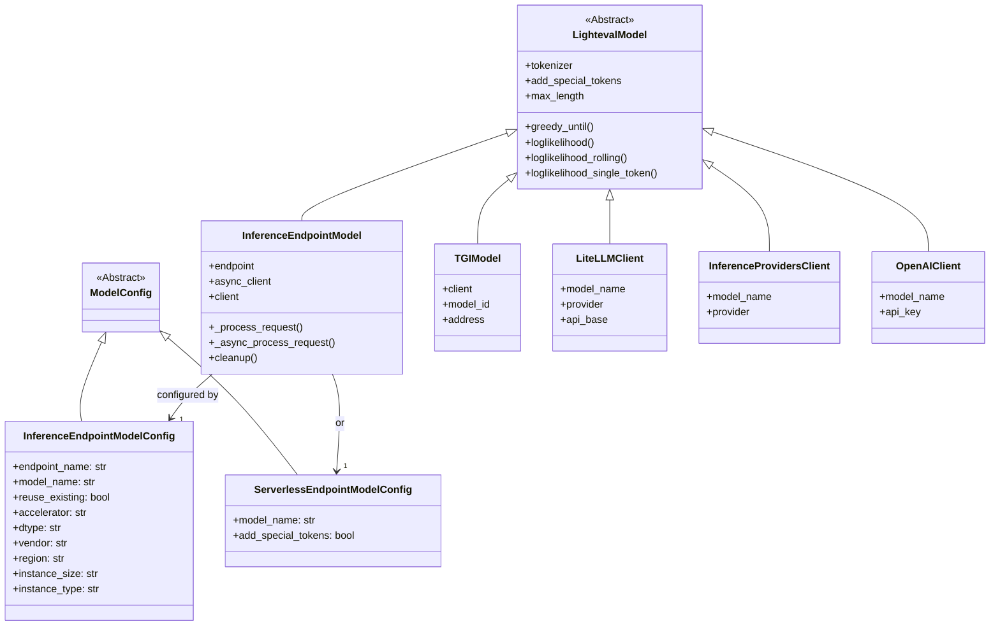
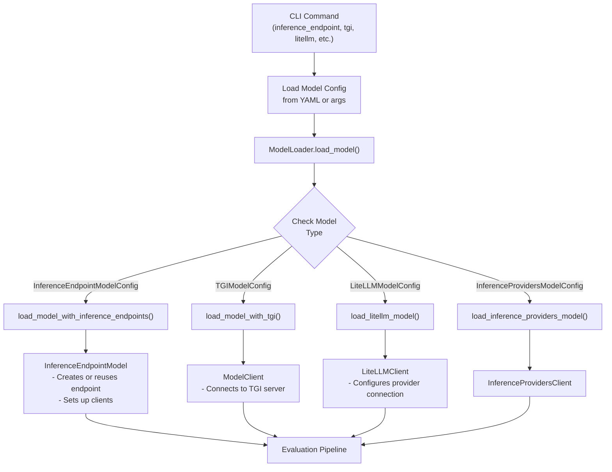

<!-- source: DeepWiki mcp.deepwiki.com · repo huggingface/lighteval · page 7.6 Endpoint Models · fetched 2026-10-26 -->

# Endpoint Models

<details>
<summary>Relevant source files</summary>

The following files were used as context for generating this wiki page:

- [src/lighteval/logging/evaluation_tracker.py](src/lighteval/logging/evaluation_tracker.py)
- [src/lighteval/main_accelerate.py](src/lighteval/main_accelerate.py)
- [src/lighteval/main_custom.py](src/lighteval/main_custom.py)
- [src/lighteval/main_endpoint.py](src/lighteval/main_endpoint.py)
- [src/lighteval/main_nanotron.py](src/lighteval/main_nanotron.py)
- [src/lighteval/main_sglang.py](src/lighteval/main_sglang.py)
- [src/lighteval/main_vllm.py](src/lighteval/main_vllm.py)
- [src/lighteval/models/endpoints/inference_providers_model.py](src/lighteval/models/endpoints/inference_providers_model.py)
- [src/lighteval/models/sglang/sglang_model.py](src/lighteval/models/sglang/sglang_model.py)
- [src/lighteval/models/transformers/transformers_model.py](src/lighteval/models/transformers/transformers_model.py)
- [src/lighteval/models/utils.py](src/lighteval/models/utils.py)
- [src/lighteval/models/vllm/vllm_model.py](src/lighteval/models/vllm/vllm_model.py)

</details>


This document describes the endpoint model interfaces in LightEval, which allow you to evaluate language models hosted on remote endpoints and APIs rather than running them locally. For information about other model backends, see [Base Model Interface](#6.1), [VLLM Backend](#6.2), [Accelerate Backend](#6.3), and [Nanotron Backend](#6.4).

## Overview

Endpoint models provide several advantages over local evaluation:

- Evaluate models too large to run locally
- Compare commercial API models with open-source models
- Test models deployed on inference endpoints
- Evaluate without setting up a local GPU environment

LightEval supports multiple types of remote endpoints:

1. **HuggingFace Inference Endpoints** - Both managed endpoints and free serverless endpoints
2. **Text Generation Inference (TGI)** - For deployments using TGI servers
3. **LiteLLM** - Unified interface for commercial LLM providers (OpenAI, Anthropic, etc.)
4. **Inference Providers** - General interface for other inference providers

Sources: [src/lighteval/models/endpoints/endpoint_model.py:130-602](). [src/lighteval/main_endpoint.py:38-482]()

## Endpoint Model Architecture



Sources: [src/lighteval/models/model_loader.py:60-87](). [src/lighteval/models/endpoints/endpoint_model.py:77-96](), [src/lighteval/models/endpoints/endpoint_model.py:130-135]()

## Model Loading Flow



Sources: [src/lighteval/models/model_loader.py:60-183](). [src/lighteval/main_endpoint.py:38-482]()

## HuggingFace Inference Endpoints

LightEval has built-in support for HuggingFace's Inference Endpoints, which allow you to deploy models in the cloud and access them via an API. The library supports two modes:

1. **Dedicated Endpoints** - Creates a new endpoint or uses an existing one (requires HF Pro subscription)
2. **Free Endpoints** - Uses the serverless free inference API (limited to public models on the Hub)

### Configuration Options

For Inference Endpoints, you can use a YAML configuration file with these options:

| Parameter | Description | Default |
|-----------|-------------|---------|
| `endpoint_name` | Name of existing endpoint to use | None |
| `model_name` | Model ID to deploy (if not using existing endpoint) | None |
| `reuse_existing` | Whether to reuse an existing endpoint | False |
| `accelerator` | Hardware accelerator type | "gpu" |
| `dtype` | Model data type/quantization | None |
| `vendor` | Cloud provider | "aws" |
| `region` | Deployment region | "us-east-1" |
| `instance_size` | Instance size (e.g., "x1", "x4") | None |
| `instance_type` | Instance type (e.g., "nvidia-a10g") | None |
| `add_special_tokens` | Whether to add special tokens | True |

For Serverless Endpoints (free), the configuration is simpler:

| Parameter | Description | Default |
|-----------|-------------|---------|
| `model_name` | Model ID on the Hugging Face Hub | Required |
| `add_special_tokens` | Whether to add special tokens | True |

Sources: [src/lighteval/models/endpoints/endpoint_model.py:77-128](). [src/lighteval/main_endpoint.py:38-146]()

### Hardware Autoscaling

When using dedicated endpoints, LightEval includes an autoscaling feature that automatically selects appropriate hardware if none is specified. If a deployment fails due to resource constraints, it will attempt to scale up to larger hardware configurations in this order:

1. `nvidia-a10g, x1`
2. `nvidia-t4, x4`
3. `nvidia-a100, x1`
4. `nvidia-a10g, x4`
5. `nvidia-a100, x2`
6. `nvidia-a100, x4`

Sources: [src/lighteval/models/endpoints/endpoint_model.py:283-299]()

## TGI (Text Generation Inference)

Text Generation Inference is a framework for deploying LLMs for inference. LightEval can connect to existing TGI servers for evaluation.

```yaml
# Example TGI configuration
model:
  inference_server_address: "https://your-tgi-server.com"
  inference_server_auth: "YOUR_AUTH_TOKEN"  # Optional
  model_id: "meta-llama/Llama-2-7b-chat-hf"  # Optional
generation:
  temperature: 0.0
  max_new_tokens: 512
```

Sources: [src/lighteval/main_endpoint.py:150-256]()

## LiteLLM

LiteLLM provides a unified interface to various commercial LLM providers like OpenAI, Anthropic, and more. LightEval uses LiteLLM to evaluate models from these providers.

Configuration can be provided either through a YAML file or as comma-separated arguments:

```yaml
# Example LiteLLM configuration
model:
  model_name: "gpt-4"
  base_url: "https://api.openai.com/v1"  # Optional
  provider: "openai"  # Optional
generation:
  temperature: 0.0
  max_tokens: 512
```

Sources: [src/lighteval/main_endpoint.py:260-375]()

## Inference Providers

This is a general interface for other inference providers that may not be covered by the above options.

```yaml
# Example Inference Providers configuration
model:
  model_name: "claude-2"
  provider: "anthropic"
generation:
  temperature: 0.0
  max_tokens: 512
```

Sources: [src/lighteval/main_endpoint.py:378-482]()

## Command-Line Usage

Here are examples of how to use each endpoint model type from the command line:

### HuggingFace Inference Endpoints

```bash
# Using a dedicated endpoint
lighteval inference_endpoint \
  examples/model_configs/endpoint_model.yaml \
  mmlu,arc_challenge \
  --save_details \
  --output_dir results

# Using a free serverless endpoint
lighteval inference_endpoint \
  examples/model_configs/endpoint_model.yaml \
  mmlu,arc_challenge \
  --free_endpoint \
  --save_details \
  --output_dir results
```

### TGI (Text Generation Inference)

```bash
lighteval tgi \
  examples/model_configs/tgi_model.yaml \
  mmlu,arc_challenge \
  --save_details \
  --output_dir results
```

### LiteLLM

```bash
# Using a YAML config file
lighteval litellm \
  examples/model_configs/litellm_model.yaml \
  mmlu,arc_challenge \
  --save_details \
  --output_dir results

# Using inline model arguments
lighteval litellm \
  "model_name=gpt-4,provider=openai" \
  mmlu,arc_challenge \
  --save_details \
  --output_dir results
```

### Inference Providers

```bash
lighteval inference_providers \
  examples/model_configs/providers_model.yaml \
  mmlu,arc_challenge \
  --save_details \
  --output_dir results
```

Sources: [src/lighteval/main_endpoint.py:38-482]()

## API Request/Response Flow

When using endpoint models, LightEval handles the complexities of making API requests and processing responses. The flow for generative requests works as follows:

1. Tasks are converted to request objects (`GreedyUntilRequest`, `LoglikelihoodRequest`, etc.)
2. These requests are processed in batches through an asynchronous client
3. Results are processed and converted to response objects (`GenerativeResponse`, `LoglikelihoodResponse`)
4. Responses are fed into the metrics system for evaluation

For generation requests, LightEval processes requests in batches and supports both synchronous and asynchronous modes (with async being faster).

Sources: [src/lighteval/models/endpoints/endpoint_model.py:356-396](). [src/lighteval/models/endpoints/endpoint_model.py:453-602]()

## Limitations

Endpoint models have some limitations compared to local models:

1. **Limited Metrics Support**: Some metrics that require token-level information may not be available
2. **No Single Token Analysis**: The `loglikelihood_single_token` method is not supported
3. **Higher Latency**: Requests to remote endpoints take longer than local inference
4. **Potential Costs**: Using dedicated endpoints or commercial APIs incurs costs

Sources: [src/lighteval/models/endpoints/endpoint_model.py:597-602]()

---

