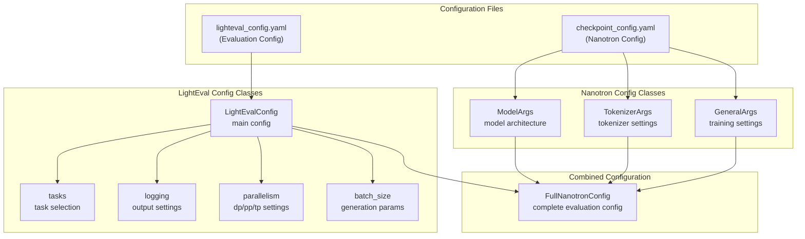
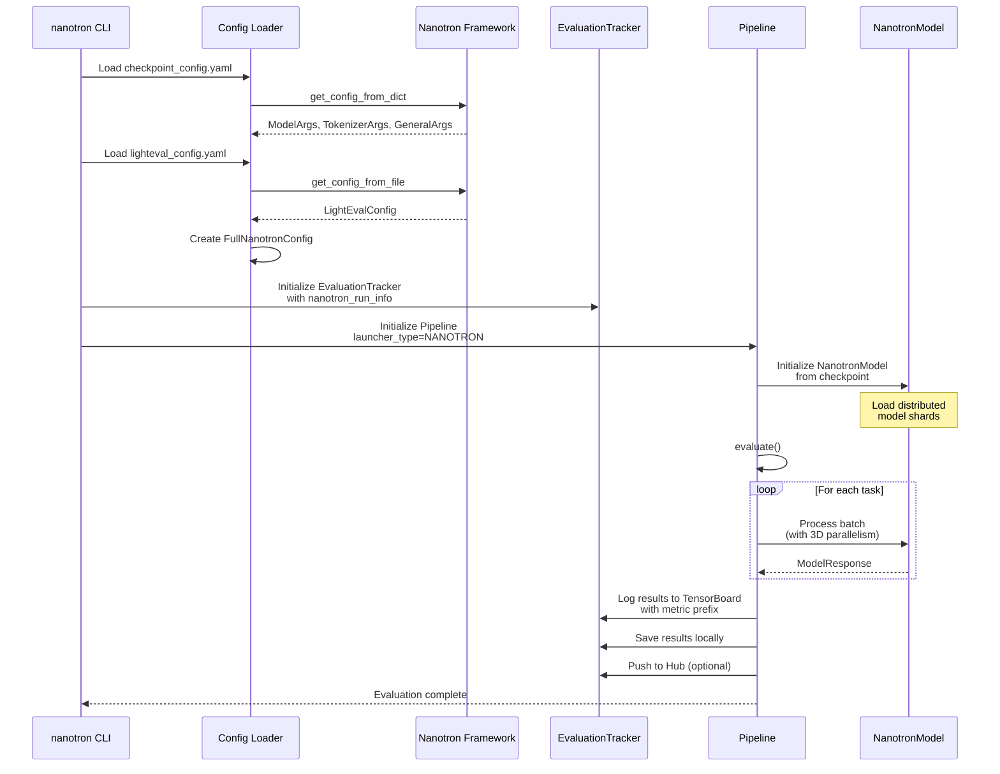
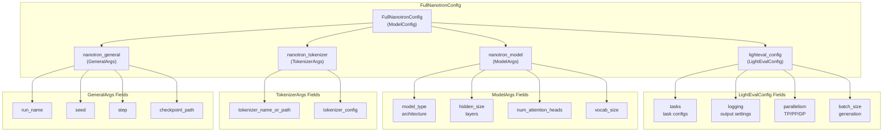
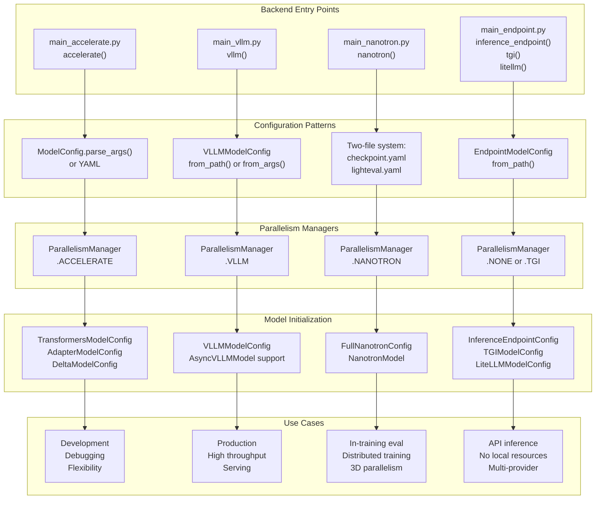
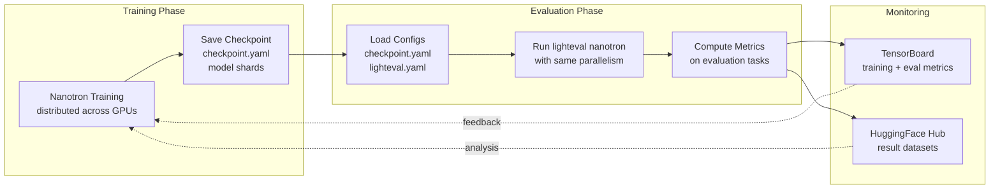

<!-- source: DeepWiki mcp.deepwiki.com · repo huggingface/lighteval · page 7.7 Nanotron Backend · fetched 2026-10-26 -->

# Nanotron Backend

<details>
<summary>Relevant source files</summary>

The following files were used as context for generating this wiki page:

- [src/lighteval/logging/evaluation_tracker.py](src/lighteval/logging/evaluation_tracker.py)
- [src/lighteval/main_accelerate.py](src/lighteval/main_accelerate.py)
- [src/lighteval/main_custom.py](src/lighteval/main_custom.py)
- [src/lighteval/main_endpoint.py](src/lighteval/main_endpoint.py)
- [src/lighteval/main_nanotron.py](src/lighteval/main_nanotron.py)
- [src/lighteval/main_sglang.py](src/lighteval/main_sglang.py)
- [src/lighteval/main_vllm.py](src/lighteval/main_vllm.py)

</details>


This document covers the Nanotron backend implementation in lighteval, which enables evaluation of models trained with the Nanotron distributed training framework. The Nanotron backend is unique among lighteval's backends as it is specifically designed for in-training evaluation of models during distributed training runs, supporting 3D parallelism (tensor, pipeline, and data parallelism).

For information about other model backends, see [Models and Backends](#7). For general model interface documentation, see [Model Interface](#7.1). For custom backend implementation, see [Custom Backends](#7.7).

## Overview

The Nanotron backend integrates lighteval with the [Nanotron](https://github.com/huggingface/nanotron) distributed training framework. Unlike other backends that operate on pre-trained models, the Nanotron backend evaluates checkpoints produced during training runs, enabling continuous monitoring of model performance throughout the training process.

**Key Features:**
- In-training evaluation support during Nanotron training runs
- Full support for Nanotron's 3D parallelism (tensor, pipeline, data)
- Direct integration with Nanotron's checkpoint and configuration system
- Seamless handling of distributed model shards
- TensorBoard integration for training-time metric visualization

**Configuration Classes:**
- `FullNanotronConfig` - Main configuration combining lighteval and nanotron settings
- `LightEvalConfig` - Lighteval-specific evaluation configuration
- Integration with `ModelArgs`, `TokenizerArgs`, `GeneralArgs` from Nanotron

Sources: [src/lighteval/main_nanotron.py:1-122]()

## Configuration Structure

The Nanotron backend uses a two-file configuration system: one for the Nanotron checkpoint and one for lighteval evaluation parameters.



Sources: [src/lighteval/main_nanotron.py:64-83]()

### Nanotron Checkpoint Configuration

The checkpoint configuration file contains the Nanotron training settings. The backend extracts three key configuration sections from this file:

| Configuration | Class | Purpose |
|--------------|-------|---------|
| `model` | `ModelArgs` | Model architecture and parameters |
| `tokenizer` | `TokenizerArgs` | Tokenizer configuration |
| `general` | `GeneralArgs` | Training settings and parallelism |

The configuration is loaded using Nanotron's `get_config_from_dict()` utility:

```python
# Example from main_nanotron.py:68-79
with open(checkpoint_config_path) as f:
    nanotron_yaml = yaml.load(f, Loader=SafeLoader)

model_config, tokenizer_config, general_config = [
    get_config_from_dict(
        nanotron_yaml[key],
        config_class=config_class,
        skip_unused_config_keys=True,
        skip_null_keys=True,
    )
    for key, config_class in [("model", ModelArgs), ("tokenizer", TokenizerArgs), ("general", GeneralArgs)]
]
```

Sources: [src/lighteval/main_nanotron.py:64-79]()

### LightEval Configuration

The `LightEvalConfig` class defines evaluation-specific settings. This configuration is loaded from a separate YAML file and contains the following sections:

**Tasks Configuration:**
- `tasks`: Task specification string (e.g., `"lighteval|gsm8k|5"`)
- `dataset_loading_processes`: Number of parallel processes for dataset loading
- `max_samples`: Maximum samples per task (useful for quick testing)
- `custom_tasks`: Path to custom task definitions
- `num_fewshot_seeds`: Number of seeds for few-shot sampling
- `multichoice_continuations_start_space`: Handling of spaces in multiple-choice continuations

**Logging Configuration:**
- `output_dir`: Directory for saving results
- `save_details`: Whether to save per-sample details
- `push_to_hub`: Whether to publish results to HuggingFace Hub
- `push_to_tensorboard`: Whether to log to TensorBoard
- `public_run`: Whether the run is public
- `results_org`: Organization for Hub results
- `tensorboard_metric_prefix`: Prefix for TensorBoard metrics

**Parallelism Configuration:**
- `dp`: Data parallelism degree
- `pp`: Pipeline parallelism degree
- `pp_engine`: Pipeline parallel engine (e.g., `"1f1b"`)
- `tp`: Tensor parallelism degree
- `tp_linear_async_communication`: Async communication flag
- `tp_mode`: Tensor parallel mode (e.g., `"ALL_REDUCE"`)

**Batch Configuration:**
- `batch_size`: Batch size for evaluation
- `generation`: Generation parameters (temperature, top_p, etc.)

Sources: [src/lighteval/main_nanotron.py:82-83](), [examples/nanotron/lighteval_config_override_template.yaml:1-24]()

### Configuration Template

The repository provides a template configuration file at [examples/nanotron/lighteval_config_override_template.yaml:1-24]():

```yaml
# Auto batch size doesn't work yet, so use default
batch_size: 8
generation: null
logging:
  output_dir: "outputs"
  save_details: false
  push_to_hub: false
  public_run: false
  results_org: null
  tensorboard_metric_prefix: "eval"
parallelism:
  dp: 1
  pp: 1
  pp_engine: 1f1b
  tp: 1
  tp_linear_async_communication: false
  tp_mode: ALL_REDUCE
tasks:
  dataset_loading_processes: 8
  max_samples: 10
  multichoice_continuations_start_space: null
  num_fewshot_seeds: null
  tasks: lighteval|gsm8k|5
```

Sources: [examples/nanotron/lighteval_config_override_template.yaml:1-24]()

## CLI Usage

The Nanotron backend is invoked through the `lighteval nanotron` command, which requires two configuration file paths.

### Command Structure

```bash
lighteval nanotron \
    --checkpoint-config-path <path_to_nanotron_checkpoint.yaml> \
    --lighteval-config-path <path_to_lighteval_config.yaml> \
    [--load-tasks-multilingual] \
    [--remove-reasoning-tags] \
    [--reasoning-tags <tags>]
```

### Required Arguments

| Argument | Type | Description |
|----------|------|-------------|
| `--checkpoint-config-path` | `str` | Path to the Nanotron checkpoint YAML config file (can be on S3) |
| `--lighteval-config-path` | `str` | Path to the lighteval evaluation YAML config file |

### Optional Arguments

| Argument | Type | Default | Description |
|----------|------|---------|-------------|
| `--load-tasks-multilingual` | `bool` | `False` | Load multilingual task definitions |
| `--remove-reasoning-tags` | `bool` | `False` | Remove reasoning tags from prompts |
| `--reasoning-tags` | `str` | `None` | Specific reasoning tags to use |

Sources: [src/lighteval/main_nanotron.py:43-51]()

### Example Usage

```bash
# Basic evaluation with default settings
lighteval nanotron \
    --checkpoint-config-path ./checkpoints/step_1000/config.yaml \
    --lighteval-config-path ./eval_config.yaml

# Evaluation with multilingual tasks
lighteval nanotron \
    --checkpoint-config-path s3://bucket/checkpoint.yaml \
    --lighteval-config-path ./lighteval_config.yaml \
    --load-tasks-multilingual

# In-training evaluation with reasoning tag removal
lighteval nanotron \
    --checkpoint-config-path ./checkpoint.yaml \
    --lighteval-config-path ./eval.yaml \
    --remove-reasoning-tags
```

Sources: [src/lighteval/main_nanotron.py:43-122]()

## Evaluation Flow

The Nanotron backend follows a specialized evaluation flow that integrates with the Nanotron framework's distributed execution model.



Sources: [src/lighteval/main_nanotron.py:43-122]()

### Key Differences from Other Backends

The Nanotron backend has several unique characteristics compared to other lighteval backends:

| Feature | Nanotron Backend | Other Backends |
|---------|------------------|----------------|
| **Model Source** | Nanotron training checkpoints | Pre-trained models from Hub or local |
| **Parallelism** | 3D parallelism (TP/PP/DP) via Nanotron | Single-node or vLLM/accelerate parallelism |
| **Primary Use Case** | In-training evaluation | Standalone evaluation |
| **Configuration** | Two-file system (checkpoint + lighteval) | Single file or command-line args |
| **Distributed Loading** | Handled by Nanotron framework | Handled by accelerate or Ray |
| **TensorBoard Integration** | Direct integration with training metrics | Optional standalone logging |
| **Checkpoint Handling** | Native Nanotron checkpoint format | Standard HF checkpoint format |

Sources: [src/lighteval/main_nanotron.py:1-122](), [src/lighteval/main_accelerate.py:55-156](), [src/lighteval/main_vllm.py:51-138]()

## Implementation Details

### Pipeline Initialization

The Nanotron backend sets up the evaluation pipeline with specific parameters tailored for distributed training environments:

```python
# From main_nanotron.py:97-108
pipeline_parameters = PipelineParameters(
    launcher_type=ParallelismManager.NANOTRON,
    job_id=os.environ.get("SLURM_JOB_ID", 0),
    nanotron_checkpoint_path=checkpoint_config_path,
    dataset_loading_processes=lighteval_config.tasks.dataset_loading_processes,
    custom_tasks_directory=lighteval_config.tasks.custom_tasks,
    num_fewshot_seeds=1,
    max_samples=lighteval_config.tasks.max_samples,
    remove_reasoning_tags=remove_reasoning_tags,
    reasoning_tags=reasoning_tags,
    load_tasks_multilingual=load_tasks_multilingual,
)
```

**Key Parameters:**
- `launcher_type=ParallelismManager.NANOTRON`: Specifies the Nanotron parallelism manager
- `job_id`: Automatically retrieved from SLURM environment for cluster jobs
- `nanotron_checkpoint_path`: Path to the checkpoint configuration for model loading
- `num_fewshot_seeds=1`: Fixed to 1 for deterministic evaluation during training

Sources: [src/lighteval/main_nanotron.py:97-108]()

### Evaluation Tracker Setup

The `EvaluationTracker` is initialized with Nanotron-specific information to properly associate evaluation results with training runs:

```python
# From main_nanotron.py:85-95
evaluation_tracker = EvaluationTracker(
    output_dir=lighteval_config.logging.output_dir,
    results_path_template=lighteval_config.logging.results_path_template,
    hub_results_org=lighteval_config.logging.results_org,
    public=lighteval_config.logging.public_run,
    push_to_hub=lighteval_config.logging.push_to_hub,
    push_to_tensorboard=lighteval_config.logging.push_to_tensorboard,
    save_details=lighteval_config.logging.save_details,
    tensorboard_metric_prefix=lighteval_config.logging.tensorboard_metric_prefix,
    nanotron_run_info=nanotron_config.nanotron_general,
)
```

The `nanotron_run_info` parameter contains training metadata from `GeneralArgs`, enabling correlation between training steps and evaluation metrics in TensorBoard.

Sources: [src/lighteval/main_nanotron.py:85-95]()

### TensorBoard Integration

The Nanotron backend has specialized TensorBoard support for in-training evaluation visualization:

- `tensorboard_metric_prefix`: Prefix for all evaluation metrics (default: `"eval"`)
- Metrics are logged with structure: `{prefix}/{task_name}/{metric_name}`
- Synchronized with training step counter for aligned visualization
- Supports concurrent logging with training metrics

Example TensorBoard metric paths:
- `eval/gsm8k/exact_match`
- `eval/mmlu/acc`
- `eval/hellaswag/acc_norm`

Sources: [examples/nanotron/lighteval_config_override_template.yaml:10](), [src/lighteval/main_nanotron.py:85-95]()

## FullNanotronConfig Structure

The `FullNanotronConfig` class combines all configuration elements into a single unified structure that implements the lighteval model configuration interface.



The `FullNanotronConfig` is created by combining all configuration components:

```python
# From main_nanotron.py:83
nanotron_config = FullNanotronConfig(
    lighteval_config,
    model_config,
    tokenizer_config,
    general_config
)
```

This unified configuration is then passed to the `Pipeline` as the `model_config` parameter, which uses it to initialize the `NanotronModel` backend instance.

Sources: [src/lighteval/main_nanotron.py:83](), [src/lighteval/main_nanotron.py:110-115]()

## Comparison with Other Backends

The following diagram illustrates how the Nanotron backend fits into the overall backend ecosystem:



Sources: [src/lighteval/main_nanotron.py:1-122](), [src/lighteval/main_accelerate.py:55-156](), [src/lighteval/main_vllm.py:51-138](), [src/lighteval/main_endpoint.py:55-409]()

### Backend Comparison Table

| Aspect | Accelerate | VLLM | Nanotron | Endpoints |
|--------|-----------|------|----------|-----------|
| **Model Loading** | `transformers` library | VLLM engine | Nanotron checkpoints | API/HTTP |
| **Parallelism** | DDP via accelerate | Tensor/Data via Ray | 3D (TP/PP/DP) | N/A (remote) |
| **Configuration** | CLI args or YAML | CLI args or YAML | Two-file YAML | YAML only |
| **Primary Mode** | Offline evaluation | Offline evaluation | In-training | Online/Offline |
| **Quantization** | ✓ (4-bit, 8-bit) | ✓ (AWQ, GPTQ) | ✗ | Varies by provider |
| **Custom Models** | ✓ | ✓ (if compatible) | ✓ (Nanotron format) | ✗ |
| **Checkpoint Format** | HF transformers | HF transformers | Nanotron | N/A |
| **TensorBoard** | Optional | Optional | Built-in training sync | Optional |
| **Best For** | Development, debugging | Production serving | Training runs | API-based models |

Sources: [src/lighteval/main_nanotron.py:1-122](), [src/lighteval/main_accelerate.py:55-156](), [src/lighteval/main_vllm.py:51-138](), [src/lighteval/main_endpoint.py:55-409]()

## Integration with Training Workflow

The Nanotron backend is designed to integrate seamlessly into training workflows. The typical integration pattern looks like this:



**Typical Workflow Steps:**

1. **Training Step**: Nanotron trains the model with 3D parallelism
2. **Checkpoint Creation**: At regular intervals (e.g., every 1000 steps), save checkpoint
3. **Evaluation Trigger**: Launch lighteval evaluation with the checkpoint
4. **Metric Computation**: Lighteval evaluates the model on specified tasks
5. **Result Logging**: Metrics logged to TensorBoard and optionally Hub
6. **Continuous Monitoring**: Training continues with eval metrics in TensorBoard

Sources: [src/lighteval/main_nanotron.py:43-122]()

## Limitations and Considerations

### Current Limitations

1. **Auto Batch Sizing**: Automatic batch size detection is not currently supported. Batch size must be manually specified in the configuration.
   
   ```yaml
   # From lighteval_config_override_template.yaml:1-2
   # As of right now auto batch size doesn't work, so we use some default
   batch_size: 8
   ```

2. **Few-Shot Seeds**: The `num_fewshot_seeds` parameter is fixed to 1 in the implementation, meaning only one seed is used for few-shot example selection.

3. **Configuration Validation**: The checkpoint configuration must be a YAML file. Python configuration files are not supported.

Sources: [examples/nanotron/lighteval_config_override_template.yaml:1-2](), [src/lighteval/main_nanotron.py:103](), [src/lighteval/main_nanotron.py:65-66]()

### Performance Considerations

**Distributed Execution:**
- Evaluation must run with the same parallelism configuration as training to properly load model shards
- Pipeline parallelism (PP) requires careful memory management during evaluation
- Data parallelism (DP) can speed up evaluation by processing different tasks in parallel

**Resource Requirements:**
- Memory requirements match training configuration (same number of GPUs needed)
- Evaluation runs in the same distributed environment as training (typically SLURM clusters)
- S3 or shared filesystem access required for checkpoint loading

**Checkpoint Loading:**
- Loading distributed checkpoints can be slow on first access
- Checkpoint path can point to S3 locations for cloud-based training
- Nanotron handles shard distribution automatically based on parallelism config

Sources: [src/lighteval/main_nanotron.py:97-108](), [examples/nanotron/lighteval_config_override_template.yaml:11-17]()

## Best Practices

### Configuration Management

1. **Keep Configs Version Controlled**: Store both checkpoint config and lighteval config in version control alongside training configs

2. **Use Descriptive Output Directories**: Structure output directories by training run and checkpoint step:
   ```yaml
   logging:
     output_dir: "outputs/run_{run_name}/step_{step}"
   ```

3. **Set Appropriate Sample Limits**: Use `max_samples` for quick validation during training:
   ```yaml
   tasks:
     max_samples: 100  # for fast feedback
   ```

4. **Configure TensorBoard Prefix**: Use consistent prefixes to organize metrics:
   ```yaml
   logging:
     tensorboard_metric_prefix: "eval"
   ```

### Evaluation Strategy

1. **Evaluation Cadence**: Balance evaluation frequency with training time:
   - Early training: Every 500-1000 steps
   - Mid training: Every 2000-5000 steps
   - Late training: Every 5000-10000 steps

2. **Task Selection**: Start with a small subset of tasks for frequent evaluation, use full suite less frequently

3. **Checkpoint Management**: Keep checkpoint configs synchronized with lighteval configs to avoid version mismatches

Sources: [examples/nanotron/lighteval_config_override_template.yaml:1-24](), [src/lighteval/main_nanotron.py:85-95]()

## Error Handling

### Common Errors

**Invalid Checkpoint Path:**
```python
# From main_nanotron.py:65-66
if not checkpoint_config_path.endswith(".yaml"):
    raise ValueError("The checkpoint path should point to a YAML file")
```

**Missing Configuration Sections:**
If the checkpoint YAML is missing required sections (`model`, `tokenizer`, or `general`), the configuration loading will fail with a KeyError.

**Parallelism Mismatch:**
If the lighteval parallelism configuration doesn't match the checkpoint's training parallelism, model loading will fail.

**SLURM Job ID:**
The implementation automatically retrieves the SLURM job ID from environment variables:
```python
# From main_nanotron.py:99
job_id=os.environ.get("SLURM_JOB_ID", 0)
```
If not running in SLURM, it defaults to 0.

Sources: [src/lighteval/main_nanotron.py:65-66](), [src/lighteval/main_nanotron.py:99]()

## Summary

The Nanotron backend provides specialized support for evaluating models during distributed training with the Nanotron framework. Key distinguishing features include:

- **Two-file configuration system** separating training checkpoint config from evaluation config
- **Native 3D parallelism support** (tensor, pipeline, data parallelism)
- **Seamless TensorBoard integration** for tracking evaluation metrics alongside training
- **In-training evaluation workflow** designed for continuous monitoring during long training runs
- **SLURM cluster integration** for HPC environments

While other backends (accelerate, vllm, sglang) focus on evaluating pre-trained models, the Nanotron backend is uniquely designed for in-progress training evaluation, making it essential for monitoring model performance during the training process.

Sources: [src/lighteval/main_nanotron.py:1-122]()

---

