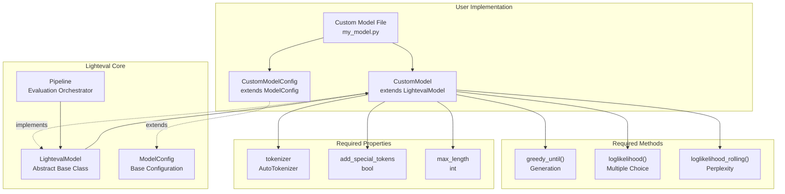
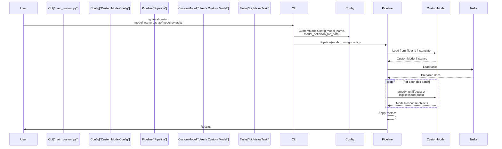
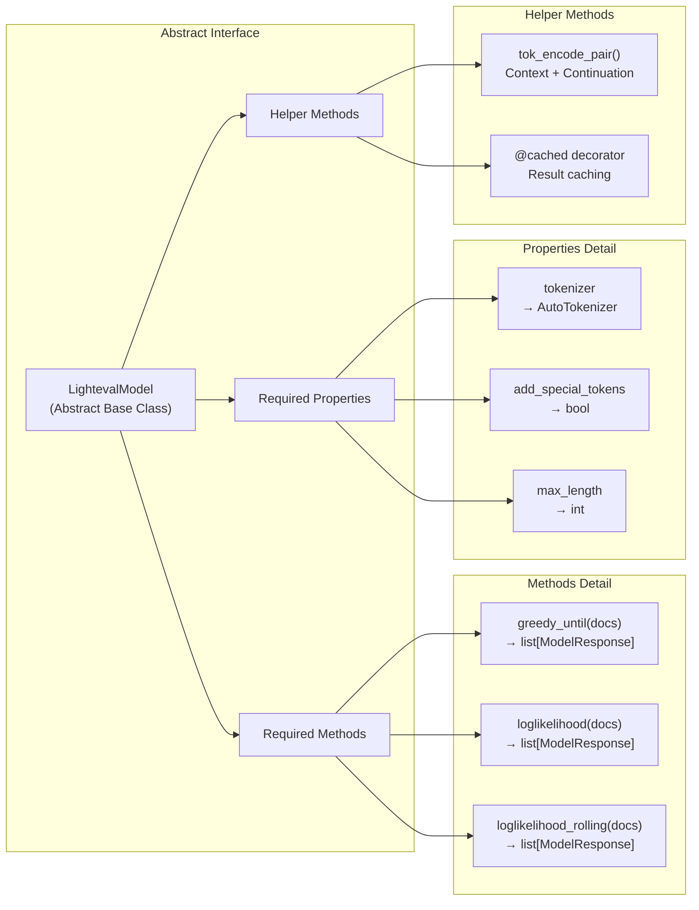
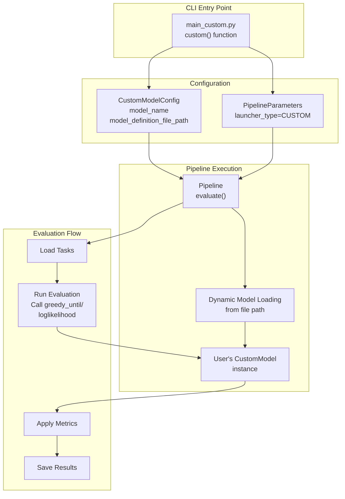

<!-- source: DeepWiki mcp.deepwiki.com · repo huggingface/lighteval · page 7.9 Custom Backend Integration · fetched 2026-10-26 -->

# Custom Backends

<details>
<summary>Relevant source files</summary>

The following files were used as context for generating this wiki page:

- [src/lighteval/logging/evaluation_tracker.py](src/lighteval/logging/evaluation_tracker.py)
- [src/lighteval/main_accelerate.py](src/lighteval/main_accelerate.py)
- [src/lighteval/main_custom.py](src/lighteval/main_custom.py)
- [src/lighteval/main_endpoint.py](src/lighteval/main_endpoint.py)
- [src/lighteval/main_nanotron.py](src/lighteval/main_nanotron.py)
- [src/lighteval/main_sglang.py](src/lighteval/main_sglang.py)
- [src/lighteval/main_vllm.py](src/lighteval/main_vllm.py)
- [src/lighteval/models/abstract_model.py](src/lighteval/models/abstract_model.py)

</details>


## Purpose and Scope

This page explains how to implement custom model backends for lighteval. Custom backends allow you to integrate any model inference system into lighteval's evaluation pipeline by implementing the `LightevalModel` interface. This enables evaluation of proprietary models, experimental inference engines, or specialized hardware accelerators.

For information about the abstract model interface that all backends must implement, see [Model Interface](#7.1). For examples of existing backend implementations, see [Transformers Backend](#7.2), [VLLM Backend](#7.3), [SGLang Backend](#7.4), [Endpoint Models](#7.5), and [Nanotron Backend](#7.6).

## Overview

Custom backends provide a mechanism to evaluate any model by implementing a standardized interface. The lighteval pipeline remains agnostic to the underlying inference implementation, allowing for maximum flexibility while maintaining consistent evaluation results across different backends.



**Sources:** [src/lighteval/main_custom.py:1-125](), [src/lighteval/models/abstract_model.py]() (referenced)

## Architecture Integration

Custom backends integrate into the lighteval pipeline through the `CustomModelConfig` and CLI interface. The pipeline loads the custom model implementation dynamically from a user-provided Python file.



**Sources:** [src/lighteval/main_custom.py:52-124]()

## Configuration

### CustomModelConfig Class

Custom backends require a configuration class that specifies the model name and the path to the implementation file.

[src/lighteval/models/custom/custom_model.py]() (referenced in [src/lighteval/main_custom.py:46]())

```python
class CustomModelConfig(ModelConfig):
    """Configuration for custom model backends.
    
    Attributes:
        model_name (str): Identifier for the model (used in result tracking)
        model_definition_file_path (str): Path to Python file containing the model implementation
        generation_parameters (GenerationParameters): Optional generation parameters
        system_prompt (str | None): Optional system prompt for chat models
        cache_dir (str): Cache directory for model artifacts
    """
```

The configuration is instantiated from CLI arguments:

[src/lighteval/main_custom.py:96]()

**Sources:** [src/lighteval/main_custom.py:46-96]()

## LightevalModel Interface

All custom backends must inherit from `LightevalModel` and implement its abstract interface. This interface defines three core methods for different evaluation types.



**Sources:** [src/lighteval/models/abstract_model.py]() (referenced in all backend implementations)

## Required Methods

### greedy_until

Generates text using greedy decoding until stopping conditions are met. Used for generative tasks.

**Method Signature:**
```python
@cached(SamplingMethod.GENERATIVE)
def greedy_until(self, docs: list[Doc]) -> list[ModelResponse]:
    """Generate responses using greedy decoding.
    
    Args:
        docs: List of Doc objects containing:
            - prompt/context text
            - stop_sequences: List of strings to stop generation
            - generation_size: Max tokens to generate
            - num_samples: Number of samples per prompt
            
    Returns:
        List of ModelResponse objects containing:
            - text: Generated text(s)
            - input_tokens: List of input token IDs
            - output_tokens: List of output token IDs
            - logprobs: Optional per-token log probabilities
    """
```

**Implementation Pattern** (from VLLM example):

[src/lighteval/models/vllm/vllm_model.py:308-406]()

Key steps:
1. Create `GenerativeTaskDataset` to organize and sort docs
2. Prepare prompts using `PromptManager.prepare_prompt()`
3. Tokenize inputs with `self.tokenizer()`
4. Truncate if needed to respect `max_length`
5. Call your inference engine
6. Package results into `ModelResponse` objects
7. Return in original order using `dataset.get_original_order()`

**Sources:** [src/lighteval/models/vllm/vllm_model.py:308-406](), [src/lighteval/models/sglang/sglang_model.py:224-314](), [src/lighteval/models/transformers/transformers_model.py:625-757]()

### loglikelihood

Computes log-likelihood of continuations given contexts. Used for multiple-choice tasks.

**Method Signature:**
```python
@cached(SamplingMethod.LOGPROBS)
def loglikelihood(self, docs: list[Doc]) -> list[ModelResponse]:
    """Compute log-likelihood of continuations.
    
    Args:
        docs: List of Doc objects containing:
            - context: The prompt/context
            - choices: List of possible continuations
            - gold_index: Index of correct answer
            
    Returns:
        List of ModelResponse objects containing:
            - logprobs: Log-likelihood for each choice (list or float)
            - argmax_logits_eq_gold: Whether highest logprob matches gold
            - input_tokens: Token IDs for context + continuation
            - output_tokens: Token IDs for continuation only
    """
```

**Implementation Pattern** (from VLLM example):

[src/lighteval/models/vllm/vllm_model.py:465-532]()

Key steps:
1. Create `LoglikelihoodDataset` for docs
2. For each doc, tokenize context and each choice using `tok_encode_pair()`
3. Concatenate context + continuation tokens
4. Run inference to get prompt log-probabilities
5. Extract logprobs for continuation tokens only
6. Check if argmax equals gold answer
7. Package results into `ModelResponse`

**Sources:** [src/lighteval/models/vllm/vllm_model.py:465-532](), [src/lighteval/models/sglang/sglang_model.py:351-418](), [src/lighteval/models/transformers/transformers_model.py:821-945]()

### loglikelihood_rolling

Computes rolling log-likelihood over text sequences. Used for perplexity metrics.

**Method Signature:**
```python
@cached(SamplingMethod.PERPLEXITY)
def loglikelihood_rolling(self, docs: list[Doc]) -> list[ModelResponse]:
    """Compute rolling log-likelihood for perplexity.
    
    Args:
        docs: List of Doc objects containing full text sequences
        
    Returns:
        List of ModelResponse objects with per-token logprobs
    """
```

**Note:** Many backends raise `NotImplementedError` for this method if perplexity evaluation is not required. Check [src/lighteval/models/vllm/vllm_model.py:534-536]() for example.

**Sources:** [src/lighteval/models/vllm/vllm_model.py:534-536](), [src/lighteval/models/transformers/transformers_model.py:947-1069]()

## Required Properties

### tokenizer

Returns the tokenizer instance used by the model.

```python
@property
def tokenizer(self) -> AutoTokenizer:
    """Return the model's tokenizer.
    
    Returns:
        AutoTokenizer instance or compatible tokenizer
    """
    return self._tokenizer
```

The tokenizer should be compatible with HuggingFace's `AutoTokenizer` interface, providing methods like:
- `__call__(text)` for tokenization
- `encode()` and `decode()`
- `model_max_length` attribute

**Sources:** [src/lighteval/models/vllm/vllm_model.py:222-224](), [src/lighteval/models/sglang/sglang_model.py:169-171](), [src/lighteval/models/transformers/transformers_model.py:309-311]()

### add_special_tokens

Indicates whether special tokens should be added during tokenization.

```python
@property
def add_special_tokens(self) -> bool:
    """Whether to add special tokens during tokenization.
    
    Returns:
        bool: True if special tokens should be added
    """
    return self._add_special_tokens
```

Typically set from configuration and passed to `tokenizer(..., add_special_tokens=self.add_special_tokens)`.

**Sources:** [src/lighteval/models/vllm/vllm_model.py:235-237](), [src/lighteval/models/sglang/sglang_model.py:181-183](), [src/lighteval/models/transformers/transformers_model.py:313-315]()

### max_length

Returns the maximum sequence length the model can handle.

```python
@property
def max_length(self) -> int:
    """Return maximum sequence length.
    
    Returns:
        int: Maximum number of tokens the model can process
    """
    return self._max_length
```

Used for truncation decisions in `greedy_until` and `loglikelihood` methods.

**Sources:** [src/lighteval/models/vllm/vllm_model.py:239-241](), [src/lighteval/models/sglang/sglang_model.py:185-187](), [src/lighteval/models/transformers/transformers_model.py:317-319]()

## Helper Components

### PromptManager

The `PromptManager` class handles prompt formatting, including chat template application and few-shot example injection. Initialize it in your `__init__`:

```python
from lighteval.tasks.prompt_manager import PromptManager

self.prompt_manager = PromptManager(
    use_chat_template=self.use_chat_template,
    tokenizer=self.tokenizer,
    system_prompt=config.system_prompt
)
```

Use it to prepare prompts:
```python
contexts = [self.prompt_manager.prepare_prompt(doc) for doc in docs]
```

**Sources:** [src/lighteval/models/vllm/vllm_model.py:217](), [src/lighteval/models/sglang/sglang_model.py:164](), [src/lighteval/models/transformers/transformers_model.py:236-238]()

### SampleCache

The `SampleCache` provides result caching with the `@cached` decorator. Initialize it in your `__init__`:

```python
from lighteval.utils.cache_management import SampleCache

self._cache = SampleCache(config)
```

Apply the `@cached` decorator to your methods:
```python
from lighteval.tasks.requests import SamplingMethod
from lighteval.utils.cache_management import cached

@cached(SamplingMethod.GENERATIVE)
def greedy_until(self, docs: list[Doc]) -> list[ModelResponse]:
    ...
```

**Sources:** [src/lighteval/models/vllm/vllm_model.py:220](), [src/lighteval/models/sglang/sglang_model.py:167](), [src/lighteval/models/transformers/transformers_model.py:241]()

### Dataset Classes

Use specialized dataset classes for batching and sorting:

```python
from lighteval.data import GenerativeTaskDataset, LoglikelihoodDataset

# For greedy_until
dataset = GenerativeTaskDataset(requests=docs, num_dataset_splits=self.DATASET_SPLITS)
for split in dataset.splits_iterator():
    # Process split
    results.append(...)
return dataset.get_original_order(results)

# For loglikelihood
dataset = LoglikelihoodDataset(requests=docs, num_dataset_splits=1)
for split in dataset.splits_iterator():
    # Process split
    results.append(...)
return dataset.get_original_order(results)
```

These classes handle sorting by length, splitting into batches, and reordering results back to original order.

**Sources:** [src/lighteval/models/vllm/vllm_model.py:327-406](), [src/lighteval/models/vllm/vllm_model.py:473-532]()

## Implementation Template

Here is a minimal template for implementing a custom backend:

```python
# my_custom_model.py
from typing import Optional
import logging
from transformers import AutoTokenizer

from lighteval.models.abstract_model import LightevalModel, ModelConfig
from lighteval.models.model_output import ModelResponse
from lighteval.tasks.requests import Doc, SamplingMethod
from lighteval.tasks.prompt_manager import PromptManager
from lighteval.utils.cache_management import SampleCache, cached
from lighteval.data import GenerativeTaskDataset, LoglikelihoodDataset

logger = logging.getLogger(__name__)


class MyCustomModelConfig(ModelConfig):
    """Configuration for my custom model backend."""
    model_name: str
    # Add your custom configuration fields here
    custom_param: str = "default_value"
    max_length: int = 2048


class MyCustomModel(LightevalModel):
    """Custom model implementation."""
    
    # Class variable for dataset splitting
    DATASET_SPLITS = 1
    
    def __init__(self, config: MyCustomModelConfig):
        """Initialize the custom model."""
        self.config = config
        self.model_name = config.model_name
        self._max_length = config.max_length
        self._add_special_tokens = True
        
        # Initialize your model/inference engine here
        self.model = self._load_model()
        
        # Load tokenizer
        self._tokenizer = AutoTokenizer.from_pretrained(config.model_name)
        if self._tokenizer.pad_token is None:
            self._tokenizer.pad_token = self._tokenizer.eos_token
        
        # Determine if using chat template
        self.use_chat_template = self._tokenizer.chat_template is not None
        
        # Initialize prompt manager
        self.prompt_manager = PromptManager(
            use_chat_template=self.use_chat_template,
            tokenizer=self.tokenizer,
            system_prompt=config.system_prompt
        )
        
        # Initialize cache
        self._cache = SampleCache(config)
    
    def _load_model(self):
        """Load your custom model/inference engine."""
        # Implement your model loading logic here
        pass
    
    @property
    def tokenizer(self):
        return self._tokenizer
    
    @property
    def add_special_tokens(self) -> bool:
        return self._add_special_tokens
    
    @property
    def max_length(self) -> int:
        return self._max_length
    
    def cleanup(self):
        """Clean up resources."""
        if hasattr(self, 'model') and self.model is not None:
            # Clean up your model
            del self.model
    
    @cached(SamplingMethod.GENERATIVE)
    def greedy_until(self, docs: list[Doc]) -> list[ModelResponse]:
        """Generate text using greedy decoding."""
        dataset = GenerativeTaskDataset(
            requests=docs, 
            num_dataset_splits=self.DATASET_SPLITS
        )
        results = []
        
        for split in dataset.splits_iterator():
            # Prepare prompts
            contexts = [self.prompt_manager.prepare_prompt(doc) for doc in split]
            
            # Tokenize
            tokenized = self.tokenizer(
                contexts,
                add_special_tokens=self.add_special_tokens
            )
            
            # Extract generation parameters from first doc (assuming batch is homogeneous)
            max_new_tokens = split[0].generation_size
            stop_sequences = split[0].stop_sequences or []
            
            # Truncate if needed
            inputs = tokenized["input_ids"]
            if max_new_tokens and len(inputs[0]) + max_new_tokens > self.max_length:
                context_size = self.max_length - max_new_tokens
                inputs = [inp[-context_size:] for inp in inputs]
            
            # Run your inference engine
            # outputs = self.model.generate(inputs, max_new_tokens=max_new_tokens, ...)
            outputs = self._run_generation(inputs, max_new_tokens, stop_sequences)
            
            # Package results
            for i, output in enumerate(outputs):
                response = ModelResponse(
                    text=[output["text"]],  # List for multi-sample support
                    input_tokens=inputs[i],
                    output_tokens=output["output_tokens"],
                    logprobs=output.get("logprobs", [])
                )
                results.append(response)
        
        return dataset.get_original_order(results)
    
    def _run_generation(self, inputs, max_new_tokens, stop_sequences):
        """Implement your generation logic here."""
        # This is where you call your custom inference engine
        raise NotImplementedError("Implement your generation logic")
    
    @cached(SamplingMethod.LOGPROBS)
    def loglikelihood(self, docs: list[Doc]) -> list[ModelResponse]:
        """Compute log-likelihood of continuations."""
        dataset = LoglikelihoodDataset(requests=docs, num_dataset_splits=1)
        results = []
        
        for split in dataset.splits_iterator():
            contexts = [self.prompt_manager.prepare_prompt(doc) for doc in split]
            
            for context, doc in zip(contexts, split):
                # Tokenize context and continuations separately
                tokenized_contexts, tokenized_continuations = self.tok_encode_pair(
                    context, 
                    doc.choices,
                    pairwise=False  # Set based on your needs
                )
                
                choice_logprobs = []
                for ctx_tokens, cont_tokens in zip(tokenized_contexts, tokenized_continuations):
                    full_tokens = ctx_tokens + cont_tokens
                    
                    # Truncate if needed
                    if len(full_tokens) > self.max_length:
                        full_tokens = full_tokens[-self.max_length:]
                    
                    # Compute logprobs for continuation tokens
                    # logprobs = self.model.compute_logprobs(full_tokens, cont_tokens)
                    logprob = self._compute_continuation_logprob(full_tokens, cont_tokens)
                    choice_logprobs.append(logprob)
                
                # Check if argmax matches gold
                argmax_matches = (
                    choice_logprobs.index(max(choice_logprobs)) == doc.gold_index
                )
                
                response = ModelResponse(
                    logprobs=choice_logprobs,
                    argmax_logits_eq_gold=argmax_matches,
                    input_tokens=tokenized_contexts,
                    output_tokens=tokenized_continuations
                )
                results.append(response)
        
        return dataset.get_original_order(results)
    
    def _compute_continuation_logprob(self, full_tokens, continuation_tokens):
        """Implement your logprob computation here."""
        raise NotImplementedError("Implement your logprob computation")
    
    @cached(SamplingMethod.PERPLEXITY)
    def loglikelihood_rolling(self, docs: list[Doc]) -> list[ModelResponse]:
        """Compute rolling log-likelihood (optional)."""
        raise NotImplementedError("Rolling loglikelihood not implemented")
```

**Sources:** [src/lighteval/models/vllm/vllm_model.py:186-536](), [src/lighteval/models/sglang/sglang_model.py:141-422](), [src/lighteval/models/transformers/transformers_model.py:191-1069]()

## CLI Usage

Once you have implemented your custom model in a Python file, use the `lighteval custom` command:

```bash
lighteval custom \
    my-model-name \
    path/to/my_custom_model.py \
    "task1|num_fewshot|0,task2|num_fewshot|5" \
    --output-dir ./results \
    --save-details
```

**Command Arguments:**

| Argument | Description |
|----------|-------------|
| `model_name` | Identifier for your model (appears in results) |
| `model_definition_file_path` | Path to Python file containing your model implementation |
| `tasks` | Comma-separated task specifications |
| `--custom-tasks` | Optional path to custom task definitions |
| `--output-dir` | Directory for saving results |
| `--save-details` | Save detailed per-sample results |
| `--max-samples` | Limit samples per task (for testing) |
| `--push-to-hub` | Push results to HuggingFace Hub |

**Example with Multiple Options:**

```bash
lighteval custom \
    my-proprietary-llm \
    ./models/proprietary_model.py \
    "mmlu|5,hellaswag|10,gsm8k|5" \
    --custom-tasks ./my_tasks \
    --output-dir ./eval_results \
    --save-details \
    --max-samples 100 \
    --push-to-hub
```

**Sources:** [src/lighteval/main_custom.py:52-124]()

## Pipeline Integration

The custom backend integrates with the evaluation pipeline through a specific parallelism manager configuration:



**Parallelism Manager:** The `ParallelismManager.CUSTOM` setting tells the pipeline to load the model implementation from the provided file path rather than using a built-in backend.

[src/lighteval/main_custom.py:95]()

**Sources:** [src/lighteval/main_custom.py:52-124]()

## Best Practices

### Error Handling

Implement robust error handling in your inference methods:

```python
def greedy_until(self, docs: list[Doc]) -> list[ModelResponse]:
    try:
        # Your implementation
        ...
    except Exception as e:
        logger.error(f"Generation failed: {e}")
        # Return empty responses or raise
        raise
```

### Memory Management

Implement the `cleanup()` method to properly release resources:

```python
def cleanup(self):
    """Release model and GPU memory."""
    if hasattr(self, 'model'):
        del self.model
    torch.cuda.empty_cache()
    gc.collect()
```

**Sources:** [src/lighteval/models/vllm/vllm_model.py:226-233](), [src/lighteval/models/sglang/sglang_model.py:173-179]()

### Tokenization Consistency

Use `tok_encode_pair()` helper for consistent tokenization:

```python
tokenized_contexts, tokenized_continuations = self.tok_encode_pair(
    context, 
    doc.choices,
    pairwise=False  # or True based on your model's needs
)
```

The `pairwise` parameter controls whether context and continuation are tokenized separately or together, affecting how special tokens are handled.

**Sources:** [src/lighteval/models/vllm/vllm_model.py:484-490](), [src/lighteval/models/transformers/transformers_model.py:850-859]()

### Batch Processing

Use the provided dataset classes for efficient batch processing:

```python
dataset = GenerativeTaskDataset(
    requests=docs,
    num_dataset_splits=self.DATASET_SPLITS  # Adjust based on memory constraints
)

for split in dataset.splits_iterator():
    # Split is already sorted by length for efficient batching
    # Process the split
    ...
```

Higher `DATASET_SPLITS` values reduce memory usage but increase overhead.

**Sources:** [src/lighteval/models/vllm/vllm_model.py:327-336](), [src/lighteval/data]() (referenced)

### Caching

Always use the `@cached` decorator to enable result caching:

```python
@cached(SamplingMethod.GENERATIVE)
def greedy_until(self, docs: list[Doc]) -> list[ModelResponse]:
    ...
```

This avoids redundant computation when re-running evaluations and is required for proper integration with the caching system.

**Sources:** [src/lighteval/models/vllm/vllm_model.py:308](), [src/lighteval/utils/cache_management.py]() (referenced)

### Chat Template Detection

Use the utility function to detect if a model should use chat templates:

```python
from lighteval.models.utils import uses_chat_template

self.use_chat_template = uses_chat_template(
    model_name=config.model_name,
    override_chat_template=config.override_chat_template
)
```

This ensures consistent prompt formatting across different model types.

**Sources:** [src/lighteval/models/utils.py:109-137](), [src/lighteval/models/vllm/vllm_model.py:193-195]()

## Testing Custom Backends

Test your custom backend implementation with a small number of samples before running full evaluations:

```bash
# Test with 10 samples per task
lighteval custom \
    my-model \
    path/to/model.py \
    "hellaswag|0" \
    --max-samples 10 \
    --output-dir ./test_results
```

Verify that:
1. `greedy_until` returns valid `ModelResponse` objects with text
2. `loglikelihood` returns valid logprobs and argmax_logits_eq_gold
3. Results are saved correctly
4. Memory is properly cleaned up between tasks

**Common Issues:**

| Issue | Solution |
|-------|----------|
| Tokenizer not found | Ensure model_name points to valid HF model ID or provide custom tokenizer |
| OOM errors | Reduce `DATASET_SPLITS`, implement proper truncation |
| Wrong result ordering | Always use `dataset.get_original_order(results)` |
| Missing logprobs | Ensure your inference engine returns log probabilities |
| Cache not working | Verify `@cached` decorator is applied correctly |

**Sources:** [src/lighteval/main_custom.py:52-124]()

---

